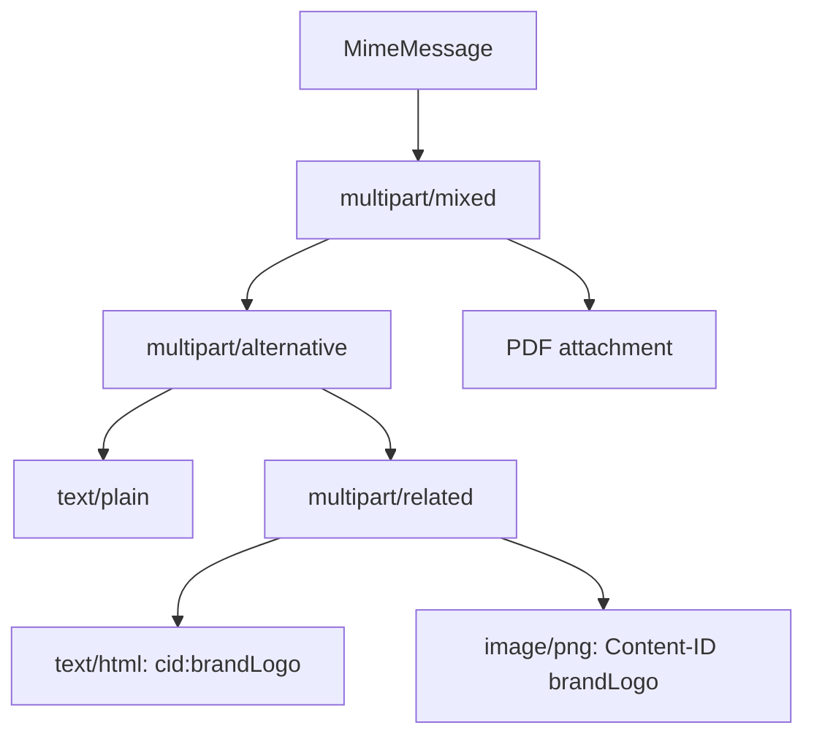

# Limitations of the helper when needing special MIME structures

In **Spring Framework Mail**, `MimeMessageHelper` helps create HTML emails, fallback text versions, inline images, and file attachments without having to manipulate each MIME part directly. For most transactional emails, this approach is both concise and easy to maintain. However, **`MimeMessageHelper` is not a tool for building every arbitrary MIME structure**.

When the application needs a `multipart/*` tree different from the types Spring supports, adding a `text/calendar` part with a special relationship, forwarding an email as `message/rfc822`, creating delivery reports, or S/MIME signing/encryption, simply calling `setText(...)`, `addInline(...)`, and `addAttachment(...)` may not suffice. At that point, the developer needs to understand **the boundaries of the helper**, the MIME structure the receiving system expects, and when to use the **Jakarta Mail** API directly.

This lesson presents those limitations, how to recognize when to switch to `MimeMultipart`/`MimeBodyPart`, an example of building a special MIME structure in a Spring application, and notes on encoding, message lifecycle, mail client compatibility, and error handling.

## 1. What can MimeMessageHelper solve?

Spring Mail has three common role classes:

| Component | Role |
|---|---|
| `JavaMailSender` | Creates `MimeMessage` and executes sending through mail transport. |
| `MimeMessage` | Jakarta Mail object storing headers and body in Internet mail/MIME format. |
| `MimeMessageHelper` | Spring utility operating on `MimeMessage` to build common fields and content types. |

Simple flow:

```java
MimeMessage message = mailSender.createMimeMessage();

MimeMessageHelper helper = new MimeMessageHelper(
        message,
        MimeMessageHelper.MULTIPART_MODE_MIXED_RELATED,
        "UTF-8"
);

helper.setFrom("no-reply@example.org");
helper.setTo("user@example.net");
helper.setSubject("Notification");
helper.setText(
        "This is text content.",
        "<p>This is <strong>HTML</strong> content.</p>"
);

mailSender.send(message);
```

The helper can support:

- Setting common headers: `From`, `To`, `Cc`, `Bcc`, `Reply-To`, `Subject`.
- Creating a `text/plain` or `text/html` body.
- Creating two content versions via `setText(plainText, htmlText)`.
- Adding inline resources referenced by HTML via `cid:...`.
- Adding attachments from files, `Resource`, or other data sources.
- Setting one of the built-in **multipart modes**, along with the charset used for composing content.

For welcome messages, PDF invoices, simple marketing emails, or notifications with logos, those features are usually enough. **There is no need to write MIME manually just because an email has multiple parts**.

## 2. MIME structure is a tree, not just an attachment list

An email can be a single body:

```text
MimeMessage
└── text/plain; charset=UTF-8
```

Or a tree of nested parts:

```text
MimeMessage
└── multipart/mixed
    ├── multipart/alternative
    │   ├── text/plain
    │   └── multipart/related
    │       ├── text/html
    │       └── image/png; Content-ID: <brandLogo>
    └── application/pdf; attachment
```

Common types carry distinct meanings:

| MIME content type | Relationship between parts |
|---|---|
| `multipart/alternative` | Alternative versions of the same content; client usually chooses one displayable version. |
| `multipart/related` | Main content and resources needed to render it, like HTML and CID images. |
| `multipart/mixed` | Coexisting components, such as main content and downloadable files. |
| `message/rfc822` | Another email message packaged as a content part. |
| `text/calendar` | Calendar/iCalendar content; may accompany text/HTML versions in a properly designed structure. |
| `multipart/signed` | Content and linked digital signature part in signed MIME format. |
| `multipart/report` | Report structure with its own definition, such as forms of delivery status notifications. |

Knowing an email “has HTML, logo, PDF” is not enough to infer the **exact positions** of parts. The MIME-building library must select corresponding parents/children, order, and metadata.

For example, `multipart/alternative` places the text version first and the HTML version after because these are **alternatives**. Conversely, a PDF attachment should sit at the **same level as the content section**, usually under `multipart/mixed`, rather than being an alternative version.

## 3. Built-in multipart structures in the helper

`MimeMessageHelper` has four main modes:

| Constant | MIME frame the helper builds |
|---|---|
| `MULTIPART_MODE_NO` | Does not initialize multipart; for a single simple body. |
| `MULTIPART_MODE_MIXED` | One `multipart/mixed` group at the root. |
| `MULTIPART_MODE_RELATED` | One `multipart/related` group at the root. |
| `MULTIPART_MODE_MIXED_RELATED` | Outermost `multipart/mixed` containing `multipart/related` for content and inline resources. |

Mode selection example:

```java
MimeMessageHelper helper = new MimeMessageHelper(
        message,
        MimeMessageHelper.MULTIPART_MODE_MIXED_RELATED,
        "UTF-8"
);
```

`MIXED_RELATED` mode usually suits emails consisting of plain text, HTML, an inline logo, and attachments; the helper arranges its content into the established groups. If calling `setText(plain, html)`, the helper can add a `multipart/alternative` group in the corresponding position.

With the common structure, the result takes the conceptual form:

```text
multipart/mixed
├── multipart/related
│   ├── multipart/alternative
│   │   ├── text/plain
│   │   └── text/html
│   └── image/png; Content-ID: <brandLogo>
└── application/pdf; attachment
```

**The limitation lies in the predefined shapes.** The helper does not provide a generic API like `createMultipart("alternative")` followed by `insertPartAt(path, index)` to build any arbitrary nested MIME tree. It provides high-level operations for common needs.

## 4. When do the limitations become a problem?

There are many requirements where the **desired result** differs from the helper's default shape.

### 4.1. Requiring the root to be `multipart/alternative`

A receiving system may require the message in the form:

```text
MimeMessage
└── multipart/alternative
    ├── text/plain
    └── text/html
```

`MimeMessageHelper.setText(plain, html)` supports the alternative concept, yet when using a multipart helper, the alternative part may be **nested inside the mixed/related frame** that the mode initialized. The helper has no dedicated constant equivalent to “create `multipart/alternative` directly at root”.

If this is merely mail sent to ordinary users, a root alternative is not strictly necessary. If a partner requires **one exact root structure**, consider creating `MimeMultipart("alternative")` directly and attaching it to `MimeMessage`.

### 4.2. HTML and inline images must be **one** separate alternative

There are cases needing the tree:

```text
multipart/alternative
├── text/plain
└── multipart/related
    ├── text/html
    ├── image/png; Content-ID: <brandLogo>
    └── image/jpeg; Content-ID: <banner>
```

Here, the **entire HTML + inline images branch** is the richer content version compared to plain text. That differs from the helper's common arrangement, where `multipart/alternative` may sit inside the `related` group.

The two structures may be handled similarly by popular mail clients, yet **are not identical in terms of the MIME tree**. When the receiving side demands an exact nesting style, or a specific mail client has issues with the common nesting, control at the `MimeMultipart`/`MimeBodyPart` level is needed.

### 4.3. Multiple special part types inside alternative

A meeting invitation may need:

```text
multipart/alternative
├── text/plain
├── text/html
└── text/calendar; method=REQUEST; charset=UTF-8
```

`MimeMessageHelper` does not have a high-level overload like `setText(plain, html, calendar)`. Nor can you use `addAttachment("invite.ics", ...)` and assume every mail client will recognize it as a **calendar invitation** in the desired position and semantics.

Creating calendar emails also requires iCalendar/iTIP fields such as `UID`, `DTSTART`, `DTEND`, `METHOD`, `ORGANIZER`, `ATTENDEE` per business logic. **Having `text/calendar` alone does not guarantee the invitation is accepted by every client.**

### 4.4. Forwarding an email verbatim under `message/rfc822`

The “Forward as attachment” button in many clients can produce:

```text
multipart/mixed
├── text/plain: "I am forwarding the email for you to review."
└── message/rfc822: a complete email
```

`addAttachment(...)` usually serves file attachments or resources. If the destination requires **a part with MIME type `message/rfc822` containing the original message along with its headers**, using `MimeBodyPart` and appropriate `setContent(...)`/`DataHandler` is clearer than trying to treat the original email like a text file.

### 4.5. Signed or encrypted MIME

An S/MIME structure can use `multipart/signed`, or other forms of cryptographic elements. This is not merely adding a `signature.p7s` file into `multipart/mixed`: the signature must be computed over **content represented per standard rules**, accompanied by the right content type and algorithm parameters.

`MimeMessageHelper` is not an S/MIME signing or encryption API. You must use a dedicated library, construct/finalize the MIME structure according to cryptographic rules, and only then send with `JavaMailSender`. After signing, **do not arbitrarily modify signed bytes/parts** as it can invalidate the signature.

Similarly, `multipart/report` is for reports structured per standard, not an arbitrary group of attachments labeled “report”.

### 4.6. Mandatory control over ordering or headers of individual parts

A specialized integration may require:

- The main content part or MIME root specified via the `start` parameter.
- A specific part ordering inside `multipart/alternative`.
- `Content-ID`, `Content-Location`, `Content-Disposition`, or a subtype not provided directly by the helper as desired.
- An extended `multipart/*` form where the helper does not take a subtype parameter.
- Body parts nested at various levels with custom identification.

The helper can create common headers and groups, yet **does not promise control over every parameter and relationship in the tree**. If having to match a special MIME contract, build the structure deliberately with Jakarta Mail.

## 5. Decision boundary: helper or Jakarta Mail directly?

One way to choose the API:

| Requirement | Suitable approach |
|---|---|
| Text or HTML only | `MimeMessageHelper` in non-multipart mode. |
| Plain and HTML as alternatives | `MimeMessageHelper.setText(plain, html)` with multipart mode. |
| HTML + inline images | `MimeMessageHelper` in `RELATED` or `MIXED_RELATED` mode. |
| HTML/inline images + attached PDF, CSV | `MimeMessageHelper` in `MIXED_RELATED` mode. |
| Root must strictly be `multipart/alternative` | Build `MimeMultipart("alternative")` directly. |
| Alternative branch containing a complete `related` group | Build `MimeBodyPart`/`MimeMultipart` tree with Jakarta Mail. |
| Calendar invite with `text/calendar` placed per contract | Build calendar part with Jakarta Mail or a library specialized for calendar email. |
| Forward message under `message/rfc822` | Build the message part directly. |
| S/MIME signed/encrypted | Dedicated S/MIME library and Jakarta Mail. |
| Must control boundary, root, order, special subtype | Low-level MIME API, carefully weighing standard constraints. |

**Do not choose the low-level API just to get “maximum flexibility”.** It increases the number of responsibilities to manage and compatibility risks. Start with the helper; switch only when a **specific required MIME structure** falls outside the operations the helper supports.

## 6. Example problem: HTML with images as an alternative branch

Suppose an email needs to include:

1. A `text/plain` version so clients not displaying HTML can still read it.
2. An HTML version along with an inline logo image, grouped inside **one `multipart/related` group**.
3. A PDF outside as an attachment.

Target tree:

```text
multipart/mixed
├── multipart/alternative
│   ├── text/plain
│   └── multipart/related
│       ├── text/html
│       └── image/png; Content-ID: <brandLogo>
└── application/pdf; attachment; filename="report.pdf"
```

The difference from the common `MIXED_RELATED` structure is that the **`related` branch sits inside the HTML alternative branch**, instead of alternative sitting inside related. This is a useful example of needing to **decide parent–child relationships** of parts yourself.



An email following this tree can still be sent with `JavaMailSender`. What needs to change is **how the `MimeMessage` is built**, not the entire SMTP infrastructure.

## 7. Building a custom structure with Jakarta Mail

Main classes:

| Class | Function |
|---|---|
| `MimeMultipart` | Groups multiple MIME parts, e.g. `alternative`, `related`, `mixed`. |
| `MimeBodyPart` | Represents a part; contains text, HTML, images, attachments, or a child multipart. |
| `MimeMessage` | Outermost message, holding headers and content root. |
| `DataHandler` | Wraps content and data type so the part can be read/serialized. |
| `ByteArrayDataSource` | Supplies byte data along with MIME type, convenient for examples with in-memory sources. |
| `Part` | Constants and APIs related to disposition, such as `INLINE` and `ATTACHMENT`. |

With Spring Boot, you can use `spring-boot-starter-mail` and continue receiving the `JavaMailSender` bean as usual. The MIME creation part will use the Jakarta Mail APIs supported by the starter.

Example resources on the classpath:

```text
src/main/resources/
└── mail/
    ├── brand-logo.png
    └── report.pdf
```

### Complete Java example

```java
import jakarta.activation.DataHandler;
import jakarta.mail.Message;
import jakarta.mail.MessagingException;
import jakarta.mail.Part;
import jakarta.mail.internet.InternetAddress;
import jakarta.mail.internet.MimeBodyPart;
import jakarta.mail.internet.MimeMessage;
import jakarta.mail.internet.MimeMultipart;
import jakarta.mail.util.ByteArrayDataSource;
import java.io.IOException;
import java.io.InputStream;
import org.springframework.core.io.ClassPathResource;
import org.springframework.mail.javamail.JavaMailSender;
import org.springframework.stereotype.Service;

@Service
public class CustomMimeMailService {

    private final JavaMailSender mailSender;

    public CustomMimeMailService(JavaMailSender mailSender) {
        this.mailSender = mailSender;
    }

    public void sendReport(String recipient)
            throws MessagingException, IOException {

        // 1. Use Spring to create a message with an appropriate mail Session.
        MimeMessage message = mailSender.createMimeMessage();
        message.setFrom(
                new InternetAddress("reports@example.org")
        );
        message.setRecipients(
                Message.RecipientType.TO,
                InternetAddress.parse(recipient, true)
        );
        message.setSubject("Monthly report", "UTF-8");

        // 2. Plain text version: first alternative.
        MimeBodyPart plainPart = new MimeBodyPart();
        plainPart.setText(
                "Your monthly report is ready.\n" +
                "See the attached report.pdf file.",
                "UTF-8"
        );

        // 3. HTML branch with inline resource.
        MimeBodyPart htmlPart = new MimeBodyPart();
        htmlPart.setContent(
                """
                <html>
                  <body>
                    
                    <h1>Monthly report</h1>
                    <p>See the attached report.pdf file.</p>
                  </body>
                </html>
                """,
                "text/html; charset=UTF-8"
        );

        MimeBodyPart logoPart = new MimeBodyPart();
        logoPart.setDataHandler(new DataHandler(
                new ByteArrayDataSource(
                        readResource("mail/brand-logo.png"),
                        "image/png"
                )
        ));
        logoPart.setHeader("Content-ID", "<brandLogo>");
        logoPart.setDisposition(Part.INLINE);

        MimeMultipart related = new MimeMultipart("related");
        related.addBodyPart(htmlPart);
        related.addBodyPart(logoPart);

        // Both HTML and logo become a single alternative.
        MimeBodyPart htmlWithLogoPart = new MimeBodyPart();
        htmlWithLogoPart.setContent(related);

        MimeMultipart alternative = new MimeMultipart("alternative");
        alternative.addBodyPart(plainPart);
        alternative.addBodyPart(htmlWithLogoPart);

        MimeBodyPart mainContentPart = new MimeBodyPart();
        mainContentPart.setContent(alternative);

        // 4. PDF is an attachment independent of HTML content.
        MimeBodyPart pdfPart = new MimeBodyPart();
        pdfPart.setDataHandler(new DataHandler(
                new ByteArrayDataSource(
                        readResource("mail/report.pdf"),
                        "application/pdf"
                )
        ));
        pdfPart.setFileName("report.pdf");
        pdfPart.setDisposition(Part.ATTACHMENT);

        // 5. Mixed root holds main content and PDF.
        MimeMultipart mixed = new MimeMultipart("mixed");
        mixed.addBodyPart(mainContentPart);
        mixed.addBodyPart(pdfPart);

        message.setContent(mixed);

        // 6. JavaMailSender sends the message created by Jakarta Mail.
        mailSender.send(message);
    }

    private static byte[] readResource(String path) throws IOException {
        ClassPathResource resource = new ClassPathResource(path);
        try (InputStream stream = resource.getInputStream()) {
            return stream.readAllBytes();
        }
    }
}
```

In the example:

- `MimeMultipart("related")` holds HTML and logo, with HTML as the first part to represent the root content per this layout.
- `MimeMultipart("alternative")` holds the plain-text version first, followed by **one body part whose content is `related`**.
- `MimeMultipart("mixed")` holds the main content branch and the PDF attachment.
- `setContent(...)` attaches a `MimeMultipart` onto a `MimeBodyPart` or onto `MimeMessage`.
- `Content-ID: <brandLogo>` matches `cid:brandLogo` in HTML.
- `DataHandler` and `ByteArrayDataSource` supply image/PDF bytes. Do not use a text charset to transcode binary data.
- `JavaMailSender.send(message)` continues to be the SMTP send point.

**What is worth learning here is nesting parts.** Parts are created from the inside out, then attached to the right parent. Each `alternative`, `related`, and `mixed` group is created **because of the corresponding content relationship**, not out of a desire to add extra layers for complexity.

### Why choose `ByteArrayDataSource`?

In this example, both resources sit on the classpath and are read completely into `byte[]`. This is an easy-to-understand approach that helps ensure the data source **can be re-read when the library serializes the message**.

For very large attachments, holding all bytes in memory can consume lots of RAM. In that case, use a data source/stream suited to the mail library and ensure fresh streams can be opened when needed, while considering SMTP size limits. Some `InputStreamSource` implementations supplying only a read-once stream are unsuitable if Jakarta Mail needs to read the data in multiple passes.

## 8. Rules when building a MIME tree manually

### 8.1. Build from leaf parts, then nest groups

An easy-to-follow approach is:

1. Create leaf parts: `text/plain`, `text/html`, `image/png`, `application/pdf`.
2. Set needed metadata for each part, such as charset, Content-ID, disposition, and filename.
3. Build the lowest-level content groups, such as `multipart/related`.
4. Wrap that group into a `MimeBodyPart` so it can attach to a parent like `multipart/alternative`.
5. Put the main content group into `multipart/mixed` if there are also attachments.
6. Set the root multipart onto `MimeMessage`, then send via `JavaMailSender`.

Unlike the helper, Jakarta Mail lets you control **every parent–child relationship**. In return, setting the wrong parent or order can lead to a message that is hard to display.

### 8.2. Do not place text and HTML as two parallel files if they are alternatives

Structure mismatched with intent:

```text
multipart/mixed
├── text/plain
└── text/html
```

Some clients may display both versions or treat the HTML version as an auxiliary part. If the content consists of **two ways to represent the same message**, use:

```text
multipart/alternative
├── text/plain
└── text/html
```

The second form conveys the meaning more accurately.

### 8.3. Alternative ordering carries semantics

In `multipart/alternative`, usually put the plain-text version first and the version capable of richer presentation after. When a content-rich alternative is `multipart/related` (HTML + images), the **entire group** can come after the plain-text version.

Do not rely on a specific client always choosing HTML. A client may be configured to display text only, or have a different security policy.

### 8.4. Choose the root of related carefully

With `multipart/related`, if there is no `start` parameter, the first part is usually understood as the root. In the example, `htmlPart` comes before `logoPart`. When structures are more complex, you may need to specify the root via Content-ID and appropriate parameters per the relevant standard.

If sending a set of resources without being able to identify the root content, clients may mistake an image or another part for the main body.

### 8.5. Do not concatenate boundaries by string yourself

A real MIME multipart has headers like:

```text
Content-Type: multipart/mixed; boundary="----=_Part_12345"
```

and each part is separated by the matching markers. When using `MimeMultipart` and `MimeBodyPart`, let the library generate and manage boundaries. Concatenating boundary strings yourself or hand-building raw MIME easily causes bugs with nested groups, header encoding, line breaks, and data escaping.

### 8.6. Charset differs from Content-Transfer-Encoding

`UTF-8` specifies how to convert **characters** into bytes. `base64` or `quoted-printable` is how **bytes** are represented on the transport path. Jakarta Mail can generate the appropriate headers and encodings when finalizing the message.

If a part is text:

```text
Content-Type: text/html; charset=UTF-8
Content-Transfer-Encoding: quoted-printable
```

while an image part might be:

```text
Content-Type: image/png
Content-Transfer-Encoding: base64
```

Do not apply UTF-8 to PNG/PDF bytes as if they were text strings.

## 9. Keeping helper and manual MIME together: possible, but ownership must be clear

Technically, `MimeMessageHelper` operates on a Jakarta Mail `MimeMessage`. Therefore, code can:

- Use the helper to fill in familiar headers, then attach a manually built MIME body.
- Or build the body with the Jakarta Mail API and use `JavaMailSender` only for sending.
- Or create all headers/body directly with Jakarta Mail from the start.

However, there is **risk when mixing body-building operations**. The helper usually keeps references to the multipart it initialized in its constructor. If the application subsequently calls `message.setContent(customRoot)` and then continues calling `helper.addInline(...)` or `helper.addAttachment(...)`, the helper may be adding data to the **old multipart tree**, not the new root the message is using.

Confusing example:

```java
MimeMessage message = mailSender.createMimeMessage();
MimeMessageHelper helper = new MimeMessageHelper(message, true);

helper.setText("Initial content");

// Replace root content with another tree:
message.setContent(customRoot);

// Continue calling helper as if it still owned the root:
helper.addAttachment("report.pdf", attachment);
```

`customRoot` and `attachment` in the snippet above are illustrative variables. The issue lies in **structural ownership**: the helper and manual code do not necessarily operate on the same tree after the root has been replaced.

**Practical recommendation:** pick one place responsible for building the **MIME body** of each message. You can use the helper to set headers if preferred, yet once switching to a manual tree, let Jakarta Mail code manage all body parts completely. Avoid calling helper methods that alter content afterward.

## 10. Another custom example: text/calendar

A calendar email can be described as follows:

```text
MimeMessage
└── multipart/alternative
    ├── text/plain
    ├── text/html
    └── text/calendar; charset=UTF-8; method=REQUEST
```

At the Jakarta Mail level, a calendar part can be created with a similar API:

```java
MimeBodyPart calendarPart = new MimeBodyPart();
calendarPart.setContent(
        icsContent,
        "text/calendar; charset=UTF-8; method=REQUEST"
);

MimeMultipart alternatives = new MimeMultipart("alternative");
alternatives.addBodyPart(plainPart);
alternatives.addBodyPart(htmlPart);
alternatives.addBodyPart(calendarPart);

message.setContent(alternatives);
```

`icsContent` is valid iCalendar content created in another step. This snippet **only illustrates the MIME structure**; to have a real calendar invitation, you must generate the right VCALENDAR/VEVENT data, METHOD, UID, times, organizer, attendees, and related iTIP rules. Some mail clients have their own rules about disposition, alternative, and support for updating/canceling invitations.

Simply adding an `invite.ics` file with `helper.addAttachment(...)` does not mean every client will handle it as a directly acceptable invitation. When the requirement is serious calendar interaction, use an iCalendar generation library and test the result on the clients users actually use.

## 11. S/MIME, signatures, and encrypted content require specialized libraries

Digital signatures differ from ordinary attachments. A digitally signed email may require the structure:

```text
multipart/signed
├── signed content
└── application/pkcs7-signature
```

Headers of `multipart/signed` may also carry algorithm and protocol parameters per the applicable standard. Order, representation, and the **actual bytes of the signed content** matter greatly.

An operation like:

```java
helper.addAttachment("signature.p7s", signatureBytes);
```

does not turn an ordinary email into a valid S/MIME signed email. A cryptographic/S/MIME solution is needed to handle:

- Signing keys and certificates;
- MIME data to be signed;
- How to canonicalize and generate the signature;
- Signed or encrypted message formatting;
- Signature verification and compatibility on the receiving side.

Similarly, S/MIME encrypted emails have their own rules for wrapping content and managing recipient certificates. `MimeMessageHelper` can still be useful in the step of creating content **before signing or encrypting**, yet does not replace the work of an S/MIME library.

**Once a content section has been signed, do not arbitrarily edit the subject/body/parts and assume the signature remains valid.** Adding or transforming content bytes within the signed scope can cause verification to fail.

## 12. `message/rfc822` and forwarding an entire email

If the goal is to send a received message as a **message-type attachment**, the tree might be:

```text
multipart/mixed
├── text/plain: "I am forwarding this email for you to review."
└── message/rfc822
    └── From, To, Subject, body... of the original email
```

Distinction to make:

- Sending a **text snapshot** of the email: can be an attached text file.
- Sending the **verbatim message**: must preserve message information such as headers, body, and MIME parts in `message/rfc822` form.

Jakarta Mail has APIs to represent a `MimeMessage` and put the message object into a body part with an appropriate content type. How it is built depends on whether the source is an already-parsed message object or a raw message stream. If code only calls `addAttachment(...)` with a pre-formatted string, it may lose the “email nested inside email” semantics that clients expect.

When forwarding external data, consider privacy: headers of the original message may contain recipients, Message-IDs, internal addresses, or sensitive content that should not be forwarded.

## 13. Do not arbitrarily alter external raw MIME

Some systems receive an existing MIME message and need to forward it or add information. Example:

```java
MimeMessage parsed = mailSender.createMimeMessage(inputStream);
```

`inputStream` contains an email in Internet message format. After parsing, the content may be a complex multipart tree containing headers created by external systems.

If you want to **preserve the original structure and content**, do not default to using a new helper to “reassemble the whole” message. Doing so can alter:

- Multipart structure and alternative order;
- `Content-ID` and `cid:` links;
- Filenames, Content-Disposition, charset, or transfer encoding;
- Headers serving threading, signatures, or intermediary systems.

For signed messages, changing bytes within the signature's scope can break verification.

If the business need is **creating a new email based on old data**, extract the data actually needed and build a new `MimeMessage` with a clear contract structure. If the business need is **forwarding verbatim**, choose an appropriate wrapping or forwarding approach and keep the information that must be preserved intact.

## 14. Lifecycle and when the message is finalized

One easily overlooked point is that `MimeMessage` can be built incrementally in memory:

```text
JavaMailSender.createMimeMessage()
        ↓
Create headers and MIME parts
        ↓
Assign multipart root via setContent(...)
        ↓
Finalize MIME data when needed
        ↓
JavaMailSender.send(message)
        ↓
SMTP accepts or rejects
```

Jakarta Mail provides `saveChanges()` and `writeTo(OutputStream)` to update certain headers and write out the MIME representation. The mail sender library can perform the finalization step before sending. Thus, in common Spring flows, **there is no need to call `saveChanges()` yourself just to get the email sent**.

However, when there is a requirement to inspect or digitally sign based on **serialized MIME bytes**, you must know precisely when the message is finalized and whether a subsequent serialize/send pass alters headers/bytes within the scope that must stay unchanged. Do not sign a temporary representation and then keep modifying the message without a proper workflow.

`MimeMessage.writeTo(...)` only writes MIME to a stream; **it does not send SMTP**. It can be used to observe structure during development, yet raw content can contain recipient addresses, verification codes, and attachments; do not dump the whole thing into production logs.

## 15. Error handling at the MIME level and SMTP level

When skipping the helper to use Jakarta Mail directly, errors can appear during the **content-building stage** or the **sending stage**.

| Stage | Example error | Group to check |
|---|---|---|
| Creating headers/addresses | Invalid address or malformed header. | `AddressException` / `MessagingException` |
| Building MIME parts | Unsuitable content, part operation failure. | `MessagingException` |
| Reading image/PDF | Missing file, unreadable, broken stream source. | `IOException` or data read error during serialization |
| Serializing multipart | DataSource not re-readable, structure/encoding error. | `MessagingException` and related cause |
| SMTP connection | Timeout, DNS, TLS, authentication. | `MailException` on Spring side and root cause |
| SMTP sending message | Server rejects sender, recipient, size, or content. | `MailSendException`/related SMTP exception |
| Delivery after SMTP accepts | Bounce, spam, delay, blocked on destination side. | Email infrastructure events/logs, not necessarily appearing in `send(...)` |

A service can declare its own MIME-building exceptions:

```java
public void sendReport(String recipient)
        throws MessagingException, IOException {
    MimeMessage message = buildCustomMessage(recipient);
    mailSender.send(message);
}
```

`buildCustomMessage(...)` in the example is a hypothetical method that builds MIME manually and may raise checked exceptions. `mailSender.send(...)` from Spring usually reports transport errors via `MailException`, which is an unchecked exception.

**Do not equate “MIME structure created successfully” with “email has been sent”.** And `send(...)` returning normally usually only means handing off to SMTP completed, not confirming the mail reached the recipient's Inbox.

### Unknown send status and risk of duplicate sends

A connection can drop right after the server receives the content yet before the application reads the final response. If retrying blindly, the email risks duplicate delivery. Neither the MIME helper nor manual APIs solve this problem automatically. For important business emails, manage **request ID, queue/outbox, attempt history, and SMTP/delivery status** at the application layer.

## 16. Mail client compatibility is a practical requirement

A valid MIME tree can still be handled differently by mail clients. Common differences often lie in:

- How clients choose alternatives between plain text and HTML.
- How clients identify the root part of `related`.
- Whether inline images are also shown as attachments.
- Whether clients recognize `text/calendar` as a meeting invitation or a text file.
- CSS support level and ability to display images in HTML.
- How Content-Disposition, Content-ID, filename, and filename encoding are handled.
- Provider policies blocking external content or scanning attachments.

When using a special MIME structure, what needs checking is **not just whether exceptions occur**, but the actual tree and how target clients interpret that tree.

### How to observe MIME source

You can use a test SMTP environment like Mailpit/GreenMail or a test mailbox to receive the email, then inspect **raw message source**. Look for:

1. `MIME-Version` and `Content-Type` at the root level.
2. Each multipart's `boundary` strings and nesting relationships.
3. Order of parts inside `multipart/alternative`.
4. `Content-ID` of images and `cid:` referenced in HTML.
5. `Content-Disposition` and `filename` of attachments.
6. Special part types such as `text/calendar`, `message/rfc822`, or `multipart/signed`.
7. Charset and Content-Transfer-Encoding of text bodies.

Abbreviated raw MIME example of the special structure:

```text
MIME-Version: 1.0
Content-Type: multipart/mixed; boundary="mix"

--mix
Content-Type: multipart/alternative; boundary="alt"

--alt
Content-Type: text/plain; charset=UTF-8

Your report is ready.

--alt
Content-Type: multipart/related; boundary="rel"

--rel
Content-Type: text/html; charset=UTF-8

<p>The report is ready.</p>


--rel
Content-Type: image/png
Content-ID: <brandLogo>
Content-Disposition: inline

[encoded image data]
--rel--

--alt--

--mix
Content-Type: application/pdf
Content-Disposition: attachment; filename="report.pdf"

[encoded PDF data]
--mix--
```

The sample above illustrates **relationships and order**. Actual encoding headers, boundaries, and data generated by the library may differ.

### Distinguishing wrong structure from client display differences

If an image is displayed as an attachment, there are at least two possibilities:

- **Structure does not express the relationship properly**: image is not in a suitable related group, wrong Content-ID, or MIME root not identified as expected.
- **Client has its own display policy**: image is in the right MIME position yet still shown in the attachment area.

Only by looking at raw MIME and observing the same message across different clients do you have a basis for deciding to change the structure.

## 17. Common misunderstandings

| Misunderstanding | Correct understanding |
|---|---|
| “`MimeMessageHelper` supports attachments so it supports every MIME subtype.” | The helper supports common operations, not an API to build every MIME tree and special standard. |
| “`setText(plain, html)` always creates a `multipart/alternative` root.” | Root shape depends on multipart mode; alternative may be nested inside another group. |
| “`MIXED_RELATED` is equivalent to every combination of mixed, related, and alternative.” | It chooses one specific layout; if needing related inside the HTML alternative branch, you may have to build manually. |
| “`addAttachment("invite.ics", ...)` always creates a meeting invitation.” | Calendar invites need iCalendar/iTIP data and proper MIME placement, plus client support. |
| “Adding a signature file to the helper makes an S/MIME signed email.” | Digital signing requires cryptographic workflows and standard structures, usually via a separate library. |
| “You can replace the MIME root and keep using the helper normally.” | The helper may still hold references to the old multipart, operating on a structure no longer sent. |
| “Must enter boundaries manually to control structure.” | Let `MimeMultipart` manage boundaries and serialization; control at the part/subtype level. |
| “An email without SMTP errors means the MIME tree is compatible with every client.” | Server acceptance and proper client display are two different matters. |
| “Building MIME yourself means you can no longer use Spring Mail.” | Still use `JavaMailSender.createMimeMessage()` and `send(...)`; only content creation needs Jakarta Mail APIs. |

## 18. Long-term design principles

An email-sending application usually benefits from separating:

```text
Business service
    ↓
Email content model (recipients, template data, attachments)
    ↓
Message builder
    ├── MimeMessageHelper: common structures
    └── Direct Jakarta Mail: special structures
    ↓
JavaMailSender
    ↓
SMTP server
```

With this organization:

- Business services do not need to understand every `multipart/*` type.
- Builders decide the **MIME tree** per the contract of each email type.
- The sender is responsible only for connecting and sending.
- SMTP settings, timeouts, TLS, and credentials can be managed centrally.
- If a special format needs structural changes, changes are isolated to the corresponding builder.

For high-throughput systems or important mail sending, business information to be sent should be persisted durably if queueing/retrying is needed. Do not use one shared mutable `MimeMessage` across multiple concurrent requests; create a new message for each independent send task.

## 19. Takeaways

- **`MimeMessageHelper` suits common emails**: plain/HTML, alternatives, inline resources, and attachments.
- **The helper's multipart modes have a fixed set of choices**: `NO`, `MIXED`, `RELATED`, and `MIXED_RELATED`; it is not an arbitrary MIME tree-building language.
- **Trees equivalent in display can differ in structure**. When the receiving side requires a specific root/subtree, control at the part level.
- **`MimeMultipart` and `MimeBodyPart`** are the Jakarta Mail APIs used to build MIME groups with specific subtypes, ordering, parent–child relationships, and metadata.
- **`JavaMailSender` can still send custom messages**: you can create via `createMimeMessage()`, build the body yourself, and then call `send(message)`.
- **Avoid mixing two mechanisms modifying the body together** after replacing the MIME root; clearly establish which code owns the structure.
- **Calendar invites, nested emails, delivery reports, and S/MIME** have their own rules going beyond adding ordinary attachments.
- **Inspect raw MIME and target mail clients** to verify structure and display, while managing SMTP errors and delivery as separate layers.

Choose `MimeMessageHelper` when it expresses the kind of email you need accurately. When an integration contract requires a **special MIME structure**, use the Jakarta Mail API directly to build a semantically right tree, and continue leveraging Spring's `JavaMailSender` for transport. This separation keeps business code clean and ensures special cases are controlled at the right technical layer.
