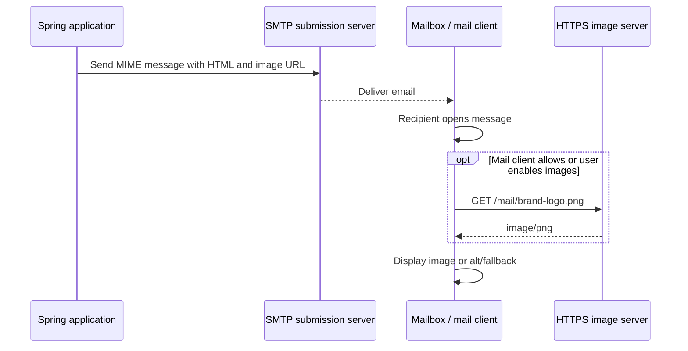

# Images from public URLs and inline resources in HTML email with Spring Framework Mail

HTML email can display logos, product photos, charts, or banners right inside the message body. When building emails with **Spring Framework Mail**, there are two common ways to put images into the `src` attribute of an `` tag:

1. **Images from a public URL (remote image):** the HTML email contains an HTTPS address; the email reader can load the image from that server when displaying the message.
2. **Inline resource (CID image):** the application puts the image bytes into the MIME message itself, assigns a `Content-ID` to the image part, and uses `src="cid:..."` in the HTML to reference it.

For example, two HTML tags may look similar:

```html
<!-- Image located on a web server -->


<!-- Image packaged inside the email message -->

```

But the data path is very different. With a public URL, the recipient may need a network connection to download the image and is subject to the mail client's external image blocking policy. With CID, the image data is sent along with the email as a MIME part; there is no need to load that image from a web server when viewing the message, but the client must support displaying inline resources and the email becomes larger.

In Spring, `JavaMailSender` handles sending the email; `MimeMessageHelper` helps create the HTML, add MIME parts via `addInline(...)`, and manage the `multipart/related` structure. This article covers the complete approach, compatibility limits, points to watch for security, and how to choose a solution for each situation.

## 1. Images in HTML email differ from images on web pages

On a web page, the browser usually loads images from `src` according to web rules. In email, the **mail client** decides whether to load, display, cache, or replace images. Many clients intentionally block images from external URLs to reduce the risk of tracking readers and unwanted content.

A piece of HTML can be valid yet is not guaranteed to render the same way in Gmail, Outlook, Apple Mail, mobile apps, webmail, or enterprise filters. Therefore, you must distinguish:

| Concept | Meaning |
|---|---|
| **HTML body** | The message content part with MIME type `text/html` |
| **Remote image** | An image pointed to by a URL, usually `https://...` |
| **Inline MIME resource** | Image data inside the email, referenced via `Content-ID` and `cid:` |
| **Attachment** | A MIME part intended to be handled as a separate attached file |
| **`alt` text** | Alternative text when the image does not display or the reader uses assistive tools |
| **`multipart/related`** | Groups the main content and the resources that the main content references |

The word **inline** can be confusing: in HTML/CSS, an image element appearing in the layout may be called an inline image, whereas in MIME, an **inline resource** usually refers to an enclosed part with a `Content-ID` for the HTML part to reference. A URL image appearing inside a paragraph does not by that fact become a MIME inline resource.

## 2. First approach: using images from a public URL

With a remote image, the email content contains only the **image path**, not all the image bytes. For example:

```html
<!doctype html>
<html lang="en">
  <body>
    <h2>Thank you for your order</h2>
    <p>
      
    </p>
    <p>Order DH-2048 has been confirmed.</p>
  </body>
</html>
```

The hostname `static.example.org` here is only an illustrative example, not a real image URL for deployment. In a real project, use a hostname and HTTPS URL managed or authorized by the organization.

### Conditions for a URL image to display

The mail reader can display the image if:

- `src` contains a valid absolute URL that is reachable from the recipient's environment.
- The server/CDN allows downloading content over HTTPS with a valid certificate.
- The image returns actual data in a format the client supports (usually PNG, JPEG, or GIF).
- The URL still works when the recipient opens the email many hours, days, or months later.
- The mail client's privacy and security policy permits loading images, or the user has chosen to display them.

Do not use local paths such as `C:\images\logo.png`, `/home/app/logo.png`, or relative paths `/assets/logo.png`. Those paths only have meaning in the sending application's specific environment, not necessarily on the recipient's device.

### When are URL images loaded?

Typical flow:



Some email services also **fetch images through a proxy, cache images, or scan images before displaying them**, so the origin server may not receive a direct request from the reader's browser or device. For that reason, do not rely on image download logs as definitive proof that the recipient has actually read the message.

### Pros and cons of remote images

**Advantages:**

- The email is usually smaller because it does not carry the image's bytes.
- One logo/banner can be reused across very many emails.
- Images can be distributed via a CDN and cached.
- Easy to manage a shared image asset repository and create versioned URLs.

**Limitations:**

- The image depends on the HTTPS server and the lifetime of the URL.
- The mail client may not load external images or may require user consent.
- An image updated at an old URL may look different later, or remain in cache; it cannot be controlled consistently.
- Remote images can expose access data or be treated as a tracking factor, depending on URL design and how the client loads them.

For small logos, product photos distributed by a CDN, or marketing banners, remote images are usually convenient when the system accepts network dependence and the recipient's display policy.

## 3. Second approach: inline resources using `Content-ID` and `cid:`

With an inline image, the picture is sent **with the email message**, as a separate MIME part. The image part has a `Content-Type`, usually has a `Content-ID`, and may have `Content-Disposition: inline`.

Example describing the headers of a PNG part:

```text
Content-Type: image/png
Content-ID: <shop-logo>
Content-Disposition: inline
Content-Transfer-Encoding: base64

iVBORw0KGgoAAA... (truncated image data)
```

HTML snippet referencing the image:

```html

```

The related pieces:

| Component | Role |
|---|---|
| `Content-Type: image/png` | Tells the client the part contains a PNG image |
| `Content-ID: <shop-logo>` | Identifier of the MIME part |
| `cid:shop-logo` | URL in HTML used to reference the part with a matching Content-ID |
| `Content-Disposition: inline` | Hints to the client to display the part inside the message body |
| `multipart/related` | Connects the HTML part with its dependent resources |

**Important point:** `Content-Disposition: inline` by itself does not specify the image's position in the HTML. For the image to appear in the desired place, the HTML must contain the corresponding `cid:...`, and the MIME part must have a matching `Content-ID` along with an appropriate structure.

### Multipart structure of an email with inline images

An email with a plain-text part, HTML, and an image can have the logical structure:

```text
MimeMessage
└── multipart/related
    ├── multipart/alternative
    │   ├── text/plain; charset=UTF-8
    │   └── text/html; charset=UTF-8
    │       
    └── image/png
        Content-ID: <shop-logo>
        Content-Disposition: inline
```

`multipart/alternative` holds alternative representations of the same content, while `multipart/related` connects the HTML with the referenced image resource. If the email also attaches a PDF, `multipart/mixed` usually appears at the outer layer to combine the message content with independent attachments.

**Note:** this is an illustrative tree. `MimeMessageHelper` may produce a slightly different nested structure depending on the multipart mode and library version; what matters is that the parts have the right relationships and headers.

### CID is not a URL to open in a browser

`cid:shop-logo` is not an HTTP/HTTPS URL. It references a part inside **the same MIME message**. You cannot send an email with only `` and expect the mail client to find the image from the application's disk by itself. You must add the image to the message when creating the email using an API such as `MimeMessageHelper.addInline(...)`.

### Pros and cons of inline resources

**Advantages:**

- Image data is packaged right inside the email, independent of whether a public image URL stays alive.
- Can be suitable for logos, small illustrations, or charts specific to the message.
- Allows HTML to reference specific content by Content-ID.

**Limitations:**

- The email is larger because it must carry the image data, usually with `Content-Transfer-Encoding: base64`.
- Not every client handles CID and MIME layout the same way.
- Some clients display inline images as an extra attachment.
- Changing an image after sending is harder because the image copy is already inside the message.
- For messages with many large images, you may hit the SMTP provider's message size limit.

Inline does not mean the image is guaranteed to render on every device. Some mail clients still block certain content types or display resources in their own way.

## 4. Direct comparison of the two ways to use images

| Criterion | Public URL image | Inline (CID) image |
|---|---|---|
| `src` in HTML | `https://...` | `cid:...` |
| Where are the image bytes? | On a website/CDN | In the MIME message |
| Does the email get larger because of the image? | Usually negligible | Yes, increases by total image bytes and encoding |
| Need to load the image when the recipient opens the email? | Usually yes, unless already cached/proxied | No need to access an external image URL for the sent part |
| Blocked by client policy? | Possible | Also possible |
| Depends on the URL staying alive? | Yes | No |
| Replace the image after sending? | A new image may appear when the URL is reloaded; cache may keep the old image | The image content is bound to the email |
| Need `addInline`? | No | Yes, or must build the MIME part manually |
| Need `Content-ID`? | No | Yes, for HTML to reference via `cid:` |
| May appear as an attachment? | Does not create a MIME attachment of the remote image itself | Some clients still list the image MIME part |
| Common scenarios | Banners, product photos, shared logos | Small logos, custom charts, images that must accompany the message |
| Characteristic risks | Privacy, expired URLs, CDN dependency | Size, MIME structure, CID compatibility |

You can **combine both** in one email: small logo using CID, product photos using HTTPS. The decision should be based on size, resource durability, privacy, and the required compatibility level, rather than always applying one method for every image.

## 5. Preparing Spring Boot Mail and SMTP configuration

With Spring Boot, you can use the mail starter:

```groovy
dependencies {
    implementation 'org.springframework.boot:spring-boot-starter-mail'
}
```

Example `application.yml` for SMTP submission port 587 + STARTTLS:

```yaml
spring:
  mail:
    host: ${SMTP_HOST}
    port: 587
    username: ${SMTP_USERNAME}
    password: ${SMTP_PASSWORD}
    default-encoding: UTF-8
    properties:
      "[mail.smtp.auth]": true
      "[mail.smtp.starttls.enable]": true
      "[mail.smtp.starttls.required]": true
      "[mail.smtp.ssl.checkserveridentity]": true
      "[mail.smtp.connectiontimeout]": 5000
      "[mail.smtp.timeout]": 10000
      "[mail.smtp.writetimeout]": 10000

app:
  mail:
    from: ${MAIL_FROM}
```

Where:

- `spring.mail.host`, `port`, `username`, `password` connect to the authorized SMTP submission server.
- `mail.smtp.starttls.enable` and `required` enable and require STARTTLS on 587.
- `mail.smtp.ssl.checkserveridentity` helps verify the hostname on the TLS certificate.
- `default-encoding: UTF-8` supports Vietnamese content in MIME.
- `app.mail.from` is a property **defined by the application itself**, not a property that automatically chooses Spring's sender address.

The `SMTP_*` values should come from environment variables or a secret manager. If the provider requires **port 465 and implicit TLS**, use `port: 465` and `"[mail.smtp.ssl.enable]": true` according to the provider's documentation. How images are embedded in HTML is independent of choosing the SMTP port.

**Version:** the examples below use `jakarta.mail` corresponding to Spring Framework 6+ / Spring Boot 3+. Older projects using Spring Framework 5 / Boot 2 may need `javax.mail`; make sure to choose the right dependency group and imports.

## 6. Example A: sending an HTML email with an image from a public URL

When the image is on a CDN, **there is no need to download the image bytes to the application to send the email**. Just create an `` tag containing the HTTPS URL in the HTML.

```java
package com.example.mail;

import jakarta.mail.MessagingException;
import jakarta.mail.internet.MimeMessage;
import org.springframework.beans.factory.annotation.Value;
import org.springframework.mail.javamail.JavaMailSender;
import org.springframework.mail.javamail.MimeMessageHelper;
import org.springframework.stereotype.Service;

@Service
public class RemoteImageMailService {
    private final JavaMailSender mailSender;
    private final String fromAddress;

    public RemoteImageMailService(
            JavaMailSender mailSender,
            @Value("${app.mail.from}") String fromAddress) {
        this.mailSender = mailSender;
        this.fromAddress = fromAddress;
    }

    public void sendOrderNotice(String recipient)
            throws MessagingException {

        String plainText = """
                Your order has been confirmed.

                View details at:
                https://shop.example.org/orders

                Sincerely,
                Store team
                """;

        String htmlText = """
                <!doctype html>
                <html lang="en">
                  <body>
                    
                    <h2>Your order has been confirmed</h2>
                    <p>Thank you for your purchase.</p>
                    <p>
                      <a href="https://shop.example.org/orders">
                        View order details
                      </a>
                    </p>
                  </body>
                </html>
                """;

        MimeMessage message = mailSender.createMimeMessage();
        MimeMessageHelper helper = new MimeMessageHelper(
                message, true, "UTF-8");
        helper.setFrom(fromAddress);
        helper.setTo(recipient);
        helper.setSubject("Order confirmed");
        helper.setText(plainText, htmlText);

        mailSender.send(message);
    }
}
```

Explanation:

1. `helper.setText(plainText, htmlText)` creates two alternative versions, so clients that only read text still have the main content.
2. `src="https://..."` asks the mail client to download the image over the web when permitted; there is no `addInline` call.
3. SMTP only transfers the **HTML containing the URL** and the plain-text part. The image may change or become unavailable after sending.
4. The `alt` attribute provides alternative text, and `width` helps anticipate the display size. Do not rely solely on CSS because mail clients may ignore some rules.

The sample URL in the example is for illustration. In production, use an HTTPS domain you control and ensure the image can be accessed from the recipient's side without needing an internal system's login cookie.

### Can internal URLs or URLs requiring login be used?

If `src` is `http://localhost:8080/logo.png`, the recipient cannot see the sender's local server. If the image requires the application's session cookie, the mail client or proxy service may not have that cookie. For remote images, use resources that are genuinely authorized to be downloaded by the system's design.

If the image is **private information**, do not simply turn it into a public URL so the email can load it. Consider a CID image, or send a link to an authenticated page so the recipient views the content inside the application instead of exposing data through the image URL.

## 7. Example B: embedding an inline image from the classpath with `addInline(...)`

Suppose the application packages the logo in:

```text
src/main/resources/mail/logo.png
```

At build time, this resource can be read via `ClassPathResource`. In HTML, use a CID URL:

```html

```

Spring service:

```java
package com.example.mail;

import jakarta.mail.MessagingException;
import jakarta.mail.internet.MimeMessage;
import org.springframework.beans.factory.annotation.Value;
import org.springframework.core.io.ClassPathResource;
import org.springframework.mail.javamail.JavaMailSender;
import org.springframework.mail.javamail.MimeMessageHelper;
import org.springframework.stereotype.Service;

@Service
public class InlineLogoMailService {
    private final JavaMailSender mailSender;
    private final String fromAddress;

    public InlineLogoMailService(
            JavaMailSender mailSender,
            @Value("${app.mail.from}") String fromAddress) {
        this.mailSender = mailSender;
        this.fromAddress = fromAddress;
    }

    public void sendWelcome(String recipient)
            throws MessagingException {

        MimeMessage message = mailSender.createMimeMessage();
        MimeMessageHelper helper = new MimeMessageHelper(
                message,
                MimeMessageHelper.MULTIPART_MODE_RELATED,
                "UTF-8");

        helper.setFrom(fromAddress);
        helper.setTo(recipient);
        helper.setSubject("Welcome");

        String plainText = """
                Welcome to the Example store!

                Visit https://shop.example.org to get started.
                """;

        String htmlText = """
                <!doctype html>
                <html lang="en">
                  <body>
                    <p>
                      
                    </p>
                    <h2>Welcome!</h2>
                    <p>Visit https://shop.example.org to get started.</p>
                  </body>
                </html>
                """;

        // Set the HTML first, then add the image part that the HTML references.
        helper.setText(plainText, htmlText);
        helper.addInline(
                "brand-logo",
                new ClassPathResource("mail/logo.png"),
                "image/png");

        mailSender.send(message);
    }
}
```

In the example:

- `MULTIPART_MODE_RELATED` allows creating a MIME structure with HTML content and related resources.
- `setText(plainText, htmlText)` creates two content versions for the same email.
- `addInline("brand-logo", ...)` binds the image bytes to a Content-ID. The helper generates the necessary header representation for the part.
- `"image/png"` accurately describes the data type of the PNG logo.
- `cid:brand-logo` in the HTML must match the string `brand-logo` passed to the helper.

**Do not put `<` and `>` characters into the content ID parameter** when calling `addInline`. In the MIME source, Content-ID is usually represented as `<brand-logo>`, whereas the HTML reference uses `cid:brand-logo`.

### The order of creating MIME parts is very important

With Spring `MimeMessageHelper`, perform the steps in this order:

1. Create `MimeMessage` and `MimeMessageHelper` in multipart mode.
2. Set `From`, `To`, `Subject`.
3. **Call `setText(...)` to create the body part.**
4. **Call `addInline(...)` to add images**, referenced by their corresponding Content-ID.
5. If needed, add attachments.
6. Call `mailSender.send(message)`.

Spring recommends setting text before adding inline resources because some mail clients depend on part ordering. If you call `addInline(...)` first and change the text structure later, the image might not be recognized or displayed reliably.

### When there are multiple inline images

Each independently referenced image needs a matching Content-ID:

```java
helper.setText(
        "The weekly report is ready.",
        """
        <p></p>
        <h2>Weekly report</h2>
        <p></p>
        """);

helper.addInline(
        "company-logo",
        new ClassPathResource("mail/logo.png"),
        "image/png");

helper.addInline(
        "sales-chart",
        new ClassPathResource("mail/sales-chart.png"),
        "image/png");
```

In practice, report images may be dynamically generated per recipient's data; in that case use a `ByteArrayResource` or a re-readable data source, as in the next section.

## 8. Embedding dynamically generated images as `byte[]`

Images do not have to already exist on the classpath. Charts, business QR codes, or thumbnails can be generated at send time. Once you have the image bytes, use `ByteArrayResource`:

```java
import org.springframework.core.io.ByteArrayResource;

byte[] chartPng = /* generate or read PNG image from an authorized source */;

String plainText = """
        The weekly report is ready.

        You can view the metrics in your account.
        """;

String htmlText = """
        <h2>Weekly report</h2>
        <p>Illustrative chart:</p>
        
        """;

helper.setText(plainText, htmlText);
helper.addInline(
        "weekly-chart",
        new ByteArrayResource(chartPng),
        "image/png");
```

The snippet assumes `helper` was created in multipart mode, `chartPng` is a valid PNG, and the data is authorized to be sent to the recipient.

### Why not pass a one-time `InputStream`?

Jakarta Mail may have to read a MIME resource multiple times when preparing or sending an email. Therefore, the overloads taking `InputStreamSource` need a source that can return a new `InputStream` for each request.

`ByteArrayResource` meets this need by creating a re-readable stream from an in-memory byte array. `ClassPathResource` or `FileSystemResource` can usually also reopen the data while the source still exists. An `InputStreamResource` wrapping a single already-open stream can cause errors or run out of data when the mail transport rereads it.

For small images, `ByteArrayResource` is simple. For large images, keeping all the bytes in RAM for thousands of emails can consume memory; consider a file resource, a storage source with a repeatable stream mechanism, or a controlled image URL.

### When images are downloaded from an external source

If the system has a feature that “takes an image URL and puts the image inline into the email”, the process of **the server itself downloading the URL to get the bytes** carries the risk of SSRF or accessing unwanted internal endpoints. Only allow permitted image sources, and control redirects, schemes, host/IP, timeouts, and maximum downloaded data size.

Taking a public URL to fill directly into `` and **the backend actively fetching the URL** are two different behaviors. Either way, user-supplied URLs must be controlled according to product policy to avoid abuse and data leakage.

## 9. Combining inline images with file attachments

An email may need an inline logo and a PDF invoice for download. In that case, using `MimeMessageHelper.MULTIPART_MODE_MIXED_RELATED` is a common choice because it supports the `related` relationship between HTML and images, while also having a `mixed` structure for attachments.

Example:

```java
import org.springframework.core.io.ByteArrayResource;
import org.springframework.core.io.ClassPathResource;

MimeMessage message = mailSender.createMimeMessage();
MimeMessageHelper helper = new MimeMessageHelper(
        message,
        MimeMessageHelper.MULTIPART_MODE_MIXED_RELATED,
        "UTF-8");

helper.setFrom("billing@example.org");
helper.setTo("customer@example.net");
helper.setSubject("Your invoice");

helper.setText(
        "Your invoice is ready. Please see the attached PDF.",
        """
        <p></p>
        <p>Your invoice is ready.</p>
        <p>Please see the attached PDF file.</p>
        """);

helper.addInline(
        "invoice-logo",
        new ClassPathResource("mail/logo.png"),
        "image/png");

helper.addAttachment(
        "invoice.pdf",
        new ByteArrayResource(invoicePdf),
        "application/pdf");

mailSender.send(message);
```

`invoicePdf` in the example is a `byte[]` variable containing a valid PDF, generated from the authenticated recipient's data. Do not manually insert the base64 encoding of the PDF into the body.

Illustrative MIME tree:

```text
MimeMessage
└── multipart/mixed
    ├── multipart/related
    │   ├── multipart/alternative
    │   │   ├── text/plain; charset=UTF-8
    │   │   └── text/html; charset=UTF-8
    │   └── image/png
    │       Content-ID: <invoice-logo>
    │       Content-Disposition: inline
    └── application/pdf
        Content-Disposition: attachment; filename="invoice.pdf"
```

Distinguish:

- `addInline(...)` creates an image part for HTML to reference with `cid:`.
- `addAttachment(...)` creates a separate file part for the client to display in the attachments area or offer for download.
- A mail client may still show inline images in the file list, because `Content-Disposition` is a display hint; the client has the right to handle it according to its own policy.

## 10. HTML image techniques to use and avoid in email

### Image size and display on phones

HTML email should specify appropriate dimensions and avoid overly large images:

```html

```

`width` is a width hint when building the email; `max-width` and `height:auto` help display flexibly in supporting clients. Not every CSS property is applied consistently across mail clients, so test on the target clients.

When you need to support Outlook or clients with limited CSS support, you may have to use HTML tables to lay out the email and compatible presentation attributes. These choices relate to template design and do not change the `addInline` mechanism.

### Use `alt` for alternative information

Because images may be blocked, provide `alt`:

```html

```

`alt` should describe the purpose of the image. If the image is purely decorative and the information is already in the text, you can use `alt=""` according to accessibility policy. For charts or images containing important numbers, add **text figures/interpretation** in both the HTML and the plain-text version, because a short `alt` is usually not enough to replace an entire chart.

### Avoid relying on background images, SVG, or complex CSS

Techniques such as `background-image`, SVG, animation, external CSS, or scripts have very different support levels. Some clients filter or do not load those resources. PNG and JPEG are usually more compatible for common images; GIF may work, though not every client plays the animation as desired.

Do not put sole critical content (OTP code, deadline, total amount) on an image banner. If the recipient turns off images, they must still be able to read the business content.

### Do not use `data:` URIs as the default option

On web pages, you can create images like:

```html

```

However, many mail clients **restrict or strip data URIs** due to security policies and compatibility. This also increases the size of the HTML part. When you need to package images into the email, prefer a MIME part with `cid:` and `addInline(...)` instead of putting the entire base64 in `src`.

### A public URL does not mean an uncontrolled URL

An image URL used in email should be an endpoint managed by the organization, with HTTPS, defined content, download limits, and not requiring an unshareable session cookie. Do not use a public URL to expose an internal image just because users need to view it in an email.

## 11. Optimizing email size and loading speed

With remote images, the HTML part contains only the URL, so the email swells very little from image data. However, the time it takes the recipient to see the image depends on the CDN, the network, and how the client decides to load it.

With CID, the image is packaged in MIME. Binary data is usually base64-encoded, causing the representation size to grow by about **one third**, not counting line breaks and MIME headers. For example, a 120 KB original image can take up more than 160 KB in MIME transport.

| Cost | URL image | Inline image |
|---|---|---|
| Email size | Only the URL and related HTML | Includes image bytes + encoding + MIME metadata |
| SMTP sending bandwidth | Lower if no other embedded images | Increases with the number and size of images |
| Bandwidth at view time | May download the image from CDN/proxy | Uses image data already in the received message |
| Reuse across multiple emails | Can cache image by URL | Each email usually contains its own copy of the image |
| Message size quota | Little affected by remote images | Can quickly hit size limits |

When optimizing:

1. Scale images down to an appropriate display size instead of sending original multi-megapixel images.
2. Choose PNG for logos with few colors/high sharpness; JPEG is usually suitable for photographs, depending on content.
3. Inline only images that are truly necessary and reasonably sized.
4. If an image contains large data or changes continuously, consider a link to an authenticated page instead of embedding everything into the email.
5. Measure the total MIME email size when you need to meet the provider's quota, because quotas apply to the **encoded message**, not just the total original file size.

## 12. Security and privacy

### Remote images can be used to track email opens

An image URL can contain an identifier unique to each recipient or each message. When the image is loaded, the image server can record the timestamp and some request metadata. However, mail clients using proxies, caching, or prefetching means an image-load event **does not definitively prove a human has read the email**.

In products, respect privacy policies and data usage purposes. Do not create tracking pixels yourself or attach sensitive personal tokens to URLs just to measure email opens. Avoid letting data such as personal emails, verification codes, or session tokens appear directly in the query string of public images.

### Inline images and data access rights

Images embedded in MIME are sent **with the message** and can be saved, forwarded, or downloaded. Do not embed an image containing secret data and then assume the recipient cannot copy it because it only appears “in the body”.

If the image is a financial chart or personal report, verify the right recipient and information scope before adding the part. When a recipient forwards the email, embedded content can keep traveling with the message.

### Risks from uncontrolled HTML data

If the application inserts customer names, product descriptions, or URLs into HTML, escape and validate **according to the exact context**. For example:

- Content between `<p> ... </p>` needs escaping of characters with HTML meaning.
- `src` and `href` values need scheme/hostname control, attribute encoding handling, and URL policies.
- Do not let users arbitrarily create `cid:` pointing to unauthorized parts or inject MIME headers through unfiltered data.
- Do not assemble HTML or headers yourself from data containing uncontrolled newline characters.

A template engine with appropriate escaping is usually easier to manage than joining lots of HTML strings with `+`.

### Public images differ from the server downloading arbitrary images

If HTML only contains `src="https://..."`, the Spring application does not necessarily access that URL when sending; the mail client will decide to download it later. If the backend accepts a URL and fetches the image itself to create a CID, the backend is making an outbound HTTP connection and needs SSRF prevention mechanisms.

Measures for an image-import feature can include an allowed-host list, address verification after DNS/redirect, port/scheme limits, timeouts, byte limits, file format checks, and isolating the service's egress permissions. Do not allow an untrusted URL string to turn into arbitrary access to the internal network.

### SMTP TLS does not replace content security

SMTP STARTTLS protects the data-transfer leg from the application to the configured server; it does not make private image URLs safe and does not guarantee end-to-end encryption for email. Sender domain authentication, SPF/DKIM/DMARC handling, recipient control, and data management still need to be performed independently.

## 13. Common errors and how to identify the root cause

| Symptom | Possible cause | How to handle |
|---|---|---|
| URL image shows a broken icon | Wrong URL, 404, HTTPS/certificate error, image not publicly accessible | Access the URL from an external environment, check response and MIME type |
| URL image does not load even though the URL works | Client blocks external images or uses a different proxy/cache | Check “Display images” setting and client policy; provide `alt` |
| URL image worked at send time but breaks later | File deleted, URL expired, host/CDN changed | Use a URL with an appropriate lifecycle, manage asset versions |
| CID image does not appear | `cid:` does not match `Content-ID` or `addInline` was not called | Use the same ID in HTML/helper and inspect the MIME source |
| Inline image appears as an attached file | Client lists MIME resources itself or multipart mode is not suitable | Use `multipart/related`/`MIXED_RELATED`; test on target clients |
| Image broke after changing helper call order | Added `addInline` before setting text or modified MIME structure | Call `setText(...)` first, `addInline(...)` afterward |
| Error reading the image stream | `InputStreamSource` cannot be reopened, file was deleted | Use `ByteArrayResource`/`ClassPathResource` or a source that creates a fresh stream |
| Some images display, others do not | Duplicate Content-ID, wrong content type, unsupported image type | Use distinct IDs, accurate MIME types, PNG/JPEG images |
| Email rejected for being too large | Too many inline images, base64 and attachments increase size | Reduce image count, resize/compress, use remote URLs for suitable images |
| HTML displays the raw `` tag | Body was sent as `text/plain` | Use `helper.setText(html, true)` or the plain + HTML overload |
| HTML has images but the plain-text version lacks clear content | All information was placed in images | Add business text and important links to both versions |
| Sent successfully but user does not see images | Client display policy, proxy, or content filtering | Distinguish SMTP status from display on the recipient's machine |

### Inspecting the message's MIME source

In a test environment, use an SMTP sink such as Mailpit to view the message or the mail reader's “Show original/View source” feature. Identify the part tree accurately:

```text
Content-Type: multipart/related
...
Content-Type: text/html; charset=UTF-8
...

...
Content-Type: image/png
Content-ID: <brand-logo>
Content-Disposition: inline
```

In an email with an outer `multipart/mixed`, `related` may appear at a nested level. Do not look only at the first `Content-Type` line and conclude inline images are missing.

For URL images, open the HTML version and check `src`, then test the HTTPS URL from an appropriate network environment. Remember that a browser may display an image from a URL while a mail client still blocks it.

Do not write the entire MIME source of emails containing personal data or sensitive tokens to general logs just to debug.

## 14. Designing email templates with both plain text and HTML

A friendly email should have both plain text and HTML, even when the HTML version has images. Example business data structure:

```java
public record OrderMailView(
        String orderCode,
        String totalFormatted,
        String detailUrl,
        String imageUrl) {
}
```

The application can render:

**Plain text**:

```text
Order DH-2048 has been confirmed.
Total: $450.00

View details:
https://shop.example.org/orders/DH-2048
```

**HTML**:

```html
<div>
  
  <h2>Order DH-2048 has been confirmed</h2>
  <p>Total: $450.00</p>
  <p>
    <a href="https://shop.example.org/orders/DH-2048">
      View details
    </a>
  </p>
</div>
```

In the CID version, simply replace `src` with `cid:brand-logo` and call `addInline(...)` with the matching ID. The business text stays the same.

If there are multiple locales (Vietnamese, English), render both versions from **the same data and the same locale**. For images containing text, provide translations or equivalent descriptive text; if an image contains prices/terms, do not let the data in the image differ from the data in the text.

### Using a template engine

Spring Mail does not automatically render placeholders in an HTML file. If there are templates like `mail/order-confirmed.html` and `mail/order-confirmed.txt`, the application needs a suitable renderer/template engine. For HTML, the engine should handle safe context-aware escaping; image URLs must pass an allowlist policy or be generated from a trusted system.

Do not use `String.replace` to substitute data in HTML when data may contain `<`, `&`, quotes, or arbitrary URLs. The text/plain part should also be rendered from a validated model to avoid leaking data to the wrong recipient.

## 15. Sending emails with images and tracking delivery

When calling `mailSender.send(message)`, the application submits a MIME message to the SMTP server. A successful response from the submission server usually indicates **the message has been accepted for further processing**.

That does not mean:

- The email has definitely been delivered to the final inbox.
- The recipient has opened the message.
- The mail client has loaded the remote image from HTTPS.
- The mail client has displayed every inline image.
- The recipient viewed the HTML version rather than the plain-text version.

If the business needs to know message delivery status, use delivery/bounce events from the mail provider or transport system. For remote images, image loading is not reliable proof to conclude a user has read the email, because proxies and prefetching can generate requests without a direct human reader.

In an asynchronous sending queue, file/resource CID images must still be accessible when the worker actually builds and sends the MIME message. If the resource sits in temporary storage and gets deleted before the worker runs, you may encounter MIME creation errors or incomplete image data.

## 16. Choosing a solution by scenario

| Need | Suggestion | Reason |
|---|---|---|
| Small logo appearing with account confirmation email | Inline CID or public HTTPS depending on desired compatibility | Both work; CID avoids URL dependency when opening the message |
| Marketing banner with many images, content updated per campaign | HTTPS images from CDN | Smaller emails and shared resources |
| Personal chart generated for a private report | Inline CID if data is authorized to be sent | Packages the specific image in the message |
| Product photos from a public catalog | HTTPS URL | Can reuse images from the catalog system |
| Images meant only for logged-in users | Consider CID or a link to an authenticated page | Avoid creating public URLs that expose private data |
| Email with HTML, logo, and PDF invoice | `MIXED_RELATED` + `addInline` + `addAttachment` | Separates image relationships and attachments |
| Notification email that must work when images are blocked | Complete plain-text version + HTML with `alt` | Keeps important information in text form |
| Report containing many very large images | Link to an authorized page/file | Avoids exceeding message limits and wasting bandwidth |

There is no single perfect choice for every email. The reasonable approach is to decide based on **access rights, size, resource durability, client support, and business content that must be readable without images**.

## 17. Frequently asked questions

**Do images from public URLs need `helper.addInline(...)`?** No. When HTML uses ``, the email contains only the URL. `addInline` is for enclosed MIME parts referenced via `cid:`.

**Can `` be used in email?** You should not. Relative paths have no reliable base URL in a mail client. Use an absolute HTTPS URL for remote images or CID for embedded parts.

**Does using CID guarantee the image appears?** No. Mail clients may handle it differently, block content, or display the MIME part as an attachment. Test on target clients.

**Do CID images need the Internet when the recipient opens the message?** The image data is inside the received message, so there is no need to load that image from an external web URL. However, the recipient still needs the message and a suitable email app; other resources in the HTML may still need a network connection.

**Are `cid:logo` and `Content-ID: <logo>` two different IDs?** No. They reference the same identifier under CID rules. In the Spring helper, pass the content ID string such as `"logo"`, while in HTML use `cid:logo`.

**Can multiple inline images be added in the same email?** Yes. Call `addInline(...)` for each image with a distinct Content-ID and reference each ID in the HTML.

**Why does an inline image appear as an attachment?** Some mail clients list every MIME part with image data in the attachments area. If the HTML still displays properly, this may just be how the client presents it; otherwise, check the `multipart/related` structure.

**Can base64 images be used directly in `src="data:image/...">`?** In HTML syntax it is possible, but many mail clients do not support or block it. For attached image data, `addInline` + CID is usually the more compatible approach.

**Does Spring Mail automatically find images from paths in HTML and embed them into the email?** No. `MimeMessageHelper.setText(html, true)` only sets the HTML content. To have a CID image, the application must call `addInline` and supply the actual bytes/resource.

**Is `setText(...)` needed before `addInline(...)`?** You should do so. Spring recommends this order to match MIME organization and mail client compatibility.

**Can remote images display when the recipient is offline?** If the image has never been downloaded/cached, usually not. A CID image is already inside the message so it can display offline if the mail client has the message data and supports that part.

**How do we know an image was viewed by the recipient?** You cannot conclude with certainty from SMTP or HTTP image-load requests alone. Proxies, caches, prefetching, and image-blocking modes make the signal very hard to interpret; do not rely on it to confirm the recipient read the message.

**Are SMTP send failures caused by unreachable image URLs?** If you only insert a URL into HTML, the SMTP server usually does not fetch that URL to send. SMTP can accept the email even if the remote image is broken when viewed. Conversely, if the backend actively downloads the image to create a CID, image fetch failures can happen before the SMTP step.

**What image MIME type should be set?** Use the type matching the actual data, such as `image/png` or `image/jpeg`. Do not declare `image/png` for JPEG data just because the filename has a PNG extension.

**Can HTML be sent alone without plain text?** Yes, but a plain-text version helps users and clients that do not use HTML still read important information. `helper.setText(plainText, htmlText)` is the right way when both are needed.

## 18. Related technical documentation

- **Spring Framework Mail — `JavaMailSender` and `MimeMessageHelper`:** creating MIME messages, `setText(...)`, `addInline(...)`, `addAttachment(...)`, and multipart modes.
- **Jakarta Mail — `MimeMessage`, `MimeMultipart`, and `InternetHeaders`:** message structure components.
- **RFC 2045–2049 — MIME:** `Content-Type` principles, `multipart/related`/`alternative`, and content encoding.
- **RFC 2387 — Multipart/Related:** relationship between primary content and related resources.
- **RFC 2392 — Content-ID and Message-ID URLs:** how to reference MIME parts via `cid:`.
- **RFC 2183 — Content-Disposition:** metadata suggesting `inline` and `attachment` display.
- **Spring Boot Mail Configuration:** `spring.mail.*` and `spring.mail.properties.*` for SMTP transport.

---

**Takeaway:** with HTML email, images from public URLs use `` and depend on the client's image-loading policy; MIME inline images use `` combined with `MimeMessageHelper.addInline(...)` to put the image bytes into the email itself. When adding inline images, create the helper in multipart mode, **set text/HTML first and then add inline resources**, and provide a consistent Content-ID and MIME type. Whichever approach you choose, keep important information in text form, use appropriate `alt`, and verify rendering on the mail clients that need to be supported.
