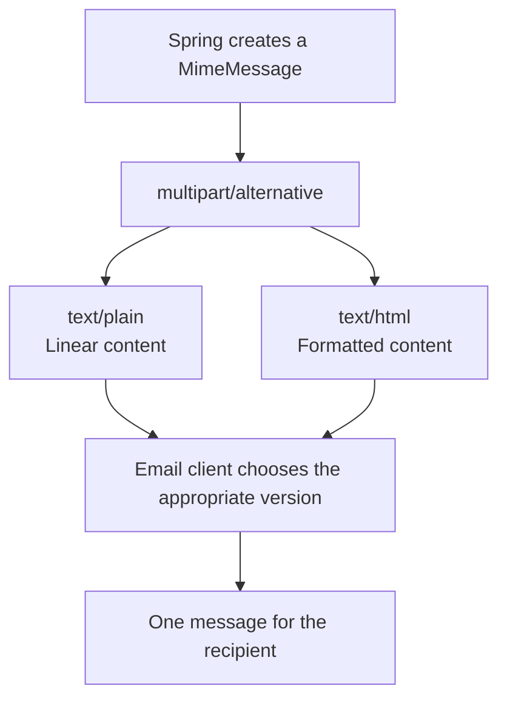

# Plain-text alternative for accessibility in HTML email

An HTML email can look attractive with logos, buttons, tables, and colors, but not every recipient reads mail through a full HTML-rendering interface. Some use a mail reader in plain-text mode, some need assistive technology, some use automated systems that extract email content, or a security environment restricts HTML content. Therefore, when building HTML email in **Spring Framework Mail**, the application should also provide a **`text/plain` version carrying the same important information and actions**.

Spring supports this approach through `MimeMessageHelper`:

```java
helper.setText(plainText, htmlText);
```

The two strings do not create two independent emails. They are **two alternative versions of the same content** inside one `MimeMessage`, usually packaged using MIME `multipart/alternative`. The mail reader chooses the version suited to its capabilities and the user's preferences.

**Important distinction:** having a plain-text version is a **measure that improves accessibility and compatibility**, but it is **not enough to claim the email is accessible**. The HTML version still needs an understandable structure, alternative text for images, clearly labeled links, suitable contrast, and not relying solely on color. The text version also needs to be written and presented so that a reader can understand it, not merely as HTML tags stripped away.

## 1. Why does an HTML email need a plain-text version?

Suppose the application sends an appointment confirmation email. In the HTML version, the recipient sees:

```html
<h1>Appointment confirmed</h1>
<p>Hello An,</p>
<p>Your appointment <strong>APT-204</strong> is at
   <strong>09:30 on 20/11/2026</strong> at District 1 Branch.</p>
<p><a href="https://appointments.example/appointments/APT-204">
  View appointment details
</a></p>
```

If an email client only handles `text/plain`, this HTML part is not a usable notification: the reader may see tags, attributes, and unformatted content. The equivalent plain-text version should be:

```text
APPOINTMENT CONFIRMED

Hello An,

Appointment ID: APT-204
Time: 09:30 on 20/11/2026 (Asia/Ho_Chi_Minh)
Location: District 1 Branch

View appointment details:
https://appointments.example/appointments/APT-204

If you need support, please reply to this email.
```

Text-version users **do not have to switch to HTML** to learn the time, location, or link. The two versions differ in form while preserving the same meaning.

### Situations where a plain-text version is valuable

| Context | How does the plain-text version help? | What not to misunderstand |
| --- | --- | --- |
| Email client in text-only reading mode | Provides content without needing an HTML renderer | Not every client automatically selects text when CSS has errors |
| User deliberately chooses plain text | The message remains complete with usable URLs | Plain text does not guarantee readability by itself if poorly laid out |
| Assistive reading tools or dedicated accessibility flows | Provides a linear representation with little visual dependency | Screen readers can also read well-structured HTML |
| Archiving, filtering, or information extraction systems | Has simple content to process | You cannot assume systems read only plain text |
| Images, CSS, or external content are unavailable | Important content is still in the text version if selected | Blocking images in the HTML version does not necessarily trigger switching to text |
| Restricted connection or device | Has a compact representation with fewer resource dependencies | Total email size still includes the HTML and MIME parts |

Some email clients display HTML yet **do not load remote images**. In that case, the client may continue showing HTML and **not switch automatically to `text/plain`**. Hence you must design both **HTML that is accessible on its own** and **plain text with complete information**.

## 2. Accessibility: not just removing HTML

In this article, *accessibility* means that the recipient can **receive, understand, and act on** the email under varying conditions and usage needs.

An accessible email usually meets these principles:

1. **Important information is expressed in words.** Do not leave amounts, deadlines, order numbers, or action requests solely inside an image.
2. **Meaningful reading order.** Content is presented in sequence: event, details, action, support.
3. **Links have context.** Do not force readers to guess the meaning of a repeated “Click here” string.
4. **Do not use color as the only signal.** For example, “red items require action” must be accompanied by a text label.
5. **Do not depend on tables, columns, or CSS to understand data relationships.** In the text version, fields should have clear labels.
6. **Support appropriate language, numbers, and time.** Dates, times, and time zones must be meaningful for the recipient.
7. **Content is not lost when images/HTML are not displayed.** Both the text version and fallbacks in HTML participate in solving the problem.

Example of an HTML snippet showing status with color:

```html
<span style="color:red">●</span> Payment incomplete
```

When converting to text, do not keep only `●`. Write:

```text
Payment status: INCOMPLETE
Required action: complete payment before 17:00 on 20/11/2026.
```

**The plain-text version does not need to mimic the visual design**, rather it needs to convey actionable content. Good structure for users also helps logs, archives, and automated readers process it more easily, though it should not replace testing real users' accessibility requirements.

## 3. MIME `multipart/alternative`: the mechanism for transporting two versions

MIME allows an email to contain multiple parts. When those parts are **alternative representations of the same message**, they are grouped using `multipart/alternative`:

```text
A MimeMessage
└── multipart/alternative
    ├── text/plain; charset=UTF-8
    │   └── Complete plain-text version
    └── text/html; charset=UTF-8
        └── Equivalent HTML version
```



By conventional MIME usage, `text/plain` is placed before `text/html`, with the richer version afterward. The email client picks the part it supports and the user prefers. **The client is not required to display both parts one after another**, because they are alternatives rather than two supplementary pieces of information.

### Example raw email structure

```mime
MIME-Version: 1.0
From: notifications@appointments.example
To: an@example.net
Subject: Appointment confirmed
Content-Type: multipart/alternative; boundary="alt-204"

--alt-204
Content-Type: text/plain; charset=UTF-8
Content-Transfer-Encoding: quoted-printable

Appointment APT-204 is confirmed.
Time: 09:30 on 20/11/2026 (Asia/Ho_Chi_Minh)
Details: https://appointments.example/appointments/APT-204

--alt-204
Content-Type: text/html; charset=UTF-8
Content-Transfer-Encoding: quoted-printable

<html><body>
  <h1>Appointment confirmed</h1>
  <p>APT-204: 09:30 on 20/11/2026</p>
  <a href="https://appointments.example/appointments/APT-204">View details</a>
</body></html>
--alt-204--
```

This is a **schematic example**: the `quoted-printable` parts and line endings of real MIME have been simplified for readability. An actual message created by Jakarta Mail may choose `quoted-printable` or `base64` depending on the data and transport. Those `Content-Transfer-Encoding` types serve **transport encoding**, not a content security mechanism.

### When the email also has inline images or attachments

If the HTML uses an embedded `cid:` logo and the message also has an attached PDF file, the MIME tree may include:

```text
multipart/mixed
├── multipart/related
│   ├── multipart/alternative
│   │   ├── text/plain        <-- important information in text
│   │   └── text/html         <-- 
│   └── image/png             <-- Content-ID: <logo@appointments.example>
└── application/pdf           <-- independent attachment
```

The three structures have different roles:

| MIME subtype | Meaning |
| --- | --- |
| `multipart/alternative` | Multiple alternative representations of the same content |
| `multipart/related` | Primary content and related resources, such as CID images |
| `multipart/mixed` | Combined components such as the body and attachments |

When using Spring, the exact structure also depends on the mode of `MimeMessageHelper`, but **plain text still needs to express the main content** even when the HTML includes images or PDFs.

## 4. `MimeMessageHelper.setText(plainText, htmlText)` in Spring

Spring Framework Mail provides `JavaMailSender` and `MimeMessageHelper` to create MIME emails. Overloads that are easy to confuse:

| Method | Result |
| --- | --- |
| `setText("Hello")` | Only one plain-text part |
| `setText("<b>Hello</b>", true)` | Only one HTML part |
| `setText("Hello", false)` | Only one plain-text part |
| **`setText("Hello", "<b>Hello</b>")`** | **Two alternative text/plain and text/html parts** |

Example:

```java
// HTML only, no automatic plain-text fallback:
helper.setText("<p>Order is ready.</p>", true);

// Two versions with the same meaning:
helper.setText(
        "Order is ready.",
        "<p>Order is ready.</p>");
```

**Spring does not automatically convert HTML into a complete text version.** The application must supply `plainText` and `htmlText` that have already been composed or rendered. If the text version only says “Please view the HTML content”, users who choose text reading mode still lose important information.

To use the two-version overload, create `MimeMessageHelper` with an appropriate multipart mode:

```java
MimeMessage message = mailSender.createMimeMessage();
MimeMessageHelper helper = new MimeMessageHelper(
        message,
        MimeMessageHelper.MULTIPART_MODE_MIXED_RELATED,
        "UTF-8");

helper.setText(plainText, htmlText);
```

The `MULTIPART_MODE_MIXED_RELATED` mode is suitable when inline images or attachments are needed later. For messages with only text and HTML, you can choose another suitable multipart structure; the key point remains **two content versions of one `MimeMessage`**.

## 5. Complete example: appointment confirmation email with a plain-text alternative

Suppose the validated business data consists of:

```text
appointmentId: APT-204
recipient: an@example.net
recipientName: An
scheduledAt: 2026-11-20T02:30:00Z
timeZone: Asia/Ho_Chi_Minh
location: District 1 Branch
```

To avoid the two versions differing in time and location name, **normalize the data once** and then pass it to both renderers.

### Validated data DTO

```java
package com.example.mail;

import java.time.Instant;
import java.time.ZoneId;

public record AppointmentNotice(
        String appointmentId,
        String recipientEmail,
        String recipientName,
        String location,
        Instant scheduledAt,
        ZoneId timeZone
) {
}
```

This is a DTO dedicated to the email, not the entire database entity. It holds just the fields needed to compose the notification.

### Service using `JavaMailSender`

```java
package com.example.mail;

import java.time.ZonedDateTime;
import java.time.format.DateTimeFormatter;
import java.util.Locale;
import java.util.Objects;

import jakarta.mail.MessagingException;
import jakarta.mail.internet.MimeMessage;

import org.springframework.beans.factory.annotation.Value;
import org.springframework.mail.javamail.JavaMailSender;
import org.springframework.mail.javamail.MimeMessageHelper;
import org.springframework.stereotype.Service;
import org.springframework.web.util.HtmlUtils;

@Service
public class AppointmentConfirmationEmailService {

    private static final DateTimeFormatter DATE_TIME_FORMAT =
            DateTimeFormatter.ofPattern(
                    "HH:mm 'on' dd/MM/yyyy",
                    Locale.forLanguageTag("en-US"));

    private final JavaMailSender mailSender;
    private final String fromAddress;

    public AppointmentConfirmationEmailService(
            JavaMailSender mailSender,
            @Value("${app.mail.from}") String fromAddress) {
        this.mailSender = mailSender;
        this.fromAddress = fromAddress;
    }

    public void send(AppointmentNotice notice) throws MessagingException {
        Objects.requireNonNull(notice, "notice");
        Objects.requireNonNull(notice.scheduledAt(), "scheduledAt");
        Objects.requireNonNull(notice.timeZone(), "timeZone");

        // Example requiring the ID to match a schema to build a safe URL.
        String id = Objects.requireNonNull(notice.appointmentId());
        if (!id.matches("[A-Za-z0-9-]{1,40}")) {
            throw new IllegalArgumentException("Invalid appointment ID");
        }

        // Single-line fields normalized/controlled by the business logic.
        String name = notice.recipientName();
        String location = notice.location();
        if (name == null || name.isBlank()) {
            name = "there";
        }
        if (location == null || location.isBlank()) {
            throw new IllegalArgumentException("Location is required");
        }

        ZonedDateTime localTime = notice.scheduledAt()
                .atZone(notice.timeZone());
        String formattedTime = DATE_TIME_FORMAT.format(localTime)
                + " (" + notice.timeZone().getId() + ")";

        String detailsUrl =
                "https://appointments.example/appointments/" + id;

        String plainText = """
                APPOINTMENT CONFIRMED

                Hello %s,

                Appointment ID: %s
                Time: %s
                Location: %s

                View appointment details:
                %s

                If you need support, please reply to this email.
                """.formatted(name, id, formattedTime, location, detailsUrl);

        String htmlText = """
                <!doctype html>
                <html lang="en">
                  <body>
                    <h1>Appointment confirmed</h1>
                    <p>Hello %s,</p>
                    <p><strong>Appointment ID:</strong> %s</p>
                    <p><strong>Time:</strong> %s</p>
                    <p><strong>Location:</strong> %s</p>
                    <p><a href="%s">View appointment details</a></p>
                    <p>If you need support, please reply to this email.</p>
                  </body>
                </html>
                """.formatted(
                HtmlUtils.htmlEscape(name),
                HtmlUtils.htmlEscape(id),
                HtmlUtils.htmlEscape(formattedTime),
                HtmlUtils.htmlEscape(location),
                HtmlUtils.htmlEscape(detailsUrl));

        MimeMessage message = mailSender.createMimeMessage();
        MimeMessageHelper helper = new MimeMessageHelper(
                message,
                MimeMessageHelper.MULTIPART_MODE_MIXED_RELATED,
                "UTF-8");

        helper.setFrom(fromAddress);
        helper.setTo(notice.recipientEmail());
        helper.setSubject("Appointment confirmation " + id);
        helper.setText(plainText, htmlText);

        mailSender.send(message);
    }
}
```

The illustrative code uses Java supporting text blocks and `String.formatted(...)`, Spring Framework Mail, and Jakarta Mail. It assumes the business data has already had recipient permissions, email syntax, and length limits checked at the appropriate layers. `HtmlUtils.htmlEscape` serves to escape content placed into HTML, and **does not replace checking recipient addresses, URLs, or business logic**.

In a real application, you should also check for control characters, field length for name/location, and data that may contain line breaks to avoid abnormal content. The URL in the example is built from a trusted host and an ID with clear rules; if building a URL from arbitrary data, validate scheme/host and encode path/query by context before HTML-escaping.

### Minimal Spring Boot configuration for sending via SMTP

```groovy
dependencies {
    implementation 'org.springframework.boot:spring-boot-starter-mail'
}
```

```yaml
spring:
  mail:
    host: smtp.provider.example
    port: 587
    username: ${SMTP_USERNAME}
    password: ${SMTP_PASSWORD}
    default-encoding: UTF-8
    properties:
      "[mail.smtp.auth]": "true"
      "[mail.smtp.starttls.enable]": "true"
      "[mail.smtp.starttls.required]": "true"
      "[mail.smtp.ssl.checkserveridentity]": "true"
      "[mail.smtp.connectiontimeout]": "5000"
      "[mail.smtp.timeout]": "10000"
      "[mail.smtp.writetimeout]": "10000"

app:
  mail:
    from: notifications@appointments.example
```

`spring.mail.username`/`password` is used for SMTP AUTH, while `app.mail.from` is a custom configuration used by the service to set the sender header. Credential values must come from environment secrets; do not store real passwords in source code.

`send()` submits the message via SMTP. When it returns normally, that **does not guarantee the recipient has opened the message or that the email client rendered the HTML/text version as intended**. Deliverability, delivery to the mailbox, and content accessibility are three different aspects.

## 6. From one source data model to two consistent versions

A major risk when composing two versions manually is **information mismatch**:

```text
Plain text: Deadline 17:00 on 20/11/2026
HTML:       Deadline 19:00 on 20/11/2026
```

If the renderers calculate dates/times in two different places, the reader may receive conflicting instructions. Therefore, define a normalized **view model**:

```java
public record AppointmentMailView(
        String name,
        String appointmentId,
        String formattedLocalTime,
        String location,
        String detailsUrl
) {
}
```

Content-building flow:

```text
AppointmentEvent / database snapshot
           |
           v
Normalize data: time, time zone,
name, location, trusted URL
           |
           v
AppointmentMailView
     /            \
    v              v
Plain text        HTML template
    \              /
     v            v
   helper.setText(plainText, htmlText)
```

In a project with many notifications, you can create two separate templates:

```text
src/main/resources/templates/mail/
├── appointment-confirmed.txt
└── appointment-confirmed.html
```

Conceptual template content example:

```text
APPOINTMENT CONFIRMED

Hello {{name}},
Appointment ID: {{appointmentId}}
Time: {{formattedLocalTime}}
Location: {{location}}
Details: {{detailsUrl}}
```

```html
<h1>Appointment confirmed</h1>
<p>Hello <strong>{{name}}</strong>,</p>
<p>Appointment ID: <strong>{{appointmentId}}</strong></p>
<p>Time: <strong>{{formattedLocalTime}}</strong></p>
<p>Location: {{location}}</p>
<p><a href="{{detailsUrl}}">View appointment details</a></p>
```

The `{{...}}` notation here is an **illustrative placeholder**, not the default syntax of every template engine. If you use Thymeleaf, FreeMarker, or another engine, you must choose the appropriate syntax and escaping mechanism. **The same view model** helps keep data synchronized, yet the two templates still need to be designed for their display environments.

### Principles for keeping the two versions equivalent

| Data or action | HTML version | Equivalent text version |
| --- | --- | --- |
| Status | Green badge “Confirmed” | `Status: Confirmed` |
| Deadline | Highlighted in bold/colored text | State date, time, and time zone clearly |
| Action link | `<a href="...">View details</a>` | `View details: https://...` |
| List | `<ul><li>...</li></ul>` | `- Item 1`, `- Item 2` |
| Order table | “Product / Quantity” columns | `Product: ...; Quantity: ...` per line |
| Illustrative image | `` | Write meaningful information clearly if the image conveys content |
| Prominent CTA | Button labeled “Confirm appointment” | Instruction line and full URL |
| Contact information | Phone/email icon + link | `Support:` label and contact address |
| Legal information | Small footer | Still includes content required by legal/business rules |

**Equivalent does not mean identical line by line.** HTML can use tables and CSS, while text expresses the same information using labels and line breaks. The goal is that the user does not lose an important operation just because they chose a different display mode.

## 7. Presenting the plain-text version for readers and assistive technology

An easy-to-read text version needs **simple formatting with a clear structure**. Useful practices:

- Start with a summary sentence or a content heading.
- Split into short paragraphs, with blank lines between topics.
- Use clear labels such as `Time:`, `Location:`, `Order ID:`, `Required action:`.
- For lists, use `- ` at the beginning of each line instead of packing many items onto one line.
- Write absolute URLs with clear destinations and accompanying labels.
- State deadlines along with the time zone or local context.
- Avoid ASCII art, boxes made from `+----+` characters, tables aligned into columns with lots of spaces, or rows of decorative symbols.
- Limit writing in ALL CAPS, obscure abbreviations, and long strings of punctuation.
- If information is optional, avoid lines like `Location: null` or `Deadline: undefined`.

### Why can ASCII tables be poorly accessible?

A hard-to-read example:

```text
+-----------+-------+----------+
| Item      | Qty   | Price    |
+-----------+-------+----------+
| Shirt     | 2     | 250000   |
+-----------+-------+----------+
```

Many text readers, small devices, or assistive technologies struggle to preserve column alignment. Switch to a linear structure:

```text
Product 1: Dress shirt
Quantity: 2
Unit price: 250,000 VND

Total: 500,000 VND
```

The text version may be a bit longer, but the order and relationship between label–value pairs are clear. For complex multi-column reports, consider directing users to a web page with an accessible UI instead of forcing an entire large table into the email.

### Links with specific labels

Do not write:

```text
Click here: https://appointments.example/appointments/APT-204
Click here: https://appointments.example/help
```

Instead write:

```text
View appointment details:
https://appointments.example/appointments/APT-204

Contact support:
https://appointments.example/help
```

In HTML, the label `View appointment details` must describe the link's destination without forcing the reader to rely on the button's position or color. In text, the URL is usually shown in full. Paths should be controlled to avoid unsafe URLs or overly long ones that cause line-wrapping breaks.

### Sensitive data in URLs

A very long URL containing an access token or customer information can cause a leak when the email is forwarded or saved. The plain-text version makes the URL visible directly, yet **even in the HTML version, the real URL is already inside the message's `href` attribute**. Therefore, design links according to security policy: a trusted host, appropriate access controls, sufficiently short-lived tokens if needed, and no unnecessary secret data embedded in the URL.

## 8. Plain-text fallback and the accessibility of the HTML version

To improve practical accessibility, do not treat the text version as an excuse to neglect HTML quality. Recipients who choose HTML still need to be able to use that content.

### Semantic tags and reading order

Where semantic HTML can be used compatibly with email clients, include clear headings, paragraphs in natural reading order, and links describing the action:

```html
<h1>Appointment confirmed</h1>
<p>Appointment ID: <strong>APT-204</strong></p>
<p>Time: 09:30 on 20/11/2026</p>
<p><a href="https://appointments.example/appointments/APT-204">
  View appointment details
</a></p>
```

Email clients have different HTML support from browsers; some kinds of tags/attributes may be filtered or modified. Therefore, prefer simple structures and sequential content rather than complex layouts that scramble the reading order when switching to a small screen.

### Alternative text for images

```html
<!-- Image carrying brand content -->


<!-- Purely decorative image -->

```

If the image **conveys information**, `alt` needs to describe its meaning; if it is purely decorative, `alt=""` is usually appropriate to prevent decorative parts from creating noise in assistive readers. Do not place important information solely inside an image, even when `alt` is present; the text version and HTML text should still carry the main information.

For images containing a QR code used for ticket checking, you may also need a text booking code or alternative instructions, depending on business rules and security risk. Not every QR code can safely be turned into a single plain URL line to send.

### Color contrast and links

In HTML email, do not rely solely on red/green text to indicate status. Action buttons should have **meaningful labels**, sufficiently contrasting colors, and a touch target size appropriate to the actual design. A CSS button may lose its color or styles in some clients; the text and `href` must still work.

Users who read only plain text also need a textual status description, yet having a text fallback does not solve the issue for users who are choosing HTML with low contrast. Both representations must receive independent attention.

## 9. Combining `cid:` images with two content versions

In Spring, `MimeMessageHelper` allows attaching embedded images. For example:

```java
import org.springframework.core.io.ClassPathResource;

String cid = "brand-logo@appointments.example";

String plainText = """
        Appointments Example

        Appointment APT-204 has been confirmed.
        Details: https://appointments.example/appointments/APT-204
        """;

String htmlText = """
        <html><body>
          
          <h1>Appointment confirmed</h1>
          <p>Appointment ID: APT-204</p>
          <a href="https://appointments.example/appointments/APT-204">
            View appointment details
          </a>
        </body></html>
        """;

// helper was created in the appropriate multipart mode.
helper.setText(plainText, htmlText);
helper.addInline(
        cid,
        new ClassPathResource("mail/images/logo.png"),
        "image/png");
```

Suppose the image file is placed at `src/main/resources/mail/images/logo.png`. The `Content-ID` of the image MIME part will correspond to `cid:brand-logo@appointments.example` in the HTML. **Plain text cannot render this image**, so the service name text and URL must still be present in the text version.

With `MimeMessageHelper`, call **`setText(...)` before `addInline(...)`** to keep the MIME structure compatible with many email clients. Do not place important instructions only inside an image; the image might not display due to client policy, a missing MIME part, or size limits.

## 10. Multilingual support, time, and number formatting

Accessibility is not just about assistive technology. If the email is sent to users who speak another language, whether strings are properly translated and whether units and times are clear also determine whether they understand the notification.

One strategy is to build a **locale-based display model** and then render both text and HTML:

```text
Domain event
   |
   v
Resolve recipient locale / time zone
   |
   v
Format time, amount, labels once
   |
   +--> render plain text
   |
   +--> render HTML
   |
   v
MimeMessageHelper.setText(plainText, htmlText)
```

If the deadline stored in the database is an `Instant`:

```java
import java.time.Instant;
import java.time.ZoneId;
import java.time.format.DateTimeFormatter;
import java.util.Locale;

Instant scheduledAt = Instant.parse("2026-11-20T02:30:00Z");
ZoneId zone = ZoneId.of("Asia/Ho_Chi_Minh");

DateTimeFormatter formatter = DateTimeFormatter
        .ofPattern("HH:mm 'on' dd/MM/yyyy",
                Locale.forLanguageTag("en-US"));

String displayTime = formatter.format(scheduledAt.atZone(zone))
        + " (" + zone.getId() + ")";
```

Result to use in **both versions**:

```text
09:30 on 20/11/2026 (Asia/Ho_Chi_Minh)
```

If two renderers convert time zones or format monetary amounts separately, plain text and HTML may contradict each other. For money, use a data type with an explicit currency (`BigDecimal` and a currency code, or a business Money type) before formatting by locale; do not let the text version write `1000.00` while the HTML version writes `1,000,000` just because of incorrect formatting.

### HTML language and email headers

With HTML, you can declare `lang="en"` or the corresponding language when the client preserves this attribute. That supports reading tools suited to the language. In MIME, charset `UTF-8` helps transmit accented characters; **charset does not replace declaring the language**, and the plain-text version does not have an HTML structure to set a `lang` attribute per paragraph.

If the application sends bilingual mail, think through how to write clearly in both parts, instead of only translating the HTML version into two languages and forgetting plain text.

## 11. Inspecting MIME structure in memory

An email can be built before sending to see whether Jakarta Mail has packaged both parts. This helps understand the MIME structure without needing an SMTP server.

Java example:

```java
import java.io.ByteArrayOutputStream;
import java.nio.charset.StandardCharsets;
import java.util.Properties;

import jakarta.mail.Session;
import jakarta.mail.internet.MimeMessage;
import org.springframework.mail.javamail.MimeMessageHelper;

public class PlainTextAlternativeSourceExample {

    public static void main(String[] args) throws Exception {
        Session session = Session.getInstance(new Properties());
        MimeMessage message = new MimeMessage(session);

        MimeMessageHelper helper = new MimeMessageHelper(
                message,
                MimeMessageHelper.MULTIPART_MODE_MIXED_RELATED,
                "UTF-8");

        helper.setFrom("notifications@appointments.example");
        helper.setTo("an@example.net");
        helper.setSubject("Appointment confirmation");
        helper.setText(
                "Appointment APT-204 has been confirmed.\n"
                        + "Details: https://appointments.example/appointments/APT-204",
                "<h1>Appointment confirmed</h1>"
                        + "<p>Appointment ID APT-204</p>"
                        + "<a href=\"https://appointments.example/appointments/APT-204\">"
                        + "View details</a>");

        message.saveChanges();

        try (ByteArrayOutputStream output = new ByteArrayOutputStream()) {
            message.writeTo(output);
            String rawEmail = output.toString(StandardCharsets.UTF_8);
            System.out.println(rawEmail);
        }
    }
}
```

This is a **technical example in a development environment**. It does not send mail; it prints the raw MIME of a constructed `MimeMessage`. Do not use real email addresses and personal data content when writing `.eml` files or printing sources to logs.

In the raw source, understand these markers:

```text
Content-Type: multipart/alternative
  Content-Type: text/plain; charset=UTF-8
  Content-Type: text/html; charset=UTF-8
```

In nested MIME mode, `multipart/alternative` can sit inside `multipart/related` or `multipart/mixed`, not necessarily as the top-level `Content-Type`. `Message.getContent()` may also return a `Multipart` rather than a string; to process the source structurally, traverse the body parts.

### An example of traversing a MIME tree

```java
import jakarta.mail.Multipart;
import jakarta.mail.Part;

static void printMimeTypes(Part part, String indentation)
        throws Exception {
    System.out.println(indentation + part.getContentType());

    Object content = part.getContent();
    if (content instanceof Multipart multipart) {
        for (int i = 0; i < multipart.getCount(); i++) {
            printMimeTypes(multipart.getBodyPart(i), indentation + "  ");
        }
    }
}
```

This function only shows **the MIME types in the message tree**; it does not by itself prove the two versions have the same meaning or that the email is accessible. For a real product, evaluating accessibility requires looking at **the content received by the user**, not just the number of MIME parts.

## 12. Testing and evaluation approach in the development process

For emails with two versions, the system should have separate test layers by objective:

| Objective | Appropriate test approach |
| --- | --- |
| Both MIME parts present | Observe `multipart/alternative` and the `Content-Type` of the parts |
| Consistent business data | Compare ID, amount, deadline, location, and URL between text and HTML |
| Plain text usable independently | Read the text part alone without looking at HTML |
| HTML usable when images are blocked | View the HTML email with remote images disabled |
| Different email clients | Send tests to target mail readers and observe |
| Screen reader/assistive reading | Check reading order, link labels, image content, and actual navigation |
| Unicode/Vietnamese | Check accented content and time zone in both versions |
| Content with user data | Check escaping, trusted URLs, and length-limited fields |
| Mail delivery result | Observe SMTP/provider events, separated from MIME rendering |

A unit test can construct a `MimeMessage` in memory to verify there are two content types, and a separate test can confirm important strings appear in both representations. However, **automatically finding the same `orderId` does not prove the two versions have the same meaning**, especially when HTML has action buttons or information conveyed through color/images.

### Cases to deliberately include in test data

- Recipient with no display name: must have a fallback greeting.
- Deadline close to midnight: needs accurate time zone formatting.
- Name containing Vietnamese diacritics, `&`, `<`, `"`: HTML must escape properly, text must remain readable.
- Long link or link with query: text has a usable URL and HTML has a meaningful label.
- Multiple products or multiple appointment items: text has a linear list structure.
- Logo image fails to load: HTML still has content and reasonable `alt`.
- Urgent notification: text describes it in words, not only via color.

Separate testing **content** from testing **transport**: a test with SMTP capture proves the message was submitted to the test relay, but cannot replace observing how clients or assistive technologies read the message.

## 13. Common mistakes with plain-text fallbacks

### 13.1. Calling only `setText(html, true)`

```java
helper.setText("<h1>Notification</h1>", true);
```

This is a single HTML version. If you want a text alternative, supply `plainText` and call:

```java
helper.setText(plainText, htmlText);
```

### 13.2. Using `SimpleMailMessage` to send HTML

`SimpleMailMessage` represents plain text and has no two MIME alternatives. Calling:

```java
simpleMessage.setText("<strong>Notification</strong>");
```

does not make the content render as HTML. When both HTML and text versions are needed, use `MimeMessage` with `MimeMessageHelper`.

### 13.3. Text version only says “enable HTML”

```text
This email contains HTML. Please switch to HTML view.
```

This text version **is not a useful fallback** because the recipient cannot see the content or action. Replace it with a version that expresses all essential information, including links or support channels.

### 13.4. Stripping HTML tags yourself with regex

For example, removing `<[^>]+>` can lose URLs inside `href`, merge text between two table cells, break lists, and discard image meaning. If you must generate text from HTML, use a proper HTML processor and semantic conversion rules, though **rendering two templates from the same view model** is usually clearer and more controllable.

### 13.5. Putting the link only inside an HTML button

An HTML version having:

```html
<a href="https://appointments.example/appointments/APT-204">
  View appointment
</a>
```

while the text lacks the URL prevents text-only readers from completing the action. The text version should contain both **the label and the full URL**.

### 13.6. Dropping deadlines, warnings, and legal notices

Do not trim the text version to the point of removing terms of use, total amounts, or payment deadlines. If a mandatory piece of information affects the user's decision, it must appear in both versions.

### 13.7. Turning HTML tables into hard-to-read ASCII tables

Tables with `|`, `+`, and runs of spaces can be hard to follow on narrow devices and assistive readers. Convert data into label–value lines or clear lists.

### 13.8. Expecting plain text to automatically fix every HTML accessibility flaw

Users may continue choosing HTML even when images are blocked or CSS compatibility is poor. The HTML version still needs alternative text, link labels, reading order, and proper contrast. A text alternative is **an additional option**, not a substitute for every accessible HTML effort.

### 13.9. Using an inappropriate charset

If Vietnamese text gets garbled in encoding, readers will struggle with both versions. Use UTF-8 consistently from the data source and template to `MimeMessageHelper`; do not Base64-encode strings yourself and put them into `setText`.

### 13.10. Text and HTML content differ in context

HTML says `Confirmed` while text says `Pending`, or one version has UTC time and the other has Vietnam time. Compute status and display values **once** before rendering the two representations.

### 13.11. Attaching instead of providing an alternative

Attaching two files `message.txt` and `message.html` to an email **is not equivalent** to `multipart/alternative`. With `setText(plainText, htmlText)`, the email client can choose the appropriate display right in the message body without opening an attachment.

### 13.12. Confusing successful SMTP send with message readability

`JavaMailSender.send()` may succeed while HTML lacks `alt`, plain text has no link, or an email client displays a broken structure. SMTP controls message exchange, not content accessibility. Rendering and reading-experience checks must be done separately.

## 14. Three real-world scenarios

### Scenario A: Invoice email with a payment button

The HTML version has a prominent “Pay invoice” button, while the text version only says “Your invoice is ready”. Text users do not know where to open to pay.

**How to handle:** the text version needs the invoice number, total amount, payment deadline, and a clear payment link. The HTML version also needs a labeled link, not relying solely on button color. Both must use a URL generated by the application from a trusted source.

### Scenario B: E-ticket email with a QR image

The HTML version contains a QR code embedded via `cid:`. Recipients using a text-only client cannot view the QR code.

**How to handle:** depending on security and business requirements, add a text booking code and instructions for presenting/claiming the ticket by an alternative method. Do not send sensitive tokens as a plain URL if policy forbids it. `alt` on the QR image also needs to describe its function, though it does not replace an actionable option when images do not display.

### Scenario C: Appointment reschedule email with two time zones

The HTML version uses the customer's local time, while the text version accidentally outputs UTC time. A user reading text arrives seven hours late.

**How to handle:** normalize `Instant` and `ZoneId` to a single display value before rendering, then pass the same date-time string into both HTML and text. In the email, clearly state the applicable time zone or locality.

## 15. Self-check questions

**1. How many emails does `helper.setText(plainText, htmlText)` send?**

One email, consisting of two content versions grouped by MIME alternatives. The client choosing how to display it does not create another SMTP transaction.

**2. When remote images are blocked in HTML, does the email client always switch to text?**

No. The client may still display HTML without loading images. Therefore HTML needs content that is readable when images are hidden, while the message also has a plain-text alternative.

**3. Does having a plain-text version mean the email meets all accessibility requirements?**

No. Both HTML and text need to be designed meaningfully, with structure, clear links, information independent of color or images, and observed in the target users' environment.

**4. Why should you not use regex to strip HTML tags to create the text version?**

Because you can lose link URLs, break table/list structure, and drop important information that was expressed only through markup.

**5. In the text version, how should an HTML `View details` button be represented?**

Use an action label and an absolute URL, for example `View appointment details: https://...`.

**6. How does `multipart/alternative` differ from `multipart/mixed`?**

`alternative` groups multiple presentations of the same content; `mixed` usually holds independent additional parts such as attachments. They can be nested.

**7. Can the text version contain a `cid:` image?**

It can contain the literal character string `cid:`, but `text/plain` does not render images like HTML. Important content from the image must be expressed in words or an appropriate alternative.

**8. Why use a single view model to render two templates?**

To keep business data such as time, location, status, and URL synchronized, avoiding two versions giving conflicting information.

**9. Does UTF-8 configuration replace writing a clear text version?**

No. UTF-8 ensures accented characters are transmitted; the content still needs appropriate wording, order, and structure.

**10. Does a successful `send()` call prove the plain text is readable?**

No. Successful SMTP submission does not validate MIME content or reading experience. You need to inspect the MIME parts and actual rendering.

## Conclusion

**A plain-text alternative is an important part of accessible HTML email**: it ensures recipients can still understand the event, numbers, and required action even when they choose or can only read plain text. In Spring Framework Mail, create a `MimeMessage` and call **`MimeMessageHelper.setText(plainText, htmlText)`** to provide two representations under `multipart/alternative`. The two versions must be equivalent in content, include full links and deadlines, use suitable charset/locale, and be generated from shared business data. At the same time, the HTML version still needs headings, link labels, alternative text for images, reading order, and phrasing that does not depend on color. **The goal is not merely having both MIME parts present, but that recipients can genuinely read, understand, and act on the email in the display mode they use.**
