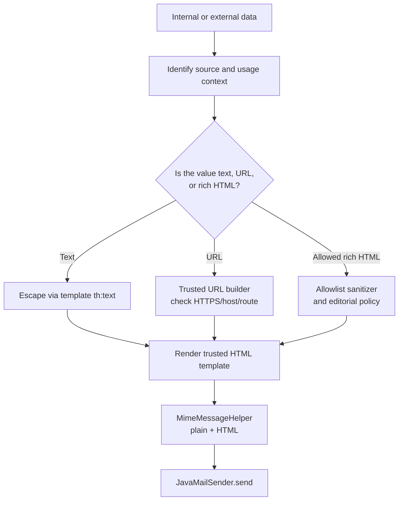

# Do not put scripts or dangerous dynamic content into email

A Spring Boot system sends account confirmation emails in HTML. The development team wants to create a “Confirm now” button, showing the user's name and request details. One developer suggests putting JavaScript into the email to count down the confirmation deadline; another takes the description content entered by the customer as-is and concatenates it into the HTML string. Those ideas raise two different issues:

1. **HTML email is not a full web page.** Most modern email clients block or strip JavaScript, interactive forms, iframes, and many types of active content.
2. **Uncontrolled dynamic data can turn an email into misleading or malicious content.** The fact that an email client has a security filter does not permit the sending application to skip escaping, path checking, or content policies.

In **Spring Framework Mail**, `JavaMailSender`, `MimeMessage`, and `MimeMessageHelper` help create, package, and send emails in MIME format. **They are not HTML filters, do not run JavaScript, and do not automatically guarantee all HTML content is safe.** This lesson explains how to design safe HTML email, distinguish **valid personalization** from **dangerous active content**, and gives Spring Boot examples applicable to transactional emails.

## 1. How does HTML email differ from a web page?

HTML email uses a MIME part with `Content-Type: text/html`. However, the display environment depends on the receiving application: Gmail, Outlook, Apple Mail, corporate webmail, mobile apps, or an intermediate security system. Each place may apply different filters and rendering engines.

| Capability | Ordinary web page | Ordinary HTML email |
|---|---|---|
| Basic HTML: `p`, `h1`, `table`, `a` | Supported | Usually supported, though presentation may differ. |
| CSS | Broad support | **Inconsistent** support; some selectors/properties are ignored. |
| JavaScript | Can run according to web security policy | Usually blocked, stripped, or not executed. |
| Input forms and data submission | Usable | Unreliable; usually disabled or handled differently. |
| iframe, embed, object | Usable per web policy | Usually blocked or sanitized. |
| Content loaded from external domains | Loadable per browser policy | May be blocked, proxied, or loaded only when recipient allows. |
| Cookies/local storage/browser APIs | Accessible in web context | Cannot be relied upon from HTML email. |
| Responsive layout | CSS/media queries fairly common | Depends on email client; fallback layout needed. |

**Do not write an email like a miniature SPA.** A good email must convey core information with **readable static content** and HTTPS links to a protected website or application. When complex interaction is needed, take users to a dedicated page with full authentication, authorization, and security controls.

### 1.1. Example of what not to do

This HTML snippet **illustrates an unsuitable design**:

```html
<!-- DO NOT put into emails sent to users -->
<h2>Order confirmation</h2>
<script>
  // Expecting the email client to run JavaScript: unreliable.
  document.body.append("Countdown 60 seconds...");
</script>
<form action="https://example.com/confirm" method="post">
  <input name="code" placeholder="Verification code">
  <button type="submit">Send</button>
</form>
```

Risks:

- Scripts usually do not run, so the countdown does not work.
- The form may be stripped or fail to submit as the developer expects.
- Users may not see the button, see a broken layout, or not understand what to do.
- If the email client or intermediate display system has a vulnerability, active content becomes a security risk instead of a reliable feature.

Replace with static content and a link:

```html
<h2>Order confirmation</h2>
<p>Your request is awaiting confirmation.</p>
<p>
  <a href="https://accounts.example.com/orders/DH1024">
    View and confirm on the account page
  </a>
</p>
<p>If you did not request this action, please ignore this email.</p>
```

The link example here illustrates a path belonging to a **system-managed domain**. In a real product, you must build the URL from trusted configuration, attach an identifier/token when needed, check access rights at the destination page, and never treat the user **seeing** the link as already authenticated.

## 2. Is “dynamic content” always dangerous?

**No.** Email can be heavily personalized while remaining safe.

Examples of valid dynamic content:

- Recipient name: `An Van Nguyen`.
- Order code: `DH1024`.
- Formatted amount: `$125.00`.
- Appointment time: `14:30 on 15/11/2026`.
- Product list, delivery status, service plan name.
- A link to a verification/account page generated from a trusted domain.

The issue is not that **data changes between emails**, but putting untrusted data into contexts that can be interpreted as **HTML markup, attributes, CSS, URLs, or active commands**.

| Content type | Example | Appropriate handling |
|---|---|---|
| Dynamic text values | Customer name, shipping address | **HTML-escape** before placing into text nodes. |
| Dynamic HTML attributes | `alt`, `title` | Escape for the **attribute context**, use a template engine. |
| Dynamic URLs | Verification link, view invoice | Build/validate URL from trusted source, allow only permitted schemes/domains; then escape attribute. |
| Business-edited HTML snippets | Formatted notification content | Prefer controlled templates or an appropriate allowlist sanitizer. |
| User-entered HTML | Comments, incident descriptions, UGC content | Display by default **as escaped text**; do not render directly as markup. |
| Scripts or JavaScript events | `script`, `onclick`, `onload` | Do not put into email. |
| Forms, iframes, objects, embeds | Password fields, money-transfer forms | Do not put into email; move to an authenticated web page. |
| Untrusted CSS/URLs | `style`, `url(...)`, external stylesheets | Do not let arbitrary data control them; use static CSS and approved resources. |

**Foundational rule:** *Templates are controlled code; business data is data*. Do not mix the two roles by concatenating strings without escaping.

## 3. HTML elements that should not be put into email

### 3.1. `script` and inline JavaScript

Do not put JavaScript into email in any form:

```html
<!-- All unsuitable for HTML email -->
<script src="https://example.com/app.js"></script>
<script>alert("Hello");</script>
<a href="javascript:alert('clicked')">Click here</a>

<button onclick="submitOrder()">Confirm</button>
```

Those techniques depend on running JavaScript, which most mail clients block. Besides not working, they are also **dangerous input forms** if forwarded to a less secure HTML rendering system.

Outgoing emails should contain:

- Meaningful text.
- Simple presentational HTML tags.
- Validated `https://...` links.
- Permitted images/resources that do not need scripts to display.

Do not create content that becomes readable only after JavaScript runs.

### 3.2. Event handlers in attributes

Attributes starting with `on...` can attach behavior when an event fires, such as `onclick`, `onerror`, or `onload`.

```html
<!-- Unsafe example, do not put in email -->

<a href="https://example.com" onclick="runCode()">View details</a>
```

Do not rely on “the email client will definitely strip these attributes”. The sending system must proactively produce HTML without them, because content may pass through different processors, previews, or HTML archiving systems.

### 3.3. iframe, object, embed, and embedded content

```html
<!-- DO NOT use for ordinary HTML email -->
<iframe src="https://example.com/dashboard"></iframe>
<object data="https://example.com/document"></object>
<embed src="https://example.com/animation">
```

These elements are not reliable ways to display dashboards, forms, or documents in email. Replace them with a **static summary** and an HTTPS link to a protected page.

### 3.4. Forms entering sensitive information

Do not ask users to enter **passwords, OTP codes, payment information, or secret data** into an HTML form inside an email. Emails can be forwarded, screenshotted, displayed through gateways, or spoofed. Many email clients block forms; even if a form worked, it could train dangerous habits in users.

Instead of:

```html
<!-- Design not to apply -->
<form action="https://example.com/login" method="post">
  <input type="password" name="password">
  <button>Log in</button>
</form>
```

use:

```html
<p>To manage your account, please visit the official page.</p>
<a href="https://accounts.example.com/login">Open login page</a>
```

The destination page must check **TLS, authentication, CSRF, authorization, session lifetime, and input validation** itself. Do not shift that responsibility onto a button inside an email.

### 3.5. SVG and images carrying active content

SVG is an XML-based image format and in some contexts can contain scripts, external references, or active components. Allowing SVG uploads and putting them straight into email as HTML/inline code can create risks when passing through different display systems.

If logos, simple charts, or illustrations are needed, the pragmatic choice is usually **PNG/JPEG generated from a trusted source**, using matching `alt`. For SVGs or user-supplied files, a dedicated inspection/conversion policy is needed; do not trust solely based on `Content-Type: image/svg+xml`.

## 4. HTML injection: dangerous even when scripts usually do not run

Suppose a form lets customers enter their name:

```text
An Van Nguyen
```

The developer builds the email:

```java
// DO NOT: user-originating content concatenated directly as HTML.
String html = "<p>Hello " + customerName + "</p>"
        + "<p>Your order has been recorded.</p>";
```

If `customerName` contains markup-like characters, such as:

```text
<strong>VIP Customer</strong>
```

then the sent content is no longer *a user name as text*. It can become **user-controlled HTML**.

The content can also impersonate the brand, insert links to another domain, create requests to transfer money, or alter the layout. JavaScript does not need to run for risk to exist: **HTML injection can turn an email into a misleading message**.

### 4.1. Escape text instead of manually “filtering bad characters”

If data plays only a text role, HTML-escape it before rendering:

| Character | Common HTML representation |
|---|---|
| `&` | `&amp;` |
| `<` | `&lt;` |
| `>` | `&gt;` |
| `"` | `&quot;` in attribute context |
| `'` | Can be represented with a context-appropriate entity |

In Java, **do not write an ad-hoc character replacement function** if the project already uses a template engine with context-aware escaping. Correctness also depends on replacement order, character encoding, and where it is inserted into HTML.

Example of desired HTML after escaping:

```html
<p>Hello &lt;strong&gt;VIP Customer&lt;/strong&gt;</p>
```

The recipient sees the string `<strong>VIP Customer</strong>` as **text**, not a real HTML tag.

### 4.2. HTML escaping does not mean URL validation

Suppose the template uses:

```html
<a th:href="${actionUrl}">Confirm</a>
```

The template engine can escape characters so they do not break **HTML attribute syntax**. However, if `actionUrl` is controlled by an attacker, it can still point to a spoofed page or use a dangerous URL scheme. **Escaping solves syntax; it does not decide which links are allowed.**

Therefore **two separate steps** are needed:

1. Check/construct a trusted URL: `https` scheme, hostname in allowlist, application-controlled path, valid token.
2. Let the template engine escape the URL in the `href` attribute for the HTML context.

Do not use `contains("example.com")` or `endsWith("example.com")` on raw URL strings to decide trusted links; those checks easily fail with hostnames, userinfo, subdomains, or URL representations.

## 5. URLs in email: use only controlled destinations

### 5.1. URL groups to avoid

| URL/value type | Problem |
|---|---|
| `javascript:...` | Not a safe navigation link; can trigger scripts in environments that allow them. |
| `data:...` | Can embed arbitrary content; unsuitable as a trusted action link. |
| `file:...` | Refers to local resources; not a valid navigation target for user-facing email. |
| `http://...` | Unencrypted connection; unsuitable for login/verification links or sensitive data. |
| Unvalidated user-entered links | Can lead to phishing, unwanted redirects, or disallowed domains. |
| Shortened links not controlled by the system | Obscure the real destination and make trust hard to assess. |
| Links containing long-lived secrets | Risk exposure via email forwarding, history, logs, or intermediate systems. |

A “Confirm account” button in email should be **an `a` tag with an HTTPS URL**, not a JavaScript event handler.

### 5.2. Example of checking a URI before passing it into a template

Suppose the service only allows verification links belonging to **`accounts.example.com`**, over HTTPS default port or 443, with a fixed path starting with `/verify`.

```java
import java.net.URI;
import java.util.Locale;

public final class MailLinks {

    private MailLinks() {}

    public static URI requireVerificationLink(String rawUrl) {
        if (rawUrl == null || rawUrl.isBlank()) {
            throw new IllegalArgumentException("Verification URL required");
        }

        URI uri = URI.create(rawUrl);
        if (!uri.isAbsolute()
                || !"https".equalsIgnoreCase(uri.getScheme())
                || uri.getHost() == null
                || uri.getRawUserInfo() != null
                || uri.getRawFragment() != null) {
            throw new IllegalArgumentException("Unsafe verification URL");
        }

        String host = uri.getHost().toLowerCase(Locale.ROOT);
        if (!host.equals("accounts.example.com")) {
            throw new IllegalArgumentException("Unexpected URL host");
        }

        int port = uri.getPort();
        if (port != -1 && port != 443) {
            throw new IllegalArgumentException("Unexpected URL port");
        }

        String path = uri.getRawPath();
        if (!"/verify".equals(path)) {
            throw new IllegalArgumentException("Unexpected URL path");
        }

        return uri;
    }
}
```

This is an **illustrative validator for one specific URL flow**. It is not a library checking every kind of URL, and does not replace **token generation, authorization, expiry checks, or replay protection** on the backend. The exact path policy in the example limits open redirect/path confusion; for projects needing multiple paths, **build URLs from fixed domain configuration and defined routes**, instead of extending with arbitrary string checks.

When generating verification links yourself, let the **application create the link from a reliably configured base URL** and encode the token in query/path according to rules, rather than accepting an arbitrary destination URL from an HTTP request. Some operations with tokens in URLs must consider logs, referrers, proxies, and email forwarding; tokens need to be random, short-lived, and minimally scoped.

### 5.3. Links leading to login/verification pages, not performing sensitive actions via plain GET

Some systems send links for users to verify email or reset passwords. Consider mail security systems that **automatically scan/visit links** before the recipient clicks.

If a `GET /delete-account?token=...` request automatically performs an irreversible action, link scanners may trigger it accidentally. For sensitive operations, use a link leading to a **confirmation page** and require an intentional action, combined with appropriate authentication/authorization mechanisms. Do not design destructive actions based solely on a URL being opened.

## 6. Spring Mail sends HTML yet does not “clean” HTML automatically

### 6.1. Distinguishing the layers

| Component | Responsibility |
|---|---|
| `JavaMailSender` | Creates and sends messages via Jakarta Mail/SMTP transport. |
| `MimeMessage` | Represents MIME email: headers, body, content parts. |
| `MimeMessageHelper` | Helps set `From`, `To`, `Subject`, text/HTML, attachments, inline resources. |
| Template engine (e.g., Thymeleaf) | Builds HTML strings from templates and data; can escape expressions when the right API is used. |
| Validators and business policies | Control URLs, permitted data, outgoing content, and recipient scope. |
| Allowlist sanitizer (when needed) | Restricts the allowed HTML subset for untrusted rich-text data. |
| Email client | Displays the message according to recipient policy; must not be treated as the sole protective layer. |

Direct example:

```java
MimeMessage message = mailSender.createMimeMessage();
MimeMessageHelper helper =
        new MimeMessageHelper(message, false, "UTF-8");

helper.setFrom("notifications@example.com");
helper.setTo("an@example.net");
helper.setSubject("System notification");
helper.setText(htmlContent, true);

mailSender.send(message);
```

The `true` parameter in `setText(htmlContent, true)` means **the body is marked as HTML**, **not** that Spring has stripped `script` or guaranteed `htmlContent` is safe. If `htmlContent` was built from unvalidated user strings, the bug lies in the earlier **content construction process**.

### 6.2. Sending both `text/plain` and `text/html`

An approach compatible with many email clients is creating both a **plain-text version** and an **HTML version**:

```java
MimeMessage message = mailSender.createMimeMessage();
MimeMessageHelper helper =
        new MimeMessageHelper(message, true, "UTF-8");

helper.setFrom("notifications@example.com");
helper.setTo("an@example.net");
helper.setSubject("Registration confirmation");
helper.setText(
        "Thank you for registering. Please open the verification page from the link in this email.",
        "<h1>Registration confirmation</h1><p>Thank you for registering.</p>"
                + "<p><a href=\"https://accounts.example.com/verify\">"
                + "Verify account</a></p>");

mailSender.send(message);
```

The `setText(String plainText, String htmlText)` overload builds **`multipart/alternative`** and requires the helper to have **multipart enabled**. In practice, **plain text should contain equivalent information and URLs**, not just say “view HTML” like the short snippet above. Users may use a client that does not display HTML or a screen reader, so the plain-text part is content with real value.

For simple text-only emails, `SimpleMailMessage` is even cleaner and avoids many HTML issues.

## 7. Using Thymeleaf to insert dynamic data safely

When email content has customer names, order numbers, and links, concatenating HTML strings directly in Java is hard to control. A **template engine** separates edited HTML from dynamic data.

In the Spring Boot ecosystem, **Thymeleaf** can be used. This example assumes the project has added the Thymeleaf dependency matching its Spring Boot version and configured the template resolver per the application's conventions.

### 7.1. HTML template using `th:text`

File `src/main/resources/templates/mail/verification.html`:

```html
<!doctype html>
<html lang="en" xmlns:th="http://www.thymeleaf.org">
<head>
  <meta charset="UTF-8">
  <title>Account verification</title>
</head>
<body style="font-family: Arial, sans-serif; color: #222;">
  <table role="presentation" cellpadding="0" cellspacing="0"
         style="max-width: 600px; width: 100%;">
    <tr>
      <td>
        <h1>Account verification</h1>
        <p>
          Hello <strong th:text="${displayName}">friend</strong>,
        </p>
        <p>
          We have received your account registration request.
          Please click the following link to continue.
        </p>
        <p>
          <a th:href="${verificationUrl}"
             href="https://accounts.example.com/"
             style="background: #154f8d; color: #fff;
                    padding: 12px 18px; text-decoration: none;">
            Verify account
          </a>
        </p>
        <p>If you did not request registration, please ignore this email.</p>
      </td>
    </tr>
  </table>
</body>
</html>
```

In Thymeleaf:

- **`th:text`** inserts values into text nodes as **escaped text**, suitable for customer names and untrusted text data.
- **`th:href`** puts values into URL attributes; it helps build/escape the attribute per the template engine, **yet does not verify the URL's domain or scheme**.
- **`th:utext`** inserts **unescaped HTML**. Do not use `th:utext` for data coming directly from users, external APIs, or uncontrolled databases.
- HTML/CSS in templates is **code-reviewed static structure**, not code generated from free-form data.

Example of a user having the name:

```text
<b>Administrator</b>
```

`th:text` makes the client see the text `<b>Administrator</b>`, rather than treating that value as a `b` tag. This is the desired behavior for **names**, because a name is text data.

### 7.2. Java service: render then send MIME

Spring Boot example with `JavaMailSender` and `SpringTemplateEngine`:

```java
package com.example.mail;

import jakarta.mail.MessagingException;
import jakarta.mail.internet.MimeMessage;
import org.springframework.beans.factory.annotation.Value;
import org.springframework.mail.javamail.JavaMailSender;
import org.springframework.mail.javamail.MimeMessageHelper;
import org.springframework.stereotype.Service;
import org.thymeleaf.TemplateEngine;
import org.thymeleaf.context.Context;

import java.net.URI;
import java.util.Locale;

@Service
public class VerificationEmailSender {

    private final JavaMailSender mailSender;
    private final TemplateEngine templateEngine;
    private final String fromAddress;

    public VerificationEmailSender(
            JavaMailSender mailSender,
            TemplateEngine templateEngine,
            @Value("${app.mail.from}") String fromAddress) {
        this.mailSender = mailSender;
        this.templateEngine = templateEngine;
        this.fromAddress = fromAddress;
    }

    public void send(
            String recipient,
            String displayName,
            String verificationUrl) throws MessagingException {

        // URL was created from trusted configuration at the business layer
        // and must satisfy the product's routing policy.
        URI safeUrl = MailLinks.requireVerificationLink(verificationUrl);

        // Text data is escaped by th:text in the template.
        Context context = new Context(Locale.forLanguageTag("en-US"));
        context.setVariable("displayName", displayName);
        context.setVariable("verificationUrl", safeUrl.toASCIIString());

        String html = templateEngine.process(
                "mail/verification", context);

        String plain = "Hello " + displayName
                + ". Please verify your account at: "
                + safeUrl.toASCIIString()
                + ". If you did not request registration, please ignore this email.";

        MimeMessage message = mailSender.createMimeMessage();
        MimeMessageHelper helper =
                new MimeMessageHelper(message, true, "UTF-8");

        helper.setFrom(fromAddress);
        helper.setTo(recipient);
        helper.setSubject("Account verification");
        helper.setText(plain, html);

        mailSender.send(message);
    }
}
```

`MailLinks` in the example is the utility defined in the previous section. To complete it in a real application, check the **recipient**, sending policy, length limit of `displayName`, and token issuance flow. The class above focuses on illustrating **separating HTML rendering from SMTP transport**. In particular, `plain` is just a text string so it does not need HTML escaping, yet you must still control control characters, length, and content so as not to produce misleading emails.

Common dependency when using Spring Boot with Gradle:

```groovy
dependencies {
    implementation 'org.springframework.boot:spring-boot-starter-mail'
    implementation 'org.springframework.boot:spring-boot-starter-thymeleaf'
}
```

`application.yml` for SMTP submission with STARTTLS:

```yaml
spring:
  mail:
    host: ${MAIL_HOST}
    port: 587
    username: ${MAIL_USERNAME}
    password: ${MAIL_PASSWORD}
    protocol: smtp
    default-encoding: UTF-8
    properties:
      "[mail.smtp.auth]": true
      "[mail.smtp.starttls.enable]": true
      "[mail.smtp.starttls.required]": true
      "[mail.smtp.ssl.checkserveridentity]": true
      "[mail.smtp.connectiontimeout]": 5000
      "[mail.smtp.timeout]": 10000
      "[mail.smtp.writetimeout]": 10000

app:
  mail:
    from: ${MAIL_FROM:notifications@example.com}
```

This is an illustrative configuration for a provider supporting **port 587 and STARTTLS**. Environment variables must be supplied from the deployment system; do not put SMTP passwords in the repository. Providers using implicit TLS on port 465 need a corresponding TLS/transport configuration. SMTP TLS configuration protects the **sending connection**; it does not automatically sanitize HTML and does not guarantee the message is read by the recipient.

### 7.3. Common mistakes when using Thymeleaf

Wrong because it renders the user's name as HTML:

```html
<!-- DO NOT use with names or untrusted data -->
<p th:utext="${displayName}">User name</p>
```

Wrong because it takes an arbitrary URL and assumes `th:href` already protects everything:

```java
context.setVariable("verificationUrl", request.getRedirectUrl());
```

Wrong because it assembles HTML attributes manually:

```java
// DO NOT: turn user data into markup directly.
String html = "<a href=\"" + request.getUrl() + "\">Confirm</a>";
```

Better:

1. Get the URL from a **trusted link builder**, not from an arbitrary redirect.
2. Check domain, scheme, route, and token on the backend.
3. Pass **logical values** into the context.
4. Use `th:text` and `th:href` to render in the right context.
5. Do not put `th:utext` into templates for free-form data.

## 8. If the business genuinely needs user-edited rich text

Some products let staff compose formatted email content: bold, italics, paragraphs, lists, or links. Data may come from a WYSIWYG editor as HTML.

That is a **different problem from inserting user names**. If the business only needs text, **escape and display as text**. If the business needs to preserve a very small set of HTML, an appropriate **allowlist-based sanitizer** is required.

### 8.1. Do not use a blacklist of dangerous keywords

Approaches such as:

```java
// Wrong idea: not enough to make arbitrary HTML safe.
html = html.replace("<script>", "");
html = html.replace("javascript:", "");
```

are unsafe because HTML has many syntax variants, letter cases, encodings, attributes, and contexts. String-based replacement can miss risks or corrupt valid content.

### 8.2. Allowlist by element and attribute

A sample policy for product introduction emails might allow only:

- Simple presentational tags: `p`, `br`, `strong`, `em`, `ul`, `ol`, `li`.
- The `a` tag if the URL is permitted; restrict the `href` attribute by policy.
- Disallow `script`, arbitrary `style`, `iframe`, `object`, `form`, inline SVG, or `on...` event attributes.

Example of the idea of using the **jsoup** library to clean HTML:

```java
import org.jsoup.Jsoup;
import org.jsoup.safety.Safelist;

public final class MailRichText {
    private MailRichText() {}

    public static String clean(String untrustedHtml) {
        Safelist allowed = new Safelist()
                .addTags("p", "br", "strong", "em", "ul", "ol", "li");

        // Very narrow example policy: text and formatting only,
        // user-inserted links or images are not permitted.
        return Jsoup.clean(untrustedHtml, allowed);
    }
}
```

This example needs a **separate jsoup dependency**, which is not available just from adding `spring-boot-starter-mail`. It illustrates **a simple allowlist** and deliberately forbids user-supplied links/images. If `a href` must be allowed, there must be a clear URL policy and protocol/host checks matching product requirements.

**Important:** a sanitizer is a protective layer that must be properly configured and kept up to date; it does not turn all HTML into absolute safety. If you want to put sanitizer-approved HTML into a template, that must be **a separate flow with clear rules**, not turning on `th:utext` arbitrarily for every field. Ideally, limit who is allowed to edit rich HTML, store content history, and control template releases.

### 8.3. Rich text does not mean JavaScript

Even with a sanitizer, **there is no need and no reason to keep scripts** to make rich email. Composed content should be limited to presentation and controlled links. Dynamic features like live charts, current order status, or interactive forms belong on the website/app behind the link.

## 9. CSS in email: focus on display, do not use CSS as a channel for arbitrary content

CSS in email has uneven support. Some clients handle inline styles better than complex stylesheets; many properties and media queries may be ignored.

### 9.1. Use only CSS controlled by the application

Example HTML email with a simple layout:

```html
<table role="presentation" style="width: 100%; max-width: 600px;">
  <tr>
    <td style="font-family: Arial, sans-serif; line-height: 1.5;">
      <h1 style="font-size: 22px;">Order update</h1>
      <p>Your order has been confirmed.</p>
      <a href="https://orders.example.com/"
         style="color: #154f8d; text-decoration: underline;">
        View details
      </a>
    </td>
  </tr>
</table>
```

This is a static HTML email example. Depending on the client, some styles may still be altered or ignored. **Main content must be readable even when CSS does not work.**

### 9.2. Do not inject arbitrary CSS or background images from users

If users are allowed to control raw `style="..."`, content could:

- Hide important text or create spoofed overlays.
- Create remote links/resources via `url(...)` in supported contexts.
- Attempt to load external content or cause rendering errors in clients.
- Make the email unreadable when the client drops part of the CSS.

Therefore, input data should only determine **business values**; choosing colors, typography, spacing, and structure belongs to trusted templates. If themes are needed, use a predefined set of values rather than injecting arbitrary CSS.

### 9.3. Dark mode, responsive design, and accessibility

Email clients can alter colors in dark mode, limit width on phones, or not support selectors. To keep email usable:

1. Choose reasonable text contrast and avoid using color alone to convey status.
2. Use concise content, readable font sizes, and clearly named links.
3. Add `alt` to meaningful images.
4. Do not put all text inside images.
5. Include an equivalent `text/plain` version when sending MIME multipart/alternative.
6. Check the email on the clients your product's users commonly use during content testing.

## 10. External images and personal data

In HTML email, images can be referenced by URL:

```html

```

Yet remote resources depend on the email client's policy. The receiving app may **block image loading, load via proxy, or load only when the user permits**. You cannot rely on a remote image to convey mandatory information.

### 10.1. Remote images can create privacy risks

Each time a remote resource is requested, the hosting system may observe metadata such as access time and network/proxy info depending on the client. **Tracking pixels** are a sensitive example: an email may contain a tiny image with a per-recipient URL to infer open behavior.

These signals are **not reliable as proof that the user actually read the email**, because some clients prefetch images, use proxies, or block loading. When an application uses tracking features, it must comply with privacy policies, recipient choices, and applicable regulations.

### 10.2. Inline images via Content-ID

If you want a logo sent along with the email, you can use **CID** instead of relying on remote images:

```java
MimeMessage message = mailSender.createMimeMessage();
MimeMessageHelper helper = new MimeMessageHelper(
        message,
        MimeMessageHelper.MULTIPART_MODE_MIXED_RELATED,
        "UTF-8");

helper.setFrom("notifications@example.com");
helper.setTo("an@example.net");
helper.setSubject("Notification");
helper.setText(
        "System notification.",
        "<p>System notification.</p>"
                + "");

helper.addInline(
        "company-logo",
        new ClassPathResource("mail/company-logo.png"),
        "image/png");

mailSender.send(message);
```

Here you need to import `org.springframework.core.io.ClassPathResource` along with the corresponding Spring Mail/Jakarta Mail APIs. The resource `mail/company-logo.png` must exist on the classpath. **Call `setText` before `addInline`** to help email clients recognize the HTML structure and related resources.

Inline images do not run scripts if the application only sends controlled raster images. Still, clients may block/display them differently; the email should have a text version and meaningful `alt`.

## 11. Content returned by external systems must still be treated as untrusted data

Not only data from web forms is dangerous. An email-sending system may pull information from:

- Partner APIs.
- Support ticket content entered by customers.
- CRM, order management systems, or databases imported from files.
- Results from search engines, content aggregators, or AI.
- Webhooks from external services.

For example, a CRM returns `customerDisplayName` or `ticketDescription` containing markup. **Even if data passes through an internal system, its original source may still be a user or third party.**

Appropriate flow:



Do not let free-form paragraphs from external systems be interpreted as commands in the pipeline, as live HTML, or as a link that can send users to an arbitrary domain.

## 12. Special cases and misconceptions to avoid

### 12.1. “The email client already blocks scripts, so it's fine if I send scripts anyway”

**Wrong in design.** Results will be inconsistent across clients, the email may break layout, or gateways may flag it as suspicious. Content may also be re-rendered by preview systems, archives, or internal dashboards with varying protection levels. **Eliminating scripts at the source** is a simple and durable principle.

### 12.2. “`MimeMessageHelper.setText(html, true)` will sanitize HTML”

**No.** The `true` parameter specifies **HTML content**; it does not run an XSS filter or tag allowlist. You must escape data when rendering templates or use a separate sanitizer if genuinely accepting rich HTML.

### 12.3. “Using `th:text` makes every link safe too”

**No.** `th:text` is suitable for text nodes. URLs need scheme, host, route, and link-source checks before being placed in `th:href`. A link pointing to a spoofed website remains a dangerous link even though HTML syntax has been escaped.

### 12.4. “Just `replace("<script>", "")` is enough”

**No.** Manual blacklists can miss many HTML variants, event handlers, URL schemes, and dangerous attributes. When data is just text, escape it; when rich HTML must be accepted, use a maintained **allowlist sanitizer** with clear scope.

### 12.5. “Images in email will definitely display”

**No.** Remote images can be blocked/proxied, and inline CID can also be handled differently by clients. Main content should not depend on images; always include `alt` and a text version.

### 12.6. “All dynamic content must be banned”

**No.** Recipient name, order code, appointment time, and payment status are necessary dynamic content. What must be forbidden is **dangerous active content or untrusted data interpreted as arbitrary markup/URL/CSS**. Safe personalization is rendering data in the right context.

### 12.7. “Interactive email forms can be sent like an SPA page”

For **ordinary HTML email**, do not rely on forms, JavaScript, iframes, or client state. Some ecosystems have specialized interactive formats (such as AMP for Email) with dedicated support and authentication mechanisms; those are **not** a reason to put arbitrary JavaScript into `text/html`. If genuinely implementing a dedicated format, you must follow its specification and provider policies, while keeping an HTML/text fallback.

### 12.8. “Sending safe HTML email makes phishing impossible”

**False.** An email with no scripts can still lead users to phishing links or contain spoofed content. Beyond HTML control, the sending system must manage domains and `From` accounts, domain authentication (SPF, DKIM, DMARC per infrastructure), content abuse prevention, and link verification. Safe presentation is one layer of trustworthy email design.

## 13. Operations and content control before release

In a system with many email templates, split responsibilities:

| Layer | Decision |
|---|---|
| **Business logic** | Which notification type is sent, who the recipient is, what data is allowed in the email. |
| **Template** | HTML layout, text presentation, static CSS, links/CTAs, and approved resources. |
| **Data validation** | Length, format, URLs, order codes, user content. |
| **HTML escaping / sanitizer** | How untrusted data is turned into safely renderable content. |
| **Mail composer** | Uses `MimeMessageHelper` to build text/plain, text/html, inline, and attachments. |
| **SMTP sender** | Sends via `JavaMailSender` with appropriate TLS/AUTH and timeouts. |
| **Observability** | Tracks template version, notification ID, submission/delivery results, and errors, without logging secrets. |

### 13.1. Template versioning and data limits

If an email is an important transactional document, manage template versions to explain what content a notification was sent with. Input data should have **length and type limits**: an overly long name can break layout; a multi-megabyte description can push the email past provider quotas.

For emails containing OTPs or password reset links, never log secret content; use a notification ID/correlation ID for investigation. If evidence must be retained for auditing, weigh security policy, retention period, and access rights instead of storing every email verbatim.

### 13.2. Checking display in a safe environment

During development, use an SMTP catcher or provider sandbox to view emails before real sending. Cases to pay attention to:

- HTML displays reasonably if CSS or images fail to load.
- Plain-text version is complete, containing links and necessary details.
- Names with Vietnamese diacritics and `<`, `&` characters are displayed as text.
- Links lead to the right domain and contain no out-of-policy redirects.
- No `script`, `on...` handlers, forms, or unintended external resources appear.
- HTML email is readable on desktop, mobile, dark mode, and target clients.
- Data supplied by external systems does not alter HTML structure unintentionally.

These are testing goals in the product development lifecycle; **`MimeMessageHelper` does not perform these verifications automatically**.

## 14. Practice exercises

### Exercise 1 — Separating data and markup

An application has:

```java
String html = "<p>Hello " + input.displayName() + "</p>";
```

Identify the risk when `displayName` contains `<a href="...">...` or `<strong>...`. Rewrite the Thymeleaf template using `th:text` so the name is always text.

### Exercise 2 — Verification link

A REST request contains a user-entered `redirectUrl`. The developer puts that value straight into `th:href` on the “Verify account” button.

Explain:

1. Why HTML escaping is not enough to protect the link?
2. How should the application build the URL from a trusted domain?
3. How should `javascript:`, `http:`, spoofed hostnames, or unusual ports be handled?
4. Why do links with tokens need specific expirations and permissions?

### Exercise 3 — Countdown JavaScript

An email notifies that a verification code expires in 5 minutes. The development team wants to use JavaScript to update a countdown number in HTML every second.

Propose a static alternative so recipients know the deadline while the email remains useful when scripts are blocked. If the deadline needs real-time updates, where should the application place that logic?

### Exercise 4 — Customer-entered HTML

A support agent sends a customer an email containing a ticket description entered by another user. The description may contain HTML.

When should the entire thing be escaped as text? If the product requires rich text support, propose a small allowlist and explain why not to use a `<script>` blacklist.

### Exercise 5 — Images and privacy

Design an email with a logo fetched from a remote URL and a 1×1 px image carrying a recipient ID. Distinguish the purposes of the two images, privacy impacts, and why image loading is not definitive proof a real person read the email.

### Exercise 6 — Multipart/alternative

Write Java using `MimeMessageHelper` to send content containing:

- `text/plain` describing order status and an HTTPS link.
- `text/html` creating a “View order” button.
- A Vietnamese customer name properly HTML-escaped.

Explain why the helper needs multipart mode when using `setText(plain, html)`, and why `setText(html, true)` must not be called with HTML concatenated directly from user data.

### Exercise 7 — Checking content from an external API

A third-party API returns data:

```json
{
  "productName": "Thermos flask",
  "description": "<strong>Discount!</strong>",
  "productLink": "https://partner.example/items/123"
}
```

Design how to display the fields in the email: which field should be escaped as text, which needs URL checking, and when (if ever) is it allowed to keep a portion of cleaned rich HTML?

## 15. Takeaways and references

When building **HTML email with Spring Framework Mail**:

1. **Do not put JavaScript, event handlers, iframes, interactive forms, or dangerous active content into `text/html`.** Email clients usually block them and should not be treated as a runtime for web applications.
2. **Personalization does not mean allowing arbitrary HTML.** User names and business data need context-aware escaping.
3. **`MimeMessageHelper` does not sanitize HTML.** `setText(html, true)` only creates the HTML part in MIME; the template engine/validator/sanitizer is responsible for input.
4. **Links must be checked separately.** HTML escaping does not replace HTTPS, domain/route validation, open-redirect prevention, and token management.
5. **Prefer static, readable content with a `text/plain` fallback.** Images and CSS must have a display plan when blocked or unsupported.
6. **If user-edited rich HTML is needed, use an allowlist sanitizer under a clear policy.** Do not filter with simple `String.replace(...)` calls.
7. **Separate rendering and sending.** Templates build HTML, `MimeMessageHelper` packages MIME, `JavaMailSender` sends via SMTP; the business flow manages sending permission and delivery results.

Materials for further study:

- **Spring Framework Reference — Email:** `JavaMailSender`, `MimeMessageHelper`, and how to build MIME messages.
- **Spring Framework API — `MimeMessageHelper`:** `setText`, multipart, inline resources, and header methods.
- **Thymeleaf Documentation — Standard Dialect:** `th:text`, `th:utext`, `th:href`, and HTML escaping.
- **jsoup Documentation — Safelist/Cleaner:** HTML cleaning model using a list of allowed elements/attributes.
- **RFC 2045–2049 — MIME:** email content structure and `text/plain`, `text/html` types.
- **RFC 5322 — Internet Message Format:** email header and body format.
- **OWASP Cross Site Scripting Prevention Cheat Sheet:** context-based escaping and distinguishing encoding from sanitization.

**Conclusion:** A good HTML email is **a trustworthy, readable message**, not a miniature web page. Spring Mail helps send that message, yet the application must proactively remove unsuitable active content, escape dynamic data, control URLs, and keep HTML structure inside managed templates.
