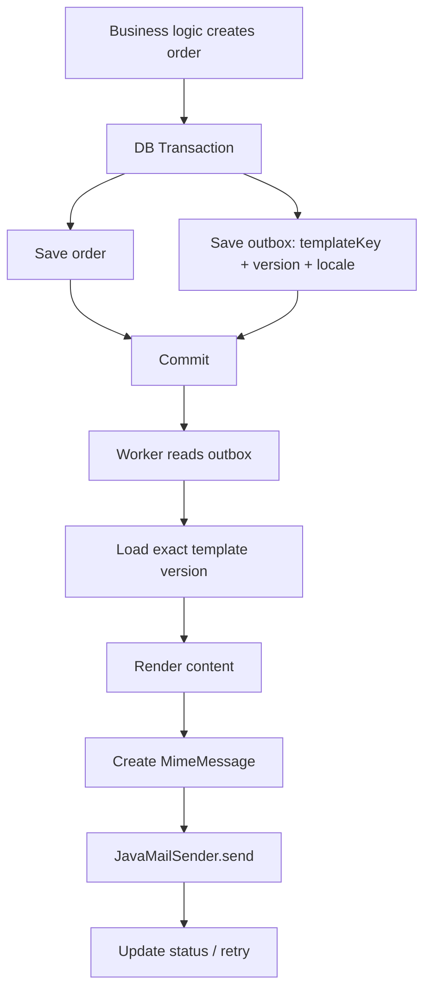
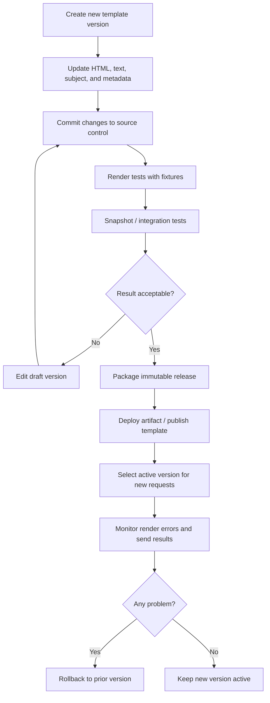

# Keeping templates versioned and tracking content changes

In **Spring Framework Mail**, email HTML content changes often: product teams revise wording, update logos, replace links, add legal notices, or adjust layouts. If HTML is assembled directly in a Java service, each change may entail editing code, building, and redeploying the application. When an email goes out wrong, operations teams also struggle to know exactly **which content version was used**.

A better way to organize is to manage **versioned email templates** and record that version in every send request. Templates become assets with change history that can be tested, released, and rolled back. Spring Mail remains responsible for creating and sending messages; a template engine such as Thymeleaf or FreeMarker handles rendering HTML from templates and data.

This lesson covers how to design the template lifecycle, directory structure, rendering in Spring, tracking content changes, storing versions in an outbox, testing, and executing rollbacks. The goal is to be able to answer: **which template, which version, which locale, and which data contract generated a specific email?**

## 1. Why should templates be versioned?

Suppose the application sends order confirmation emails. The first version displays order number, total amount, and a view-details link. Later the content team makes changes:

- Updates the greeting and wording.
- Changes the logo and brand colors.
- Adds support information.
- Replaces the order tracking page URL.
- Adds English or Japanese versions.
- Adjusts legal wording at the bottom of the email.

If the application stores only a single `order-confirmation.html` file and overwrites it on every change, an email sent last week is hard to trace back to its original content. If an email sits in a queue for a few hours, the worker might pick up the newest file and send content different from when the business created the request.

Versioning solves three needs:

1. **Reproducibility:** identify the exact template used when an email was generated.
2. **Change control:** know what content changed, why, and which release it belongs to.
3. **Safe deployment:** release a new template, observe results, and revert to a prior version when needed.

### A template version is not the recipient's personal data

| Component | Example | Does it increment the template version? |
|---|---|---|
| Fixed content and layout | Greeting, instructions, logo, HTML structure | Yes, when the template changes. |
| Dynamic data | Recipient name, order number, amount | No; this is render data for each email. |
| Sending configuration | SMTP host, sender address, timeout | No; this is transport configuration. |

If the recipient name changes from “An” to “Binh”, that is not a new template version. If the greeting changes from “Hello” to “Welcome”, the template content changed and needs a new revision/version per project policy.

## 2. Distinguishing template key, version, locale, and variant

A system with many templates usually needs to distinguish:

- **Template key:** stable name of the email type, such as `order-confirmation`.
- **Template version:** immutable version of content, such as `v1` or `v2`.
- **Locale:** language and region, such as `vi-VN`, `en-US`.
- **Variant:** content variation for campaigns or experiments, such as `control` and `campaign-a`.
- **Revision:** specific edit in source control history; may not be released yet.
- **Release:** set of templates included in a deployment or artifact.

A complete identifier:

```text
templateKey = order-confirmation
version     = v3
locale      = vi-VN
variant     = default
```

Do not use an ambiguous string such as `latest` to record in mail-sending records. `latest` is only a dynamic alias; when the template is updated, the same old record may no longer identify the content that was used. Store a **specific version** such as `v3`.

### Choosing a versioning scheme

| Strategy | Example | When appropriate |
|---|---|---|
| Incrementing integers | `1`, `2`, `3` | Simple systems, each release creates a new version. |
| Semantic versioning | `1.2.0`, `2.0.0` | Need to distinguish content changes from data-contract changes. |
| Release ID | `mail-2026-11-12.1` | Templates are released together with a deployment batch. |
| Content hash | `sha256:...` | Need to identify the exact released content bytes. |

For email templates, **immutable version numbers** are usually easiest to operate. They can be combined with Git commits or SHA-256 to trace content accurately. What matters is a consistent version-incrementing rule and that released versions are never overwritten.

## 3. Organizing templates in source code

An easy-to-follow directory structure:

```text
src/main/resources/
└── mail/
    ├── order-confirmation/
    │   ├── v1/
    │   │   ├── vi-VN.html
    │   │   ├── en-US.html
    │   │   └── text.txt
    │   ├── v2/
    │   │   ├── vi-VN.html
    │   │   ├── en-US.html
    │   │   └── text.txt
    │   └── metadata.yml
    └── password-reset/
        ├── v1/
        │   ├── vi-VN.html
        │   └── text.txt
        └── metadata.yml
```

Advantages:

- Each version has its own content, unaffected when later versions are released.
- Multiple locales can be stored inside the same version.
- Easy to review changes via Git diff.
- Easy to package templates inside the application artifact.
- Easy to test a specific version independently of `latest` state.

For example, `order-confirmation/v2/vi-VN.html` is a stable path for the Vietnamese content of version 2.

### Do not overwrite released versions

Suppose `v2` has been used to send emails. When the content team edits a sentence in `v2/vi-VN.html`, subsequent sends still record `v2` even though actual content differs. When investigating old emails, there is no reliable way to know which edition was used.

Rules to apply:

- Released versions are **immutable**.
- Any later content change creates a new version.
- Unreleased drafts can be edited on a working branch.
- On release, associate the version with a specific commit/artifact.
- Rollback means selecting an old version again, not editing the old version's content.

### Shared fragments and assets must also be managed

A template may share a common header/footer. If `v2` references fragment `shared/footer.html` and the fragment is later edited, the effective content of `v2` also changes even if the main file did not change.

There are two approaches:

1. **Version fragments alongside templates:** each version references its corresponding immutable fragment.
2. **Package the entire resolved template:** at release time, store an artifact or snapshot that already includes needed fragments and assets.

Avoid a template version that is immutable in name yet depends on untracked mutable fragments. If exact reproducibility is required, all dependencies at release time must be known.

## 4. Storing metadata for templates

Alongside HTML files, you can store metadata so developers and systems know the template's contract.

Example `metadata.yml`:

```yaml
key: order-confirmation
versions:
  v1:
    status: retired
    locales:
      - vi-VN
      - en-US
    releasedAt: 2026-09-10
    changeSummary: Initial order confirmation email

  v2:
    status: active
    locales:
      - vi-VN
      - en-US
    releasedAt: 2026-11-12
    changeSummary: Updated support information and tracking link
    variables:
      - orderNumber
      - customerName
      - totalAmount
      - trackingUrl
```

Metadata can record template key/version, supported locales, release date, status, change summary, variable list, schema version, commit, and content hash.

The `active` status describes the version used by default, yet **does not replace storing the specific version in each send request**. An already-queued email needs to keep the selected version or follow a clearly defined version-resolution policy.

## 5. Using a template engine with Spring Mail

Spring Framework Mail is responsible for building and sending emails; it does not mandate a single template engine. Applications usually combine Spring Mail with:

- **Thymeleaf:** HTML templates with expressions, fragments, and strong Spring ecosystem integration.
- **FreeMarker:** FTL templates, suitable when rendering content from a model.
- **Mustache:** simple syntax, supporting separation of data and presentation.
- **In-house template engine:** if the application has special caching, versioning, or sandboxing requirements.

The sections below illustrate with Thymeleaf. Template name, version, and locale are chosen before rendering; the HTML result is then passed to `MimeMessageHelper`.

### 5.1. Thymeleaf template

File `mail/order-confirmation/v2/vi-VN.html`:

```html
<!doctype html>
<html lang="en">
<head>
  <meta charset="UTF-8">
  <title>Order confirmation</title>
</head>
<body>
  <main>
    <h1>Hello <span th:text="${customerName}">friend</span>!</h1>
    <p>
      Order
      <strong th:text="${orderNumber}">ORD-0001</strong>
      has been confirmed.
    </p>
    <p>
      Total:
      <strong th:text="${totalAmount}">0</strong>
    </p>
    <p>
      <a th:href="${trackingUrl}">Track order</a>
    </p>
    <p>If you need support, please contact customer care.</p>
  </main>
</body>
</html>
```

`th:text` expressions place values into text content using Thymeleaf's default HTML escaping mechanism. `th:href` sets the URL in the link attribute; the URL still needs to be validated per application policy before rendering.

**Do not put user-supplied strings into HTML via direct string concatenation.** Use the template engine's context-aware escaping mechanism and validate URLs, attributes, fragments, or rich HTML content if present.

### 5.2. Configuring TemplateEngine

```java
import org.springframework.context.annotation.Bean;
import org.springframework.context.annotation.Configuration;
import org.thymeleaf.TemplateEngine;
import org.thymeleaf.templateresolver.ClassLoaderTemplateResolver;

@Configuration
public class MailTemplateConfiguration {

    @Bean
    public TemplateEngine mailTemplateEngine() {
        ClassLoaderTemplateResolver resolver =
                new ClassLoaderTemplateResolver();

        resolver.setPrefix("mail/");
        resolver.setSuffix(".html");
        resolver.setTemplateMode("HTML");
        resolver.setCharacterEncoding("UTF-8");
        resolver.setCacheable(true);

        TemplateEngine engine = new TemplateEngine();
        engine.setTemplateResolver(resolver);
        return engine;
    }
}
```

This resolver searches for templates on the classpath using prefix `mail/` and suffix `.html`. If calling template key `order-confirmation/v2/vi-VN`, the corresponding path is:

```text
mail/order-confirmation/v2/vi-VN.html
```

In an application already using Thymeleaf Web MVC, you can use a separate `TemplateEngine` for email to isolate its resolver, cache, and template location from website views. The example above is minimal configuration; a real project may need dialects, message resolvers, fragment resolvers, and suitable caching rules.

## 6. Rendering a specific version and sending via JavaMailSender

Separate **content rendering** from **SMTP sending**. This allows testing templates independently of transport and recording the selected version.

A data model:

```java
public record OrderConfirmationModel(
        String customerName,
        String orderNumber,
        String totalAmount,
        String trackingUrl
) {
}
```

Renderer accepts key, version, locale, and model:

```java
import java.util.Locale;
import java.util.Map;
import org.springframework.stereotype.Component;
import org.thymeleaf.TemplateEngine;
import org.thymeleaf.context.Context;

@Component
public class MailTemplateRenderer {

    private final TemplateEngine mailTemplateEngine;

    public MailTemplateRenderer(TemplateEngine mailTemplateEngine) {
        this.mailTemplateEngine = mailTemplateEngine;
    }

    public String render(
            String templateKey,
            String version,
            Locale locale,
            Map<String, Object> variables
    ) {
        String templateName = templateKey
                + "/" + version
                + "/" + locale.toLanguageTag();

        Context context = new Context(locale);
        context.setVariables(variables);

        return mailTemplateEngine.process(templateName, context);
    }
}
```

Example call:

```java
Map<String, Object> variables = Map.of(
        "customerName", "An Nguyen",
        "orderNumber", "ORD-2026-001",
        "totalAmount", "1.250.000 VND",
        "trackingUrl", "https://shop.example.org/orders/ORD-2026-001"
);

String html = renderer.render(
        "order-confirmation",
        "v2",
        Locale.forLanguageTag("vi-VN"),
        variables
);
```

Here version `v2` is passed explicitly. The renderer does not look up the newest file on its own; the same send request can be reproduced when a worker runs later.

### Sending the rendered result with Spring Mail

```java
import jakarta.mail.MessagingException;
import jakarta.mail.internet.MimeMessage;
import org.springframework.mail.javamail.JavaMailSender;
import org.springframework.mail.javamail.MimeMessageHelper;
import org.springframework.stereotype.Service;

@Service
public class OrderConfirmationMailer {

    private final JavaMailSender mailSender;
    private final MailTemplateRenderer renderer;

    public OrderConfirmationMailer(
            JavaMailSender mailSender,
            MailTemplateRenderer renderer
    ) {
        this.mailSender = mailSender;
        this.renderer = renderer;
    }

    public void send(
            String recipient,
            OrderConfirmationModel model
    ) throws MessagingException {

        String html = renderer.render(
                "order-confirmation",
                "v2",
                java.util.Locale.forLanguageTag("vi-VN"),
                java.util.Map.of(
                        "customerName", model.customerName(),
                        "orderNumber", model.orderNumber(),
                        "totalAmount", model.totalAmount(),
                        "trackingUrl", model.trackingUrl()
                )
        );

        MimeMessage message = mailSender.createMimeMessage();
        MimeMessageHelper helper =
                new MimeMessageHelper(message, false, "UTF-8");

        helper.setFrom("orders@example.org", "Store");
        helper.setTo(recipient);
        helper.setSubject("Order confirmation " + model.orderNumber());
        helper.setText(
                "Order " + model.orderNumber()
                        + " has been confirmed. Please check the details in your account.",
                html
        );

        mailSender.send(message);
    }
}
```

The example shows how to combine the renderer and the sender. In production code, the URL should be built and checked by a separate business component. The Subject and text version should also be rendered under the same version or managed alongside the metadata to avoid divergence between plain and HTML.

## 7. Recording the version in the mail send record

Versioning template files alone is not enough. When an email is created, the system needs to record the chosen version at the **send-request level**.

| Field | Example | Meaning |
|---|---|---|
| `message_id` | `mail-8f31` | Internal ID of the send request. |
| `template_key` | `order-confirmation` | Email type. |
| `template_version` | `v2` | Chosen content version. |
| `locale` | `vi-VN` | Language. |
| `variant` | `default` | Variant used. |
| `template_hash` | `sha256:...` | Hash of released content/artifact. |
| `schema_version` | `2` | Render data contract version. |
| `status` | `PENDING` | Request processing status. |
| `created_at` | Timestamp | Request creation time. |

An illustrative record:

```json
{
  "messageId": "mail-8f31",
  "templateKey": "order-confirmation",
  "templateVersion": "v2",
  "locale": "vi-VN",
  "variant": "default",
  "templateHash": "sha256:abc123...",
  "schemaVersion": 2,
  "status": "PENDING"
}
```

This is illustrative metadata, not a mandatory structure of Spring Mail. The application can store it in an outbox table, an email delivery table, or a message broker with suitable metadata.

**Do not store only `template_key` and let the worker use the latest active version.** If the request was created while `v2` was active yet the worker runs after `v3` is released, using `latest` can make the email go out with content different from the original decision.

## 8. Combining template versions with a transactional outbox

For important emails, the application can write the send request to an outbox in the same transaction as the business logic. The record must store the chosen version.



Example outbox record:

```java
public record EmailOutboxRecord(
        String messageId,
        String recipient,
        String templateKey,
        String templateVersion,
        String localeTag,
        int schemaVersion,
        String payloadJson
) {
}
```

Worker uses the exact version:

```java
String html = renderer.render(
        record.templateKey(),
        record.templateVersion(),
        Locale.forLanguageTag(record.localeTag()),
        payload
);
```

If template `v2` has been retired yet pending requests still reference it, the system still needs to keep `v2` content while those requests can be processed. Do not delete an old template just because a new version became active.

### What if the old template is no longer data-compatible?

Perhaps `v2` expects `customerName`, whereas `v3` changes to `displayName` and adds `supportUrl`. This is why you should version the **render data schema** or define a contract per template version.

- Keep the renderer/model compatible with versions currently referenced by the queue.
- Transform payloads to the schema expected by the template version.
- When retiring a version, only stop creating new requests; continue supporting pending records until completion.
- If an old version cannot be rendered, mark the error clearly; do not silently switch to a new version.

## 9. Tracking content changes with Git and changelog

If templates live in a repository, Git provides source history:

```text
commit A: Add order-confirmation v1
commit B: Update Vietnamese wording in v2
commit C: Change tracking link and support footer
commit D: Release email-template bundle
```

A content change can be reviewed through a diff:

```diff
- <p>Your order has been recorded.</p>
+ <p>Your order has been confirmed.</p>

- <a href="https://old.example.org/orders">Track order</a>
+ <a href="https://shop.example.org/orders">Track order</a>
```

Keep a readable changelog:

```markdown
## order-confirmation

### v2 — 2026-11-12
- Updated order status wording.
- Replaced order tracking link.
- Added support contact information.
- Preserved v1 variable schema.

### v1 — 2026-09-10
- Released initial order confirmation template.
```

The changelog should answer: which version was released, what content changed, which locales were affected, whether variable names/types changed, whether URLs/CTAs/footer/legal content changed, and whether snapshots/test fixtures need updating.

There is no need to put every tiny punctuation mark in the changelog if Git history already shows it completely; the changelog should summarize meaningful changes for operators and content owners.

## 10. Tracking changes with content hashes

Version identifies the **logical identity** of a template. Hash identifies the **specific byte content** that was recognized.

Example computing SHA-256 for a file:

```java
import java.nio.charset.StandardCharsets;
import java.security.MessageDigest;
import java.security.NoSuchAlgorithmException;
import java.util.HexFormat;

public final class TemplateHash {

    private TemplateHash() {}

    public static String sha256(String content) {
        try {
            MessageDigest digest = MessageDigest.getInstance("SHA-256");
            byte[] hash = digest.digest(
                    content.getBytes(StandardCharsets.UTF_8)
            );
            return HexFormat.of().formatHex(hash);
        } catch (NoSuchAlgorithmException exception) {
            throw new IllegalStateException(
                    "SHA-256 is not available",
                    exception
            );
        }
    }
}
```

On release, you can store:

```text
templateKey: order-confirmation
version: v2
locale: vi-VN
sha256: 6e3a...
release: mail-2026-11-12.1
```

Hashes help detect files modified outside the versioning process. Yet hashes **do not replace versions**: the same content may be re-released in another release; one version can also consist of multiple files (HTML, plain text, fragments, metadata). For templates with fragments or assets, compute the hash over the **packaged artifact** or the resolved content set, rather than hashing only the main HTML file.

Hashes also do not prove who changed content or why. For auditing, combine commits, release metadata, and actor information in the source/release management system.

## 11. Tracking version, locale, and variant together

Multilingual templates should maintain a clear version policy.

```text
order-confirmation/
├── v2/
│   ├── vi-VN.html
│   ├── en-US.html
│   └── text.txt
└── v3/
    ├── vi-VN.html
    ├── en-US.html
    └── text.txt
```

There are two strategies:

**Shared version across all locales:** `v3` is a content release covering both `vi-VN` and `en-US`. If only one locale changes, the new release still creates a shared version. This is simple when translations are always released together.

**Separate version per locale:** each language has its own release history, such as `vi-VN/v3` and `en-US/v2`. This is flexible when translations are updated at different times, yet metadata and send records must store the corresponding locale's version.

With A/B testing, the variant must also be recorded:

```text
templateKey: order-confirmation
version: v3
locale: vi-VN
variant: subject-test-b
```

If the system selects a variant randomly yet does not record it, it is hard to analyze results or reproduce the email. Do not use variants to silently change content after a request has been created.

## 12. Testing templates before release

HTML templates are dynamically rendered content. Compiling the application successfully alone does not guarantee the template has all variables, valid links, or proper rendering on mail clients.

| Test type | Purpose | Example |
|---|---|---|
| Render test | Confirm the template engine renders the right version. | `order-confirmation/v2/vi-VN` with a valid fixture. |
| Variable contract test | Detect missing variables or wrong variable names. | `orderNumber`, `customerName`. |
| Snapshot test | Track output HTML changes. | Compare output against an approved snapshot. |
| Text fallback test | Ensure plain text has equivalent content. | CTA, order code, URL present in the text version. |
| Link/content test | Check links and mandatory info. | URL belongs to permitted domain, footer present. |
| Integration test | Check message and SMTP test server. | Mailpit or GreenMail. |
| Client rendering test | Check display on target clients. | Webmail, desktop, and mobile. |

### 12.1. Isolated render test

```java
@Test
void rendersOrderConfirmationV2() {
    Map<String, Object> variables = Map.of(
            "customerName", "An Nguyen",
            "orderNumber", "ORD-001",
            "totalAmount", "500.000 VND",
            "trackingUrl", "https://shop.example.org/orders/ORD-001"
    );

    String html = renderer.render(
            "order-confirmation",
            "v2",
            Locale.forLanguageTag("vi-VN"),
            variables
    );

    assertThat(html).contains("An Nguyen");
    assertThat(html).contains("ORD-001");
    assertThat(html).contains("Track order");
}
```

This is an illustrative example with JUnit and AssertJ. Fixtures should cover Unicode, permitted empty data, long lengths, and special values requiring escaping.

### 12.2. Snapshot test

Snapshots store rendered HTML from fixed fixtures. When a template changes, diffs show where output changed. Snapshots do not decide on their own whether that change is right or wrong; they help reviewers see changes before release.

```text
snapshots/
└── order-confirmation/
    └── v2/
        └── vi-VN.html
```

Do not mechanically update snapshots just to make tests pass. Understand the content change and record the corresponding version.

### 12.3. Testing MIME with a simulated SMTP server

You can use Mailpit or GreenMail to receive messages in a test environment. Check `From`, `To`, `Subject` headers; `text/plain` and `text/html` bodies; charset; attachments; filenames; Content-IDs; and template key, version, and locale in metadata.

SMTP server tests confirm the application built and sent the message with the expected structure. They do not fully simulate every Gmail/Outlook/Apple Mail renderer. Final display checks must be done on clients that recipients actually use.

## 13. Template caching and releasing a new version

Template engines can cache parsed or resolved content to reduce rendering cost. Caching helps performance, yet you must understand the impact when templates change.

For templates on the classpath packaged with the application:

- Released template versions should be immutable.
- New releases usually go with a new artifact.
- Cache can hold old version content without causing issues, because that version is not overwritten.
- On rollback, select the old version already present in the corresponding artifact or release.

For templates stored in a database or object storage and updated independently:

- Cache key includes **template key + version + locale**.
- When releasing a new version, the new cache entry has a new key.
- Do not use a cache key consisting only of the template key, because it may return content from the wrong version.
- Define invalidation rules, TTL, and handling when content no longer exists.
- Allow reading only released versions; workers must not pick up drafts currently being edited.

Example cache key:

```text
order-confirmation:v2:vi-VN
```

If versions are immutable, the cache does not need to be cleared just because `v3` is released. Workers with pending work using `v2` can still fetch the right content.

## 14. Rollback and retiring old templates

Rollback should be **re-selecting a previously released version**, not editing the current version's content.

```text
v1 — retired
v2 — active
v3 — candidate

If v3 has a bug:
active version = v2
v3 = disabled/retired
```

Distinguish:

- **Stop creating new requests with the old version:** change the active/default configuration to the new version.
- **Delete the old version:** do this only when no pending requests, audit obligations, or reproducibility needs require it anymore.

With a queue/outbox, an email created under `v2` may still be waiting for processing. If the worker uses the current active version `v3` on its own, outgoing content will differ from the initial decision. Both policies are valid, yet one must be chosen clearly:

1. **Pin version at request creation:** the outbox record keeps `v2` and the worker always uses exact `v2`.
2. **Resolve version at send time:** the record stores only the template key, and the worker uses the active version at execution time. This fits some notifications that need the newest content, yet cannot reproduce the content decision from request creation time.

For transactional emails such as order confirmations, password resets, or payment notices, **pinning the version at request creation** is usually easier to control. If content must comply with instant policy changes, a clear priority and pending-request handling policy is required.

## 15. Recording change history and auditing

A useful history needs to answer:

- Who or which team proposed the change?
- Which template key/version/locale does the change belong to?
- Which part of the content changed and why?
- Which version replaced which version?
- Which release deployed which version to which environment?
- From what time did new send requests use the new version?

An illustrative release record:

```json
{
  "templateKey": "order-confirmation",
  "version": "v3",
  "locale": "vi-VN",
  "releaseId": "mail-2026-11-12.1",
  "commit": "8f12ab...",
  "contentHash": "sha256:...",
  "releasedAt": "2026-11-12T09:00:00Z",
  "changeSummary": "Updated tracking instructions"
}
```

In environments with a content-management workflow, author, reviewer, and publisher can be added. This is **template-management process metadata**, not mandatory fields of Spring Mail.

When sending email, operational logs can record:

```text
messageId=mail-8f31
templateKey=order-confirmation
templateVersion=v3
locale=vi-VN
releaseId=mail-2026-11-12.1
smtpResult=accepted
```

You do not need to log entire HTML or payloads containing personal data just to know the version. ID, version, locale, and hash are usually enough to trace back to source. If rendered content must be stored for auditing, appropriate data protection, retention period, and access control policies are needed.

## 16. Separating template content from sending configuration and business logic

A maintainable design:

```text
Business service
    │
    ├── Select template key/version/locale
    ├── Create render data
    └── Save send request / outbox
             │
             ▼
       Template renderer
             │
             ├── Load specific version
             ├── Render HTML
             └── Render plain text / subject
             │
             ▼
       Message builder
             │
             ├── MimeMessage
             └── MimeMessageHelper
             │
             ▼
       JavaMailSender
             │
             ▼
          SMTP
```

Each part has its own responsibility:

- **Business service:** decides when to send, to whom, which email type, and which business data.
- **Template catalog/selector:** determines version, locale, and variant per policy.
- **Template renderer:** turns data into subject, plain text, and HTML.
- **Message builder:** sets headers, builds MIME parts, inline resources, and attachments.
- **JavaMailSender:** hands the message to SMTP infrastructure.
- **Delivery tracker:** stores SMTP results and delivery events if present.

Do not let HTML templates decide recipients, SMTP hosts, or credentials on their own. Templates should only be responsible for presenting supplied data.

## 17. Security when rendering HTML templates

Template versioning does not automatically make email safe. Dynamic data can still come from users, external systems, or databases.

1. **Context-aware escaping:** use `th:text` instead of putting untrusted input into raw HTML. With FreeMarker or other engines, choose auto-escaping mechanisms and verify the exact HTML context.
2. **Validate URLs:** allow only suitable schemes/domains, avoiding turning user data into dangerous links or spoofed links.
3. **Do not render raw HTML arbitrarily:** if the business allows rich text, a sanitizer under a clear policy is needed.
4. **Do not put secrets into templates:** do not put SMTP passwords, internal tokens, or authentication info into HTML source.
5. **Control sensitive content:** emails can be forwarded or viewed on shared devices; include only necessary information.
6. **Do not log sensitive payloads:** template version and message ID are usually more useful than logging entire content.

If templates are loaded dynamically from sources edited by untrusted parties, the template engine may be able to execute expressions or access objects depending on configuration. Do not let arbitrary users edit templates that have access to beans or sensitive data. Restrict edit permissions, appropriately sandbox/allowlist features, and control the release process.

## 18. Subject, plain text, and HTML must share the same version

An email can have three content parts managed by the system:

- **Subject:** title shown in the mail list.
- **Plain text:** content for clients not using HTML.
- **HTML:** richly formatted presentation content.

Do not version HTML alone while forgetting the subject or text version. If HTML says “order delivered” while the subject still says “processing”, the recipient sees conflicting information. If plain text lacks an important URL present in HTML, text-only readers cannot perform the action.

You can store all of them under the same version:

```text
order-confirmation/v3/vi-VN/
├── subject.txt
├── body.txt
├── body.html
└── metadata.yml
```

Renderer returns one content object:

```java
public record RenderedMailContent(
        String subject,
        String plainText,
        String html,
        String templateKey,
        String templateVersion,
        String locale
) {
}
```

Message builder uses the result:

```java
MimeMessage message = mailSender.createMimeMessage();
MimeMessageHelper helper =
        new MimeMessageHelper(message, false, "UTF-8");

helper.setFrom("orders@example.org");
helper.setTo(recipient);
helper.setSubject(content.subject());
helper.setText(content.plainText(), content.html());

mailSender.send(message);
```

The example assumes `content` was rendered from a fixed version. When inline images or attachments are needed, choose the matching multipart mode. Having subject, text, and HTML share version metadata helps the system retrieve the entire content of a send.

## 19. Safe template release strategy



Key steps:

1. Create a new version from the active edition.
2. Edit content and metadata; do not overwrite released versions.
3. Test rendering for each locale and boundary data.
4. Review diffs to recognize actual changes.
5. Package or publish the version with a release ID/hash.
6. Switch the selector to the new version for new requests.
7. Observe render errors, send errors, recipient feedback, and related events.
8. If there are errors, select the prior version again per rollback policy.

When deploying multiple instances, ensure every instance can access the same versions or the same artifact. Do not let instance A have `v3` while instance B only has `v2` after the selector has already switched to `v3`.

## 20. Handling missing template versions

A common mistake is an outbox referencing `v2` while an artifact or storage has already deleted that version. Do not silently fall back to the newest version, because that changes the send request's content without a trace.

You can define a dedicated error:

```java
public class TemplateVersionNotFoundException
        extends RuntimeException {

    public TemplateVersionNotFoundException(
            String templateKey,
            String version,
            String locale
    ) {
        super("Template not found: "
                + templateKey + "/" + version + "/" + locale);
    }
}
```

When the template is not found:

- Record the requested key/version/locale.
- Retain the outbox record and a handleable error status.
- Alert operations if a released version cannot be loaded.
- Restore the right artifact/version or perform a controlled migration.
- Do not replace with `latest` automatically unless business policy allows it and the decision is recorded.

This makes errors clear and avoids sending the wrong language, legal wording, or links.

## 21. Common mistakes when versioning templates

| Symptom | Possible cause | How to handle |
|---|---|---|
| Queued email uses new content despite earlier creation | Worker resolves `latest` instead of stored version | Pin `templateVersion` in the outbox. |
| Version incremented yet content did not change | Cache key does not include version/locale | Use a complete key and inspect the resolver. |
| v2 content changes without a release | Dependent fragment or asset was overwritten | Version dependencies or package snapshots. |
| Cannot render old emails | Referenced template version was deleted | Keep versions until pending records expire/complete. |
| HTML is right yet subject/plain text is old | Only the HTML file was versioned | Manage subject, text, and HTML in the same release. |
| Translations differ in schema | Locales updated out of sync | Specify locale/version and variable contracts clearly. |
| Snapshots keep changing | Unstable fixtures or output contains dynamic timestamps/IDs | Use stable fixture data and keep dynamic values outside templates. |
| Cannot trace change source | Missing commit/release ID or changelog | Record release metadata and source control history. |
| Rollback does not restore old emails | Old version was deleted or shared fragment changed | Keep immutable artifacts and all dependencies. |
| Template has unsafe content | Uncontrolled raw HTML/URLs | Escape, validate URLs, and restrict edit permissions. |

## 22. Takeaways

- **Template key** identifies email type; **version** identifies released content; **locale** identifies language; **variant** identifies variation.
- Released versions should be **immutable**. Any content change creates a new version with a changelog.
- Store templates in source control or reproducible artifacts; manage fragments, subject, plain text, HTML, and dependent assets as well.
- Separate **template renderer** from **JavaMailSender**. Template engines build content; Spring Mail creates MIME messages and sends SMTP.
- Use a specific version instead of `latest` when saving send requests, especially with outboxes or asynchronous queues.
- Record `templateKey`, `templateVersion`, `locale`, `variant`, `releaseId`, and necessary hashes in send metadata for traceability.
- Test rendering, variable schemas, snapshots, plain fallbacks, MIME, and target clients before release.
- Cache keys must include version and locale; do not delete old versions while requests still reference them.
- Rollback means switching the selector back to a previously released version, not editing old version files.
- Escape dynamic data, validate URLs, restrict edit permissions, and avoid logging sensitive content.

Template versioning turns email content into a historical and traceable part of the mail-sending lifecycle. When every email is tied to a **specific template key, version, locale, and release**, development teams can reproduce content, investigate incidents, roll out changes under control, and revert to stable editions without losing track of previously created emails.
