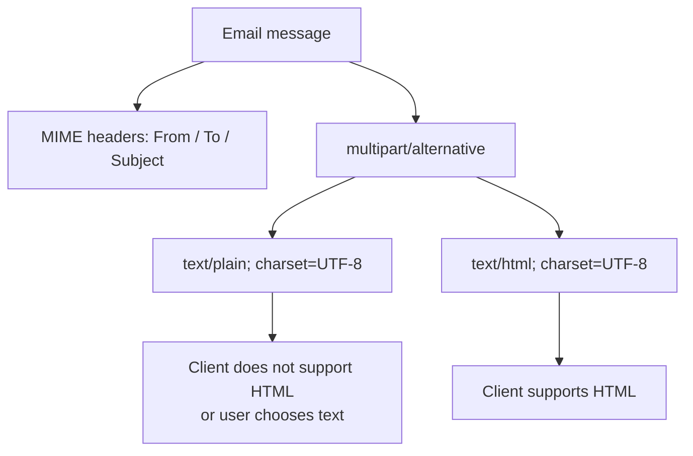
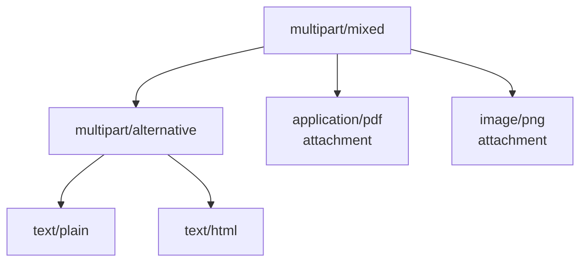
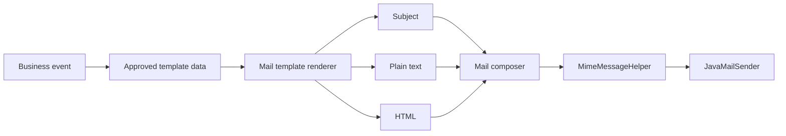

# Templates for Subject, Plain Text, and HTML

An email may be read in a web browser, on a phone, in a text-only client, by a screen reader, or by an automated content-parsing system. Therefore, a Spring Framework Mail notification typically needs **three separately designed content parts**: the subject, the plain-text version, and the HTML version.

If you only create an HTML string and send it as text, recipients may see raw HTML tags. If you only send HTML, some clients may not render it properly or recipients in text mode will miss content. If the subject is concatenated from arbitrary data, the subject can become too long, contain control characters, or accidentally expose private information. Separating the three parts into templates gives each part its own formatting, security rules, localization capability, and independent testing.

This lesson covers how to design email templates in Spring Framework Mail using `JavaMailSender`, `MimeMessageHelper`, and a template engine such as Thymeleaf. The content focuses on preparing data, rendering subject/plain text/HTML, sending both body representations as MIME alternative, handling escaping and URLs, localization, testing, and template versioning.

## 1. An Email Has Three Presentation Parts

Suppose the application sends a course enrollment success notification:

| Part | Example | Purpose |
|---|---|---|
| **Subject** | `You have successfully enrolled in the Spring course` | Lets the recipient know the topic before opening the message |
| **Plain text** | Readable text content and URLs | Works in text-only clients, aids accessibility, and acts as a fallback |
| **HTML** | Headings, paragraphs, links, layout | Richer presentation on clients that support HTML |

The three parts are related in **meaning** but do not need the same formatting. The subject must be concise and contain no markup; plain text must read naturally without CSS; HTML can use structure, links, and styling, but must be safe with input data.

A template should keep these three contents consistent:

```text
Subject:
You have successfully enrolled in the Spring course

Plain text:
Hello Minh,

You have successfully enrolled in the Spring Framework Mail course.
Open your account to view course information:
https://app.example.test/my-courses

HTML:
<h1>Enrollment Successful</h1>
<p>Hello Minh,</p>
<p>You have enrolled in the course...</p>
<a href="https://app.example.test/my-courses">Open account</a>
```

These are three representations of the same business event. Do not create the subject by extracting the first h1 tag from HTML or generate plain text by stripping all tags with regex. Such approaches easily lose content, drop links, or produce hard-to-read text.

## 2. MIME multipart/alternative Representing Plain Text and HTML

An email with both text and HTML versions typically uses the MIME type `multipart/alternative`. The parts represent the same content in different formats so the client can pick the appropriate one.



An abbreviated MIME message might look like this:

```text
MIME-Version: 1.0
Content-Type: multipart/alternative; boundary="alt-123"

--alt-123
Content-Type: text/plain; charset=UTF-8
Content-Transfer-Encoding: quoted-printable

Hello Minh,

You have successfully enrolled in the Spring Framework Mail course.

--alt-123
Content-Type: text/html; charset=UTF-8
Content-Transfer-Encoding: quoted-printable

<html>
  <body>
    <h1>Enrollment Successful</h1>
    <p>Hello <strong>Minh</strong>,</p>
    <p>You have successfully enrolled in the Spring Framework Mail course.</p>
  </body>
</html>

--alt-123--
```

This is a structural illustration; actual boundaries and encodings produced by Jakarta Mail may differ. Clients typically choose the appropriate representation. Therefore, plain text is not "extra" filler just to satisfy MIME: it is complete content for situations where HTML cannot be used.

### 2.1. When Attachments Are Present

If an email has plain text, HTML, and attached files, the structure is typically an outer `multipart/mixed`, containing a `multipart/alternative` and one or more attachments:



`MimeMessageHelper` can manage this structure. When initializing the helper in multipart mode and calling `setText(plainText, htmlText)`, the helper builds the alternative content; calls to `addAttachment(...)` append the attachment parts. There is no need to assemble MIME boundaries or headers by hand.

## 3. Separating Templates from Business Logic

A maintainable design divides email sending into responsibilities:

1. **Business logic** determines which event needs to be sent, who the recipient is, and which template is used.
2. **Data mapper** creates the set of permitted variables, without passing raw entities or requests.
3. **Template renderer** renders the subject, plain text, and HTML.
4. **Mail composer** puts the results into `MimeMessageHelper`.
5. **Mail transport** calls `JavaMailSender.send(...)`.



For example, a course enrollment event might contain an account ID, email, payment reference, audit metadata, and many internal properties. The template only needs:

```java
public record EnrollmentMailData(
        String displayName,
        String courseTitle,
        String coursePageUrl
) {}
```

This is an **allowlist**: only three fields are passed to the renderer. When the business entity gains new data, the template does not automatically gain access to that field.

Do not pass directly:

```java
// Avoid passing the full entity to the template.
context.setVariable("account", accountEntity);
context.setVariable("order", orderEntity);
context.setVariable("request", httpRequest);
```

If the template engine allows nested property access, passing the full entity can accidentally expose sensitive fields or couple the template to internal structure. Creating a dedicated DTO per email type makes clear which data is allowed to be displayed.

## 4. Organizing Template Files

A clear directory structure could be:

```text
src/main/resources/
└── templates/
    └── mail/
        └── enrollment/
            ├── subject.txt
            ├── body-text.txt
            └── body-html.html
```

The three files have distinct roles:

- `subject.txt`: contains only the subject, with no HTML.
- `body-text.txt`: plain-text content, with blank lines and readable URLs.
- `body-html.html`: HTML markup for mail clients that support HTML.

With multiple email types, you can organize directories by template ID:

```text
templates/mail/
├── enrollment/
│   ├── subject.txt
│   ├── body-text.txt
│   └── body-html.html
├── password-reset/
│   ├── subject.txt
│   ├── body-text.txt
│   └── body-html.html
└── order-confirmed/
    ├── subject.txt
    ├── body-text.txt
    └── body-html.html
```

If there are multiple languages, add locale directories or a clear template naming convention:

```text
templates/mail/enrollment/
├── vi/
│   ├── subject.txt
│   ├── body-text.txt
│   └── body-html.html
└── en/
    ├── subject.txt
    ├── body-text.txt
    └── body-html.html
```

Choose the locale based on the recipient's profile/context and have a clear fallback when the corresponding template does not exist yet. Do not guess the language from email content or use the server's locale as the default language for all recipients.

## 5. Using Thymeleaf as the Template Engine

Thymeleaf is a popular choice in Spring applications. It supports HTML and text templates and integrates with Spring. You can use a dedicated engine for mail or configure an existing engine to recognize the corresponding resolvers.

With Spring Boot, the typical dependency is:

```groovy
dependencies {
    implementation 'org.springframework.boot:spring-boot-starter-mail'
    implementation 'org.springframework.boot:spring-boot-starter-thymeleaf'
}
```

The Thymeleaf starter typically configures an engine for web HTML templates. If emails also need TEXT template mode and a separate resolver, you must configure the engine accordingly; do not assume the application's HTML resolver automatically reads `.txt` files.

### 5.1. Configuring Resolvers for HTML and TEXT

Example configuring a dedicated engine for mail:

```java
package com.example.mail.config;

import java.util.LinkedHashSet;
import java.util.Set;

import org.springframework.context.annotation.Bean;
import org.springframework.context.annotation.Configuration;
import org.thymeleaf.spring6.SpringTemplateEngine;
import org.thymeleaf.templatemode.TemplateMode;
import org.thymeleaf.templateresolver.ClassLoaderTemplateResolver;
import org.thymeleaf.templateresolver.ITemplateResolver;

@Configuration(proxyBeanMethods = false)
public class MailTemplateConfiguration {

    @Bean("mailTemplateEngine")
    SpringTemplateEngine mailTemplateEngine() {
        ClassLoaderTemplateResolver htmlResolver =
                new ClassLoaderTemplateResolver();
        htmlResolver.setPrefix("templates/mail/");
        htmlResolver.setSuffix(".html");
        htmlResolver.setTemplateMode(TemplateMode.HTML);
        htmlResolver.setCharacterEncoding("UTF-8");
        htmlResolver.setCheckExistence(true);
        htmlResolver.setOrder(1);

        ClassLoaderTemplateResolver textResolver =
                new ClassLoaderTemplateResolver();
        textResolver.setPrefix("templates/mail/");
        textResolver.setSuffix(".txt");
        textResolver.setTemplateMode(TemplateMode.TEXT);
        textResolver.setCharacterEncoding("UTF-8");
        textResolver.setCheckExistence(true);
        textResolver.setOrder(2);

        Set<ITemplateResolver> resolvers = new LinkedHashSet<>();
        resolvers.add(htmlResolver);
        resolvers.add(textResolver);

        SpringTemplateEngine engine = new SpringTemplateEngine();
        engine.setTemplateResolvers(resolvers);
        return engine;
    }
}
```

In this configuration:

- The template name `enrollment/body-html` is resolved by the HTML resolver at `templates/mail/enrollment/body-html.html`.
- The template name `enrollment/body-text` is resolved by the TEXT resolver at `templates/mail/enrollment/body-text.txt`.
- The template name `enrollment/subject` is resolved by the TEXT resolver at `templates/mail/enrollment/subject.txt`.
- `setCheckExistence(true)` allows the resolver to skip a nonexistent template so the next resolver has a chance to handle it.

In an application already using Thymeleaf for web views, avoid accidentally replacing the shared engine/resolver that web pages depend on. A dedicated mail bean named `mailTemplateEngine` lets mail-sending code select the right engine via `@Qualifier`. If configuring a shared web engine, add resolvers intentionally and test both template groups.

### 5.2. Rendering Each Artifact

A renderer can take `SpringTemplateEngine` and return a rendered object:

```java
package com.example.mail;

public record RenderedMail(
        String subject,
        String plainText,
        String html
) {}
```

```java
package com.example.mail;

import java.util.Locale;

import org.springframework.beans.factory.annotation.Qualifier;
import org.springframework.stereotype.Component;
import org.thymeleaf.context.Context;
import org.thymeleaf.spring6.SpringTemplateEngine;

@Component
public class EnrollmentMailRenderer {

    private final SpringTemplateEngine templateEngine;

    public EnrollmentMailRenderer(
            @Qualifier("mailTemplateEngine")
            SpringTemplateEngine templateEngine) {
        this.templateEngine = templateEngine;
    }

    public RenderedMail render(
            EnrollmentMailData data, Locale locale) {
        Context context = new Context(locale);
        context.setVariable("displayName", data.displayName());
        context.setVariable("courseTitle", data.courseTitle());
        context.setVariable("coursePageUrl", data.coursePageUrl());

        String subject = templateEngine.process(
                "enrollment/subject", context);
        String plainText = templateEngine.process(
                "enrollment/body-text", context);
        String html = templateEngine.process(
                "enrollment/body-html", context);

        return new RenderedMail(
                subject.strip(),
                plainText,
                html);
    }
}
```

In this example, the resolvers map template names by their corresponding suffix. Naming them `body-text` and `body-html` helps code readers clearly see the purpose of each template. `Context` receives the locale and allowed variables. Do not add the entire entity or request object to the context.

For large templates, you can split out shared fragments/headers/footers, while still keeping variable access explicit.

### 5.3. Subject File

Contents of `templates/mail/enrollment/subject.txt`:

```text
You have successfully enrolled in [[§DOLLAR${courseTitle}]]
```

The subject is text, not HTML. If the template engine returns a string with leading/trailing whitespace, you can `strip()` it before putting it into the message. Length and control characters must also be checked before sending.

### 5.4. Plain-Text File

Contents of `templates/mail/enrollment/body-text.txt`:

```text
Hello [[§DOLLAR${displayName}]],

You have successfully enrolled in the course:
[[§DOLLAR${courseTitle}]]

You can open your account to view course details:
[[§DOLLAR${coursePageUrl}]]

If you did not perform this action, please contact support through the official application.
```

Plain text should maintain:

- Blank lines between paragraphs for readability.
- URLs that can be copied and visited.
- Content that conveys the full meaning even when the client does not support HTML.
- No reliance on color, icons, or buttons to convey essential information.

In TEXT template mode, use the appropriate Thymeleaf expression syntax and inspect the actual output. Plain text is not HTML; do not turn every special character into HTML entities in a way that makes readers see unintended `&amp;` or `&lt;`. At the same time, control newline characters and untrusted data to prevent users from injecting forged paragraphs into notifications.

### 5.5. HTML File

Contents of `templates/mail/enrollment/body-html.html`:

```html
<!doctype html>
<html lang="vi" xmlns:th="http://www.thymeleaf.org">
<head>
    <meta charset="UTF-8">
    <meta name="viewport" content="width=device-width, initial-scale=1">
    <title>Course Enrollment Successful</title>
</head>
<body>
    <main>
        <h1>Enrollment Successful</h1>
        <p th:text="|Hello §DOLLAR${displayName},|">Hello there,</p>
        <p>
            You have successfully enrolled in the course:
            <strong th:text="§DOLLAR${courseTitle}">Course name</strong>.
        </p>
        <p>
            <a th:href="§DOLLAR${coursePageUrl}">
                Open account to view course
            </a>
        </p>
        <p>
            If you did not perform this action, please open the official
            application and contact support.
        </p>
    </main>
</body>
</html>
```

In HTML mode:

- `th:text` writes the value as text and escapes special HTML characters.
- Do not use `th:utext` with user data or untrusted external data without an appropriate sanitization step.
- `th:href` values must undergo URL validation at the application layer. HTML escaping protects attribute syntax but does not prove the scheme/host is safe.
- HTML emails should keep structure simple and avoid relying on JavaScript, forms, or complex CSS that many mail clients block.

### 5.6. Notes on TEXT and HTML Syntax

Thymeleaf has multiple template modes. An expression in HTML mode does not necessarily use the same syntax as in TEXT mode. In the example:

- HTML uses `th:text="§DOLLAR${courseTitle}"` to render HTML-escaped text.
- TEXT uses `[[§DOLLAR${courseTitle}]]` to interpolate into a text template.

Do not copy `th:text` syntax directly into a .txt file expecting it to be processed like HTML. Conversely, do not use unescaped output syntax in HTML for untrusted data.

## 6. Rendering and Sending with MimeMessageHelper

Once the three rendered strings are ready, creating the MIME message is quite concise:

```java
package com.example.mail;

import jakarta.mail.MessagingException;
import jakarta.mail.internet.MimeMessage;
import org.springframework.beans.factory.annotation.Value;
import org.springframework.mail.javamail.JavaMailSender;
import org.springframework.mail.javamail.MimeMessageHelper;
import org.springframework.stereotype.Service;

import java.util.Locale;

@Service
public class EnrollmentMailService {

    private final JavaMailSender mailSender;
    private final EnrollmentMailRenderer renderer;
    private final String fromAddress;

    public EnrollmentMailService(
            JavaMailSender mailSender,
            EnrollmentMailRenderer renderer,
            @Value("${app.mail.from}") String fromAddress) {
        this.mailSender = mailSender;
        this.renderer = renderer;
        this.fromAddress = fromAddress;
    }

    public void send(
            String recipient,
            EnrollmentMailData data,
            Locale locale) throws MessagingException {

        RenderedMail content = renderer.render(data, locale);
        validateSubject(content.subject());

        MimeMessage message = mailSender.createMimeMessage();
        MimeMessageHelper helper =
                new MimeMessageHelper(message, true, "UTF-8");

        helper.setFrom(fromAddress);
        helper.setTo(recipient);
        helper.setSubject(content.subject());
        helper.setText(content.plainText(), content.html());

        mailSender.send(message);
    }

    private static void validateSubject(String subject) {
        if (subject == null || subject.isBlank() || subject.length() > 160) {
            throw new IllegalArgumentException("Invalid email subject");
        }
        for (int i = 0; i < subject.length(); i++) {
            if (Character.isISOControl(subject.charAt(i))) {
                throw new IllegalArgumentException(
                        "Control character in email subject");
            }
        }
    }
}
```

Explanation:

1. `renderer.render(...)` generates subject, plain text, and HTML before calling transport.
2. `MimeMessageHelper(message, true, "UTF-8")` creates a multipart helper with UTF-8 encoding.
3. `setSubject(...)` takes the rendered subject string without needing manual RFC 2047 encoding.
4. `setText(plainText, html)` places both representations in an alternative structure.
5. `mailSender.send(message)` performs the send operation over transport.

In the example, `true` enables multipart so attachments can be added later. If the message has no attachments, you can still use an appropriate helper configuration for plain/HTML alternatives without needing an outer multipart/mixed structure. What matters is that **both bodies are set via the `setText(plainText, htmlText)` overload**, rather than calling `setText(plain)` followed by `setText(html)`, which replaces the previous content.

The `send(...)` method throws `MessagingException` for MIME helper errors; transport errors can appear as Spring Mail exceptions such as `MailException`. Exception declarations/translations should match the service API and error handling of the application.

## 7. Subject: Short, Contextual, and Free of HTML

The subject appears in message lists, push notifications, and sometimes on lock screens. Therefore, it needs dedicated design:

- State the main event without trying to cram the entire body into the subject.
- Avoid sensitive data such as passwords, tokens, financial details, or health information.
- Keep a moderate length to avoid truncation on mobile devices.
- Contain no HTML tags, newlines, or control characters.
- Match the language and tone with the body.
- Do not let callers pass an arbitrary subject without a policy.

Example:

| Overly Detailed Subject | Conciser Subject |
|---|---|
| `Your new password is 123456` | `Account access instructions` |
| `Medical exam results for Nguyen Van A...` | `You have a new notification in your account` |
| `Order at 123 Nguyen Trai has been delivered...` | `Your order has been updated` |
| `NullPointerException in PaymentService...` | `Your request needs attention` |

### 7.1. Do Not Let the Subject Receive CR/LF from External Data

A subject built by concatenating arbitrary data:

```java
String subject = "Notification: " + userProvidedTitle;
```

can inject control characters or misleading text into headers. Use a fixed template and validate the post-render value. For personalized subjects, limit length, strip/reject control characters, and use only data selected for display purposes.

Do not use a simple regex to "fix" every subject. If input contains CR/LF, it is usually better to reject the value or move it to an appropriately formatted body field rather than silently turning it into a different subject.

## 8. Plain Text: The Fallback Must Be Complete

Plain text should not be HTML with tags stripped. A good text template should have:

1. Greeting and context.
2. Core information about the event.
3. Next steps to take.
4. Full URLs if links are included.
5. Contact instructions or what to do if the recipient did not initiate the action.
6. Necessary footer such as service details or notification preferences.

Example:

```text
Hello Minh,

You have successfully enrolled in the Spring Framework Mail course.

You can view the content and schedule at:
https://app.example.test/my-courses

If you did not perform this registration, please open the official application
to check your account or contact support.

Best regards,
Learning Team
```

Do not just write "Click the button below" because the text version may not have a button. URLs should be displayed clearly enough for recipients to inspect the domain before opening them.

### 8.1. Plain Text Also Needs Input Control

Plain text does not execute HTML/JavaScript, yet risks still exist:

- Users inserting newlines to forge a paragraph or alter meaning.
- Very long strings making the body hard to read or increasing storage/transmission cost.
- Control characters or Unicode bidi making displayed content misleading.
- User-supplied URLs pointing to spoofed domains.
- Content containing unnecessary tokens or private data.

Normalize line endings, limit length, control permitted fields, and validate URLs. There is no need to HTML-escape all text by turning `&` into `&amp;`; plain text and HTML are two representations with separate encoding rules.

## 9. HTML Email: Escaping, URLs, and Compatibility

HTML email allows more readable structure, but also raises safety requirements.

### 9.1. Use Context-Appropriate Text Escaping

In Thymeleaf HTML mode:

```html
<p th:text="§DOLLAR${displayName}">Recipient name</p>
```

`th:text` inserts the value into a text node and escapes special characters for HTML. If the name is:

```text
Minh <script>alert(1)</script>
```

the content is displayed as text and does not become an executable script in the markup.

Do not use:

```html
<div th:utext="§DOLLAR${displayName}"></div>
```

for untrusted data. `th:utext` allows raw markup in the output; without a reliable sanitization step, it can cause HTML injection or forged content.

### 9.2. Attribute Escaping Does Not Validate URLs

Example:

```html
<a th:href="§DOLLAR${coursePageUrl}">Open course</a>
```

Thymeleaf handles attribute values through the template mechanism, but that does not mean the URL is safe. If the data is:

```text
javascript:alert(1)
https://attacker.example.test/fake-login
```

you must **validate the URL scheme, host, and purpose** before passing it into the template. HTML escaping protects attribute syntax but does not prove the scheme/host is safe. Build links from a configured base URL, a domain allowlist, and application-controlled paths. Do not take a host from an untrusted request and send it in an email.

### 9.3. Avoid Unnecessarily Complex HTML

Many mail clients restrict CSS, strip JavaScript, block external images by default, or handle layouts differently from browsers. HTML emails should:

- Prefer simple markup and readable structure.
- Use inline CSS or presentation approaches tested on target clients.
- Provide alt text when images fail to load.
- Not rely on JavaScript, forms, or dynamic interaction inside the email.
- Keep essential information in text form.
- Use clear HTTPS URLs.
- Test rendering across the major mail clients supported by the product.

An HTML button is just a prominently styled link; do not ask users to enter passwords or authentication credentials directly into a form inside an email.

## 10. Localizing Subject, Plain Text, and HTML

Emails can be sent to recipients using multiple languages. Localization must remain consistent across all three representations:

| Locale | Subject | Plain text | HTML |
|---|---|---|---|
| `vi-VN` | Vietnamese | Vietnamese body | Vietnamese HTML |
| `en-US` | English | English body | English HTML |
| `ja-JP` | 日本語 | 日本語の本文 | 日本語のHTML |

You can select the locale from the user profile, saved preferences, or business context. Do not automatically use the mail server's locale for all recipients.

In Thymeleaf, you can pass the locale into `Context`:

```java
Locale locale = Locale.forLanguageTag("vi-VN");
Context context = new Context(locale);
```

The template engine can use the locale for message resolution when Spring integration is configured appropriately. Alternatively, you can organize template files by locale folder and select the template name by locale in the renderer. Either way, there must be a clear fallback—for example, if a locale has no template, use the approved English version rather than mixing an English subject with a Vietnamese body.

### 10.1. Formatting Dates, Times, Numbers, and Currency

Do not format data using the server's locale:

```java
String formattedDate = DateTimeFormatter
        .ofPattern("dd/MM/yyyy")
        .format(occurredAt);
```

The snippet above fixes a single format; if emails have multiple locales, pick the formatter for the appropriate locale and timezone:

```java
DateTimeFormatter formatter =
        DateTimeFormatter
                .ofLocalizedDateTime(FormatStyle.MEDIUM)
                .withLocale(locale)
                .withZone(userZoneId);

String formatted = formatter.format(occurredAt);
```

`userZoneId` is an application variable that must be determined from the profile or business context, not a built-in Java variable. Similarly, currency should use `NumberFormat.getCurrencyInstance(locale)` together with the actual currency code; do not guess the currency from language alone.

## 11. Using MessageSource for Subject and UI Strings

For short subjects or shared labels, Spring `MessageSource` is a convenient option:

Contents of `messages_vi.properties`:

```properties
mail.enrollment.subject=Bạn đã đăng ký thành công khóa học {0}
mail.common.greeting=Xin chào {0},
```

Contents of `messages_en.properties`:

```properties
mail.enrollment.subject=You have successfully enrolled in {0}
mail.common.greeting=Hello {0},
```

Example retrieving the subject:

```java
import java.util.Locale;
import org.springframework.context.MessageSource;
import org.springframework.stereotype.Component;

@Component
public class MailSubjectRenderer {

    private final MessageSource messageSource;

    public MailSubjectRenderer(MessageSource messageSource) {
        this.messageSource = messageSource;
    }

    public String enrollmentSubject(
            String courseTitle, Locale locale) {
        return messageSource.getMessage(
                "mail.enrollment.subject",
                new Object[] { courseTitle },
                locale);
    }
}
```

Plain-text and HTML bodies can use template files to hold long paragraphs, while the subject uses `MessageSource` to manage strings by locale. This is a reasonable split, provided the renderer still returns **one complete object** containing subject, plain text, and HTML.

When the body also contains many short sentences/phrases, MessageSource can support shared labels and messages. However, do not cram an entire long HTML email into a hard-to-maintain property; template files are better suited for long structures and layouts.

## 12. Versioning and Managing Template Changes

Email templates are part of the product. A small change can affect semantics, links, accessibility, or the data appearing in the message. Therefore, you should have:

- Stable template IDs such as `enrollment-confirmed`.
- Clear template versions or release rules.
- Content/language owners and reviewers when content is critical.
- Render tests for supported locales.
- MIME testing and previews on target clients.
- A template rollback mechanism when a change causes issues.

Example of an intent metadata record:

```json
{
  "notificationId": "a4f20b5c-7f63-4a87-a0e2-3c1d0a10f002",
  "templateId": "enrollment-confirmed",
  "templateVersion": 3,
  "locale": "vi-VN"
}
```

If an email is queued today but a worker sends it tomorrow after the template has been updated, the system needs to decide whether to use the version from when the intent was created or the latest version. For critical transactional or audit emails, storing the approved version/variables can keep re-sent content consistent. For marketing emails, the latest version may be chosen per policy. This is a business decision, not automatic behavior of Thymeleaf or Spring Mail.

## 13. Testing Templates Before Sending

Do not merely test that `mailSender.send(...)` was called. Verify that all three representations were rendered and have the right meaning.

### 13.1. Unit Testing the Renderer

Example renderer-level test:

```java
package com.example.mail;

import static org.junit.jupiter.api.Assertions.assertFalse;
import static org.junit.jupiter.api.Assertions.assertNotNull;
import static org.junit.jupiter.api.Assertions.assertTrue;

import java.util.Locale;
import org.junit.jupiter.api.Test;

class EnrollmentMailRendererTest {

    private final EnrollmentMailRenderer renderer =
            TestMailTemplateConfiguration.createRenderer();

    @Test
    void rendersSubjectTextAndHtml() {
        EnrollmentMailData data = new EnrollmentMailData(
                "Minh",
                "Spring Framework Mail",
                "https://app.example.test/my-courses");

        RenderedMail mail = renderer.render(
                data, Locale.forLanguageTag("vi-VN"));

        assertNotNull(mail.subject());
        assertNotNull(mail.plainText());
        assertNotNull(mail.html());

        assertTrue(mail.subject().contains("Spring Framework Mail"));
        assertTrue(mail.plainText().contains("Minh"));
        assertTrue(mail.html().contains("Enrollment Successful"));
        assertFalse(mail.subject().contains("<html"));
    }
}
```

`TestMailTemplateConfiguration.createRenderer()` is a test-defined factory to initialize the engine with test templates. The example focuses on assertions; in a real project, you can use a Spring test context to inject the configured renderer.

### 13.2. Testing Escaping

Use data with special characters:

```java
EnrollmentMailData malicious = new EnrollmentMailData(
        "<script>alert(1)</script>",
        "Course ",
        "https://app.example.test/my-courses");
```

In HTML, assert that values are placed into text nodes as escaped text and do not appear as executable script/img elements. In plain text, assert that content does not contain unintended control characters or forged paragraphs. For URLs, test that disallowed schemes/hosts are rejected in the validation layer before rendering.

Do not only check a single string snapshot if the template engine/provider can vary equivalent encodings. You can parse HTML in tests to inspect actual nodes and attributes.

### 13.3. Testing the Subject

The subject should be verified for:

- Not empty.
- No CR/LF or control characters.
- Within length limits set by the application.
- No tokens or sensitive fields.
- No unnecessary HTML markup.
- Correct locale and correct template ID.

There is no single Subject byte limit that applies identically to every application; set a reasonable product threshold and let Jakarta Mail handle appropriate encoded-word/header folding.

### 13.4. Testing MIME with JavaMailSender and a Simulated SMTP Server

You can use Mailpit or an SMTP test server:

```bash
docker run --rm --name mailpit -p 1025:1025 -p 8025:8025 axllent/mailpit
```

Send an email from a test service and then verify:

1. The Subject header displays Unicode properly.
2. MIME contains both `text/plain` and `text/html`.
3. Plain text has complete core information and contains no HTML markup.
4. HTML has the right structure and links.
5. No unrendered variables such as `§DOLLAR${displayName}` or `[[...]]` remain.
6. No unintended sensitive data is present.

Raw MIME may vary in boundary, line folding, or quoted-printable/Base64 between sends. Do not compare entire `.eml` files byte-for-byte; inspect the MIME structure and decoded content.

### 13.5. Visual Preview

A simulated SMTP server lets you view messages and inspect how mail clients render them. Additionally, you can export MIME in a test environment and open it with an email preview tool. Use dummy data only; `.eml` files can contain the full body, recipients, and attachments, so do not commit them to public storage.

## 14. Testing Across Multiple Locales and Edge Cases

A useful test dataset:

| Case | Data | Goal |
|---|---|---|
| Normal name | `Minh` | Basic content |
| Unicode name | `Nguyễn Ánh` | Proper UTF-8 |
| HTML characters | `<script>alert(1)</script>` | HTML escaping |
| Long name | 200 characters | Length limits and layout |
| Course title with brackets | `Java < Advanced >` | Text/HTML rendered properly |
| Valid URL | `https://app.example.test/my-courses` | Correct link domain |
| Invalid URL | `javascript:alert(1)` | Rejected |
| Vietnamese locale | `vi-VN` | Subject/text/html all in Vietnamese |
| English locale | `en-US` | Proper fallback/translation |
| Missing template | `enrollment/body-html` does not exist | Clear error before sending |
| Missing variable | missing `courseTitle` | Caught in render test |
| Canary token | `test-secret-canary` | Does not appear outside allowed sections |

If the renderer returns an empty subject or body, do not send a nearly blank email only to discover it in the mailbox. Validate rendered output **before** calling `JavaMailSender.send(...)`.

## 15. Handling Template Errors Separately from SMTP Errors

Template rendering and SMTP transport are two distinct steps:

| Stage | Example Error | Appropriate Reaction |
|---|---|---|
| Template selection | Template ID/locale does not exist | Stop before sending, fall back per policy, or report configuration error |
| Render subject | Missing variable, template syntax error | Fix data/template; do not retry SMTP |
| Render plain text | Empty content or leftover placeholder | Stop before sending |
| Render HTML | Invalid template or escaping error | Stop before sending, handle template error |
| Build MIME | Invalid charset/header/part | Handle message preparation error |
| Send SMTP | AUTH, timeout, SMTP 4xx/5xx | Classify transport error and retry per policy |

Do not wrap the entire process in a single `catch (Exception)` and retry. If a template is wrong, retrying SMTP will not fix template syntax. If SMTP returns 451, re-rendering the template repeatedly can create unnecessary load.

A good workflow:

```text
Load intent
  -> select template/version/locale
  -> render subject, plain text, HTML
  -> validate rendered content
  -> create MimeMessage
  -> send through JavaMailSender
  -> persist transport outcome
```

If a retry is needed, decide whether re-rendering is required. With a fixed template version and immutable intent data, you can re-render the same content; for systems requiring strict reproducibility, you can store rendered data under an appropriate security policy.

## 16. Do Not Unintentionally Put Sensitive Data into Templates

Templates should only receive approved variables:

```java
public record PasswordResetMailData(
        String displayName,
        String resetUrl,
        String expiresInText
) {}
```

Do not pass passwords, password hashes, general access tokens, or the entire account entity. If `resetUrl` contains a one-time token, the token must:

- Grant permission for only a single action.
- Have a short expiration and be invalidated after use.
- Be generated from a cryptographic random source.
- Not appear in logs, tracing, exceptions, or metric labels.
- Use a configured and controlled HTTPS domain.

For ordinary notification emails, you can simply include a link to the sign-in page instead of placing a token in the URL. The subject should also not contain sensitive data because it may appear in previews.

### 16.1. Do Not Let the Template Engine Access Overly Broad Objects

What to avoid:

```java
context.setVariable("user", fullUserEntity);
context.setVariable("request", requestDto);
context.setVariable("session", session);
```

Instead, create a DTO containing only the variables the template needs. This also allows templates to be reused across domain model versions and reduces the risk of accidentally rendering a new field.

### 16.2. Template Editing Permissions

If templates are stored outside the repository or have an internal editing UI:

- Only authorized personnel may edit outbound templates.
- Review changes related to URLs, data, language, and security content.
- Do not let end users enter raw HTML and render it as a privileged template.
- Avoid allowing templates to invoke beans or execute expressions with system access beyond the required scope.
- Maintain versioning, auditing, and rollback.

A template engine does not automatically make content safe merely because syntax compiles cleanly.

## 17. Template Fragments and Shared Content

Emails often share headers/footers, greetings, or support sections. Thymeleaf supports fragments to avoid duplicating HTML:

Contents of `templates/mail/fragments/footer.html`:

```html
<footer th:fragment="mailFooter">
    <p>This is an automated email. Please do not reply directly.</p>
    <p>
        <a href="https://app.example.test/support">Support Center</a>
    </p>
</footer>
```

The HTML template can include the fragment:

```html
<body>
    <main>
        <h1>Enrollment Successful</h1>
        <p th:text="|Hello §DOLLAR${displayName},|">Hello there,</p>
    </main>
    <div th:replace="~{fragments/footer :: mailFooter}"></div>
</body>
```

Fragments help keep the footer consistent. However, plain text also needs a corresponding separately rendered footer; do not take an HTML fragment and strip tags to generate text.

With multiple emails, you can create shared header/body/footer fragments, but avoid turning everything into a rigid layout that prevents templates from adapting per notification type. Keep essential content in each template and share only what is truly common.

## 18. Common Mistakes

**Sending only HTML and skipping plain text.** Some clients do not support HTML or recipients choose text mode; a complete fallback is required.

**Calling `setText(plain)` and then `setText(html)`.** The second call can replace the first content; use the `setText(plainText, htmlText)` overload.

**Treating the subject as an HTML line.** The subject is header text; render separately and validate characters/length.

**Rendering plain text by stripping HTML tags with regex.** Links, lists, headings, and spacing are easily lost; maintain a separate text template.

**Using `th:utext` for user names.** Can introduce untrusted markup into HTML; use `th:text` for text nodes.

**Allowing arbitrary URLs into `th:href`.** Attribute escaping does not validate domain or scheme; validate URLs at the application layer.

**Passing the entire entity into the template context.** The template may expose newly added fields; use an allowlist DTO.

**Using the server locale for all emails.** Recipients may receive the wrong language; choose locale from user profiles or business rules.

**Not validating missing variables or unrendered placeholders.** Emails may go out with literal `§DOLLAR${courseTitle}`; test the renderer and validate output.

**Treating template errors as SMTP errors.** Classify errors by stage; do not retry transport for rendering errors.

**Comparing raw MIME byte-for-byte in tests.** Boundaries and encodings can vary; parse MIME and verify decoded content.

**Logging the full rendered email.** Bodies can contain personal data or tokens; log template ID, notification ID, and safe outcomes.

## 19. Comprehensive Practice Exercise

Build a course enrollment confirmation email using Spring Boot, Thymeleaf, and Spring Framework Mail.

### Part A — Create Three Templates

Create `subject.txt`, `body-text.txt`, and `body-html.html` for the `enrollment` template. Use the same set of variables:

- `displayName`
- `courseTitle`
- `coursePageUrl`

Do not pass the full student entity to the template.

### Part B — Render by Locale

Render `vi-VN` and `en-US`. Verify that subject, plain text, and HTML all use the same language. Design a fallback when a locale does not yet have a template.

### Part C — Build MIME Alternative

Use `MimeMessageHelper.setText(plain, html)` to build the message. Send through Mailpit and confirm both `text/plain` and `text/html` parts exist.

### Part D — Test Untrusted Data

Use a student name containing `<script>`, a course title with brackets, and an invalid URL scheme. Verify that HTML escapes properly, plain text remains readable, invalid URLs are rejected, and the subject contains no control characters.

### Part E — Localization and Formatting

Use different dates/times, locales, and timezones. Ensure date/time and currency formatting does not depend on the server's default timezone.

### Part F — Test Template Errors

Delete a template, omit a variable, or introduce a syntax error. Confirm the error is caught before calling `JavaMailSender.send(...)`. Do not enqueue an email with a rendering error for SMTP retry.

### Part G — Inspect Actual Content

Open the email in a simulated SMTP server and inspect Subject, text, HTML, URLs, and rendering across target clients. Do not put real data or real tokens into tests.

## 20. Principles to Maintain During Implementation

A good email template starts from **a business event and an approved set of variables**. From there, the renderer produces three distinct representations: a concise subject, complete plain text, and context-escaped HTML. `MimeMessageHelper.setText(plainText, htmlText)` puts both bodies into a MIME alternative structure so mail clients choose the appropriate display format.

Keep templates decoupled from transport, keep locales and versions clear, validate subjects/URLs, and test outputs before sending. Plain text must be independently readable; HTML must not use raw markup for untrusted data; the Subject should not contain private data. When errors occur, separate template selection/rendering/MIME stages from the SMTP stage to avoid wrong retries.

In Spring Framework Mail, `JavaMailSender` and `MimeMessageHelper` handle creating and sending MIME messages. **They do not design content on their own, decide which data is allowed to be exposed, or guarantee that the three representations stay consistent.** Those responsibilities belong to the template renderer and the application's data contract.
