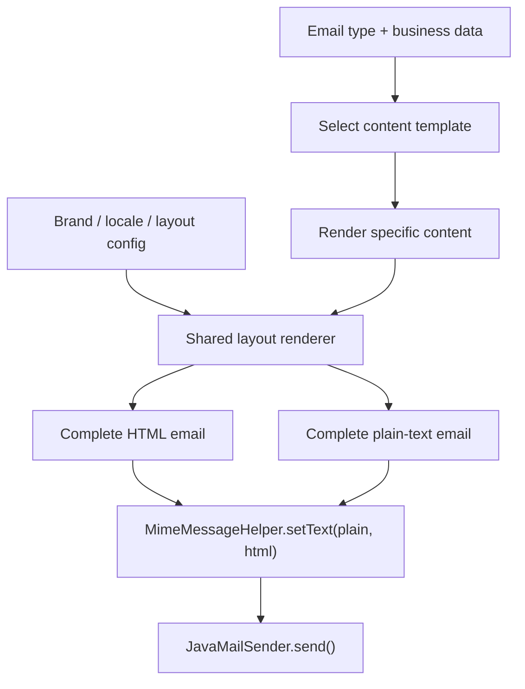

# Separating Shared Layout from Per-Email Content in Spring Framework Mail

An application may send many kinds of email: new-user welcome, order confirmation, invoice, password reset, payment notification, or appointment reminder. Each message has its own content and data, yet they usually share the logo, brand name, header, typography, spacing, footer, support address, and policy links.

If you write the entire HTML for every email, shared parts get duplicated across many files. When the logo, brand color, or support details change, the development team has to edit every template and can easily miss some. Conversely, cramming every message into one huge template with dozens of conditionals also makes reading and maintenance difficult.

**The right organization is to separate the shared layout from per-email-type content.** The layout handles the presentation frame and reusable components; the content template handles the business information for one email type. Spring Framework Mail provides the API for creating and sending MIME messages, while template rendering is typically handled by a template engine such as Thymeleaf or FreeMarker.

## 1. Distinguishing Shared Layout and Per-Email Content

A transactional email can be divided into three layers:

1. **Layout (presentation frame):** header, logo, content area, footer, shared styling, and brand details.
2. **Content template (per-email content):** content heading, greeting, order details, verification code, payment status, or specific instructions.
3. **Data model (render data):** recipient name, order number, amount, deadline, links, and business values passed to the template.

Example:

```text
Shared layout
├── Header: logo + brand name
├── Content slot
└── Footer: support + policies + company information

Per-email content
├── welcome
├── order-confirmed
├── payment-receipt
├── password-reset
└── appointment-reminder
```

When sending an order confirmation email, the system takes the shared layout, inserts the content of `order-confirmed` into the content slot, and passes a model containing the order number, amount, and detail URL. When sending a password reset email, the layout can stay the same while the content area uses the `password-reset` template.



The key point is that **the layout does not decide the business logic of each email**. The layout should not contain conditions like "if invoice show amount, if password reset show OTP." Those details belong in individual templates. The layout only provides slots and shared components for templates to use.

## 2. Why Separate the Layout?

### Reduce Duplication and Simplify Updates

Suppose 12 email types all share a logo and footer. If each file embeds the same HTML block, changing the support address or logo requires editing many places. When the layout is separated, shared details are managed in one place and reused across emails.

### Maintain a Consistent Experience

Recipients may receive multiple kinds of messages from the same product. Consistent headers, colors, typography, spacing, and footers help them recognize the sender. Each message type can still have its own content and layout inside the main area.

### Clear Separation of Responsibilities

| Component | Responsibility | Example |
|---|---|---|
| Layout | HTML frame, header/footer, shared styles | Logo, company name, content area |
| Fragment/component | Small reusable building blocks | CTA button, support line, contact details |
| Content template | Structure specific to an email type | Order confirmation, password reset |
| Data model | Business values passed to the template | `orderCode`, `amount`, `expiresAt` |
| Renderer | Select template, render layout and content | Thymeleaf engine or FreeMarker |
| Mail service | Build MIME message and send | `MimeMessageHelper` + `JavaMailSender` |

### Reduce Inconsistency Bugs

When each email type defines its own footer, one email may show an old support address while another shows the new one. Separating the layout keeps shared details updated in sync. Even so, mandatory content per email type (such as unsubscribe instructions for certain marketing emails) still belongs in the appropriate template or fragment matching the sending policy.

## 3. Template Directory Structure

A reference structure:

```text
src/main/resources/
└── templates/
    └── mail/
        ├── layout/
        │   ├── email.html
        │   └── fragments.html
        ├── html/
        │   ├── welcome.html
        │   ├── order-confirmed.html
        │   ├── payment-receipt.html
        │   └── password-reset.html
        └── text/
            ├── welcome.txt
            ├── order-confirmed.txt
            ├── payment-receipt.txt
            └── password-reset.txt
```

Roles:

- `layout/email.html` holds the shared HTML frame.
- `layout/fragments.html` holds small reusable parts such as header, footer, or buttons.
- `html/*.html` holds HTML content specific to each email type.
- `text/*.txt` holds the plain-text version of the same email type.

You do not need to create too many folders when the application only has a few templates. What matters is clearly distinguishing **layout**, **per-email content**, and **plain-text/HTML versions**. Name files after their business purpose so maintainers can find them easily.

## 4. Shared HTML Layout with Thymeleaf Layout Dialect

Spring Mail does not provide a built-in template engine. If the project uses Thymeleaf, you can use **Thymeleaf Layout Dialect** to declare a layout and let child templates fill content into defined slots.

Add a Layout Dialect library matching your project's Thymeleaf version. Gradle example:

```groovy
dependencies {
    implementation 'org.springframework.boot:spring-boot-starter-mail'
    implementation 'org.springframework.boot:spring-boot-starter-thymeleaf'
    implementation 'nz.net.ultraq.thymeleaf:thymeleaf-layout-dialect'
}
```

In an application not using Spring Boot, you must manually declare the corresponding Spring Mail, Thymeleaf Spring integration, and Layout Dialect dependencies. Specific versions should be managed via the Spring Boot BOM or project dependency management.

### 4.1. Creating the Shared Layout

File `templates/mail/layout/email.html`:

```html
<!doctype html>
<html lang="vi"
      xmlns:th="http://www.thymeleaf.org"
      xmlns:layout="http://www.ultraq.net.nz/thymeleaf/layout">
<head>
    <meta charset="UTF-8">
    <meta name="viewport" content="width=device-width, initial-scale=1">
    <title layout:fragment="title">Notification from Example</title>
</head>
<body style="margin:0;padding:0;background-color:#f4f5f7;">
    <table role="presentation" width="100%" cellpadding="0" cellspacing="0" border="0">
        <tr>
            <td align="center" style="padding:24px 12px;">
                <table role="presentation" width="600" cellpadding="0"
                       cellspacing="0" border="0"
                       style="width:100%;max-width:600px;background:#ffffff;">
                    <tr>
                        <td th:replace="~{mail/layout/fragments :: header(${brand})}">
                            Brand header
                        </td>
                    </tr>
                    <tr>
                        <td style="padding:28px 24px;">
                            <main layout:fragment="content">
                                Default email content
                            </main>
                        </td>
                    </tr>
                    <tr>
                        <td th:replace="~{mail/layout/fragments :: footer(${brand})}">
                            Brand footer
                        </td>
                    </tr>
                </table>
            </td>
        </tr>
    </table>
</body>
</html>
```

In the layout:

- `layout:fragment="title"` declares the page title region for child templates to replace.
- `layout:fragment="content"` declares the main content region.
- Header and footer are included from shared fragments.
- Table-based structure with `role="presentation"` is a common layout pattern in HTML email because more mail clients support it reliably than some modern CSS layouts.

This is an illustrative skeleton. In real implementation, test widths, padding, fonts, and CSS across target mail clients; do not assume every CSS browser feature is supported in email.

### 4.2. Creating Shared Fragments

File `templates/mail/layout/fragments.html`:

```html
<!doctype html>
<html lang="vi" xmlns:th="http://www.thymeleaf.org">
<body>
<header th:fragment="header(brand)" style="padding:24px;background:#ffffff;">
    
    <p th:unless="${brand.logoUrl != null}" th:text="${brand.name}">
        Example
    </p>
</header>
<footer th:fragment="footer(brand)"
        style="padding:24px;background:#f4f5f7;color:#555555;">
    <p>
        Need support?
        <a th:href="'mailto:' + ${brand.supportEmail}"
           th:text="${brand.supportEmail}">support@example.org</a>
    </p>
    <p th:text="${brand.legalName}">Example Company</p>
    <p th:if="${brand.websiteUrl != null}">
        <a th:href="${brand.websiteUrl}" th:text="${brand.websiteUrl}">
            https://example.org
        </a>
    </p>
</footer>
</body>
</html>
```

`header(brand)` and `footer(brand)` are parameterized fragments. The `brand` value is passed from the render context; a tenant can have a different logo, display name, support email, and website if the configuration has been verified.

In templates, `th:text` writes data as HTML-escaped text via Thymeleaf. When placing URLs into `th:href` or `th:src`, the application must still **validate the scheme and host** per policy before rendering. Do not treat Thymeleaf's HTML character escaping as proof that a URL is trustworthy.

### 4.3. Specific Template for Order Confirmation Email

File `templates/mail/html/order-confirmed.html`:

```html
<!doctype html>
<html lang="vi"
      xmlns:th="http://www.thymeleaf.org"
      xmlns:layout="http://www.ultraq.net.nz/thymeleaf/layout"
      layout:decorate="~{mail/layout/email}">
<head>
    <title layout:fragment="title"
           th:text="'Order confirmation ' + ${mail.orderCode}">
        Order confirmation
    </title>
</head>
<body>
    <main layout:fragment="content">
        <h1>Order Confirmed</h1>
        <p>Hello <strong th:text="${mail.customerName}">An</strong>,</p>
        <p>
            Your order <strong th:text="${mail.orderCode}">DH-2048</strong>
            has been confirmed.
        </p>
        <p>
            Total payment:
            <strong th:text="${mail.totalDisplay}">450.000 ₫</strong>
        </p>
        <p>
            <a th:href="${mail.orderUrl}" th:text="#{mail.order.view}">
                View order details
            </a>
        </p>
    </main>
</body>
</html>
```

The child template only contains **its own title and content**. It does not need to declare the logo, footer, or the entire presentation frame. During rendering, Layout Dialect merges this content into the shared layout.

Another template such as `password-reset.html` can reuse the same `layout/email.html`, while its main content covers the token expiration, password-reset instructions, and a warning if the recipient did not initiate the request.

## 5. Plain Text Also Needs a Shared Layout

An HTML layout cannot be used verbatim for plain-text emails because `<table>`, ``, CSS, and HTML tags have no presentation meaning in `text/plain`. If the system sends both versions, design **a separate text layout** while reusing brand information and shared rules.

Example structure:

```text
mail/text/
├── layout.txt
├── welcome.txt
├── order-confirmed.txt
└── password-reset.txt
```

The `layout.txt` file can define:

```text
{{brandName}}
{{separator}}

{{body}}

------------------------------
Need support? {{supportEmail}}
{{websiteUrl}}
{{legalName}}
```

This is a custom placeholder syntax, not a built-in Spring Mail syntax. A text renderer can take the body rendered per email type and insert it into the layout:

```java
package com.example.mail;

public class PlainTextMailLayout {
    public String wrap(
            String body,
            String brandName,
            String supportEmail,
            String websiteUrl,
            String legalName) {

        String separator = "==============================";
        String footerSeparator = "------------------------------";

        return """
                %s
                %s

                %s

                %s
                Need support? %s
                %s
                %s
                """.formatted(
                brandName, separator, body.strip(),
                footerSeparator, supportEmail, websiteUrl, legalName);
    }
}
```

This example uses a Java text block and `String.formatted` (Java 15+). In a real application, handle nulls, locales, line breaks, and data length; you can replace the helper with a text template engine to support conditionals and multiple languages.

The important thing is that **the text layout has the same architectural role as the HTML layout**, while using formatting appropriate for plain text. Do not put HTML into a text body hoping the client will convert it.

### Per-Email Text Content

File `order-confirmed.txt`:

```text
Hello {{customerName}},

Order {{orderCode}} has been confirmed.
Total payment: {{totalDisplay}}

View details:
{{orderUrl}}
```

After rendering, the body is placed into the shared text layout. Meanwhile, `password-reset.txt` might contain:

```text
Hello {{customerName}},

You recently requested a password reset.

Open the following link to continue:
{{resetUrl}}

The link is valid until {{expiresAt}}.
If you did not make this request, please ignore this email.
```

Each template is responsible for **per-email-type content**; the shared brand/footer parts are still assembled by the text layout.

## 6. Render Data: Separating Business Models from HTML

Do not put database fetching, permission checks, and currency formatting logic into the HTML file. Instead, prepare a **view model** already containing data suited for the email.

Example:

```java
package com.example.mail;

public record OrderConfirmedMailView(
        String customerName,
        String orderCode,
        String totalDisplay,
        String orderUrl) {
}
```

Brand information:

```java
package com.example.mail;

public record MailBrand(
        String name,
        String legalName,
        String logoUrl,
        String fromAddress,
        String replyToAddress,
        String supportEmail,
        String websiteUrl) {
}
```

These two models have different responsibilities:

- `OrderConfirmedMailView` carries data specific to the order confirmation email.
- `MailBrand` carries shared data for the layout and configured sender identity.

Another email can use `PasswordResetMailView` without adding fields like `resetUrl` to the order model. This separation ensures templates receive only the data they need.

### Formatting Data Before Rendering

Templates should focus on presentation. Important business calculations and normalizations should be handled beforehand:

| Data | Where Should It Be Prepared? | Reason |
|---|---|---|
| Total amount | Service/domain formatter | Format currency and locale accurately |
| OTP/reset expiration | Time service | Determine accurate timezone and policy |
| Recipient name | Model builder | Control null values and length |
| Action URL | Trusted URL builder | Never take arbitrary host from request |
| Support email | Brand/tenant configuration | Reused across the layout |
| Logo URL | Verified brand configuration | Avoid arbitrary or unsafe URLs |

Templates should not query repositories, pick tenants, or infer sending permissions on their own. Those belong in services and configuration layers.

## 7. Rendering Templates and Sending via MimeMessageHelper

After separating layout and content, the email-sending flow consists of two parts:

1. **Render:** pick the template by email type, prepare the context, and generate complete plain text and HTML.
2. **Send:** create `MimeMessage`, set headers and bodies via `MimeMessageHelper`, then call `JavaMailSender.send(...)`.

Declaring the rendered result:

```java
package com.example.mail;

public record RenderedMail(
        String subject,
        String plainText,
        String htmlText) {
}
```

Renderer contract:

```java
package com.example.mail;

import java.util.Locale;

public interface MailTemplateRenderer {
    RenderedMail renderOrderConfirmed(
            OrderConfirmedMailView mail,
            MailBrand brand,
            Locale locale);
}
```

Illustrative implementation using two template engines:

```java
package com.example.mail;

import java.util.Locale;
import org.springframework.stereotype.Component;
import org.thymeleaf.context.Context;
import org.thymeleaf.spring6.SpringTemplateEngine;

@Component
public class ThymeleafMailTemplateRenderer
        implements MailTemplateRenderer {

    private final SpringTemplateEngine htmlEngine;
    private final SpringTemplateEngine textEngine;
    private final PlainTextMailLayout textLayout;

    public ThymeleafMailTemplateRenderer(
            SpringTemplateEngine htmlEngine,
            SpringTemplateEngine textEngine,
            PlainTextMailLayout textLayout) {
        this.htmlEngine = htmlEngine;
        this.textEngine = textEngine;
        this.textLayout = textLayout;
    }

    @Override
    public RenderedMail renderOrderConfirmed(
            OrderConfirmedMailView mail,
            MailBrand brand,
            Locale locale) {

        Context context = new Context(locale);
        context.setVariable("mail", mail);
        context.setVariable("brand", brand);

        String html = htmlEngine.process(
                "mail/html/order-confirmed", context);
        String bodyText = textEngine.process(
                "mail/text/order-confirmed", context);
        String plain = textLayout.wrap(
                bodyText,
                brand.name(),
                brand.supportEmail(),
                brand.websiteUrl(),
                brand.legalName());

        String subject = "Order confirmation " + mail.orderCode();
        return new RenderedMail(subject, plain, html);
    }
}
```

This integration example assumes `htmlEngine` and `textEngine` beans are configured with appropriate resolvers. Template naming is a logical path under the resolver's prefix, not an arbitrary filesystem path.

### Sending the Rendered Result

```java
package com.example.mail;

import jakarta.mail.MessagingException;
import jakarta.mail.internet.MimeMessage;
import java.nio.charset.StandardCharsets;
import java.util.Locale;
import org.springframework.mail.javamail.JavaMailSender;
import org.springframework.mail.javamail.MimeMessageHelper;
import org.springframework.stereotype.Service;

@Service
public class OrderMailService {
    private final JavaMailSender mailSender;
    private final MailTemplateRenderer renderer;

    public OrderMailService(
            JavaMailSender mailSender,
            MailTemplateRenderer renderer) {
        this.mailSender = mailSender;
        this.renderer = renderer;
    }

    public void sendOrderConfirmed(
            String recipient,
            OrderConfirmedMailView view,
            MailBrand brand,
            Locale locale) throws MessagingException {

        RenderedMail rendered =
                renderer.renderOrderConfirmed(view, brand, locale);
        MimeMessage message = mailSender.createMimeMessage();
        MimeMessageHelper helper = new MimeMessageHelper(
                message, true, StandardCharsets.UTF_8.name());

        helper.setFrom(brand.fromAddress());
        helper.setTo(recipient);
        helper.setSubject(rendered.subject());
        helper.setText(rendered.plainText(), rendered.htmlText());

        if (brand.replyToAddress() != null) {
            helper.setReplyTo(brand.replyToAddress());
        }
        mailSender.send(message);
    }
}
```

The example focuses on connecting the renderer to Spring Mail. In a real application, `From` must be a verified and authorized sender address; the support address does not have to be the sender address. You can use `setReplyTo(...)` if policy requires replies to go to a different mailbox.

`MimeMessageHelper` is initialized in multipart mode to hold both `text/plain` and `text/html` versions. `setText(plain, html)` creates alternative representations within the same message; `send(...)` sends only one email, not two independent messages.

## 8. Configuring Two Template Engines for HTML and Plain Text

If using Thymeleaf, you can create two separate resolvers: one for HTML, one for text. The HTML engine needs Layout Dialect; the text engine only needs to process text content.

Spring Framework 6+ / Spring Boot 3+ configuration example:

```java
package com.example.mail;

import nz.net.ultraq.thymeleaf.layoutdialect.LayoutDialect;
import org.springframework.context.annotation.Bean;
import org.springframework.context.annotation.Configuration;
import org.springframework.context.annotation.Qualifier;
import org.thymeleaf.spring6.SpringTemplateEngine;
import org.thymeleaf.spring6.templateresolver.SpringResourceTemplateResolver;
import org.thymeleaf.templatemode.TemplateMode;

@Configuration
public class MailTemplateConfiguration {

    @Bean("htmlMailTemplateEngine")
    SpringTemplateEngine htmlMailTemplateEngine() {
        SpringResourceTemplateResolver resolver =
                new SpringResourceTemplateResolver();
        resolver.setPrefix("classpath:/templates/");
        resolver.setSuffix(".html");
        resolver.setTemplateMode(TemplateMode.HTML);
        resolver.setCharacterEncoding("UTF-8");
        resolver.setCacheable(true);

        SpringTemplateEngine engine = new SpringTemplateEngine();
        engine.setTemplateResolver(resolver);
        engine.addDialect(new LayoutDialect());
        return engine;
    }

    @Bean("textMailTemplateEngine")
    SpringTemplateEngine textMailTemplateEngine() {
        SpringResourceTemplateResolver resolver =
                new SpringResourceTemplateResolver();
        resolver.setPrefix("classpath:/templates/");
        resolver.setSuffix(".txt");
        resolver.setTemplateMode(TemplateMode.TEXT);
        resolver.setCharacterEncoding("UTF-8");
        resolver.setCacheable(true);

        SpringTemplateEngine engine = new SpringTemplateEngine();
        engine.setTemplateResolver(resolver);
        return engine;
    }
}
```

When injecting both engines into the renderer, use `@Qualifier("htmlMailTemplateEngine")` and `@Qualifier("textMailTemplateEngine")` so Spring picks the right bean. Constructor example:

```java
public ThymeleafMailTemplateRenderer(
        @Qualifier("htmlMailTemplateEngine")
        SpringTemplateEngine htmlEngine,
        @Qualifier("textMailTemplateEngine")
        SpringTemplateEngine textEngine,
        PlainTextMailLayout textLayout) {
    this.htmlEngine = htmlEngine;
    this.textEngine = textEngine;
    this.textLayout = textLayout;
}
```

The configuration above illustrates two independent resolvers. When using Spring Boot auto-configuration, verify whether the project already has a default template engine or resolver to avoid creating duplicate beans or accidentally altering template configuration for web pages.

### Text-Mode Template Example

File `templates/mail/text/order-confirmed.txt`:

```text
Hello [[${mail.customerName}]],

Order [[${mail.orderCode}]] has been confirmed.
Total payment: [[${mail.totalDisplay}]]

View details:
[[${mail.orderUrl}]]
```

In Thymeleaf TEXT mode, `[[...]]` is an inline expression; the engine renders values into a text string. This is the per-email body content; `PlainTextMailLayout` merges the shared header/footer in the earlier example.

Do not use a text template to replace HTML or vice versa. If using another template engine, keep the same principle: **the two formats have separate templates receiving the same business model**.

## 9. Another Email Type Reusing the Layout

For example, a password reset email can share the HTML layout while changing the content:

File `templates/mail/html/password-reset.html`:

```html
<!doctype html>
<html lang="vi"
      xmlns:th="http://www.thymeleaf.org"
      xmlns:layout="http://www.ultraq.net.nz/thymeleaf/layout"
      layout:decorate="~{mail/layout/email}">
<head>
    <title layout:fragment="title">Password reset request</title>
</head>
<body>
    <main layout:fragment="content">
        <h1>Password Reset</h1>
        <p>Hello <strong th:text="${mail.customerName}">An</strong>,</p>
        <p>We received a request to reset the password for your account.</p>
        <p>
            <a th:href="${mail.resetUrl}">
                Continue password reset
            </a>
        </p>
        <p>
            Link valid until
            <strong th:text="${mail.expiresAtDisplay}">15:30</strong>.
        </p>
        <p>If you did not make this request, please ignore this email.</p>
    </main>
</body>
</html>
```

This template still uses the logo, footer, and shared frame from `layout/email.html`. The content contains no order information; it only receives a model suitable for password resets.

### Do Not Use One Combined Model for Every Email

An easy-to-write but hard-to-maintain approach is creating a class with dozens of optional fields:

```java
// Do not turn every email type into one giant model.
public class GenericMailModel {
    String customerName;
    String orderCode;
    String total;
    String resetUrl;
    String otp;
    String appointmentTime;
    String invoiceUrl;
}
```

Then any template can access unrelated data, and enforcing which fields are required becomes difficult. Use per-email models (`OrderConfirmedMailView`, `PasswordResetMailView`, `InvoiceMailView`) and a separate layout model (`MailBrand`).

## 10. Managing Email Types and Selecting Templates

As the number of email types grows, avoid writing a long chain of conditionals in the mail service:

```java
if (type.equals("ORDER_CONFIRMED")) {
    // Render order template.
} else if (type.equals("PASSWORD_RESET")) {
    // Render reset template.
} else if (type.equals("WELCOME")) {
    // Render welcome template.
}
```

You can define an enum or registry to map email types to template names:

```java
public enum MailType {
    WELCOME("welcome"),
    ORDER_CONFIRMED("order-confirmed"),
    PASSWORD_RESET("password-reset"),
    PAYMENT_RECEIPT("payment-receipt");

    private final String templateKey;

    MailType(String templateKey) {
        this.templateKey = templateKey;
    }

    public String templateKey() {
        return templateKey;
    }
}
```

A registry can manage:

| Mail type | HTML template | Text template | Subject key |
|---|---|---|---|
| `WELCOME` | `mail/html/welcome` | `mail/text/welcome` | `mail.welcome.subject` |
| `ORDER_CONFIRMED` | `mail/html/order-confirmed` | `mail/text/order-confirmed` | `mail.order.subject` |
| `PASSWORD_RESET` | `mail/html/password-reset` | `mail/text/password-reset` | `mail.password-reset.subject` |
| `PAYMENT_RECEIPT` | `mail/html/payment-receipt` | `mail/text/payment-receipt` | `mail.payment.subject` |

A registry lets you control which templates are used and which model type corresponds to each. If a template key comes from external data, map it through an enum/allowlist; **never concatenate a filename directly from user input** and pass it to the template engine. Doing so can create a vulnerability allowing out-of-scope template reads or unapproved content usage.

### Separating Subject from Layout

`Subject` is a message header, not part of the layout body. It can be retrieved from a message source or locale-specific message bundle:

```java
String subject = messageSource.getMessage(
        "mail.order-confirmed.subject",
        new Object[] { view.orderCode() },
        locale);
```

The subject can vary by email type and language, but do not put logos/footers or HTML into the subject. When creating `MimeMessageHelper`, call `setSubject(subject)` separately.

## 11. Multi-Tenant and Different Brands

In a SaaS application, each tenant may have its own logo, company name, support email, website, legal address, and some presentation options. In this model, **the layout can be shared structurally**, while brand data is passed per tenant:

```text
Tenant Alpha
  brand.name = Alpha
  brand.logoUrl = https://static.alpha.example/logo.png
  brand.supportEmail = support@alpha.example

Tenant Beta
  brand.name = Beta
  brand.logoUrl = https://static.beta.example/logo.png
  brand.supportEmail = help@beta.example
```

The layout reads `brand` and renders the appropriate information. The content template is still selected by email type, such as `order-confirmed`.

### Isolating Tenant Data

Do not accept an arbitrary `MailBrand` object from a request and use it directly. Look up the brand configuration for the authenticated tenant and verify status and usage permissions before rendering. Likewise, the `From` address and SMTP sender must come from authorized configuration, not from a logo or domain submitted by the client.

If a tenant changes its logo while a worker is sending, decide whether the job uses the brand snapshot at creation time or the latest brand at render time. Either can be appropriate; what matters is a consistent policy, especially for invoice or receipt emails requiring traceability.

### Limiting Layout Customization

Allowing tenants to change logos and basic colors is usually easy to control. Allowing tenants to supply arbitrary free-form HTML/CSS can lead to brand spoofing, phishing links, incompatible CSS, out-of-policy content, or dangerous markup. If a template customization feature exists, use an approved set of components and variables, review templates before activation, and store versions.

## 12. Multi-Language: Shared Layout, Localized Content

Multi-language emails should select the layout and content template using the same `Locale`. Example:

```text
mail/
├── vi/
│   ├── html/order-confirmed.html
│   └── text/order-confirmed.txt
└── en/
    ├── html/order-confirmed.html
    └── text/order-confirmed.txt
```

Or use a single set of templates with a message bundle and translated variables. Either way, ensure:

1. Subject and body use the same locale.
2. Plain text and HTML use the same language.
3. Dates, times, currencies, and numbers are formatted according to the expected locale/timezone.
4. Footers, policies, and support addresses are also translated or supplied via configuration.
5. Fallback templates are clearly defined if the recipient's locale is not yet supported.

Example passing a locale into Thymeleaf:

```java
Locale locale = Locale.forLanguageTag("vi-VN");
Context context = new Context(locale);
context.setVariable("mail", view);
context.setVariable("brand", brand);
String html = htmlEngine.process(
        "mail/html/order-confirmed", context);
```

Passing the locale into the context makes message expressions and locale-dependent components work according to that choice. Currency and date formatting should still be prepared or configured intentionally.

## 13. Security When Using Templates

Separating layout from content improves maintainability but does not automatically secure emails. The template engine, render data, and URLs must all be managed safely.

### Escaping HTML Data

With Thymeleaf, `th:text` escapes data when outputting to HTML. Example:

```html
<p th:text="${mail.customerName}">Customer name</p>
```

If `customerName` contains `<script>alert(1)</script>`, the content is represented as text instead of executing as markup.

Avoid using `th:utext` with untrusted data:

```html
<!-- Only use when content has been properly controlled/sanitized -->
<div th:utext="${mail.richContent}"></div>
```

`th:utext` inserts unescaped content into HTML; if the source contains malicious markup, the template can produce dangerous content or phishing links.

### URLs in `href` and `src`

HTML escaping does not replace URL validation. Especially for password reset links, order confirmations, and images:

- Generate hostnames from trusted application configuration, never directly from request headers.
- Allow only expected schemes, typically `https`.
- Do not let tenants set links pointing to external domains without policy checks.
- Use tokens with controlled expiration, scope, and usage limits.
- Do not put passwords or long-lived secrets in query strings.
- Ensure URLs in plain text and HTML point to the same safe action.

### Do Not Use User-Specified Template Paths

Paths such as `mail/html/order-confirmed` should come from an application enum/registry. If an API accepts an arbitrary `templateName` string and passes it to the engine, users may request unauthorized templates or trigger unintended resource access depending on the resolver.

### Protecting Data in Logs

Do not log full HTML, plain text, or password reset tokens in production logs just for debugging. You can log `jobId`, `tenantId`, `mailType`, template version, rendering result, and SMTP status; sensitive fields must be stripped or masked.

## 14. Inline Images and Attachments When Reusing a Layout

A shared layout can include a logo as a remote URL or CID. If using CID, add the resource to the MIME message after setting the HTML body:

```java
MimeMessage message = mailSender.createMimeMessage();
MimeMessageHelper helper = new MimeMessageHelper(
        message,
        MimeMessageHelper.MULTIPART_MODE_MIXED_RELATED,
        "UTF-8");

helper.setText(plainText, htmlText);
helper.addInline(
        "brand-logo",
        new ClassPathResource("mail/logo.png"),
        "image/png");
```

HTML layout reference:

```html

```

If the logo differs per tenant, the renderer or mail service must select the right resource from verified brand configuration. For remote logos, simply put the HTTPS URL in the layout; there is no need to call `addInline`.

Attachments for each email type can vary: PDF invoices, CSV statements, or contract documents. Do not place attachment logic in the shared layout because not every email has a file. The content template or mail type handler decides which attachments to send, while the MIME service adds them to the message.

### A Message Can Have Multiple Part Types

An email with text/plain, HTML, a CID logo, and a PDF can have a MIME tree:

```text
MimeMessage
└── multipart/mixed
    ├── multipart/related
    │   ├── multipart/alternative
    │   │   ├── text/plain
    │   │   └── text/html
    │   └── image/png (Content-ID: <brand-logo>)
    └── application/pdf (attachment)
```

This is an illustrative structure; exact nesting depends on the multipart mode and library. The layout template only renders HTML; it does not create MIME parts for images or PDFs by itself.

## 15. Versioning and Template Lifecycle

Email templates are part of the product experience and can affect transactional content. When updating layouts or templates, manage versioning and release processes:

| Component | Suggested Management |
|---|---|
| Shared layout | Version changes to brand, header, footer, and shared structure |
| Content template | Version by email type and locale |
| Translation/message bundle | Update in the same release as the corresponding template |
| Brand configuration | Version or track effective dates if traceability is needed |
| Rendered message | Optionally store metadata/template version to aid investigation |

If an invoice email must have reproducible content, save **the template version and an appropriate data snapshot** when creating the document. It is not necessary to store full emails containing personal data in every system; define audit, retention, and access-control requirements clearly.

### Template Caching

Template engines can usually cache parsed templates to reduce rendering overhead. In production, caching stabilizes performance; in development, you can disable caching or configure refresh intervals as needed.

When deploying new templates, define how caches are refreshed (restart, redeploy, or refresh), synchronize instances, and use versioning/invalidation if templates are stored in a dynamic source. Do not let a sending worker unintentionally combine a new layout with old content if content must stay version-consistent.

### Broken Templates Must Be Caught Before Actual Sending

An HTML file can fail to render due to missing variables, wrong fragments, or syntax errors. Have a template rendering check step in development/staging with sample data. Do not wait until the first customer email is sent to discover a broken layout.

## 16. Testing Layouts and Per-Email Content

Because the layout is shared across many emails, a small change in the layout can affect multiple email types. You can organize testing at two levels:

1. **Render tests:** provide a sample model and verify the renderer produces plain text/HTML containing the required values and no leftover placeholders.
2. **Mail-sending integration tests:** use an SMTP sink such as Mailpit to receive the MIME message and inspect structure, CID images, attachments, and headers.

Unit-level renderer test example:

```java
@Test
void rendersOrderMailWithSharedLayout() {
    OrderConfirmedMailView view = new OrderConfirmedMailView(
            "An",
            "DH-2048",
            "450.000 ₫",
            "https://shop.example.org/orders/DH-2048");

    MailBrand brand = new MailBrand(
            "Example",
            "Example Company",
            "https://static.example.org/logo.png",
            "notifications@example.org",
            "support@example.org",
            "support@example.org",
            "https://example.org");

    RenderedMail rendered = renderer.renderOrderConfirmed(
            view, brand, Locale.forLanguageTag("vi-VN"));

    assertTrue(rendered.plainText().contains("DH-2048"));
    assertTrue(rendered.htmlText().contains("DH-2048"));
    assertTrue(rendered.htmlText().contains("Example"));
    assertTrue(rendered.plainText().contains("support@example.org"));
}
```

This is an illustrative test example assuming a test framework and a configured `renderer` bean. You can additionally check the subject, locale, URLs, header/footer, and ensure the HTML contains no leftover placeholder strings.

### Testing Multiple Email Types with the Same Layout

| Email Type | Per-Email Content Checks | Shared Layout Checks |
|---|---|---|
| Welcome | User name, getting-started link | Logo, footer, support |
| Order confirmed | Order number, amount, order URL | Logo, footer, brand |
| Password reset | Token link, expiration, warning | Logo, footer, support |
| Payment receipt | Amount, transaction ID, timestamp | Logo, company details |

When changing a layout, render at least representative templates or all email types using that layout. If a template does not provide a properly named title/content fragment, failures may occur only for that specific email type.

### Inspecting MIME Source in an SMTP Sink

A local SMTP sink confirms the application sent a message containing both `text/plain` and `text/html`, that the header/footer rendered, that the CID image has a `Content-ID` matching `cid:...` in HTML, that attachments appear only on the email types that need them, and that the charset supports Vietnamese.

During local testing, you can use a dedicated local SMTP sink configuration (such as localhost port 1025) without AUTH/TLS if the test environment is isolated. Never use that configuration in production.

## 17. Common Errors When Separating Layout and Content

| Symptom | Possible Cause | How to Fix |
|---|---|---|
| Header/footer does not appear | Wrong fragment name or template path | Check namespace, fragment name, and resolver prefix |
| Child template does not use layout | Missing/wrong `layout:decorate` or dialect not registered | Configure Layout Dialect and the exact layout path |
| Content region duplicated twice | Layout and child template both keep unreplaced default content | Define fragment slots properly; do not render the whole body twice |
| Missing title or title uses default value | Child template does not declare a properly named title fragment | Declare `layout:fragment="title"` |
| Wrong tenant logo | Brand model fetched the wrong tenant or stale config cache | Determine tenant context and brand version |
| Footer does not follow locale | Hardcoded string in fragment | Use message bundle or brand localization |
| HTML shows raw Thymeleaf expressions | Template was not rendered through the engine | Invoke the engine before assigning to MIME message |
| Plain text contains HTML tags | Shared HTML body used for text part | Render a separate text template |
| Two content versions are inconsistent | Rendered from different data or at different times | Share view model and snapshot |
| User data creates markup | Used unescaped output like `th:utext` | Escape/sanitize by context |
| Button URL points to strange domain | URL taken directly from request or unvalidated model | Generate URL from trusted config, allowlist scheme/host |
| Template path can be controlled | Arbitrary template name taken from input | Use an enum/registry allowlist |
| Layout changed but some emails are still old | Cache or multiple instances out of sync | Refresh caches and version releases |
| Attachments appear on every email | Attachment logic placed in shared layout/service | Attach files per mail type |
| Email renders but fails to send | SMTP/AUTH/TLS/quota error | Separate rendering errors from submission errors |
| Email submission succeeds but misses inbox | Delivery delayed/bounced/spam-filtered | Check provider events and recipient-side status |

A useful rule is to distinguish **rendering errors** (template/model/layout), **MIME creation errors** (multipart/attachment/charset), and **SMTP sending errors** (network/TLS/AUTH/policy). They occur at different stages and require different log details.

## 18. When Is a Complex Layout Engine Not Needed?

If the application only has one or two very short emails, adding a template dialect and multiple layers of abstraction may be unnecessary. You can start with a content-builder class and a helper that constructs the shared header/footer.

| Scale | Appropriate Approach |
|---|---|
| Single short notification email | `SimpleMailMessage` or `MimeMessageHelper` with direct strings |
| A few emails sharing logo/footer | Simple helper/fragment or template engine |
| Multiple email types, with HTML and plain text | Separate templates per mail type, shared layout |
| Multiple locales and tenant branding | Renderer + layout + content templates + brand model |
| Administrators allowed to customize templates | Template registry, versioning, validation, and moderation policy |

Do not build a custom template framework before requirements ask for it. However, when layout duplication starts appearing or multiple people edit content, extracting shared parts makes changes much easier to manage.

## 19. Frequently Asked Questions

**Does Spring Framework Mail include built-in layout template functionality?** No. Spring Mail provides the API for creating and sending emails. Layout/content rendering is typically performed by Thymeleaf, FreeMarker, Mustache, or an application-built renderer.

**How do layout and content templates differ?** The layout contains the shared frame such as header, footer, and content slot. The content template contains the business content of a single email type, such as order confirmation or password reset.

**Can the same layout be used for both plain text and HTML?** You can share the same layout principles and brand data, but you need separate templates/layouts per format. HTML markup has no meaning in text/plain.

**Can one layout be used by multiple tenants?** Yes. Pass the brand model for the authenticated tenant into the layout; never let an arbitrary request choose another tenant's logo, sender address, or domain.

**Can templates query the database themselves?** Avoid this. The service prepares a view model containing the needed data, and the template focuses only on presentation. This keeps rendering easy to test and avoids mixing business logic with HTML.

**Can each email type have its own footer?** Yes. You can use a shared footer as the default and add a separate fragment or extension slot for email types needing extra details. However, mandatory legal or unsubscribe details must still appear according to the relevant policy.

**If I only want to change the logo, do I have to edit every template?** No, if the logo resides in the shared layout/fragment and is passed via the brand model. You only need to update the shared configuration or resource according to your deployment setup.

**Can one HTML file be shared for all email types using many conditionals?** It is possible, but as the number of email types grows, many conditional branches make the template hard to read and risk leaking unrelated content. Splitting files per mail type is usually clearer.

**Why are both plain text and HTML needed?** So recipients have an appropriate display option. HTML provides layout, while text/plain keeps content readable in clients that do not render HTML. Both versions must convey equivalent business information.

**Should the layout contain the subject?** No. The subject is a message header and varies by mail type/locale. The layout is for body presentation; the subject is rendered separately and set via `MimeMessageHelper.setSubject(...)`.

**Should rendered HTML be saved to the database?** It depends on audit and reproducibility needs. If you need to trace the exact content sent, you can save a snapshot or template version along with metadata, while weighing personal data, retention, and access control.

**Can templates be changed while the application is running?** Yes, if the resolver/cache supports reloading or templates are stored in a dynamic source, provided versioning and invalidation stay synchronized. For templates packaged inside the application, you usually release a new application version.

**Is using Layout Dialect mandatory?** No. You can use Thymeleaf fragments, FreeMarker macros, or a custom renderer. Layout Dialect is simply one option for expressing layouts and content slots cleanly.

**If an email has a CID image, does the layout need to know where the image file is?** The layout only needs to know the Content-ID used in HTML. The mail service/renderer is responsible for adding the corresponding MIME resource via `addInline(...)` after setting the body.

## 20. Related Technical References

- **Spring Framework Mail — `JavaMailSender`, `MimeMessageHelper`:** building MIME messages, setting headers/bodies, sending plain text, HTML, and inline resources.
- **Thymeleaf — Template Layout:** `layout:decorate`, `layout:fragment`, and Layout Dialect mechanisms.
- **Thymeleaf — Fragments:** reusing headers, footers, and template components.
- **Spring Boot Mail:** SMTP configuration and `spring.mail.*`.
- **RFC 2045–2049 — MIME:** `text/plain`, `text/html` content types and multipart structure.
- **RFC 5322 — Internet Message Format:** email header and body structure.

---

**Remember:** the shared layout manages **the presentation frame and brand components**; the content template manages **information specific to each email type**; the view model supplies **prepared data**. The renderer combines layout and content, generates both plain text and HTML, and `MimeMessageHelper.setText(plainText, htmlText)` places both versions into a single MIME message for `JavaMailSender` to send. This separation lets multiple email types share an experience, update centrally, and keep business content independent.
