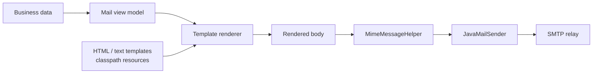

# Template Directories and Resource Loading in Spring Framework Mail

When a Spring application sends HTML emails or emails with multiple content templates, writing all copy inside Java services quickly becomes hard to maintain. A common organization is to **place email templates and accompanying resources in the resource directory**, then use Spring to load them when building messages. Templates can be HTML, plain text, logo images, or other static data files.

In a Spring Boot project, the structure typically starts from:

```text
src/main/resources/
├── templates/
│   └── mail/
│       ├── order-ready.html
│       ├── order-ready.txt
│       ├── payment-received.html
│       └── password-reset.html
├── mail/
│   └── images/
│       └── brand-logo.png
└── application.yml
```

Files in `src/main/resources` are placed onto the **classpath** during build. Therefore, the application can load `templates/mail/order-ready.html` using the Spring Resource API or through a template engine such as Thymeleaf. When running from an executable JAR, the templates remain inside the application artifact and can be read as streams.

The important thing is distinguishing two tasks:

- **Resource loading:** locating and opening a file from the classpath, filesystem, URL, or a Spring-supported source.
- **Template rendering:** substituting business data into placeholders, applying the template engine's syntax and escaping rules to produce the complete email string.

The Spring Resource API solves the first part. The template engine solves the second part. The two can work together, but do not confuse a `Resource` with an already-rendered content object.

## 1. Why Separate Templates from Java Code?

Suppose an application sends order notifications. If the service queries data, concatenates HTML strings, and sends via SMTP all in one place, the code can turn into:

```java
String html = "<html><body>"
        + "<h1>Order " + order.getId() + "</h1>"
        + "<p>Hello " + order.getCustomer().getName() + "</p>"
        + "</body></html>";
```

This approach may work for a small example, but it is hard to scale when content needs multiple paragraphs, tables, links, logos, complex HTML structure, both `text/plain` and `text/html` versions, multiple languages, or multiple templates per event type.

Separating templates creates a clear boundary:



The business layer decides **which email needs to be sent and which data is allowed in**. The rendering layer decides **how to present the data**. The sender layer hands the message to SMTP. When changing template locations or switching template engines, business logic is far less affected.

## 2. Project Template Directory Conventions

An easy-to-find and extensible structure:

```text
my-application/
├── src/
│   ├── main/
│   │   ├── java/
│   │   │   └── com/example/mail/
│   │   │       ├── MailSenderConfiguration.java
│   │   │       ├── MailTemplateRenderer.java
│   │   │       └── OrderNotificationService.java
│   │   └── resources/
│   │       ├── templates/
│   │       │   └── mail/
│   │       │       ├── order-ready.html
│   │       │       ├── order-ready.txt
│   │       │       ├── order-cancelled.html
│   │       │       └── order-cancelled.txt
│   │       ├── mail/
│   │       │   └── images/
│   │       │       └── brand-logo.png
│   │       └── application.yml
│   └── test/
│       ├── java/
│       └── resources/
│           └── templates/
│               └── mail/
└── build.gradle
```

| Path | Content | Reason |
| --- | --- | --- |
| `src/main/resources/templates/mail/` | HTML and text email templates | Distinguishes email templates from web page or other UI templates |
| `src/main/resources/mail/images/` | Images packaged with the application | Can be loaded from the classpath and added to MIME as inline resources |
| `src/main/resources/application.yml` | SMTP configuration and template locations | Separates operational configuration from message content |
| `src/main/java/.../mail/` | Renderer, service, sender configuration | Keeps Java code for logic, without embedding long raw templates |
| `src/test/resources/` | Resources used only in testing | Provides fixtures or test templates specifically for tests |

The directory name `templates/mail` is a **readable convention**, not a mandatory name in Spring Framework Mail. If the application has many template groups, you can nest further:

```text
templates/mail/
├── account/
│   ├── welcome.html
│   └── password-reset.html
├── order/
│   ├── ready.html
│   └── cancelled.html
└── billing/
    ├── invoice.html
    └── payment-received.html
```

Directory and file names should reflect the **notification type**, independent of Java class names or a specific email address. When both HTML and text exist, keep paired filenames identical: `order-ready.html` and `order-ready.txt`.

### Do Not Confuse Email Templates with Web Static Resources

Directories such as `static/` and `public/` are typically used for resources that the web server can serve directly. Email templates usually **do not need to be exposed as public URLs**; the application reads them from the classpath or a configured location and renders them before sending.

Placing templates in `templates/mail` separates email-specific content from images, CSS, and public web-application files. A logo image referenced by public URL can live on a static server/CDN; if embedded via CID, the application loads the image file from resources and puts it into the MIME message.

## 3. How `src/main/resources` Gets Placed on the Classpath

When building a Java application, contents of `src/main/resources` are typically copied into the project's output resources directory. When running from the classes directory, files are on the classpath. When packaged as a Spring Boot executable JAR, they are typically placed in the JAR's classpath area, such as `BOOT-INF/classes/`.

```text
src/main/resources/templates/mail/order-ready.html
                |
                | build
                v
classpath resource:
templates/mail/order-ready.html
                |
                | package Spring Boot
                v
application.jar
└── BOOT-INF/classes/
    └── templates/mail/order-ready.html
```

The classpath is the set of directories and archives that the class loader searches for classes and resources. Therefore, a resource path should be understood as a **path inside the classpath**, not an absolute path on the development machine's disk.

File example:

```text
src/main/resources/templates/mail/order-ready.html
```

Commonly used classpath paths:

```text
templates/mail/order-ready.html
classpath:/templates/mail/order-ready.html
```

The first path can be used directly with `ClassPathResource`; the second is an explicit location for `ResourceLoader`.

Do not hardcode development machine paths such as:

```text
C:\Users\developer\project\src\main\resources\templates\mail\order-ready.html
```

This is a source tree path. It is no longer valid when the application runs in a container, on Linux, from an executable JAR, or on another server.

| Location | Meaning |
| --- | --- |
| `src/main/resources/templates/mail/order-ready.html` | File path in the repository during development |
| `templates/mail/order-ready.html` | Relative path inside the classpath |
| `classpath:/templates/mail/order-ready.html` | Resource location specified with the classpath prefix |
| `file:/etc/myapp/mail/order-ready.html` | Resource on the runtime machine's filesystem |
| `https://assets.example/logo.png` | Remote URL resource, if actively supported by the application |

## 4. Spring Resource abstraction

Spring Core provides the `org.springframework.core.io.Resource` interface to represent a resource. A resource can come from the classpath, filesystem, URL, servlet context, or an application-supplied stream source.

Commonly used implementations:

| Implementation | Data Source | Example |
| --- | --- | --- |
| `ClassPathResource` | Classpath | `new ClassPathResource("templates/mail/order-ready.html")` |
| `FileSystemResource` | Filesystem | `new FileSystemResource("/etc/myapp/mail/order-ready.html")` |
| `UrlResource` | URL | `new UrlResource(URI.create("https://assets.example/logo.png"))` |
| `ByteArrayResource` | Byte array in memory | Template or image already read into a byte array |
| `InputStreamResource` | Existing InputStream | Stream provided from another source, usually unsuitable for opening multiple times |

`Resource` is a **data-source descriptor**, not necessarily a real file on disk. Key methods:

| Method | Meaning |
| --- | --- |
| `exists()` | Whether the resource exists as determined by the implementation |
| `isReadable()` | Whether the resource can be read |
| `getInputStream()` | Open a stream to read the content |
| `getURL()` | Get the URL if the resource can be represented as a URL |
| `getFile()` | Get a File object if the resource has a corresponding physical file |
| `getFilename()` | Filename if available |
| `contentLength()` | Content size according to the implementation's capabilities |

Not every resource supports every operation. In particular, **not every resource can be converted to a `java.io.File`**.

### Why Is `getInputStream()` Important?

When a template is inside an executable JAR, it can be read directly from an archive entry. There is no standalone file at a path that `File` can represent. `Resource.getInputStream()` lets you read the content without caring whether the resource is in a directory or inside a JAR.

```text
ClassPathResource
       |
       v
Resource.getInputStream()
       |
       v
InputStream
       |
       v
UTF-8 decoder
       |
       v
String template
```

For text/HTML templates, this is a loading approach that works both when running from an IDE and when running from a JAR.

## 5. Loading a Template with `ClassPathResource`

If the exact template file is known, you can create the resource directly:

```java
import java.io.IOException;
import java.io.InputStream;
import java.nio.charset.StandardCharsets;

import org.springframework.core.io.ClassPathResource;
import org.springframework.core.io.Resource;
import org.springframework.util.StreamUtils;

public class MailTemplateReader {

    public String readOrderReadyHtml() {
        Resource resource = new ClassPathResource(
                "templates/mail/order-ready.html");

        if (!resource.exists() || !resource.isReadable()) {
            throw new IllegalStateException(
                    "Mail template is missing or unreadable");
        }

        try (InputStream input = resource.getInputStream()) {
            return StreamUtils.copyToString(
                    input, StandardCharsets.UTF_8);
        } catch (IOException exception) {
            throw new IllegalStateException(
                    "Cannot read mail template", exception);
        }
    }
}
```

Explanation:

1. `ClassPathResource` locates the resource by classpath path.
2. `exists()` and `isReadable()` help detect missing files in configuration or application packaging.
3. `getInputStream()` opens the resource content.
4. `StreamUtils.copyToString(..., UTF_8)` reads the stream into a string with an explicit charset.
5. `try-with-resources` closes the stream after reading, preventing resource leaks.

This example reads **raw content**. It does not substitute placeholders and does not send emails. When using a template engine, you should usually pass the template name to the engine so it resolves the resource and renders it itself instead of reading and concatenating strings manually.

### Is a Leading `/` Needed in the Path?

With `ClassPathResource`, classpath paths are typically written as:

```java
new ClassPathResource("templates/mail/order-ready.html");
```

The path has no `classpath:` prefix because the constructor itself specifies the resource type. With `ResourceLoader`, use a location with an explicit prefix:

```java
resourceLoader.getResource(
        "classpath:/templates/mail/order-ready.html");
```

Do not mix `ResourceLoader` location syntax with constructor parameters of every implementation. If using another library or template engine, check that resolver's path rules.

## 6. Loading Resources via `ResourceLoader`

`ResourceLoader` is the Spring interface used to obtain a `Resource` from a location string. It is useful when the template location is configured per environment:

```java
import org.springframework.core.io.Resource;
import org.springframework.core.io.ResourceLoader;
import org.springframework.stereotype.Component;
import org.springframework.util.StreamUtils;

import java.io.IOException;
import java.io.InputStream;
import java.nio.charset.StandardCharsets;

@Component
public class ConfigurableMailTemplateReader {

    private final ResourceLoader resourceLoader;

    public ConfigurableMailTemplateReader(ResourceLoader resourceLoader) {
        this.resourceLoader = resourceLoader;
    }

    public String read(String location) {
        Resource resource = resourceLoader.getResource(location);

        if (!resource.exists() || !resource.isReadable()) {
            throw new IllegalStateException(
                    "Mail template cannot be read: " + location);
        }

        try (InputStream input = resource.getInputStream()) {
            return StreamUtils.copyToString(
                    input, StandardCharsets.UTF_8);
        } catch (IOException exception) {
            throw new IllegalStateException(
                    "Failed to load mail template", exception);
        }
    }
}
```

Configuration example:

```yaml
app:
  mail:
    templates:
      order-ready-html: classpath:/templates/mail/order-ready.html
      order-ready-text: classpath:/templates/mail/order-ready.txt
```

The service can receive the location from configuration:

```java
@Value("${app.mail.templates.order-ready-html}")
private String orderReadyHtmlLocation;
```

This is an illustrative way to read properties; in a large application, you can group properties into a `@ConfigurationProperties` class for strong typing and clear validation.

### Common Prefixes

| Location | Interpretation |
| --- | --- |
| `classpath:/templates/mail/order-ready.html` | Look up on the classpath |
| `file:/etc/myapp/mail/order-ready.html` | Read a file outside the application |
| `https://assets.example/mail/logo.png` | Remote URL source if supported by the loader/implementation |

Explicit prefixes avoid accidentally interpreting a relative path against the process's working directory. For email templates, classpath is convenient when content is packaged with the application version.

### Do Not Take Arbitrary Paths from Requests

Do not let users pass:

```text
../../application.yml
file:/etc/passwd
https://internal-service.example/private-template
```

and feed it directly into `ResourceLoader.getResource(...)`. If the location is influenced by untrusted data, the application could read unintended files or access internal services. Use an **allowlisted template key** that maps the key to an application-controlled resource location.

Example:

```java
private static final Map<String, String> TEMPLATE_LOCATIONS = Map.of(
        "ORDER_READY", "classpath:/templates/mail/order-ready.html",
        "PAYMENT_RECEIVED", "classpath:/templates/mail/payment-received.html"
);
```

The map illustrates how to select a template by defined type code; do not accept filesystem paths or URLs directly from clients.

## 7. Loading Multiple Resources with `ResourcePatternResolver`

If you need to find multiple templates or images matching a pattern, Spring provides `ResourcePatternResolver`. This interface extends resource lookup with patterns such as `classpath*:`:

```java
import org.springframework.core.io.Resource;
import org.springframework.core.io.support.ResourcePatternResolver;
import org.springframework.stereotype.Component;

import java.io.IOException;

@Component
public class MailTemplateCatalog {

    private final ResourcePatternResolver resolver;

    public MailTemplateCatalog(ResourcePatternResolver resolver) {
        this.resolver = resolver;
    }

    public Resource[] findHtmlTemplates() throws IOException {
        return resolver.getResources(
                "classpath*:templates/mail/**/*.html");
    }
}
```

The pattern above asks to find HTML files under the `templates/mail` tree on the classpath. It is useful when multiple modules contribute templates, when building a template catalog from packaged resources, or when listing images/files by group.

### How Does `classpath:` Differ from `classpath*:`?

| Prefix | Purpose |
| --- | --- |
| `classpath:` | Retrieve a resource from the classpath at a single location |
| `classpath*:` | Search for resources across the entire classpath using the pattern resolver mechanism |

For **a single known template**, `classpath:` or `ClassPathResource` is usually simpler. For **a set of resources by pattern**, `classpath*:` via `ResourcePatternResolver` is more appropriate.

Do not rescan the entire classpath on every email send if the template list does not change. You can discover resources at startup, store a verified catalog, and look up by key.

## 8. Loading Templates from Files Outside the Application

Some systems need operations teams to update email content without rebuilding the executable JAR. In that case, templates can be placed on the filesystem and a location configured:

```yaml
app:
  mail:
    templates:
      location: file:/etc/myapp/mail/
```

Reading example:

```java
Resource resource = resourceLoader.getResource(
        "file:/etc/myapp/mail/order-ready.html");
```

The advantage is that templates can be updated independently of the artifact, mounted from volumes, or shared across environments with the same artifact. However, you must manage:

- **Filesystem permissions:** the process should only read the required template directory.
- **Integrity:** files outside the JAR need versioning, review, and controlled deployment.
- **Availability:** if a volume is not mounted or a file is deleted, email rendering will fail.
- **Caching:** the template engine may hold parsed templates; changing an external file does not necessarily take effect immediately.
- **Rollback:** you need the ability to revert to a previous template version if content errors occur.

| Need | Usually Suitable Choice |
| --- | --- |
| Templates change alongside software versions | `classpath:` |
| Content is reviewed and packaged in the artifact | `classpath:` |
| Operations team needs to deploy environment-specific content | `file:` with a managed directory |
| Templates need independent updates with versioning/rollback process | Filesystem or dedicated template management system |

Neither option is automatically safer. **Classpath reduces dependency on external runtime files**, whereas external files increase independent update flexibility at the cost of explicit permission and lifecycle management.

## 9. Why Should You Not Use `getFile()` for Every Resource?

A common mistake:

```java
Resource resource = new ClassPathResource(
        "templates/mail/order-ready.html");

File file = resource.getFile();
```

`getFile()` may work when the resource is in the classes directory on a development machine. However, when the application is packaged in a JAR, the resource may live inside the archive and **not exist as a standalone file on the filesystem**. In that case, `getFile()` can throw an exception.

For template content, read via stream:

```java
try (InputStream input = resource.getInputStream()) {
    String template = StreamUtils.copyToString(
            input, StandardCharsets.UTF_8);
}
```

| API | Should It Be Used to Read Classpath Templates in a JAR? | Reason |
| --- | --- | --- |
| `Resource.getInputStream()` | **Yes** | Reads the resource through the abstraction |
| `Resource.getFile()` | Should not rely on it | Requires a physical file on the filesystem |
| `new File("src/main/resources/...")` | No | This is a source tree path, not a runtime resource |
| `Paths.get(resource.getURI())` | Should not assume it works | The URI may be `jar:` rather than a file URI |
| `ResourceLoader.getResource("classpath:...")` | **Yes** | Uses the location abstraction |

For stream-based resources, always close the stream after reading. Do not store a single `InputStream` and reuse it across multiple renders; many streams can only be read once. If readable-again data is needed, keep a `Resource` that can open a new stream or store an appropriate byte array.

### `InputStreamResource` and Re-readability

`InputStreamResource` typically represents an already-opened stream. It is not a good choice for caching a template and opening it many times, because the stream may already have been consumed. For in-memory data, `ByteArrayResource` may fit better; for files/classpath, keep a `Resource` that can open a fresh stream each time.

## 10. Loading and Rendering Templates with Thymeleaf

The Spring Resource API helps locate files, but **does not substitute placeholders** such as `[[${customerName}]]` or `th:text`. To render templates, the application can use Thymeleaf, FreeMarker, or another engine.

With Spring Boot, you can add:

```groovy
dependencies {
    implementation 'org.springframework.boot:spring-boot-starter-thymeleaf'
}
```

Dependencies and versions must be compatible with the project's Spring Boot/Spring Framework version. If the application uses the engine only for email, you can declare the corresponding Thymeleaf Spring dependency without pulling in an unnecessary web stack.

### Thymeleaf Template Layout

```text
src/main/resources/templates/mail/
├── order-ready.html
└── order-ready.txt
```

HTML template:

```html
<!doctype html>
<html lang="vi" xmlns:th="http://www.thymeleaf.org">
  <body>
    <h1>Order Is Ready</h1>
    <p>Hello <strong th:text="${customerName}">Customer name</strong>,</p>
    <p>
      Order ID:
      <strong th:text="${orderId}">ORD-000</strong>
    </p>
    <p>
      <a th:href="${orderUrl}">View order details</a>
    </p>
  </body>
</html>
```

Text template:

```text
ORDER IS READY

Hello [[${customerName}]],

Order ID: [[${orderId}]]
View details:
[[${orderUrl}]]
```

In Thymeleaf, text inlining syntax `[[...]]` inserts values into text templates. These placeholders read data from the context; the template should not query the database or decide recipient permissions itself.

### Configuring Separate Resolvers for Email

A web application may already have template resolvers for UI pages. To avoid mixing web templates with email templates, you can configure separate resolvers:

```java
package com.example.mail;

import org.springframework.context.annotation.Bean;
import org.springframework.context.annotation.Configuration;
import org.thymeleaf.spring6.SpringTemplateEngine;
import org.thymeleaf.templatemode.TemplateMode;
import org.thymeleaf.templateresolver.ClassLoaderTemplateResolver;

@Configuration
public class MailTemplateConfiguration {

    @Bean
    public SpringTemplateEngine mailHtmlTemplateEngine() {
        ClassLoaderTemplateResolver resolver =
                new ClassLoaderTemplateResolver();
        resolver.setPrefix("templates/mail/");
        resolver.setSuffix(".html");
        resolver.setTemplateMode(TemplateMode.HTML);
        resolver.setCharacterEncoding("UTF-8");
        resolver.setCacheable(true);

        SpringTemplateEngine engine = new SpringTemplateEngine();
        engine.setTemplateResolver(resolver);
        return engine;
    }

    @Bean
    public SpringTemplateEngine mailTextTemplateEngine() {
        ClassLoaderTemplateResolver resolver =
                new ClassLoaderTemplateResolver();
        resolver.setPrefix("templates/mail/");
        resolver.setSuffix(".txt");
        resolver.setTemplateMode(TemplateMode.TEXT);
        resolver.setCharacterEncoding("UTF-8");
        resolver.setCacheable(true);

        SpringTemplateEngine engine = new SpringTemplateEngine();
        engine.setTemplateResolver(resolver);
        return engine;
    }
}
```

Here there are two separate engines/resolvers:

- The HTML engine looks for `templates/mail/<name>.html` and processes with `TemplateMode.HTML`.
- The text engine looks for `templates/mail/<name>.txt` and processes with `TemplateMode.TEXT`.
- Both read from the classloader and use UTF-8.
- `cacheable=true` suits stable packaged templates in production; during development, you can choose an appropriate cache setting so changes are reflected.

The example uses the `org.thymeleaf.spring6` package for Spring 6 integration. For projects using a different Spring/Thymeleaf version, packages and dependencies must match the version in use.

### Rendering Both Versions

```java
import java.util.Locale;
import java.util.Map;

import org.springframework.stereotype.Component;
import org.thymeleaf.context.Context;
import org.thymeleaf.spring6.SpringTemplateEngine;

@Component
public class OrderReadyTemplateRenderer {

    private final SpringTemplateEngine htmlEngine;
    private final SpringTemplateEngine textEngine;

    public OrderReadyTemplateRenderer(
            @Qualifier("mailHtmlTemplateEngine")
            SpringTemplateEngine htmlEngine,
            @Qualifier("mailTextTemplateEngine")
            SpringTemplateEngine textEngine) {
        this.htmlEngine = htmlEngine;
        this.textEngine = textEngine;
    }

    public RenderedMailBody render(
            String customerName,
            String orderId,
            String orderUrl,
            Locale locale) {

        Context context = new Context(locale);
        context.setVariables(Map.of(
                "customerName", customerName,
                "orderId", orderId,
                "orderUrl", orderUrl));

        String html = htmlEngine.process("order-ready", context);
        String text = textEngine.process("order-ready", context);

        return new RenderedMailBody(text, html);
    }
}

public record RenderedMailBody(String plainText, String htmlText) {
}
```

The example assumes the beans are configured as above and imports `org.springframework.beans.factory.annotation.Qualifier`. A dedicated view model is usually better than passing many scattered parameters when a template has many fields.

Once you have `RenderedMailBody`, send via Spring Mail:

```java
MimeMessage message = mailSender.createMimeMessage();
MimeMessageHelper helper = new MimeMessageHelper(
        message,
        MimeMessageHelper.MULTIPART_MODE_MIXED_RELATED,
        "UTF-8");

helper.setFrom("notifications@shop.example");
helper.setTo(recipientEmail);
helper.setSubject("Order " + orderId + " is ready");
helper.setText(body.plainText(), body.htmlText());

mailSender.send(message);
```

### Escaping Data in Templates

In HTML, use `th:text` for text content and `th:href` for application-controlled URLs. `th:text` escapes displayed content per Thymeleaf's rules; avoid using `th:utext` for user-supplied strings without an appropriate sanitization process.

Text templates do not require HTML escaping in the same way, yet still require controlling control characters in single-line fields, data length, sensitive data, and URLs. A template engine does not replace business validation or recipient authorization.

## 11. Loading Resources for Inline Images and Attachments

Besides templates, emails may need logo images, QR codes, or documents. Files packaged on the classpath can also be loaded as a Spring `Resource`:

```java
Resource logo = new ClassPathResource(
        "mail/images/brand-logo.png");
```

Then add the inline image:

```java
helper.setText(plainText, htmlText);
helper.addInline(
        "brand-logo@shop.example",
        logo,
        "image/png");
```

The HTML needs to reference the same Content-ID:

```html

```

With `MimeMessageHelper`, call `setText(...)` first and then `addInline(...)`. `Resource` provides the image data; `addInline` puts it into a MIME part with the Content-ID. **The image's classpath path is not the `cid:` value**: HTML references the Content-ID, not the filename.

### Attachment

A PDF attachment can be loaded similarly:

```java
Resource invoice = new ClassPathResource(
        "mail/documents/sample-invoice.pdf");

helper.addAttachment("invoice.pdf", invoice);
```

In production, invoices are usually documents generated per transaction, so the resource can come from a byte array, controlled storage file, or object storage. Do not put customer-specific invoice data into a static resource on the application's classpath.

For in-memory data:

```java
Resource invoiceResource = new ByteArrayResource(pdfBytes);
helper.addAttachment("invoice.pdf", invoiceResource);
```

`pdfBytes` is a byte array created in the business flow. If the file is stored in external storage, verify access permissions and size before downloading it to attach.

## 12. Locale-Specific Templates and Multi-Language Structure

If emails are sent to recipients in multiple languages, you can organize:

```text
templates/mail/
├── vi/
│   ├── order-ready.html
│   └── order-ready.txt
├── en/
│   ├── order-ready.html
│   └── order-ready.txt
└── default/
    ├── order-ready.html
    └── order-ready.txt
```

The application determines the recipient's locale, then chooses **a defined template key**. Example:

```java
String templateBase = switch (locale.getLanguage()) {
    case "vi" -> "vi/order-ready";
    case "en" -> "en/order-ready";
    default -> "default/order-ready";
};
```

This is an example of choosing a template name; when using a resolver with a prefix/suffix, the engine locates the corresponding file. Do not concatenate a locale value from a request directly into a filesystem path without restricting the locale list.

If a Vietnamese HTML template exists without a Vietnamese text template, the application might send an email with no fallback. Therefore, template deployment should treat **the HTML/text pair as one unit**:

```text
vi/order-ready.html  <-->  vi/order-ready.txt
en/order-ready.html  <-->  en/order-ready.txt
```

If no specific locale applies, a defined default template pair can be used. Do not fall back HTML to English while falling back text to Vietnamese without explicit intent.

## 13. Caching and Template Lifecycle

Reading files from the classpath or filesystem on every send can create repeated I/O. Template engines typically have a mechanism to cache parsed templates to reduce overhead.

| Deployment Approach | Characteristics |
| --- | --- |
| Classpath template + cache enabled | Suits templates packaged with the artifact, updated via build/deploy |
| Classpath template + cache disabled | Useful during development/debugging, but does not make resources inside a JAR update automatically |
| External file + cache enabled | May require an invalidation/reload policy when files are updated |
| External file + cache disabled | Can read fresh content frequently, at the cost of increased I/O and filesystem dependency |

In production, if templates are packaged in a JAR, it is usually best to cache and release a new artifact when content changes. If templates live outside the artifact, clearly define how updates, checks, cache eviction, and rollbacks work.

Caching is not a versioning mechanism. If one worker is rendering with template version A and another process just updated to version B, emails sent during the transition may use different versions depending on cache and timing. For important business emails, attach the template version/release ID to notification metadata and optionally retain old template versions when retrying an already-created notification.

## 14. Testing Resource Loading and Template Rendering

Test separately:

1. Resource exists on the classpath.
2. Resource is readable as UTF-8.
3. Template engine finds the template name and renders without errors.
4. Dynamic data is substituted properly and escaped according to context.
5. Both text/HTML versions contain equivalent business information.
6. Inline/attachment resources can be opened when building MIME.
7. Resources remain readable when the application is packaged in a JAR.

### Testing Resource Reading

```java
import static org.junit.jupiter.api.Assertions.assertTrue;

import java.io.IOException;

import org.junit.jupiter.api.Test;
import org.springframework.core.io.ClassPathResource;
import org.springframework.core.io.Resource;

class MailTemplateResourceTest {

    @Test
    void orderReadyHtmlTemplateExists() throws IOException {
        Resource template = new ClassPathResource(
                "templates/mail/order-ready.html");

        assertTrue(template.exists());
        assertTrue(template.isReadable());
    }
}
```

This test confirms the resource is present on the test classpath. It does not by itself guarantee the template is packaged properly in the production artifact; checking the artifact/JAR remains useful at deployment time.

### Testing Template Rendering

With Thymeleaf, you can call the engine directly:

```java
Context context = new Context(Locale.forLanguageTag("vi-VN"));
context.setVariable("customerName", "An");
context.setVariable("orderId", "ORD-184");
context.setVariable(
        "orderUrl",
        "https://shop.example/orders/ORD-184");

String html = mailHtmlTemplateEngine.process(
        "order-ready", context);

assertTrue(html.contains("ORD-184"));
```

The snippet assumes the engine has been configured and the template exists. You should also verify that data containing special characters cannot create unintended markup, and that links render to the controlled URL.

### Testing When Running from an Executable JAR

A bug that often surfaces only after packaging is code that reads resources using `File`, succeeding in the IDE but failing in a JAR. Integration checks should run the application or a test artifact with the expected packaging, and verify that resource names are present in the JAR, resolvers use the right prefix/suffix, charset remains UTF-8, inline images open via streams, and no code depends on `src/main/resources` at runtime.

## 15. Common Errors When Loading Templates/Resources

| Symptom | Possible Cause | How to Fix |
| --- | --- | --- |
| `FileNotFoundException` when running JAR | Using `getFile()` on a resource inside an archive | Read with `getInputStream()` or use a template resolver |
| Template exists in IDE but missing when deployed | Resource not in output/artifact or wrong path/case | Check exact location in JAR and filename |
| `Resource` does not exist | Wrong prefix, path, name, or directory | Use explicit `classpath:`/`file:`, check path |
| Garbled Vietnamese text | Using a default charset other than UTF-8 | Specify UTF-8 when reading and configuring the template engine |
| Content still has placeholders | Only read raw resource without running template engine | Render with an engine or a well-designed placeholder processor |
| HTML data injects markup | Using unescaped interpolation or raw HTML templates | Use proper escaping, never use raw output for untrusted input |
| Edited external file but email keeps old content | Template engine is caching | Review cache/invalidation policy |
| Failed to load resource pattern | Used `ResourceLoader` instead of `ResourcePatternResolver` or wrong pattern | Use a pattern-capable resolver and `classpath*:` syntax |
| Works on Windows, fails on Linux | Filesystem case sensitivity | Keep filenames and paths matching exactly |
| `InputStream` already closed during render | Reused a one-time stream | Store a re-openable `Resource` or byte data |
| External template missing | Volume/path not mounted or insufficient read permissions | Check deployment configuration and process permissions |
| User can choose arbitrary path | Template key taken directly from request | Use an allowlist and map to fixed resources |

### Mistake: Using `new File(...)` with Classpath Resources

```java
File template = new File(
        "src/main/resources/templates/mail/order-ready.html");
```

This path only reflects source code structure. After building, the application does not necessarily have a `src/main/resources` directory. Use `ClassPathResource` or `ResourceLoader` to access runtime resources.

### Mistake: Loading a Resource but Forgetting to Render

```java
String html = reader.read(
        "classpath:/templates/mail/order-ready.html");
```

If the template contains placeholders, the `html` variable remains a raw string. Pass the string to an appropriate template engine or let the engine locate the resource and render by template name.

### Mistake: Reading a Stream Without Closing It

```java
InputStream input = resource.getInputStream();
String html = StreamUtils.copyToString(input, StandardCharsets.UTF_8);
// Stream is not closed.
```

Use try-with-resources to guarantee closing the stream even when an exception occurs:

```java
try (InputStream input = resource.getInputStream()) {
    String html = StreamUtils.copyToString(
            input, StandardCharsets.UTF_8);
}
```

### Mistake: Using Template Paths from Untrusted Data

Do not concatenate `templateName` from a request directly into a classpath or filesystem path. If data is unrestricted, users may choose unexpected resources. Use an enum or allowlist of known template IDs.

## 16. Integrating Resources and Templates into the Spring Mail Sending Flow

A complete service typically has these steps:

1. Receive a validated business event.
2. Build a view model containing only permitted data.
3. Determine the template key and locale per application rules.
4. Render the HTML and text versions from resources.
5. Create `MimeMessage` and `MimeMessageHelper`.
6. Set sender, recipient, subject, and both content versions.
7. Add inline images or attachments if needed.
8. Call `JavaMailSender.send(...)`.

Example:

```java
public void sendOrderReady(
        OrderReadyData data,
        Locale locale) throws MessagingException {

    RenderedMailBody body = templateRenderer.render(data, locale);

    MimeMessage message = mailSender.createMimeMessage();
    MimeMessageHelper helper = new MimeMessageHelper(
            message,
            MimeMessageHelper.MULTIPART_MODE_MIXED_RELATED,
            "UTF-8");

    helper.setFrom(fromAddress);
    helper.setTo(data.recipientEmail());
    helper.setSubject("Order " + data.orderId() + " is ready");
    helper.setText(body.plainText(), body.htmlText());

    helper.addInline(
            "brand-logo@shop.example",
            new ClassPathResource("mail/images/brand-logo.png"),
            "image/png");

    mailSender.send(message);
}
```

The snippet connects the components described; the `templateRenderer`, `fromAddress`, and `mailSender` fields are injected/configured in the application. The HTML template must contain `src="cid:brand-logo@shop.example"` and the image must be validated for the right format.

| Component | Responsibility |
| --- | --- |
| `OrderReadyData` | Curated business data |
| `ResourceLoader`/`ClassPathResource` | Locate and open template/image files |
| Thymeleaf/other engine | Substitute data into templates and apply rendering rules |
| `RenderedMailBody` | Holds rendered plain text and HTML |
| `MimeMessageHelper` | Build MIME message, content, inline parts, and attachments |
| `JavaMailSender` | Submit messages over SMTP |

Separating in this way allows changing resource locations or template engines without modifying SMTP logic; changing SMTP providers also does not force rewriting templates.

## 17. Deployment and Operational Notes

### Classpath Resources Are Immutable per Artifact

If templates are packaged in a JAR, changing content usually requires releasing a new artifact. Do not edit files directly inside a running JAR. This keeps templates and code versioned together, though it requires a release process for email content changes.

### External File Resources Require Versioning

If using `file:`, manage templates as a versioned deployment configuration:

```text
/etc/myapp/mail/
├── release-2026-11/
│   ├── order-ready.html
│   └── order-ready.txt
└── current -> release-2026-11
```

This is a filesystem organization example; how symlinks or files are deployed depends on the environment. The goal is knowing which template set an instance is running and being able to roll back to a known version.

### Do Not Let Templates Contain Secrets

Templates can contain brand names, instructions, and placeholders, but must not contain SMTP passwords, OAuth tokens, API keys, signing secrets, static personal customer data, or sensitive internal URLs.

SMTP credentials live in separate secrets/configuration. Templates only receive necessary display data from the view model.

### Control URLs and Remote Resources

Do not fetch templates from arbitrary URLs on every send. If using URL resources, the application must control host, TLS, timeout, size, caching, and trusted sources; otherwise, it may depend on external networks or create SSRF risks when URLs are user-controlled.

For email images, decide clearly between embedding via CID from classpath/byte array, using a public CDN URL, or omitting images when unnecessary. Never put private internal-system URLs into HTML emails sent to external recipients.

### Track Errors by Resource Type

When sending fails, distinguish:

- Template not found.
- Template engine cannot parse syntax.
- Render data missing or wrong type.
- Unable to read image/attachment.
- Failed to create MIME message.
- SMTP submission failed.

These errors occur at different steps. Logs should include template key/version and appropriate notification ID, while avoiding logging the full body or sensitive recipient data.

## 18. Self-Check Questions

**1. Why put templates in `src/main/resources`?**

Because content is placed on the classpath and packaged with the application; code can load it using the Spring Resource API without depending on source paths on a development machine.

**2. Does a `Resource` always represent a file on disk?**

No. It can represent a classpath entry inside a JAR, a URL, a stream, or another source. Therefore, do not assume `getFile()` always works.

**3. When running from an executable JAR, which reading approach is appropriate?**

Use `Resource.getInputStream()` or a template resolver supporting classpath resources; avoid `new File("src/main/resources/...")`.

**4. How does `ResourceLoader` differ from `ResourcePatternResolver`?**

`ResourceLoader` loads one resource by location; `ResourcePatternResolver` supports finding multiple resources by pattern such as `classpath*:`.

**5. Does reading HTML from a `Resource` automatically substitute `th:text`?**

No. The Resource API only loads content; a template engine such as Thymeleaf renders expressions and placeholders.

**6. Should template paths be taken directly from requests?**

No. Select templates via an allowlisted key/enum and map to an application-managed resource location.

**7. When should `file:` be used instead of `classpath:`?**

When templates need to be deployed/updated outside the artifact and a clear process exists for managing permissions, versioning, caching, and rollback.

**8. Why is UTF-8 needed when reading templates?**

So Vietnamese and Unicode content is decoded consistently; the charset when reading resources must match the charset used when rendering MIME.

**9. Can the same HTML template be used for the text version?**

No. The two versions have different structure and reading experiences; create a separate template pair or a renderer with explicit semantic conversion rules.

**10. When a template has CID images, where does the image resource live?**

Images can live on the classpath, filesystem, or in a byte array. The application loads the resource and calls `MimeMessageHelper.addInline(...)`; HTML references the Content-ID, not the resource path.

**11. Does the template engine cache automatically detect external file changes?**

You cannot assume that. Configure caching/invalidation/reloading appropriate for the engine and environment.

**12. Why check the artifact/JAR after building?**

To verify that resources are actually packaged and the resolver can read them in the runtime environment, especially when code was previously tested only in an IDE.

## Conclusion

**Template directories and resource loading determine where a Spring application finds email content and how it uses it.** Placing HTML/text templates in `src/main/resources/templates/mail` packages them onto the classpath; use `ClassPathResource`, `ResourceLoader`, or `ResourcePatternResolver` to load them, preferring `getInputStream()` over relying on `getFile()` when running from an executable JAR. The Resource API only opens content; a template engine such as Thymeleaf renders data into placeholders. When integrating with Spring Mail, render both versions from the same view model, put them into `MimeMessageHelper`, and send via `JavaMailSender`. If using external files outside the application, manage permissions, versioning, caching, and rollback. **Clear resource organization keeps templates easy to locate, easy to test, reliably packaged, and independent of developer machines.**
