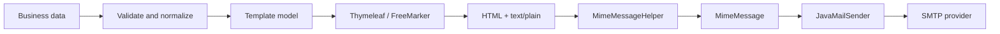

# Thymeleaf, FreeMarker, or Other Engines in the Mail Sending Flow

A Spring Boot application needs to send an account confirmation email. The content includes the recipient's name, request ID, verification expiration, and an HTTPS link. Writing all the HTML via string concatenation in Java quickly makes the mail service hard to read: presentation mixes with business data, quotes easily break, Vietnamese content is hard to manage, and user data can accidentally become HTML.

A **template engine** solves the problem of separating presentation from data. In the Spring ecosystem, popular choices include **Thymeleaf** and **FreeMarker**. The engine takes a managed template and a data model, then renders an HTML or text string. Spring Mail takes the rendered result via `MimeMessageHelper` and `JavaMailSender` to build a MIME message and send it over SMTP.

Basic flow:



The template engine **does not send email**, does not replace SMTP transport, and does not itself decide who is allowed to receive mail. It only renders content. The application must still control recipients, dynamic data, URLs, sending permissions, security, and delivery outcomes.

## 1. Distinguishing Template Engine, MIME Composer, and Mail Sender

These three parts have separate responsibilities:

| Component | Example | Responsibility |
|---|---|---|
| **Template engine** | Thymeleaf, FreeMarker | Render templates into HTML or text strings from input data. |
| **MIME composer** | `MimeMessage`, `MimeMessageHelper` | Build headers, text/plain, text/html, inline resources, and attachments. |
| **Mail sender** | `JavaMailSender` | Hand off the message to the configured SMTP transport. |

An HTML template can generate:

```html
<h1>Account Confirmation</h1>
<p>Hello Alice Nguyen,</p>
<p>Please verify your account using the link below.</p>
```

The template engine generates the string above. Then `MimeMessageHelper` can place that string into the `text/html` MIME part while also adding a `text/plain` version. Finally, `JavaMailSender` hands the message off to the SMTP server.

Do not put SMTP sending logic into the template engine, nor let the mail service render HTML via string concatenation if templates have multiple variants, languages, or layouts.

### 1.1. When Is a Template Engine Needed?

A template engine is useful when emails:

- Have multiple dynamic fields such as name, order number, delivery date, and monetary amount.
- Share an HTML layout across multiple notification types.
- Require multiple languages or content variants.
- Need to separate content designers' work from Java services.
- Need independent testing of rendering and SMTP sending.
- Have paired text and HTML templates.

For a plain-text email consisting of a single fixed sentence, `SimpleMailMessage` may suffice. Do not add a template engine just to substitute one simple string.

## 2. Template Directory Structure for Email

An easy-to-manage structure in a Spring Boot project:

```text
src/
└── main/
    └── resources/
        ├── application.yml
        ├── templates/
        │   └── mail/
        │       ├── vi/
        │       │   ├── verification.html
        │       │   ├── order-confirmation.html
        │       │   └── password-reset.html
        │       └── en/
        │           ├── verification.html
        │           └── order-confirmation.html
        └── mail/
            └── images/
                └── company-logo.png
```

For larger projects, you can separate text templates as well:

```text
templates/mail/vi/verification.html
templates/mail/vi/verification.txt
templates/mail/en/verification.html
templates/mail/en/verification.txt
```

A template should have a **clear business purpose**, such as `verification`, `order-confirmation`, or `invoice-ready`. Do not name templates after recipients or order numbers, because per-email data belongs to variables in the model, not template filenames.

Templates should be packaged with the application or loaded from a controlled content store. If editing templates outside runtime is allowed, enforce permissions, version history, a release process, and content validation before use.

## 3. Dependencies and Shared Configuration in Spring Boot

### 3.1. Dependency

Gradle example when choosing Thymeleaf:

```groovy
dependencies {
    implementation 'org.springframework.boot:spring-boot-starter-mail'
    implementation 'org.springframework.boot:spring-boot-starter-thymeleaf'
}
```

If choosing FreeMarker:

```groovy
dependencies {
    implementation 'org.springframework.boot:spring-boot-starter-mail'
    implementation 'org.springframework.boot:spring-boot-starter-freemarker'
}
```

Starter versions are managed via Spring Boot dependency management. Do not manually pick a Thymeleaf, FreeMarker, or Jakarta Mail version incompatible with the Spring Boot version in use.

Usually, you only need to pick the engine your project uses. You can use multiple engines in the same application, but only with a clear reason and explicit template path/resolver configuration to avoid confusion.

### 3.2. SMTP Configuration Independent of the Template Engine

Example `application.yml` for SMTP submission on port 587 with STARTTLS:

```yaml
spring:
  mail:
    host: ${MAIL_HOST}
    port: 587
    protocol: smtp
    username: ${MAIL_USERNAME}
    password: ${MAIL_PASSWORD}
    default-encoding: UTF-8
    properties:
      "[mail.smtp.auth]": true
      "[mail.smtp.starttls.enable]": true
      "[mail.smtp.starttls.required]": true
      "[mail.smtp.ssl.checkserveridentity]": true
      "[mail.smtp.connectiontimeout]": 5000
      "[mail.smtp.timeout]": 10000
      "[mail.smtp.writetimeout]": 10000

app:
  mail:
    from: ${MAIL_FROM:notifications@example.com}
    base-url: ${APP_BASE_URL:https://accounts.example.com}
```

This is an illustrative configuration for a provider supporting **587 + STARTTLS**. If the provider requires implicit TLS on port 465, configure the transport per their instructions. Username/password come from the deployment environment or a secret manager; never commit real secrets to Git.

`spring.mail.*` controls the sender/SMTP. `spring.thymeleaf.*` or `spring.freemarker.*` controls the template engine. The two configuration groups serve two distinct stages.

## 4. Using Thymeleaf to Render HTML Email

Thymeleaf integrates well with Spring. Spring Boot auto-configures the template engine when the corresponding starter is present, and default templates are typically loaded from `classpath:/templates/`.

### 4.1. Template HTML

Create `src/main/resources/templates/mail/vi/verification.html`:

```html
<!doctype html>
<html lang="vi" xmlns:th="http://www.thymeleaf.org">
<head>
  <meta charset="UTF-8">
  <title>Verify your account</title>
</head>
<body>
  <table role="presentation" cellpadding="0" cellspacing="0"
         style="width:100%; max-width:600px; font-family:Arial,sans-serif;">
    <tr>
      <td>
        <h1>Verify Your Account</h1>
        <p>
          Hello <span th:text="${displayName}">there</span>,
        </p>
        <p>
          We received a request to verify your account.
        </p>
        <p>
          <a th:href="${verificationUrl}"
             href="https://accounts.example.com/"
             style="display:inline-block; padding:12px 18px;
                    background-color:#154f8d; color:#ffffff;
                    text-decoration:none;">
            Verify account
          </a>
        </p>
        <p>
          The link is valid until
          <strong th:text="${expiresAtText}">expiration time</strong>.
        </p>
        <p>If you did not request this action, please ignore this email.</p>
      </td>
    </tr>
  </table>
</body>
</html>
```

Key expressions:

- `th:text="${displayName}"` inserts the name as **HTML-escaped text**.
- `th:href="${verificationUrl}"` builds the link attribute; the URL value must still be validated separately by the application.
- `th:text="${expiresAtText}"` inserts the expiration time as text.
- HTML and CSS are static content controlled by the project.

If the customer's name has the value `<strong>Administrator</strong>`, `th:text` makes the email display those characters as text. It does not turn the user's value into an actual HTML tag.

**Do not replace `th:text` with `th:utext` for untrusted data.** `th:utext` inserts unescaped HTML and should only be used for a controlled rich-HTML pipeline sanitized against an allowlist.

### 4.2. Rendering Templates with SpringTemplateEngine

Spring Boot provides `SpringTemplateEngine` for rendering templates:

```java
import java.util.Locale;

import org.springframework.stereotype.Component;
import org.thymeleaf.context.Context;
import org.thymeleaf.spring6.SpringTemplateEngine;

@Component
public class ThymeleafMailRenderer {

    private final SpringTemplateEngine templateEngine;

    public ThymeleafMailRenderer(SpringTemplateEngine templateEngine) {
        this.templateEngine = templateEngine;
    }

    public String renderVerification(
            String displayName,
            String verificationUrl,
            String expiresAtText,
            Locale locale) {

        Context context = new Context(locale);
        context.setVariable("displayName", displayName);
        context.setVariable("verificationUrl", verificationUrl);
        context.setVariable("expiresAtText", expiresAtText);

        return templateEngine.process(
                "mail/vi/verification", context);
    }
}
```

Explanation:

1. `Context` holds the variables to be used in the template.
2. `new Context(locale)` lets the template use the appropriate locale when resolving internationalized messages.
3. `setVariable` passes logical values, not a pre-concatenated HTML string.
4. `process(templateName, context)` renders the template into an HTML `String`.
5. Template names are usually specified **without an extension** if the application's resolver automatically appends the `.html` suffix.

The example above hardcodes the `vi` directory for readability. In a multi-language application, select the template path from a validated locale, such as `mail/vi/verification` or `mail/en/verification`. Never construct an arbitrary template path from a user request.

### 4.3. Configuring the Template Resolver When Needed

With default Spring Boot configuration, you usually do not need to create a resolver manually. When you need custom paths, suffixes, modes, or caching, configure them via `spring.thymeleaf.*` properties appropriate for your Boot version.

Example:

```yaml
spring:
  thymeleaf:
    prefix: classpath:/templates/
    suffix: .html
    mode: HTML
    encoding: UTF-8
    cache: true
```

`cache: true` suits production runtime when templates are packaged and rarely change. In development, you can disable caching to see template changes faster. If the application uses Thymeleaf for both web views and email, consider sharing a resolver vs. creating separate resolvers per mode so email settings are not accidentally applied to web pages.

## 5. Using FreeMarker to Render Email

FreeMarker is another template engine commonly used in Java applications. It uses its own directive and interpolation syntax, such as `${displayName}` and `<#if ...>`.

### 5.1. Configuring FreeMarker in Spring Boot

When adding `spring-boot-starter-freemarker`, Spring Boot can auto-configure `FreeMarkerConfigurer` and the template loader per configuration. Example:

```yaml
spring:
  freemarker:
    template-loader-path: classpath:/templates/
    charset: UTF-8
    prefer-file-system-access: false
```

Example paths:

```text
src/main/resources/templates/mail/vi/verification.ftlh
src/main/resources/templates/mail/vi/verification.ftl
```

Here:

- `.ftlh` is a common convention for HTML templates with HTML output format and auto-escaping when FreeMarker configuration recognizes standard extensions.
- `.ftl` is typically used for non-HTML templates, such as plain text.
- To avoid relying implicitly on project defaults, the HTML template below explicitly declares output format and auto-escaping.

### 5.2. HTML Template with Auto-Escaping

File `src/main/resources/templates/mail/vi/verification.ftlh`:

```ftl
<#ftl output_format="HTML" auto_esc=true>
<!doctype html>
<html lang="vi">
<head>
  <meta charset="UTF-8">
  <title>Verify your account</title>
</head>
<body>
  <h1>Verify Your Account</h1>
  <p>Hello <strong>${displayName}</strong>,</p>
  <p>We received a request to verify your account.</p>
  <p>
    <a href="${verificationUrl}">Verify account</a>
  </p>
  <p>The link is valid until <strong>${expiresAtText}</strong>.</p>
  <p>If you did not request this action, please ignore this email.</p>
</body>
</html>
```

With HTML output format and auto-escaping enabled, ordinary interpolations like `${displayName}` are HTML-escaped. If the name is `<b>An</b>`, the recipient sees those characters as text.

FreeMarker also has operators/expressions that **disable escaping** or mark a value as already safe content, such as `?no_esc`. Never use them for user- or external-system-supplied data without a controlled sanitizer pipeline.

URLs in `href` still require scheme, host, and route validation at the application layer. Auto-escaping only protects HTML syntax; it does not determine whether a URL is trustworthy.

### 5.3. Rendering with FreeMarkerConfig

Spring provides `FreeMarkerConfig` to obtain the `freemarker.template.Configuration` object:

```java
import freemarker.template.Template;
import org.springframework.stereotype.Component;
import org.springframework.ui.freemarker.FreeMarkerConfig;
import org.springframework.ui.freemarker.FreeMarkerTemplateUtils;

import java.util.HashMap;
import java.util.Locale;
import java.util.Map;

@Component
public class FreeMarkerMailRenderer {

    private final FreeMarkerConfig freeMarkerConfig;

    public FreeMarkerMailRenderer(FreeMarkerConfig freeMarkerConfig) {
        this.freeMarkerConfig = freeMarkerConfig;
    }

    public String renderVerification(
            String displayName,
            String verificationUrl,
            String expiresAtText,
            Locale locale) throws Exception {

        Map<String, Object> model = new HashMap<>();
        model.put("displayName", displayName);
        model.put("verificationUrl", verificationUrl);
        model.put("expiresAtText", expiresAtText);

        Template template = freeMarkerConfig.getConfiguration()
                .getTemplate("mail/vi/verification.ftlh", locale);

        return FreeMarkerTemplateUtils.processTemplateIntoString(
                template, model);
    }
}
```

In the example:

1. `FreeMarkerConfig` is configured by Spring via auto-configuration when the FreeMarker starter is present.
2. `getTemplate(...)` loads the template by name from the classpath/template loader.
3. `locale` is passed so FreeMarker handles locale-aware formatting if the template uses those features.
4. `FreeMarkerTemplateUtils.processTemplateIntoString(...)` renders the template with the model into a string.

The method declares `throws Exception` to keep the example short; in production code, catch/wrap rendering exceptions at the appropriate layer and distinguish template errors from SMTP errors. Never swallow rendering errors and send an empty email.

### 5.4. FreeMarker text template

If a plain-text version is needed, you can create a separate `verification.ftl`:

```ftl
Hello ${displayName},

We received a request to verify your account.
Open the following link to continue:
${verificationUrl}

The link is valid until ${expiresAtText}.
If you did not request this action, please ignore this email.
```

Text templates are not HTML, so they do not use HTML escaping. Data still needs normalization to avoid control characters or content that makes the email hard to read. When the application supports both text and HTML, keep **equivalent content and actions** between the two versions.

## 6. Comparing Thymeleaf and FreeMarker

| Criterion | Thymeleaf | FreeMarker |
|---|---|---|
| Template authoring | Natural HTML with `th:*` attributes | Directives and `${...}` interpolation |
| Spring integration | Starter and SpringTemplateEngine | Starter, FreeMarkerConfigurer/FreeMarkerConfig |
| HTML escaping | `th:text` escapes text; `th:utext` does not escape | Requires HTML output format and auto-escaping; avoid `?no_esc` |
| HTML email | Easy to view close to final HTML | Uses `.ftlh`/HTML output format |
| Text email | Can configure a separate TemplateMode.TEXT resolver | Can use a separate text template |
| Locale | `Context(locale)` and Spring message integration | Locale when loading templates/formatting data |
| Conditionals/loops | Attributes such as `th:if`, `th:each` | Directives such as `<#if>`, `<#list>` |
| Best fit | Spring projects wanting templates close to HTML | Projects already using FreeMarker or needing flexible template syntax |

No engine automatically makes content safe in every situation. **Escaping configuration, data sources, and template usage** determine resistance to HTML injection.

### 6.1. Can Other Engines Be Used?

Yes. Spring Mail only needs the rendered string. Other options include:

- **Mustache:** simple syntax, suited for low-logic templates; must use the right escaping mode.
- **Pebble:** supports templates and integrates with Spring via its corresponding library.
- **Handlebars:** fits when the system already uses Handlebars templates; requires proper escaping configuration.
- **StringTemplate or a custom renderer:** usable for very simple emails, though avoid building a custom template engine replacement unless needed.

When choosing an engine, weigh **Spring integration, auto-escaping, locale support, caching, template loading, testability, and team familiarity**. Do not pick an engine solely because its syntax is shorter.

## 7. Rendering Both text/plain and text/html

Transactional emails should include **two content representations** when appropriate:

- `text/plain`: usable in clients that do not display HTML, screen readers, or constrained environments.
- `text/html`: presents layout, headings, tables, and link buttons.

These two parts belong to MIME `multipart/alternative`. Email clients choose the part they can display; they are two representations of **the same message**, not two separate emails.

### 7.1. A Data Type Holding the Rendered Result

You can standardize the output of different engines into one object:

```java
public record RenderedMail(
        String subject,
        String plainText,
        String html) {
}
```

The renderer returns `RenderedMail` regardless of whether Thymeleaf or FreeMarker is used behind the scenes. This decouples the mail-sending service from template engine syntax.

### 7.2. Building Corresponding Plain Text

Example of a text-building method:

```java
public String renderVerificationText(
        String displayName,
        String verificationUrl,
        String expiresAtText) {

    return """
            Hello %s,

            We received a request to verify your account.
            Open the following link to continue:
            %s

            The link is valid until %s.
            If you did not request this action, please ignore this email.
            """.formatted(
                    displayName,
                    verificationUrl,
                    expiresAtText);
}
```

This is a simple approach when the text version has little logic. If content has many variants, you can use a dedicated text template from the engine. Either way, control newlines in names/dynamic data and ensure plain text cannot be turned into headers or misleading content.

### 7.3. Packaging with MimeMessageHelper

After rendering:

```java
MimeMessage message = mailSender.createMimeMessage();
MimeMessageHelper helper =
        new MimeMessageHelper(message, true, "UTF-8");

helper.setFrom("notifications@example.com");
helper.setTo("an@example.net");
helper.setSubject(rendered.subject());
helper.setText(rendered.plainText(), rendered.html());

mailSender.send(message);
```

`new MimeMessageHelper(message, true, "UTF-8")` enables multipart to create both text and HTML parts. `setText(plain, html)` builds the alternative body. The template engine does not need to know about SMTP; `MimeMessageHelper` also does not need to know which engine rendered the template.

If sending only HTML, you can use `helper.setText(html, true)`. However, for important notifications, consider plain text to improve accessibility and compatibility.

## 8. Building Safe Dynamic URLs Before Rendering

Templates often contain links such as:

- Verify email address.
- Reset password.
- View order.
- Download invoice.
- Manage notification subscriptions.

Do not take an arbitrary URL from a request and place it directly into `href`. **HTML escaping and URL validation are two different things.**

### 8.1. Building URLs from a Trusted Base URL

Suppose the application has a base URL in configuration:

```yaml
app:
  mail:
    base-url: https://accounts.example.com
```

You can build links from the managed base URL:

```java
import org.springframework.web.util.UriComponentsBuilder;

public String buildVerificationUrl(String baseUrl, String token) {
    return UriComponentsBuilder.fromUriString(baseUrl)
            .path("/verify")
            .queryParam("token", token)
            .build()
            .encode()
            .toUriString();
}
```

In a real application, `baseUrl` must be a trusted configuration validated at startup, not a user-supplied redirect value. Tokens must be generated from a cryptographic random source, have an expiration, and be bound to the right account/purpose.

### 8.2. URL Validation and Escaping in Templates

Before putting a URL into the model:

1. Verify the scheme is `https`.
2. Verify the hostname belongs to an allowed application domain.
3. Control the port, path, and query per business rules.
4. Disallow userinfo or arbitrary redirects.
5. Escape the value when rendering into an HTML attribute.

With Thymeleaf, `th:href` creates the HTML attribute using the engine's escaping mechanism. With FreeMarker HTML output format and auto-escaping, `${verificationUrl}` is escaped for HTML. **Neither engine proves on its own that the URL points to the right domain.**

### 8.3. Tokens in URLs Must Have a Lifecycle

Emails can be forwarded, stored in mailboxes, scanned by gateways, or appear in logs. Therefore, tokens in links should:

- Grant minimal permissions for the exact action.
- Have a short expiration fitting business requirements.
- Be revocable or invalidated after use.
- Never be logged in full.
- Never be reused as long-lived access tokens.

For sensitive actions, links should open a confirmation page; do not perform destructive actions merely because an email scanner visited the URL.

## 9. Dynamic Data and Preventing HTML Injection

### 9.1. Treat Model Data as Data, Not Template Code

Example:

```java
context.setVariable("displayName", customer.getDisplayName());
```

`displayName` is a **text value**. If it contains:

```text
<b>VIP Customer</b>
```

then the email must display those characters literally if this is a user-entered name. Do not turn them into a `b` tag.

In Thymeleaf:

```html
<span th:text="${displayName}">Name</span>
```

In FreeMarker with HTML output format and auto-escaping:

```ftl
<#ftl output_format="HTML" auto_esc=true>
<span>${displayName}</span>
```

Do not use `th:utext` or `?no_esc` with free-form data. If the product needs to display user-authored rich text, there must be a dedicated allowlist sanitizer and an explicit policy.

### 9.2. Context-Aware Escaping

A string can appear in different locations:

| Location | Required Control |
|---|---|
| Text node | HTML escaping. |
| HTML attributes such as `alt`/`title` | Attribute escaping via template engine. |
| URL attributes such as `href` | URL policy validation **and** attribute escaping. |
| CSS | Do not inject arbitrary user CSS; use predefined values. |
| JavaScript | Do not put scripts into emails; do not create JS contexts in templates. |
| Rich HTML text | Allowlist sanitizer and clear authoring permissions. |

A template engine can only help escape properly when used in the **right output format and syntax**. Never disable escaping to "fix angle-bracket issues."

### 9.3. Do Not Allow Users to Choose Template Names

Do not write:

```java
// Unsafe: template name taken directly from request.
String html = templateEngine.process(request.getTemplateName(), context);
```

If template names are uncontrolled, the application can accidentally render internal templates or create an unintended content access vulnerability, depending on the resolver and template source.

Use a **template code from an enum/allowlist**:

```java
public enum MailTemplate {
    ACCOUNT_VERIFICATION,
    ORDER_CONFIRMATION,
    PASSWORD_RESET
}
```

Then map each business type to a fixed template name in the service. Users only supply permitted business data, never controlling template paths or template syntax.

## 10. Internationalization: Locale, Date/Time, and Currency

A template engine helps one message have multiple languages, but **the locale must be chosen explicitly**.

Example:

```java
Locale locale = Locale.forLanguageTag("vi-VN");
Context context = new Context(locale);
context.setVariable("displayName", displayName);
context.setVariable("orderCode", orderCode);
```

With FreeMarker, pass the locale when loading templates or configure the locale for configuration/template processing according to your project's approach.

### 10.1. Do Not Use the Server's Default Timezone as the Recipient's Timezone

An order has a timestamp stored in UTC:

```java
Instant paidAt = order.paidAt();
ZoneId recipientZone = ZoneId.of("Asia/Ho_Chi_Minh");

DateTimeFormatter formatter = DateTimeFormatter
        .ofPattern("HH:mm dd/MM/uuuu", Locale.forLanguageTag("vi-VN"))
        .withZone(recipientZone);

String paidAtText = formatter.format(paidAt);
```

This is an example of formatting date/time before passing it into the template. For recipients in another timezone, use the timezone from their profile or defined business rules; do not assume every recipient is in the same timezone as the server.

### 10.2. Formatting Currency by Locale

```java
import java.text.NumberFormat;
import java.util.Currency;
import java.util.Locale;

Locale locale = Locale.forLanguageTag("vi-VN");
NumberFormat money = NumberFormat.getCurrencyInstance(locale);
money.setCurrency(Currency.getInstance("VND"));

String totalText = money.format(order.total());
```

Put the formatted `totalText` into the model. Ensure the currency unit comes from the order, rather than assuming every amount is VND. Do not let templates guess exchange rates or convert currencies.

### 10.3. Translating Subject and Content

The email subject is a header, not HTML. You can use `MessageSource` or a localization layer to fetch the subject by locale, then pass the validated string to `MimeMessageHelper.setSubject`. Template content should also have corresponding translations.

Do not use free-form user data as the subject. Enforce length limits and control characters, especially CR/LF, to prevent header injection.

## 11. Combining Template Engines with Attachments and Inline Images

A template engine only builds HTML/text content. Adding files or inline images still belongs to `MimeMessageHelper`.

### 11.1. HTML Referencing Images by CID

In the HTML template:

```html
<p>System notification</p>

```

After rendering, add the resource:

```java
helper.setText(plainText, html);
helper.addInline(
        "company-logo",
        new ClassPathResource("mail/images/company-logo.png"),
        "image/png");
```

Call `setText` before `addInline` so the helper builds the appropriate MIME structure. `MULTIPART_MODE_MIXED_RELATED` is typically suitable when the same email has related content and attachments.

### 11.2. Attaching Files

```java
helper.addAttachment(
        "invoice-DH1024.pdf",
        new FileSystemResource(invoicePath),
        "application/pdf");
```

Display names, content types, and data sources must be controlled separately. Do not take an arbitrary path from a request and pass it directly to `FileSystemResource`. Verify file access permissions, content type, size, and data source lifecycle.

## 12. A Complete Flow Using Thymeleaf

This example combines HTML rendering, plain-text generation, and sending via Spring Mail. Business data classes are assumed to already exist in the application.

### 12.1. Render Result Type

```java
public record RenderedMail(
        String subject,
        String plainText,
        String html) {
}
```

### 12.2. Renderer

```java
import java.util.Locale;

import org.springframework.stereotype.Component;
import org.thymeleaf.context.Context;
import org.thymeleaf.spring6.SpringTemplateEngine;

@Component
public class VerificationTemplateRenderer {

    private final SpringTemplateEngine engine;

    public VerificationTemplateRenderer(SpringTemplateEngine engine) {
        this.engine = engine;
    }

    public RenderedMail render(VerificationMailModel model) {
        Context context = new Context(model.locale());
        context.setVariable("displayName", model.displayName());
        context.setVariable("verificationUrl", model.verificationUrl());
        context.setVariable("expiresAtText", model.expiresAtText());

        String html = engine.process(
                "mail/vi/verification", context);

        String plain = """
                Hello %s,

                We received a request to verify your account.
                Open the following link to continue:
                %s

                The link is valid until %s.
                If you did not request this action, please ignore this email.
                """.formatted(
                        model.displayName(),
                        model.verificationUrl(),
                        model.expiresAtText());

        return new RenderedMail(
                "Verify your account", plain, html);
    }
}
```

`VerificationMailModel` is an application-defined record:

```java
import java.util.Locale;

public record VerificationMailModel(
        String displayName,
        String verificationUrl,
        String expiresAtText,
        Locale locale) {
}
```

In real code, the model should be built from validated data: length-limited name, URL from a trusted URL builder, expiration formatted by timezone/locale, and locale within the supported set.

### 12.3. Mail service

```java
import jakarta.mail.MessagingException;
import jakarta.mail.internet.MimeMessage;

import org.springframework.beans.factory.annotation.Value;
import org.springframework.mail.javamail.JavaMailSender;
import org.springframework.mail.javamail.MimeMessageHelper;
import org.springframework.stereotype.Service;

@Service
public class VerificationMailService {

    private final JavaMailSender mailSender;
    private final VerificationTemplateRenderer renderer;
    private final String fromAddress;

    public VerificationMailService(
            JavaMailSender mailSender,
            VerificationTemplateRenderer renderer,
            @Value("${app.mail.from}") String fromAddress) {
        this.mailSender = mailSender;
        this.renderer = renderer;
        this.fromAddress = fromAddress;
    }

    public void send(
            String recipient,
            VerificationMailModel model) throws MessagingException {

        RenderedMail rendered = renderer.render(model);

        MimeMessage message = mailSender.createMimeMessage();
        MimeMessageHelper helper =
                new MimeMessageHelper(message, true, "UTF-8");

        helper.setFrom(fromAddress);
        helper.setTo(recipient);
        helper.setSubject(rendered.subject());
        helper.setText(rendered.plainText(), rendered.html());

        mailSender.send(message);
    }
}
```

This service snippet illustrates the boundaries:

- `VerificationTemplateRenderer` is responsible for rendering.
- `RenderedMail` holds the subject and both content representations.
- `MimeMessageHelper` packages MIME.
- `JavaMailSender` performs the send.

In production, validate recipients, sending permissions, verification state, duplicate prevention, and suppression policies before calling the service. If sending asynchronously, store the request in an outbox and let the worker perform rendering/sending.

## 13. Organizing FreeMarker Under the Same Contract

If using FreeMarker, you can keep `RenderedMail` unchanged and simply swap the renderer:

```java
import freemarker.template.Template;
import org.springframework.stereotype.Component;
import org.springframework.ui.freemarker.FreeMarkerConfig;
import org.springframework.ui.freemarker.FreeMarkerTemplateUtils;

import java.util.HashMap;
import java.util.Map;

@Component
public class FreeMarkerVerificationRenderer {

    private final FreeMarkerConfig freeMarkerConfig;

    public FreeMarkerVerificationRenderer(FreeMarkerConfig freeMarkerConfig) {
        this.freeMarkerConfig = freeMarkerConfig;
    }

    public RenderedMail render(VerificationMailModel model) throws Exception {
        Map<String, Object> data = new HashMap<>();
        data.put("displayName", model.displayName());
        data.put("verificationUrl", model.verificationUrl());
        data.put("expiresAtText", model.expiresAtText());

        var configuration = freeMarkerConfig.getConfiguration();
        Template htmlTemplate = configuration.getTemplate(
                "mail/vi/verification.ftlh", model.locale());
        Template textTemplate = configuration.getTemplate(
                "mail/vi/verification.ftl", model.locale());

        String html = FreeMarkerTemplateUtils.processTemplateIntoString(
                htmlTemplate, data);
        String plain = FreeMarkerTemplateUtils.processTemplateIntoString(
                textTemplate, data);

        return new RenderedMail("Verify your account", plain, html);
    }
}
```

In the example, the `.ftlh` template declares `<#ftl output_format="HTML" auto_esc=true>` at the top; the `.ftl` template is plain text and does not apply HTML escaping. If the project sets a global default output format or auto-escaping, configure the text template explicitly so it is not altered unexpectedly.

The mail service can use the FreeMarker renderer under the same contract. There is no need to rewrite `MimeMessageHelper` or SMTP logic just because the engine changed.

## 14. Testing Templates Before Sending

Test **rendering** independently of **SMTP**.

### 14.1. Testing Escaping of Dynamic Data

With Thymeleaf, you can call the renderer with a name containing special characters:

```java
@Test
void shouldRenderDisplayNameAsText() {
    VerificationMailModel model = new VerificationMailModel(
            "<strong>Admin</strong>",
            "https://accounts.example.com/verify?token=abc",
            "10:00 15/11/2026",
            Locale.forLanguageTag("vi-VN"));

    RenderedMail rendered = renderer.render(model);

    assertThat(rendered.html())
            .contains("&lt;strong&gt;Admin&lt;/strong&gt;");
    assertThat(rendered.html())
            .doesNotContain("<strong>Admin</strong>");
}
```

This is an escaping-behavior test example; import the corresponding test libraries such as JUnit and AssertJ if your project uses them. Similar tests should be written for FreeMarker with HTML auto-escaping enabled.

### 14.2. Testing URLs

Pass values such as `javascript:alert(1)`, non-allowlisted hostnames, unusual ports, or URLs with userinfo into the trusted URL validator and confirm they are rejected. Also test valid links whose query token contains characters needing URL encoding.

Do not only assert that HTML contains the URL string. Verify **URL logic before rendering** and HTML output after escaping.

### 14.3. Inspecting MIME Content

You can mock `JavaMailSender` to confirm the service calls `send` with the constructed message; or use an SMTP test server/catcher such as GreenMail, Mailpit, or MailHog in integration tests.

Things to check:

- `From`, `To`, and `Subject` headers.
- Both `text/plain` and `text/html` exist when required by design.
- UTF-8 charset and Vietnamese characters display properly.
- Inline images have a `Content-ID` matching `cid:`.
- Attachments have the right filename and content type.
- No disallowed scripts, event handlers, or URLs.

An SMTP catcher lets you inspect the handed-off message. It **does not prove** every real-world email client will render identically or that the provider will deliver the message to the Inbox.

## 15. Caching, Template Versioning, and Operations

### 15.1. Template Caching

Email rendering can happen frequently. Template engines usually support caching to avoid repeatedly reading/parsing templates.

- **Development:** you can disable caching to edit templates and see results immediately.
- **Production:** caching is usually enabled when templates are packaged immutably with the artifact.
- **External templates:** define cache invalidation, versioning, update permissions, and content controls before release.

Do not let an ordinary user modify template files on the server's filesystem.

### 15.2. Template Versioning

For transactional or audit-related emails, you can store:

- Template code: `ACCOUNT_VERIFICATION`, `ORDER_CONFIRMATION`.
- Template version rendered.
- Locale.
- Notification ID and creation timestamp.
- Submission outcome and provider message ID if available.

It is not strictly necessary to store the entire raw HTML or sensitive tokens. If content evidence is required, apply appropriate access controls, masking, and retention periods.

### 15.3. Rendering Errors Differ from SMTP Errors

| Stage | Example Error | How to Handle |
|---|---|---|
| Load template | Template not found, wrong filename | Check resources, locale, and template mapping. |
| Render | Missing required variable, syntax error, formatting error | Record template ID/version, fix model or template. |
| Content validation | URL outside allowlist, oversized data | Reject or handle per business policy. |
| Build MIME | Address error, charset error, attachment error | Check `MimeMessageHelper` and resource sources. |
| SMTP submission | AUTH, TLS, timeout, SMTP error | Classify transport error, retry with control. |
| Async delivery | Bounce, deferred, complaint | Receive DSN/webhooks and update status separately. |

Do not catch every exception and send an empty email or default content without recording the error. A template failing to render is an application error that needs clear visibility.

## 16. Asynchronous Email Sending and Template Rendering Timing

A template engine does not automatically make email sending asynchronous. Calling `templateEngine.process(...)` and then `mailSender.send(...)` in a controller still runs both steps synchronously on the request thread.

A high-reliability flow can:

1. The business transaction saves the send request into an **outbox**.
2. The worker reads the request and loads required data.
3. The renderer generates plain text and HTML using the appropriate template/version.
4. The mail composer creates `MimeMessage`.
5. `JavaMailSender` sends over SMTP.
6. The worker records submission status; delivery events are handled separately if needed.

### 16.1. Render When Creating the Request or When the Worker Sends?

There are two approaches:

| Approach | Pros | Considerations |
|---|---|---|
| Render immediately when creating request | Content reflects data at the time of the business event; rendered output can be saved if audit is needed. | Request transaction does extra work; template/render errors can affect the business flow. |
| Render in the worker | Lighter request; worker can fetch latest data and retry per policy. | Content may change if data/template changes before sending; requires saving a snapshot or template version when requested. |

Choose based on business semantics. An invoice email might need a snapshot of the exact data at issuance time; a reminder email might need up-to-date information when the worker executes.

### 16.2. Retries Must Not Unintentionally Render Changed Data

If a send attempt fails and the worker retries after a few minutes, the system needs to know whether to re-render from current data or use the same snapshot. For example, invoice amount, recipient address, language, or order status may have changed.

Store the necessary values in the notification/outbox and choose an explicit **snapshot policy**. Do not let each retry render different content by default without deliberate intent.

## 17. Common Mistakes When Using a Template Engine for Email

### 17.1. Using `th:utext` or `?no_esc` for User Data

Both mechanisms can insert unescaped HTML. Only use them when data has passed an allowlist sanitizer and the pipeline is controlled. For ordinary names, descriptions, or comments, use `th:text` or auto-escaping.

### 17.2. Thinking Auto-Escaping Validates URLs

No. URLs must be generated/validated from a trusted source before rendering into `href`. Escaping only protects HTML syntax.

### 17.3. Using One HTML Template for Plain Text

Do not send HTML source as the plain-text version. Create a separate text template or text renderer so users whose clients do not support HTML still receive clear content.

### 17.4. Templates Without Fallback Variables

If a template requires `displayName` but the model lacks it, some engines render an empty value or throw an error depending on configuration. Define which fields are required and which have defaults, and validate the model before rendering.

### 17.5. Using the Server's Default Locale or Timezone

Recipients may be in another country. Obtain locale/timezone from the profile or product rules and format dates/times/money before putting them into the template.

### 17.6. Letting Requests Control the Template Name

Only map templates from allowed notification types. Never take arbitrary paths or template names from requests.

### 17.7. Confusing Template Errors with SMTP Errors

Template not found happens before sending. SMTP timeout happens at the transport layer. Classify them separately to avoid uselessly retrying a template syntax error.

### 17.8. Forgetting the Plain-Text Version

HTML emails can be blocked or hidden by clients. The plain-text version must convey sufficient information and links so recipients can still complete their task.

### 17.9. Putting Scripts into Templates Thinking Email Clients Will Run Them

Email is not a JavaScript environment. Use static content and links to the website/app when interaction is needed.

### 17.10. Using User Data to Build HTML via String Concatenation

Do not concatenate names, addresses, descriptions, or ticket content directly into HTML. Pass a model to the template engine and use context-aware escaping.

## 18. Practice Exercises

### Exercise 1 — Separate Renderer and Sender

A service currently builds HTML via string concatenation, configures SMTP, and calls `JavaMailSender`. Split it into:

- `VerificationTemplateRenderer` returning HTML/text.
- `RenderedMail` holding subject, plain text, and HTML.
- `VerificationMailService` creating `MimeMessageHelper` and sending.

Explain why this design makes testing easier.

### Exercise 2 — Thymeleaf

Write a `verification.html` template with recipient name, request code, expiration, and an HTTPS link. Use `th:text` for all text data and `th:href` for links checked by a validator. Test a name containing `<script>alert(1)</script>` and confirm it renders as text.

### Exercise 3 — FreeMarker

Create a `verification.ftlh` template with `<#ftl output_format="HTML" auto_esc=true>`. Render it with `FreeMarkerConfig`. Explain the effect of auto-escaping and why `?no_esc` must not be used for user data.

### Exercise 4 — Plain Text and HTML

Create two versions with equivalent content for a confirmation email. State which details must appear in both and why `MimeMessageHelper` needs multipart mode when calling `setText(plain, html)`.

### Exercise 5 — Safe URLs

An API request contains `redirectUrl`. Replace it by building URLs from a managed `app.mail.base-url`, validating HTTPS/host/path, and encoding the token. Explain why HTML escaping does not replace URL validation.

### Exercise 6 — Internationalization

A reminder email is sent to recipients in Vietnam and Japan. Design locale/timezone selection, time formatting, and subject handling. Why should the server's default timezone not be used?

### Exercise 7 — Testing Rendering

Write tests for names containing `<`, `>`, `&` and URLs outside the allowed domain. Verify HTML output is escaped and invalid URLs are rejected before rendering.

### Exercise 8 — Rendering in the Worker

An invoice email must reflect exact data at issuance time. Decide whether to store a model/template-version snapshot in the outbox or render from the database when the worker runs. Analyze the impact when retrying after the order changes.

## 19. Takeaways and References

When using **Thymeleaf, FreeMarker, or another engine in the mail sending flow**, keep clear boundaries:

1. **Business logic builds the model**: determines recipients, data, and sending permissions.
2. **Template engine renders**: generates text/HTML strings from managed templates.
3. **Escaping and URL validation**: dynamic data must be escaped according to context; URLs must be validated independently.
4. **MIME composer**: `MimeMessageHelper` packages text/plain, text/html, inline resources, and attachments.
5. **SMTP sender**: `JavaMailSender` sends messages via the configured transport.
6. **Workflow**: manages outbox, retries, data snapshots, submission status, and delivery events.

**Thymeleaf** fits when a team wants templates close to HTML with `th:*` attributes and Spring integration. **FreeMarker** fits when a project already uses directive/interpolation syntax or wants a separate template model. Other engines can also be used if they satisfy escaping, locale, caching, testing, and operational needs.

Recommended reading:

- **Spring Boot Reference — Thymeleaf:** auto-configuration and `spring.thymeleaf.*` properties.
- **Thymeleaf Documentation:** `SpringTemplateEngine`, `Context`, `th:text`, `th:href`, `th:utext`, and template modes.
- **Spring Boot Reference — FreeMarker:** auto-configuration, template loader, and `spring.freemarker.*`.
- **FreeMarker Manual:** output formats, auto-escaping, `.ftlh`, interpolation, and template processing.
- **Spring Framework Reference — Email:** `JavaMailSender`, `MimeMessageHelper`, multipart, and inline resources.
- **Jakarta Mail API:** `MimeMessage`, `InternetAddress`, and MIME components.
- **OWASP Cross Site Scripting Prevention Cheat Sheet:** context-aware escaping and handling untrusted HTML.

A maintainable mail-sending flow starts with **rendering content via controlled templates**, and only then packaging MIME and sending. Template engines make email presentation flexible; security and reliability still depend on input data, escaping, URLs, recipient policies, and how the application tracks sending results.
