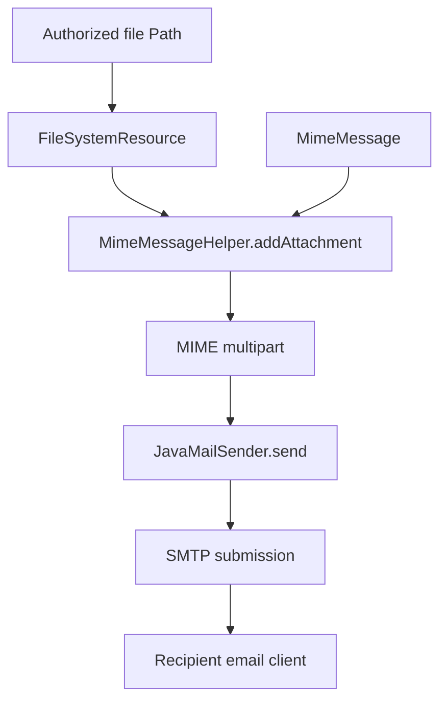
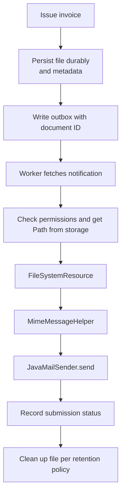

# Attaching Files from FileSystemResource

A Spring Boot application needs to send a PDF invoice to a customer. The file is already stored on the server at a system-managed path, such as `/srv/app/storage/invoices/2026/DH1024.pdf`. The recipient needs to see the name `invoice-DH1024.pdf` in the email and be able to download the file. To do this, the application needs to create a MIME email with an attachment part, supply the file bytes to Jakarta Mail, and send the message via SMTP.

In **Spring Framework Mail**, the common approach is to create a `MimeMessage`, initialize a `MimeMessageHelper` in multipart mode, and then call `addAttachment(...)` with a **`FileSystemResource`**. This resource represents a file on the filesystem and provides an input stream to read data when the library needs to serialize the email content.

Core example:

```java
MimeMessage message = mailSender.createMimeMessage();
MimeMessageHelper helper =
        new MimeMessageHelper(message, true, "UTF-8");

helper.setTo("customer@example.net");
helper.setSubject("Order DH1024 Invoice");
helper.setText("Please see the attached PDF invoice.", false);

FileSystemResource invoice =
        new FileSystemResource(Path.of("/srv/app/storage/invoices/2026/DH1024.pdf"));

helper.addAttachment(
        "invoice-DH1024.pdf",
        invoice,
        "application/pdf");

mailSender.send(message);
```

Key takeaway: **`FileSystemResource` is the data source of the attachment**, while the display name and MIME type are separate pieces of information. The resource does not send emails on its own, does not automatically check business access permissions, and does not prove that the file bytes are a safe PDF.

## 1. What is FileSystemResource?

`FileSystemResource` is a Spring `Resource` implementation representing a resource on the filesystem. It can be created from a `File`, a `Path`, or a path string depending on the constructor and Spring version.

Example:

```java
import org.springframework.core.io.FileSystemResource;

import java.io.File;
import java.nio.file.Path;

FileSystemResource fromFile =
        new FileSystemResource(new File("/srv/app/report.pdf"));

FileSystemResource fromPath =
        new FileSystemResource(Path.of("/srv/app/report.pdf"));

FileSystemResource fromString =
        new FileSystemResource("/srv/app/report.pdf");
```

In new applications, `Path` is often convenient because Java NIO provides APIs for checking, normalizing, and manipulating files. When using the constructor that accepts a `Path`, you need a Spring Framework version that supports that constructor; modern Spring versions support `Path`.

### 1.1. What does FileSystemResource do?

The resource provides file access capabilities:

| API | Meaning |
|---|---|
| `getInputStream()` | Opens a byte stream to read from the file. |
| `getFile()` | Returns a `File` when the resource can be represented as a file. |
| `getPath()` | Returns the path managed by the resource. |
| `getFilename()` | Gets the last filename segment in the path. |
| `exists()` | Checks whether the resource exists. |
| `isReadable()` | Checks whether the resource is readable according to the resource's capability. |
| `contentLength()` | Gets the resource size when it can be determined. |

`FileSystemResource` implements `InputStreamSource`. When `getInputStream()` is called, the resource opens a stream to read the file. For regular files, each call opens a new stream; this is a useful characteristic when the mail library needs to read the data source during MIME generation.

**A resource is an object describing a data source**, not a copy of the file's content. When creating `new FileSystemResource(path)`, the application does not necessarily read the entire file into memory yet.

### 1.2. FileSystemResource vs. ClassPathResource

Two commonly encountered resource types:

| Resource | Used for | Example |
|---|---|---|
| `FileSystemResource` | Files located on the filesystem that the process has permission to access | An invoice generated and stored in a data directory. |
| `ClassPathResource` | Resources packaged on the application's classpath | A company logo located in `src/main/resources/mail/logo.png`. |

If the logo is packaged with the application:

```java
ClassPathResource logo =
        new ClassPathResource("mail/logo.png");
```

If the invoice is generated in an external storage directory:

```java
FileSystemResource invoice =
        new FileSystemResource(invoicePath);
```

Do not use `FileSystemResource("src/main/resources/mail/logo.png")` as a way to access classpath resources in production. When the application is packaged into a JAR, the file may not exist at that relative path. Use `ClassPathResource` for resources shipped with the artifact and `FileSystemResource` for actual filesystem files.

### 1.3. Relative and absolute paths

A relative path depends on **the process working directory**:

```java
new FileSystemResource("storage/invoices/DH1024.pdf");
```

When running from an IDE, shell, container, or service manager, the working directory can differ. Therefore, a relative file may be looked up in an unexpected location.

A clearer configuration:

```yaml
app:
  storage:
    invoice-directory: /srv/app/storage/invoices
```

Then the storage service constructs a `Path` from the configured root directory and document code:

```java
Path invoicePath = invoiceDirectory.resolve("DH1024.pdf");
```

In practice, **never concatenate an arbitrary filename directly from a request** into this directory. Use a validated document identifier mapped through a storage service.

## 2. Why is MimeMessageHelper needed to attach files?

`SimpleMailMessage` is suitable for plain-text emails consisting of sender, recipients, subject, text, CC, and BCC. It does not represent MIME multipart and has no attachment API.

To send files, you need `MimeMessage` and `MimeMessageHelper`:

| Component | Role |
|---|---|
| `JavaMailSender` | Creates and sends `MimeMessage`. |
| `MimeMessage` | Represents a MIME email including headers and body parts. |
| `MimeMessageHelper` | Helps build multipart, text/HTML, inline resources, and attachments. |
| `FileSystemResource` | Supplies bytes from a file on the filesystem. |

Diagram:



### 2.1. Enable multipart immediately when creating the helper

Example:

```java
MimeMessage message = mailSender.createMimeMessage();
MimeMessageHelper helper =
        new MimeMessageHelper(message, true, "UTF-8");
```

The `true` parameter enables multipart. A more explicit option is to specify the mode:

```java
MimeMessageHelper helper = new MimeMessageHelper(
        message,
        MimeMessageHelper.MULTIPART_MODE_MIXED_RELATED,
        "UTF-8");
```

For an email with only text and attachments, a simple `multipart/mixed` structure can suffice. If the email also includes HTML and inline images, `MULTIPART_MODE_MIXED_RELATED` is a practical choice to combine the related content area and attachments.

If you initialize the helper with `multipart=false` and then call `addAttachment`, the helper lacks the required multipart structure and will throw an error. Therefore, decide the message structure from the start.

### 2.2. Illustrative MIME structure

A plain-text email with a PDF attachment may look like:

```text
MimeMessage
├── From: billing@example.com
├── To: customer@example.net
├── Subject: Order DH1024 Invoice
└── multipart/mixed
    ├── text/plain; charset=UTF-8
    │   └── Please see the attached PDF invoice.
    └── application/pdf
        ├── Content-Disposition: attachment
        ├── filename: invoice-DH1024.pdf
        ├── Content-Transfer-Encoding: base64
        └── [PDF bytes represented in MIME]
```

This is a conceptual diagram. Jakarta Mail generates the actual headers, boundaries, and transfer encodings.

## 3. Using FileSystemResource with addAttachment

Commonly used method in `MimeMessageHelper`:

```java
helper.addAttachment(
        String attachmentFilename,
        InputStreamSource inputStreamSource,
        String contentType);
```

`FileSystemResource` is an `InputStreamSource`, so it can be passed directly:

```java
Path path = Path.of("/srv/app/storage/invoices/DH1024.pdf");
FileSystemResource resource = new FileSystemResource(path);

helper.addAttachment(
        "invoice-DH1024.pdf",
        resource,
        "application/pdf");
```

The three components have different meanings:

1. `attachmentFilename`: the display name shown to the recipient.
2. `inputStreamSource`: the source of file bytes.
3. `contentType`: the MIME type describing the content.

For example, the physical file may be `/srv/app/storage/2026/11/4f5d9a.pdf`, while the display name is `invoice-DH1024.pdf`. There is no need to expose the internal path in the header.

### 3.1. Other overloads

`MimeMessageHelper` provides convenient overloads for different sources:

```java
// Pass java.io.File
helper.addAttachment("invoice.pdf", invoiceFile);

// Pass InputStreamSource
helper.addAttachment("invoice.pdf", invoiceResource);

// Pass InputStreamSource and an explicit MIME type
helper.addAttachment("invoice.pdf", invoiceResource, "application/pdf");

// Pass Jakarta Activation DataSource
helper.addAttachment("invoice.pdf", invoiceDataSource);
```

`FileSystemResource` is typically passed via the overload accepting `InputStreamSource`. When you want explicit control over the content type, use the three-argument overload.

### 3.2. Do not confuse the attachment name with getFilename()

`FileSystemResource.getFilename()` returns the filename from the source path. However, the `attachmentFilename` parameter in `addAttachment` can be different.

Example:

```java
FileSystemResource resource =
        new FileSystemResource(Path.of(
                "/srv/app/storage/4f5d9a7c-uuid.pdf"));

String storageFilename = resource.getFilename();
// storageFilename: 4f5d9a7c-uuid.pdf

helper.addAttachment(
        "invoice-DH1024.pdf",
        resource,
        "application/pdf");
```

The recipient will be given the display name chosen by the application. This helps:

- Avoid leaking UUIDs or internal storage conventions.
- Use a business-friendly name.
- Avoid exposing directories or customer names on the filesystem.
- Maintain a stable name even if the physical file is moved or renamed.

The display name still must be controlled: no CR/LF, control characters, or path separators; a reasonable length; and an extension matching the actual content.

## 4. Preparing the file before attaching

You should not create a resource and send immediately without verifying whether the file exists and the application has read permission. Before adding an attachment, check according to storage policy.

### 4.1. Basic file checks with Java NIO

```java
import java.nio.file.Files;
import java.nio.file.Path;

public void requireReadableRegularFile(Path path) throws IOException {
    if (path == null) {
        throw new IllegalArgumentException("File path is required");
    }

    if (!Files.isRegularFile(path) || !Files.isReadable(path)) {
        throw new IllegalArgumentException(
                "Attachment is not a readable regular file");
    }
}
```

`Files.isRegularFile` checks that the path points to a regular file; `Files.isReadable` checks readability according to permissions and filesystem state as observed by the JVM. These checks are useful, but they do not guarantee the file will still exist or remain readable at a later time.

If you need to avoid following symbolic links, you can use the overload with `LinkOption.NOFOLLOW_LINKS`:

```java
boolean regularFile = Files.isRegularFile(
        path, LinkOption.NOFOLLOW_LINKS);
```

Whether policy allows symlinks depends on storage design. Not every application needs to forbid symlinks; however, if a directory can be modified by other users, you must consider the possibility of a valid path being redirected to an out-of-scope file.

### 4.2. Size checks

```java
long size = Files.size(path);
if (size <= 0) {
    throw new IllegalArgumentException("Attachment is empty");
}

long maxPdfBytes = 12L * 1024 * 1024;
if (size > maxPdfBytes) {
    throw new IllegalArgumentException("Attachment exceeds size limit");
}
```

`12L * 1024 * 1024` is a **12 MiB** limit in this example, chosen by application policy. Allowed sizes must be based on SMTP provider limits, file types, attachment count, and recipient experience.

**The original file size is not equal to the total MIME email size.** Binary files are usually base64-encoded; every 3 original bytes become 4 base64 characters, plus line breaks and headers. The base64 section of a large file can be approximately 1.37 times the original size. You must also add the body, headers, boundaries, and any other attachments.

### 4.3. Checking the actual format

If the application generates PDFs using an internal library, you can rely on the contract of the document generation step and verify the output per system requirements. If a file is uploaded by a user, never conclude it is a PDF just because:

- The name ends with `.pdf`.
- The HTTP request declares `Content-Type: application/pdf`.
- The application calls `addAttachment(..., "application/pdf")`.

Those values are metadata supplied by the source or labels attached by the application. The file must be verified using an appropriate parser/validator, content type controls, security scanning when required by policy, and size limits.

A magic bytes check such as the `%PDF-` prefix can serve as an initial signal, but it does not prove the entire file is valid or free of dangerous content.

## 5. Complete example: sending an invoice from the filesystem

Suppose the application has a storage service that returns an invoice file path after confirming the caller has permission to access that document. The mail service receives this path, validates the file, and attaches it using `FileSystemResource`.

### 5.1. Spring Boot configuration

Gradle dependency:

```groovy
dependencies {
    implementation 'org.springframework.boot:spring-boot-starter-mail'
}
```

Example `application.yml` for SMTP submission on port 587 + STARTTLS:

```yaml
spring:
  mail:
    host: ${MAIL_HOST}
    port: 587
    protocol: smtp
    username: ${MAIL_USERNAME}
    password: ${MAIL_PASSWORD}
    default-encoding: UTF-8
    properties:
      "[mail.smtp.auth]": true
      "[mail.smtp.starttls.enable]": true
      "[mail.smtp.starttls.required]": true
      "[mail.smtp.ssl.checkserveridentity]": true
      "[mail.smtp.connectiontimeout]": 5000
      "[mail.smtp.timeout]": 10000
      "[mail.smtp.writetimeout]": 10000

app:
  mail:
    from: ${MAIL_FROM:billing@example.com}
  storage:
    invoice-directory: /srv/app/storage/invoices
```

This is an illustrative configuration for a provider supporting STARTTLS on port 587. For implicit TLS on port 465, configure the corresponding connection style. Credentials are supplied from the deployment environment or secret manager, not hardcoded in the repository.

### 5.2. File attachment service

```java
package com.example.mail;

import jakarta.mail.MessagingException;
import jakarta.mail.internet.MimeMessage;

import org.springframework.beans.factory.annotation.Value;
import org.springframework.core.io.FileSystemResource;
import org.springframework.mail.javamail.JavaMailSender;
import org.springframework.mail.javamail.MimeMessageHelper;
import org.springframework.stereotype.Service;

import java.io.IOException;
import java.nio.file.Files;
import java.nio.file.Path;
import java.nio.charset.StandardCharsets;

@Service
public class InvoiceMailService {

    private static final long MAX_PDF_BYTES = 12L * 1024 * 1024;

    private final JavaMailSender mailSender;
    private final Path invoiceDirectory;
    private final String fromAddress;

    public InvoiceMailService(
            JavaMailSender mailSender,
            @Value("${app.storage.invoice-directory}") String invoiceDirectory,
            @Value("${app.mail.from}") String fromAddress) {
        this.mailSender = mailSender;
        this.invoiceDirectory = Path.of(invoiceDirectory)
                .toAbsolutePath()
                .normalize();
        this.fromAddress = fromAddress;
    }

    public void sendInvoice(
            String recipient,
            String orderCode) throws IOException, MessagingException {

        // orderCode has already been validated at the business layer.
        if (orderCode == null || !orderCode.matches("[A-Za-z0-9-]{1,40}")) {
            throw new IllegalArgumentException("Invalid order code");
        }

        // Only construct the path from the storage root and a controlled identifier.
        Path invoicePath = invoiceDirectory
                .resolve(orderCode + ".pdf")
                .normalize();

        // Ensure the path remains inside the storage root by lexical check.
        if (!invoicePath.startsWith(invoiceDirectory)) {
            throw new IllegalArgumentException("Invalid invoice path");
        }

        if (!Files.isRegularFile(invoicePath) || !Files.isReadable(invoicePath)) {
            throw new IllegalArgumentException(
                    "Invoice file is not readable");
        }

        long fileSize = Files.size(invoicePath);
        if (fileSize <= 0 || fileSize > MAX_PDF_BYTES) {
            throw new IllegalArgumentException(
                    "Invoice file size is outside the allowed range");
        }

        MimeMessage message = mailSender.createMimeMessage();
        MimeMessageHelper helper = new MimeMessageHelper(
                message,
                MimeMessageHelper.MULTIPART_MODE_MIXED,
                StandardCharsets.UTF_8.name());

        helper.setFrom(fromAddress);
        helper.setTo(recipient);
        helper.setSubject("Invoice for order " + orderCode);
        helper.setText(
                "Please see the attached PDF invoice for order "
                        + orderCode + ".", false);

        FileSystemResource invoiceResource =
                new FileSystemResource(invoicePath);

        helper.addAttachment(
                "invoice-" + orderCode + ".pdf",
                invoiceResource,
                "application/pdf");

        mailSender.send(message);
    }
}
```

`recipient`, `orderCode`, and the file path must be validated/authorized by the appropriate layers before calling the mail service. The example above assumes the invoice is generated by the application and the internal filename is derived from a controlled order code.

Important notes about paths:

- `normalize()` removes syntactically redundant path components.
- `startsWith(invoiceDirectory)` checks that the normalized path lies under the storage root according to Java's path structure.
- This lexical check **does not by itself solve all symbolic link or race condition risks** if the directory can be modified by another actor.
- In systems handling untrusted data, the storage service should manage files using immutable IDs and ensure the storage directory does not allow users to arbitrarily replace files or symlinks.

### 5.3. Why not accept a Path from the request?

Do not create an endpoint like:

```java
public void send(@RequestParam String path) {
    FileSystemResource resource = new FileSystemResource(path);
    // ...
}
```

Users may try supplying paths outside the storage area such as:

```text
../../../../etc/passwd
C:\Windows\win.ini
```

If the service has permission to read these files, the application could inadvertently send system data or another user's data. This is a **path traversal and unauthorized file access** risk.

Instead, the API accepts a **document ID or order ID**. The service checks whether the caller has permission to view the document, and then the storage layer maps the ID to a server-managed path.

## 6. How does FileSystemResource provide streams?

`FileSystemResource` does not necessarily read the entire file when created. When the library needs the bytes, it calls `getInputStream()` to open the file.

Model:

```text
FileSystemResource(path)
        |
        | getInputStream()
        v
InputStream reads file
        |
        v
Jakarta Mail builds MIME body part
        |
        v
Transfer encoding (e.g., base64)
        |
        v
SMTP transport writes data
```

### 6.1. Stream re-openability

`InputStreamSource` is designed to provide an `InputStream`. When used for an attachment, the source should be able to supply valid data whenever the library needs to read it. `FileSystemResource` fits because each call to `getInputStream()` opens a new stream from the file.

This differs from an `InputStreamResource` wrapping an already-opened stream:

```java
InputStream input = Files.newInputStream(path);
InputStreamResource oneShot = new InputStreamResource(input);
```

The `oneShot` source may only be readable once. If the library needs to read again while creating/serializing the message, an already-consumed stream will not automatically rewind to the beginning. This can lead to errors or an incomplete attachment.

**Practical rule:** use `FileSystemResource` for re-openable files; use `ByteArrayResource` for small data already in memory; only use a single-use source when the API and the entire processing flow guarantee the exact read contract.

### 6.2. The file must continue to exist until sending completes

`MimeMessageHelper` holds a reference to the data source. During MIME construction and sending, Jakarta Mail may read the file. Therefore, the file must:

- Still exist.
- Be readable by the process.
- Not be deleted before the transport finishes reading it.
- Not be replaced or modified in a way that changes its content between reads.

With synchronous `JavaMailSender.send(message)`, when the send method returns, the send operation has completed from the sender's perspective. The application can clean up a temporary file afterward if it is no longer needed elsewhere. However, if the email is placed into a queue for a worker to send later, **do not delete the file immediately after enqueuing**.

### 6.3. Avoid modifying the file while sending

A subtle risk is the file being updated between checking its size and Jakarta Mail opening the stream:

1. The application calls `Files.size(path)`.
2. Another process replaces the file content.
3. `FileSystemResource` opens the new file.
4. The sent content may differ from the validated file.

This is a form of **time-of-check to time-of-use (TOCTOU)**. For invoices and transactional documents, store files under immutable names after issuance, use appropriate filesystem permissions, and disallow modifying the file throughout the sending lifecycle.

If stronger guarantees are needed, you can create an immutable snapshot or copy to a staging area with dedicated permissions before sending. Not every application needs to copy every file; base the decision on consistency requirements and storage trustworthiness.

## 7. Large files: FileSystemResource does not mean zero memory usage

One benefit of `FileSystemResource` is that it does not force the application to read the entire file into a `byte[]` before calling `addAttachment`.

Comparison:

```java
// Approach using FileSystemResource
helper.addAttachment(
        "invoice.pdf",
        new FileSystemResource(invoicePath),
        "application/pdf");

// Approach reading the entire file into the heap first
byte[] bytes = Files.readAllBytes(invoicePath);
helper.addAttachment(
        "invoice.pdf",
        new ByteArrayResource(bytes),
        "application/pdf");
```

For large files, the first approach generally avoids having the application actively hold the entire content in a byte array. The second approach can be convenient for small files, but you must account for heap usage and the number of concurrent emails being sent.

However, **do not promise that the entire Jakarta Mail/SMTP pipeline always streams with O(1) memory**. MIME serialization, providers, TLS, and transport layers may use buffers. `FileSystemResource` only provides a file source that can open streams; it does not guarantee that every underlying layer avoids buffering data.

### 7.1. Estimating size after base64

For binary data, base64 increases size by about 4/3 before accounting for line wrapping. When adding line breaks and MIME headers, you can estimate around 1.37 times for large data sections.

| Original file | Estimated base64 section |
|---:|---:|
| 1 MiB | About 1.37 MiB |
| 5 MiB | About 6.84 MiB |
| 10 MiB | About 13.68 MiB |
| 20 MiB | About 27.37 MiB |

This is an estimate, not an exact calculation for the entire email. You must add the text/HTML parts, headers, boundaries, and other attachments.

### 7.2. Do not pre-encode base64 yourself

Do not do this:

```java
byte[] encoded = Base64.getEncoder().encode(Files.readAllBytes(path));
helper.addAttachment(
        "invoice.pdf",
        new ByteArrayResource(encoded),
        "application/pdf");
```

If you pass already-encoded base64 bytes as the PDF file content, the recipient may download **a base64 string** instead of the original PDF; the library may also apply MIME encoding again.

Pass the raw original bytes via `FileSystemResource`. Jakarta Mail handles the appropriate `Content-Transfer-Encoding` when building the MIME part.

### 7.3. When should you send a download link instead of an attachment?

For files that are too large, documents that change frequently, or when download permissions may need to be revoked, sending a controlled download link can be more appropriate:

- An HTTPS URL on an application-managed domain.
- Authentication/authorization or a short-lived signed URL.
- Download count limits or document scope restrictions if required by business rules.
- Never leave an indefinite public URL for private documents.
- Do not log tokens contained in URLs.

The email then contains instructions and the link; the backend still checks access permissions at download time. Never treat sending a link as a reason to skip authorization checks.

## 8. MIME type and attachment filename

When calling:

```java
helper.addAttachment(
        "invoice-DH1024.pdf",
        resource,
        "application/pdf");
```

the application passes:

- Filename: `invoice-DH1024.pdf`.
- Content type: `application/pdf`.
- Byte source: `resource`.

### 8.1. Specify the content type explicitly when known

Some common MIME types:

| Format | MIME type |
|---|---|
| PDF | `application/pdf` |
| CSV | `text/csv; charset=UTF-8` |
| JSON | `application/json` |
| PNG | `image/png` |
| JPEG | `image/jpeg` |
| ZIP | `application/zip` |
| Word DOCX | `application/vnd.openxmlformats-officedocument.wordprocessingml.document` |
| Excel XLSX | `application/vnd.openxmlformats-officedocument.spreadsheetml.sheet` |
| Unknown binary | `application/octet-stream` |

If you omit the content type parameter, the helper/provider may infer it via `FileTypeMap` based on the filename or configured mappings. This is convenient, but it is not byte verification. For files generated by the application whose exact format is known, passing an explicit content type is usually clearer.

### 8.2. Unicode filenames

A Vietnamese filename such as `Hóa đơn tháng 11.pdf` must be properly represented in MIME parameters. `MimeMessageHelper` and Jakarta Mail handle header/parameter encoding according to the library's version and configuration. Do not manually concatenate a raw `Content-Disposition` header or arbitrarily URL-encode the filename.

Some older clients may display Unicode filenames differently. If broad compatibility is needed, test on target clients; a readable ASCII name like `hoa-don-thang-11.pdf` is a useful fallback option.

Depending on the Spring Framework version, `MimeMessageHelper` offers a `setEncodeFilenames(boolean)` option to adjust how filenames are encoded for compatibility needs. Do not toggle it on or off based on guesswork; inspect the generated MIME headers and test the result on the email clients supported by your product.

### 8.3. A filename is not a path

Do not pass:

```text
/srv/app/storage/invoices/2026/DH1024.pdf
```

as the display name. Only pass:

```text
invoice-DH1024.pdf
```

The display filename must not contain path separators or control characters. If the name is constructed from user data, sanitize/limit its length and verify that the extension matches the actual content.

## 9. Path security and file access permissions

Attaching from the filesystem means the application uses the process's read permissions to retrieve data. If paths are improperly controlled, the email-sending feature can become a way to **read and exfiltrate unauthorized files**.

### 9.1. Do not trust paths from the client

Never accept a raw `Path`, absolute filename, or file URL directly from a request to construct a `FileSystemResource`. Accept a document ID, then:

1. Authenticate the user.
2. Check that the user has permission to view the document.
3. Load document metadata from the storage repository.
4. Retrieve the server-managed path.
5. Verify the file resides within the allowed storage area.
6. Create the resource and send.

### 9.2. Path traversal

If the storage root is:

```text
/srv/app/storage/invoices
```

then an input filename such as:

```text
../../secrets/application.yml
```

could attempt to escape the intended directory. `Path.normalize()` and checking `startsWith(root)` catch many lexical traversal cases, but are insufficient if symbolic links or concurrent filesystem changes exist.

An additional check when appropriate:

```java
Path rootReal = storageRoot.toRealPath();
Path candidateReal = candidate.toRealPath();

if (!candidateReal.startsWith(rootReal)) {
    throw new SecurityException("File is outside the allowed storage root");
}
```

`toRealPath()` requires the file to exist and resolves symbolic links by default. You must handle I/O errors, access permissions, and race conditions between resolution and opening the file. If the environment allows untrusted actors to modify the directory, merely checking the path beforehand and opening it afterward may still not be enough; design storage with proper system permissions.

### 9.3. Filesystem permissions

The mail-sending process should only have read permissions for the directories it needs. Do not run the application with administrative privileges just so it can read any file. The invoice storage directory should have:

- Restricted ownership and access permissions.
- Server-generated filename rules.
- No arbitrary user write access to issued files.
- Clear file retention and deletion policies.
- Auditing of read and access operations on sensitive documents when required by business rules.

### 9.4. Avoid leaking data in logs and errors

Do not log full paths, file bytes, invoice contents, or tokens just for debugging. Use a document ID/notification ID and error codes. If logging paths is necessary for operations, consider whether it exposes customer names or storage layout.

## 10. File lifecycle for synchronous and asynchronous sending

`FileSystemResource` opens the file when it is read. Therefore, the file lifecycle must align with the time of sending.

### 10.1. Synchronous sending

Example:

```java
MimeMessage message = mailSender.createMimeMessage();
MimeMessageHelper helper = new MimeMessageHelper(message, true, "UTF-8");
helper.addAttachment("invoice.pdf", new FileSystemResource(invoicePath));
mailSender.send(message);

// After send returns, temporary files can be cleaned up if no longer used.
```

`mailSender.send` performs the sending operation within the current call. When it returns successfully, the transport has completed submission from the application's perspective. If the file is a temporary file used only for this email, the application can clean it up once there are no other consumers.

If `send` throws an exception, check whether the sending flow has definitely stopped reading the file before deleting it; in normal synchronous code, the exception returns after the attempt finishes, though the application must still account for other tasks that might be using the same file.

### 10.2. Sending via outbox/worker

Do not do this:

```java
Path tempInvoice = createTemporaryInvoice();
outbox.save(notification);
Files.delete(tempInvoice); // Worker has not sent it yet, and the file is already gone.
```

The outbox only saves the send request, while the worker may run later. If the temporary file is deleted before the worker reads it, the attachment will be missing.

A more suitable design:



The file must remain available until the worker finishes sending and no valid retry attempts remain that need it. For retries, persist the document durably or create an immutable snapshot. Do not rely on a temporary file tied to the lifecycle of an HTTP request.

### 10.3. Keeping the same content across retries

Suppose a worker attempts to send an invoice, SMTP times out, and it retries later. If the file at that path was replaced with a newer version, the retry might send a different invoice than the first attempt. For financial documents, this is a business risk.

Ways to mitigate the risk:

- Issued files are immutable; updating an invoice creates a new version.
- Store the document ID and version/hash alongside the notification.
- Have the worker verify the expected version before opening the file.
- If necessary, snapshot the file into separate storage for that issuance.

A hash can help detect file modifications, provided the hash is computed and stored during a trusted issuance flow. Never recompute the hash after the file could have been altered and treat it as the original value.

## 11. FileSystemResource compared to other data sources

| Source | When suitable | Advantages | Caveats |
|---|---|---|---|
| `FileSystemResource` | Files already stored on the filesystem | Opens stream from file, re-readable | File must exist and not be modified during sending. |
| `ClassPathResource` | Logos, resources packaged in the application | Accesses resources from classpath/JAR | Do not assume a physical `File` always exists. |
| `ByteArrayResource` | Small content already in `byte[]` | Can open new streams from the byte array | Holds all data on the heap. |
| `InputStreamResource` | An existing stream in certain special flows | Wraps an already-opened stream | Often unsuitable if re-reading is required. |
| `DataSource` | Need control over name, content type, and data source | Jakarta Activation abstraction | Must ensure stream and metadata are accurate. |

### 11.1. When to use ByteArrayResource?

A small CSV just generated in memory:

```java
byte[] csvBytes = csvText.getBytes(StandardCharsets.UTF_8);
helper.addAttachment(
        "orders.csv",
        new ByteArrayResource(csvBytes),
        "text/csv; charset=UTF-8");
```

`ByteArrayResource` is suitable when data is small and already available. For large files, avoid calling `Files.readAllBytes` and holding the byte array just to attach it; using `FileSystemResource` is usually more sensible.

### 11.2. When to use ClassPathResource?

A logo packaged in the application:

```java
helper.addInline(
        "company-logo",
        new ClassPathResource("mail/images/logo.png"),
        "image/png");
```

This is a classpath resource, not a user-generated invoice file. It is commonly used for fixed assets like logos or template images.

### 11.3. When to use DataSource?

If the application already has a Jakarta Activation `DataSource`:

```java
helper.addAttachment("report.pdf", reportDataSource);
```

A `DataSource` can provide content type, name, and stream. Verify that `getInputStream()` can supply valid data each time the library needs to read it; do not bind an already-consumed stream to a source expected to be re-readable.

## 12. Error handling when attaching from the filesystem

Errors can occur at several stages:

| Stage | Symptom | Common causes |
|---|---|---|
| Path construction | `InvalidPathException` or config error | Invalid path, wrong storage root. |
| File validation | `NoSuchFileException`, not readable | File deleted, filesystem permission or mount issue. |
| Opening stream | `IOException` | Disk error, permissions changed, file no longer accessible. |
| Building MIME | `MessagingException` | Error creating part, reading resource, or message structure. |
| SMTP sending | `MailException` | Connection, TLS, AUTH, quota error, or SMTP rejection. |
| Post-submission | Bounce/DSN/provider event | Receiving system rejects or cannot deliver the message. |

### 12.1. Distinguishing file errors from SMTP errors

If the file does not exist, retrying SMTP will not solve the problem. You must check storage or document status. If SMTP times out after the file has been read and sent, the cause may lie in the network or provider.

Do not catch every exception and report "invalid file". Similarly, do not catch every exception and retry indefinitely. Categorize them:

- **Permanent data/file errors:** invalid document ID, deleted file, user lacks permission.
- **Transient filesystem errors:** interrupted storage mount or temporary I/O failure.
- **Transient SMTP errors:** timeout, provider unavailable, 4xx responses.
- **Configuration/permanent errors:** incorrect SMTP AUTH, TLS hostname mismatch, recipient permanently rejected.
- **Uncertain submission outcome:** error reading response after the server may already have accepted the message; retries require deduplication policies.

### 12.2. Example error boundary handling

```java
try {
    invoiceMailService.sendInvoice(recipient, orderCode);
    notificationRepository.markSubmitted(notificationId);
} catch (IOException ex) {
    notificationRepository.markFileAccessFailed(notificationId);
    throw ex;
} catch (MessagingException ex) {
    notificationRepository.markMessageBuildFailed(notificationId);
    throw ex;
} catch (MailException ex) {
    notificationRepository.markSubmissionUncertain(notificationId);
    throw ex;
}
```

`notificationRepository` in this example is an application-defined abstraction. Not every `MailException` has an uncertain outcome; examine the root cause and failure stage to classify accurately. The example above illustrates **separating error groups**, not a complete production classifier.

In particular, the SMTP server may have already received the email while the client timed out before reading the final response. Therefore, some errors require an `UNKNOWN` or `SUBMISSION_UNCERTAIN` state rather than asserting with certainty that it was "not sent".

## 13. Testing FileSystemResource attachments

Both the generated MIME content and the file path handling should be tested.

### 13.1. Unit test with a temporary file

In tests, create a temporary file with small content:

```java
Path tempFile = Files.createTempFile("invoice-test-", ".pdf");
Files.write(tempFile, "%PDF-1.7 test".getBytes(StandardCharsets.US_ASCII));

FileSystemResource resource = new FileSystemResource(tempFile);
assertThat(resource.exists()).isTrue();
assertThat(resource.isReadable()).isTrue();

try (InputStream first = resource.getInputStream();
     InputStream second = resource.getInputStream()) {
    assertThat(first.readAllBytes()).isEqualTo(
            "%PDF-1.7 test".getBytes(StandardCharsets.US_ASCII));
    assertThat(second.readAllBytes()).isEqualTo(
            "%PDF-1.7 test".getBytes(StandardCharsets.US_ASCII));
}
```

This example demonstrates that `FileSystemResource` can open multiple fresh streams from the same file. Tests should clean up temporary files upon completion, such as in `@AfterEach` or `try/finally`.

### 13.2. Inspecting MimeMessage

You can create a `MimeMessage` with a test Jakarta Mail Session, call `MimeMessageHelper.addAttachment`, and check that `message.getContent()` is a `Multipart`. Traverse the `BodyPart`s to verify:

- There is a text content part.
- There is an attachment part.
- `Content-Disposition` includes `attachment`.
- The display filename is correct.
- `Content-Type` matches the file type.
- The bytes read from the part match the source file.

Conceptual example:

```java
Object content = message.getContent();
assertThat(content).isInstanceOf(Multipart.class);

Multipart multipart = (Multipart) content;
assertThat(multipart.getCount()).isGreaterThanOrEqualTo(2);
```

Real tests must account for potentially nested multipart structures, especially when using `MULTIPART_MODE_MIXED_RELATED` or combining text/plain + HTML + inline resources. Do not assume the attachment is always at a fixed index if the message has multiple layers.

### 13.3. Integration testing with an SMTP catcher

An SMTP catcher such as GreenMail, Mailpit, or MailHog helps verify messages sent to a test server without delivering emails to real recipients.

Verify that:

- The email has the expected recipient and subject.
- The attachment has the expected filename and content type.
- The received file bytes match the source file bytes.
- The plain text/HTML content is readable.
- The source file is not deleted before the worker sends it.

An SMTP catcher does not prove that production email clients render identically or that a provider will accept the file under real-world limits. Those checks belong to different environments and stages.

## 14. Common mistakes when using FileSystemResource

### 14.1. Using SimpleMailMessage to add files

`SimpleMailMessage` has no attachment API. Create a `MimeMessage` and use `MimeMessageHelper`.

### 14.2. Forgetting to enable multipart

Initializing the helper with `multipart=false` and then calling `addAttachment` will fail to build the required structure. Choose multipart from the beginning.

### 14.3. Using FileSystemResource for files on the classpath

The path `src/main/resources` may not exist at runtime when running a JAR. Use `ClassPathResource` for packaged resources.

### 14.4. Using relative paths

Working directories differ across IDEs, containers, and services. Use an explicitly configured storage root or a path returned by a storage service.

### 14.5. Passing user-supplied paths

This can cause path traversal and expose system files. Accept a document ID, check authorization, and map to an internal path.

### 14.6. Deleting temporary files before the worker sends

The resource only points to the file. If the worker runs after the file is deleted, the attachment will fail. Keep the file durable until all necessary sends and retries finish.

### 14.7. Modifying the file while sending

If the file changes after validation but before the stream is read, the message may contain different content. Use immutable files or snapshots.

### 14.8. Confusing the attachment filename with the physical name

The filename on disk may be a UUID; the display name should follow business rules and avoid exposing internal paths.

### 14.9. Setting content type solely by an untrusted extension

Renaming a file to `.pdf` does not turn the data into a PDF. Validate the content and specify the MIME type according to the verified actual format.

### 14.10. Reading large files into a byte array

`Files.readAllBytes` can significantly increase heap usage. For large files, pass `FileSystemResource` and set reasonable size limits.

### 14.11. Pre-encoding base64 before addAttachment

Pass the raw bytes; Jakarta Mail handles transfer encoding. Manual base64 encoding may cause recipients to receive the encoded string instead of the original file.

### 14.12. Assuming FileSystemResource guarantees streaming

The resource opens a stream from the file, but does not guarantee that the entire mail pipeline avoids buffering. Observe memory and actual load.

## 15. Some design decisions for production

### 15.1. Who is responsible for locating the file?

The mail service should receive a validated document reference or business object. A storage service is responsible for:

- Mapping document IDs to storage locations.
- Checking access permissions.
- Confirming file availability and the correct version.
- Providing the path or resource.
- Managing retention and lifecycle.

The mail service is responsible for building the message and calling the sender. Separating these two concerns prevents mixing filesystem logic with SMTP logic.

### 15.2. Pass Path or Resource to the mail service?

Both approaches work:

```java
void sendInvoice(String recipient, Path invoicePath)
```

or:

```java
void sendInvoice(String recipient, Resource invoiceResource)
```

**Accept `Path`** if the mail service needs to inspect filesystem attributes, size, permissions, and construct the resource locally. **Accept `Resource`** if the storage layer already handles source selection and the mail service only needs a data-reading abstraction.

With an API accepting a general `Resource`, not every resource is re-openable or provides a filename. Define the contract clearly: the stream must be re-readable, the source must remain available throughout sending, and the content type and filename must be passed separately.

### 15.3. Should the file be kept after sending?

It depends on the storage purpose:

- Issued invoices may need to be retained under accounting/audit policies.
- Temporary files generated solely for an email can be deleted after sending and once retry windows expire.
- Uploaded files may belong to a user's document repository and should not be deleted just because an email was sent.

Do not let the mail service delete every source file on its own. Ownership and retention belong to the storage/domain layer.

### 15.4. Limiting attachment count and total size

Establish policies for:

- Maximum size per file.
- Total attachment size per message.
- Number of files per message.
- Allowed file types.
- Recipient limits and sending rates.
- How to handle provider rejections due to exceeded limits.

For large documents, controlled download links may be more suitable. Do not raise timeouts indefinitely to force sending files that exceed server limits.

### 15.5. Tracking submission and delivery

When `mailSender.send(message)` completes, the application knows the transport reported no error at submission time. That does not guarantee the message reached the Inbox. For critical emails, track the provider message ID, bounces/DSNs, or dedicated webhooks.

Do not treat an "SMTP sent" event as "recipient downloaded the invoice". File downloads via links (if used) are a separate event and must also be interpreted according to privacy policies.

## 16. Practice exercises

### Exercise 1 — Creating a resource from a Path

Given the invoice file:

```text
/srv/app/storage/invoices/2026/DH1024.pdf
```

Create a `FileSystemResource` from `Path`, verify that the file exists and is readable, and call `addAttachment` with the filename `invoice-DH1024.pdf` and content type `application/pdf`.

### Exercise 2 — Multipart

A developer creates `MimeMessageHelper(message, false, "UTF-8")` and then calls `addAttachment`. Explain why this approach fails and fix the constructor.

### Exercise 3 — Attachment filename different from storage filename

The physical file has a UUID name. The recipient needs to see an invoice name based on the order code. Explain why the first parameter of `addAttachment` can differ from `FileSystemResource.getFilename()`.

### Exercise 4 — File uploads

A REST API receives `originalFilename` and `contentType` from an HTTP upload. Design a safe workflow to store the file, verify its format, and generate a display filename before attaching. Why should you not trust those two metadata fields sent by the client?

### Exercise 5 — Re-readable streams

Compare `FileSystemResource` and an `InputStreamResource` wrapping an already-opened stream. Explain why a single-read source can cause errors when the library needs to re-read the attachment.

### Exercise 6 — Temporary files and workers

An application creates a PDF in a temporary directory, saves a notification to the outbox, and immediately deletes the file. The worker runs later and cannot find the file. Propose a file lifecycle compatible with retries.

### Exercise 7 — Email size

An SMTP provider limits messages to 25 MiB. The application wants to attach a 20 MiB PDF. Estimate the base64 section and explain why a 20 MiB original file can exceed the message limit.

### Exercise 8 — Path traversal

An endpoint accepts a path string from the request and creates a `FileSystemResource`. Identify the risk and replace it with a document ID → authorization → storage lookup → resource flow.

### Exercise 9 — MIME testing

Design an integration test using an SMTP catcher to confirm that the attachment name, MIME type, and received bytes match the source file. Explain why recursive multipart traversal is needed when an email includes HTML, inline images, and a PDF.

## 17. Key takeaways and references

When **attaching files from FileSystemResource** in Spring Framework Mail:

1. Create a `MimeMessage` and `MimeMessageHelper` in multipart mode.
2. Use `FileSystemResource` to supply bytes from a file on the filesystem.
3. Call `addAttachment(filename, resource, contentType)` to separate the display name, data source, and MIME type.
4. Check access permissions, existence, readability, size, and format per application policy.
5. Keep the file available and immutable until the transport/worker finishes reading; pay special attention to outboxes and retries.
6. Do not accept arbitrary paths from clients, do not expose internal paths, and do not trust user-declared extensions or content types.
7. Estimate the MIME size after base64, limit the number of files, and consider download links for large files.
8. Test the MIME message and track filesystem errors separately from SMTP errors.

Technical documentation to consult:

- **Spring Framework API — `FileSystemResource`:** how to represent filesystem files, open streams, and access metadata.
- **Spring Framework API — `Resource` / `InputStreamSource`:** contracts for resources and stream-opening data sources.
- **Spring Framework API — `MimeMessageHelper`:** multipart constructors, `addAttachment`, and overloads.
- **Spring Framework Reference — Email:** `JavaMailSender`, MIME messages, attachments, and inline resources.
- **Jakarta Mail API — `MimeMessage`, `MimeMultipart`, `MimeBodyPart`:** email structure and MIME parts.
- **Jakarta Activation API — `DataSource`:** providing content type and data streams.
- **Java NIO Files API:** file checks, reading metadata, path normalization, and filesystem operations.

`FileSystemResource` lets Spring Mail connect a file on the filesystem to a MIME attachment cleanly. To implement this reliably, the application must also manage **paths, access permissions, file content, display names, resource lifecycle, and size limits**. When those responsibilities are clearly separated, sending invoices, reports, and documents via email becomes easier to control and operate.
