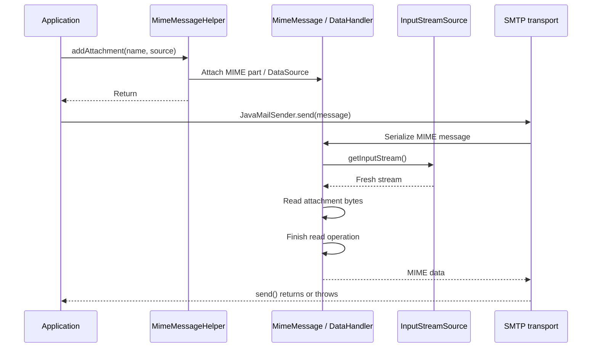
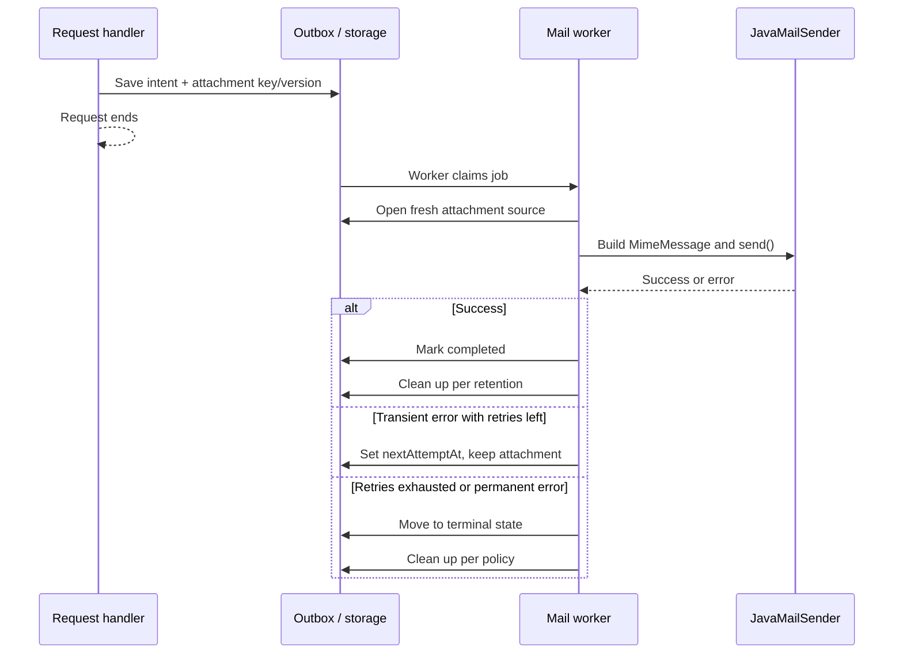

# Do Not Hold an InputStream Beyond Sending Time

When sending emails with attachments using Spring Framework Mail, creating a `MimeMessage` and calling `MimeMessageHelper.addAttachment(...)` does not mean the file content has already been read to completion. The helper typically binds a data source to the MIME part; Jakarta Mail/Activation may read that source when the message is serialized during sending. Therefore, an `InputStream` that is opened too early, closed too early, or held too long can all cause the send to fail.

The key rule is **never hold an open stream beyond the task that needs to read it**. Open streams close to consumption time, close streams read by your own application using `try-with-resources`, and when passing attachments to `MimeMessageHelper`, supply a source capable of opening a fresh stream instead of holding a single stream in a field, queue, or long-lived reusable message.

This lesson explains the `InputStream` lifecycle in the email-sending flow, when `JavaMailSender.send(...)` actually reads the attachment, how to distinguish synchronous from asynchronous sending, code patterns for files, byte arrays, and remote sources, as well as managing temporary files and retries. Examples use Spring Framework 6.x, Spring Boot 3.x, Java 21, and Jakarta Mail.

## 1. Why must an InputStream not be held too long?

`InputStream` is a stateful object. It maintains a current read position, can be closed, and usually cannot rewind to the start of the source. When an application opens a stream, it may simultaneously hold an operating system or remote resource:

- A file stream holds a file handle.
- An HTTP response stream may hold a socket, a connection pool lease, and the response body.
- An object storage stream may hold a connection to the storage service.
- A database BLOB stream may hold a cursor, connection, or transaction.
- A decoding stream may hold buffers and codec resources.

If a stream is held in a singleton service, a job list, or an email object longer than necessary, the system may suffer:

1. **Resource leaks:** file descriptors, sockets, or connections are never released.
2. **Closed stream:** a worker reads after the request or stream-creating method has ended.
3. **Exhausted stream:** a second serialization has no remaining bytes to read.
4. **Inconsistent data:** the source changes between reads or across retry attempts.
5. **Race conditions:** multiple threads concurrently read from one stateful stream.
6. **Asynchronous failures:** the caller closes the stream or deletes the file before the worker even starts sending.

A stream is not a durable reference to data. It is **one specific read session**. When the read task finishes, that session must be closed; if reading again is needed, create a fresh session from the still-existing data source.

## 2. Identifying exactly when the attachment is read

With `MimeMessageHelper`, the call:

```java
helper.addAttachment("report.pdf", resource, "application/pdf");
```

typically sets up a MIME body part and associates it with the data source. It does not guarantee that the entire file content has already been copied into the message at that moment.

Typical sending flow:



The diagram illustrates conceptual timing. How many times `getInputStream()` is called depends on the implementation and MIME processing path. Additional serializations may occur in tests, saving MIME copies, or internal handling. Therefore, the attachment source must be able to re-open from the beginning.

### 2.1. addAttachment is not the end of the stream lifecycle

Incorrect pattern:

```java
InputStream input = Files.newInputStream(path);
try {
    helper.addAttachment(
            "report.pdf",
            new InputStreamResource(input),
            "application/pdf");
} finally {
    input.close();
}

mailSender.send(message);
```

The helper may merely store the data source. When the transport starts serializing the message, the stream is already closed. Moreover, `InputStreamResource` represents an already-opened stream and does not satisfy an attachment's re-readability needs well.

Do not assume a stream can be closed immediately after `addAttachment()`. The safe point to end the data lifecycle depends on **when the message has been serialized and the synchronous send finishes**, or when an asynchronous worker actually completes sending.

### 2.2. JavaMailSenderImpl.send() is synchronous

Spring's common implementation `JavaMailSenderImpl` executes the sending operation inside the `send(...)` call. When the call returns normally, that invocation's transport operation has completed per the implementation's contract. If transport fails, the method typically throws a `MailException`.

This **does not prove the email reached an inbox or was read**. It only indicates the send operation at the sender/transport layer completed without error. An SMTP relay may accept the message and perform downstream routing later; subsequent bounces or delivery failures are a separate matter.

When using a synchronous sender, the application can keep the data source alive until `send(message)` finishes. Afterward, if no retries or other consumers need the source, the application can release temporary files or underlying resources per its policy.

### 2.3. @Async does not make send() inside it non-blocking

Example:

```java
@Async
public void sendReport(Path reportPath, String recipient) {
    // This method runs on an executor thread.
    // The JavaMailSender.send call inside remains synchronous
    // if the sender is a standard JavaMailSenderImpl.
    sendSynchronously(reportPath, recipient);
}
```

The caller of an `@Async` method regains control before the worker finishes, but **the worker still blocks** on the `send(...)` call in its thread. Therefore:

- Open the file source inside the worker; do not open a stream on the request thread and close it before the worker runs.
- Keep the file or object storage key alive until the worker finishes.
- If retries exist, retain the source until the job completes or exhausts its retry policy.

The asynchronous boundary is where work is handed off to an executor or queue, not an automatic property of every operation inside the method.

## 3. Distinguishing InputStream from InputStreamSource

Spring provides `org.springframework.core.io.InputStreamSource`:

```java
public interface InputStreamSource {
    InputStream getInputStream() throws IOException;
}
```

An `InputStream` is a read session. An `InputStreamSource` is a **way to obtain a read session**. For attachments, an implementation should return a fresh stream starting at the beginning of the data each time `getInputStream()` is called.

Mental model:

```text
InputStreamSource.getInputStream() call 1 -> Stream A, position 0
InputStreamSource.getInputStream() call 2 -> Stream B, position 0
InputStreamSource.getInputStream() call 3 -> Stream C, position 0

Closing A does not prevent B or C from reading.
```

Do not write a lambda that merely looks like a factory yet always returns the same stream:

```java
// Wrong: every call returns the exact same stateful object.
InputStream shared = Files.newInputStream(path);
InputStreamSource source = () -> shared;
```

After the first read, the stream's position has advanced; if the stream is closed, subsequent reads cannot use it. A valid source must open an independent read session.

### 3.1. Suitable resources for attachments

| Source | How data is opened | Suitable for attachments? |
|---|---|---|
| `ByteArrayResource` | Creates a fresh stream over a byte array | Yes, when data is small and bounded |
| `FileSystemResource` | Opens a fresh file stream each time | Yes, when the file exists and is immutable during sending |
| `ClassPathResource` | Re-opens a resource on the classpath | Yes, for appropriate static files |
| `InputStreamSource` lambda | Opens a fresh source on each call | Yes, if implementation obeys the contract |
| `InputStreamResource` | Wraps an already-opened stream | Often unsuitable for attachments needing re-reading |

Do not keep an `InputStreamResource` in a long-lived object and reuse it across multiple messages. When data can only be read once, copy it to a size-bounded byte array or re-openable file/object storage.

## 4. Open streams close to usage time

A principle that minimizes resource retention time is **open late, read, then close**. If your code needs to read data before building the attachment, use `try-with-resources` right at the point of reading:

```java
byte[] content;
try (InputStream input = Files.newInputStream(path)) {
    content = input.readAllBytes();
}

// Original file stream is already closed.
// Attachment uses byte[] which can open fresh streams.
helper.addAttachment(
        "report.pdf",
        new ByteArrayResource(content),
        "application/pdf");

mailSender.send(message);
```

This example works well when file size is bounded. `ByteArrayResource` creates fresh streams from the byte array; there is no need to hold the original file handle open throughout SMTP transmission.

For large files, avoid reading the whole file into the heap just to avoid holding a stream. Use a re-openable source such as `FileSystemResource` and ensure the file remains present until sending completes.

## 5. Safe pattern with FileSystemResource

If the attachment is already on disk, pass a resource pointing to the file:

```java
import java.nio.file.Path;

import jakarta.mail.MessagingException;
import jakarta.mail.internet.MimeMessage;
import org.springframework.core.io.FileSystemResource;
import org.springframework.mail.javamail.JavaMailSender;
import org.springframework.mail.javamail.MimeMessageHelper;

public class ReportMailService {

    private final JavaMailSender mailSender;

    public ReportMailService(JavaMailSender mailSender) {
        this.mailSender = mailSender;
    }

    public void send(Path reportPath, String recipient)
            throws MessagingException {

        MimeMessage message = mailSender.createMimeMessage();
        MimeMessageHelper helper =
                new MimeMessageHelper(message, true, "UTF-8");

        helper.setFrom("reports@example.test");
        helper.setTo(recipient);
        helper.setSubject("Report is ready");
        helper.setText("The report is attached to this email.");

        FileSystemResource resource =
                new FileSystemResource(reportPath);
        helper.addAttachment("report.pdf", resource, "application/pdf");

        // Standard JavaMailSenderImpl serializes the message inside send().
        // Keep reportPath present until this call finishes.
        mailSender.send(message);
    }
}
```

Here the service does not open an `InputStream` itself. `FileSystemResource` provides stream-opening capability when the MIME layer needs to read. The service remains responsible for ensuring:

- The file exists throughout the sending process.
- The worker has permission to read the file.
- The file is not overwritten or deleted between reads.
- The file does not exceed application and SMTP provider attachment limits.
- The file is cleaned up according to ownership and retention policies.

### 5.1. Do not delete the file before send completes

Incorrect pattern:

```java
Path temp = createReportFile();
MimeMessage message = createMessageWithAttachment(temp);

Files.deleteIfExists(temp);  // Too early
mailSender.send(message);
```

By the time `send(message)` serializes MIME, the file no longer exists. With a synchronous sender, if the service owns the temporary file and has no retries, it can delete after the send call finishes:

```java
Path temp = createReportFile();
try {
    MimeMessage message = createMessageWithAttachment(temp);
    mailSender.send(message);
} finally {
    Files.deleteIfExists(temp);
}
```

This pattern is only valid when `mailSender.send(...)` finishes synchronously and no component retains the message/resource for later use. In production code, handle cleanup failures separately so they do not mask the original exception from the send operation; also run a sweeper job for expired files to handle cases where the process is killed before `finally` executes.

## 6. Safe pattern with ByteArrayResource

For small content, you can build a byte array and close the source stream immediately:

```java
byte[] attachmentBytes;
try (InputStream input = remoteReport.openStream()) {
    attachmentBytes = input.readAllBytes();
}

if (attachmentBytes.length > 5 * 1024 * 1024) {
    throw new IllegalArgumentException("Attachment is too large");
}

helper.addAttachment(
        "report.csv",
        new ByteArrayResource(attachmentBytes),
        "text/csv; charset=UTF-8");

mailSender.send(message);
```

This snippet illustrates `remoteReport.openStream()` as an application API. In a real system, size limits should be enforced **while reading**, not only after `readAllBytes()`, to avoid allocating an oversized array before detecting the limit breach.

Advantages:

- The original stream is closed right after the copy step.
- The byte array can be re-read multiple times.
- No file handle or HTTP response is held open during SMTP transmission.

Limitations:

- The byte array occupies heap memory as long as the message holds a reference.
- Many concurrent emails can create memory pressure.
- MIME encoding can allocate additional intermediate memory.

For large attachments or high sending concurrency, prefer a re-openable file or storage source.

## 7. Do not store an InputStream in fields or shared objects

A Spring service is typically a singleton. If you store a stream in a field:

```java
@Service
public class UnsafeMailService {

    private InputStream attachmentStream;

    public void prepare(Path path) throws IOException {
        this.attachmentStream = Files.newInputStream(path);
    }
}
```

multiple requests can overwrite the field, share a stream, or read after the stream has been closed. A singleton object is not a place to store a per-email read session.

Avoid placing `InputStream` inside:

- Fields of Spring singletons or static fields.
- Event DTOs published onto an application event bus.
- Queue or message broker payloads.
- Caches shared across multiple requests.
- `MimeMessage` objects retained for long-term retries.
- Closures/lambdas executing after the enclosing scope has closed the resource.

Instead, store a **data source identifier**: a stable `Path`, an object storage key/version, an attachment ID, or a small bounded byte array. The worker opens a fresh stream at the start of each attempt.

### 7.1. Use a factory instead of a pre-held stream

Example:

```java
Path reportPath = Path.of("/srv/app/reports/report-42.pdf");

InputStreamSource attachmentSource =
        () -> Files.newInputStream(reportPath);

helper.addAttachment(
        "report.pdf",
        attachmentSource,
        "application/pdf");
mailSender.send(message);
```

This lambda does not open the file when created. Each time `getInputStream()` is called, it opens a fresh stream from the beginning. The requirement is that the file still exists and its contents are not altered during use.

If you open a stream yourself in another code branch, close that stream using `try-with-resources`. Never close a stream before the MIME layer reads it; and never hold an open stream in a field just so the helper can read it later.

## 8. Sources from HTTP or object storage

Remote sources typically tie a stream to a response or connection. An `InputStreamSource` for this kind of data needs to create a new request/response on each open, and closing the returned stream must also release the underlying response/resource per the client's contract.

Illustrative example with application-defined abstractions:

```java
public interface RemoteObjectClient {
    RemoteResponse open(String objectKey) throws IOException;
}

public interface RemoteResponse extends AutoCloseable {
    InputStream body() throws IOException;
    @Override
    void close() throws IOException;
}
```

You can construct the source as follows:

```java
InputStreamSource source = () -> {
    RemoteResponse response = remoteObjectClient.open(objectKey);
    try {
        InputStream body = response.body();
        if (body == null) {
            response.close();
            throw new IOException("Remote object has no body");
        }
        return new FilterInputStream(body) {
            @Override
            public void close() throws IOException {
                try {
                    super.close();
                } finally {
                    response.close();
                }
            }
        };
    } catch (IOException | RuntimeException ex) {
        try {
            response.close();
        } catch (IOException closeError) {
            ex.addSuppressed(closeError);
        }
        throw ex;
    }
};
```

`RemoteObjectClient` and `RemoteResponse` are application-designed example interfaces, not Spring APIs. The key point is that each call to the source creates a new response; closing the returned stream also closes the response, releasing the connection. In real code, use the exact close API of your SDK and avoid double-closing the response if the SDK forbids it.

Do not do this:

```java
InputStream remoteStream = openRemoteResponse();
InputStreamSource source = () -> remoteStream;
```

because this is still a shared, stateful stream that may already be closed. If the remote source can only be read once or does not support re-opening, materialize it into a size-bounded byte array or durable storage before building the MIME message.

## 9. MultipartFile and HTTP request lifecycle

`MultipartFile` typically represents uploaded content stored by Spring in memory or in a temporary file. That temporary file may be cleaned up when the request finishes. Therefore, do not pass a stream opened from an upload into a job running after the request and expect the data to remain available.

### 9.1. Synchronous sending inside the request for small files

If the file size is within limits, you can copy it into a byte array:

```java
if (uploadedFile.getSize() > MAX_ATTACHMENT_BYTES) {
    throw new IllegalArgumentException("Upload is too large");
}

byte[] bytes = uploadedFile.getBytes();
if (bytes.length > MAX_ATTACHMENT_BYTES) {
    throw new IllegalArgumentException("Upload is too large");
}

helper.addAttachment(
        safeFilename,
        new ByteArrayResource(bytes),
        trustedContentType);
mailSender.send(message);
```

`MAX_ATTACHMENT_BYTES`, `safeFilename`, `trustedContentType`, and `message` must be defined/validated by the application. This example avoids holding the upload stream past the end of the request, though it still requires practical size limits and file-type verification.

### 9.2. Asynchronous sending after the request finishes

Do not enqueue the raw `MultipartFile` or an opened stream:

```java
// Do not do this: the worker may run after the request and temp file are gone.
mailExecutor.execute(() -> send(uploadedFile.getInputStream()));
```

Instead:

1. Check upload permissions, size, file type, and content.
2. Persist the file to object storage or durable storage managed by the application.
3. Write the attachment key/version along with the send intent to an outbox.
4. The worker fetches the key, opens a fresh source, and sends.
5. Delete the object/file after the job completes or the retry window expires per retention policy.

Workers should never depend on request objects, streams, or temporary files owned by the web framework.

## 10. Asynchronous sending and retries

When an email is sent via a queue or worker, the attachment source's lifecycle outlives a single method call. Never keep an open stream inside the queue. Keep a **durable reference to the data**, and open a fresh stream for each send attempt.



### 10.1. Open a fresh source on each retry

Do not do this:

```java
InputStream shared = Files.newInputStream(path);
MimeMessage message = buildMessage(shared);

try {
    mailSender.send(message);
} catch (MailException ex) {
    mailSender.send(message); // Unsafe to reuse stream/message.
}
```

After the first serialization, the stream may already be exhausted or closed. The message may also have had state/headers modified by Jakarta Mail when saving or serializing.

Instead, build a fresh message and attach a fresh source on each attempt:

```java
public void sendAttempt(Path immutableAttachment, String recipient)
        throws MessagingException {

    MimeMessage message = mailSender.createMimeMessage();
    MimeMessageHelper helper =
            new MimeMessageHelper(message, true, "UTF-8");

    helper.setFrom("reports@example.test");
    helper.setTo(recipient);
    helper.setSubject("Report");
    helper.setText("The report is attached.");

    InputStreamSource source =
            () -> Files.newInputStream(immutableAttachment);
    helper.addAttachment(
            "report.pdf", source, "application/pdf");

    mailSender.send(message);
}
```

This method assumes `immutableAttachment` exists and does not change throughout the retry window. It builds a new message and a source capable of opening fresh streams. The policy deciding whether to retry must be based on SMTP error type, recipient status, and whether the relay may already have accepted the message—never retry blindly just because a `MailException` occurred.

### 10.2. The source must survive the entire retry window

Example:

```text
09:00  Generate report-version-7.pdf and store attachment key
09:01  Attempt 1 -> SMTP 451, schedule retry
09:05  Attempt 2 -> timeout, outcome needs classification
09:15  Attempt 3 -> relay accepts
09:16  Job completes, begin retention-based cleanup
```

If the file were deleted at 09:01 right after the first attempt, subsequent retries would have no data. Conversely, keeping the file indefinitely after the job ends wastes storage and retains sensitive data longer than necessary.

Tie cleanup to the **terminal state of the job** and the chosen retention period. If manual investigations or out-of-band retries exist, retention must account for those workflows as well.

### 10.3. Content must be immutable

Opening a fresh stream is not enough if successive streams read different bytes. If a file at a path is overwritten between attempts, the same notification could send different attachment versions.

Use:

- Unique paths/keys per content version.
- Object storage version IDs or content hashes.
- A write procedure that finishes completely before publishing the key to workers.
- Read-only permissions during the sending window.
- Never overwrite a file while a worker is using it.

For retries, the goal is for every attempt to re-read **the exact same approved content**.

## 11. Who closes the stream and who deletes the underlying data?

Closing an `InputStream` and deleting a file are two separate actions:

| Scenario | Who opens the stream? | Who closes the stream? | Who manages the underlying source? |
|---|---|---|---|
| Application reads file to build byte array | Application | Application, via `try-with-resources` | Application manages the file |
| `FileSystemResource` read by MIME layer | MIME/Activation opens from resource | Consuming layer per library contract | Application retains/deletes file at the right time |
| `ByteArrayResource` read by MIME layer | Resource provides fresh stream | Consuming layer; memory stream holds no file handle | Application manages byte array |
| Source opens HTTP/object-store response | Source opens response/stream | Consumer closes stream; wrapper must release response | Application/SDK manages response and object |
| Application opens stream first and wraps `InputStreamResource` | Application | Application must close opened stream; unsuitable for attachments needing replay | Application |

When handing an `InputStreamSource` to `MimeMessageHelper`, never close the stream yourself before the MIME layer reads it. For streams opened by MIME/Activation, adhere to the consuming API's contract and ensure your source implementation releases underlying resources when the stream is closed. If your own code opens a stream to read or copy data, your code must close it with `try-with-resources`.

Do not assume closing a stream deletes a file, ends an object-store lifecycle, or closes every client/connection created by the source. If the source opens an SDK response, return a stream whose `close()` releases the corresponding response.

## 12. Handling temporary files properly for synchronous and asynchronous sending

### 12.1. Synchronous sending, no retries

If a service creates a temporary file, sends synchronously with `JavaMailSenderImpl`, and has no other consumers, it can keep the file until the send call completes:

```java
Path tempFile = Files.createTempFile("mail-report-", ".pdf");
try {
    reportGenerator.writePdf(tempFile);
    MimeMessage message = createMessage(tempFile, recipient);
    mailSender.send(message);
} finally {
    try {
        Files.deleteIfExists(tempFile);
    } catch (IOException cleanupFailure) {
        // Record redacted cleanup failure.
        // Do not log email contents or secrets.
    }
}
```

This is an illustrative skeleton. `reportGenerator` and `createMessage(...)` are application-provided components. In systems where preserving the original send error is critical, record cleanup failures as a separate operational error rather than silently ignoring them or masking the send exception.

### 12.2. Asynchronous sending with retries

Never put file deletion in the `finally` block of an individual attempt if the job can still retry:

```java
// Do not use this structure for retryable jobs.
try {
    sendAttempt(file, recipient);
} finally {
    Files.deleteIfExists(file);
}
```

After the first transient failure, the file is already deleted so the next attempt cannot read it. With durable workers, cleanup belongs at the job layer:

```text
claim job
  -> open immutable attachment reference
  -> build fresh MimeMessage
  -> send synchronously inside worker
  -> classify result
       -> RETRY: keep attachment, set nextAttemptAt
       -> FINAL: clean up per retention policy
```

If the process crashes, `finally` may never run. A cleanup sweeper job should scan for expired files/objects, checking job state/leases so it never deletes resources currently in use by another worker.

## 13. Do not place streams into queues or persisted send state

Queues and outboxes must store data recoverable across process restarts. An open `InputStream` is not durable data:

```java
// Do not store a stream in a job payload.
record MailJob(
        String recipient,
        InputStream attachmentStream
) {}
```

After serializing the job, a stream generally cannot be reconstructed; even within the same process, the stream may have been closed or partially read. Store metadata instead:

```java
record MailJob(
        String notificationId,
        String recipientReference,
        String templateId,
        String attachmentObjectKey,
        String attachmentVersion
) {}
```

The worker retrieves the key/version from storage, opens a fresh stream, and sends. The payload should not contain uncontrolled internal paths, storage credentials, or policy-violating confidential content.

## 14. Risks of holding streams in singletons or shared state

Suppose a singleton service has a field:

```java
@Service
public class MailService {
    private InputStream currentAttachment;
}
```

Two concurrent requests can overwrite `currentAttachment`. Request A opens stream A, Request B replaces the field with stream B, and then A sends its message while mistakenly reading stream B. If one request closes the field, the other may fail with `Stream closed`.

Never share a single stream across:

- Multiple recipients.
- Multiple MIME parts.
- Multiple send calls.
- Multiple workers or threads.
- An initial send and a retry.

Each message/attempt needs a re-readable data source, and each request to the source must yield a separate stream. If multiple recipients must receive the same attachment, use an immutable resource capable of opening multiple independent streams, never a single stream shared among them.

## 15. Resource limits and backpressure

Not holding streams for a long time does not mean opening unlimited concurrent streams. A worker pool sending hundreds of emails with large attachments can still exhaust file handles, sockets, or storage bandwidth.

Control:

- Number of concurrent send jobs.
- Maximum size per attachment.
- Total attachment volume currently in flight.
- Timeouts for opening and reading remote sources.
- Maximum duration for a single send attempt.
- Retry counts and notification expiration windows.
- Temp directory / object storage capacity.
- Number of open files/responses per worker.

Conceptual configuration example:

```yaml
app:
  mail:
    worker:
      concurrency: 4
      max-attachment-bytes: 10485760
      max-attempts: 5
      attachment-retention-hours: 48
```

These are application-defined properties, not standard Spring Boot Mail properties. Tune values based on SMTP provider capacity, CPU, heap, storage, and SLAs. Apply backpressure so queues do not open more files/responses than the system can release.

## 16. Diagnosing InputStream lifecycle errors

| Symptom | Possible cause | Resolution |
|---|---|---|
| `Stream closed` | Stream closed before MIME serialization | Do not close after `addAttachment()`; provide a fresh-opening source |
| Empty attachment | Stream already read to EOF or positioned at end | Create a fresh stream from byte 0 each time |
| `FileNotFoundException` | File deleted before send or worker cannot see path | Retain file until send/retries finish; use shared storage |
| `Too many open files` | Many streams/file handles never released | Check ownership, close self-opened streams, limit concurrency |
| Connection pool exhausted | Remote response streams not closed | Ensure closing stream releases underlying response/connection |
| First send succeeds, retry fails | Reused old stream or message | Create fresh message and fresh source for every attempt |
| Worker cannot read `MultipartFile` | Request ended and temp file was cleaned up | Persist upload durably before enqueuing |
| Attachment changes between attempts | Path/object key points to overwritten content | Use immutable versions or keys |
| Temp files grow forever | Cleanup only runs on success path | Clean up based on job state and run a crash sweeper |

### 16.1. Distinguishing stream errors from SMTP errors

An attachment read error may surface inside the exception chain of a send operation, yet the root cause is not always the SMTP server. If a file is missing or the source throws `IOException`, retrying the SMTP connection will not fix the data source.

Classify at least:

```text
ATTACHMENT_SOURCE_MISSING
ATTACHMENT_SOURCE_UNREADABLE
ATTACHMENT_SOURCE_EXPIRED
ATTACHMENT_SIZE_LIMIT
SMTP_TEMPORARY_FAILURE
SMTP_PERMANENT_FAILURE
SMTP_OUTCOME_UNKNOWN
```

Only retry when justified and when the data source remains readable. If a source expired, regenerate or recover the attachment before resending. If SMTP may have already received DATA but the response was lost, the outcome is uncertain; blind retrying risks sending duplicate emails.

## 17. Testing re-openable sources

The key test is verifying that every call to `getInputStream()` returns an independent stream reading the same data from byte 0.

```java
package com.example.mail;

import static org.junit.jupiter.api.Assertions.assertArrayEquals;
import static org.junit.jupiter.api.Assertions.assertNotSame;

import java.io.InputStream;
import java.nio.file.Files;
import java.nio.file.Path;

import org.junit.jupiter.api.Test;
import org.junit.jupiter.api.io.TempDir;
import org.springframework.core.io.InputStreamSource;

class RepeatableAttachmentSourceTest {

    @TempDir
    Path tempDir;

    @Test
    void opensIndependentStreamsFromBeginning() throws Exception {
        Path file = tempDir.resolve("report.bin");
        byte[] expected = new byte[] {10, 20, 30, 40, 50};
        Files.write(file, expected);

        InputStreamSource source =
                () -> Files.newInputStream(file);

        try (InputStream first = source.getInputStream();
             InputStream second = source.getInputStream()) {
            assertNotSame(first, second);
            assertArrayEquals(expected, first.readAllBytes());
            assertArrayEquals(expected, second.readAllBytes());
        }

        // Closing streams does not destroy the source file.
        try (InputStream third = source.getInputStream()) {
            assertArrayEquals(expected, third.readAllBytes());
        }
    }
}
```

This test verifies the source's contract without sending an email. It does not require Jakarta Mail to call the source a specific number of times.

### 17.1. Testing stream closure after self-reading

When the application copies a one-shot source into a byte array, tests should verify:

1. The original stream is closed after the copy step.
2. `ByteArrayResource` still supplies fresh streams.
3. Two reads from the resource return identical content.
4. No original file/remote stream remains held in a field or closure.

For remote sources, a fake response can record that `close()` was invoked when the consumer closed the stream. This confirms the wrapper releases the connection per the abstraction's contract.

### 17.2. Integration testing via mock SMTP

You can use Mailpit or an SMTP test server to inspect MIME:

```bash
docker run --rm --name mailpit -p 1025:1025 -p 8025:8025 axllent/mailpit
```

Send an email with a test attachment and verify:

- The message has the attachment with the expected name and MIME type.
- Decoded bytes match the source content.
- The source file remained present while the sender serialized.
- Cleanup only occurred after the synchronous call returned or the job reached a terminal state.
- A transient SMTP error did not delete the source before retry.

Use dummy files; never use real customer data or confidential files in test environments. Tests should inspect state and decoded content rather than comparing raw MIME byte-for-byte.

## 18. Complete example: sending a report and cleaning up on time

The following example is for **synchronous sending with no in-method retries**. The service creates a temporary file, attaches a `FileSystemResource`, calls the synchronous sender, and then cleans up the file:

```java
package com.example.mail;

import java.io.IOException;
import java.nio.file.Files;
import java.nio.file.Path;

import jakarta.mail.MessagingException;
import jakarta.mail.internet.MimeMessage;
import org.springframework.core.io.FileSystemResource;
import org.springframework.mail.MailException;
import org.springframework.mail.javamail.JavaMailSender;
import org.springframework.mail.javamail.MimeMessageHelper;
import org.springframework.stereotype.Service;

@Service
public class TemporaryReportMailService {

    private final JavaMailSender mailSender;
    private final ReportGenerator reportGenerator;
    private final CleanupFailureRecorder cleanupFailureRecorder;

    public TemporaryReportMailService(
            JavaMailSender mailSender,
            ReportGenerator reportGenerator,
            CleanupFailureRecorder cleanupFailureRecorder) {
        this.mailSender = mailSender;
        this.reportGenerator = reportGenerator;
        this.cleanupFailureRecorder = cleanupFailureRecorder;
    }

    public void send(String recipient, String reportId)
            throws IOException, MessagingException, MailException {

        Path tempFile = Files.createTempFile("report-", ".pdf");
        try {
            reportGenerator.writePdf(reportId, tempFile);

            MimeMessage message = mailSender.createMimeMessage();
            MimeMessageHelper helper =
                    new MimeMessageHelper(message, true, "UTF-8");

            helper.setFrom("reports@example.test");
            helper.setTo(recipient);
            helper.setSubject("Your report");
            helper.setText("The PDF report is attached.");
            helper.addAttachment(
                    "report.pdf",
                    new FileSystemResource(tempFile),
                    "application/pdf");

            // JavaMailSenderImpl synchronously reads/serializes the message in send().
            mailSender.send(message);
        } finally {
            try {
                Files.deleteIfExists(tempFile);
            } catch (IOException cleanupFailure) {
                cleanupFailureRecorder.record(
                        tempFile.getFileName().toString(),
                        cleanupFailure.getClass().getSimpleName());
            }
        }
    }
}
```

`ReportGenerator` and `CleanupFailureRecorder` are application-defined interfaces. The example shows cleanup failures recorded separately without logging email contents or secrets.

This pattern is not meant for retryable workers. If sending fails and the application intends to retry later, the file must be kept in durable storage and the job must manage deletion timing. A local temporary file created inside a request is also unsuitable if retry workers may run on a different host.

## 19. Stream lifecycle design checklist

When adding an attachment in Spring Mail, establish:

- Where is the stream opened?
- Who owns the opened stream?
- Who closes the stream when reading finishes?
- Can the source supply a fresh stream from byte 0?
- Is the file/object immutable throughout the entire send?
- When does the send call actually finish?
- Do any async executors or queues change the lifetime boundaries?
- If retrying, how long is the data source retained?
- If the process crashes, what mechanism cleans up expired files/objects?
- For remote sources, does closing the stream release the response/connection?
- Are size and concurrency limits enforced?

If you cannot answer these questions, do not hold an open stream and pass it across multiple layers. Pass a re-openable resource or key and let each processing pass own its own stream.

## 20. Practice exercises

### Part A — Reproducing premature closure

Create a test file, open an `InputStream`, wrap it in an `InputStreamResource`, call `addAttachment()`, and close the stream before `send()`. Observe the failure at serialization/sending time. Explain why calling the helper does not mean the attachment has already been fully read.

### Part B — Switching to a re-openable source

Replace the opened stream with `FileSystemResource` or the lambda `() -> Files.newInputStream(path)`. Serialize the MIME twice in a test and confirm the attachment content stays identical.

### Part C — Bounding in-memory data

For a read-once source, copy into a size-bounded byte array and create a `ByteArrayResource`. Test a file exceeding the limit and verify the application rejects it before building the outgoing message.

### Part D — Asynchronous sending

Have a controller accept a `MultipartFile` and offload work to a worker. Try passing the raw upload to observe failure when the request ends, then fix it by persisting the object/file durably and enqueuing the attachment key/version.

### Part E — Retries and cleanup

Simulate SMTP returning a transient error on the first attempt. Ensure the file remains available for the next attempt, each attempt builds a fresh `MimeMessage` and opens a fresh source. Once the job finishes, clean up once per retention policy.

### Part F — Remote sources

Create a fake HTTP/object-store response. Each time the source opens, it must create a fresh response; when the stream is closed, the response must also be released. Verify no connections remain held after multiple serializations.

### Part G — Observing resources

Send multiple attachments concurrently and measure open stream/file handles, heap, temp disk usage, and active jobs. Apply concurrency limits and alerts when resources are not released.

## 21. Conclusion

In Spring Framework Mail, an attachment may only be read when Jakarta Mail serializes the `MimeMessage` during `send()`. Therefore, **never open a stream too early and hold it across a request, queue, or multiple retries**. Never close a stream before the MIME layer finishes reading it, and never reuse an already-read or closed stream.

Pass a re-openable source such as `FileSystemResource`, `ByteArrayResource`, or an `InputStreamSource` that creates fresh streams. If your application reads a stream itself, close it with `try-with-resources` as soon as the copy finishes. With a synchronous sender, retain the source until `send()` returns; with async/outbox/retries, retain underlying data until the entire job no longer needs it and clean up per terminal state.

**Closing a stream, deleting a file, and completing an email are three distinct milestones.** Managing each milestone separately prevents `Stream closed` errors, file-handle leaks, missing attachments on retry, and retaining sensitive data longer than needed.
