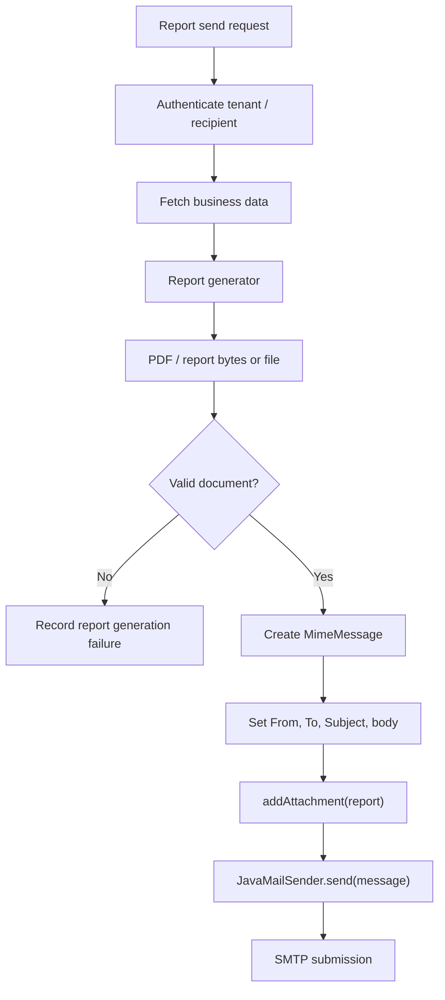
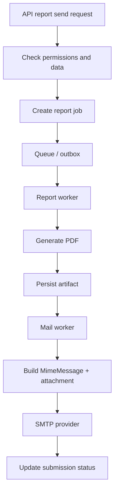

# Generating a PDF or Report Before Creating the Message in Spring Framework Mail

Many business emails need to attach a document generated from application data: PDF invoices, revenue reports, transaction statements, receipts, or activity summaries. In Spring Framework Mail, an easy-to-control way to organize this is to **finish generating the document first, and only then create the email message and attach the ready document**.

The workflow can be described as follows:

1. Retrieve validated business data and check access permissions.
2. Generate the report or PDF from that data.
3. Validate the generated document: non-empty data, valid format, and appropriate filename.
4. Create `MimeMessage`, setting sender, recipient, subject, and body.
5. Attach the PDF/report using `MimeMessageHelper.addAttachment(...)`.
6. Send the message using `JavaMailSender.send(...)`.

Separating these two stages allows report-generation failures to be caught before the application begins constructing the email. It also lets you test the PDF generator independently of SMTP, reuse the document across multiple channels, and choose a storage strategy suited to the report size.

## 1. Distinguishing report generation from email message creation

In a Spring application, these two tasks have distinct goals:

| Task | Inputs | Output | Typical components |
|---|---|---|---|
| Generating report/PDF | Business data, report template, fonts, locale | PDF file or byte array | PDFBox, JasperReports, report export library |
| Creating email message | Sender, recipient, subject, body, generated document | `MimeMessage` | `JavaMailSender`, `MimeMessageHelper` |
| Sending email | Complete `MimeMessage` | Submission result or error | `JavaMailSender.send(...)`, SMTP provider |

`MimeMessage` is the MIME email message structure. It is not the place to compute revenue, query invoices, or render PDF content. `MimeMessageHelper` helps set headers, body, and attachments; the reporting library is responsible for producing the file data before the attachment is added.



If you create the message first and only then start generating the report, the code ends up holding an unfinished message while document generation may fail due to data, fonts, size, or library errors. Generating the report first keeps the boundary between **document creation failures** and **email creation/sending failures** much clearer.

### Why not put PDF generation logic inside the mail service?

A mail service should focus on building and sending messages. If it simultaneously queries multiple tables, computes figures, draws PDFs, formats pages, and talks to SMTP, that class becomes hard to test and hard to reuse.

Responsibilities can be separated as:

- `ReportDataService` retrieves and prepares report data.
- `PdfReportGenerator` transforms the data into a PDF.
- `MailTemplateRenderer` produces the subject and body.
- `ReportEmailService` combines the results, builds the MIME message, and sends.

For reports with complex business rules, compute and validate data at the service/domain layer before passing the prepared model to the PDF library. Never let PDF rendering code decide which tenant can view a report or run unguarded data queries.

## 2. Choosing how to generate a PDF or report

No single library fits every report. Pick tools based on complexity and output form:

| Need | Possible choice | Characteristics |
|---|---|---|
| Simple PDFs, text content, tables, and images | Apache PDFBox | Low-level API with direct page and content control |
| Templated reports with bands, groups, aggregations | JasperReports | Provides a report template model and export engine |
| PDF reports from HTML | Appropriate HTML-to-PDF engine | Reuses HTML templates; requires checking CSS and fonts |
| Data tables for further user processing | CSV or XLSX | Can be attached instead of PDF |
| Documents with an existing pipeline from another system | Pre-generated file/resource | Mail service only reads and attaches |

This lesson uses **Apache PDFBox** for illustration because it can generate PDFs directly from Java and embed Unicode fonts. For financial statements or complex forms, JasperReports or a dedicated reporting engine may be more suitable.

When choosing a library, evaluate licensing, Java version compatibility, font embedding support, Vietnamese character support, memory usage, size limits, and maintenance needs. Do not pick a library simply because a short snippet can generate a one-page PDF.

## 3. Preparing dependencies and Unicode fonts

With Gradle, an example using PDFBox 2.x:

```groovy
dependencies {
    implementation 'org.springframework.boot:spring-boot-starter-mail'
    implementation 'org.apache.pdfbox:pdfbox:2.0.32'
}
```

Choose a PDFBox version approved by your project and keep it updated per your application's dependency management policy. If using Spring Boot, keep dependency versions consistent with the active BOM or dependency management.

### Why does a Vietnamese PDF need an appropriate font?

Built-in standard PDF fonts such as Helvetica usually support only a limited character set. If you generate a Vietnamese PDF with a font lacking the required glyphs, accented characters may disappear, turn into square boxes, or render incorrectly.

To support Unicode, **embed a TrueType/OpenType font with sufficient glyphs** into the PDF. For example, you can use Noto Sans:

```text
src/main/resources/
└── fonts/
    └── NotoSans-Regular.ttf
```

Only use fonts that the application has rights to distribute and embed into documents. Placing the font on the classpath packages the resource with the artifact and avoids relying on font paths on the deployment server.

In PDFBox 2.x, you can load a font using `PDType0Font.load(document, inputStream)`. An embedded Unicode font allows Vietnamese content to display properly across different PDF readers, provided the font contains the corresponding glyphs.

## 4. Preparing report data before building the PDF

Before rendering content, prepare a report model containing validated data. Example order summary report:

```java
package com.example.report;

import java.util.List;

public record OrderReportData(
        String reportCode,
        String title,
        String customerName,
        String periodDisplay,
        String generatedAtDisplay,
        String totalDisplay,
        List<String> detailLines) {
}
```

Example prepared data:

```java
OrderReportData report = new OrderReportData(
        "ORD-RPT-2026-0042",
        "Order Summary Report",
        "Nguyễn An",
        "01/10/2026 - 31/10/2026",
        "12/11/2026 16:30 (UTC+07:00)",
        "125.500.000 ₫",
        List.of(
                "Paid orders: 120",
                "Processing orders: 8",
                "Cancelled orders: 3"));
```

This is illustrative data. In a real system, figures must be calculated from an authorized data source, filtered by the right tenant and reporting period, and formatted according to the selected locale/time zone.

### Do not let the report generator decide data access permissions

Before generating a report, the business layer must verify:

- The requester is permitted to view that report.
- The tenant or organization owning the data is resolved from the authenticated context.
- The reporting period and data scope are valid.
- The email recipient is authorized to receive the document.
- Sensitive fields are stripped or redacted per policy.

Never take `tenantId`, customer ID, or data scope from a request and trust it blindly. An attached report is a data copy that can be saved or forwarded; recipient authorization must be checked before generation and sending.

## 5. Generating a PDF as a byte array with PDFBox

For moderately sized documents, a simple approach is to generate the PDF in memory using `ByteArrayOutputStream` and return `byte[]`. Then the mail service uses that byte array to create the attachment.

### 5.1. Implementing PdfReportGenerator

```java
package com.example.report;

import java.io.ByteArrayOutputStream;
import java.io.IOException;
import java.io.InputStream;
import java.util.ArrayList;
import java.util.List;

import org.apache.pdfbox.pdmodel.PDDocument;
import org.apache.pdfbox.pdmodel.PDPage;
import org.apache.pdfbox.pdmodel.PDPageContentStream;
import org.apache.pdfbox.pdmodel.common.PDRectangle;
import org.apache.pdfbox.pdmodel.font.PDType0Font;
import org.springframework.core.io.ClassPathResource;
import org.springframework.stereotype.Component;

@Component
public class PdfReportGenerator {

    public byte[] generate(OrderReportData report) throws IOException {
        try (PDDocument document = new PDDocument();
             ByteArrayOutputStream output = new ByteArrayOutputStream();
             InputStream fontInput = new ClassPathResource(
                     "fonts/NotoSans-Regular.ttf").getInputStream()) {

            PDType0Font font = PDType0Font.load(document, fontInput);
            document.getDocumentInformation().setTitle(report.title());

            try (PageWriter pageWriter = new PageWriter(document, font)) {
                pageWriter.writeParagraph(report.title(), 18);
                pageWriter.writeParagraph(
                        "Report Code: " + report.reportCode(), 10);
                pageWriter.writeParagraph(
                        "Customer: " + report.customerName(), 11);
                pageWriter.writeParagraph(
                        "Report Period: " + report.periodDisplay(), 11);
                pageWriter.writeParagraph(
                        "Generated At: " + report.generatedAtDisplay(), 10);
                pageWriter.writeParagraph(
                        "Total Value: " + report.totalDisplay(), 13);

                pageWriter.writeParagraph("Details", 14);
                for (String detail : report.detailLines()) {
                    pageWriter.writeParagraph("- " + detail, 11);
                }
            }

            document.save(output);
            return output.toByteArray();
        }
    }

    private static final class PageWriter implements AutoCloseable {
        private static final float MARGIN = 48;
        private static final float MAX_WIDTH = PDRectangle.A4.getWidth()
                - (2 * MARGIN);

        private final PDDocument document;
        private final PDType0Font font;
        private PDPage page;
        private PDPageContentStream stream;
        private float y;

        PageWriter(PDDocument document, PDType0Font font) throws IOException {
            this.document = document;
            this.font = font;
            startPage();
        }

        void writeParagraph(String text, float fontSize) throws IOException {
            for (String line : wrap(text, fontSize)) {
                writeLine(line, fontSize);
            }
            y -= 6;
        }

        private List<String> wrap(String text, float fontSize)
                throws IOException {
            List<String> lines = new ArrayList<>();
            StringBuilder current = new StringBuilder();

            for (String word : text.strip().split("\\s+")) {
                String candidate = current.length() == 0
                        ? word
                        : current + " " + word;
                float width = font.getStringWidth(candidate)
                        / 1000f * fontSize;

                if (width > MAX_WIDTH && current.length() > 0) {
                    lines.add(current.toString());
                    current.setLength(0);
                }

                if (current.length() > 0) {
                    current.append(' ');
                }
                current.append(word);
            }

            if (current.length() > 0) {
                lines.add(current.toString());
            }
            return lines;
        }

        private void writeLine(String text, float fontSize)
                throws IOException {
            float lineHeight = fontSize * 1.5f;
            if (y < MARGIN + lineHeight) {
                startPage();
            }

            stream.beginText();
            stream.setFont(font, fontSize);
            stream.newLineAtOffset(MARGIN, y);
            stream.showText(text);
            stream.endText();

            y -= lineHeight;
        }

        private void startPage() throws IOException {
            if (stream != null) {
                stream.close();
            }

            page = new PDPage(PDRectangle.A4);
            document.addPage(page);
            stream = new PDPageContentStream(document, page);
            y = page.getMediaBox().getHeight() - MARGIN;
        }

        @Override
        public void close() throws IOException {
            if (stream != null) {
                stream.close();
            }
        }
    }
}
```

This example demonstrates basic multi-page document creation:

- `PDDocument` manages the PDF document.
- `PDPage` represents each A4 page.
- `PDPageContentStream` writes content onto a page.
- `PDType0Font` provides the embedded Unicode font.
- `ByteArrayOutputStream` captures the PDF output to return `byte[]`.
- `PageWriter` automatically advances to a new page when approaching the bottom margin.

The `wrap(...)` helper measures string width using the font to break lines across the page width. This is a simple whitespace-based line wrapper; reports with complex tables, columns, repeating headers/footers, images, or grouped pagination should use a dedicated layout or reporting engine. The example also assumes no single word is wider than the page width and that the font supports every character supplied.

### 5.2. Why return a byte array?

When the report generator returns `byte[]`, it produces a result independent of SMTP:

```text
OrderReportData
      |
      v
PdfReportGenerator.generate(...)
      |
      v
byte[] pdfBytes
      |
      +------> Storage
      |
      +------> Preview / download
      |
      +------> Email attachment
```

A generated PDF can be used for web downloads, stored in object storage, or attached to multiple messages per policy. There is no need to regenerate the PDF in each place if the data and document version must stay consistent.

### 5.3. Checking the result before creating the message

The mail service can perform a minimal check:

```java
byte[] pdfBytes = pdfReportGenerator.generate(report);

if (pdfBytes == null || pdfBytes.length == 0) {
    throw new IllegalStateException("PDF report is empty");
}
```

Checking that the initial bytes of a PDF start with the `%PDF-` signature can be useful as a preliminary format check, though it does not prove the entire document is valid. If you need to verify PDF structure, re-open it with PDFBox or validate via a separate step.

Importantly, **if report generation fails, do not create a MimeMessage and do not call SMTP yet**. The failure can be recorded as a report-generation error, retried per the generator's policy, or returned to the caller.

## 6. Attaching the PDF with MimeMessageHelper

Once `byte[]` is ready, you can use `ByteArrayResource` as the data source for `addAttachment(...)`.

```java
import org.springframework.core.io.ByteArrayResource;
import org.springframework.mail.javamail.MimeMessageHelper;

helper.addAttachment(
        "order-report.pdf",
        new ByteArrayResource(pdfBytes),
        "application/pdf");
```

Meaning:

- `order-report.pdf` is the filename visible to the recipient.
- `ByteArrayResource(pdfBytes)` supplies the file content for the MIME attachment.
- `application/pdf` is the PDF MIME type.

`ByteArrayResource` fits byte arrays because it can open a fresh `InputStream` from the same data whenever requested. This matters because the mail library may read the attachment source while building or sending the MIME message.

### 6.1. Example service sending an email with a PDF attachment

```java
package com.example.mail;

import com.example.report.OrderReportData;
import com.example.report.PdfReportGenerator;
import jakarta.mail.MessagingException;
import jakarta.mail.internet.MimeMessage;
import java.io.IOException;
import java.nio.charset.StandardCharsets;

import org.springframework.beans.factory.annotation.Value;
import org.springframework.core.io.ByteArrayResource;
import org.springframework.mail.javamail.JavaMailSender;
import org.springframework.mail.javamail.MimeMessageHelper;
import org.springframework.stereotype.Service;

@Service
public class ReportEmailService {

    private final JavaMailSender mailSender;
    private final PdfReportGenerator pdfReportGenerator;
    private final String fromAddress;

    public ReportEmailService(
            JavaMailSender mailSender,
            PdfReportGenerator pdfReportGenerator,
            @Value("@@{app.mail.from}") String fromAddress) {
        this.mailSender = mailSender;
        this.pdfReportGenerator = pdfReportGenerator;
        this.fromAddress = fromAddress;
    }

    public void sendOrderReport(
            String recipient,
            OrderReportData report)
            throws IOException, MessagingException {

        // Step 1: generate and validate the document before creating MimeMessage.
        byte[] pdfBytes = pdfReportGenerator.generate(report);
        if (pdfBytes.length == 0) {
            throw new IllegalStateException("Generated PDF is empty");
        }

        // Step 2: create a message only after the document is ready.
        MimeMessage message = mailSender.createMimeMessage();
        MimeMessageHelper helper = new MimeMessageHelper(
                message, true, StandardCharsets.UTF_8.name());

        helper.setFrom(fromAddress);
        helper.setTo(recipient);
        helper.setSubject(
                "Order report " + report.reportCode());

        String plainText = """
                Hello,

                Your order report has been generated.
                Report Code: %s
                Report Period: %s

                Please open the attached PDF file to view details.

                Best regards,
                The Example Team
                """.formatted(report.reportCode(), report.periodDisplay());

        String htmlText = """
                <!doctype html>
                <html lang="en">
                  <body>
                    <h2>Order Report Ready</h2>
                    <p>Report Code: <strong>%s</strong></p>
                    <p>Report Period: %s</p>
                    <p>Please open the attached PDF file to view details.</p>
                  </body>
                </html>
                """.formatted(report.reportCode(), report.periodDisplay());

        helper.setText(plainText, htmlText);
        helper.addAttachment(
                "order-report-" + report.reportCode() + ".pdf",
                new ByteArrayResource(pdfBytes),
                "application/pdf");

        // Step 3: send only once both the report and MIME message are complete.
        mailSender.send(message);
    }
}
```

In this example:

1. `pdfReportGenerator.generate(report)` finishes before `createMimeMessage()` is called.
2. `MimeMessageHelper(message, true, "UTF-8")` enables multipart so the message can carry both the body and the attachment.
3. `setText(plainText, htmlText)` sets both alternative content versions in the same email.
4. `addAttachment(...)` adds the PDF as an independent MIME part.
5. `mailSender.send(message)` submits a single message containing the body and PDF file to the SMTP server.

When only plain text or HTML is needed, use the appropriate `setText` overload. If both versions and attachments are needed, the helper must be created in multipart mode. Never use `SimpleMailMessage` for this case because it does not support attachments.

### 6.2. Attachment filename

The filename should be constructed from controlled data, for example:

```java
String attachmentName =
        "order-report-" + report.reportCode() + ".pdf";
```

If a report code or name comes from user input, strip control characters, path separators, and disallowed characters. A safe option is using an internal ID consisting only of letters, digits, hyphens, and underscores:

```java
String safeId = report.reportCode()
        .replaceAll("[^A-Za-z0-9_-]", "_");
String attachmentName = "report-" + safeId + ".pdf";
```

Never directly use a filesystem path as the attachment name, such as `C:\\reports\\customer.pdf`. The recipient only needs a valid filename like `report-ORD-0042.pdf`.

Display filenames and server storage paths are two different concepts. Never put internal paths, bucket names, or server layout details into attachment headers.

## 7. Generate the report first, then create the message: stage-by-stage error handling

Separating stages helps the application categorize errors cleanly:

| Stage | Example error | Appropriate behavior |
|---|---|---|
| Fetching data | Database timeout, report not found | Record data error, do not build PDF |
| Generating PDF | Missing font, file write error, invalid data | Record report error, do not build message |
| Validating artifact | Empty PDF or exceeds size limit | Reject sending and handle per policy |
| Building MIME | Invalid address, MIME structure error, resource error | Do not call SMTP |
| SMTP submission | DNS, TLS, AUTH, quota, or server rejection | Handle send error and apply appropriate retry |
| Post-submission delivery | Bounce, delay, or filtering | Track via provider/delivery system |

For example, if the PDF font is missing from the classpath, `ClassPathResource.getInputStream()` will fail during report generation. Because the message has not been created yet, the mail service never has to deal with a half-built message.

Conversely, if the PDF generates successfully yet the SMTP server rejects the submission, the artifact can still be kept to retry sending later without regenerating from scratch, if data policy and report freshness rules allow.

### Do not equate submission with delivery

When `mailSender.send(message)` returns normally, it usually means the SMTP submission server accepted the message for further processing. It **does not prove the recipient downloaded the PDF, opened the file, or received the email in their inbox**.

If business rules require tracking delivery, use provider events/bounces and store the provider message ID or queue ID when available. Internal states should distinguish `REPORT_CREATED`, `EMAIL_SUBMITTED`, and delivery states backed by corresponding evidence.

## 8. Using FileSystemResource when reports are large

`byte[]` is very convenient for small and medium files, though the entire PDF resides on the heap. If reports are large or many emails are generated concurrently, memory usage can grow substantially.

An alternative is writing the PDF to a temporary file or managed storage area, and then using `FileSystemResource` as the attachment source:

```java
import java.nio.file.Files;
import java.nio.file.Path;

import org.springframework.core.io.FileSystemResource;

Path pdfPath = Files.createTempFile("order-report-", ".pdf");
try {
    // The report generator can provide an overload writing directly to a Path.
    pdfReportGenerator.generateToFile(report, pdfPath);

    MimeMessage message = mailSender.createMimeMessage();
    MimeMessageHelper helper =
            new MimeMessageHelper(message, true, "UTF-8");

    helper.setFrom(fromAddress);
    helper.setTo(recipient);
    helper.setSubject("Report " + report.reportCode());
    helper.setText(
            "The report is attached.",
            "<p>The report is attached.</p>");
    helper.addAttachment(
            "report.pdf",
            new FileSystemResource(pdfPath),
            "application/pdf");

    mailSender.send(message);
} finally {
    Files.deleteIfExists(pdfPath);
}
```

`generateToFile(...)` here is an application-implemented overload; PDFBox can save directly via `document.save(path.toFile())`. This snippet illustrates a temporary file lifecycle in a synchronous send flow.

`FileSystemResource` can re-open the file when the library needs to read the attachment. When `send(...)` completes synchronously, the application can delete the temporary file in `finally`. If sending runs asynchronously, **do not delete the file immediately after creating the job**; the file must persist until the worker finishes reading and sending, or the worker must regenerate or fetch the document from durable storage.

### Comparing attachment sources

| Resource | Suitable for | Notes |
|---|---|---|
| `ByteArrayResource` | Small/medium PDFs already in RAM | Data occupies heap; can open fresh streams |
| `FileSystemResource` | Large files or files already saved on filesystem | Manage file permissions, lifecycle, and cleanup |
| `ClassPathResource` | Static documents packaged with the application | Unsuitable for dynamic per-customer reports |
| `InputStreamResource` | Certain special data streams | Stream may be read-once; must ensure the source meets mail library read requirements |

For an `InputStreamSource` passed to `addAttachment(...)`, use a source capable of providing a fresh `InputStream` on each call. `ByteArrayResource` and `FileSystemResource` generally satisfy this better than an already-opened, consumed stream.

## 9. When should you persist the PDF before sending?

Not every report needs permanent storage. There are three common patterns:

### Model A: generate in memory and send immediately

```text
Data -> PDF bytes -> MimeMessage -> SMTP
```

Suitable when:

- The PDF is small or medium.
- There is no need to retain the report copy after sending.
- The send task is synchronous or easy to regenerate.
- Concurrency is reasonably bounded.

### Model B: create a temporary file and send

```text
Data -> temporary PDF file -> MimeMessage -> SMTP -> delete temp file
```

Suitable when the PDF is larger than what fits comfortably in a byte array yet can complete within a single worker. Manage temp files, read permissions, disk space, timeouts, and cleanup if the process terminates abruptly.

### Model C: generate and persist an immutable artifact

```text
Data -> PDF -> object storage / document store
                    |
                    v
              Email job / queue
                    |
                    v
             Worker reads PDF
                    |
                    v
              MimeMessage -> SMTP
```

Suitable when:

- Users need to re-download the report.
- Send retries are needed without recomputing the report.
- Auditing or document version traceability is required.
- Email sending is asynchronous and may sit in a queue for a while.

In this model, the job should only carry **an authorized artifact ID or storage key**, never arbitrary filesystem paths or credential data. The worker must verify tenant/access permissions before reading the artifact and sending.

### Pinning data and report versions

If a report is generated from mutable data, decide:

- Does the report reflect data at request time or at worker send time?
- Should retries regenerate a new report or resend the exact file already created?
- How long is the file retained?
- Who is authorized to re-download or request a resend?
- Must template version, generation timestamp, and data scope be recorded?

For invoices or official statements, resending **the exact issued artifact** is usually more important than generating a new file from current data. For ephemeral dashboard summaries, regenerating from current data may be acceptable if business rules state so explicitly.

## 10. CSV or XLSX reports instead of PDF

A "report" does not have to be a PDF. If recipients need to filter, sort, or process numbers, CSV/XLSX may be a better fit.

| Format | Common MIME type | Example filename |
|---|---|---|
| PDF | `application/pdf` | `order-report.pdf` |
| CSV | `text/csv; charset=UTF-8` | `orders.csv` |
| XLSX | `application/vnd.openxmlformats-officedocument.spreadsheetml.sheet` | `orders.xlsx` |
| JSON | `application/json` | `report.json` |

Example attaching a CSV generated as a byte array:

```java
byte[] csvBytes = csvReportGenerator.generate(report);

helper.addAttachment(
        "orders.csv",
        new ByteArrayResource(csvBytes),
        "text/csv; charset=UTF-8");
```

For CSVs with Vietnamese text, pick the right encoding and consider how spreadsheet apps detect UTF-8. If opened in Excel, a BOM convention or CSV formatting suited to target users may be needed; test in the actual target application.

For XLSX, you can build a workbook using Apache POI or an equivalent library, write to a `ByteArrayOutputStream`, and attach with the XLSX MIME type. Never assign MIME type `application/pdf` to an XLSX file just because both are reports.

### Controlling spreadsheet content

If CSV/XLSX contains data starting with characters such as `=`, `+`, `-`, or `@`, some spreadsheet apps may interpret the content as a formula. When data comes from users or untrusted sources, apply a CSV/formula-injection defense policy suited to the format and opening application.

## 11. Generating PDFs from JasperReports or HTML templates

PDFBox fits when you need direct control over page contents. For reports with many tables, groups, subtotals, charts, and complex print layouts, a dedicated reporting engine can be used.

### JasperReports

A conceptual flow:

```java
JasperPrint filledReport = reportService.fillReport(reportData);
byte[] pdfBytes = JasperExportManager.exportReportToPdf(filledReport);

if (pdfBytes.length == 0) {
    throw new IllegalStateException("Report export produced no data");
}

// Only after this step create MimeMessage and call addAttachment(...).
```

`reportService.fillReport(...)` is application logic loading templates, parameters, and data sources; `JasperExportManager` is the API exporting `JasperPrint` to PDF. Configure appropriate font extensions if the report includes Vietnamese text, and version report templates/resources properly.

### HTML-to-PDF

If report content already exists as an HTML template, you can use a compatible HTML-to-PDF engine to render HTML into PDF. Check:

- What level of CSS is supported.
- How Vietnamese fonts are loaded and embedded.
- Where images and stylesheets are permitted to load from.
- Whether page breaks, repeating headers/footers, and multi-page tables are supported.
- Whether the engine performs external URL fetches while rendering.

If HTML contains user-controlled URLs, the renderer could fetch unintended resources. Restrict image/CSS sources, control redirects, and lock down network egress when converting HTML to PDF.

Whether you choose PDFBox, JasperReports, or HTML-to-PDF, **the final output should still be generated and validated before building the email message**. The mail service does not need to know the details of the library that produced the file.

## 12. Securing attached documents

Report PDFs can contain personal data, transactions, revenue, or internal information. Emailing attachments means the document can be saved to devices, forwarded, and persist outside the application.

### Checking recipients and data scope

Before generating a PDF:

1. Identify the tenant/data owner from the authenticated context.
2. Verify the requester has permission to generate and send that report type.
3. Verify the recipient is authorized to receive all data inside the report.
4. Query only the fields needed for the report's purpose.
5. Mask or omit sensitive information per policy.

Never send a single report containing multiple customers' data to one recipient merely because they asked for a combined email. Access scope must be enforced at the data and business layers before generating the artifact.

### Filenames and PDF contents

- Never build filenames from unfiltered input.
- Never embed passwords, tokens, or long-lived secrets in report content.
- Never put internal details such as server paths, bucket names, or stack traces into the PDF.
- If a PDF requires password protection or access controls, apply mechanisms matching business requirements; never treat sending over SMTP as document protection.
- If sharing sensitive documents, consider sending an authenticated, time-limited download link instead of attaching the file directly.

### Never write temporary files to public locations

If using temporary files:

- Create them in an OS-managed temp directory with minimal permissions.
- Use random or system-generated names.
- Never save inside web root or public static directories.
- Delete files after the worker finishes, or run a cleanup sweeper when processes terminate unexpectedly.
- Bound disk usage and concurrent temporary file counts.

### PDFs from untrusted data

If a report includes user-entered text, constrain length, control characters, and rendered content. For PDF libraries, track security patches and bound input size and complexity. If the system accepts pre-made PDFs from users and attaches them, never assume those files are safe; apply file-type verification, malware scanning, and storage policies before forwarding.

### SMTP security

SMTP connections require TLS/AUTH per provider configuration. TLS protects the hop to the SMTP submission server per policy, but does not replace recipient authorization or protect the file after delivery to a mailbox. Emails can be forwarded or stored on devices beyond the application's control.

## 13. Managing size and attachment limits

SMTP providers and mailboxes typically enforce message size limits. Those limits apply to **the entire MIME-encoded email**, not only the original PDF size.

When an attachment is base64-encoded, its encoded size typically grows by roughly one-third, plus MIME boundaries and headers. A 15 MB PDF can push a message past a 20 MB limit depending on provider accounting and the rest of the body/attachments.

You should:

- Check artifact size before building the message.
- Enforce limits aligned with your provider and product.
- Account for base64 overhead along with the body and other attachments.
- Avoid attaching duplicate copies of the same report.
- Compress or downscale images when appropriate.
- Use authenticated download links for oversized files.
- Monitor failure rates caused by message size to tune your design.

Example size check:

```java
private static final int MAX_PDF_BYTES = 10 * 1024 * 1024;

byte[] pdfBytes = pdfReportGenerator.generate(report);
if (pdfBytes.length > MAX_PDF_BYTES) {
    throw new IllegalArgumentException(
            "Report is too large to attach to email");
}
```

The 10 MB figure is only an illustrative application threshold, not a universal SMTP limit. Set limits based on your provider, mail gateway, and product requirements.

## 14. Sending reports asynchronously with a queue/outbox

For heavy reports, do not force a user's HTTP request to wait for both PDF generation and SMTP sending. Persist the request to a queue or transactional outbox for workers to execute:



You can use one worker to generate the PDF and send the email in the same job, or split into two workers to reuse artifacts. If split:

- The report job builds the artifact and stores metadata.
- The mail job references the artifact ID.
- The mail worker checks artifact access permissions before reading.
- Artifacts have status/version and retention expiration.
- Email retries do not necessarily need to re-run the report generator.

### What should the job payload contain?

Example job:

```json
{
  "jobId": "mail-job-0042",
  "tenantId": "tenant-alpha",
  "reportId": "ORD-RPT-2026-0042",
  "artifactId": "artifact-8f31",
  "recipientId": "user-1024",
  "templateKey": "order-report-ready",
  "status": "REPORT_CREATED"
}
```

This JSON illustrates an application-defined schema. Jobs should reference recipient/tenant/artifact by controlled IDs; never place SMTP passwords, access tokens, or large base64 PDFs inside queue payloads without a clear reason.

### Choosing when to generate the report

There are two common policies:

| Policy | How it works | Suitable for |
|---|---|---|
| Generate at request time | API/service builds artifact first, then queues email | Reports needing a snapshot at the moment of request |
| Generate in worker | Queue the request; worker fetches data and builds artifact | Large reports needing background processing and load throttling |

In both cases, determine when data is snapshotted. If a worker runs several minutes later, database numbers may have changed. A report with formal statement semantics should record the timestamp and data version appropriately.

### Retries and duplicate sends

If the PDF is already generated and durably stored, send retries can reuse that artifact. However, if the SMTP server received the email and the worker lost connection before receiving the response, retrying can send duplicates. SMTP does not inherently guarantee exactly-once delivery.

Track status by `jobId` and provider message ID when available. Retry only transient failures with backoff and attempt caps; data errors, authorization failures, or report-generation errors usually require addressing the root cause. Never generate multiple new PDF copies on every retry if business rules require preserving the issued snapshot.

## 15. Testing the report generator and email service separately

Because the two components have separate responsibilities, they can be tested independently.

### Testing the PDF generator

Scenarios to verify:

- Output is non-empty and carries the PDF signature.
- Multiple pages are created when content exceeds one page.
- Vietnamese content renders properly with the embedded font.
- Names, report codes, periods, and figures are accurate.
- Long content is not clipped off the page.
- The PDF opens cleanly in standard PDF viewers.
- Data belongs to the requested tenant and scope.

Basic file-signature check example:

```java
byte[] pdf = generator.generate(report);

assertTrue(pdf.length > 0);
assertEquals('%', (char) pdf[0]);
assertEquals('P', (char) pdf[1]);
assertEquals('D', (char) pdf[2]);
assertEquals('F', (char) pdf[3]);
```

This is only a preliminary `%PDF` header check; it does not replace opening and verifying document structure with PDFBox.

### Testing the email service with mocks

You can mock `JavaMailSender` and verify:

- The report generator is called before `createMimeMessage()`.
- When the generator throws an error, no message is built and `send(...)` is not called.
- When the generator returns a PDF, the helper is initialized in multipart mode.
- The email has the expected subject, recipient, and body.
- The attachment has the expected filename, MIME type, and byte content.
- SMTP errors are propagated or handled per service policy.

When verifying helper calls, you can use a local SMTP sink to confirm the MIME source actually contains `application/pdf`, the expected filename, and PDF bytes. Never send emails to real addresses in tests.

### Separating PDF rendering tests from SMTP tests

If a single test hits the database, generates a PDF, connects to real SMTP, and waits for delivery, it becomes flaky and hard to diagnose. Instead, test:

1. Report data service with sample data or a test database.
2. PDF generator with actual artifacts opened and inspected.
3. Email service with a mock sender or local SMTP sink.
4. Full integration flow in staging when verifying provider configuration.

## 16. Common errors and troubleshooting

| Symptom | Possible cause | Resolution |
|---|---|---|
| Empty PDF | Report data has no content, export error, or not saved | Inspect data, complete export, and check byte length |
| Vietnamese text renders as boxes | Font lacks glyphs or was not embedded | Use an appropriate Unicode font and embed it into the PDF |
| PDF fails to open | Document not saved/closed in the right order or truncated bytes | Finish saving before creating the attachment resource |
| Report table clipped | Missing line wrapping or page breaks | Use a layout engine or proper pagination logic |
| `FileNotFoundException` for font | Font not on classpath or wrong resource name | Check resource path and packaging |
| Email has no attachment | Helper lacked multipart or `addAttachment` was not called | Use `new MimeMessageHelper(message, true, "UTF-8")` |
| Empty attachment | Byte/resource source has no data left when mail library reads | Use a source capable of opening fresh streams, e.g. `ByteArrayResource` |
| PDF sent with wrong filename | Filename taken from uncontrolled data or contains odd chars | Generate a safe filename using basename only |
| Client cannot open file | MIME type/extension mismatches content | Set `application/pdf` and generate a valid PDF |
| SMTP rejects message size | Large PDF, base64 overhead, or multiple attachments | Reduce size or send a download link |
| API waits too long | Generating large report and sending SMTP synchronously | Offload generation/sending to a worker or queue |
| Retries produce different report copies | Regenerating from mutated data | Persist artifact snapshots or pin data timestamps |
| Temp file deleted before sending | Async worker references an already cleaned-up file | Manage lifecycle or persist artifacts durably |
| Submission succeeds but recipient has not seen email | Delivery delayed/bounced/filtered as spam | Inspect provider events; do not infer delivery from `send()` |
| Report data leaked across tenants | Unverified data scope or recipient | Verify tenant and permissions before creating the artifact |

### Distinguishing PDF creation errors from attachment errors

If `PdfReportGenerator.generate(...)` throws `IOException`, the failure occurred before building the MIME message. If the PDF has valid bytes yet `addAttachment(...)` fails, inspect the resource, filename, multipart mode, and MIME type. If the message built fine yet `send(...)` fails, inspect SMTP/network/TLS/AUTH and provider limits.

Categorizing failures this way gives logs clear context rather than recording a generic "email send failed" message for every cause.

## 17. Key design choices

### Should you generate the PDF before checking SMTP?

If the PDF takes significant time or data can change, define a policy. In a "generate report then send" flow, building the PDF first yields an independent artifact. However, if the SMTP endpoint is known to be down and the report is very expensive, the system can check configuration or provider health before starting heavy work. Even with pre-checks, still handle SMTP failures after the PDF is generated.

### Should you store the PDF after sending?

Store it only when business requirements call for re-downloading, auditing, reconciliation, or retries. Otherwise, hold the byte array or temp file during sending and release it afterward. Long-term storage requires retention policies, encryption, access controls, and data deletion rules.

### Should you generate one PDF for multiple recipients?

Only when every recipient is authorized to view **the exact same dataset**. If the report contains individual per-person information, generate separate artifacts or scope-filtered content. Never group recipients in `To`/`Cc` on a single attachment just to save file-generation work.

### Should you send a link instead of an attachment?

For large or sensitive files, an authenticated download link is often more suitable. Links should expire and restrict access to the intended recipient; avoid uncontrolled public URLs. The email simply notifies that the report is ready and provides a link under a trusted domain.

## 18. Complete workflow example with authorization and artifact storage

A large reporting system can be structured around interfaces:

```java
public interface ReportDataService {
    OrderReportData loadAuthorizedReport(
            String authorizedTenantId,
            String reportCode);
}

public interface ReportArtifactStore {
    String save(String tenantId, byte[] content, String contentType);
    byte[] readAuthorized(String tenantId, String artifactId);
}

public interface ReportEmailQueue {
    void enqueue(ReportEmailJob job);
}

public record ReportEmailJob(
        String jobId,
        String tenantId,
        String recipient,
        String reportCode,
        String artifactId) {
}
```

These interfaces are application-defined contracts, not built-in Spring Mail APIs. An orchestration service can do:

```java
public void requestReportEmail(
        String authorizedTenantId,
        String reportCode,
        String recipient) throws IOException {

    OrderReportData report = reportDataService.loadAuthorizedReport(
            authorizedTenantId, reportCode);

    byte[] pdf = pdfReportGenerator.generate(report);
    if (pdf.length == 0) {
        throw new IllegalStateException("Report is empty");
    }

    String artifactId = artifactStore.save(
            authorizedTenantId, pdf, "application/pdf");

    ReportEmailJob job = new ReportEmailJob(
            createJobId(),
            authorizedTenantId,
            recipient,
            reportCode,
            artifactId);

    reportEmailQueue.enqueue(job);
}
```

Worker handling the job:

```java
public void handle(ReportEmailJob job)
        throws MessagingException {

    byte[] pdf = artifactStore.readAuthorized(
            job.tenantId(), job.artifactId());

    if (pdf.length == 0) {
        throw new IllegalStateException("Stored report is empty");
    }

    MimeMessage message = mailSender.createMimeMessage();
    MimeMessageHelper helper =
            new MimeMessageHelper(message, true, "UTF-8");

    helper.setFrom(fromAddress);
    helper.setTo(job.recipient());
    helper.setSubject("Report " + job.reportCode());
    helper.setText(
            "Your report is attached.",
            "<p>Your report is attached.</p>");
    helper.addAttachment(
            "report-" + safeId(job.reportCode()) + ".pdf",
            new ByteArrayResource(pdf),
            "application/pdf");

    mailSender.send(message);
}
```

This is an architectural sketch. In a real application, the worker must reliably verify recipient and tenant context, check artifact status, enforce access permissions, handle idempotency/retries, and update job state. `artifactStore.readAuthorized(...)` must enforce tenant isolation on the server side; never blindly trust an ID supplied by the queue.

This flow clearly shows that the report is generated and persisted **before the worker builds the MimeMessage**. If SMTP experiences a transient failure, the worker can retry using the persisted artifact as long as policy permits.

## 19. Frequently asked questions

**Why generate the PDF before creating MimeMessage?** To finish and validate the document independently of the email. If the PDF fails, the application stops at the report-generation step instead of holding an incomplete message; if the PDF succeeds, it can be stored, previewed, or reused.

**Can the PDF be generated after creating MimeMessage?** Technically yes, though it offers no clear benefit and couples the two stages more tightly. Generate the artifact first and then build the message unless a specific design demands otherwise.

**Can `SimpleMailMessage` be used to send a PDF?** No. `SimpleMailMessage` is only for simple mail content and has no attachment API. Use `MimeMessage` with `MimeMessageHelper`.

**Why does the `MimeMessageHelper` constructor need multipart set to true?** Because the email must contain multiple MIME parts: body and attached file. When an email has both plain text and HTML, the two bodies are also organized under `multipart/alternative`.

**Is `ByteArrayResource` suitable for large PDFs?** For small/medium files, it is simple. Large files or many concurrent jobs can cause heap pressure; consider `FileSystemResource` or object storage with appropriate stream reading.

**Can `InputStreamResource` be used for attachments?** In some cases yes, but you must ensure the source supplies a fresh stream when requested. An already-opened and exhausted stream may not be re-readable; prefer a resource with a clear lifecycle and re-openability.

**Does PDFBox render Vietnamese automatically?** Not automatically with every font. You must load and embed a Unicode font containing Vietnamese glyphs, such as Noto Sans, and use that font when writing content.

**Does a PDF generated in RAM need to be saved to a file?** Not required. You can return `byte[]` and attach it directly. Persist a file or durable artifact only when handling large files, re-downloads, auditing, or retries.

**Can both PDF and CSV be attached together?** Yes. Call `addAttachment(...)` for each resource with its respective filename and MIME type.

**Can attachment filenames contain Vietnamese characters?** MIME and email clients have filename encoding mechanisms, though compatibility varies. For stability, you can use a safe, readable ASCII name containing no paths.

**Does a successful email send mean the PDF reached the recipient?** No. A successful `send(...)` usually only indicates the SMTP submission server accepted the message. Delivery, bounces, and inbox placement happen afterward.

**If SMTP fails, does the PDF need to be regenerated?** Not necessarily. If the artifact was persisted and remains valid, you can retry sending using the same file. If only a byte array lived in an already-ended request, you must regenerate it or fetch the artifact from storage.

**Should sensitive reports be sent as attachments?** Only when policy allows and the recipient's permissions are properly verified. For sensitive or large documents, an authenticated, time-limited download link may be more suitable.

**Can a report contain data from multiple tenants?** Only if the recipient is authorized to view that entire scope under policy. Verify permissions before querying, generating the PDF, and sending; never infer permissions from an email address alone.

## 20. Related technical documentation

- **Spring Framework Mail — `JavaMailSender`:** creating and sending `MimeMessage`.
- **Spring Framework Mail — `MimeMessageHelper`:** `addAttachment(...)`, `setText(...)`, and multipart configuration.
- **Spring Core Resources:** `ByteArrayResource`, `FileSystemResource`, and `ClassPathResource` as attachment data sources.
- **Apache PDFBox:** `PDDocument`, `PDPage`, `PDPageContentStream`, and `PDType0Font` for PDF creation.
- **Jakarta Mail:** MIME structure, Content-Type, Content-Disposition, and attachment data.
- **Spring Boot Mail:** SMTP configuration via `spring.mail.*`.

---

**Key takeaway:** **generate and validate the PDF/report before calling `JavaMailSender.createMimeMessage()`**. For small/medium files, return `byte[]` from the report generator and attach using `ByteArrayResource`; for large files, consider a temporary file or artifact store with a clear lifecycle. Then create `MimeMessage` in multipart mode, set body and headers, call `MimeMessageHelper.addAttachment(...)` with the right filename and MIME type, and only then send via SMTP. This separation allows report generation, MIME assembly, and SMTP submission to be handled, tested, and retried independently.
