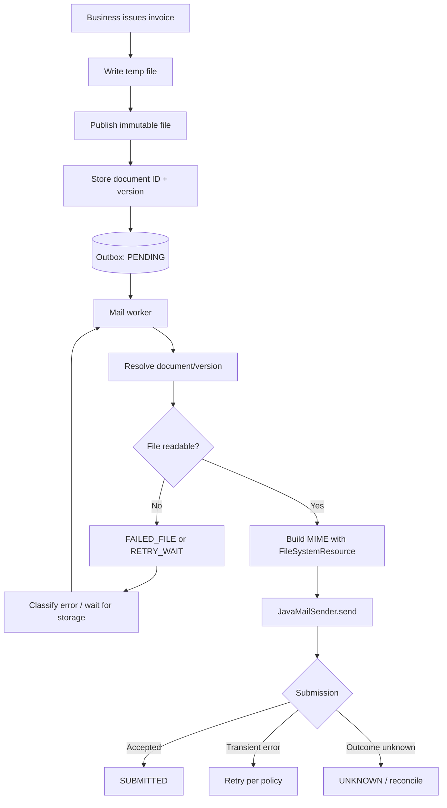

# Handling Missing or Unreadable Attachment Files

A Spring Boot application generates a PDF invoice, saves it to the filesystem, and sends an email to the customer using `JavaMailSender`. By the time sending happens, the file may have been deleted, the path misconfigured, the process lacking read permission, or the disk or network mount temporarily disconnected. If the application simply calls `new FileSystemResource(path)` and `addAttachment(...)` assuming everything is fine, errors can surface late while Jakarta Mail serializes the MIME message.

In **Spring Framework Mail**, `FileSystemResource` represents a file on the filesystem and provides a stream when the library needs to read the content. The resource does not cache a byte copy of the file, nor does it guarantee the file continues to exist after creation. Therefore, the application needs a strategy to **detect file access errors, classify root causes, decide whether to retry, and maintain accurate business state**.

This lesson focuses on cases where an attachment file does not exist or cannot be read: from pre-checks before building the message, filesystem exception handling, resource read timing, and race conditions, to operating with workers and outboxes.

## 1. Scenarios that make an attachment unreadable

Suppose the application intends to attach:

```text
/srv/app/storage/invoices/2026/DH1024.pdf
```

Common failures are not limited to deleted files:

| Scenario | Possible symptoms | Causes to investigate |
|---|---|---|
| File does not exist | `NoSuchFileException` or `FileNotFoundException` | Wrong name, wrong directory, file not yet created, deleted, or cleaned up too early. |
| Path points to a directory | Cannot be read as a regular file | Wrong document identifier or path mapping. |
| Lacks file read permission | `AccessDeniedException` or I/O error | POSIX permissions, Windows ACL, service user, or container policy. |
| Cannot traverse parent directory | Access error may occur even if the file exists | Missing traverse/execute permission on a directory along the path. |
| File locked or modified | Error depends on OS and how the file is accessed | Another process is writing, replacing, or holding the file. |
| Storage mount lost | `IOException`, device error, or stalled operation | Volume, network filesystem, disk, or storage service failure. |
| File still being generated | File exists but is empty or truncated | Mail sending ran before document creation finished. |
| File deleted after pre-check | Error occurs when opening stream or sending | Race condition between check and use. |
| File changed during sending | Received content differs from validated content | Data source is mutable or overwritten. |

Never lump all of the above into a single "Invalid file" message. **A missing file, denied permissions, and a temporarily disconnected storage mount each require different handling.**

## 2. Creating FileSystemResource does not mean the file has been read

Example:

```java
Path path = Path.of("/srv/app/storage/invoices/DH1024.pdf");
FileSystemResource resource = new FileSystemResource(path);
```

These two lines mainly create an object describing the file location. The application has not necessarily read the file's bytes yet.

When used:

```java
helper.addAttachment(
        "invoice-DH1024.pdf",
        resource,
        "application/pdf");
```

`MimeMessageHelper` creates a MIME body part and attaches the data source to the part. In typical Jakarta Mail flows, opening the stream and reading content can happen **later**, when the message is saved/serialized during sending.

Thus, the following sequence can occur:

```text
1. new FileSystemResource(path)       -> succeeds
2. helper.addAttachment(...)          -> may succeed
3. mailSender.send(message)           -> begins MIME serialization
4. resource.getInputStream()          -> opens file
5. Filesystem reports missing file    -> send fails
```

**Do not treat `addAttachment` returning normally as proof that the file was read successfully.** File access errors can be discovered while `mailSender.send(...)` is building the outgoing data.

### 2.1. FileSystemResource supplies a stream on demand

`FileSystemResource` implements the `InputStreamSource` abstraction. When `getInputStream()` is called, the resource opens a stream from the file path. For regular filesystem files, each call can open a fresh stream.

Example:

```java
FileSystemResource resource = new FileSystemResource(path);

try (InputStream input = resource.getInputStream()) {
    byte[] prefix = input.readNBytes(5);
    System.out.println(new String(prefix, StandardCharsets.US_ASCII));
}
```

`getInputStream()` can throw `IOException`, including specific subclasses like `FileNotFoundException`, `NoSuchFileException`, or `AccessDeniedException` depending on the operation and operating system.

Reading a test stream and closing it can catch errors **at check time**, but does not guarantee the subsequent read during sending will also succeed. This is a key limitation of pre-checks.

### 2.2. Why can the error surface inside MailSendException?

When `JavaMailSenderImpl` sends a `MimeMessage`, an error reading the attachment source during serialization may be wrapped inside Spring's mail exception, typically `MailSendException` or a related exception depending on the stage and library version.

Therefore, inspect the **cause chain** to find the root cause:

```text
MailSendException
  caused by MessagingException / IOException
    caused by NoSuchFileException
```

This is an illustrative pattern; actual exception chains vary by provider and failure timing. Never look only at the outermost exception class name and conclude it is definitely an SMTP error.

## 3. Checking the file before creating the message

A useful workflow is to verify the file is ready before creating the `MimeMessage`:

1. Obtain the path from a trusted storage service.
2. Check that the file exists and is a regular file per policy.
3. Check readability.
4. Check size and document status.
5. Attempt opening a stream if immediate accessibility confirmation is needed.
6. Only then create the helper and add the attachment.

### 3.1. Basic checks with Java NIO

```java
import java.io.IOException;
import java.nio.file.Files;
import java.nio.file.Path;

public void validateAttachment(Path path) throws IOException {
    if (path == null) {
        throw new IllegalArgumentException("Attachment path is required");
    }

    if (!Files.exists(path)) {
        throw new IllegalArgumentException("Attachment does not exist");
    }

    if (!Files.isRegularFile(path)) {
        throw new IllegalArgumentException(
                "Attachment path is not a regular file");
    }

    if (!Files.isReadable(path)) {
        throw new IllegalArgumentException(
                "Attachment is not readable");
    }

    if (Files.size(path) <= 0) {
        throw new IllegalArgumentException("Attachment is empty");
    }
}
```

These checks detect common cases:

- `Files.exists(path)` checks whether the path exists as observed by the filesystem.
- `Files.isRegularFile(path)` checks whether the path points to a regular file; by default this follows symbolic links.
- `Files.isReadable(path)` checks readability as observed by the JVM.
- `Files.size(path)` reads file size and may throw `IOException`.

**Boolean check methods do not provide full diagnostics.** For example, `Files.exists(path)` can return `false` when the JVM cannot determine status due to an access error; that result does not necessarily prove the file is absent. `Files.isReadable(path)` can also return `false` without indicating which permission is missing.

When accurate classification is needed, perform the actual I/O operation and handle the thrown exception.

### 3.2. Testing stream opening before sending

A practical preflight step:

```java
public void verifyCanOpen(Path path) throws IOException {
    try (InputStream ignored = Files.newInputStream(path)) {
        // Opening successfully confirms the file can be opened at this moment.
    }
}
```

This checks whether the file can be opened and immediately closes the stream. It is useful when the application wants early failure detection before building the MIME message.

However, after closing the stream, `FileSystemResource` will open the file again when sending. The file can be deleted, modified, or lose permissions between the two points in time. Therefore:

> **Preflight helps detect issues early, but does not eliminate race conditions.**

If business rules require sending the exact file version that was checked, ensure an immutable source or create a stable snapshot before sending.

### 3.3. Checking size and application limits

Example:

```java
private static final long MAX_ATTACHMENT_BYTES = 12L * 1024 * 1024;

public void validateSize(Path path) throws IOException {
    long size = Files.size(path);

    if (size == 0) {
        throw new IllegalArgumentException("Attachment is empty");
    }
    if (size > MAX_ATTACHMENT_BYTES) {
        throw new IllegalArgumentException("Attachment is too large");
    }
}
```

`12L * 1024 * 1024` is 12 MiB under this illustrative policy. Permitted sizes must be based on SMTP provider limits, document types, attachment count, and total MIME message size.

Binary files are typically base64-encoded in MIME. The base64 payload can be roughly 4/3 the size of the original file, excluding headers, boundaries, and email body content. Therefore, the raw file limit needs headroom below the provider's message limit.

## 4. Handling paths and access permissions safely

An invoice-sending application must never accept arbitrary paths directly from a request. If an endpoint lets clients pass `/etc/passwd` or `../../private/secret.pdf`, the application could use the server's own filesystem permissions to read out-of-scope data.

### 4.1. Use a document ID instead of a user-supplied path

Recommended flow:

```text
Request: documentId
       |
       v
Authenticate user
       |
       v
Check permission to view document
       |
       v
Storage service looks up documentId
       |
       v
Retrieve server-managed path
       |
       v
Validate file and create FileSystemResource
       |
       v
Build MIME attachment and send
```

The business layer decides whether the caller is authorized to send that document. The storage layer maps the document ID to a file. The mail service receives a validated source and is responsible for creating the message.

### 4.2. Checking that the path stays within the storage root

Suppose the storage root is:

```text
/srv/app/storage/invoices
```

One way to check the path after normalization:

```java
Path root = storageRoot.toAbsolutePath().normalize();
Path candidate = root.resolve(storageName).normalize();

if (!candidate.startsWith(root)) {
    throw new SecurityException("Attachment path is outside storage root");
}
```

This is a **lexical path** check. It catches many traversal patterns like `../`, though it does not solve all symbolic link risks.

### 4.3. Checking real paths and symbolic links

If policy requires the file to physically reside beneath the storage root, resolve the real path:

```java
Path realRoot = storageRoot.toRealPath();
Path realFile = candidate.toRealPath();

if (!realFile.startsWith(realRoot)) {
    throw new SecurityException("Resolved file is outside storage root");
}

if (!Files.isRegularFile(realFile)) {
    throw new IllegalArgumentException("Attachment is not a regular file");
}
```

`toRealPath()` requires the path to be resolvable and resolves symbolic links by default. It helps detect a symlink inside storage pointing outside the root. However, the possibility still exists of a file or symlink changing after the check. A stronger safeguard is **ensuring the storage directory does not permit untrusted actors to replace files or create arbitrary symlinks**.

### 4.4. Process read permissions

A file may be readable in an IDE yet unreadable when the application runs under a service account or another container user.

Things to check:

- User/group running the JVM.
- File read permissions.
- Traverse/execute permissions on every parent directory.
- Windows ACLs if running on Windows.
- Whether the volume mount is read-only or restricted.
- UID/GID mappings in Docker/Kubernetes.
- Network filesystem credentials and mount health.
- Permission changes after deployment or volume rotation.

Never fix permission errors by granting the mail-sending process read access to the entire filesystem. Grant only least-privilege access on the storage area the service needs.

## 5. Classifying errors to choose handling

Not every file read error should be retried. They can be divided into three groups:

| Group | Examples | Typically suitable policy |
|---|---|---|
| **Permanent data or permission errors** | Document ID does not exist, deleted file, access denied | Stop the attempt, record business error, request regeneration or proper permissions. |
| **Transient infrastructure errors** | Network storage disconnected, volume temporarily unavailable, transient I/O error | Retry with caps and backoff after determining the cause is recoverable. |
| **Document state errors** | File not finished generating, empty file, unpublished version | Wait for document creation to complete or transition to pending state. |

### 5.1. NoSuchFileException

`NoSuchFileException` typically occurs when the path or a path component does not exist at operation time.

Possible causes:

- Filename constructed incorrectly.
- File not yet generated or not yet published.
- A cleanup job deleted the file.
- Worker is reading a document ID whose retention expired.
- Path constructed from a different working directory than expected.

If the file should have been issued before sending, this is usually a bug to fix in the **document creation workflow or storage mapping**. Retrying the exact same path repeatedly will not make the file appear.

### 5.2. AccessDeniedException

`AccessDeniedException` usually indicates a filesystem operation was rejected. Check file permissions, parent directory permissions, service accounts, ACLs, mount options, and container policies.

Do not broaden permissions or run the app as an administrator just to "make it work". Log the logical path/document ID, operation type, and service account in controlled logs; avoid logging file contents or customer data.

### 5.3. General IOException

`IOException` can represent many issues: device failures, network filesystems, closed streams, mid-transfer read failures, or unstable file state. Inspect the cause chain and storage layer context.

Never classify every `IOException` as transient. An I/O error from a failing disk or corrupted file may need intervention; a brief network hiccup may be retryable.

### 5.4. FileNotFoundException does not always mean "no file"

The name `FileNotFoundException` is often used when opening a file fails, yet on some platforms it can also appear in access-denied scenarios. Therefore, do not look solely at the exception name and conclude with certainty that the file does not exist.

Combine:

- Logical path and document ID.
- The operation that failed.
- The cause chain.
- Storage health/status.
- Process permissions.

to determine the remediation path.

## 6. Designing custom exceptions for attachments

A mail service can represent file errors using a business exception so controllers and workers handle them uniformly.

### 6.1. Custom exception

```java
public class AttachmentUnavailableException extends RuntimeException {

    public AttachmentUnavailableException(String message) {
        super(message);
    }

    public AttachmentUnavailableException(String message, Throwable cause) {
        super(message, cause);
    }
}
```

This exception is application-defined, not a built-in Spring Mail class.

### 6.2. Service checking file sources

```java
import org.springframework.core.io.FileSystemResource;

import java.io.IOException;
import java.io.InputStream;
import java.nio.file.Files;
import java.nio.file.Path;

public class AttachmentFileService {

    public FileSystemResource requireReadable(Path path) {
        if (path == null) {
            throw new AttachmentUnavailableException(
                    "Attachment path is missing");
        }

        try {
            if (!Files.isRegularFile(path)) {
                throw new AttachmentUnavailableException(
                        "Attachment is missing or is not a regular file");
            }

            if (!Files.isReadable(path)) {
                throw new AttachmentUnavailableException(
                        "Attachment is not readable");
            }

            try (InputStream ignored = Files.newInputStream(path)) {
                // Confirm the file can be opened at the time of inspection.
            }

            return new FileSystemResource(path);
        } catch (IOException ex) {
            throw new AttachmentUnavailableException(
                    "Cannot access attachment file", ex);
        }
    }
}
```

In this example, errors from the check step are converted into a business exception preserving the root cause. Errors can still happen when Jakarta Mail reads the resource again while sending. **Preflight does not replace error handling at the send boundary.**

A production implementation should receive paths from a storage layer that already checked permissions and root containment, and provide more specific error codes or types to distinguish missing, denied, and storage-unavailable cases. Never expose raw sensitive paths in messages returned to end users.

## 7. Sending the email only after the attachment is ready

Example service:

```java
import jakarta.mail.MessagingException;
import jakarta.mail.internet.MimeMessage;

import org.springframework.core.io.FileSystemResource;
import org.springframework.mail.MailException;
import org.springframework.mail.javamail.JavaMailSender;
import org.springframework.mail.javamail.MimeMessageHelper;
import org.springframework.stereotype.Service;

import java.io.IOException;
import java.nio.charset.StandardCharsets;
import java.nio.file.Path;

@Service
public class InvoiceMailService {

    private final JavaMailSender mailSender;
    private final AttachmentFileService attachmentFileService;

    public InvoiceMailService(
            JavaMailSender mailSender,
            AttachmentFileService attachmentFileService) {
        this.mailSender = mailSender;
        this.attachmentFileService = attachmentFileService;
    }

    public void sendInvoice(
            String recipient,
            Path invoicePath,
            String orderCode) throws MessagingException {

        // 1. Confirm the file source can be opened before building the message.
        FileSystemResource invoice =
                attachmentFileService.requireReadable(invoicePath);

        // 2. Create the message only after preflight succeeds.
        MimeMessage message = mailSender.createMimeMessage();
        MimeMessageHelper helper = new MimeMessageHelper(
                message,
                MimeMessageHelper.MULTIPART_MODE_MIXED,
                StandardCharsets.UTF_8.name());

        helper.setFrom("billing@example.com");
        helper.setTo(recipient);
        helper.setSubject("Invoice for order " + orderCode);
        helper.setText(
                "Please see the attached PDF invoice for order "
                        + orderCode + ".", false);
        helper.addAttachment(
                "invoice-" + orderCode + ".pdf",
                invoice,
                "application/pdf");

        // 3. File read errors can still occur inside send().
        try {
            mailSender.send(message);
        } catch (MailException ex) {
            // Classify root cause and submission status
            // before deciding whether to retry.
            throw ex;
        }
    }
}
```

This example assumes `recipient` and `orderCode` are validated, invoice access permissions have been checked, and the file is genuinely a system-generated PDF. In production code, build filenames from character-restricted business data rather than arbitrary request input.

Key points of this ordering:

1. If the file is already unreadable at preflight, the service stops before creating the message.
2. If the file disappears after preflight, an error can still surface inside `send`.
3. Errors at the send step are classified separately from file validation errors.
4. The application never silently drops the attachment and sends the email as if the invoice were attached.

## 8. How to handle optional attachments?

Not every email requires an attached file. For instance, an order status notification email might only need summary details and a link to view more. When an attachment is optional, the application can have a policy to skip the file and send the remaining content.

Condition: **optionality must be defined by business rules**, not inferred simply because a file failed.

Example:

```java
MimeMessage message = mailSender.createMimeMessage();
MimeMessageHelper helper = new MimeMessageHelper(message, true, "UTF-8");

helper.setFrom("notifications@example.com");
helper.setTo(recipient);
helper.setSubject("Order update");

if (optionalDocument != null && Files.isReadable(optionalDocument)) {
    helper.setText(
            "Order details and attached document.",
            "<p>Order details and attached document.</p>");
    helper.addAttachment(
            "document.pdf",
            new FileSystemResource(optionalDocument),
            "application/pdf");
} else {
    helper.setText(
            "Your order has been updated. "
                    + "You can view the document on your account page.",
            "<p>Your order has been updated.</p>"
                    + "<p><a href=\"https://accounts.example.com/orders\">"
                    + "Open account page</a></p>");
}

mailSender.send(message);
```

This is merely an illustrative example for a **genuinely optional attachment**. In production, do not rely solely on `Files.isReadable` to decide whether a file can be sent; preflight and late-read error handling are still required. If the document is a mandatory invoice per business requirements, you must fail and report an error when the file is unavailable.

### 8.1. Do not send misleading emails

If the body text says "Invoice is attached" while the file was skipped, the email is no longer truthful. When an optional attachment is missing:

- Replace the body text with an accurate explanation.
- Optionally provide a document link if access permissions are verified.
- Record that the document attachment was skipped.
- Never record completion of a mandatory workflow if the required document was not sent.

## 9. Handling files not yet created or currently being written

A common bug in asynchronous systems:

```text
Job A: starts generating invoice.pdf
Job B: sees the invoice record exists and sends the email
Job A: is still writing PDF bytes
Job B: opens an incomplete file
```

The file may exist with size 0, incomplete bytes, or OS locks depending on how it is handled. Simply checking `Files.exists` does not prove the file is ready.

### 9.1. Publish the file after creation completes

A common pattern:

1. Generate the document into a temporary file on the same storage filesystem.
2. Close the stream and finish writing.
3. Verify the file and required metadata.
4. Rename/move to an immutable name in the published area, typically using an atomic operation when the filesystem supports it.
5. Only then mark the document `READY` or write the email outbox record.

Conceptual example:

```java
Path temp = storageRoot.resolve("DH1024.pdf.part");
Path published = storageRoot.resolve("DH1024.pdf");

generatePdf(temp);

try {
    Files.move(
            temp,
            published,
            StandardCopyOption.ATOMIC_MOVE);
} catch (AtomicMoveNotSupportedException ex) {
    // Choose a publish mechanism suited to the filesystem and application policy.
    throw new IllegalStateException(
            "Atomic publish is not supported by this storage", ex);
}

// Only after publish succeeds create the email notification.
```

This example assumes the temp file and target file reside on a filesystem supporting atomic moves. `ATOMIC_MOVE` may not be supported on every filesystem; never silently assume the operation is always atomic. For object storage or distributed storage, use the service's dedicated versioning/finalization mechanism.

### 9.2. Document lifecycle states

A simple state model:

```text
GENERATING
    |
    | created and published successfully
    v
READY
    |
    | mail worker picks up document
    v
ATTACHING / SUBMITTING
    |
    +--> SUBMITTED
    |
    +--> FAILED_FILE
    |
    +--> RETRY_WAIT
```

Send only when the document is in the `READY` state and at the expected version. If the document is still `GENERATING`, the worker can wait for a completion event or enqueue the send job only after publish succeeds.

Never use a fixed `sleep` duration as the primary solution to wait for a file to appear. It easily breaks when file generation times vary and wastes worker capacity.

## 10. Race conditions between checking and sending

Suppose:

```text
T1: Files.isReadable(path) -> true
T2: another process deletes the file
T3: FileSystemResource.getInputStream() -> error
```

This is **time-of-check to time-of-use (TOCTOU)**: state changes between validation and usage.

### 10.1. Mitigations

- Use immutable files after publishing.
- Disallow other actors from deleting or overwriting files during the sending lifecycle.
- Use a storage service managing document IDs and versions.
- Retain files until attempts and retries complete.
- For critical documents, create a dedicated snapshot per notification.
- If exact byte integrity is required, store hashes/versions and verify per issuance workflow.

### 10.2. Creating a snapshot when content stability is needed

For source files that could be modified, the application can copy to a service-managed snapshot file and use the snapshot for sending:

```java
Path snapshot = Files.createTempFile(
        mailStagingDirectory, "invoice-", ".pdf");

try {
    Files.copy(
            sourcePath,
            snapshot,
            StandardCopyOption.REPLACE_EXISTING);

    // Validate snapshot and use snapshot for sending.
    sendUsingFileSystemResource(snapshot);
} finally {
    // Clean up only once synchronous sending finishes and no other consumer exists.
    Files.deleteIfExists(snapshot);
}
```

This is a synchronous send example. If sending via a worker, do not delete the snapshot inside the same request; manage retention until workers and retries no longer need the file. Copying also requires checking size limits, permissions, and source consistency. If the file could be modified mid-copy, fetch an immutable version from storage instead of relying on copy alone.

### 10.3. When to read into a byte array?

For small files, you can read the entire content after preflight:

```java
byte[] bytes = Files.readAllBytes(path);
ByteArrayResource snapshot = new ByteArrayResource(bytes);

helper.addAttachment(
        "invoice.pdf",
        snapshot,
        "application/pdf");
```

Now `ByteArrayResource` holds a byte snapshot in memory; deleting the source file afterward does not alter the already-read byte array. However, enforce size limits and account for heap usage when sending many emails concurrently.

For large files, a dedicated snapshot file or immutable storage version is usually more sensible than reading everything onto the heap.

## 11. Handling retries on file read failures

Retries only help when the underlying cause is recoverable. A simple policy:

| Error | Retry? | Reason |
|---|---|---|
| Wrong or permanently missing document ID | Usually no | Must fix data or create the document. |
| File not yet published | Wait for READY state/event | Immediate retries may repeatedly hit the same error. |
| Incorrect read permissions | Do not retry indefinitely | Requires fixing configuration or ACLs. |
| Network storage temporarily disconnected | Can retry with limits | Infrastructure may recover. |
| File deleted after issuance | Do not regenerate automatically unless policy defines rules | May indicate a retention or data bug. |
| Transient SMTP rejection after file was read | Can retry based on error code | Classify SMTP failure and duplicate-send risk. |
| Timeout after server may have received DATA | Outcome unknown | Reconcile with provider or apply duplicate-aware policy. |

### 11.1. Bounded backoff

Example retry schedule:

```text
Attempt 1: immediately when notification is ready
Attempt 2: after 30 seconds
Attempt 3: after 2 minutes
Attempt 4: after 10 minutes
Afterward: transition to needs-intervention / dead letter
```

This is an illustrative schedule. In practice, use exponential backoff with jitter, total time caps, and attempt limits. Do not retry continuously when a file does not exist, as that error rarely disappears without a document creation/publish step.

### 11.2. Separating file retries from SMTP retries

Two phases:

```text
Resolve document + read attachment
            |
            v
Build MIME message
            |
            v
SMTP submission
```

If the file cannot be read before sending, retries belong to the **storage/file stage**. If the file was read and the error occurs while talking to SMTP, retries belong to the **submission stage**. The two failure types may have different attempt counts, backoff delays, and alerts.

Never apply one uniform retry policy to every exception.

### 11.3. Never send emails missing mandatory attachments

If an invoice is a mandatory part of the email, never catch a file error and proceed to send a body saying "please see the attached invoice". Mark the attempt as failed due to the file, record the error, and wait for the document to be restored or regenerated.

If the file is optional, the skip policy must be defined upfront and the email body must accurately reflect the absence of the file.

## 12. Integrating outbox and workers

In production applications, an HTTP request should not hold responsibility for managing the entire file lifecycle and mail delivery if those operations can take time.

A possible flow:



The outbox should store enough information for the worker to locate **the exact document**:

- Notification ID.
- Document ID.
- Document version or immutable storage key.
- Validated recipient.
- Template/version and required snapshot data.
- Status, attempt count, next retry timestamp.
- Classified error code without sensitive payloads.

You do not necessarily need to store an absolute filesystem path in the outbox if the storage service can map a document ID/version. This allows changing storage locations without breaking existing jobs.

### 12.1. File lifecycle and cleanup

A file must not be cleaned up while pending notifications or active retries may still need it. Deletion criteria can require:

- The document's business retention window has expired.
- No notification still references that version.
- Sending attempts have ended or retry windows have expired.
- No other task is using the file.

Cleanup jobs should delete based on state and storage metadata, never sweeping and deleting files merely because they are "a few minutes old".

### 12.2. Workers must not hold stale Paths too long

If an outbox entry is processed hours later, never store a relative path or a path tied to the process working directory at enqueue time. The worker should re-resolve the document from the storage service using the document ID/version at processing time.

If storage returns a temporary path or URL, know its validity window and ensure the worker uses it within that window. With object storage, you may need to download the file to staging or use an appropriate DataSource.

## 13. Example error handling inside a worker

The following snippet illustrates separating file errors from send errors. Repositories and state transitions are application-defined abstractions.

```java
import org.springframework.core.io.FileSystemResource;
import org.springframework.mail.MailException;

import java.io.IOException;
import java.nio.file.NoSuchFileException;
import java.nio.file.AccessDeniedException;
import java.nio.file.Path;

public void processInvoiceNotification(InvoiceNotification notification) {
    try {
        // Storage service validates permissions and resolves the exact document version.
        Path path = invoiceStorage.resolveReadablePath(
                notification.documentId(),
                notification.documentVersion());

        FileSystemResource resource =
                attachmentFileService.requireReadable(path);

        invoiceMailService.send(
                notification.recipient(),
                notification.orderCode(),
                resource);

        notificationRepository.markSubmitted(notification.id());

    } catch (NoSuchFileException ex) {
        notificationRepository.markFailedFile(
                notification.id(), "DOCUMENT_MISSING");

    } catch (AccessDeniedException ex) {
        notificationRepository.markFailedFile(
                notification.id(), "DOCUMENT_ACCESS_DENIED");

    } catch (IOException ex) {
        notificationRepository.scheduleStorageRetry(
                notification.id(), classifyStorageFailure(ex));

    } catch (MailException ex) {
        notificationRepository.recordMailFailure(
                notification.id(), classifyMailFailure(ex));
    }
}
```

This example demonstrates the classification idea, not a complete production classifier:

- `invoiceStorage.resolveReadablePath`, `attachmentFileService.requireReadable`, `invoiceMailService.send`, and `notificationRepository` are hypothetical application APIs.
- Late file-read errors may be wrapped inside `MailException`; traverse the cause chain to identify data-source failures for accurate classification.
- A `MailException` is not automatically a pure SMTP error; the root cause may be attachment reading or MIME construction.
- Never mark `SUBMITTED` simply because the worker started calling `send`; update only according to actual results and state policy.
- If an error occurs after the SMTP server may have received the message, use an `UNKNOWN` state or reconciliation workflow to avoid duplicate sends.

## 14. Traversing the cause chain for filesystem errors

Spring may wrap the root cause across several layers. A simple helper to search for a cause in the chain:

```java
import java.io.IOException;
import java.nio.file.AccessDeniedException;
import java.nio.file.NoSuchFileException;
import java.util.Collections;
import java.util.IdentityHashMap;
import java.util.Set;

public final class ExceptionCauses {

    private ExceptionCauses() {}

    public static boolean hasCause(
            Throwable error,
            Class<? extends Throwable> expectedType) {

        Set<Throwable> visited =
                Collections.newSetFromMap(new IdentityHashMap<>());

        Throwable current = error;
        while (current != null && visited.add(current)) {
            if (expectedType.isInstance(current)) {
                return true;
            }
            current = current.getCause();
        }
        return false;
    }
}
```

Usage:

```java
try {
    mailSender.send(message);
} catch (MailException ex) {
    if (ExceptionCauses.hasCause(ex, NoSuchFileException.class)
            || ExceptionCauses.hasCause(ex, FileNotFoundException.class)) {
        // Record error: file no longer exists or cannot be opened.
    } else if (ExceptionCauses.hasCause(ex, AccessDeniedException.class)) {
        // Record filesystem permission error.
    } else if (ExceptionCauses.hasCause(ex, IOException.class)) {
        // Investigate other I/O error.
    } else {
        // Classify mail error using cause chain and SMTP responses.
    }
}
```

Remember to import `org.springframework.mail.MailException` and `java.io.FileNotFoundException` in the usage snippet. The helper above only traverses `Throwable.getCause()`; some exception hierarchies may hold errors in separate lists or fields. Never use cause inspection as the sole proof of SMTP submission status.

## 15. Testing missing or unreadable file errors

Tests should separate **validator/storage** from **mail transport** to verify the right layer catches the failure.

### 15.1. Testing a missing file

```java
@Test
void shouldRejectMissingAttachment() {
    Path missing = tempDirectory.resolve("missing-invoice.pdf");

    assertThatThrownBy(() -> attachmentFileService.requireReadable(missing))
            .isInstanceOf(AttachmentUnavailableException.class);
}
```

This is a JUnit/AssertJ example. `tempDirectory` can be injected via JUnit `@TempDir`.

### 15.2. Testing a directory instead of a file

```java
@Test
void shouldRejectDirectoryAsAttachment() throws IOException {
    Path directory = Files.createDirectory(
            tempDirectory.resolve("not-a-file"));

    assertThatThrownBy(() -> attachmentFileService.requireReadable(directory))
            .isInstanceOf(AttachmentUnavailableException.class);
}
```

### 15.3. Testing an unreadable file

A permission-based test:

```java
@Test
void shouldRejectUnreadableFile() throws IOException {
    Path file = Files.createFile(tempDirectory.resolve("private.pdf"));

    try {
        Files.setPosixFilePermissions(file, Set.of(
                PosixFilePermission.OWNER_WRITE));

        assertThatThrownBy(() -> attachmentFileService.requireReadable(file))
                .isInstanceOf(AttachmentUnavailableException.class);
    } finally {
        // Restore permissions so the test runner can clean up the file.
        Files.setPosixFilePermissions(file, PosixFilePermissions.fromString("rw-------"));
    }
}
```

This test only applies to filesystems supporting POSIX permissions. Windows or other filesystems may not support `setPosixFilePermissions`; use platform-appropriate tests or a filesystem abstraction. Additionally, when tests run as a privileged user, removing read permissions may not cause reads to fail as expected. Never assume a permission test is portable across all machines.

### 15.4. Testing late read errors during sending

To verify the service handles errors at the send boundary:

- Use a mock `JavaMailSender` throwing `MailSendException` with an `IOException` cause.
- Verify the notification is marked with the appropriate failure state.
- Confirm it is not marked as successful.
- Verify there is no fallback sending a message without the attachment if the file is mandatory.

For integration tests, you can use a test `InputStreamSource` that intentionally throws `IOException` when `getInputStream()` is called to simulate late read failures. Build MIME and execute serialize/send in the test; merely calling `addAttachment` may not trigger stream reading.

### 15.5. Testing outbox lifecycle

A worker test can:

1. Create the file and write the document ID/version to the outbox.
2. Confirm the worker sends successfully while the file exists.
3. Delete the file before the next run and confirm the worker records `FAILED_FILE` or the policy-defined retry state.
4. Restore the file/version and verify the worker can resume if policy allows.
5. Confirm cleanup does not delete the file while pending notifications still exist.

This tests **business workflow and storage lifecycle**, not merely a Spring Mail setter.

## 16. Logging and error observability

When an attachment cannot be read, logs need enough detail for investigation without leaking document contents.

Useful fields:

| Field | Purpose |
|---|---|
| `notificationId` | Correlate the send attempt. |
| `documentId` and version | Identify the requested document. |
| Operation type | Path resolution, validation, opening stream, or MIME send. |
| Classified error code | `DOCUMENT_MISSING`, `ACCESS_DENIED`, `STORAGE_UNAVAILABLE`. |
| Exception class name and cause | Support root-cause analysis. |
| Expected size | Distinguish empty vs. oversized file errors. |
| Retry count and next attempt time | Monitor worker progress. |
| Template/message ID | Correlate email content if needed. |

Do not log:

- Full file bytes or contents.
- Invoices, records, or sensitive personal data.
- Tokens in links or authentication credentials.
- Full internal paths if they reveal sensitive structure and are unnecessary for operations.

Metrics to track:

- Missing attachment count.
- Access denied attachment count.
- Storage I/O error rate.
- Retry and dead-letter counts.
- File resolve/open/read duration.
- Ratio of emails failing due to file errors vs. SMTP errors.
- Count of notifications waiting for a file to be published.

Never use high-cardinality email addresses, document IDs, or raw exception messages as metric labels. Use error category codes and storage/provider groups.

## 17. Common mistakes when handling attachments

### 17.1. Calling exists() and assuming the file will stay

`Files.exists(path)` only reflects state observed at check time. The file can still be deleted before the stream is opened. Manage lifecycle and handle errors during actual reads.

### 17.2. Calling isReadable() and ignoring errors from send()

Permissions or file state can change. `mailSender.send` can still encounter attachment read errors. Always handle errors at the send boundary.

### 17.3. Creating the resource before the file is published

`new FileSystemResource(path)` does not wait for file generation to finish. Create the send notification only after the document reaches the `READY` state.

### 17.4. Catching every IOException and retrying forever

Permanently deleted files or wrong permissions will not heal through retries. Classify causes, cap attempts, and move actionable errors into clear states.

### 17.5. Dropping the attachment while still sending text claiming it is attached

This misleads recipients. Omit the file only when the attachment is defined as optional and the email body reflects that accurately.

### 17.6. Deleting the file right after writing to the outbox

Workers running later will have no source to attach. Persist files or snapshots durably until the send/retry lifecycle finishes.

### 17.7. Trial-reading and assuming TOCTOU is eliminated

Closing a preflight stream and re-opening at send time still leaves a gap between the two accesses. The file can change. Use immutable sources or snapshots when needed.

### 17.8. Using client-supplied paths

This risks path traversal and exposing system data. Accept a document ID, check authorization, and resolve via a storage service.

### 17.9. Assuming MailSendException is always an SMTP error

Attachment read errors can occur during sending and be wrapped in a mail exception. Inspect the cause chain and failure stage.

### 17.10. Granting overly broad permissions to fix AccessDenied

Grant least-privilege permissions to the service account only on required storage areas; check ACLs and mounts before changing permissions.

### 17.11. Confusing raw file size with MIME message size

A smaller raw file can still push an email over limits due to base64 and other MIME parts. Enforce limits against the whole message.

### 17.12. Treating a successful send() as proof the recipient has the file

Accepted submission does not prove the email reached the Inbox or the recipient downloaded the attachment. Track bounces/DSNs/provider events if required by business rules.

## 18. Practice exercises

### Exercise 1 — Missing file

A service builds a `FileSystemResource` from `/srv/app/invoices/DH1024.pdf` and calls `addAttachment`. The file was cleaned up beforehand. Explain why `addAttachment` may not report an error yet and why the error surfaces when calling `mailSender.send`.

### Exercise 2 — Classifying exceptions

Explain the differences between `NoSuchFileException`, `AccessDeniedException`, and a general `IOException`. For each case, decide when to retry versus when to fix data or permissions.

### Exercise 3 — Checking before building the message

Write a method using `Files.isRegularFile`, `Files.isReadable`, `Files.size`, and `Files.newInputStream` to verify a file is ready. State the limitation of opening and closing a stream before sending.

### Exercise 4 — Path traversal

An endpoint accepts `filePath` from a request. Replace it with a document ID → authorization → storage lookup → real path flow. Explain the roles of `normalize()`, `toRealPath()`, and symbolic links.

### Exercise 5 — File not finished generating

A PDF generation job takes 10 seconds, while the mail worker starts after 2 seconds. Design `GENERATING`/`READY` states and a publish mechanism before creating the notification.

### Exercise 6 — Race conditions

`Files.isReadable(path)` returns true, yet the file is deleted immediately afterward. Why does preflight not solve TOCTOU? Propose using immutable files or snapshots.

### Exercise 7 — Mandatory vs. optional attachments

An invoice is a mandatory attachment; a brochure is an optional attachment. Describe error handling for each type and how to update email content when the brochure is unavailable.

### Exercise 8 — Outbox and cleanup

A notification is enqueued at 10:00, the worker sends at 10:05, and retries until 11:00. The file is cleaned up at 10:02. Identify the lifecycle bug and propose file deletion conditions.

### Exercise 9 — Wrapped read error

`mailSender.send` throws `MailSendException` with cause `NoSuchFileException`. Explain why traversing the cause chain is needed and why not every `MailSendException` can be treated as an SMTP error.

### Exercise 10 — Unknown submission outcome

The SMTP server may have received DATA while the client suffered an I/O error before the final reply. Design an `UNKNOWN` state, provider reconciliation, and a retry policy to limit duplicate sends.

## 19. Key takeaways and references

When handling **missing or unreadable files** in Spring Framework Mail:

1. `FileSystemResource` describes a file source; creating the resource does not mean bytes have been read.
2. `MimeMessageHelper.addAttachment` may bind the source before Jakarta Mail actually opens the stream. Read errors can appear during `mailSender.send`.
3. Check regular file status, readability, size, and stream opening before building the message to detect failures early.
4. Preflight does not eliminate race conditions; use immutable files or snapshots when preserving the exact version matters.
5. Distinguish missing files, denied permissions, unavailable storage, and unpublished documents; retry only recoverable errors.
6. Never accept arbitrary paths from clients; resolve via document IDs and an authorization-enforcing storage service.
7. Mandatory attachments must cause sending to fail if missing; optional attachments may be skipped only when policy and email content permit.
8. With outbox/workers, retain the file until all required attempts and retries complete.
9. Traverse the cause chain when errors surface in Spring Mail; never assume every `MailSendException` is an SMTP failure.
10. Track submission and delivery as separate states.

Technical documentation to consult:

- **Spring Framework API — `FileSystemResource`:** opening streams and accessing filesystem files.
- **Spring Framework API — `Resource` and `InputStreamSource`:** data source contracts and stream-opening capabilities.
- **Spring Framework API — `MimeMessageHelper`:** `addAttachment`, multipart, and providing data sources.
- **Spring Framework Reference — Email:** `JavaMailSender`, `JavaMailSenderImpl`, and MIME messages.
- **Java NIO Files API:** `exists`, `isRegularFile`, `isReadable`, `size`, `newInputStream`, `toRealPath`, and filesystem exceptions.
- **Jakarta Mail API:** `MimeMessage`, `MimeMultipart`, `MimeBodyPart`, and MIME serialization.
- **Java SE IOException hierarchy:** distinguishing file access errors from I/O errors.

**Reliable attachment handling starts with proper document lifecycle management.** Spring Mail binds the file source into the MIME message; the application must verify access permissions, ensure the file is ready and immutable during sending, classify errors at the right layer, and only then decide to retry or fail. This prevents sending emails missing mandatory attachments and enables clear investigation when the filesystem or SMTP encounters trouble.
