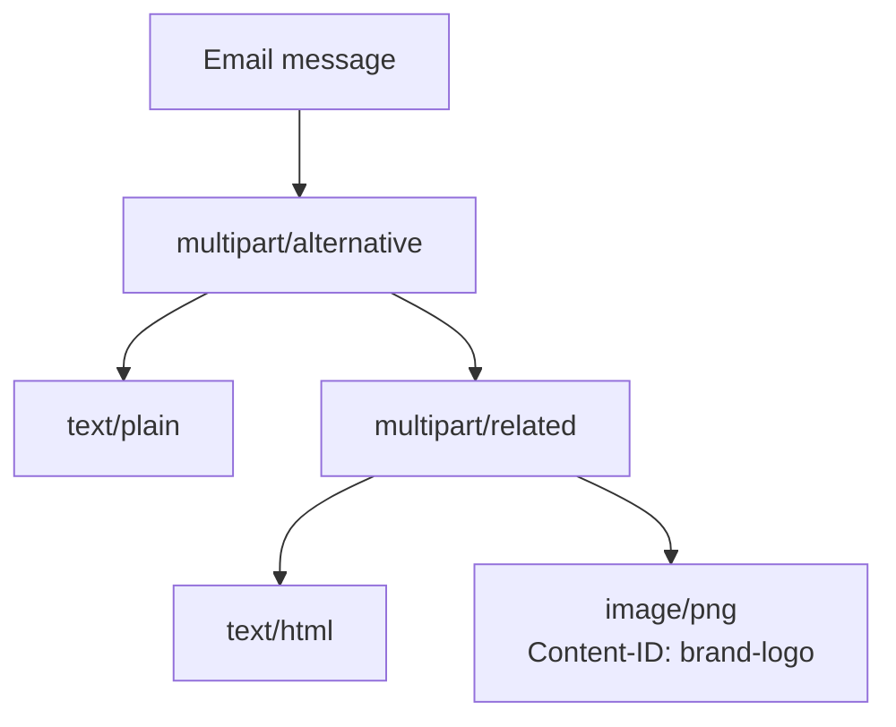
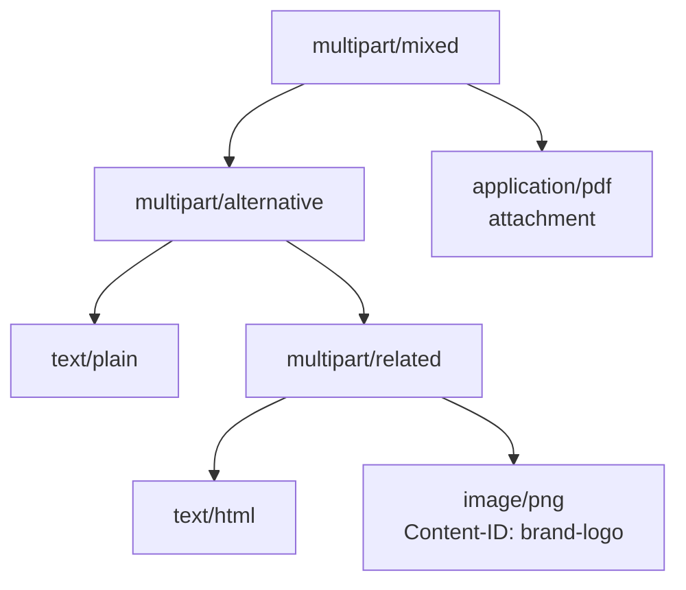
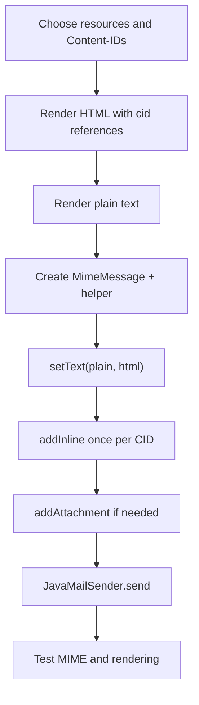

# Using One Resource in Multiple Positions in HTML

HTML emails often use the same image in multiple places: a logo in the email header, a smaller logo in the footer, an icon next to a reminder, or a brand graphic appearing in both the introduction and the signature. When an image is embedded directly into the email with Spring Framework Mail, you can **attach a single inline resource and reference it multiple times in the HTML via the same Content-ID**.

What matters is distinguishing **one MIME resource** from **multiple display locations in HTML**. A single MIME body part with a Content-ID can be referenced by multiple HTML tags via a `cid:...` URI. You do not need to create a separate MIME attachment for each `img` tag. In fact, calling `MimeMessageHelper.addInline(...)` multiple times with the same Content-ID can create parts with duplicate identifiers, causing email clients to pick unpredictably or render inconsistently.

This lesson explains inline resources, Content-ID, referencing the same image in multiple positions, MIME message construction order, choosing re-readable `Resource` types, HTML email structure, handling multiple images, testing, and common mistakes. Examples use Spring Framework Mail 6.x, Spring Boot 3.x, Java 21, and Jakarta Mail.

## 1. What is an inline resource?

An inline resource is content included inside a MIME message and linked to the HTML part via a Content-ID identifier. For images, HTML typically references the resource using a URI:

```html

```

In the MIME message, there is a body part holding the image data and headers similar to:

```text
Content-Type: image/png
Content-Transfer-Encoding: base64
Content-ID: <brand-logo>
Content-Disposition: inline

...encoded image bytes...
```

Content-ID connects two pieces:

- The MIME part containing the image data and the `Content-ID` header.
- The HTML body containing one or more `cid:brand-logo` URIs.

The mail client reads the MIME message, finds the part with the matching Content-ID, and renders the image content wherever the HTML requests it. Because the image is sent inside the email, the client does not need to download the file from an external web URL to obtain that content.

### 1.1. One MIME part can be referenced multiple times

HTML example:

```html
<header>
    
</header>

<main>
    <h1>Service notification</h1>
    <p>Main content of the email.</p>
    <p>
        You can recognize this notification by our
        
        mark.
    </p>
</main>

<footer>
    
</footer>
```

All three `img` tags reference `cid:brand-logo`. They all use **the exact same MIME part**, so you only need to register the resource once:

```java
helper.addInline(
        "brand-logo",
        new ClassPathResource("mail/images/brand-logo.png"),
        "image/png");
```

This is the core point of this lesson: **the number of times a CID URI appears in HTML does not determine the number of `addInline()` calls**. One Content-ID identifies one part; multiple HTML elements can point to that same part.

### 1.2. Inline resources vs. downloadable attachments

| Characteristic | Inline resource | Regular attachment |
|---|---|---|
| Purpose | Displayed inside HTML content | For the recipient to open or download as a file |
| Linkage | Referenced by HTML via `cid:` | Usually appears in the attachment list |
| Helper API | `addInline(contentId, resource, contentType)` | `addAttachment(filename, resource, contentType)` |
| MIME disposition | Typically `inline` | Typically `attachment` |
| Examples | Logo, icon, illustration | PDF, CSV, document |

Calling `addInline()` does not guarantee the mail client will display the image. Clients may block images per their own policies or lack support for certain formats. Provide appropriate fallback content via the `alt` attribute and keep essential information in text.

## 2. Content-ID and the cid: URI

Content-ID is the identifier of a MIME body part. In MIME headers, the value is typically enclosed in angle brackets:

```text
Content-ID: <brand-logo>
```

In HTML, the URI uses the `cid:` prefix and the identifier:

```html

```

With Spring's `MimeMessageHelper` API, pass the Content-ID as the identifier:

```java
helper.addInline("brand-logo", resource, "image/png");
```

Do not include the `cid:` prefix in the first argument, because `cid:` belongs to the HTML URI. Also do not manually add angle brackets to the string passed to the helper; the helper is responsible for formatting the Content-ID header per MIME conventions.

### 2.1. Content-ID must be unique within a message

Each inline MIME body part needs its own Content-ID. Example:

| Resource | Content-ID | HTML reference |
|---|---|---|
| Brand logo | `brand-logo` | `cid:brand-logo` |
| Calendar icon | `calendar-icon` | `cid:calendar-icon` |
| Product photo | `product-image-42` | `cid:product-image-42` |

Never use the same Content-ID for two different images in the same message. If two parts share a duplicate identifier, the client may pick the first part, the last part, or handle it its own way; the outcome becomes indeterminate.

If the same image appears in multiple positions, use **one Content-ID and one part**. If two images are different, assign two different Content-IDs.

### 2.2. Scope of Content-ID

Content-ID is used to link parts within a message. Two independent emails can both use `brand-logo`; that identifier does not need to be globally unique across the entire mail system. However, within each message, parts should have non-overlapping Content-IDs.

You can use readable IDs such as `brand-logo`, or create namespaced IDs to prevent collisions when templates have many components:

```text
mail-header-logo
mail-footer-logo
invoice-company-mark
notification-calendar-icon
```

Do not construct Content-IDs from arbitrary user input. Use constants or application-controlled values to avoid invalid characters, collisions, and hard-to-trace issues.

## 3. Using MimeMessageHelper to register a resource once

Example of sending an HTML email with a logo in both the header and footer:

```java
package com.example.mail;

import jakarta.mail.MessagingException;
import jakarta.mail.internet.MimeMessage;

import org.springframework.core.io.ClassPathResource;
import org.springframework.mail.javamail.JavaMailSender;
import org.springframework.mail.javamail.MimeMessageHelper;
import org.springframework.stereotype.Service;

@Service
public class BrandedMailService {

    private static final String LOGO_CID = "brand-logo";

    private final JavaMailSender mailSender;

    public BrandedMailService(JavaMailSender mailSender) {
        this.mailSender = mailSender;
    }

    public void sendWelcome(String recipient)
            throws MessagingException {

        MimeMessage message = mailSender.createMimeMessage();
        MimeMessageHelper helper =
                new MimeMessageHelper(message, true, "UTF-8");

        helper.setFrom("hello@example.test");
        helper.setTo(recipient);
        helper.setSubject("Welcome");

        String plainText = """
                Welcome to our service.

                You can open your account to view more details.
                """;

        String html = """
                <!doctype html>
                <html lang="en">
                <body>
                  <header>
                    
                  </header>
                  <main>
                    <h1>Welcome</h1>
                    <p>Thank you for using our service.</p>
                  </main>
                  <footer>
                    <p>Best regards, Support Team</p>
                    
                  </footer>
                </body>
                </html>
                """;

        // Set the body before adding inline resources.
        helper.setText(plainText, html);

        // One MIME part is created for both positions in the HTML.
        helper.addInline(
                LOGO_CID,
                new ClassPathResource("mail/images/brand-logo.png"),
                "image/png");

        mailSender.send(message);
    }
}
```

Place the image file at:

```text
src/main/resources/
└── mail/
    └── images/
        └── brand-logo.png
```

In the code:

1. `MimeMessageHelper(message, true, "UTF-8")` creates a multipart helper.
2. `setText(plainText, html)` sets the plain-text and HTML content.
3. The HTML references `cid:brand-logo` in two places.
4. `addInline("brand-logo", ...)` registers a single inline part.
5. `mailSender.send(message)` hands the message off to the transport.

**Call order matters:** call `setText(...)` before `addInline(...)` calls. Spring's `MimeMessageHelper` documentation requires adding inline elements after setting the text, because setting text can create or alter the multipart structure managed by the helper. Adding inline parts first and calling `setText(...)` afterward can break the linkage or produce an unintended MIME structure.

## 4. Why not call addInline multiple times with the same Content-ID?

Anti-pattern to avoid:

```java
// Do not register the same ID multiple times in the same message.
helper.setText(plainText, html);

helper.addInline(
        "brand-logo",
        new ClassPathResource("mail/images/brand-logo.png"),
        "image/png");

helper.addInline(
        "brand-logo",
        new ClassPathResource("mail/images/brand-logo.png"),
        "image/png");
```

The HTML only needs one `brand-logo` MIME part; calling it twice risks creating two parts carrying the same Content-ID. When a message contains duplicate identifiers, resolving `cid:brand-logo` is no longer unique and may depend on how each mail client handles duplicates.

Instead:

```java
helper.setText(plainText, html);

helper.addInline(
        "brand-logo",
        new ClassPathResource("mail/images/brand-logo.png"),
        "image/png");
```

In HTML, reference it as many times as your layout needs:

```html

...

...

```

If you genuinely want two different images, register two parts and use two distinct IDs:

```java
helper.addInline(
        "header-logo",
        new ClassPathResource("mail/images/header-logo.png"),
        "image/png");

helper.addInline(
        "footer-mark",
        new ClassPathResource("mail/images/footer-mark.png"),
        "image/png");
```

HTML:

```html

...

```

The rule is **one ID per MIME part**, while one MIME part may be referenced multiple times.

## 5. MIME structure of inline resources

When a message has HTML and inline images, the images are related to the HTML body. MIME typically represents this relationship using `multipart/related`. If the message also has a plain-text version, an alternative structure wraps the corresponding representations. If there are regular attachments, an outer `multipart/mixed` layer may wrap everything.

Conceptual model:



If there is a PDF file:



These diagrams explain MIME relationships, not a guarantee that every implementation produces the exact same part tree or header order. Spring's `MimeMessageHelper` manages the MIME structure for the operations invoked. You do not need to assemble boundaries or write Content-ID headers manually.

### 5.1. Inline parts and attachment parts have different roles

An image registered with `addInline(...)` is a resource serving the HTML. A PDF registered with `addAttachment(...)` is a file the recipient can download. Do not use the same Content-ID to represent both, and do not confuse attachment filenames with Content-IDs.

Example:

```java
helper.setText(plainText, html);

helper.addInline(
        "brand-logo",
        new ClassPathResource("mail/images/brand-logo.png"),
        "image/png");

helper.addAttachment(
        "guide.pdf",
        new ClassPathResource("mail/files/guide.pdf"),
        "application/pdf");
```

The HTML references the logo via `cid:brand-logo`. The PDF needs no CID URI if its sole purpose is a downloadable attachment.

## 6. Using the same resource in a Thymeleaf template

With HTML templates, keep the Content-ID in a constant and pass that value into the template context so the CID string in Java and HTML cannot drift apart.

### 6.1. HTML template

File `templates/mail/welcome.html`:

```html
<!doctype html>
<html lang="en" xmlns:th="http://www.thymeleaf.org">
<body>
    <header>
        
    </header>

    <main>
        <h1 th:text="|Hello ${displayName}|">Hello</h1>
        <p>Thank you for registering.</p>
        <p>
            
            This is a notification from our service.
        </p>
    </main>

    <footer>
        
    </footer>
</body>
</html>
```

All three image tags use the same `logoCid` variable. Thymeleaf renders `cid:brand-logo` in all three places.

### 6.2. Renderer and composer

```java
private static final String LOGO_CID = "brand-logo";

public void sendWelcome(String recipient, String displayName)
        throws MessagingException {

    Context context = new Context(Locale.forLanguageTag("vi-VN"));
    context.setVariable("displayName", displayName);
    context.setVariable("logoCid", LOGO_CID);

    String html = templateEngine.process("mail/welcome", context);
    String plainText = "Thank you for registering.";

    MimeMessage message = mailSender.createMimeMessage();
    MimeMessageHelper helper =
            new MimeMessageHelper(message, true, "UTF-8");

    helper.setFrom("hello@example.test");
    helper.setTo(recipient);
    helper.setSubject("Welcome");
    helper.setText(plainText, html);

    // Register once even though the template references the logo multiple times.
    helper.addInline(
            LOGO_CID,
            new ClassPathResource("mail/images/brand-logo.png"),
            "image/png");

    mailSender.send(message);
}
```

`templateEngine` is a template engine configured in the application, such as Thymeleaf. `Context` receives only the variables the template needs. Do not pass an entire user entity into the template just to display a name.

Benefits of sharing a constant:

- Java registers the exact Content-ID referenced by the HTML.
- When changing the ID, only one constant and the context variable need updating.
- Tests can verify that the rendered ID and the registered ID match.
- The template never has to assemble an arbitrary ID from recipient data.

## 7. Choosing a Resource for inline images

An inline resource must remain readable when Jakarta Mail serializes the message. Choose a Resource type matching the data source and re-readability requirements.

| Resource | Best suited when | Notes |
|---|---|---|
| `ClassPathResource` | Static logo/icon packaged with the app | Easy to use, independent of requests |
| `ByteArrayResource` | Small image generated or loaded into memory | Bound size and concurrency |
| `FileSystemResource` | Image stored on disk | File must exist and stay unchanged during send |
| Custom `InputStreamSource` | Image fetched from storage/service | Each call must open a fresh stream |
| `InputStreamResource` | Single-read stream source | Often unsuitable because stream may be opened/read and cannot replay |

### 7.1. ClassPathResource for shared logos

```java
Resource logo = new ClassPathResource("mail/images/brand-logo.png");

helper.addInline("brand-logo", logo, "image/png");
```

The resource lives on the classpath and can be reopened as needed. This is a convenient choice for fixed application logos, icons, and brand imagery.

Paths in `ClassPathResource` are typically relative to the classpath root. With the layout:

```text
src/main/resources/mail/images/brand-logo.png
```

the resource name is:

```text
mail/images/brand-logo.png
```

Do not pass an absolute path from a developer machine; when packaged into a JAR, that path will not exist on the server.

### 7.2. ByteArrayResource for dynamically generated images

```java
byte[] pngBytes = chartRenderer.renderPng(chartId);

if (pngBytes.length > MAX_INLINE_IMAGE_BYTES) {
    throw new IllegalArgumentException("Inline image is too large");
}

helper.addInline(
        "chart-preview",
        new ByteArrayResource(pngBytes),
        "image/png");
```

`chartRenderer` and `MAX_INLINE_IMAGE_BYTES` are application-defined components/settings. `ByteArrayResource` can supply a fresh stream from the byte array, making it suitable when the same image is read during MIME serialization. However, the byte array still occupies heap memory for as long as the message holds a reference to it.

### 7.3. FileSystemResource for images stored on disk

```java
Path imagePath = imageStorage.pathFor(imageId);
Resource logo = new FileSystemResource(imagePath);

helper.addInline("product-preview", logo, "image/png");
```

The file must remain present until sending finishes. If sent through a worker or retried, the file must be kept until no job needs it anymore. Do not delete the file right after `addInline()` because the content may only be read when `send()` serializes the message.

### 7.4. Custom sources must open a fresh stream

If the image comes from object storage, you can use:

```java
InputStreamSource source =
        () -> objectStore.openReadStream(objectKey);

helper.addInline("brand-logo", source, "image/png");
```

`objectStore.openReadStream(objectKey)` is an illustrative application API. Every call must return a fresh stream from the beginning, and closing the stream must release the underlying response/connection. Never return the same already-opened stream.

## 8. Using the same image across multiple emails

A single resource can be used across multiple messages, but each message needs its own MIME part.

Example:

```java
private final Resource brandLogo =
        new ClassPathResource("mail/images/brand-logo.png");

public MimeMessage createMessage(String recipient)
        throws MessagingException {

    MimeMessage message = mailSender.createMimeMessage();
    MimeMessageHelper helper =
            new MimeMessageHelper(message, true, "UTF-8");

    helper.setTo(recipient);
    helper.setSubject("Notification");
    helper.setText("Plain text content.", """
            <html><body>
              
            </body></html>
            """);
    helper.addInline("brand-logo", brandLogo, "image/png");
    return message;
}
```

Here, the same `ClassPathResource` object can be used to create inline parts for multiple messages because it represents a re-openable source. Each message still calls `addInline(...)` once to get its own MIME part.

**Never share a single `InputStream` across multiple messages.** If a resource is built from an already-opened stream, the first message may consume or close the stream, causing subsequent messages to fail. Share a Resource capable of opening independent streams, not an active read session.

### 8.1. Difference between reusing a Resource and reusing a MIME part

| Reuse pattern | Recommended? | Why |
|---|---|---|
| One `ClassPathResource` used to build parts in multiple emails | Yes | Each message gets its own part; resource can reopen |
| One `ByteArrayResource` used across multiple messages | Yes, if size is bounded | Each read creates a fresh stream from the byte array |
| One `InputStream` shared across multiple messages | No | Streams are stateful and can be exhausted or closed |
| One Content-ID registered twice in the same message | Avoid | Multiple parts compete for the same identifier |
| One Content-ID used in two independent messages | Yes | IDs are scoped to each individual message |
| One CID referenced by multiple `img` tags in the same HTML | Yes | Multiple places point to the same MIME part |

## 9. Multiple positions and multiple resources in one template

A template can contain several different images and repeat each of them:

```html
<header>
    
</header>

<section>
    
    <p>The new schedule has been updated.</p>

    
    <h2>Spring Framework Mail</h2>
</section>

<footer>
    
    
</footer>
```

Only three MIME parts are needed:

```java
helper.addInline(
        "company-logo",
        new ClassPathResource("mail/images/company-logo.png"),
        "image/png");

helper.addInline(
        "calendar-icon",
        new ClassPathResource("mail/images/calendar.png"),
        "image/png");

helper.addInline(
        "course-thumbnail",
        new ClassPathResource("mail/images/course.png"),
        "image/png");
```

The logo and calendar icon are referenced twice each but registered only once per resource. The thumbnail appears once and likewise has one part.

Manage IDs in a group of constants or template metadata so you never have to hunt for scattered CID strings:

```java
public final class MailContentIds {
    public static final String COMPANY_LOGO = "company-logo";
    public static final String CALENDAR_ICON = "calendar-icon";
    public static final String COURSE_THUMBNAIL = "course-thumbnail";

    private MailContentIds() {}
}
```

Constants reduce typos. When templates change, tests can assert that every referenced CID has a matching part.

## 10. Order of setText and addInline

A common mistake is adding inline resources before setting the HTML:

```java
// Do not use this order.
helper.addInline("brand-logo", logo, "image/png");
helper.setText(plainText, html);
```

According to Spring `MimeMessageHelper` guidance, inline elements must be added **after setting the text**. Calling `setText(...)` can create the MIME body structure; if inline is called first, setting the body may replace the related multipart section.

Recommended order:

```java
helper.setText(plainText, html);
helper.addInline("brand-logo", logo, "image/png");
helper.addInline("calendar-icon", calendarIcon, "image/png");
mailSender.send(message);
```

This order applies to both messages with one inline resource and messages with multiple inline resources. After setting text, register each Content-ID once and then send.

## 11. HTML emails must reference CIDs properly

### 11.1. Use the cid URI in the src attribute

Example:

```html

```

Do not write:

```html

```

or:

```html
" alt="Brand logo">
```

In HTML, use `cid:` and the identifier without angle brackets. Angle brackets belong to the MIME Content-ID header representation, not part of the URI in the example.

### 11.2. Always include alt text

Some mail clients may not display inline images due to privacy settings, text mode, or format limits. Every image should have an `alt` attribute describing its purpose:

```html

```

If an image is purely decorative, you can use `alt=""` so screen readers skip it. Never put critical information inside images alone; main content must have corresponding text.

### 11.3. Dimensions and layout

If the same image is shown at multiple sizes, you can reuse the same CID while setting distinct size attributes on each tag:

```html


```

Mail clients can handle CSS and dimension attributes differently. Prepare images at reasonable dimensions and avoid embedding huge images only to ask clients to scale them down drastically. If different quality or aspect ratios are required, choose two separate resources with different Content-IDs.

### 11.4. Avoid relying on background images for primary content

Some email clients support `background-image` or CSS backgrounds inconsistently. If an image is important, use an `img` tag with CID and alt text. Backgrounds should only be decorative and must have fallback colors/content.

## 12. Combining inline resources with plain text and attachments

An email can contain:

- Subject.
- Plain-text body.
- HTML body with inline logo/images.
- PDF attachment.

Example:

```java
MimeMessage message = mailSender.createMimeMessage();
MimeMessageHelper helper =
        new MimeMessageHelper(message, true, "UTF-8");

helper.setFrom("notifications@example.test");
helper.setTo(recipient);
helper.setSubject("Your invoice is ready");

String plainText = """
        Your invoice is ready.
        The PDF file is attached to this email.
        """;

String html = """
        <html><body>
          
          <h1>Your invoice is ready</h1>
          <p>The PDF file is attached to this email.</p>
          
        </body></html>
        """;

helper.setText(plainText, html);

helper.addInline(
        "company-logo",
        new ClassPathResource("mail/images/company-logo.png"),
        "image/png");

helper.addAttachment(
        "invoice.pdf",
        new ClassPathResource("mail/files/invoice-sample.pdf"),
        "application/pdf");

mailSender.send(message);
```

The logo is registered once and referenced twice in HTML. The PDF is a separate attachment. There is no need to create two inline parts just because the logo appears at the top and bottom of the body.

## 13. Size, performance, and resource count

An inline image can be referenced multiple times without duplicating MIME parts, but that does not make image data free:

- Image bytes are still transmitted with every email.
- Content may be Base64-encoded, increasing MIME size.
- Mail servers and mailboxes enforce message size limits.
- Many concurrent emails can increase memory and I/O usage.
- Very large images slow down downloads and hurt readability on mobile devices.

If the same logo appears in three places, one part avoids the duplicate bytes of registering three separate parts. Yet when every email embeds a logo, each message still carries its own logo bytes. Do not expect independent messages to share a MIME part at the mailbox layer.

Best practices:

1. Compress images and choose suitable formats.
2. Enforce file size limits before sending.
3. Size images for their actual display dimensions.
4. Reuse one part when the same image appears in multiple locations in the same message.
5. Embed only necessary images; consider controlled HTTPS URLs for non-critical assets if your product accepts remote image-loading behavior.
6. Check total MIME size, not just raw source file size.

## 14. Security and resource access control

Inline resources are still outbound data. Before embedding, verify whether the recipient is authorized to view that image.

- Never take an arbitrary file path from a request and pass it straight into `FileSystemResource`.
- Use resources from controlled directories or managed storage.
- Verify actual content types; never trust user-supplied file extensions blindly.
- Limit inline image size and count.
- Never embed screenshots containing personal data without a clear purpose.
- Never log full image bytes, Base64 payloads, or raw MIME.
- With object storage, grant only necessary read permissions and ensure internal URLs/keys are not exposed in HTML needlessly.
- Never use CID as an access-control mechanism; Content-ID is only a linking identifier inside a MIME message.

If an image contains sensitive data, apply policies similar to attachments: verify the recipient, minimize data, limit retention, and avoid leaking copies into logs or debug dumps.

## 15. Testing a resource referenced multiple times

Tests should assert two independent facts:

1. The HTML contains multiple occurrences of the required CID URI.
2. The MIME message has **only one part** with the matching Content-ID.

Do not simply count `img` tags and conclude the resource was registered properly. Conversely, do not simply see one MIME part without checking whether HTML references the right ID.

### 15.1. Checking rendered HTML

If the template uses Thymeleaf, renderer tests can assert:

```java
assertEquals(3, countOccurrences(html, "cid:brand-logo"));
```

`countOccurrences(...)` is a test-defined helper. This assertion checks only the HTML; it does not prove the MIME part was attached.

### 15.2. Checking Content-ID in MIME

You can serialize the message in memory in a test:

```java
ByteArrayOutputStream output = new ByteArrayOutputStream();
message.saveChanges();
message.writeTo(output);

String rawMime = output.toString(StandardCharsets.UTF_8);
```

Raw MIME is useful for investigation, though tests should not hard-code dependencies on boundaries, line folding, or part ordering. A more reliable way is to parse the MIME tree, collect Content-ID headers, and count the target identifier.

Example part-traversal function:

```java
static void collectContentIds(
        Part part, List<String> contentIds) throws Exception {

    String[] values = part.getHeader("Content-ID");
    if (values != null) {
        contentIds.addAll(Arrays.asList(values));
    }

    Object content = part.getContent();
    if (content instanceof Multipart multipart) {
        for (int i = 0; i < multipart.getCount(); i++) {
            collectContentIds(multipart.getBodyPart(i), contentIds);
        }
    }
}
```

Required imports include `jakarta.mail.Part`, `jakarta.mail.Multipart`, and Java collection classes. The function traverses recursively because inline parts can live inside nested multiparts. In tests, normalize angle brackets if needed and verify there is only one `brand-logo` Content-ID.

### 15.3. Checking HTML and MIME part data

An integrated test should:

- Render HTML with three tags referencing `cid:brand-logo`.
- Build the message with `MimeMessageHelper`.
- Call `setText(plainText, html)` before `addInline(...)`.
- Call `addInline("brand-logo", ...)` only once.
- Parse the message and confirm exactly one part has the matching Content-ID.
- Confirm the part has MIME type `image/png`.
- Read the part data and compare it against the test image bytes.

Do not compare entire raw MIME byte-for-byte because Jakarta Mail may choose different boundaries and Content-Transfer-Encoding values.

### 15.4. Testing through a mock SMTP server

You can use Mailpit or an SMTP test server:

```bash
docker run --rm --name mailpit -p 1025:1025 -p 8025:8025 axllent/mailpit
```

Send a test email and open it in the Mailpit UI. Verify:

1. The logo appears in every referenced location.
2. No icons or images are missing.
3. Plain text still holds complete content when HTML is not used.
4. Any PDF attachment still appears separately if the message includes a file.
5. No unregistered CIDs exist.

A mock SMTP server confirms message generation and delivery in a test environment; it does not guarantee every production mail client renders identically. For critical templates, preview on target clients.

## 16. Common mistakes

**Calling `addInline()` multiple times with the same Content-ID.** Can create multiple parts with duplicate identifiers. Register once and reference the CID multiple times in HTML.

**Using different CIDs in HTML and Java.** HTML points to a nonexistent part. Use constants and pass the ID into the template context.

**Putting the `cid:` prefix in the Content-ID argument.** The API takes the identifier, while `cid:` belongs to the URI in HTML.

**Putting angle brackets in HTML.** MIME headers may use `<...>`, but HTML URIs typically use `cid:identifier`.

**Calling addInline before setText.** The body structure may be altered when the helper sets the text. Set text first, inline after.

**Using an already-opened InputStream.** The source may be drained or closed during MIME serialization. Use a Resource/source that can open fresh streams.

**Deleting the file immediately after addInline.** The content may not have been read yet. Keep the source until synchronous send finishes or async/retry jobs complete.

**Using the wrong MIME type.** Declaring `image/png` for JPEG bytes or vice versa can cause clients to mis-handle it. Declare the content type matching actual data.

**Missing alt text.** Recipients in text mode or clients blocking images will lack a description. Add suitable alt text and keep primary content as text.

**Embedding oversized images.** Makes messages heavy, slow, and prone to exceeding provider limits. Resize/compress and enforce limits.

**Using uncontrolled remote paths or URLs.** May leak information or send unauthorized data. Use application-verified resources.

## 17. Workflow for designing templates with inline resources

When building an email that uses a logo in multiple positions, follow this sequence:

1. Identify which images truly need to be embedded.
2. Assign a stable Content-ID to each distinct resource.
3. Place `cid:` URIs at the desired display positions in the HTML.
4. Render HTML and plain text from authorized data.
5. Create `MimeMessageHelper` with appropriate multipart mode and charset.
6. Call `setText(plainText, htmlText)`.
7. Call `addInline(...)` exactly once per Content-ID.
8. Call `addAttachment(...)` separately for downloadable files if needed.
9. Call `JavaMailSender.send(...)`.
10. Test both HTML references and MIME Content-IDs, then preview on target clients.

Diagram:



## 18. Practice exercises

### Part A — Using one logo in three positions

Create a welcome email with a logo in the header, inside the body, and in the footer. All three image tags use `cid:brand-logo`. Call `addInline("brand-logo", ...)` exactly once. Verify the message has only one matching MIME part.

### Part B — Adding a second image

Add a calendar icon in two places. Register `calendar-icon` once and reference it twice. Ensure `brand-logo` and `calendar-icon` have distinct Content-IDs.

### Part C — Separating HTML and plain text

Use `MimeMessageHelper.setText(plainText, htmlText)`. Confirm plain text is complete even when images do not display. Do not use tag-stripped HTML as a substitute for a plain-text template.

### Part D — Testing helper call order

Try calling `addInline()` before `setText()` in a separate test to observe the message structure, then switch to the recommended order. Keep tests asserting MIME parts and CIDs rather than relying on raw boundaries.

### Part E — Switching Resource types

Try `ClassPathResource`, `ByteArrayResource`, and `FileSystemResource`. Verify resources remain readable during serialization, MIME types are accurate, and files are not deleted before sending.

### Part F — Adding a downloadable attachment

Add a PDF via `addAttachment(...)`. Confirm the inline logo renders inside the HTML, the PDF appears as a separate attachment, and CIDs do not collide.

### Part G — Testing content

Use a small test image and verify that HTML has multiple references, MIME has exactly one part per Content-ID, alt text is appropriate, and no sensitive data appears in filenames or logs.

## 19. Principles to remember

An inline resource is identified by a Content-ID in MIME. HTML references it via a `cid:` URI. **A single MIME part can serve multiple positions in the same HTML body**, so if a logo appears at the top, middle, and bottom of an email, only one `addInline(...)` call is needed for that logo.

Within a message, each distinct resource needs its own Content-ID, and each Content-ID should belong to only one MIME part. Use Resources capable of opening fresh streams, call `setText(plainText, htmlText)` before `addInline(...)`, keep the source readable until send completes, and verify both MIME and HTML.

Spring's `MimeMessageHelper` manages creating MIME parts and linking inline resources. It does not automatically detect `cid:` URIs in HTML to create parts, does not merge duplicate ID registrations, and does not verify whether image content is appropriate for the recipient. The application must keep Content-IDs consistent, register each resource once, and validate data before sending.
