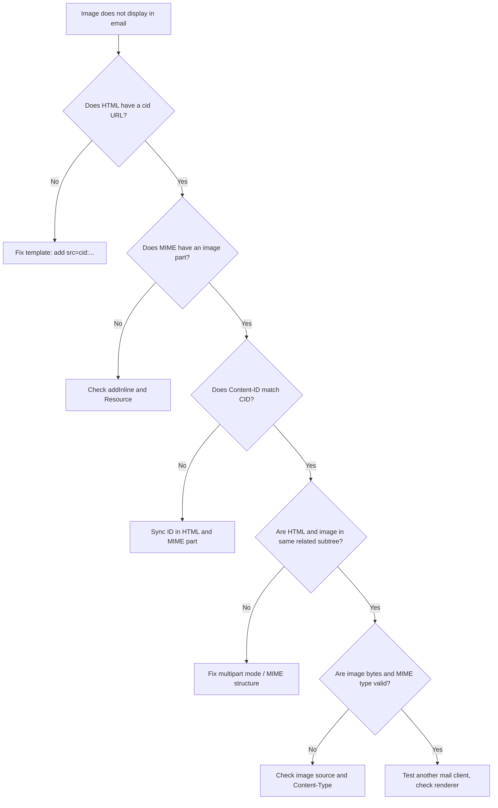

# Inspecting multipart/related and cid Links

When an HTML email needs to display a logo, product photo, or illustration directly inside its body, a Spring Framework Mail application can attach the image as an **inline MIME part** and reference that part using a `cid:...` URL in the HTML. This approach only works properly when the MIME structure expresses the relationship between the HTML part and the image resource. Therefore, inspecting an email with inline images is not just checking whether an image file is present in the message; you must verify that **`multipart/related` is created properly, `Content-ID` matches `cid:`, and both parts reside in the same related subtree**.

`MimeMessageHelper` supports this via `addInline(...)`. However, mail clients may render differently, image sources may become unreadable during serialization, or HTML may reference the wrong ID. This lesson walks through understanding the MIME tree, creating CID links, inspecting raw messages, automated testing, and troubleshooting common errors.

## 1. How do inline images in email differ from attachments?

There are three common ways to include images in HTML emails:

| Approach | HTML reference | Where is the image stored? | Characteristics |
|---|---|---|---|
| Inline image via CID | `` | A MIME part inside the same email | No need to fetch image from a website; requires matching Content-ID. |
| Image from an external URL | `` | Web server/CDN | Clients may block remote images or prompt user permission. |
| Data URI/base64 in HTML | `` | Data embedded directly in HTML | Support across mail clients is inconsistent. |

**Inline CID** fits when an image must travel with the email and be referenced directly by HTML. The image does not need to be publicly hosted on a web server, though message size increases due to the image payload and MIME encoding.

A regular attachment serves a different purpose: the recipient downloads or opens the file separately. If you add an image with `addAttachment(...)`, mail clients usually present it as a file attachment; HTML has no automatic relationship to display that image inside the body.

Example:

```html
<!-- References an inline MIME part -->


<!-- References an image from a web server -->


<!-- This is an external relative image URL, not a CID -->

```

A relative path like `logo.png` does not automatically point to a file on the application's classpath. The recipient's mail client has no access to the mail-sending server's filesystem.

## 2. What relationship does multipart/related represent?

`multipart/related` is a multipart type used to group a root content part with the related resources needed to render it. The most common case is HTML and one or more images referenced by the HTML via CID.

Conceptual structure:

```text
MimeMessage
└── multipart/related
    ├── text/html
    │   └── 
    └── image/png
        ├── Content-ID: <brand-logo>
        └── Content-Disposition: inline
```

HTML contains the URL `cid:brand-logo`. The image MIME part carries header `Content-ID: <brand-logo>`. The relationship between the two parts is expressed by placing them together inside `multipart/related`.

If the message also has a PDF attachment, the structure may be:

```text
MimeMessage
└── multipart/mixed
    ├── multipart/related
    │   ├── text/html
    │   └── image/png; Content-ID: <brand-logo>
    └── application/pdf; attachment
```

Here, `multipart/related` groups the HTML and inline image; the outermost `multipart/mixed` groups the body section with the standalone PDF file. The PDF does not need to be referenced from HTML via CID.

That is why Spring provides `MULTIPART_MODE_RELATED` and `MULTIPART_MODE_MIXED_RELATED`. The second mode is useful when an email has both inline resources and standalone attachments.

### The root part of multipart/related

According to MIME rules, the *root body part* of `multipart/related` is typically the first part unless a `start` parameter is specified. For HTML emails, the first part is typically `text/html`. Subsequent parts supply resources such as images.

Example:

```text
Content-Type: multipart/related; boundary="rel-123"

--rel-123
Content-Type: text/html; charset=UTF-8

<p>Hello</p>


--rel-123
Content-Type: image/png
Content-ID: <brand-logo>
Content-Disposition: inline

[image bytes]
--rel-123--
```

When inspecting raw MIME, check whether the HTML lives inside the related subtree and whether the image part lives in that same subtree. Simply seeing both parts present somewhere in the message is not enough to confirm a valid related structure.

## 3. Content-ID and cid URL must match

`Content-ID` is the header identifying a MIME part. In message source, it typically looks like:

```text
Content-ID: <brand-logo>
```

HTML references the part with a URL:

```html

```

The two representations differ syntactically:

- MIME headers typically enclose the value in angle brackets: `<brand-logo>`.
- HTML URLs start with `cid:` and use the ID without angle brackets: `cid:brand-logo`.

Do not write:

```html
" alt="Logo">
```

Angle brackets belong to Content-ID header syntax, not to the identifier inside a CID URL.

### Choosing stable and unique Content-IDs

An ID should contain no spaces, use simple URL-friendly characters, not collide with any other inline part's ID in the same message, and be created once and reused for both HTML rendering and calling `addInline(...)`.

You can generate a per-message ID using a UUID:

```java
String logoContentId = "logo-" + UUID.randomUUID();
```

Then use that exact variable in both HTML and the MIME part. Avoid writing two separate string literals in two places, as one side might be updated while the other is forgotten.

For IDs with special characters, CID URL syntax has percent-encoding rules. To reduce bugs and maximize compatibility, use simple tokens made of ASCII letters, digits, and hyphens, such as `logo-7f3a92`.

### Never use one ID for multiple different images

If an email has a logo and a banner image, generate two IDs:

```java
String logoCid = "logo-" + UUID.randomUUID();
String bannerCid = "banner-" + UUID.randomUUID();
```

HTML:

```html


```

Each part has a corresponding Content-ID. If two parts share the same ID, mail clients may reference the wrong part or behave depending on how they resolve duplicate IDs.

## 4. Creating inline resources with MimeMessageHelper

In Spring, the standard API is `MimeMessageHelper.addInline(...)`. Minimal example:

```java
import jakarta.mail.internet.MimeMessage;
import java.util.UUID;
import org.springframework.core.io.ClassPathResource;
import org.springframework.mail.javamail.MimeMessageHelper;

MimeMessage message = mailSender.createMimeMessage();

MimeMessageHelper helper = new MimeMessageHelper(
        message,
        MimeMessageHelper.MULTIPART_MODE_RELATED,
        "UTF-8"
);

String logoCid = "logo-" + UUID.randomUUID();

helper.setFrom("news@example.org");
helper.setTo("user@example.net");
helper.setSubject("New announcement");

String html = """
        <html>
          <body>
            <h1>Hello!</h1>
            <p>This email includes an inline logo.</p>
            
          </body>
        </html>
        """.formatted(logoCid);

helper.setText(html, true);

helper.addInline(
        logoCid,
        new ClassPathResource("mail/brand-logo.png"),
        "image/png"
);

mailSender.send(message);
```

Key points:

1. Create a new `MimeMessage` for each email.
2. Select the appropriate multipart mode.
3. Generate a Content-ID and insert it into HTML as `cid:...`.
4. Call `setText(...)` to set the HTML body.
5. Call `addInline(...)` with the same ID and image source.
6. Send with `JavaMailSender`.

### Why call setText before addInline?

When using `MimeMessageHelper`, call `setText(...)` before `addInline(...)`. Spring documentation warns that some mail clients may fail to recognize inline resources properly if images are added before the text/HTML body has been set.

Order to follow:

```java
helper.setText(html, true);
helper.addInline(logoCid, logoResource, "image/png");
```

Do not reverse the order of these two calls. When troubleshooting missing images, check API call order alongside the MIME tree and CIDs.

### Using multiple inline resources

`MimeMessageHelper` can add multiple resources:

```java
helper.setText(html, true);

helper.addInline(
        logoCid,
        new ClassPathResource("mail/logo.png"),
        "image/png"
);

helper.addInline(
        bannerCid,
        new ClassPathResource("mail/banner.jpg"),
        "image/jpeg"
);
```

Each call needs a distinct Content-ID and HTML must reference the matching ID. The MIME type should match the actual bytes of the file; never declare PNG for JPEG content or vice versa.

## 5. Choosing the right multipart mode

`MimeMessageHelper` provides these modes:

| Mode | Structure at helper level | When to use |
|---|---|---|
| `MULTIPART_MODE_NO` | Non-multipart | Single-body email without inline resources or attachments via helper. |
| `MULTIPART_MODE_MIXED` | `multipart/mixed` | Body and attachments; inline resources may not be grouped in a dedicated related branch. |
| `MULTIPART_MODE_RELATED` | `multipart/related` | Body and inline images/related resources, with no standalone attachments. |
| `MULTIPART_MODE_MIXED_RELATED` | Outer `multipart/mixed`, inner `multipart/related` | Both inline resources and standalone attachments present. |

### Only HTML and an inline logo

You can choose:

```java
new MimeMessageHelper(
        message,
        MimeMessageHelper.MULTIPART_MODE_RELATED,
        "UTF-8"
);
```

Expected structure:

```text
multipart/related
├── text/html
└── image/png; Content-ID: <logo-id>
```

### HTML, inline logo, and PDF attachment

Use:

```java
new MimeMessageHelper(
        message,
        MimeMessageHelper.MULTIPART_MODE_MIXED_RELATED,
        "UTF-8"
);
```

Conceptual structure:

```text
multipart/mixed
├── multipart/related
│   ├── text/html
│   └── image/png; Content-ID: <logo-id>
└── application/pdf; attachment
```

Do not rely only on the boolean constructor when a specific structural requirement needs code-review clarity. Using clearly named constants communicates intent to readers. When attachments are present, inspect raw MIME to verify the attachment sits outside the related subtree.

## 6. Image sources must be readable when the message is serialized

`addInline(...)` accepts a `Resource` or `InputStreamSource` depending on the overload. The helper sets up the part, but source data may only be read when the MIME message is serialized or sent.

Common sources:

```java
new ClassPathResource("mail/logo.png")
new FileSystemResource("/opt/app/mail/logo.png")
new ByteArrayResource(imageBytes)
```

Key principles:

- Classpath files must actually be packaged inside the artifact.
- Filesystem files must exist and be readable in the runtime environment.
- Byte arrays must hold valid image data.
- Custom stream sources should supply a fresh stream for each read if the library needs to re-read.
- Do not close a stream before the library finishes reading.
- Check image sizes and total message size.

Example using `ClassPathResource`:

```java
Resource logo = new ClassPathResource("mail/brand-logo.png");

if (!logo.exists()) {
    throw new IllegalStateException("Missing mail logo resource");
}

helper.addInline(logoCid, logo, "image/png");
```

Checking `exists()` helps catch missing files early. It does not prove the file is a valid PNG; verify source assets and MIME types.

### ByteArrayResource for dynamically generated images

If the image is produced from data or a graphics service:

```java
byte[] pngBytes = chartRenderer.renderPng(chartData);

helper.addInline(
        chartCid,
        new ByteArrayResource(pngBytes),
        "image/png"
);
```

`ByteArrayResource` works well when data is already in memory and needs to be re-readable. For large images, avoid keeping too many byte arrays concurrently; consider size limits or more suitable data sources.

## 7. Inspecting message source after creation

A direct way to inspect is serializing `MimeMessage` to a byte array and examining the raw MIME:

```java
ByteArrayOutputStream output = new ByteArrayOutputStream();
message.writeTo(output);

String rawMessage = output.toString(StandardCharsets.UTF_8);
System.out.println(rawMessage);
```

Raw source lets you inspect the `MIME-Version` header, root `Content-Type`, boundaries, position of `text/html`, the image's `Content-ID`, `Content-Disposition`, and `Content-Type`, CIDs in HTML, and placement of standalone attachments.

Never log full raw emails in production. Content may contain recipient addresses, tokens, personal data, and attachments. Use raw source only in test environments or controlled logs with sensitive data scrubbed.

### Example of valid raw MIME

```text
MIME-Version: 1.0
Content-Type: multipart/related; boundary="rel-123"

--rel-123
Content-Type: text/html; charset=UTF-8
Content-Transfer-Encoding: quoted-printable

<html>
  <body>
    <p>Hello!</p>
    
  </body>
</html>

--rel-123
Content-Type: image/png
Content-Transfer-Encoding: base64
Content-ID: <logo-7f3a92>
Content-Disposition: inline

iVBORw0KGgoAAAANSUhEUg...
--rel-123--
```

This is a condensed example. Real messages may have extra headers, different encodings, and library-generated boundaries. Focus on the relationship between the HTML part and the image part.

## 8. Inspecting the MIME tree with Jakarta Mail

Instead of merely searching strings in raw source, you can traverse message contents after creation or parsing.

Diagnostic utility example:

```java
import jakarta.mail.BodyPart;
import jakarta.mail.MessagingException;
import jakarta.mail.Multipart;
import jakarta.mail.Part;
import java.io.IOException;
import java.util.Arrays;

public final class MimeTreePrinter {

    private MimeTreePrinter() {}

    public static void print(Part part, String indent)
            throws MessagingException, IOException {

        System.out.println(
                indent + "Content-Type: " + part.getContentType()
        );
        System.out.println(
                indent + "Disposition: " + part.getDisposition()
        );
        System.out.println(
                indent + "Filename: " + part.getFileName()
        );
        System.out.println(
                indent + "Content-ID: "
                        + Arrays.toString(part.getHeader("Content-ID"))
        );

        Object content = part.getContent();

        if (content instanceof Multipart multipart) {
            for (int index = 0; index < multipart.getCount(); index++) {
                BodyPart child = multipart.getBodyPart(index);
                print(child, indent + "  ");
            }
        }
    }
}
```

Invoke:

```java
MimeTreePrinter.print(message, "");
```

The output might look like:

```text
Content-Type: multipart/related; boundary="..."
Disposition: null
Filename: null
Content-ID: null
  Content-Type: text/html; charset=UTF-8
  Disposition: null
  Filename: null
  Content-ID: null
  Content-Type: image/png
  Disposition: inline
  Filename: null
  Content-ID: [<logo-7f3a92>]
```

When using `MIXED_RELATED` mode with a PDF, the outermost level may be `multipart/mixed`, containing a `multipart/related` child. Because the utility above traverses recursively, it will still reveal the image part in the nested subtree.

Note: `getContent()` can read part data and throw `IOException` or `MessagingException`. This is a diagnostic tool for dev/test environments; avoid calling it to read entire attachments during production sending unless necessary.

## 9. Checking whether Content-ID matches HTML

A helpful three-step check:

1. Extract the CID URLs referenced in the HTML.
2. Extract the `Content-ID` headers from the image parts.
3. Compare IDs after normalizing header syntax.

Example HTML:

```html


```

Headers:

```text
Content-ID: <logo-7f3a92>
Content-ID: <banner-4b19c0>
```

The two sets of IDs must align. If HTML references `cid:logo` while the part carries `Content-ID: <brand-logo>`, the client has no reason to guess they are the same image.

For CIDs containing special characters, handle percent-encoding per URL rules. In typical applications, simple IDs of letters, digits, and hyphens make matching straightforward.

### Do not check CIDs globally only

If a message has multiple related subtrees, the referenced CID must belong to the same related group as the HTML being rendered. Finding a part with that ID in a completely separate branch of the tree is not enough to guarantee the client can resolve the reference.

Example of a structure that mismatches the intended relationship:

```text
multipart/mixed
├── text/html; body references cid:logo
└── image/png; Content-ID: <logo>
```

Both parts sit inside mixed, yet they are not grouped inside `multipart/related`. Some clients might still display it their own way, but the MIME tree does not clearly express a related-resource relationship.

Expected structure:

```text
multipart/mixed
└── multipart/related
    ├── text/html; body references cid:logo
    └── image/png; Content-ID: <logo>
```

## 10. Integration testing with a mock SMTP server

Inspecting the message before sending is helpful, and integration tests can verify the sender delivered the message to an SMTP test server. You can use Mailpit or GreenMail in test environments.

Workflow:

1. Start the SMTP test server.
2. Configure `JavaMailSender` to point to the test host/port.
3. Call the service that sends the email with inline resources.
4. Retrieve the message received by the test server.
5. Parse the message and traverse the MIME tree.
6. Confirm the HTML part has `cid:...` and the image part has the matching Content-ID.
7. Verify disposition, content type, and inline resource count.
8. If attachments exist, verify attachments reside in the outer mixed branch.

Example raw-source assertion with JUnit/AssertJ:

```java
@Test
void messageContainsRelatedImageWithMatchingContentId()
        throws Exception {

    MimeMessage message = mailSender.createMimeMessage();
    String cid = "logo-test-123";

    MimeMessageHelper helper = new MimeMessageHelper(
            message,
            MimeMessageHelper.MULTIPART_MODE_RELATED,
            "UTF-8"
    );

    helper.setFrom("test@example.org");
    helper.setTo("recipient@example.net");
    helper.setSubject("CID test");
    helper.setText(
            "<html><body>"
                    + ""
                    + "</body></html>",
            true
    );
    helper.addInline(
            cid,
            new ClassPathResource("mail/brand-logo.png"),
            "image/png"
    );

    ByteArrayOutputStream output = new ByteArrayOutputStream();
    message.writeTo(output);

    String raw = output.toString(StandardCharsets.UTF_8);

    assertThat(raw).contains("multipart/related");
    assertThat(raw).contains("cid:" + cid);
    assertThat(raw).contains("Content-ID: <" + cid + ">");
    assertThat(raw).contains("Content-Disposition: inline");
}
```

This example checks the generated structure. When testing emails with mixed-related mode, adapt assertions to the actual MIME tree: the root may be `multipart/mixed` with `multipart/related` as a child. For long headers, libraries may fold lines; tests should parse headers when needed rather than relying on a single raw substring.

### Verifying after receiving from the SMTP test server

A full integration test should parse the message retrieved from the test server rather than only serializing the original object. This confirms data traversed the transport and can be parsed back as a MIME message. Depending on Mailpit/GreenMail APIs, tests can fetch messages via an API mailbox or IMAP test endpoint.

Upon re-parsing, verify:

- `multipart/related` appears at the right level.
- The HTML part is the root of related or properly indicated via the `start` parameter.
- The image part has the matching Content-ID.
- Image content has valid bytes and Content-Type.
- Standalone attachments are not mistakenly placed inside related.
- Subject/body use the right charset.

An SMTP test server verifies message reception in a test environment; it does not fully simulate how Gmail, Outlook, Apple Mail, or mobile apps render images.

## 11. Common errors with inline CIDs

| Symptom | Possible cause | How to inspect and fix |
|---|---|---|
| Image not shown, broken image icon | CID in HTML mismatches Content-ID | Compare `cid:` and header after stripping angle brackets. |
| Image appears as an attachment | Used `addAttachment`, or part is outside the right related branch | Use `addInline` and inspect the MIME tree. |
| Message has image yet HTML does not see it | Image part exists, but HTML does not reference it | Check `src="cid:..."` in rendered HTML. |
| CID matches yet image still does not show | Empty/corrupt resource, wrong MIME type, or client behavior | Check image bytes, Content-Type, raw MIME, and mail client. |
| Some emails show images, others do not | Reused ID, unstable source data, or race from sharing messages | Create a fresh message and distinct CIDs per send. |
| Multiple logos yet all show the same image | Parts share duplicate CIDs or HTML references the same ID | Assign a distinct ID per image. |
| Email fails to send when image is added | Unreadable resource, single-use stream, or serialization error | Check Resource/InputStreamSource and exception cause. |
| Image shows in only some clients | Differences in client MIME/HTML support | Inspect raw MIME and test on target clients. |
| External URL image does not show | Client blocks remote images or URL unreachable | Use CID when image must travel with mail, or check URL/CDN. |
| PDF treated as inline resource | Attachment placed inside related instead of outer mixed | Choose `MIXED_RELATED` and inspect the tree. |
| Image too large, email rejected | MIME size exceeds provider limit | Optimize images, limit count, and check size quotas. |
| Logo stretched or wrong aspect ratio | Mismatched HTML/CSS dimensions or source image | Check width/height attributes and original image file. |

### Case: CID matches yet image still does not display

Do not rush to randomly change IDs or multipart modes. Verify in order:

1. Rendered HTML actually contains `src="cid:..."` after template engine processing.
2. Raw MIME contains an image part with the matching `Content-ID`.
3. The image part sits inside the same `multipart/related` subtree as the HTML.
4. Image bytes are readable and Content-Type is accurate.
5. The mail client supports that embedding style and does not block content under its own policy.

If the first four checks pass yet one client still does not display it, it is likely a renderer difference or image-loading policy. Test on another client to distinguish a message bug from a display difference.

## 12. Distinguishing inline images, remote images, and data URIs

### CID inline images

Advantages: images travel with the email, do not depend on external web endpoints, require no Internet download by the client, and can display inline when clients support MIME related.

Limitations: increases email size, requires generating and checking Content-IDs, mail clients may still list inline images in the attachment area, and images must be properly packaged/encoded.

### External URL images

Advantages: smaller email, images can be updated on CDN without editing email templates, and assets can be reused across many emails.

Limitations: clients may block remote images, URLs must be reachable from the recipient's device, proxies/caches can skew open-tracking, and URLs with tokens or private data must be protected.

### Data URIs

Data URIs embed base64 bytes directly inside HTML. Although web browsers support them broadly, mail clients enforce restrictive and differing policies. Avoid choosing data URIs merely to skip creating a MIME part when real email compatibility matters. For important in-body images, CID is a much clearer MIME integration approach.

## 13. Accessibility and fallbacks when images are blocked

Even when CID is configured properly, recipients may disable images, use screen readers, or use clients that do not render inline resources as expected.

Always provide alt text:

```html

```

Key principles:

- Never put exclusive information inside images.
- Critical content such as order IDs, statuses, and CTAs must appear as text.
- Use sensible image dimensions to prevent layout shifts.
- Check contrast if images contain text.
- Use alt text describing purpose, not repeating filenames.
- If a logo is purely decorative, consider empty alt text per email accessibility requirements.

Inline images improve the visual experience, but should never be a prerequisite for understanding the email content.

## 14. Security and privacy controls

Inline resources are data sent to recipients, so control both their sources and contents:

- Embed only images the application is licensed to use and share.
- Never include images containing another recipient's data.
- Never embed tokens, session IDs, or secrets in CIDs.
- Avoid putting personal data in CIDs; random IDs suffice.
- Verify actual file types instead of trusting filename extensions blindly.
- Bound image size and total message size.
- Never log raw MIME or sensitive image bytes in production logs.
- If images are generated from user input, validate data types and enforce upload policies.

CIDs are typically just message-scoped identifiers, not authentication or encryption mechanisms. Recipients can save images along with the email. Never put confidential data into images assuming inline resources receive special protection.

## 15. Systematic diagnostic workflow

When a user reports "the logo in the email is missing," follow this flow:



This order isolates bugs at the right layer:

- **Template:** missing or wrong CID URL.
- **Message builder:** `addInline` not called, called out of order, or wrong mode used.
- **Resource:** missing file, stream error, non-image bytes.
- **MIME:** wrong Content-ID, Content-Type, disposition, or related tree.
- **Mail client:** rendering differences or image-display policies.

Do not assume SMTP failed just because an image did not appear. The SMTP server may have accepted the email completely normally while the mail client failed to resolve the CID.

## 16. Key takeaways

- **`multipart/related`** groups the primary body with the resources required to display it, typically HTML and inline images.
- HTML references images via `cid:logo-id`; the MIME part carries `Content-ID: <logo-id>`. URLs contain no angle brackets.
- Use `MimeMessageHelper.addInline(...)` to add inline resources; call `setText(...)` before `addInline(...)`.
- Choose `RELATED` when only body and inline resources are needed; choose `MIXED_RELATED` when standalone attachments are also present.
- CIDs must be unique within a message, used consistently, and placed in the same related subtree as the HTML referencing them.
- Image sources must be readable during message serialization; MIME types must match actual bytes.
- Inspect raw MIME or traverse the Jakarta Mail tree to verify Content-Type, boundaries, Content-ID, disposition, and part placement.
- Use an SMTP test server to inspect messages after transport; test on target mail clients to confirm display.
- Provide alt text and keep essential information in text because recipients may block images.
- CIDs do not replace security controls; never embed secrets or private data in IDs or images.

When verifying inline images, confirm **three core things**: HTML has the CID URL, MIME has a part with the matching Content-ID, and both are grouped inside the same `multipart/related`. Then check the image source, MIME type, and mail clients. This systematic approach separates template bugs, MIME-building bugs, resource issues, and rendering differences without guessing at mail-sending configuration.
