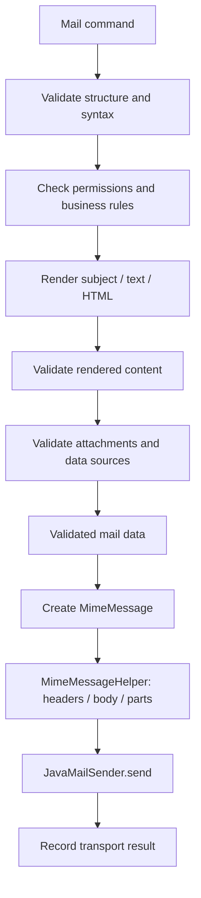
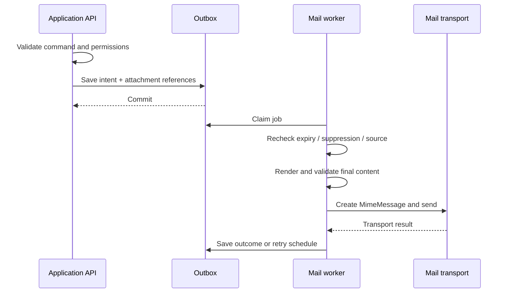

# Validating Data Before Creating the Message

In a Spring Framework Mail application, creating a `MimeMessage` is the starting step of building an email to send. Before calling `JavaMailSender.createMimeMessage()`, the application needs to confirm that input data is valid, recipients are authorized to receive the email, content is fully rendered, and attachments can be used safely.

If you create the message first and validate afterward, the code has to deal with a partially constructed MIME object. An error branch can leave an incomplete recipient, subject, body, or attachment; later edits can easily miss a check. Some errors are only detected when the helper sets headers or when the transport serializes the message. By then, the system has already spent work creating the MIME message and it becomes harder to separate data errors from SMTP errors.

The principle of this lesson is **validate and prepare all verifiable data before creating the message**. Accept a structured command, validate syntax and business rules, verify sending permissions, render templates, validate the final output, and verify attachment sources. Only when a validated result is ready should the service create the `MimeMessage`, use `MimeMessageHelper` to assemble the content, and call `JavaMailSender.send(...)`.

This article covers a preflight validation workflow for Spring Framework Mail: sender/recipients, subject and headers, plain text/HTML, templates and locales, attachments, resource limits, multi-tenant data, error classification, Jakarta Bean Validation examples, service code, and testing. Examples use Spring Framework 6.x, Spring Boot 3.x, Java 21, and Jakarta Mail.

## 1. A mail-sending workflow with a preflight step

A mail-sending method typically receives data from a controller, event handler, scheduler, or worker. That data may come from users, internal systems, templates, or storage. You should not treat data as valid merely because it was deserialized into a Java object.



Validation steps B through F take place before creating the MIME message. If any step fails, the application returns a clear validation or business error and does not invoke the transport.

Validation answers: does the address have acceptable syntax; is the caller allowed to send to that address; is the subject empty, too long, or containing control characters; does the body exist and have a reasonable size; do URLs belong to allowed domains; do attachments exist, match expected types, and remain readable; are To/Cc/Bcc groups free of duplicates and within limits?

Transport answers different questions: is the SMTP server reachable, does authentication succeed, does the relay accept the message, and are there timeouts or protocol errors during sending? A syntactically valid email address does not mean the mailbox exists. An attachment existing in storage does not mean SMTP will accept the message size. Preflight eliminates errors detectable upfront; it does not guarantee the network or mail relay will succeed.

## 2. Use a dedicated command for mail-sending requests

Do not accept an arbitrary object containing business entities, HTTP requests, streams, and MIME fields all mixed together. Create a DTO that expresses the exact data the mail-sending use case needs.

```java
package com.example.mail;

import java.util.List;

public record SendMailCommand(
        String recipient,
        String replyTo,
        String templateId,
        String localeTag,
        String subject,
        String plainText,
        String html,
        List<AttachmentCommand> attachments
) {}

public record AttachmentCommand(
        String storageKey,
        String filename,
        String declaredContentType,
        long declaredSize
) {}
```

This command contains no `MimeMessage`, `MimeMessageHelper`, or `InputStream`. Attachment fields are metadata and storage keys; the service validates the data source before creating the message.

Separating the command from MIME objects lets you unit test commands without a mail server, return validation errors before initializing Jakarta Mail, persist intent in an outbox without holding open streams, enforce permissions per tenant/notification type, and swap template engines or mail providers without changing the business API.

For transactional emails, the sender usually comes from application configuration rather than the request. The command only needs recipients and business data; the `From` address comes from approved configuration. This prevents callers from spoofing sender addresses or using unauthorized domains.

## 3. Structural validation with Jakarta Bean Validation

Spring Boot can integrate Jakarta Bean Validation via the validation starter:

```groovy
dependencies {
    implementation 'org.springframework.boot:spring-boot-starter-mail'
    implementation 'org.springframework.boot:spring-boot-starter-validation'
}
```

Example DTO:

```java
package com.example.mail;

import jakarta.validation.Valid;
import jakarta.validation.constraints.Email;
import jakarta.validation.constraints.NotBlank;
import jakarta.validation.constraints.PositiveOrZero;
import jakarta.validation.constraints.Size;

import java.util.List;

public record SendMailCommand(
        @NotBlank @Email @Size(max = 254)
        String recipient,
        @Email @Size(max = 254)
        String replyTo,
        @NotBlank @Size(max = 80)
        String templateId,
        @NotBlank @Size(max = 35)
        String localeTag,
        @NotBlank @Size(max = 160)
        String subject,
        @Size(max = 100_000)
        String plainText,
        @Size(max = 200_000)
        String html,
        @Size(max = 5)
        List<@Valid AttachmentCommand> attachments
) {}

public record AttachmentCommand(
        @NotBlank @Size(max = 500)
        String storageKey,
        @NotBlank @Size(max = 180)
        String filename,
        @NotBlank @Size(max = 100)
        String declaredContentType,
        @PositiveOrZero
        long declaredSize
) {}
```

`@Email` checks address format according to the configured validator; it does not verify that the mailbox exists or that the recipient is allowed to receive the email. `@NotBlank` is needed alongside `@Email` because many constraints like `@Email` accept null values. The `@Size` limits are example application policies and should be tuned to message types and provider limits. `@Valid` instructs the validator to validate each nested attachment.

Annotations check shape and declared limits. The service still has to verify storage access permissions, actual size, and real content type.

## 4. Business rules are more than annotations

Many rules depend on multiple fields or context: at least one body must exist; To/Cc/Bcc must not overlap; the template ID must be in an allowlist; the locale must be supported for that template; users may only send to addresses within their tenant; attachments must belong to the right record or notification.

These checks should live in a clearly named preflight validator/service, such as `MailPreflightValidator`. Avoid scattering checks across controllers and during calls to `MimeMessageHelper.setTo(...)`, `setSubject(...)`, or `addAttachment(...)`.

### 4.1. Ensuring at least one body is present

The system may allow HTML-only or text-only, but should never send an email with both empty:

```java
private static void validateBodyPresence(
        String plainText, String html) {
    boolean hasText = plainText != null && !plainText.isBlank();
    boolean hasHtml = html != null && !html.isBlank();

    if (!hasText && !hasHtml) {
        throw new MailValidationException(
                "Email must have a plain text or HTML body");
    }
}
```

If the product requires both versions, verify both are present. If only one version is present, choose the matching `setText(...)` overload and document the behavior.

### 4.2. Validating template ID and locale

Never accept an arbitrary template filename from users and pass it straight to the template engine. Use a registered catalog:

```java
public enum MailTemplateId {
    ENROLLMENT_CONFIRMED,
    PASSWORD_RESET,
    INVOICE_READY
}
```

The API can accept a string ID, but must map it to an allowlisted value. The locale must also be in the supported set:

```java
private static final Set<String> SUPPORTED_LOCALES =
        Set.of("vi-VN", "en-US");

private static Locale parseLocale(String localeTag) {
    Locale locale = Locale.forLanguageTag(localeTag);
    if (locale.getLanguage().isBlank()
            || !SUPPORTED_LOCALES.contains(locale.toLanguageTag())) {
        throw new MailValidationException("Unsupported locale");
    }
    return locale;
}
```

In real applications, supported locales may vary per template. Fallbacks must be explicit, such as falling back to an approved default locale when a template lacks a translation. Do not let a resolver silently pick a template with the same name in the wrong language.

## 5. Validating sender and recipient addresses

Email addresses go into headers and determine where the message is delivered. Both syntax and sending permissions must be checked.

### 5.1. Syntax does not prove the mailbox exists

`@Email` or an address parser can catch malformed values. It does not prove that the domain has valid MX records, the mailbox exists, the recipient opted in, the caller has permission to email that recipient, or the SMTP relay will accept the address.

Do not send a probe email just to verify a mailbox on every request; doing so can create spam, leak account status, or trigger anti-abuse systems.

If you need to parse an address with Jakarta Mail, you can use:

```java
import jakarta.mail.internet.AddressException;
import jakarta.mail.internet.InternetAddress;

static void validateAddressSyntax(String value) {
    try {
        InternetAddress address = new InternetAddress(value, true);
        address.validate();
    } catch (AddressException ex) {
        throw new MailValidationException(
                "Invalid email address");
    }
}
```

This is an additional syntax check. Application policy decides whether display names, internationalized addresses, or special aliases are accepted. For an API accepting a single address, require a single mailbox rather than a comma-separated list of multiple addresses.

### 5.2. Sender comes from trusted configuration

For example:

```yaml
app:
  mail:
    from: notifications@example.test
    reply-to: support@example.test
```

The application should validate these addresses at startup or configuration construction time. Never read `From` from query parameters or arbitrary request fields. If there are multiple senders per tenant, map each tenant to a registered and permitted sender.

### 5.3. Checking recipient authorization

A syntactically valid address may still be unauthorized to receive that type of notification:

- User A must not trigger sending User B's invoice.
- One tenant must not use another tenant's addresses.
- Marketing emails must respect opt-in/opt-out state.
- Password reset emails must go to the account's verified address.
- Transactional emails must only go to contacts approved by business rules.

Enforce authorization based on business IDs and authenticated identity, not just the email string supplied by the caller.

### 5.4. Validating To, Cc, and Bcc

If a command supports multiple recipients, limit the total recipient count, reject blank addresses, deduplicate across To/Cc/Bcc, avoid exposing recipient lists by putting everyone in To, and use Bcc only for appropriate purposes. For personalized emails, generate one message per recipient to prevent data leaks and make tracking/idempotency accurate.

Do not blindly lowercase the entire email address as a universal normalization rule. Domains are case-insensitive, whereas the local-part can technically be case-sensitive; if your system treats account emails as case-insensitive, apply that consistently in the identity/domain layer.

## 6. Validating Subject and headers before creating the message

The subject appears in inbox lists, push notifications, and sometimes on lock screens. It must be clear, bounded in length, and free of control characters.

```java
private static void validateSubject(String subject) {
    if (subject == null || subject.isBlank()) {
        throw new MailValidationException("Subject must not be blank");
    }
    if (subject.length() > 160) {
        throw new MailValidationException("Subject is too long");
    }

    for (int i = 0; i < subject.length(); i++) {
        if (Character.isISOControl(subject.charAt(i))) {
            throw new MailValidationException(
                    "Subject contains control characters");
        }
    }
}
```

The 160-character limit is an example product policy, not a universal limit across all SMTP servers. Use a configurable limit suitable for your language, templates, and display needs.

### 6.1. Preventing header injection

Never concatenate untrusted input into Subject, Reply-To, From, or other headers without validation. CR/LF characters can alter how headers are interpreted. Use controlled subject templates and reject control characters:

```java
// Avoid building headers from uncontrolled input.
String subject = "Notification: " + userSuppliedText;
```

If subject personalization is needed, use sanitized, length-bounded, pre-rendered fields. Do not silently strip all control characters and proceed if doing so could alter the meaning of data; rejecting invalid input is usually clearer.

### 6.2. MIME encoding does not replace validation

`MimeMessageHelper.setSubject(...)` and Jakarta Mail handle MIME header encoding, including Unicode content. Encoding addresses how headers are represented on the wire, not whether the subject is appropriate, safe, or allowed to contain that data.

## 7. Validating plain text and HTML bodies

Bodies may be rendered from templates or built from business data. Validate content **after rendering**, because a valid template can still receive missing variables, invalid URLs, or overly long strings.

### 7.1. Size limits

```java
private static void validateBodies(String plainText, String html) {
    boolean hasText = plainText != null && !plainText.isBlank();
    boolean hasHtml = html != null && !html.isBlank();

    if (!hasText && !hasHtml) {
        throw new MailValidationException("Email body is empty");
    }
    if (plainText != null && plainText.length() > 100_000) {
        throw new MailValidationException("Plain text body is too long");
    }
    if (html != null && html.length() > 200_000) {
        throw new MailValidationException("HTML body is too long");
    }
}
```

Character length and UTF-8 byte size are not the same. If the system limits messages by bytes, measure byte size after rendering and account for MIME/encoding overhead. The limits above are application policies, not universal SMTP thresholds.

### 7.2. Context-aware HTML escaping

When using Thymeleaf, use `th:text` for text nodes:

```html
<p th:text="${displayName}">Recipient name</p>
```

Do not pass untrusted data into `th:utext` without a reliable HTML sanitization pipeline. Escaping prevents user-supplied markup from being interpreted as HTML; it does not verify that a link is safe or that a domain is allowed.

### 7.3. Validating URLs in the body

Emails containing login, confirmation, or invoice links must build URLs from a configured base URL and domain allowlist. Never read the host from the Host header or user input and pass it straight into a template.

For sensitive URLs, use HTTPS only, validate the host, keep long-lived access tokens and credentials out of query strings, scope and expire one-time tokens tightly, and never log URLs containing tokens.

### 7.4. Rendering does not mean authorized to disclose

A template engine substitutes variables; it does not decide data disclosure permissions. Put only permitted fields into the context. Avoid passing entire entities, requests, or sessions. Check sensitive data against the template type and sending purpose.

## 8. Validating attachments before creating MIME parts

Attachments are a frequent source of late failures because their data may be read only when Jakarta Mail serializes the message. Before creating the MIME message, validate metadata and data sources:

1. Attachment count does not exceed the limit.
2. Total actual size does not exceed the application limit.
3. Storage key falls within the access scope of the current business operation.
4. File exists and is readable.
5. MIME type matches actual content.
6. Filename contains no path traversal or control characters.
7. File has passed scanning/inspection per policy.
8. The source can open a fresh stream when the MIME layer reads it.

### 8.1. Do not trust declared size or content type

Clients may declare `application/pdf` for a file that is not a PDF. Size metadata can also be wrong or stale. Use trusted storage metadata and, when needed, verify file signatures/magic bytes or run an appropriate scanner.

You do not have to load an entire large file into heap memory just to inspect it. You can read a small header prefix to detect format, then use a bounded streaming/scanning pipeline. Any stream opened for inspection must be closed; the attachment source must then open a new stream later.

### 8.2. Validating filenames

The filename shown to recipients must not be a path. Keep only the base name, bound length, and reject:

- Directory separators such as / and \.
- Control characters and CR/LF.
- Empty names or dot-only names.
- Extensions disallowed by business rules.
- Misleading names or names exposing unnecessary personal data.

Example:

```java
private static String validateFilename(String filename) {
    if (filename == null || filename.isBlank()
            || filename.length() > 180) {
        throw new MailValidationException("Invalid filename");
    }

    if (filename.contains("/") || filename.contains("\\\\")) {
        throw new MailValidationException(
                "Filename must not contain paths");
    }

    for (int i = 0; i < filename.length(); i++) {
        if (Character.isISOControl(filename.charAt(i))) {
            throw new MailValidationException(
                    "Filename contains control characters");
        }
    }
    return filename;
}
```

This is a basic check on the display filename. It does not replace verifying storage key permissions or inspecting file contents.

### 8.3. Allowlisting MIME types

For example, an invoice use case that accepts only PDFs:

```java
private static void validateInvoiceContentType(String contentType) {
    if (!"application/pdf".equalsIgnoreCase(contentType)) {
        throw new MailValidationException(
                "Invoices only accept PDF format");
    }
}
```

For multiple file types, use a per-use-case allowlist. Do not allow arbitrary MIME types just because `MimeMessageHelper.addAttachment(...)` accepts a content-type string. Nor should you infer MIME types solely from client-supplied extensions.

### 8.4. Validating total size

```java
static long totalSize(List<ValidatedAttachment> attachments) {
    long total = 0;
    for (ValidatedAttachment attachment : attachments) {
        total = Math.addExact(total, attachment.sizeBytes());
    }
    return total;
}
```

`Math.addExact(...)` detects integer overflow. After summing, compare against the configured limit. Final MIME size can exceed raw byte totals due to headers, boundaries, and Content-Transfer-Encoding, so leave safety headroom below the mail provider's limit.

## 9. Verifying that attachment sources are readable

A resource may have valid metadata yet fail to read at send time—for example, a deleted file, an expired object storage key, or missing read permissions for a worker.

For stored sources, preflight should verify that the key belongs to the right tenant/notification, confirm the object/version exists, check size and content type from trusted metadata, verify worker read permissions, and if scanning is required, open a fresh stream and close it right after scanning. The result should be an immutable reference so the MIME layer can open another stream when composing.

Do not store an `InputStream` in the command or validation result. The result should hold a storage key/version or a reopenable Resource.

```java
public record ValidatedAttachment(
        String storageKey,
        String objectVersion,
        String filename,
        String contentType,
        long sizeBytes
) {}

InputStreamSource source =
        () -> objectStore.openReadStream(
                attachment.storageKey(),
                attachment.objectVersion());

helper.addAttachment(
        attachment.filename(),
        source,
        attachment.contentType());
```

`objectStore.openReadStream(...)` is an application-defined API. Each call must return a fresh stream from the beginning; closing the stream must release the underlying response/connection. Use versions to ensure data does not change between preflight and MIME serialization.

## 10. Building a MailPreflightValidator class

A dedicated validator centralizes checks before message creation:

```java
package com.example.mail;

import jakarta.validation.ConstraintViolation;
import jakarta.validation.Validator;
import org.springframework.stereotype.Component;

import java.util.Set;

@Component
public class MailPreflightValidator {

    private final Validator beanValidator;
    private final RecipientPolicy recipientPolicy;
    private final AttachmentInspector attachmentInspector;

    public MailPreflightValidator(
            Validator beanValidator,
            RecipientPolicy recipientPolicy,
            AttachmentInspector attachmentInspector) {
        this.beanValidator = beanValidator;
        this.recipientPolicy = recipientPolicy;
        this.attachmentInspector = attachmentInspector;
    }

    public ValidatedMailRequest validate(
            SendMailCommand command,
            String authenticatedUserId) {

        Set<ConstraintViolation<SendMailCommand>> violations =
                beanValidator.validate(command);
        if (!violations.isEmpty()) {
            throw MailValidationException.from(violations);
        }

        validateSubject(command.subject());
        validateBodyPresence(command.plainText(), command.html());
        if (!recipientPolicy.maySendTo(
                authenticatedUserId, command.recipient())) {
            throw new MailValidationException(
                    "Not authorized to send to this recipient");
        }

        var attachments = command.attachments() == null
                ? java.util.List.<ValidatedAttachment>of()
                : command.attachments().stream()
                        .map(attachmentInspector::inspect)
                        .toList();

        validateTotalAttachmentSize(attachments);

        return new ValidatedMailRequest(
                command.recipient().trim(),
                command.replyTo(),
                command.subject(),
                command.plainText(),
                command.html(),
                attachments);
    }

    private static void validateSubject(String subject) {
        if (subject == null || subject.isBlank()
                || subject.length() > 160) {
            throw new MailValidationException("Invalid subject");
        }
        for (int i = 0; i < subject.length(); i++) {
            if (Character.isISOControl(subject.charAt(i))) {
                throw new MailValidationException(
                        "Subject contains control characters");
            }
        }
    }

    private static void validateBodyPresence(
            String plainText, String html) {
        boolean hasText = plainText != null && !plainText.isBlank();
        boolean hasHtml = html != null && !html.isBlank();
        if (!hasText && !hasHtml) {
            throw new MailValidationException("Email body is empty");
        }
    }

    private static void validateTotalAttachmentSize(
            java.util.List<ValidatedAttachment> attachments) {
        long total = 0;
        for (ValidatedAttachment attachment : attachments) {
            total = Math.addExact(total, attachment.sizeBytes());
        }
        if (total > 15L * 1024 * 1024) {
            throw new MailValidationException(
                    "Total attachment size exceeds limit");
        }
    }
}
```

`RecipientPolicy`, `AttachmentInspector`, `ValidatedMailRequest`, and `MailValidationException` are application abstractions. The example shows the sequence: Bean Validation, header/body rules, recipient authorization, attachment inspection, and finally constructing the validated object.

In production code, also validate template ID/locale, Reply-To, total recipient count, body limits, content-type allowlists, and overflow errors according to policy. Do not leak storage paths or detailed authorization reasons to untrusted callers.

## 11. Rendering templates before creating MimeMessage

If the subject, plain text, and HTML come from a template engine, render and validate the output before calling `createMimeMessage()`:

```java
public RenderedMail renderAndValidate(
        MailTemplateId templateId,
        Locale locale,
        EnrollmentMailData data) {

    RenderedMail rendered = templateRenderer.render(
            templateId, locale, data);

    validateSubject(rendered.subject());
    validateBodyPresence(
            rendered.plainText(), rendered.html());
    validateRenderedSize(rendered);

    return rendered;
}
```

A template can be syntactically valid yet produce bad rendered output: blank names, unresolved placeholders in the subject, disallowed URLs, overly long bodies, missing translations for a locale, or business data that must not appear in emails.

Validate the output after rendering and before creating the message. For HTML, apply context-aware escaping; for plain text, do not apply HTML escaping; for URLs, verify scheme and host separately.

If the template engine can leave raw placeholders when variables are missing, enable strict mode or check required variables. Do not search only for one placeholder syntax if the engine supports multiple expression styles. It is better to configure the engine to fail when a template references nonexistent variables according to project settings.

Logs should include the notification ID, template ID, locale, failing field, and redacted error code. Avoid logging full subjects/bodies, recipients, URL tokens, or attachment bytes.

## 12. Only create MimeMessage after obtaining ValidatedMailRequest

Once preflight succeeds, the service can create the MIME message:

```java
package com.example.mail;

import jakarta.mail.MessagingException;
import jakarta.mail.internet.MimeMessage;

import org.springframework.core.io.InputStreamSource;
import org.springframework.mail.javamail.JavaMailSender;
import org.springframework.mail.javamail.MimeMessageHelper;
import org.springframework.stereotype.Service;

@Service
public class ApplicationMailService {

    private final JavaMailSender mailSender;
    private final MailPreflightValidator preflightValidator;
    private final ObjectStore objectStore;

    public ApplicationMailService(
            JavaMailSender mailSender,
            MailPreflightValidator preflightValidator,
            ObjectStore objectStore) {
        this.mailSender = mailSender;
        this.preflightValidator = preflightValidator;
        this.objectStore = objectStore;
    }

    public void send(
            SendMailCommand command,
            String authenticatedUserId)
            throws MessagingException {

        ValidatedMailRequest mail =
                preflightValidator.validate(
                        command, authenticatedUserId);

        MimeMessage message = mailSender.createMimeMessage();
        MimeMessageHelper helper =
                new MimeMessageHelper(message, true, "UTF-8");

        helper.setFrom("notifications@example.test");
        helper.setTo(mail.recipient());
        if (mail.replyTo() != null && !mail.replyTo().isBlank()) {
            helper.setReplyTo(mail.replyTo());
        }
        helper.setSubject(mail.subject());

        if (mail.html() != null && !mail.html().isBlank()) {
            String plain = mail.plainText() == null
                    ? "" : mail.plainText();
            helper.setText(plain, mail.html());
        } else {
            helper.setText(mail.plainText());
        }

        for (ValidatedAttachment attachment : mail.attachments()) {
            InputStreamSource source = () ->
                    objectStore.openReadStream(
                            attachment.storageKey(),
                            attachment.objectVersion());
            helper.addAttachment(
                    attachment.filename(),
                    source,
                    attachment.contentType());
        }

        mailSender.send(message);
    }
}
```

The example uses a fixed configured sender; if the sender depends on tenant, obtain it from the policy validated during preflight. `ObjectStore` is an application-defined interface. The source opens a fresh stream when the MIME layer reads it. All attachments were validated before the message was created.

If the email has inline resources, call `helper.setText(...)` before `helper.addInline(...)`. If the email has attachments, add them after the body has been set. Never pass an already-open stream to the helper.

### 12.1. Do not create the message first and validate afterward

Avoid this structure:

```java
MimeMessage message = mailSender.createMimeMessage();
MimeMessageHelper helper =
        new MimeMessageHelper(message, true, "UTF-8");

helper.setTo(command.recipient());
helper.setSubject(command.subject());

// Invalid data is detected only after the message is half-built.
validateEverything(command);
```

Validation may fail after part of the MIME message has already been constructed and mutated. Keep the boundary sharp: **preflight returns validated data; the composer accepts only validated data**.

## 13. Multi-recipient addresses and headers

If a use case sends to multiple recipients, the command should represent each group separately:

```java
public record MultiRecipientMailCommand(
        List<String> to,
        List<String> cc,
        List<String> bcc,
        String subject,
        String plainText,
        String html
) {}
```

Before creating the message, cap the number of entries, validate each address, remove duplicates across To/Cc/Bcc, verify permission to send to each recipient, and enforce Bcc policy. Do not log recipient lists; email addresses are personal data.

When using `MimeMessageHelper`:

```java
helper.setTo(toAddresses);
helper.setCc(ccAddresses);
helper.setBcc(bccAddresses);
```

These calls should happen only after preflight has validated the entire list. Never blindly lowercase full email addresses as a universal normalization rule: domains are case-insensitive, while the local-part can technically be case-sensitive. If your system treats account emails as case-insensitive, apply that consistently in the identity/domain layer.

## 14. Validating data by email type

Not every email shares the same rule set. Maintain policies per template/use case:

| Email type | Data requiring special checks |
|---|---|
| Welcome / enrollment | Recipient belongs to account, locale supported, course ID valid |
| Password reset | Recipient verified, one-time token, expiration, fixed link domain |
| Invoice | Recipient authorized to view invoice, attachment matches invoice, valid PDF |
| Notification | Template ID permitted, content does not leak sensitive data |
| Marketing | Opt-in, opt-out, suppression list, send limits |
| System alert | Recipient in authorized operations group, content free of secrets/raw logs |

A generic validator handles syntax and general limits; per-use-case policies handle permissions and content. In multi-tenant applications, preflight must verify that the notification, recipient, attachment, template, and sender all belong to the current tenant. Never trust a client-supplied tenant ID when the security context already establishes the tenant.

## 15. Validating data before queueing for delivery

If the application uses an outbox or message queue, distinguish **request-time validation** from **send-time validation**.

At request time, validate command syntax, caller authorization, template ID/locale, business rules, and attachment metadata. When the worker runs, recheck things that may have changed: whether the attachment key/version still exists, whether the worker has read access, whether the template version is still allowed, whether the recipient was added to a suppression/opt-out list, and whether the message expired or was canceled.

Do not store an `InputStream` in the outbox. Store the intent and storage key/version. The worker opens a fresh stream when building the MIME message. If data must stay unchanged between enqueue and send, use immutable versions and store template versions or rendered payloads per policy.



For notifications that can be canceled or recipients that can opt out, send-time checks in the worker prevent sending based on stale state. For transactional emails, the policy for sending after business state changes must be explicitly defined.

## 16. Resource limits and abuse prevention

Syntactically valid data can still cause overload. A body tens of megabytes long or thousands of recipients can spike memory, CPU, and SMTP costs.

Enforce limits per use case: recipient count, attachment count, per-attachment and total attachment size, subject/body length, emails per user/tenant, worker concurrency, attachment-open and SMTP timeouts, retry counts, and job TTL.

Example configuration:

```yaml
app:
  mail:
    limits:
      max-recipients: 10
      max-attachments: 5
      max-attachment-bytes: 10485760
      max-total-attachment-bytes: 15728640
      max-subject-characters: 160
      max-html-characters: 200000
      max-text-characters: 100000
```

These are application-defined properties, not standard Spring Boot Mail configuration. Tune them to relay limits, email types, heap, storage, and SLAs. Never enforce limits only in the UI; the service must re-enforce them so all callers are protected.

## 17. Separating validation errors from sending errors

A data error before creating a message differs from an SMTP sending failure. Keep the two error categories separate so logging, API responses, retries, and metrics stay accurate.

| Stage | Error example | Handling |
|---|---|---|
| Command validation | Invalid recipient syntax, empty subject | Return validation error; do not create message |
| Authorization | Not permitted to send to recipient | Reject; record appropriate security event |
| Template selection | Unsupported template ID or locale | Configuration/business error; do not retry SMTP |
| Template rendering | Missing required variable, bad template syntax | Stop before creating message |
| Attachment preflight | Missing file, wrong type, or oversized | Reject or recover source before sending |
| MIME composition | Invalid headers or MIME structure | Record message creation error; inspect data/config |
| SMTP transport | AUTH, timeout, SMTP 4xx/5xx | Classify transport error and retry per policy |
| Uncertain outcome | Timeout after relay may have received DATA | Handle idempotency and uncertain state |

Never catch every exception and retry. If the subject contains CR/LF, retrying SMTP will not fix the data. If a file does not exist, retrying the SMTP connection will not help either. Transient SMTP errors can be retried when attachment sources remain available and the message is rebuilt from durable data.

API responses must not expose storage paths, SMTP hostnames/credentials, full recipient lists, tokens, attachment contents, or stack traces. Internal logs need redaction and correlation IDs; never log the entire message to debug an error.

## 18. Testing preflight before message creation

An important test does not merely assert that the validator throws an error; it must also verify that validation failures **do not call** `JavaMailSender.createMimeMessage()` or `send(...)`.

### 18.1. Validator unit test

Example with JUnit 5:

```java
import static org.junit.jupiter.api.Assertions.assertThrows;

import org.junit.jupiter.api.Test;
import org.springframework.validation.beanvalidation.LocalValidatorFactoryBean;

class MailPreflightValidatorTest {

    @Test
    void rejectsSubjectContainingLineBreak() {
        try (var validator = new LocalValidatorFactoryBean()) {
            validator.afterPropertiesSet();

            MailPreflightValidator preflight =
                    TestMailPreflightFactory.create(validator);

            SendMailCommand command = new SendMailCommand(
                    "person@example.test",
                    null,
                    "enrollment-confirmed",
                    "vi-VN",
                    "Notification\r\nBcc: attacker@example.test",
                    "Content",
                    null,
                    java.util.List.of());

            assertThrows(
                    MailValidationException.class,
                    () -> preflight.validate(command, "user-42"));
        }
    }
}
```

`TestMailPreflightFactory` is a test-defined factory providing fake policy and inspector implementations. The test focuses on rejecting header-injection inputs.

### 18.2. Verifying no message is created when validation fails

Example using Mockito:

```java
import static org.junit.jupiter.api.Assertions.assertThrows;
import static org.mockito.Mockito.never;
import static org.mockito.Mockito.verify;
import static org.mockito.Mockito.when;

import org.junit.jupiter.api.Test;
import org.springframework.mail.javamail.JavaMailSender;

class ApplicationMailServiceTest {

    @Test
    void doesNotCreateMessageForInvalidCommand() {
        JavaMailSender sender = mock(JavaMailSender.class);
        MailPreflightValidator preflight = mock(
                MailPreflightValidator.class);

        ApplicationMailService service =
                new ApplicationMailService(
                        sender, preflight, mock(ObjectStore.class));

        SendMailCommand invalid = invalidCommand();
        when(preflight.validate(invalid, "user-42"))
                .thenThrow(new MailValidationException("Invalid"));

        assertThrows(
                MailValidationException.class,
                () -> service.send(invalid, "user-42"));

        verify(sender, never()).createMimeMessage();
        verify(sender, never()).send(
                org.mockito.ArgumentMatchers.any(
                        jakarta.mail.internet.MimeMessage.class));
    }
}
```

Helpers `mock(...)` and `invalidCommand()` are test fixtures to define or import from Mockito/test helpers. The key assertion is that the sender is never called when preflight fails.

### 18.3. Verifying only validated data reaches the composer

For a valid command, stub preflight to return a `ValidatedMailRequest`, stub `createMimeMessage()` to return a test message, call the service, and assert `send(...)` is called once. Parse the message to verify Subject, recipient, MIME body, and attachment metadata. Do not only verify `send` was called; confirm the message contains the validated content.

### 18.4. Testing attachments

Test nonexistent storage keys, keys belonging to another tenant, small declared sizes whose actual size exceeds limits, mismatched content types, filenames containing path separators/CRLF, total size exceeding limits, sources failing to open streams, and sources providing a fresh stream after scanning.

If a source needs scanning, tests should verify the scan stream is closed and the resource used during serialization reopens a stream. Never reuse the same stream for both scanning and sending.

## 19. Example composer accepting only validated data

Validated model:

```java
public record ValidatedMailRequest(
        String recipient,
        String replyTo,
        String subject,
        String plainText,
        String html,
        java.util.List<ValidatedAttachment> attachments
) {}
```

The composer accepts only this model:

```java
public class MailComposer {

    private final JavaMailSender mailSender;
    private final ObjectStore objectStore;

    public MailComposer(
            JavaMailSender mailSender,
            ObjectStore objectStore) {
        this.mailSender = mailSender;
        this.objectStore = objectStore;
    }

    public MimeMessage compose(ValidatedMailRequest mail)
            throws MessagingException {

        MimeMessage message = mailSender.createMimeMessage();
        MimeMessageHelper helper =
                new MimeMessageHelper(message, true, "UTF-8");

        helper.setFrom("notifications@example.test");
        helper.setTo(mail.recipient());
        if (mail.replyTo() != null) {
            helper.setReplyTo(mail.replyTo());
        }
        helper.setSubject(mail.subject());

        if (mail.html() != null && !mail.html().isBlank()) {
            helper.setText(
                    mail.plainText() == null ? "" : mail.plainText(),
                    mail.html());
        } else {
            helper.setText(mail.plainText());
        }

        for (ValidatedAttachment attachment : mail.attachments()) {
            helper.addAttachment(
                    attachment.filename(),
                    (InputStreamSource) () ->
                            objectStore.openReadStream(
                                    attachment.storageKey(),
                                    attachment.objectVersion()),
                    attachment.contentType());
        }
        return message;
    }
}
```

Orchestrator:

```java
public class MailApplicationService {

    private final MailPreflightValidator preflight;
    private final MailContentRenderer renderer;
    private final MailComposer composer;
    private final JavaMailSender mailSender;

    public void send(
            SendMailCommand command,
            String authenticatedUserId) throws MessagingException {

        ValidatedMailRequest validated =
                preflight.validate(command, authenticatedUserId);

        RenderedMail rendered = renderer.renderAndValidate(validated);
        ValidatedMailRequest ready =
                validated.withRenderedContent(rendered);

        // Message is created only after preflight and rendering succeed.
        MimeMessage message = composer.compose(ready);
        mailSender.send(message);
    }
}
```

`withRenderedContent(...)` is an application-implemented factory/copy method on the immutable model; the example is shortened to highlight responsibility boundaries. You can use a separate record such as `ReadyToSendMail` instead of modifying the validated record.

In real designs, do not introduce many abstractions if the use case is simple. What to preserve is the order and boundary: **every check that can run upfront finishes before `createMimeMessage()`**.

## 20. Common mistakes

**Creating MimeMessage before validating.** The message can end up half-built before bad input is caught. Move preflight ahead of the composer.

**Using only `@Email` to validate recipients.** The annotation checks shape, not whether the mailbox exists or the caller is authorized to send.

**Accepting From from the request.** Callers can spoof senders or domains. Read the sender from validated configuration/policy.

**Not checking CR/LF in Subject and headers.** Risks header injection. Reject control characters and enforce length limits.

**Validating templates only before rendering.** Variables can be missing, bodies too long, or URLs invalid. Validate the final output.

**Trusting declared attachment content type and size.** Client metadata can be forged or stale. Inspect the real source and enforce per-use-case allowlists.

**Storing InputStream in commands or outboxes.** Streams are stateful and non-durable. Store storage keys/versions and open fresh streams when needed.

**Checking only individual attachment sizes.** Total size can still exceed limits. Check total bytes and MIME overhead.

**Skipping recipient/tenant authorization.** A valid address can still belong to another tenant or be ineligible for that email type.

**Retrying every exception.** Validation, template, and attachment errors are not fixed by SMTP retries. Classify errors by stage.

**Logging entire commands or rendered bodies.** Can leak emails, tokens, personal data, and attachment metadata. Log redacted error codes and correlation IDs.

## 21. Practice exercises

### Part A — Create the command and Bean Validation

Create `SendMailCommand` and `AttachmentCommand` with basic constraints. Test empty recipients, malformed emails, overly long subjects, empty bodies, and attachment counts exceeding the limit.

### Part B — Block header injection

Test a subject containing CR/LF and forged header strings. Verify preflight rejects it before calling `JavaMailSender.createMimeMessage()`.

### Part C — Verify recipient authorization

Create two test tenants. Have a Tenant A user attempt to send a notification or attachment belonging to Tenant B. Verify the authorization error occurs before the composer.

### Part D — Validate template output

Render subject, plain text, and HTML for a valid locale. Test missing variables, wrong-host URLs, overly long bodies, and leftover placeholders. Do not create a MIME message when output violates policy.

### Part E — Validate attachments

Use fake files with spoofed MIME types, oversized files, missing storage keys, and filenames containing paths. Verify the inspector rejects each case.

### Part F — Verify message creation order

Use Mockito to verify `createMimeMessage()` and `send()` are not called when preflight fails. For a valid command, verify the composer creates the message and the sender sends exactly once.

### Part G — Test transport errors

Simulate an SMTP timeout or transient error after preflight succeeds. Verify the error is classified as a transport failure rather than misreported as a validation error. Verify retries use existing attachment data and build a fresh message.

### Part H — Verify logs

Send a command containing fake tokens and sensitive data. Verify logs contain only the notification ID, template ID, error code, and needed correlation ID; never tokens, bodies, or attachment bytes.

## 22. Implementation principles

A reliable mail-sending flow separates **request data**, **validated data**, **MIME message**, and **transport result**. Commands describe recipients, templates, content, and attachment references. Preflight validates syntax, permissions, limits, and data sources; the renderer builds subject/plain text/HTML and validates the final output. The composer accepts only validated data to build the `MimeMessage`.

Validate senders and recipients against policy, block CR/LF in headers, cap bodies and attachments, verify URLs, enforce tenant permissions, and never hold streams in commands or queues. When a validation step fails, stop before creating the message. Once the message is created and sent, classify MIME/transport errors separately to retry properly.

Spring `JavaMailSender` and `MimeMessageHelper` assist with creating and sending MIME messages. **They do not replace authorization checks, data validation, resource limits, or application security policies.** Placing preflight before `createMimeMessage()` surfaces errors early, ensures messages are built only from ready data, and makes the sending workflow easier to test and monitor.
