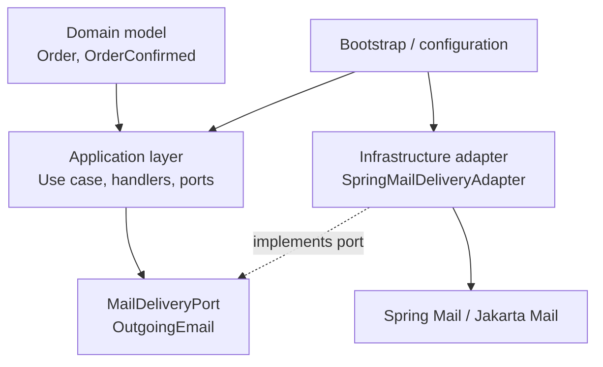
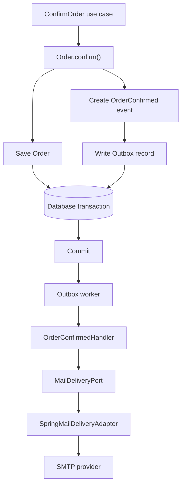

# Keeping the Domain Model Independent of MimeMessage

An order management application uses Spring Boot. When an order is confirmed, the system needs to send an email to the customer with a subject, HTML body, plain-text version, and possibly a PDF invoice. A quick approach is to call `JavaMailSender` directly inside the `Order` entity, create a `MimeMessage`, and use `MimeMessageHelper` to send it. That may work in a small sample, but it couples the business model to the mail-sending library, SMTP, and MIME structure.

Later, if the system swaps SMTP providers, moves to an HTTP email service, changes template engines, or needs to run domain tests without a mail server, infrastructure changes leak into the business layer. **The domain model should express business rules and state; it should not know what `MimeMessage` is or which protocol delivers emails.**

In a layered architecture or Hexagonal Architecture (Ports and Adapters), the application defines a **port** describing the notification need. An infrastructure adapter implements that port using Spring Mail. The domain emits pure Java business events; the application layer orchestrates content creation and calls the port. As a result, the domain has no dependency on `jakarta.mail`, `org.springframework.mail`, or SMTP.

## 1. Why should the domain model not depend on MimeMessage?

`MimeMessage` belongs to Jakarta Mail and represents an email message at the protocol layer. It carries concepts such as:

- `From`, `To`, `Cc`, `Bcc`, and `Subject` headers.
- MIME body parts, multiparts, boundaries, and Content-Type.
- Content-Disposition, Content-ID, and transfer encoding.
- Attachments, inline resources, and serialized payload data.

These are email transport details. They are not business rules of orders, accounts, or invoices.

Example of what an entity should not do:

```java
// Avoid this design: domain depends on Spring Mail/Jakarta Mail.
public class Order {

    private String id;
    private String customerEmail;

    public void confirm(JavaMailSender mailSender)
            throws MessagingException {

        this.status = OrderStatus.CONFIRMED;

        MimeMessage message = mailSender.createMimeMessage();
        MimeMessageHelper helper = new MimeMessageHelper(message, true);
        helper.setTo(customerEmail);
        helper.setSubject("Order confirmed");
        helper.setText("Your order has been confirmed.");

        mailSender.send(message);
    }
}
```

This entity takes on many responsibilities that do not belong to the domain:

1. Changing order status.
2. Deciding email content.
3. Constructing a MIME message.
4. Calling mail transport.
5. Handling Spring/Jakarta Mail errors.

Consequences:

| Issue | Impact |
|---|---|
| Domain imports framework | Domain requires Spring Mail/Jakarta Mail dependencies just to test order rules. |
| Hard to test | Entity unit tests must create a mail sender or mock the framework. |
| Hard to swap transport | Switching to a REST email provider forces entity changes. |
| Transaction mixed with I/O | Sending SMTP can prolong transactions or fail after state has already changed. |
| Hard to reuse | Domain cannot be used standalone in batches, CLIs, or other services without dragging the mail stack along. |
| Hard to handle retries | Entities should not manage queues, retries, bounces, or provider message IDs. |

**The domain model does not need to know how an email is represented in MIME.** The domain only needs to know that a business event occurred, such as an order being confirmed.

## 2. Separating responsibilities across layers

A common layout:

```text
domain/
  order/
    Order.java
    OrderStatus.java
  event/
    OrderConfirmed.java

application/
  port/
    out/
      MailDeliveryPort.java
      CustomerContactQuery.java
      OrderRepository.java
      OutboxRepository.java
  notification/
    OutgoingEmail.java
    OrderConfirmedHandler.java

infrastructure/
  mail/
    SpringMailDeliveryAdapter.java
  template/
    ThymeleafOrderConfirmationRenderer.java
  persistence/
    JpaOrderRepository.java
    JpaOutboxRepository.java

bootstrap/
  ApplicationConfiguration.java
```

Package names may vary by project; what matters is the **dependency direction**:



The application layer defines the interfaces that use cases need. Infrastructure depends on those interfaces and provides implementations. The domain does not depend on Spring Mail, SMTP, or MIME.

### 2.1. Domain layer

The domain is responsible for:

- Entity/aggregate state and behavior.
- Value objects and business invariants.
- Domain services when rules do not belong to a single entity.
- Domain events describing business events that occurred.

The domain should not:

- Create `MimeMessage` or `MimeMessageHelper`.
- Call `JavaMailSender`.
- Choose SMTP host, username, password, or TLS.
- Build HTML, CSS, or MIME boundaries.
- Manage SMTP retries or provider responses.

### 2.2. Application layer

Application orchestrates use cases:

- Calls repositories to load and save aggregates.
- Invokes domain behavior.
- Records domain events or outbox messages.
- Retrieves recipient information per use case needs.
- Builds notification models/content.
- Calls the mail-delivery port.
- Determines transaction boundaries and workflows.

The application layer can define `MailDeliveryPort` and the `OutgoingEmail` data type. These are abstractions serving use cases, not an email provider's API.

### 2.3. Infrastructure layer

Infrastructure implements technical details:

- `JavaMailSender` and `MimeMessageHelper`.
- `MimeMessage`, `MimeBodyPart`, and multipart structures.
- SMTP configuration, TLS, and authentication.
- Template engines such as Thymeleaf or FreeMarker.
- Attachment resources and file reading.
- Logging, metrics, and provider-specific error mapping.

Infrastructure can change without modifying the domain model, as long as the adapter continues to satisfy the application port's contract.

## 3. Domain describes business events, not emails

When an order is confirmed, the domain needs to express that event. It does not need to know the email subject or template name.

Example domain event:

```java
package com.example.domain.event;

import java.time.Instant;
import java.util.UUID;

public record OrderConfirmed(
        UUID orderId,
        UUID customerId,
        Instant occurredAt) {
}
```

The event carries only business facts:

- Which order was confirmed.
- Which customer is involved.
- When the event occurred.

Do not put into the event:

- `MimeMessage`.
- `JavaMailSender`.
- HTML bodies or MIME types.
- SMTP message IDs.
- File paths or `FileSystemResource`.
- Template paths managed by the presentation layer.

A domain event should express **what happened in the domain**. Sending an email is one possible reaction by the application layer; it is not the essence of the event.

### 3.1. Pure Java entity changing state

```java
package com.example.domain.order;

import com.example.domain.event.OrderConfirmed;

import java.time.Instant;
import java.util.UUID;

public class Order {

    private final UUID id;
    private final UUID customerId;
    private OrderStatus status;

    public Order(UUID id, UUID customerId, OrderStatus status) {
        this.id = id;
        this.customerId = customerId;
        this.status = status;
    }

    public OrderConfirmed confirm(Instant now) {
        if (status != OrderStatus.PAID) {
            throw new IllegalStateException(
                    "Only paid orders can be confirmed");
        }

        status = OrderStatus.CONFIRMED;
        return new OrderConfirmed(id, customerId, now);
    }

    public UUID id() {
        return id;
    }

    public OrderStatus status() {
        return status;
    }
}
```

Enum:

```java
package com.example.domain.order;

public enum OrderStatus {
    CREATED,
    PAID,
    CONFIRMED,
    CANCELLED
}
```

The entity imports neither Spring, Jakarta Mail, nor any email classes. It checks invariants, updates state, and returns a pure Java event.

In large DDD systems, aggregates may hold an internal list of domain events that the application layer collects after invoking behavior. The example above returns the event directly to focus on the core idea; event collection should stay consistent with your project's domain event mechanism.

### 3.2. Domain events are not application events

The two concepts may be implemented nearby, yet serve different purposes:

| Concept | Purpose |
|---|---|
| Domain event | Records a meaningful event in the business model, e.g., `OrderConfirmed`. |
| Application event | Notifies application components within the same process or framework. |
| Integration event | Message published across system/service boundaries for external consumers. |
| Email notification | One way to present/deliver information to a recipient; typically an application/infrastructure reaction. |

Entities do not need to call `ApplicationEventPublisher` or create Spring `ApplicationEvent` objects. A domain event can be a plain Java record; the application layer decides whether to publish it, write an outbox record, or handle it synchronously.

## 4. Application defines the mail-delivery port

The application layer needs a contract describing the action the use case wants to perform. This interface is called an **outbound port** because the application uses it to call outward.

Example:

```java
package com.example.application.port.out;

import com.example.application.notification.OutgoingEmail;

public interface MailDeliveryPort {
    void send(OutgoingEmail email);
}
```

Application-owned data type:

```java
package com.example.application.notification;

public record OutgoingEmail(
        String recipient,
        String subject,
        String plainText,
        String html) {
}
```

This contract expresses what the application needs:

- A recipient.
- A subject.
- Plain-text content.
- HTML content.

It does not reveal how the message is delivered. The implementation can use SMTP, an HTTP API, an internal mail relay, or a fake adapter in tests.

### 4.1. Why does the port live in application?

The dependency rule of Hexagonal Architecture is **inner policy defines the contract; outer details implement the contract**.

Application says: "I need to send an email with this data." Infrastructure says: "I can fulfill that using Spring Mail."

Do not place the interface in infrastructure and force application to import from there, because that makes application depend on the technical details it is trying to hide.

### 4.2. What level of data should the contract carry?

The port needs enough data for the adapter to act, without leaking framework classes outward:

| Avoid placing in the application port | Replace with |
|---|---|
| `MimeMessage` | Application-defined `OutgoingEmail`. |
| `MimeMessageHelper` | `MailDeliveryPort` contract. |
| Spring `InputStreamSource` | Application-owned Java I/O abstraction or document reference. |
| `FileSystemResource` | Appropriate attachment reference/stream contract. |
| `JavaMailSender` | Application mail-sending interface. |
| `MailException` | Neutral exception such as `MailDeliveryException`. |

Application can use standard Java types such as `String`, `UUID`, `Instant`, `InputStream`, or an abstraction it defines itself. What to avoid is locking the application contract to a specific infrastructure library.

## 5. Application handler turns domain events into notifications

A domain event only states that the order was confirmed. The application handler looks up contact details, prepares content, and calls the port.

Example application contact type:

```java
package com.example.application.customer;

import java.util.UUID;

public record CustomerContact(
        UUID customerId,
        String emailAddress,
        String displayName) {
}
```

A query port to fetch contact info:

```java
package com.example.application.port.out;

import com.example.application.customer.CustomerContact;

import java.util.Optional;
import java.util.UUID;

public interface CustomerContactQuery {
    Optional<CustomerContact> findContact(UUID customerId);
}
```

Handler:

```java
package com.example.application.notification;

import com.example.application.customer.CustomerContact;
import com.example.application.port.out.CustomerContactQuery;
import com.example.application.port.out.MailDeliveryPort;
import com.example.domain.event.OrderConfirmed;

public class OrderConfirmedHandler {

    private final CustomerContactQuery customerContactQuery;
    private final MailDeliveryPort mailDeliveryPort;

    public OrderConfirmedHandler(
            CustomerContactQuery customerContactQuery,
            MailDeliveryPort mailDeliveryPort) {
        this.customerContactQuery = customerContactQuery;
        this.mailDeliveryPort = mailDeliveryPort;
    }

    public void handle(OrderConfirmed event) {
        CustomerContact customer = customerContactQuery
                .findContact(event.customerId())
                .orElseThrow(() -> new IllegalStateException(
                        "Customer contact was not found"));

        // Short text example; real HTML should be rendered with a template
        // engine that has auto-escaping instead of concatenating user data.
        String plain = """
                Hello %s,

                Order %s has been confirmed.
                Thank you for your purchase.
                """.formatted(
                        customer.displayName(),
                        event.orderId());

        String html = """
                <html>
                  <body>
                    <p>Hello <strong>%s</strong>,</p>
                    <p>Order <strong>%s</strong> has been confirmed.</p>
                    <p>Thank you for your purchase.</p>
                  </body>
                </html>
                """.formatted(
                        escapeHtml(customer.displayName()),
                        event.orderId());

        mailDeliveryPort.send(new OutgoingEmail(
                customer.emailAddress(),
                "Order confirmed",
                plain,
                html));
    }

    private static String escapeHtml(String value) {
        return value.replace("&", "&amp;")
                .replace("<", "&lt;")
                .replace(">", "&gt;")
                .replace("\"", "&quot;")
                .replace("'", "&#39;");
    }
}
```

The escaping helper here only illustrates why HTML requires context-aware handling. In real applications, use a template engine with auto-escaping such as Thymeleaf `th:text` or FreeMarker HTML auto-escaping instead of maintaining a manual escape method in the handler. Never inject user data into HTML via arbitrary string concatenation.

Architectural highlights:

- The handler belongs to the application layer.
- It depends on the `MailDeliveryPort` port.
- It does not create `MimeMessage`.
- It knows nothing about SMTP hosts, TLS, or credentials.
- The domain event contains no subject or HTML body.

### 5.1. Should the domain event contain the recipient email?

It depends on the business model. If the email address is part of the facts that must be preserved at event time, the event can carry a domain-defined value object/address. Usually, however, the event only carries the customer ID, and the application queries the contact according to policy.

The two options have different semantics:

| Approach | Behavior |
|---|---|
| Event holds only customer ID | Handler fetches the current contact address at processing time. |
| Event holds recipient snapshot | Notification goes to the address recorded when the event occurred. |

For invoice emails or legal notices, a snapshot can matter. For routine notifications, the current address may be preferable. That is a business decision, not a reason to bring `MimeMessage` into the domain.

### 5.2. Email content factory and template renderer

If content is complex, keep HTML out of the handler. You can separate:

- `OrderConfirmationContentFactory`: turns event facts and contact info into a content model.
- `MailTemplateRenderer`: renders the model into plain text and HTML.
- `MailDeliveryPort`: hands rendered content to delivery infrastructure.

A rendering port can be defined in application if the use case needs to depend on that capability:

```java
public interface OrderConfirmationRenderer {
    OutgoingEmail render(
            OrderConfirmed event,
            CustomerContact customer);
}
```

An adapter implements it with Thymeleaf/FreeMarker. That way application does not even have to import a template engine if you want a strict boundary. For small apps, a pure Java factory may suffice; do not add abstractions for every trivial step.

## 6. Infrastructure implements the port with Spring Mail

The adapter is the only place in this flow that needs to know about `JavaMailSender`, `MimeMessage`, and `MimeMessageHelper`.

### 6.1. Adapter implementation

```java
package com.example.infrastructure.mail;

import jakarta.mail.MessagingException;
import jakarta.mail.internet.MimeMessage;

import com.example.application.notification.OutgoingEmail;
import com.example.application.port.out.MailDeliveryPort;
import com.example.application.port.out.MailDeliveryException;

import org.springframework.beans.factory.annotation.Value;
import org.springframework.mail.MailException;
import org.springframework.mail.javamail.JavaMailSender;
import org.springframework.mail.javamail.MimeMessageHelper;
import org.springframework.stereotype.Component;

import java.nio.charset.StandardCharsets;

@Component
public class SpringMailDeliveryAdapter implements MailDeliveryPort {

    private final JavaMailSender javaMailSender;
    private final String fromAddress;

    public SpringMailDeliveryAdapter(
            JavaMailSender javaMailSender,
            @Value("${app.mail.from}") String fromAddress) {
        this.javaMailSender = javaMailSender;
        this.fromAddress = fromAddress;
    }

    @Override
    public void send(OutgoingEmail email) {
        try {
            MimeMessage message = javaMailSender.createMimeMessage();
            MimeMessageHelper helper = new MimeMessageHelper(
                    message,
                    true,
                    StandardCharsets.UTF_8.name());

            helper.setFrom(fromAddress);
            helper.setTo(email.recipient());
            helper.setSubject(email.subject());
            helper.setText(email.plainText(), email.html());

            javaMailSender.send(message);
        } catch (MessagingException | MailException ex) {
            throw new MailDeliveryException(
                    "Unable to submit email message", ex);
        }
    }
}
```

Neutral exception belonging to the application contract:

```java
package com.example.application.port.out;

public class MailDeliveryException extends RuntimeException {

    public MailDeliveryException(String message, Throwable cause) {
        super(message, cause);
    }
}
```

The adapter translates Spring/Jakarta Mail errors into an exception the application understands. The application does not need to catch `MailException` or `MessagingException`.

`MimeMessageHelper(message, true, "UTF-8")` enables multipart so `setText(plain, html)` creates alternative bodies. If a message only has a single plain body, the adapter can configure it differently; the application contract does not need to change.

### 6.2. Why can the adapter depend on application?

The adapter imports `MailDeliveryPort` and `OutgoingEmail` to implement the contract. This is the right dependency direction: infrastructure knows what application needs.

Later, if you replace Spring Mail with an HTTP provider, you can write:

```java
@Component
public class HttpMailDeliveryAdapter implements MailDeliveryPort {

    private final ProviderMailClient providerClient;

    public HttpMailDeliveryAdapter(ProviderMailClient providerClient) {
        this.providerClient = providerClient;
    }

    @Override
    public void send(OutgoingEmail email) {
        providerClient.send(
                email.recipient(),
                email.subject(),
                email.plainText(),
                email.html());
    }
}
```

This illustrates a provider-specific client owned by infrastructure. Application handlers and the domain model stay unchanged because they only depend on the port.

### 6.3. SMTP configuration in infrastructure

Example `application.yml`:

```yaml
spring:
  mail:
    host: ${MAIL_HOST}
    port: 587
    protocol: smtp
    username: ${MAIL_USERNAME}
    password: ${MAIL_PASSWORD}
    default-encoding: UTF-8
    properties:
      "[mail.smtp.auth]": true
      "[mail.smtp.starttls.enable]": true
      "[mail.smtp.starttls.required]": true
      "[mail.smtp.ssl.checkserveridentity]": true
      "[mail.smtp.connectiontimeout]": 5000
      "[mail.smtp.timeout]": 10000
      "[mail.smtp.writetimeout]": 10000

app:
  mail:
    from: ${MAIL_FROM:notifications@example.com}
```

This example shows SMTP submission on port 587 with STARTTLS. A provider using implicit TLS on port 465 needs matching configuration. Credentials are supplied via environment variables or a secret manager; never place real passwords in source control.

The domain does not read this configuration. Application does not need to know the SMTP port. Only the adapter/bootstrap needs those implementation details.

## 7. Business transactions and email-sending timing

Another critical question once entities stop sending mail directly is **when does the application call the port?**

Suppose a use case does:

```java
@Transactional
public void confirmOrder(UUID orderId) {
    Order order = orderRepository.getById(orderId);
    OrderConfirmed event = order.confirm(clock.instant());
    orderRepository.save(order);

    mailDeliveryPort.send(buildEmail(event));
}
```

This moves sending out of the entity, yet still calls SMTP inside the database transaction. That can cause:

- Transaction remaining open while waiting on the network.
- Database locks held for too long.
- SMTP succeeding while the transaction rolls back.
- Transaction committing while SMTP fails.
- Request timeouts leaving delivery outcome unclear.

**Removing MIME from the domain is the first step; when high reliability is required, also decouple the mail-sending side effect from the business transaction.**

### 7.1. Sending after commit with transaction events

A simple solution is handling after the transaction commits:

```java
@Component
public class OrderConfirmedMailListener {

    private final OrderConfirmedHandler handler;

    public OrderConfirmedMailListener(OrderConfirmedHandler handler) {
        this.handler = handler;
    }

    @TransactionalEventListener(phase = TransactionPhase.AFTER_COMMIT)
    public void on(OrderConfirmed event) {
        handler.handle(event);
    }
}
```

The application use case publishes the event inside the transaction, and the listener runs only after commit. This avoids sending before the transaction succeeds.

However, an in-memory listener **is not durable storage**. If the process stops after the DB commits but before the listener executes, the notification can be lost. If the email is critical and requires retries/reconciliation, use an outbox.

### 7.2. Transactional outbox

An outbox records the notification request in the same transaction as the business change:



Illustrative use case:

```java
@Service
public class ConfirmOrderUseCase {

    private final OrderRepository orderRepository;
    private final OutboxRepository outboxRepository;
    private final Clock clock;

    public ConfirmOrderUseCase(
            OrderRepository orderRepository,
            OutboxRepository outboxRepository,
            Clock clock) {
        this.orderRepository = orderRepository;
        this.outboxRepository = outboxRepository;
        this.clock = clock;
    }

    @Transactional
    public void execute(UUID orderId) {
        Order order = orderRepository.getById(orderId);
        OrderConfirmed event = order.confirm(clock.instant());

        orderRepository.save(order);
        outboxRepository.append(
                OutboxMessage.from(event));
    }
}
```

`OrderRepository` and `OutboxRepository` are application ports; persistence implementations live in infrastructure. Saving the aggregate and the outbox record must participate in **the same database transaction** to avoid a confirmed order with no notification record.

A worker reads the outbox, converts the event into an email, and calls `MailDeliveryPort`. The worker updates state according to the submission result.

### 7.3. Outbox does not guarantee exactly-once SMTP

Suppose:

1. The worker sends the email successfully.
2. The SMTP server accepts the message.
3. The process crashes before marking the outbox record as sent.
4. The worker restarts and sends it again.

Therefore, an outbox typically provides **at-least-once processing**, not automatic exactly-once delivery. You need:

- A stable notification ID.
- Status and attempt count.
- Retries with backoff.
- An idempotency key if supported by the provider.
- Content/workflows tolerant of duplicate notices when duplicates cannot be completely eliminated.
- Provider event/bounce reconciliation if business rules require it.

Do not mark "delivered to Inbox" merely because `JavaMailSender.send` did not throw. That is usually only the submission result to the SMTP transport.

## 8. The domain model can emit domain events without Spring

Some projects use `ApplicationEventPublisher` directly inside entities or domain services. That couples the domain to Spring Context. A cleaner separation is having the domain return pure Java events, leaving the application layer to decide how to dispatch them.

### 8.1. Returning events from behavior

```java
OrderConfirmed event = order.confirm(clock.instant());
```

The application receives the event and writes to the outbox:

```java
outboxRepository.append(OutboxMessage.from(event));
```

### 8.2. Aggregate holding a list of events

Another option:

```java
public class Order {

    private final List<Object> domainEvents = new ArrayList<>();

    public void confirm(Instant now) {
        // Check invariants and update status.
        this.status = OrderStatus.CONFIRMED;
        domainEvents.add(new OrderConfirmed(id, customerId, now));
    }

    public List<Object> domainEvents() {
        return List.copyOf(domainEvents);
    }

    public void clearDomainEvents() {
        domainEvents.clear();
    }
}
```

The repository or application layer collects events after invoking the aggregate. Event collection/clearing must be designed carefully so events are not lost on transaction rollback or when an entity is saved multiple times. Do not copy this mechanism mechanically if your project already has a dedicated event dispatcher or outbox framework.

### 8.3. The domain does not need to know who consumes events

An `OrderConfirmed` event can trigger:

- Sending a confirmation email.
- Sending a push notification.
- Updating analytics.
- Creating a shipping task.
- Emitting an integration event to another service.

The domain merely records the business event. The application decides which subscribers run. As a result, adding a notification channel never forces edits to the `Order` entity.

## 9. Testing the domain without a mail server

When the domain does not import `MimeMessage`, domain tests focus on business rules.

Example:

```java
@Test
void confirmingPaidOrderChangesStatusAndReturnsEvent() {
    UUID orderId = UUID.randomUUID();
    UUID customerId = UUID.randomUUID();
    Instant now = Instant.parse("2026-11-12T08:00:00Z");

    Order order = new Order(
            orderId,
            customerId,
            OrderStatus.PAID);

    OrderConfirmed event = order.confirm(now);

    assertThat(order.status()).isEqualTo(OrderStatus.CONFIRMED);
    assertThat(event.orderId()).isEqualTo(orderId);
    assertThat(event.customerId()).isEqualTo(customerId);
    assertThat(event.occurredAt()).isEqualTo(now);
}
```

This test does not need:

- A Spring Boot context.
- A Jakarta Mail Session.
- An SMTP server.
- A JavaMailSender mock.
- MimeMessageHelper.

It verifies domain invariants and event facts.

### 9.1. Testing invalid invariants

```java
@Test
void cannotConfirmUnpaidOrder() {
    Order order = new Order(
            UUID.randomUUID(),
            UUID.randomUUID(),
            OrderStatus.CREATED);

    assertThatThrownBy(() -> order.confirm(Instant.now()))
            .isInstanceOf(IllegalStateException.class);

    assertThat(order.status()).isEqualTo(OrderStatus.CREATED);
}
```

Mail sending is unrelated to this test. If a domain test has to spin up a mail server just to verify that an unpaid order cannot be confirmed, architectural boundaries are mixed.

## 10. Testing the application with a fake port

The application handler depends on `MailDeliveryPort`. Tests can supply a fake implementation to record requested emails.

### 10.1. Fake adapter in tests

```java
class RecordingMailDeliveryPort implements MailDeliveryPort {

    private final List<OutgoingEmail> sent = new ArrayList<>();

    @Override
    public void send(OutgoingEmail email) {
        sent.add(email);
    }

    List<OutgoingEmail> sentEmails() {
        return List.copyOf(sent);
    }
}
```

Handler test:

```java
@Test
void orderConfirmedHandlerRequestsConfirmationEmail() {
    CustomerContactQuery contacts = customerId ->
            Optional.of(new CustomerContact(
                    customerId,
                    "customer@example.net",
                    "Nguyen Van An"));

    RecordingMailDeliveryPort mail = new RecordingMailDeliveryPort();
    OrderConfirmedHandler handler =
            new OrderConfirmedHandler(contacts, mail);

    UUID customerId = UUID.randomUUID();
    OrderConfirmed event = new OrderConfirmed(
            UUID.randomUUID(),
            customerId,
            Instant.parse("2026-11-12T08:00:00Z"));

    handler.handle(event);

    assertThat(mail.sentEmails()).hasSize(1);
    OutgoingEmail email = mail.sentEmails().get(0);
    assertThat(email.recipient()).isEqualTo("customer@example.net");
    assertThat(email.subject()).contains("confirmed");
    assertThat(email.plainText()).contains(event.orderId().toString());
}
```

This test demonstrates verifying application orchestration without booting Spring Mail.

### 10.2. Testing port errors

A fake port can throw `MailDeliveryException` to verify application error handling:

```java
class FailingMailDeliveryPort implements MailDeliveryPort {
    @Override
    public void send(OutgoingEmail email) {
        throw new MailDeliveryException(
                "Provider unavailable",
                new RuntimeException("Connection timeout"));
    }
}
```

For an outbox worker, tests should confirm this error causes the notification to be scheduled for retry or moved to the appropriate state. The domain entity does not need to know this exception exists.

## 11. Testing the Spring Mail adapter separately

The adapter is where Spring/Jakarta Mail dependencies live, so its tests can use the corresponding tools.

Appropriate checks:

- The adapter accepts `OutgoingEmail` and sets the right `From`, `To`, and `Subject`.
- The message contains `text/plain` and `text/html` per contract.
- The UTF-8 charset is set properly.
- Attachments/inline resources are mapped properly if supported by the contract.
- `MessagingException` or `MailException` is translated into `MailDeliveryException`.
- An SMTP catcher receives the expected MIME message.

An SMTP catcher such as GreenMail, Mailpit, or MailHog can be used for integration tests. These are **infrastructure adapter** tests, not domain tests.

### 11.1. Testing the adapter with a mocked JavaMailSender

You can mock `JavaMailSender` to confirm the adapter calls `send(MimeMessage)`:

```java
@Test
void adapterBuildsMimeMessageAndSubmitsIt() throws Exception {
    JavaMailSender sender = mock(JavaMailSender.class);
    MimeMessage mimeMessage = new MimeMessage(
            Session.getInstance(new Properties()));

    when(sender.createMimeMessage()).thenReturn(mimeMessage);

    SpringMailDeliveryAdapter adapter =
            new SpringMailDeliveryAdapter(sender, "notifications@example.com");

    adapter.send(new OutgoingEmail(
            "customer@example.net",
            "Order confirmed",
            "Order DH1024 confirmed.",
            "<p>Order <strong>DH1024</strong> confirmed.</p>"));

    verify(sender).send(mimeMessage);
}
```

This is a conceptual example; constructors and packages must match the adapter in your project. You can inspect `mimeMessage` afterward to verify headers/bodies, or use an SMTP catcher for end-to-end adapter tests.

### 11.2. Verifying translated errors

```java
when(sender.createMimeMessage())
        .thenThrow(new MailException("SMTP unavailable") {});

assertThatThrownBy(() -> adapter.send(email))
        .isInstanceOf(MailDeliveryException.class);
```

The application sees only `MailDeliveryException`. It does not need to know whether the underlying error was `MailException`, `MessagingException`, or a provider-specific exception.

## 12. Choosing port contracts for email and attachments

A minimal port may accept only text and HTML. If the use case needs attachments, there are several ways to extend it. Choose an abstraction based on data size and lifecycle requirements.

### 12.1. Small attachment data: byte array

An application-owned type:

```java
public record MailAttachment(
        String filename,
        String contentType,
        byte[] content) {
}
```

Advantages:

- No dependency on `FileSystemResource`.
- Data has an explicit snapshot.
- Easy to test byte attachments.

Drawbacks:

- Holds the entire file on the heap.
- Unsuitable for large files or many concurrent attachments.
- Requires size limits and defensive copying for true immutability.

### 12.2. Large documents: use a document reference

If the application already has a storage port, you can pass a reference:

```java
public record MailAttachmentReference(
        UUID documentId,
        String filename,
        String contentType) {
}
```

The mail adapter or an infrastructure attachment resolver fetches the file from storage by document ID. Explicitly define which layer checks access permissions and ensures the file remains available until the adapter finishes reading it.

Do not put `FileSystemResource` into an application record. If the adapter uses the filesystem, it converts the document reference into a resource itself.

### 12.3. Neutral Java I/O abstraction

If the application genuinely needs to pass a stream source, you can define a dedicated interface:

```java
public interface AttachmentContent {
    InputStream openStream() throws IOException;
    long size();
}
```

This interface uses Java SE rather than Spring `Resource`. However, define its contract clearly:

- Can `openStream()` be called once or multiple times?
- Who closes the stream?
- Does the source stay available throughout sending?
- Is the size known upfront?
- Is the content immutable across reads?

If you do not need a stream abstraction, do not add one merely to avoid an import. For many applications, a document ID or byte array is enough.

### 12.4. Do not put an open InputStream into an entity

Avoid:

```java
public class Invoice {
    private InputStream pdfStream;
    private MimeMessage message;
}
```

Entities should not hold streams or MIME objects:

- Streams have consumption state and resource lifecycles.
- Entities may be persisted/serialized; streams are not appropriate domain data.
- MIME objects depend on providers and transport.
- Testing and managing stream closure becomes difficult.

Entities should hold business data such as invoice ID, status, amount, and issuance timestamp. Application/infrastructure fetches file bytes when sending is needed.

## 13. Handling exceptions and send outcomes at the right layer

Each layer should understand the errors that belong to its responsibility:

| Layer | Errors it may handle |
|---|---|
| Domain | Invariant violations, invalid business state. |
| Application | Recipient not found, notification policy rejection, outbox retry/dead-letter. |
| Infrastructure mail adapter | SMTP unavailable, TLS/AUTH, MIME construction, provider responses. |
| Storage adapter | Missing file, read permissions, storage timeout, or missing document version. |

The adapter can translate technical errors into neutral exceptions:

```java
try {
    javaMailSender.send(message);
} catch (MailException ex) {
    throw new MailDeliveryException(
            "Mail submission failed", ex);
}
```

An application worker catches `MailDeliveryException` and decides retries according to policy. The domain never needs to catch SMTP errors.

### 13.1. Do not let mail-sending exceptions corrupt domain state

Suppose an order has already been confirmed in the database. If SMTP fails, that does not necessarily mean the order should revert to unconfirmed. Two events have distinct meanings:

- The order is confirmed.
- The confirmation email has not yet been submitted successfully.

Track notification status separately, such as `PENDING`, `SUBMITTED`, `RETRY_WAIT`, `FAILED_PERMANENT`, or `UNKNOWN`. Do not roll back order status merely because the mail provider is temporarily unavailable.

### 13.2. Submission is not delivery

`JavaMailSender.send` completing normally only confirms the transport reported no error while handing off the message. It does not guarantee:

- The email entered the Inbox.
- The email avoided spam filters.
- The recipient mailbox still exists.
- The recipient opened or read the email.

If delivery tracking is required, application/infrastructure must handle bounces, DSNs, or provider webhooks. Those states do not belong on the `Order` entity.

## 14. Dependency management and module boundaries

In a multi-module project, dependencies can be separated as follows:

```text
:domain
  - Java standard library
  - No Spring Mail/Jakarta Mail needed

:application
  - :domain
  - Application ports and use cases
  - No Spring Mail needed

:infrastructure-mail
  - :application
  - spring-boot-starter-mail
  - Jakarta Mail implementation via dependency management

:infrastructure-persistence
  - :application
  - JPA/database libraries

:bootstrap
  - :application
  - :infrastructure-mail
  - :infrastructure-persistence
  - Wiring/configuration
```

Conceptual Gradle example:

```groovy
// domain/build.gradle
dependencies {
    // Do not add spring-boot-starter-mail to domain.
}
```

```groovy
// application/build.gradle
dependencies {
    implementation project(':domain')
}
```

```groovy
// infrastructure-mail/build.gradle
dependencies {
    implementation project(':application')
    implementation 'org.springframework.boot:spring-boot-starter-mail'
}
```

```groovy
// bootstrap/build.gradle
dependencies {
    implementation project(':application')
    implementation project(':infrastructure-mail')
    implementation project(':infrastructure-persistence')
}
```

This is an illustrative dependency layout; module names and plugin/version configuration depend on your repository. What to preserve is that **domain declares no mail dependencies** and application is not forced to import Spring Mail.

If your project is a single module, you can still maintain package boundaries and port interfaces. Multi-module builds give the compiler stronger boundary enforcement, but are not mandatory to apply this principle.

## 15. Architecture tests to prevent reverse dependencies

Once ports and adapters are separated, prevent future changes from reintroducing `MimeMessage` into the domain.

### 15.1. Package rules

One convention:

- `domain..` must not import `org.springframework.mail..`.
- `domain..` must not import `jakarta.mail..`.
- `domain..` must not import `org.springframework.core.io..`.
- `application..` must not import `MimeMessage` or `JavaMailSender`.
- `infrastructure..` is allowed to import domain/application and technical libraries.

### 15.2. Example verification with ArchUnit

If your project uses ArchUnit, you can write:

```java
@AnalyzeClasses(packages = "com.example")
class ArchitectureRulesTest {

    @ArchTest
    static final ArchRule domainMustNotDependOnMailFramework =
            noClasses()
                    .that().resideInAPackage("..domain..")
                    .should().dependOnClassesThat()
                    .resideInAnyPackage(
                            "jakarta.mail..",
                            "org.springframework.mail..",
                            "org.springframework.core.io..");

    @ArchTest
    static final ArchRule applicationMustNotDependOnMimeMessage =
            noClasses()
                    .that().resideInAPackage("..application..")
                    .should().dependOnClassesThat()
                    .resideInAnyPackage(
                            "jakarta.mail..",
                            "org.springframework.mail..");
}
```

This example assumes the project already has the ArchUnit dependency and a `com.example` root package. Rules may need adjustment for actual package conventions. They prevent framework dependencies from creeping back in as multiple contributors work on the codebase.

### 15.3. Inspecting the dependency graph

In addition to ArchUnit, inspect the dependency tree of the domain and application modules to verify they do not transitively pull in the mail stack. Do not check source imports alone; a transitive dependency can still tightly couple a module to a framework.

## 16. When is the domain allowed to hold EmailAddress?

Do not misinterpret "the domain does not depend on MimeMessage" as "the domain cannot know about emails."

An email address can be **business data** for a customer or account. The domain can have a value object:

```java
package com.example.domain.customer;

public record EmailAddress(String value) {
    public EmailAddress {
        if (value == null || value.isBlank()) {
            throw new IllegalArgumentException(
                    "Email address is required");
        }
    }
}
```

This is a pure Java value object. It does not depend on mail transport. Still, validation here must fit the domain; string checks cannot prove a mailbox exists or that a user owns that address.

Distinguish clearly:

| Concept | Can belong to domain? | Reason |
|---|---|---|
| `EmailAddress` | Yes, if it is a business attribute | Represents a customer's contact address. |
| `NotificationPreference` | Yes, if product rules let users choose channels | It is a business policy. |
| `MimeMessage` | No | Email protocol representation detail. |
| `MimeBodyPart` | No | MIME detail. |
| `JavaMailSender` | No | Spring mail-sending infrastructure. |
| SMTP host/password | No | Deployment configuration and infrastructure secrets. |
| HTML template | Usually no | Presentation content belonging to application/presentation. |

The domain can decide whether a customer has email notifications enabled if that is a product rule. But the domain never needs to decide how an email is MIME-encoded.

## 17. Common anti-patterns to avoid

### 17.1. Injecting JavaMailSender into an entity

Entities are business objects, not Spring beans. Injecting services into entities ties the domain lifecycle to the container and complicates persistence/hydration.

### 17.2. Passing MimeMessage into a domain service constructor

A domain service taking `MimeMessage` is still coupled to the protocol. When sending needs to be triggered, use a domain event or an application port.

### 17.3. Leaking Spring Mail exceptions into the domain

Never declare domain methods `throws MailException` or catch `MessagingException` inside entities. Translate errors at the adapter into neutral exceptions at the application boundary.

### 17.4. Letting repositories send emails on save

Repositories are responsible for saving and loading aggregates. Sending email as a hidden side effect inside `save()` hides network calls from callers, complicates retries, and makes testing harder.

### 17.5. Using a static MailUtil inside entities

A static utility still creates coupling if it imports Spring/Jakarta Mail. Hiding a dependency behind a static method does not decouple the architecture.

### 17.6. Domain events containing HTML bodies

Events such as `OrderConfirmed` should describe business occurrences. HTML can change with branding, locales, or template versions; do not hardcode it into domain events.

### 17.7. Application ports using Spring Resource

If an application interface accepts `FileSystemResource` or `InputStreamSource`, application still depends on Spring Core. Use byte arrays, document IDs, or an application-owned abstraction.

### 17.8. Sending mail in a transaction and expecting rollback

SMTP does not participate in database transactions. A DB rollback cannot recall an email already accepted by the SMTP server. Use after-commit/outbox and separate notification state.

### 17.9. Naming a domain event like a mail command

`SendOrderConfirmationEmail` is a command/application action name, not a domain event. Domain events should express past occurrences such as `OrderConfirmed`; the application decides whether to send an email.

### 17.10. Storing provider responses on entities

Provider message IDs, bounce codes, and SMTP responses are operational notification data. If stored, place them in a notification record/application persistence, not on the order aggregate unless there is a clear business meaning.

## 18. When to use domain events vs. calling a port directly?

Not every email needs an event bus or outbox. Choose the simplest option that meets reliability needs.

| Scenario | Suitable approach |
|---|---|
| Simple use case, non-critical email, synchronous sending acceptable | Application service calls the port after domain work finishes. |
| Want sending after transaction commit, accepting process-crash risk | Transactional event listener `AFTER_COMMIT`. |
| Critical email needing retries and durability across process restarts | Transactional outbox + worker. |
| One event triggers multiple reactions | Domain event + application handlers/subscribers. |
| Sending email is an explicit user-triggered action | Application use case calls port; no fake domain event needed without a domain occurrence. |

### 18.1. Calling the port directly in an application service

Can fit less critical flows:

```java
public void resendReceipt(UUID orderId) {
    Order order = orderRepository.getById(orderId);
    OutgoingEmail email = receiptFactory.create(order);
    mailDeliveryPort.send(email);
}
```

Here, application still calls the port; the domain knows nothing about mail. Still, if sending fails, the application must decide whether to return an error, record status, or retry.

### 18.2. Domain events fit when a business occurrence happens

```java
OrderConfirmed event = order.confirm(clock.instant());
orderRepository.save(order);
eventPublisher.publish(event);
```

Here, `eventPublisher` is an application abstraction/mechanism, not a required entity dependency. If the event needs transactional durability, replace in-memory publishing with an outbox write.

## 19. Practice exercises

### Exercise 1 — Identify coupling

An `Invoice` entity has a `send(JavaMailSender sender)` method that creates a `MimeMessage` and attaches a PDF using `FileSystemResource`.

List the mixed responsibilities and explain why they do not belong in the domain model.

### Exercise 2 — Extract a domain event

Design an `InvoiceIssued` or `OrderConfirmed` record holding only the required business facts. Write an entity method that updates state and returns the event without importing Spring/Jakarta Mail.

### Exercise 3 — Define a port

Create `MailDeliveryPort` in the application layer and an application-owned `OutgoingEmail` type. The contract must support recipient, subject, plain text, and HTML. Explain why `MimeMessage` is not used as a parameter.

### Exercise 4 — Write an adapter

Create `SpringMailDeliveryAdapter` implementing the port with `JavaMailSender` and `MimeMessageHelper`. Translate `MessagingException`/`MailException` into a neutral exception. Only the adapter may import Spring Mail/Jakarta Mail.

### Exercise 5 — Test independently

Write:

- A domain unit test verifying order confirmation and event output.
- An application test with a fake `MailDeliveryPort` verifying the email send request.
- An adapter test using a mocked JavaMailSender or SMTP catcher to verify MIME output.

Explain why the three test suites have different scopes.

### Exercise 6 — Transactions and outbox

An order committed, but the process stopped before sending the email. Design a transactional outbox so the send request is not lost. Describe pending, retry, and submitted states.

### Exercise 7 — Attachment contract

The port needs to support 30 MiB PDF invoices. Compare byte arrays, Spring `Resource`, document IDs, and an application-owned stream abstraction. Pick an appropriate approach without making domain/application depend on Spring Core.

### Exercise 8 — Replacing SMTP with an HTTP provider

Write a second adapter using an HTTP API. Identify which classes must change and which should stay untouched. Explain the port's role in shielding the application from provider changes.

### Exercise 9 — Dependency enforcement

Write an ArchUnit rule preventing the domain package from importing `jakarta.mail`, `org.springframework.mail`, and `org.springframework.core.io`. Why are architecture tests valuable as a project grows long-term?

### Exercise 10 — Distinguish events and commands

Compare `OrderConfirmed` with `SendOrderConfirmationEmail`. Which describes what happened in the domain? Which represents an application request? Why does naming an event like a mail-sending command reduce reusability?

## 20. Takeaways and references

When designing **to keep the domain model independent of `MimeMessage`** in Spring Framework Mail:

1. **The domain owns business rules**, aggregate state, and pure Java domain events.
2. **Application orchestrates use cases** and defines outbound ports such as `MailDeliveryPort`.
3. **Application-owned DTOs** such as `OutgoingEmail` describe the data to send without exposing MIME or Spring `Resource`.
4. **Infrastructure adapters** implement ports using `JavaMailSender`, `MimeMessage`, and `MimeMessageHelper`.
5. **Template rendering** lives in application/presentation/infrastructure per your chosen boundary; keep HTML out of entities.
6. **Technical exceptions are translated in adapters** into neutral errors handled by application.
7. **Domain events describe past occurrences**, not SMTP commands or email bodies.
8. **Send after commit or use an outbox** when you need to avoid holding transactions across network calls and need durable retries.
9. **Test domain, application, and adapters separately**; domain tests need no mail server.
10. **Keep dependencies pointing inward** and optionally use ArchUnit/module boundaries to prevent framework coupling from returning.

Recommended reading:

- **Spring Framework Reference — Email:** `JavaMailSender`, `MimeMessageHelper`, and MIME messages.
- **Spring Framework API — `JavaMailSender` / `MimeMessageHelper`:** sending contract and multipart support.
- **Jakarta Mail API — `MimeMessage`:** protocol-layer message model.
- **Hexagonal Architecture / Ports and Adapters:** application-defined ports implemented by infrastructure adapters.
- **Domain-Driven Design:** aggregates, domain events, and domain/application boundaries.
- **Transactional Outbox pattern:** persisting events/notifications in the business transaction and processing with a worker.
- **ArchUnit documentation:** verifying package/module dependency rules in Java.

**The domain model should express what the business cares about, not how the system transports information.** An order being confirmed is a domain event; an email is a reaction orchestrated by application; `MimeMessage` is a MIME detail constructed by infrastructure. Keeping these three concepts at their proper boundaries makes the system easier to test, easier to switch providers, and resilient to changes in mail-sending technology.
