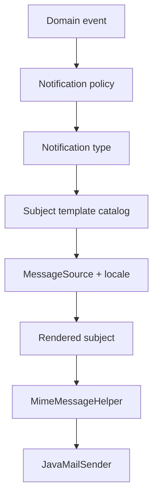

# Subject Templates by Event Code or Notification Type

In a Spring Framework Mail application, the subject usually depends on the **notification type** being sent: order confirmation, payment failure, password reset, shipment update, or appointment reminder. If each service constructs subjects directly via string concatenation, wording becomes hard to localize, hard to test, and easily inconsistent across places sending the same kind of notification.

A more manageable approach is building a **subject template catalog** keyed by notification type or business event code. Each notification type maps to a stable message code. Spring's **MessageSource** looks up the template by locale and fills in dynamic values such as order code, product name, or appointment date. After rendering, the subject is placed on **MimeMessage** using **MimeMessageHelper** or Jakarta Mail.

This lesson explains how to distinguish event codes from notification types, organize catalogs and resource bundles, design placeholders, integrate with Spring Mail, handle locales/fallbacks, validate data placed into headers, and test subjects per notification type.

## 1. Why use subject templates by notification type?

Suppose an application has the following email flows:

- An order was just confirmed.
- Payment for an order failed.
- A password reset request was created.
- A package was handed over to the carrier.
- An appointment is coming up.
- A user was invited to a workspace.

If each service constructs its own subject:

```java
String subject = "Order " + orderNumber + " confirmed";
```

or:

```java
String subject = "Payment failed for order " + orderNumber;
```

wording becomes scattered across the codebase. When the content team wants to revise phrasing, add a language, or standardize how order numbers are written, many places must be found and updated. Services may also end up phrasing the same type of email differently.

Centralized subject templates solve these issues:

1. **Consistency:** the same notification type uses the same message code and phrasing rules.
2. **Localization:** one template key has corresponding entries for `vi-VN`, `en-US`, `ja-JP`, etc.
3. **Decoupling content from business logic:** services decide which notification to send; the catalog decides the displayed subject.
4. **Testability:** subjects can be verified without an SMTP connection.
5. **Change tracking:** content is managed in resource bundles or a template catalog with history.
6. **Extensibility:** add new notification types by registering a key and its translations.

Example for the same order confirmation notification:

| Locale | Subject |
|---|---|
| `vi-VN` | Xác nhận đơn hàng ORD-2026-001 |
| `en-US` | Order ORD-2026-001 is confirmed |
| `ja-JP` | 注文 ORD-2026-001 が確定しました |

The dynamic value `ORD-2026-001` is inserted into the template; the surrounding text changes by locale.

## 2. Distinguishing event codes and notification types

These two concepts are related, though not necessarily identical.

An **event code** identifies a business occurrence that happened, for example:

- `ORDER_CONFIRMED`
- `PAYMENT_DECLINED`
- `PASSWORD_RESET_REQUESTED`
- `SHIPMENT_DISPATCHED`
- `APPOINTMENT_REMINDER_DUE`

A **notification type** identifies the kind of notice the application decides to send to an audience, for example:

- `ORDER_CONFIRMATION`
- `PAYMENT_FAILURE_NOTICE`
- `PASSWORD_RESET_EMAIL`
- `SHIPMENT_UPDATE`
- `APPOINTMENT_REMINDER`

One event can trigger multiple notification types. When an order is confirmed, the application may email the customer, notify the seller, and update operations. These three notifications can have different subjects even though all stem from the `ORDER_CONFIRMED` event.

```text
Domain event: ORDER_CONFIRMED
        |
        +--> Notification type: CUSTOMER_ORDER_CONFIRMATION
        |
        +--> Notification type: SELLER_NEW_ORDER
        |
        +--> Notification type: OPERATIONS_ORDER_UPDATE
```

Therefore, **do not default to using the event class name as the subject message key**. Have a business mapping step from event to notification type, taking recipient and notification purpose into account.

### Choosing notification type as the subject key

In many applications, the notification type is a more stable and fitting key than the event code because it describes the content the recipient will read.

Example:

```java
public enum NotificationType {
    CUSTOMER_ORDER_CONFIRMATION,
    SELLER_NEW_ORDER,
    PAYMENT_FAILURE_NOTICE,
    PASSWORD_RESET_EMAIL,
    SHIPMENT_UPDATE,
    APPOINTMENT_REMINDER
}
```

Each enum constant can map to a message code:

```java
public enum NotificationType {
    CUSTOMER_ORDER_CONFIRMATION("mail.subject.order-confirmation"),
    SELLER_NEW_ORDER("mail.subject.seller-new-order"),
    PAYMENT_FAILURE_NOTICE("mail.subject.payment-failed"),
    PASSWORD_RESET_EMAIL("mail.subject.password-reset"),
    SHIPMENT_UPDATE("mail.subject.shipment-update"),
    APPOINTMENT_REMINDER("mail.subject.appointment-reminder");

    private final String subjectCode;

    NotificationType(String subjectCode) {
        this.subjectCode = subjectCode;
    }

    public String subjectCode() {
        return subjectCode;
    }
}
```

A message code is an application identifier, not text displayed to recipients. It stays unchanged across languages.

## 3. Designing the subject template catalog

A subject catalog should capture at least:

- Notification type.
- Message code.
- Supported locales.
- Dynamic parameters required by the template.
- Content version or release if historical reproducibility is needed.
- Fallback rules when translations are missing.

Example logical catalog:

| Notification type | Message code | Parameters |
|---|---|---|
| `CUSTOMER_ORDER_CONFIRMATION` | `mail.subject.order-confirmation` | `orderNumber` |
| `SELLER_NEW_ORDER` | `mail.subject.seller-new-order` | `orderNumber`, `itemCount` |
| `PAYMENT_FAILURE_NOTICE` | `mail.subject.payment-failed` | `orderNumber` |
| `PASSWORD_RESET_EMAIL` | `mail.subject.password-reset` | None or request timestamp |
| `SHIPMENT_UPDATE` | `mail.subject.shipment-update` | `orderNumber`, `trackingCode` |
| `APPOINTMENT_REMINDER` | `mail.subject.appointment-reminder` | `appointmentDate` |

You do not need to store the entire catalog in a database if content changes alongside application releases. For simple projects, enums and resource bundles may be enough. If a content team needs to manage templates outside the deployment lifecycle, a database or template service can be used, with versioning, access control, and auditing.

### Naming message codes

Use a consistent convention:

```text
mail.subject.order-confirmation
mail.subject.payment-failed
mail.subject.password-reset
mail.subject.shipment-update
mail.subject.appointment-reminder
```

Key names should describe purpose, not current wording. If a subject changes from "Order confirmed" to "Your order is confirmed", the key does not need to change because the notification intent is still order confirmation.

Avoid overly generic keys such as `mail.subject.default`, `mail.title.1`, or `mail.subject.new`. They make it hard for maintainers to tell which email type uses them.

## 4. Storing subjects in ResourceBundle and MessageSource

Spring provides **MessageSource** to resolve messages by code, arguments, and locale. It is a good fit for subjects with short text and simple placeholders.

File layout:

```text
src/main/resources/
└── mail/
    ├── subjects.properties
    ├── subjects_vi.properties
    ├── subjects_vi_VN.properties
    ├── subjects_en.properties
    ├── subjects_en_US.properties
    └── subjects_ja_JP.properties
```

Example Vietnamese file `subjects_vi_VN.properties`:

```properties
mail.subject.order-confirmation=Xác nhận đơn hàng {0}
mail.subject.seller-new-order=Bạn có đơn hàng mới {0}
mail.subject.payment-failed=Thanh toán cho đơn hàng {0} chưa thành công
mail.subject.password-reset=Yêu cầu đặt lại mật khẩu
mail.subject.shipment-update=Cập nhật vận chuyển đơn hàng {0}
mail.subject.appointment-reminder=Nhắc lịch hẹn lúc {0}
```

Example English file `subjects_en_US.properties`:

```properties
mail.subject.order-confirmation=Order {0} is confirmed
mail.subject.seller-new-order=You received a new order {0}
mail.subject.payment-failed=Payment failed for order {0}
mail.subject.password-reset=Password reset request
mail.subject.shipment-update=Shipping update for order {0}
mail.subject.appointment-reminder=Reminder: your appointment is at {0}
```

Example Japanese file `subjects_ja_JP.properties`:

```properties
mail.subject.order-confirmation=注文 {0} が確定しました
mail.subject.seller-new-order=新しい注文 {0} が届きました
mail.subject.payment-failed=注文 {0} の決済に失敗しました
mail.subject.password-reset=パスワード再設定のリクエスト
mail.subject.shipment-update=注文 {0} の配送状況が更新されました
mail.subject.appointment-reminder=予約時刻 {0} のお知らせ
```

These files share the same message codes while adapting phrasing to each language. When adding a new locale, provide all required keys or define a product-approved fallback policy.

### Configuring MessageSource

You can declare a dedicated `ResourceBundleMessageSource` for emails:

```java
import org.springframework.context.MessageSource;
import org.springframework.context.annotation.Bean;
import org.springframework.context.annotation.Configuration;
import org.springframework.context.support.ResourceBundleMessageSource;

@Configuration
public class MailSubjectConfiguration {

    @Bean("mailSubjectMessageSource")
    public MessageSource mailSubjectMessageSource() {
        ResourceBundleMessageSource source =
                new ResourceBundleMessageSource();

        source.setBasenames("mail/subjects");
        source.setDefaultEncoding("UTF-8");
        source.setFallbackToSystemLocale(false);

        return source;
    }
}
```

`setBasenames("mail/subjects")` points to the resource bundle on the classpath. Do not include the `.properties` extension. UTF-8 supports Vietnamese, Japanese, and other Unicode characters. `setFallbackToSystemLocale(false)` prevents the server's default locale from unintentionally affecting lookups.

If using Spring Boot's auto-configured message source, basename and encoding can be configured in `application.yml`. When declaring a dedicated bean, use `@Qualifier` to avoid colliding with a message source used for web UI or another module.

### Resolving a subject

```java
String subject = messageSource.getMessage(
        "mail.subject.order-confirmation",
        new Object[] { orderNumber },
        locale
);
```

Spring selects the bundle for the locale and applies arguments using `MessageFormat` rules. If the key does not exist and no default message is given, `NoSuchMessageException` may be thrown. For transactional emails, an explicit error is usually better than sending a missing or wrong-language subject.

## 5. Using notification type to choose the template

Do not let services build message codes directly from external data:

```java
// Avoid taking message keys from arbitrary input.
String code = "mail.subject." + request.getType();
```

If `type` comes from a request or message queue, it may be invalid or point to an unauthorized key. Use an enum or registered catalog to restrict the set of notification types.

A simple resolver:

```java
import java.util.Locale;
import org.springframework.beans.factory.annotation.Qualifier;
import org.springframework.context.MessageSource;
import org.springframework.stereotype.Component;

@Component
public class NotificationSubjectResolver {

    private final MessageSource messageSource;

    public NotificationSubjectResolver(
            @Qualifier("mailSubjectMessageSource")
            MessageSource messageSource
    ) {
        this.messageSource = messageSource;
    }

    public String resolve(
            NotificationType type,
            Locale locale,
            Object... arguments
    ) {
        return messageSource.getMessage(
                type.subjectCode(),
                arguments,
                locale
        );
    }
}
```

Usage:

```java
String subject = subjectResolver.resolve(
        NotificationType.CUSTOMER_ORDER_CONFIRMATION,
        Locale.forLanguageTag("vi-VN"),
        orderNumber
);
```

The resolver accepts only a known `NotificationType`. `subjectCode()` is defined in the enum, so external input cannot arbitrarily control the message key.

### Why do arguments still need control?

An enum restricts the message code, yet `Object... arguments` can still be passed with the wrong count or order. For example, the order confirmation template requires one argument `orderNumber`, while a caller passes both customer name and amount. `MessageFormat` may ignore extra arguments or leave unreplaced placeholders when arguments are missing.

For larger systems, build strongly typed mappers per notification type. For example, `OrderConfirmationData` holds the order number; `PaymentFailureData` holds the order number and reason; the mapper produces the exact arguments. You can write specialized methods instead of letting every caller pass `Object...`.

## 6. Separating event mapping, subject data, and sending

A maintainable flow:



Each layer has a clear role:

- **Domain event:** records a business occurrence such as an order being confirmed.
- **Notification policy:** decides whether to send an email, to whom, and which notification type to use.
- **Notification type:** identifies the notification purpose.
- **Subject catalog:** maps notification types to message codes and argument rules.
- **Locale policy:** chooses the recipient's or transaction's locale.
- **Subject resolver:** renders the subject string.
- **Mail sender:** puts subject and body into `MimeMessage`, then sends over SMTP.

This separation lets a single event produce multiple notifications, and lets the same notification type originate from multiple events.

### Example event handler

```java
public void onOrderConfirmed(OrderConfirmed event) {
    Customer customer = customerRepository.findById(
            event.customerId()
    ).orElseThrow();

    String subject = subjectResolver.resolve(
            NotificationType.CUSTOMER_ORDER_CONFIRMATION,
            customer.mailLocale(),
            event.orderNumber()
    );

    mailService.sendOrderConfirmation(
            customer.email(),
            subject,
            event
    );
}
```

This example shows the event handler picking the notification type and locale. In a real application, loading customer records, checking preferences, and writing an outbox record must follow the system's transaction/consistency model.

## 7. Designing placeholders in subjects

Subjects are typically short, so placeholders must have clear meaning and not make sentences hard to translate.

Example:

```properties
mail.subject.order-confirmation=Order {0} is confirmed
mail.subject.payment-failed=Payment for order {0} failed
mail.subject.shipment-update=Shipment {0} is on its way
```

Here `{0}` is the order code or shipment code. Define an argument contract for each message code:

| Message code | Placeholder | Data type | Rules |
|---|---|---|---|
| `mail.subject.order-confirmation` | `{0}` | String | Validated order code. |
| `mail.subject.payment-failed` | `{0}` | String | Order code, free of CR/LF. |
| `mail.subject.appointment-reminder` | `{0}` | Formatted String | Date/time in recipient's locale and time zone. |
| `mail.subject.seller-new-order` | `{0}` | String | Order code; do not place private info in subject. |

### Put the whole sentence in the bundle, not fragments

Avoid:

```java
String subject = prefix + orderNumber + suffix;
```

This assumes word order is identical across languages. In some languages, the order number appears before or after the noun phrase, and punctuation may differ. To let translators control the full sentence, place the complete sentence in the bundle and use placeholders.

### Do not put too much data into the subject

The subject helps recipients recognize the email, not hold the entire notification body. Avoid placing addresses, full payment details, tokens, verification codes, or sensitive data into subjects. Such fields can appear on lock screens, notification previews, or inbox lists.

If the subject needs a dynamic variable, prefer a short identifier such as the order code rather than full product names, addresses, or transaction details.

## 8. Formatting arguments by locale before rendering

`MessageSource` uses `MessageFormat` to format arguments. Simple number/date patterns can be used, provided you account for locale and data sources.

Example:

```properties
mail.subject.invoice-ready=Invoice {0} is ready
mail.subject.item-count=You have {0,number,integer} items to review
```

For subjects with dates or times, it is usually better to format first with `DateTimeFormatter` using the explicit locale and time zone, then pass the formatted string:

```java
Instant appointmentTime = event.appointmentTime();
Locale locale = customer.mailLocale();
ZoneId zoneId = customer.timeZone();

String formattedTime = DateTimeFormatter
        .ofLocalizedDateTime(FormatStyle.SHORT)
        .withLocale(locale)
        .withZone(zoneId)
        .format(appointmentTime);

String subject = subjectResolver.resolve(
        NotificationType.APPOINTMENT_REMINDER,
        locale,
        formattedTime
);
```

Never let `MessageFormat` fall back to the JVM's default time zone for important timestamps. Locale, time zone, and currency are separate attributes; get time zone from the profile/appointment and currency from the transaction.

For currencies, format with `NumberFormat` or an appropriate money library using the transaction's actual currency code, then pass the formatted string into the subject. Do not infer currency solely from locale.

## 9. Handling plurals and complex subjects

Subjects are short, yet some notifications need to express quantities:

- "You have 1 new order".
- "You have 3 new orders".
- "1 new file was shared".
- "5 new files were shared".

Do not append plural suffixes in Java code because plural rules differ across languages. Basic `MessageFormat` does not provide full CLDR plural rules for every language.

For complex pluralization, consider ICU MessageFormat. Illustrative pattern:

```text
{count, plural,
    one {You have one new order}
    other {You have # new orders}
}
```

This is ICU syntax, not default `java.text.MessageFormat` syntax. It requires adding the library and integrating it appropriately. For some languages, plural categories include `zero`, `one`, `two`, `few`, `many`, and `other`.

If a subject does not need complex pluralization, keep it short and use neutral phrasing such as "There is a new update on your order". Choose phrasing based on content and language needs rather than forcing every language into English rules.

## 10. Locale fallback when a subject template is missing

Not every notification type is translated into every locale. Define explicit rules:

1. Look up the exact locale bundle, e.g., `ja-JP`.
2. If no regional bundle exists, fall back to the base language `ja`.
3. If no language translation exists, fall back to the product's declared default locale, e.g., `en-US`.
4. If the key is still missing, fail rendering and handle per policy.

Example:

```text
requestedLocale = ja-JP
        |
        v
subjects_ja_JP.properties
        | missing key
        v
subjects_ja.properties
        | missing bundle/key
        v
subjects_en_US.properties
        |
        v
resolvedLocale = en-US
```

`ResourceBundleMessageSource` resolves bundles according to locale hierarchy rules. However, fallback behavior for a specific missing message code within a bundle must be tested against your configuration and bundle structure. Do not assume every gap falls back automatically the way the product expects.

### Do not fall back silently

If a user chose `ja-JP` but the final subject is in English, record it:

```text
notificationType = ORDER_CONFIRMATION
requestedLocale  = ja-JP
resolvedLocale   = en-US
fallbackReason   = SUBJECT_TRANSLATION_MISSING
```

For legal, security, or market-mandated notices, falling back to another language may be disallowed. In such cases, block creating the send request until an approved translation exists.

### Missing keys should be observable errors

If calling:

```java
messageSource.getMessage(code, args, locale);
```

fails because the key does not exist, Spring may throw `NoSuchMessageException`. Do not catch the exception and return an empty string or the raw key name just to keep sending. Log the notification type, code, locale, and release; avoid logging full sensitive payloads.

## 11. Integrating subject templates with MimeMessageHelper

Once the resolver renders the subject, pass it when building `MimeMessage`.

```java
import jakarta.mail.MessagingException;
import jakarta.mail.internet.MimeMessage;
import java.nio.charset.StandardCharsets;
import java.util.Locale;
import org.springframework.mail.javamail.JavaMailSender;
import org.springframework.mail.javamail.MimeMessageHelper;
import org.springframework.stereotype.Service;

@Service
public class NotificationMailService {

    private final JavaMailSender mailSender;
    private final NotificationSubjectResolver subjectResolver;

    public NotificationMailService(
            JavaMailSender mailSender,
            NotificationSubjectResolver subjectResolver
    ) {
        this.mailSender = mailSender;
        this.subjectResolver = subjectResolver;
    }

    public void sendOrderConfirmation(
            String recipient,
            String orderNumber,
            Locale locale,
            String plainText,
            String html
    ) throws MessagingException {

        String subject = subjectResolver.resolve(
                NotificationType.CUSTOMER_ORDER_CONFIRMATION,
                locale,
                orderNumber
        );

        MimeMessage message = mailSender.createMimeMessage();

        MimeMessageHelper helper = new MimeMessageHelper(
                message,
                false,
                StandardCharsets.UTF_8.name()
        );

        helper.setFrom("orders@example.org", "Example Store");
        helper.setTo(recipient);
        helper.setSubject(subject);
        helper.setText(plainText, html);

        mailSender.send(message);
    }
}
```

`MimeMessageHelper` takes the encoding in its constructor and uses it when setting the subject and body. Unicode subjects such as Vietnamese or Japanese are handled by Jakarta Mail's header encoding mechanism; do not manually Base64-encode the subject or build a raw `Subject:` header yourself.

If the email has inline images or attachments, choose the appropriate multipart mode and construct the body as covered in the MIME multipart lessons. Selecting the subject by notification type remains the same regardless of how the body is built.

### Decoupling the subject resolver from mail transport

`NotificationSubjectResolver` does not need to know the SMTP host, password, recipient, or attachments. It takes only the notification type, locale, and subject arguments, and returns a string. This allows testing the resolver independently of `JavaMailSender`.

## 12. Safely validating dynamic data in Subjects

The subject is an email header, not an HTML body. Dynamic data placed into the subject must be validated to prevent malformed headers or misleading content.

### Rejecting CR and LF in arguments

Line break characters `\r` and `\n` can invalidate headers or create header-injection risk if data is concatenated or set unsafely. Validate externally sourced variables before rendering.

Example:

```java
public final class SubjectValueValidator {

    private SubjectValueValidator() {}

    public static String requireSingleLine(
            String value,
            String fieldName
    ) {
        if (value == null) {
            throw new IllegalArgumentException(
                    fieldName + " must not be null"
            );
        }

        for (int offset = 0; offset < value.length();) {
            int codePoint = value.codePointAt(offset);

            if (Character.isISOControl(codePoint)) {
                throw new IllegalArgumentException(
                        fieldName + " contains a control character"
                );
            }

            offset += Character.charCount(codePoint);
        }

        return value;
    }
}
```

This example rejects all control characters, including CR/LF. If a business case requires tabs or specific characters, define an explicit allowlist; never allow newlines in subjects.

### Semantic validation of values

Beyond CR/LF, validate according to data type:

- Order codes conform to domain format.
- Product names are length-bounded and Unicode-safe.
- Tracking codes contain no control characters.
- Display values are already formatted per locale.
- Never put tokens, passwords, or sensitive personal data into subjects.

Do not rely on HTML escaping to protect subjects. HTML escaping is for HTML contexts; subjects need header and display-data validation.

### Subject length limits

RFC 5322 recommends a 78-character line limit and enforces a hard 998-character limit per header line excluding CRLF. Mail libraries can fold headers during serialization. Email services and clients may also truncate subjects in UIs.

Applications should enforce a reasonable product limit, such as 120–180 Unicode code points depending on language and target clients. This is an application policy, not a universal Spring requirement. If truncation is needed, truncate by code point rather than splitting surrogate pairs, and avoid cutting off critical identifiers.

### Do not construct raw headers manually

Use:

```java
helper.setSubject(subject);
```

or:

```java
message.setSubject(subject, "UTF-8");
```

Never call `setHeader("Subject", ...)` with a manually encoded string unless required by special protocol constraints. Jakarta Mail handles header encoding and folding.

## 13. Versioning subject templates

Subject wording can change with campaigns, product updates, or regulations. Simply overwriting values in a bundle can cause queued emails to render with new wording even though the send request was created earlier.

Several strategies exist:

### Templates released alongside the application

Subject bundles are packaged inside the build artifact. Each release has a specific commit/tag. Emails created and sent within the same application version use that release's content set.

This is simple and works well when content changes on the same cadence as software deployments.

### Pinning release or version in the outbox

If emails are sent asynchronously, store the subject catalog version/release with the send request:

```json
{
  "messageId": "mail-91af",
  "notificationType": "CUSTOMER_ORDER_CONFIRMATION",
  "subjectCatalogVersion": "mail-content-v3",
  "requestedLocale": "vi-VN",
  "resolvedLocale": "vi-VN",
  "payload": {
    "orderNumber": "ORD-2026-001"
  }
}
```

The worker uses the recorded release. This requires the catalog to retain multiple versions or the matching artifact version to remain accessible.

### Per-notification-type versioning

Some notifications change independently. Metadata can attach individual versions per notification type/locale. This offers more flexibility at the cost of higher catalog and release complexity.

Whichever strategy you choose, decide explicitly whether workers use the subject from **request creation time** or **send time**. Never leave that choice up to whichever bundle a worker happens to have loaded.

## 14. Monitoring and logging subject rendering

When investigating an email sent with the wrong subject, you need to know:

- Which notification type was chosen.
- Which event code triggered the request.
- Which message code was used.
- Requested locale and resolved locale.
- Catalog/release version.
- Whether rendering succeeded or failed.
- Internal message ID to correlate with SMTP send logs.

Example structured log:

```text
messageId=mail-91af
eventCode=ORDER_CONFIRMED
notificationType=CUSTOMER_ORDER_CONFIRMATION
messageCode=mail.subject.order-confirmation
requestedLocale=vi-VN
resolvedLocale=vi-VN
catalogVersion=mail-content-v3
subjectRendered=true
smtpStatus=ACCEPTED
```

You do not need to log the full subject if it might contain personal data or sensitive codes. If exact content inspection is required, store hashes or rendered copies in an audit store with strict access control and retention.

When the subject resolver fails, log the message code and locale to identify missing bundles/keys. Never log full payloads if they contain personal info, tokens, or sensitive transaction data.

## 15. Testing the subject catalog by notification type

Subject templates should be tested independently. A basic test suite verifies:

- Each notification type maps to the expected message code.
- Every supported locale has all required message codes.
- Placeholders are substituted properly.
- Subjects contain no leftover placeholders such as `{0}`.
- Subjects contain no CR/LF/control characters from dynamic values.
- Unicode characters are preserved intact.
- Fallbacks obey policy.
- Subjects stay within product length limits.
- Event mapping picks the right notification type for each recipient.

### Resolver unit tests

```java
@Test
void rendersOrderConfirmationSubjectInVietnamese() {
    String subject = subjectResolver.resolve(
            NotificationType.CUSTOMER_ORDER_CONFIRMATION,
            Locale.forLanguageTag("vi-VN"),
            "ORD-001"
    );

    assertThat(subject).isEqualTo("Xác nhận đơn hàng ORD-001");
}
```

English test:

```java
@Test
void rendersOrderConfirmationSubjectInEnglish() {
    String subject = subjectResolver.resolve(
            NotificationType.CUSTOMER_ORDER_CONFIRMATION,
            Locale.forLanguageTag("en-US"),
            "ORD-001"
    );

    assertThat(subject).isEqualTo("Order ORD-001 is confirmed");
}
```

Expected values must match the project's resource bundles verbatim.

### Testing missing message codes

If a notification type requires a subject for a locale, assert that the resolver raises an error when the key is missing. Never accept an empty string or raw key name appearing as the subject.

### Testing arguments and header safety

```java
@Test
void rejectsLineBreakInDynamicSubjectArgument() {
    assertThatThrownBy(() ->
            SubjectValueValidator.requireSingleLine(
                    "ORD-001\r\nBcc: attacker@example.net",
                    "orderNumber"
            )
    ).isInstanceOf(IllegalArgumentException.class);
}
```

This tests the application's validator. Still use standard `MimeMessageHelper`/Jakarta Mail APIs to set headers.

### Test matrix

| Notification type | `vi-VN` | `en-US` | `ja-JP` | Parameters |
|---|---|---|---|---|
| Order confirmation | Yes | Yes | Yes | Order number |
| Payment failure | Yes | Yes | Yes | Order number |
| Password reset | Yes | Yes | Yes | Optional |
| Shipment update | Yes | Yes | Yes | Tracking/order code |
| Appointment reminder | Yes | Yes | Yes | Localized date/time |

In CI, you can iterate over the full notification type enum and all supported locales to catch missing keys before release. If an approved fallback exception exists, declare it explicitly in the catalog rather than skipping tests.

## 16. Common mistakes

| Symptom | Possible cause | Fix |
|---|---|---|
| Subject stays English while body is Vietnamese | Subject uses default locale or a different message code | Pass the same resolved locale to subject and body. |
| Subject prints literal `{0}` | Missing argument or malformed message pattern | Check mapper and placeholder count. |
| Empty subject | Missing key caught and replaced with empty string | Surface render errors and handle fallback intentionally. |
| Same email type has inconsistent wording | Subjects concatenated directly across services | Use one notification type and shared catalog. |
| Right event, wrong subject purpose | Event-to-notification-type mapping is off | Check notification policy and recipient. |
| Subject cut off mid-order-code | String too long or client truncates previews | Keep subjects concise and put key IDs early if appropriate. |
| Garbled characters in subject | Inconsistent bundle/header encoding | Use UTF-8 and Jakarta Mail header encoding. |
| Subject changes after email enters queue | Worker loads latest active bundle | Pin catalog version/release per policy. |
| Subject can be built with CR/LF | Unvalidated dynamic arguments | Reject control characters before rendering. |
| Adding a new locale leaves missing subjects | Bundle lacks required message codes | Validate catalog across notification type × locale. |
| Unnatural translation | Concatenating sentence fragments or misplaced placeholders | Translate full sentences and review in context. |
| Subject leaks sensitive data | Too much dynamic data put into header | Put only minimal required identifiers in subjects. |

## 17. Reference architecture

A package layout might look like:

```text
mail/
├── notification/
│   ├── NotificationType.java
│   ├── NotificationPolicy.java
│   └── NotificationEventHandler.java
├── subject/
│   ├── NotificationSubjectResolver.java
│   ├── SubjectArgumentsMapper.java
│   └── SubjectValueValidator.java
├── content/
│   ├── MailTemplateRenderer.java
│   └── MailMessageBuilder.java
├── sending/
│   ├── MailSenderService.java
│   └── MailDeliveryTracker.java
└── resources/
    └── mail/
        ├── subjects.properties
        ├── subjects_vi_VN.properties
        └── subjects_en_US.properties
```

Execution flow:

1. A domain event is handled.
2. Notification policy selects recipients and notification type.
3. Mapper builds arguments per the notification type's contract.
4. Subject resolver looks up the message code by locale.
5. Body renderer builds plain text/HTML.
6. Message builder constructs `MimeMessage`.
7. `JavaMailSender` sends the message.
8. Delivery tracker records the outcome.

Small applications do not need all of the classes above. What matters is that **message codes, dynamic data, and locales are managed in one controllable place**, rather than having every service concatenate subjects itself.

## 18. Key takeaways

- **Event codes** describe business occurrences; **notification types** describe messages sent to recipients. One event can produce multiple notification types.
- Use an enum/catalog to map notification types to stable message codes.
- Use `MessageSource` and resource bundles to manage subjects by locale.
- Put complete sentences in bundles with placeholders for dynamic data; avoid concatenating sentence fragments in Java.
- Build typed argument mappers per notification type to avoid missing or misordered arguments.
- Format dates, numbers, and currencies per business locale, time zone, and currency before rendering when needed.
- Resolve locale once for both subject and body; record requested/resolved locales for auditing when needed.
- Use `MimeMessageHelper.setSubject(...)` or `MimeMessage.setSubject(...)`; let Jakarta Mail handle header encoding and folding.
- Validate dynamic values in subjects—especially CR/LF, control characters, and length; keep secrets and sensitive data out of headers.
- With queues/outboxes, explicitly decide whether catalog versions are pinned at request creation or resolved at send time.
- Test notification type × locale coverage, placeholders, fallbacks, Unicode, and header safety before release.

Subject templates keyed by event code or notification type keep email wording consistent and extensible. When **events map clearly to notification types**, notification types map to message codes, and message codes render by locale, the application produces context-accurate subjects while keeping Spring Mail sending simple and controllable.
