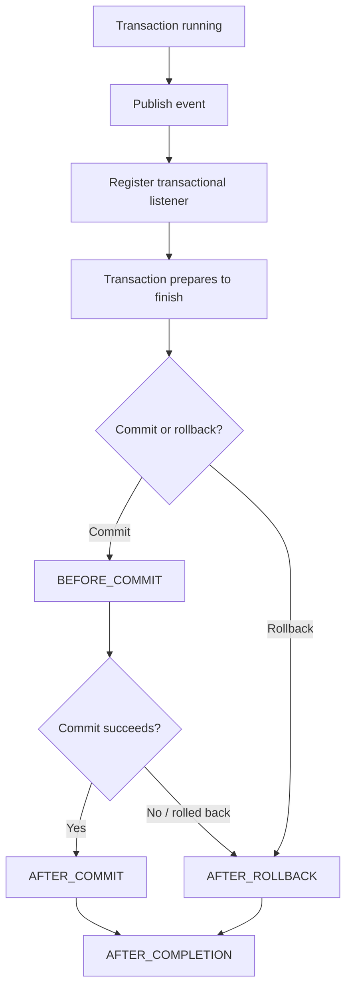

# Transactional Event Listeners and Processing Phases in Spring Framework

In a Spring application, a business operation often performs multiple changes within the same transaction: creating an order, updating inventory, recording payment, or saving account state. After the data commits, the application may need to perform follow-up actions such as sending a confirmation email, emitting a notification, updating a search index, or calling an external service.

If those actions run in the middle of the transaction, they may happen before the data commits. For instance, an order confirmation email goes out and the transaction later rolls back; the recipient receives a notification about an order that does not exist. Waiting until after commit guarantees the email is sent only after the database transaction succeeds, although you still need mechanisms to handle SMTP or external service errors.

Spring provides `@TransactionalEventListener` to bind an event listener to a transaction's lifecycle. Instead of running immediately when the event is published like a regular listener, a transactional listener can be invoked in a specific phase: before commit, after commit, after rollback, or after transaction completion.

**In business flows that send confirmation emails after data is saved, the commonly used phase is `AFTER_COMMIT`.** This article explains the phases, how to publish events, how to integrate with Spring Mail, behavior without a transaction, synchronous/asynchronous handling, and the reliability limits of in-memory events.

## 1. Regular events and transactional event listeners

Spring application events provide a mechanism for one component to announce an event while others subscribe to listen. The publisher does not need to call each listener directly.

A standard listener uses `@EventListener`:

```java
@Component
public class OrderEventListener {

    @EventListener
    public void onOrderPlaced(OrderPlacedEvent event) {
        // Listener is called when the event is published.
    }
}
```

When the publisher calls `ApplicationEventPublisher.publishEvent(...)`, Spring dispatches the event to matching listeners. With the default synchronous listener, the listener method executes on the thread publishing the event.

If the event is published inside a `@Transactional` method, a regular listener is still invoked right at publish time. The database transaction may not have committed yet:

```java
@Transactional
public void placeOrder(PlaceOrderCommand command) {
    Order order = orderRepository.save(createOrder(command));
    eventPublisher.publishEvent(new OrderPlacedEvent(order.getId()));
    // @EventListener may have already run before the method finishes.
}
```

This is a critical distinction:

| Listener | Invocation timing | Bound to transaction phase? |
|---|---|---|
| `@EventListener` | When the event is dispatched | No |
| `@TransactionalEventListener` | Configured phase of the event's transaction | Yes |

With a transactional listener:

```java
@Component
public class OrderMailListener {

    @TransactionalEventListener(
            phase = TransactionPhase.AFTER_COMMIT)
    public void onOrderPlaced(OrderPlacedEvent event) {
        // Runs only after the transaction commits successfully.
    }
}
```

Spring registers the listener with the current transaction synchronization. Only when the transaction reaches the selected phase does Spring invoke the listener. If no transaction is active, the listener does not run by default.

## 2. Phases of TransactionalEventListener

`@TransactionalEventListener` has a `phase` attribute taking a `TransactionPhase` value. The four main phases:

| Phase | Timing | Use case |
|---|---|---|
| `BEFORE_COMMIT` | Immediately before the transaction commits | Validate or prepare work that must finish before commit |
| `AFTER_COMMIT` | After the transaction commits successfully | Send confirmation emails, emit notifications after data is saved |
| `AFTER_ROLLBACK` | After the transaction rolls back | Compensate or release external resources |
| `AFTER_COMPLETION` | After the transaction finishes, whether commit or rollback | Outcome-independent resource cleanup |

If `phase` is not specified, the default value is `AFTER_COMMIT`.

### Overall sequence



The diagram illustrates the general flow. `BEFORE_COMMIT` runs only on the commit-preparation branch; if a listener in this phase throws a runtime error causing commit to fail, the transaction can roll back and the matching `AFTER_ROLLBACK`/`AFTER_COMPLETION` listeners run based on the final status.

### 2.1. BEFORE_COMMIT

`BEFORE_COMMIT` is called before the transaction commits. Database changes belonging to the current transaction can still commit along with the transaction. If the listener throws an exception that causes commit to fail, the transaction may be rolled back.

Example:

```java
@Component
public class OrderCommitListener {

    @TransactionalEventListener(
            phase = TransactionPhase.BEFORE_COMMIT)
    public void validateOrder(OrderPlacedEvent event) {
        if (event.totalAmount().signum() < 0) {
            throw new IllegalStateException(
                    "Order total must not be negative");
        }
    }
}
```

This example illustrates checking an invariant before commit. In real designs, core domain rules should be validated directly in the domain/service layer so order creation preconditions are obvious to readers. This listener phase fits when a component needs to participate in the pre-commit preparation stage via events.

**Do not send confirmation emails in `BEFORE_COMMIT`.** If the email sends successfully and the transaction then rolls back, the system has emitted information inconsistent with the final data state. Similarly, do not invoke a non-rollbackable external API in this phase if that action has side effects before the transaction commits.

### 2.2. AFTER_COMMIT

`AFTER_COMMIT` runs once the transaction has committed successfully. This is the typical phase for side effects that depend on persisted data.

Examples: sending registration or order confirmation emails, dispatching notifications, evicting caches, updating read models, or triggering a downstream workflow after business state is committed.

```java
@Component
public class OrderConfirmationListener {

    private final OrderMailService orderMailService;

    public OrderConfirmationListener(OrderMailService orderMailService) {
        this.orderMailService = orderMailService;
    }

    @TransactionalEventListener(
            phase = TransactionPhase.AFTER_COMMIT)
    public void sendConfirmation(OrderPlacedEvent event) {
        orderMailService.sendConfirmation(event);
    }
}
```

If the transaction rolls back, the method above is not invoked. If commit succeeds, Spring invokes the listener in the post-commit phase.

This solves a common business bug: no email is sent when the order-creation transaction fails. However, database commit and SMTP delivery are two independent systems. If SMTP fails after the database commits, the order exists while the email may remain unsent. Later sections cover handling this limitation.

### 2.3. AFTER_ROLLBACK

`AFTER_ROLLBACK` runs only when the transaction rolls back. It is useful when the application previously created an external effect that needs compensation or release.

For example, the system reserved capacity on an external service during business processing; if the database transaction rolls back, a listener can ask that service to release the reservation:

```java
@Component
public class ReservationRollbackListener {

    private final ReservationClient reservationClient;

    public ReservationRollbackListener(ReservationClient reservationClient) {
        this.reservationClient = reservationClient;
    }

    @TransactionalEventListener(
            phase = TransactionPhase.AFTER_ROLLBACK)
    public void releaseReservation(OrderPlacedEvent event) {
        reservationClient.release(event.orderId());
    }
}
```

This is a compensation example. The release API should be idempotent: calling it repeatedly for the same reservation must not corrupt state. The system also needs error recording and retries if the external service fails to respond.

If all work consisted solely of changes inside the same database transaction, rollback already undid them; no extra listener is needed to revert them again. `AFTER_ROLLBACK` mainly applies to resources or side effects outside the rolled-back transaction.

### 2.4. AFTER_COMPLETION

`AFTER_COMPLETION` runs after the transaction finishes, regardless of commit or rollback. This phase suits outcome-independent cleanup:

- Releasing a temporary resource.
- Closing or deleting a temporary artifact managed outside the transaction.
- Recording metrics or completion details that do not depend on the outcome.

Example:

```java
@Component
public class TemporaryResourceListener {

    private final TemporaryResourceService resourceService;

    public TemporaryResourceListener(TemporaryResourceService resourceService) {
        this.resourceService = resourceService;
    }

    @TransactionalEventListener(
            phase = TransactionPhase.AFTER_COMPLETION)
    public void cleanup(OrderProcessingEvent event) {
        resourceService.cleanupTemporaryFiles(event.processingId());
    }
}
```

The listener method does not automatically receive a commit/rollback status parameter. If cleanup logic needs to know how the transaction ended, use separate `AFTER_COMMIT` and `AFTER_ROLLBACK` listeners, or register a lower-level transaction synchronization to receive the completion status.

## 3. Default AFTER_COMMIT and fallbackExecution

Two attributes are important to understand clearly:

- `phase`: selects the processing phase; defaults to `AFTER_COMMIT`.
- `fallbackExecution`: controls whether the listener runs when an event is published without a transaction; defaults to `false`.

Example:

```java
@TransactionalEventListener
public void onEvent(OrderPlacedEvent event) {
    // Runs in AFTER_COMMIT by default.
}
```

With the default configuration, if an event is published when no transaction is active, the transactional listener will not be invoked.

### When to use fallbackExecution?

If you want the listener to still run when there is no transaction:

```java
@TransactionalEventListener(
        phase = TransactionPhase.AFTER_COMMIT,
        fallbackExecution = true)
public void handle(OrderPlacedEvent event) {
    // With a transaction: runs in the AFTER_COMMIT phase.
    // Without a transaction: executes immediately via fallback.
}
```

When there is no transaction, there is no commit phase to wait for. With `fallbackExecution = true`, the listener executes via fallback right when the event is dispatched. Thus, the listener is no longer guarded by the "after commit only" condition in that case.

Only enable fallback when business logic accepts processing the event outside a transaction as well. For order confirmation emails, usually keep the default `false` and ensure the publisher emits the event inside an actual transaction.

| Transaction active on publish? | fallbackExecution | Transactional listener |
|---|---:|---|
| Yes | false | Registered and runs in selected phase |
| Yes | true | Registered and runs in selected phase |
| No | false | Not invoked |
| No | true | Runs immediately via fallback |

## 4. Publishing events inside a transaction

For the listener to bind to a transaction, the event must be published while the transaction is active. Example of an order-creation service:

### 4.1. Defining an immutable event

```java
package com.example.order;

import java.math.BigDecimal;
import java.util.UUID;

public record OrderPlacedEvent(
        UUID orderId,
        String orderNumber,
        String recipientEmail,
        String customerName,
        BigDecimal totalAmount) {
}
```

The event record holds the data needed for the next step. Additional fields such as locale, tenant ID, or timestamps can be included, but only expose data the consumer is permitted to receive.

### 4.2. Publishing the event in a transactional service

```java
package com.example.order;

import org.springframework.context.ApplicationEventPublisher;
import org.springframework.stereotype.Service;
import org.springframework.transaction.annotation.Transactional;

@Service
public class OrderService {

    private final OrderRepository orderRepository;
    private final ApplicationEventPublisher eventPublisher;

    public OrderService(
            OrderRepository orderRepository,
            ApplicationEventPublisher eventPublisher) {
        this.orderRepository = orderRepository;
        this.eventPublisher = eventPublisher;
    }

    @Transactional
    public Order placeOrder(PlaceOrderCommand command) {
        Order order = Order.create(command);
        Order savedOrder = orderRepository.save(order);

        eventPublisher.publishEvent(new OrderPlacedEvent(
                savedOrder.getId(),
                savedOrder.getOrderNumber(),
                command.recipientEmail(),
                command.customerName(),
                savedOrder.getTotalAmount()));

        return savedOrder;
    }
}
```

The event is published after calling repository save, though the transaction has not committed yet at that line. Spring registers the listener and waits for the transaction phase. Only when the method finishes normally and the transaction commits successfully does the `AFTER_COMMIT` listener run.

If an exception triggers a rollback, the `AFTER_COMMIT` listener does not run. If the transaction is marked rollback-only, the method returning normally does not mean commit succeeded either; the listener still does not run in the commit phase.

### 4.3. Ensuring the transaction is actually active

`@Transactional` is typically enforced via a Spring proxy. Several situations prevent the annotation from creating a transaction as expected:

- Calling a transactional method from another method on the same instance (self-invocation), bypassing the proxy.
- The bean is not managed by Spring.
- The transaction manager is not configured or does not apply to the target resource.
- The method is called outside transaction management.
- The event is published before the transaction starts or after it has already completed.

If the listener does not run, check whether a transaction is truly active at the time of `publishEvent`. You can use `TransactionSynchronizationManager.isActualTransactionActive()` during diagnostics; do not use this check as a substitute for clear transaction design in production.

## 5. Combining AFTER_COMMIT with Spring Framework Mail

A practical case is sending a confirmation email after order creation. We split this into three components:

1. `OrderService` writes data and publishes the event inside the transaction.
2. `OrderConfirmationListener` listens in `AFTER_COMMIT`.
3. `OrderMailService` builds and sends the MIME message via `JavaMailSender`.

### 5.1. Listener sending mail after commit

```java
package com.example.mail;

import com.example.order.OrderPlacedEvent;
import org.springframework.stereotype.Component;
import org.springframework.transaction.event.TransactionPhase;
import org.springframework.transaction.event.TransactionalEventListener;

@Component
public class OrderConfirmationListener {

    private final OrderMailService mailService;

    public OrderConfirmationListener(OrderMailService mailService) {
        this.mailService = mailService;
    }

    @TransactionalEventListener(phase = TransactionPhase.AFTER_COMMIT)
    public void onOrderPlaced(OrderPlacedEvent event) {
        mailService.sendConfirmation(event);
    }
}
```

### 5.2. Creating the email with JavaMailSender

```java
package com.example.mail;

import com.example.order.OrderPlacedEvent;
import jakarta.mail.MessagingException;
import jakarta.mail.internet.MimeMessage;
import java.nio.charset.StandardCharsets;
import org.springframework.mail.javamail.JavaMailSender;
import org.springframework.mail.javamail.MimeMessageHelper;
import org.springframework.stereotype.Service;

@Service
public class OrderMailService {

    private final JavaMailSender mailSender;

    public OrderMailService(JavaMailSender mailSender) {
        this.mailSender = mailSender;
    }

    public void sendConfirmation(OrderPlacedEvent event) {
        try {
            MimeMessage message = mailSender.createMimeMessage();
            MimeMessageHelper helper = new MimeMessageHelper(
                    message, true, StandardCharsets.UTF_8.name());

            helper.setFrom("notifications@example.org");
            helper.setTo(event.recipientEmail());
            helper.setSubject(
                    "Order confirmation " + event.orderNumber());

            String plainText = """
                    Hello %s,

                    Your order %s has been recorded.
                    Total amount: %s

                    Thank you for shopping with us.
                    """.formatted(
                    event.customerName(),
                    event.orderNumber(),
                    event.totalAmount());

            String htmlText = """
                    <!doctype html>
                    <html lang="en">
                      <body>
                        <h2>Order Recorded</h2>
                        <p>Hello <strong>%s</strong>,</p>
                        <p>Order number: <strong>%s</strong></p>
                        <p>Total amount: <strong>%s</strong></p>
                      </body>
                    </html>
                    """.formatted(
                    escapeHtml(event.customerName()),
                    escapeHtml(event.orderNumber()),
                    escapeHtml(event.totalAmount().toPlainString()));

            helper.setText(plainText, htmlText);
            mailSender.send(message);
        } catch (MessagingException ex) {
            throw new IllegalStateException(
                    "Cannot build order confirmation email", ex);
        }
    }

    private String escapeHtml(String value) {
        return value
                .replace("&", "&amp;")
                .replace("<", "&lt;")
                .replace(">", "&gt;")
                .replace("\"", "&quot;")
                .replace("'", "&#39;");
    }
}
```

This example illustrates wiring an event to Spring Mail. In a real application, use a template engine with proper HTML escaping, format currency by currency/locale, and pull the sender address from verified configuration. The example catches `MessagingException` to distinguish message-building errors; `JavaMailSender.send(...)` can throw runtime mail exceptions.

### What happens when sending mail fails?

By the time the `AFTER_COMMIT` listener runs, the database transaction has already committed. If the SMTP server rejects the message or the connection times out, the mail send failure **cannot roll back the order transaction**.

This is right from a transaction boundary standpoint: a database transaction does not span the SMTP server. Post-commit listeners only guarantee the ordering "commit first, send later," not "database commit and email succeed or fail together."

For low-priority emails, the application can log and allow the user to request a resend. For critical transactional emails, you need a durable retry mechanism or a transactional outbox.

## 6. AFTER_COMMIT and subsequent database operations

A common point of confusion is that after a transaction commits, transaction resources may remain bound to the thread while completion callbacks execute. However, commit has already occurred; database writes performed inside the callback are not automatically committed as a continuation of the old transaction.

Spring's transaction synchronization documentation notes that resources may still be reachable after commit, but data access operations at this stage can still join the already-completed resource without a subsequent commit. If a new database write genuinely needs to be committed, execute it in a new transaction.

Example:

```java
@Service
public class MailAuditService {

    @Transactional(propagation = Propagation.REQUIRES_NEW)
    public void recordMailAttempt(UUID orderId, String status) {
        mailAuditRepository.save(new MailAudit(orderId, status));
    }
}
```

The listener can call this service:

```java
@TransactionalEventListener(phase = TransactionPhase.AFTER_COMMIT)
public void onOrderPlaced(OrderPlacedEvent event) {
    try {
        mailService.sendConfirmation(event);
        auditService.recordMailAttempt(event.orderId(), "SUBMITTED");
    } catch (RuntimeException ex) {
        auditService.recordMailAttempt(event.orderId(), "FAILED");
        throw ex;
    }
}
```

The example above illustrates recording audit entries in a new transaction. In production code, structure exception handling so an audit-write failure does not mask the original SMTP error; also avoid recording a "sent" status when the provider only accepted submission. More specific statuses such as `ATTEMPTED`, `SUBMITTED`, and `FAILED` can be used.

A cleaner design is delegating sending, outcome recording, and retries to a dedicated service where each status update runs in an independent transaction.

| Work inside AFTER_COMMIT | Handling approach |
|---|---|
| SMTP sending | Call mail sender; this is an external side effect |
| Reading committed data | Can read via service/repository; if a clear boundary is needed, use a new read-only transaction |
| Writing audit that must commit | Use a new transaction, typically `REQUIRES_NEW` |
| Updating retry/job status | Use a new transaction |
| Computing solely from event snapshot | No database transaction needed |

Avoid putting `@Transactional(REQUIRES_NEW)` on the entire listener purely out of habit. Set transaction boundaries only on database operations that truly need a new transaction.

## 7. AFTER_ROLLBACK and compensating side effects

A database transaction can roll back its own changes, but it cannot automatically roll back an HTTP request already sent to another service, a reservation created in an external system, or an email already sent.

If a workflow must create a side effect before commit, a compensation strategy is needed when the transaction rolls back. The `AFTER_ROLLBACK` event phase can trigger compensation:

```java
@TransactionalEventListener(phase = TransactionPhase.AFTER_ROLLBACK)
public void onOrderRollback(OrderReservationEvent event) {
    reservationService.release(event.reservationId());
}
```

### Compensation is not atomic rollback

Releasing a reservation is a new request to another service. It can fail, time out, or partially succeed. Therefore:

- Compensating actions should be idempotent.
- Required compensation state should be persisted if high reliability is needed.
- Retries and outcome observability are necessary.
- Do not assume the phase listener will always finish if the process stops abruptly.

Whenever possible, order business steps so irreversible side effects are unnecessary before commit. For example, send confirmation emails only after commit rather than sending inside the transaction and trying to send a correction email on rollback.

## 8. AFTER_COMPLETION for cleanup

`AFTER_COMPLETION` is useful when a resource must be released whether the transaction succeeds or fails:

```java
@Component
public class ProcessingCleanupListener {

    private final TemporaryFileService temporaryFileService;

    public ProcessingCleanupListener(TemporaryFileService temporaryFileService) {
        this.temporaryFileService = temporaryFileService;
    }

    @TransactionalEventListener(
            phase = TransactionPhase.AFTER_COMPLETION)
    public void cleanup(ReportProcessingEvent event) {
        temporaryFileService.deleteIfExists(event.tempResourceId());
    }
}
```

Cleanup operations should be safe when called multiple times. If you need to distinguish commit from rollback, use two separate listeners rather than trying to infer the transaction result from data not provided in the event.

Do not use `AFTER_COMPLETION` to send a confirmation email for an operation that is only valid upon commit, because this phase also runs after rollback. For commit-dependent actions, choose `AFTER_COMMIT`.

## 9. Ordered listeners and multiple listeners in the same phase

One event can have multiple transactional listeners. You can use `@Order` to specify the relative order among listeners processed in the same phase:

```java
@Component
public class OrderAuditListener {

    @Order(1)
    @TransactionalEventListener(phase = TransactionPhase.AFTER_COMMIT)
    public void recordAudit(OrderPlacedEvent event) {
        // Record business event.
    }
}

@Component
public class OrderNotificationListener {

    @Order(2)
    @TransactionalEventListener(phase = TransactionPhase.AFTER_COMMIT)
    public void notifyCustomer(OrderPlacedEvent event) {
        // Send email or notification.
    }
}
```

This ordering only coordinates invocation sequence within the same phase. It does not create a shared transaction across listeners and does not guarantee that the first side effect can roll back if a later listener fails.

If steps depend tightly on one another, coordinate them inside an explicit application service or workflow. Avoid using multiple listeners and ordering annotations to build a complex business process without explicit state management.

## 10. Combining @Async with TransactionalEventListener

By default, transactional listeners run synchronously on the transaction callback execution thread. This means the business method may have to wait for the email-sending listener to finish before the transactional call completes.

If sending email can take time, you can combine with `@Async`:

```java
@Configuration
@EnableAsync
public class AsyncMailConfiguration {
}
```

Listener:

```java
@Component
public class AsyncOrderMailListener {

    private final OrderMailService mailService;

    public AsyncOrderMailListener(OrderMailService mailService) {
        this.mailService = mailService;
    }

    @Async
    @TransactionalEventListener(
            phase = TransactionPhase.AFTER_COMMIT)
    public void sendConfirmation(OrderPlacedEvent event) {
        mailService.sendConfirmation(event);
    }
}
```

With this setup, in the `AFTER_COMMIT` phase, Spring invokes the listener and the executor picks up the work asynchronously. The transaction-handling thread does not wait for the entire email-sending operation to finish.

### Key things to understand when using async

**Transaction context does not transfer automatically to another thread.** Spring's imperative transactions are normally bound to the current thread. Async workers run on separate threads and do not inherit the committed transaction. If the worker needs database access, call a service with its own transaction.

**Exceptions do not return to the committed transaction.** Errors occurring in an async worker cannot roll back the original transaction and are usually not thrown back to the publisher. Configure logging, error handling, retries, and executor monitoring.

**Async is not a durable queue.** If the process stops after commit before the executor executes the work, the in-memory event can be lost. If resending after restart is required, persist a durable job/outbox.

**Executors must be bounded.** Do not let email spikes spawn excessive threads or hold too many messages in the heap. Use an executor with appropriate queue capacity, thread pool limits, and rejection policy; monitor queue depth and processing time.

### Executor declaration example

```java
@Configuration
@EnableAsync
public class MailAsyncConfiguration {

    @Bean("mailExecutor")
    public Executor mailExecutor() {
        ThreadPoolTaskExecutor executor = new ThreadPoolTaskExecutor();
        executor.setCorePoolSize(4);
        executor.setMaxPoolSize(8);
        executor.setQueueCapacity(200);
        executor.setThreadNamePrefix("mail-worker-");
        executor.initialize();
        return executor;
    }
}
```

Listener specifying the executor:

```java
@Async("mailExecutor")
@TransactionalEventListener(phase = TransactionPhase.AFTER_COMMIT)
public void sendConfirmation(OrderPlacedEvent event) {
    mailService.sendConfirmation(event);
}
```

Thread and queue numbers are examples. Choose values based on SMTP provider capacity, CPU, memory, and actual message volume.

### Avoid self-invoking the listener in the same class

`@Async` relies on Spring proxies. Calling an async method from another method on the same instance typically bypasses the proxy, preventing the call from being offloaded to the executor. Keep the listener as a Spring bean and call a separate service, or ensure calls pass through the proxy.

## 11. Transactional event listeners do not guarantee exactly-once email delivery

`@TransactionalEventListener(phase = AFTER_COMMIT)` solves a timing problem: the listener is invoked only after the transaction commits. It does not provide a durable queue, automatic retries, or exactly-once delivery.

Example scenario:

1. Database commits the order successfully.
2. Spring calls the AFTER_COMMIT listener.
3. SMTP server accepts the email.
4. Application loses connection before recording the send outcome.
5. A worker or operator retries.

The email may be sent twice because the application cannot tell for certain whether the SMTP server accepted the message. Similarly, the process may stop after commit before the listener runs, leaving the email unsent.

### Distinguishing guarantees

| Mechanism | What is guaranteed | What is not guaranteed |
|---|---|---|
| `AFTER_COMMIT` | Listener is not called when transaction rolls back | Listener is not guaranteed to run after a crash |
| `@Async` | Offloads work to an executor | Not durable across restarts |
| In-memory retry | Retries while the process stays alive | Not guaranteed if the process stops |
| Transactional outbox | Records send intent in the same business transaction | Consumers can still process repeatedly |
| Idempotency | Reduces impact when the same job is processed multiple times | Does not by itself ensure email reaches Inbox once |

## 12. Transactional outbox for critical emails

If transactional emails must be reliably resent after failures or restarts, consider a transactional outbox.

Instead of only publishing an in-memory event, the business transaction writes an outbox record in the same database transaction:

```text
Transaction
├── INSERT order
├── UPDATE inventory
└── INSERT outbox_event (ORDER_PLACED)
       |
       v
     COMMIT

Outbox worker
├── Read unprocessed events
├── Build/send email
├── Record status or attempt
└── Mark as processed
```

If the transaction rolls back, both the order and the outbox event roll back. If commit succeeds, the outbox record persists durably and a worker can resume processing after the application restarts.

### Outbox entity example

```java
@Entity
@Table(name = "outbox_event")
public class OutboxEvent {

    @Id
    private UUID id;

    private String eventType;
    private String aggregateId;

    @Column(columnDefinition = "text")
    private String payload;

    private Instant createdAt;
    private Instant processedAt;
    private int attempts;
    private String status;
}
```

A production schema needs indexes for querying pending events, locks/claims so multiple workers do not send the same job concurrently, next retry timestamp, error codes, and retention policy. Payloads should be versioned and must not contain unnecessary secrets.

### Writing to the outbox in the same transaction

```java
@Transactional
public Order placeOrder(PlaceOrderCommand command) {
    Order order = orderRepository.save(Order.create(command));

    OutboxEvent event = OutboxEventFactory.orderPlaced(
            order.getId(),
            order.getOrderNumber(),
            command.recipientEmail());
    outboxRepository.save(event);

    return order;
}
```

The order and the outbox record commit or roll back together. A worker reads pending records and sends emails afterward. You can use `@Scheduled`, a message broker, or CDC to wake the worker; the choice depends on load and architecture.

### TransactionalEventListener is still useful with an outbox

You can combine both mechanisms: publish an event inside the transaction, and have an `AFTER_COMMIT` listener wake the worker or signal that a new outbox record exists. The outbox record remains the durable source of truth; if the wake-up signal is lost, worker polling still finds the record.

Do not treat an in-memory event as an outbox record. Events are in-process notifications; an outbox is data committed to durable storage.

### At-least-once and idempotency

A worker may finish sending the email but crash before marking the outbox record as processed. A subsequent run may resend it. Therefore, an outbox typically provides at-least-once processing rather than automatically achieving exactly-once delivery.

To reduce duplicate sends:

- Use the outbox ID as an idempotency key in downstream systems if the provider supports it.
- Store attempt state and provider message IDs.
- Design business flows to tolerate or detect duplicate emails.
- Use unique constraints/claim locks to prevent multiple workers from processing the same record concurrently.
- Do not mark complete before receiving a valid submission result.

Plain SMTP does not provide a universal idempotency mechanism guaranteeing a recipient receives exactly one email. Describe internal status accurately as "submitted" rather than "read/delivered" without delivery evidence.

## 13. Event payload: what data should be passed?

An event processed after commit may execute at a different time than when it was published, especially with async or queues. Choose an appropriate payload accordingly.

### Use an immutable snapshot when data is sufficient

Example:

```java
public record OrderPlacedEvent(
        UUID orderId,
        String orderNumber,
        String recipientEmail,
        String customerName,
        String totalDisplay,
        String localeTag) {
}
```

The listener can send email from the snapshot without reloading entities. This avoids lazy loading after the transaction and keeps content consistent with when the event was created.

### Pass only the ID when the latest data is needed

An event can contain only `orderId`:

```java
public record OrderPlacedEvent(UUID orderId) {
}
```

The post-commit listener calls a service to fetch data:

```java
@Component
public class OrderMailListener {

    private final OrderQueryService queryService;
    private final OrderMailService mailService;

    @TransactionalEventListener(phase = TransactionPhase.AFTER_COMMIT)
    public void onOrderPlaced(OrderPlacedEvent event) {
        OrderMailData data = queryService.loadForMail(event.orderId());
        mailService.sendConfirmation(data);
    }
}

@Service
public class OrderQueryService {

    @Transactional(
            propagation = Propagation.REQUIRES_NEW,
            readOnly = true)
    public OrderMailData loadForMail(UUID orderId) {
        return orderRepository.findMailDataById(orderId)
                .orElseThrow();
    }
}
```

A new read-only transaction establishes a clear post-commit read boundary. Choose snapshot vs. ID based on requirements: snapshots preserve data at event time; re-querying fetches current state, which may differ if data changed afterward.

### Avoid passing JPA entities in events as a default payload

Entities can contain lazy proxies, unloaded collections, or state that changes after publishing. When a listener runs after commit or on another thread, accessing lazy fields can trigger errors or unexpected queries.

Prefer immutable records/DTOs containing the required data. If passing only an ID, let a service with a new transaction load data respecting authorization and tenant boundaries.

### Protecting personal data in events

Events may flow through logs, queues, or an outbox. Include email addresses, phone numbers, addresses, and personal data only when truly required. If events are persisted durably, define retention, encryption, and payload access controls.

## 14. Multiple listeners and responsibility boundaries

One event can trigger multiple actions:

```text
OrderPlacedEvent
    |
    +--> AFTER_COMMIT: send confirmation email
    |
    +--> AFTER_COMMIT: dispatch notification
    |
    +--> AFTER_COMMIT: update search index
    |
    +--> AFTER_COMPLETION: clean up temporary resources
```

Keep each listener focused on a single responsibility and delegate real logic to the corresponding service. A listener is an adapter connecting an application event to an action; do not turn listeners into containers for full order logic, data queries, PDF generation, and retry handling.

If multiple side effects must run in a mandatory order or share state, consider an explicit workflow/orchestrator or an outbox consumer instead of multiple independent listeners.

## 15. Reactive transactions and Spring version notes

The examples above use standard imperative transactions, typically managed by `PlatformTransactionManager` and bound to the current thread.

Reactive transactions work differently: the transaction context is stored in Reactor Context rather than relying on ThreadLocal as in the imperative model. Therefore, do not assume an event published in an arbitrary callback or thread automatically carries a reactive transaction context.

Starting with Spring Framework 6.1, transactional event listeners also support reactive transaction managers. When publishing events inside a reactive transaction, use `TransactionalEventPublisher` to attach the transaction context to the event per the documentation for your Spring version.

Key notes:

- Use the right transaction manager for imperative or reactive applications.
- Do not mix blocking mail sends directly into a reactive pipeline without managing an appropriate scheduler.
- If sending mail through a separate worker, treat it as an asynchronous side effect and handle errors/retries in the worker.
- In reactive flows, verify context propagation with the event; do not rely on thread-local transaction state.

If a project uses a Spring Framework version older than 6.1, check that version's API and reactive transactional event listener support before applying reactive examples.

## 16. Testing transactional event listeners

Tests must verify that the listener runs in the right phase, does not run on rollback, and handles the no-transaction case.

### Testing AFTER_COMMIT

You can use a test transaction to control commit timing:

```java
@SpringBootTest
class OrderEventListenerTest {

    @Autowired
    private OrderService orderService;

    @Autowired
    private MailGateway mailGateway;

    @Test
    void sendsMailAfterCommit() {
        TestTransaction.start();

        orderService.placeOrder(testCommand());

        // Before commit, the AFTER_COMMIT listener has not run yet.
        verify(mailGateway, never()).send(any());

        TestTransaction.flagForCommit();
        TestTransaction.end();

        // After the test transaction finishes with commit.
        verify(mailGateway).send(any());
    }
}
```

This is a skeletal example using Spring TestContext and Mockito; configure test transactions and mock gateways for your project. If the service method opens an independent transaction or the test does not join the intended transaction, adjust transaction control to test the right boundary.

### Testing rollback

```java
@Test
void doesNotSendMailWhenTransactionRollsBack() {
    TestTransaction.start();

    orderService.placeOrder(testCommand());

    TestTransaction.flagForRollback();
    TestTransaction.end();

    verify(mailGateway, never()).send(any());
}
```

The `AFTER_COMMIT` listener is not invoked when the transaction rolls back.

### Testing fallbackExecution

Publish an event outside a transaction:

```java
eventPublisher.publishEvent(new OrderPlacedEvent(...));
```

With `fallbackExecution = false`, verify the listener is not called. With another listener configured with `fallbackExecution = true`, verify the listener runs immediately when the event is dispatched.

### Testing BEFORE_COMMIT and AFTER_ROLLBACK

For `BEFORE_COMMIT`, verify the listener runs when the transaction reaches commit and that an exception from the listener can roll back the transaction. For `AFTER_ROLLBACK`, verify the listener runs only on the rollback branch. For `AFTER_COMPLETION`, verify cleanup runs in both outcomes.

### Avoid real SMTP in unit tests

Mock an interface such as `MailGateway` or `OrderMailService` to verify the listener triggers the right action. Use an SMTP sink in integration tests when verifying MIME messages. Never send real emails to customers in automated tests.

## 17. Common pitfalls

| Symptom | Possible cause | Remedy |
|---|---|---|
| Transactional listener does not run | Event published outside transaction and fallback defaults to false | Publish inside transactional method or consider fallback |
| Listener runs right at publish | Used `@EventListener` instead of `@TransactionalEventListener` | Choose transactional listener and appropriate phase |
| Email sent despite transaction rollback | Sent via regular listener or direct SMTP call before commit | Use `AFTER_COMMIT` |
| Email not sent after commit | Listener threw error, SMTP failed, or in-memory event lost on process stop | Logging, durable retries, or outbox |
| Post-commit audit write not saved | Write joined already-completed resource with no further commit | Call service with a new transaction |
| Async listener still runs on request thread | Missing `@EnableAsync` or self-invocation bypassed proxy | Enable async and invoke through Spring proxy |
| Async listener has no transaction | Transaction context does not propagate to worker thread | Open a separate transaction inside worker service |
| Listener reading entity hits LazyInitializationException | Payload holds JPA proxy/lazy relation | Pass DTO snapshot or re-query in a new transaction |
| Duplicate emails on retry | SMTP may have accepted message while worker did not record result | Idempotency, provider ID, and job status |
| Cleanup runs on both rollback and commit | Selected `AFTER_COMPLETION` | Use separate phases if distinction is needed |
| Compensation fails | External service unresponsive or repeated request | Idempotent compensation, retries, and persisted state |
| Listener does not run in tests | Test transaction not committed or rolled back by default | Use `TestTransaction`/`@Commit` per scenario |

### Self-invoking transactional methods

If one method in the same class calls another `@Transactional` method, the proxy may not be applied. As a result, the event is published without a transaction despite expectations. Extract a separate service or invoke through the bean proxy properly, and verify the active transaction at the publish point.

### Using the wrong phase for side effects

Sending emails in `BEFORE_COMMIT` can emit emails for data that ultimately rolls back. Sending emails in `AFTER_COMPLETION` can send even when the transaction rolls back. For confirmation emails valid only after commit, use `AFTER_COMMIT`.

### Assuming AFTER_COMMIT retries automatically

Transactional listeners only coordinate invocation timing. If the process stops or SMTP fails, Spring does not automatically convert in-memory events into durable jobs. Use an outbox or persistent queue when high reliability is required.

## 18. Phase selection guide

When designing a listener, ask: must the action occur only when the commit succeeds?

| Business requirement | Suitable phase/mechanism |
|---|---|
| Validate/prepare before commit | `BEFORE_COMMIT` |
| Send order confirmation email after saving | `AFTER_COMMIT` |
| Send notification after status update | `AFTER_COMMIT` |
| Release external reservation on rollback | `AFTER_ROLLBACK` |
| Clean up temporary files regardless of outcome | `AFTER_COMPLETION` |
| Run listener even without a transaction | Consider `fallbackExecution = true` |
| Send slow emails without blocking request thread | `AFTER_COMMIT` combined with `@Async` |
| Never lose send requests after process crash | Transactional outbox / durable queue |

The phase only determines when the listener is invoked. It does not determine retries, event durability, data access rights, or delivery guarantees.

## 19. Frequently asked questions

**How does `@TransactionalEventListener` differ from `@EventListener`?** `@EventListener` is invoked when the event is dispatched. `@TransactionalEventListener` registers with the transaction and waits for the chosen phase, such as AFTER_COMMIT.

**What is the default phase?** `AFTER_COMMIT`.

**What if an event is published outside a transaction?** By default the listener does not run because `fallbackExecution` is false. If fallback is enabled, the listener runs immediately when the event is dispatched in the no-transaction case.

**Which phase should be used for sending emails?** Usually `AFTER_COMMIT`, so the email is only sent after the business transaction commits successfully.

**Can `BEFORE_COMMIT` roll back a transaction?** Yes. If the listener throws an exception that causes commit to fail, the transaction can roll back. Therefore, do not use this phase for irreversible external side effects.

**What is `AFTER_ROLLBACK` used for?** Performing cleanup or compensation for external side effects that must be handled when the database rolls back.

**Does `AFTER_COMPLETION` run after both commit and rollback?** Yes. It runs when the transaction completes with either outcome.

**Can you write to the database inside `AFTER_COMMIT`?** Database code can be called, yet the old transaction has already committed and there is no further commit for the callback. If a write must commit independently, open a new transaction, typically with `REQUIRES_NEW`.

**Can `@Async` be combined with `@TransactionalEventListener`?** Yes. The listener is invoked at the selected phase and work is handed off to the executor. The worker runs on another thread so it does not inherit the original transaction.

**Does async guarantee emails won't be lost?** No. An in-process executor is not a durable queue. If recovery after restart is required, use an outbox or persistent queue.

**Do transactional event listeners guarantee sending exactly one email?** No. SMTP may have accepted the message while the application could not record it in time; retries can create duplicates. Proper idempotency and processing state are required.

**Should JPA entities be passed in events?** Usually avoid doing so. Pass immutable DTOs/records or an ID and re-query in a new transaction to avoid lazy loading and unexpected data mutations.

**Can there be multiple listeners for the same event?** Yes. Each can choose its own phase and use `@Order` to coordinate order within the same phase; listeners still have independent error and side-effect boundaries.

**Can reactive transactions use `@TransactionalEventListener`?** Spring Framework 6.1+ supports reactive transactions, but transaction context must be propagated via a reactive event mechanism such as `TransactionalEventPublisher`. Imperative examples cannot be applied verbatim to reactive flows.

## 20. Related technical resources

- **Spring Framework — Transaction-bound Events:** `@TransactionalEventListener`, phases, and `fallbackExecution`.
- **Spring Framework — Application Events and Listeners:** `ApplicationEventPublisher`, `@EventListener`, and listener ordering.
- **Spring Framework — Transaction Synchronization:** callbacks `beforeCommit`, `afterCommit`, `afterRollback`, and `afterCompletion`.
- **Spring Framework — Transaction Propagation:** `REQUIRES_NEW` and independent transaction boundaries.
- **Spring Framework — Task Execution and Scheduling:** `@Async`, executors, and background task execution.
- **Spring Framework Mail:** `JavaMailSender`, `MimeMessageHelper` for sending emails from listeners.
- **Transactional Outbox Pattern:** storing events/jobs in the same business transaction and processing durably after commit.

---

**Key takeaway:** `@TransactionalEventListener` binds event handling to the transaction lifecycle. Use `BEFORE_COMMIT` for work that must complete before commit, `AFTER_COMMIT` for emails and notifications after data commits, `AFTER_ROLLBACK` for compensation on rollback, and `AFTER_COMPLETION` for cleanup in either case. By default, listeners do not run if an event is published outside a transaction. Combine with `@Async` to offload sending to a worker when appropriate, and use a transactional outbox with retries/idempotency if send requests must never be lost when the application crashes.
