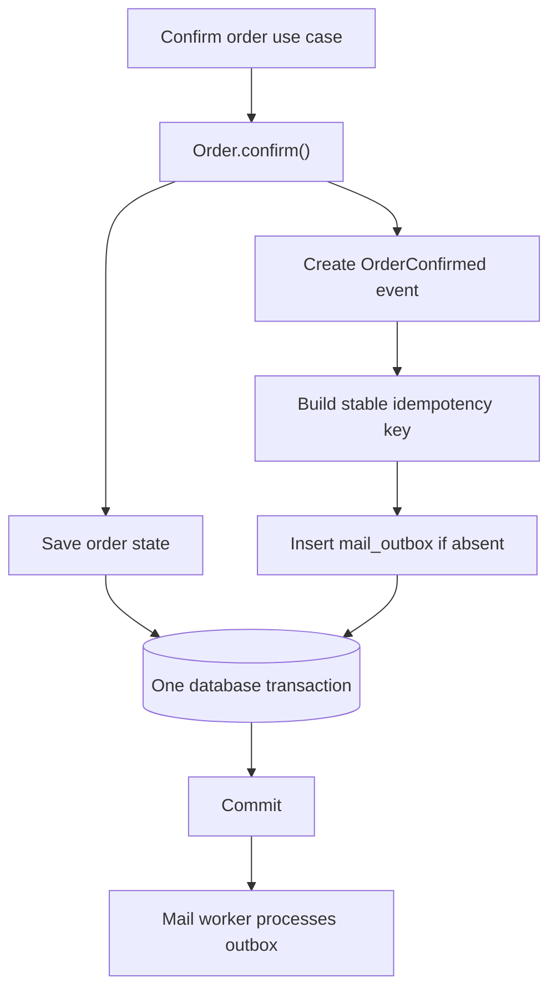
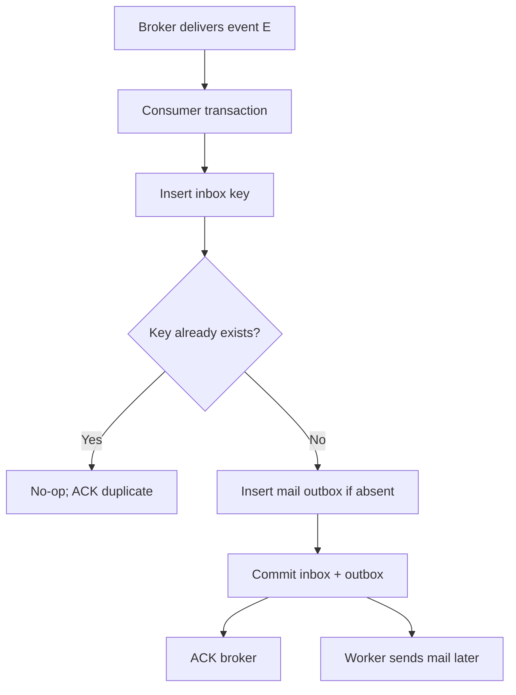

# Ensuring One Event Creates Only One Send Request

A Spring Boot application confirms an order and emits an `OrderConfirmed` event. A handler receives this event to send a confirmation email. In a real environment, the same event can be processed multiple times: a broker redelivers the message after a timeout, a worker restarts, a scheduler reruns a batch, or two instances receive the same event. If each processing pass creates a new send record, the customer may receive multiple identical emails.

To **ensure one event creates only one send request**, the system must identify the event with a stable ID, define the semantics of a send request, and enforce idempotency in durable storage. In Spring Framework Mail, final delivery may use `JavaMailSender`, yet preventing duplicate request creation must be solved in the application/database workflow before building the `MimeMessage`.

Distinguish five concepts:

- **Event:** a business event that occurred, such as an order being confirmed.
- **Send request / notification intent:** the logical requirement to send a notification for a specific purpose and recipient.
- **Send attempt:** one attempt by a worker to deliver that request.
- **Submission:** the mail transport/provider accepting the message for processing.
- **Delivery:** the delivery status reported back by the provider, if available.

An event may be reprocessed multiple times, yet it should create only one notification intent for the same purpose. That intent may have multiple attempts during retries. This is the foundation for preventing duplicate send requests.

## 1. Why can an event be processed multiple times?

In distributed systems, receiving the same message multiple times is normal:

| Cause | Example |
|---|---|
| Broker redelivery | Consumer finishes processing but ACK is lost or times out; broker redelivers the message. |
| Consumer restart | Process stops after partial processing; message was not ACKed. |
| Application retry | Worker hits a temporary error and reprocesses the same event. |
| Duplicate publish | Producer publishes the event twice due to timeout or transaction retry. |
| Concurrent consumers | Two instances receive or process an event due to distribution/lease mechanics. |
| Replay | Operations team replays events to recover or rebuild state. |
| Scheduler overlap | Two batch runs read the same data source or generate the same notifications. |

You cannot assume every message is delivered exactly once. Even when a broker offers exactly-once guarantees within its own scope, external effects like SMTP do not automatically participate in the broker's transaction.

### 1.1. Duplicate request creation bug

Simple handler example:

```java
public void handle(OrderConfirmed event) {
    OutgoingEmail email = emailFactory.from(event);
    outboxRepository.save(OutboxMessage.pending(email));
}
```

If the event arrives three times, the handler may save three records:

```text
OrderConfirmed(eventId=E-100)
       |
       +--> handle attempt 1 --> outbox row A
       |
       +--> handle attempt 2 --> outbox row B
       |
       +--> handle attempt 3 --> outbox row C

Result: three send requests for the same notification.
```

Checking only in memory with a `Set` or `ConcurrentHashMap` is insufficient. When the application runs multiple instances or restarts, each process has its own memory. Deduplication must rely on durable storage with concurrency constraints.

## 2. Idempotency: reprocessing without creating extra effects

An operation is called **idempotent** if executing it multiple times with the same logical identity/input produces the same net effect as executing it once.

For email send requests, we want:

```text
process(event E-100) attempt 1 --> create notification N-500
process(event E-100) attempt 2 --> recognizes N-500 already exists
process(event E-100) attempt 3 --> still uses N-500

Total notification intents: 1
```

Idempotency does not mean the code runs only once. The handler may run again; what matters is that subsequent runs do not create additional logical requests.

### 2.1. Distinguishing event ID from idempotency key

- **Event ID** identifies a specific event in the system.
- **Idempotency key** identifies a logical effect to be performed at most once within the chosen scope.

The two values can be closely related, though not necessarily identical.

For example, an `OrderConfirmed` event has ID `evt-8f31`. The system may send a confirmation email and create a push notification from the same event:

| Event ID | Notification purpose | Channel | Idempotency key |
|---|---|---|---|
| `evt-8f31` | `ORDER_CONFIRMATION` | Email | `evt-8f31:ORDER_CONFIRMATION:EMAIL` |
| `evt-8f31` | `ORDER_CONFIRMATION` | Push | `evt-8f31:ORDER_CONFIRMATION:PUSH` |

If the requirement is one email per recipient, recipient identity can also be part of the key. If an event can generate one email for each recipient in a list, the key must distinguish recipients to avoid accidentally collapsing valid requests.

### 2.2. Defining the deduplication scope

Before writing code, define:

1. Does one event create at most one notification per notification type?
2. Can one event create notifications for multiple recipients?
3. Can the same event trigger multiple channels such as email, SMS, and push?
4. Is a user-requested resend considered a new request?
5. How long does the system retain deduplication history?

Key example:

```text
event_id + notification_type
```

if each event may create only one notification of that type.

Or:

```text
event_id + notification_type + channel + recipient_id
```

if one event is sent to multiple recipients or multiple channels.

Do not choose a key based solely on email address and content. Two distinct events may legitimately send the same content to the same address. **Event identity and notification purpose** form the proper deduplication basis.

## 3. Events must have a stable ID

Idempotency only works if redeliveries of the same event carry the same identity.

Example:

```java
public record OrderConfirmed(
        UUID eventId,
        UUID orderId,
        UUID customerId,
        Instant occurredAt) {
}
```

`eventId` is generated once when the event is recorded. When serialized, saved to the outbox, or published to a broker, that ID must remain unchanged across every retry/replay of the same event.

### 3.1. Do not generate a new event ID on each retry

Avoid doing this:

```java
public void retryConfirmation(UUID orderId) {
    OrderConfirmed event = new OrderConfirmed(
            UUID.randomUUID(),
            orderId,
            customerId,
            clock.instant());
    eventPublisher.publish(event);
}
```

If each retry generates a new event ID, consumers treat them as different events and an event-ID-based idempotency key will not prevent duplicate notifications.

Retries should reuse **the same event record** with the same ID, or retry the notification/outbox row already created from that event. Generate a new ID only when the business genuinely emits a new event.

### 3.2. Event IDs should not be bare timestamps

Timestamps can collide when multiple events occur closely together; precision and clocks also differ across instances. Using a UUID, ULID, or scoped event sequence is more suitable. What matters is uniqueness within the storage scope and preservation across replays.

### 3.3. Replay does not equal a new event

When replaying an event for recovery, preserve the original event ID. If intentionally creating a new notification because a user clicked "Resend email," that is a **new command/request** with a new identity and explicit reason. Never disguise a resend as a replay of an old event.

## 4. Using a database unique constraint as the final barrier

A reliable way to prevent two instances from both creating a notification is storing an idempotency key with a unique constraint in the database.

Outbox table example:

```sql
CREATE TABLE mail_outbox (
    id                  UUID PRIMARY KEY,
    event_id            UUID NOT NULL,
    notification_type   VARCHAR(80) NOT NULL,
    channel             VARCHAR(20) NOT NULL,
    recipient_key       VARCHAR(320) NOT NULL,
    idempotency_key     VARCHAR(240) NOT NULL,
    recipient_address   VARCHAR(320) NOT NULL,
    subject             VARCHAR(300) NOT NULL,
    payload              TEXT NOT NULL,
    status               VARCHAR(30) NOT NULL,
    attempt_count        INTEGER NOT NULL DEFAULT 0,
    next_attempt_at     TIMESTAMP WITH TIME ZONE,
    created_at          TIMESTAMP WITH TIME ZONE NOT NULL,
    submitted_at        TIMESTAMP WITH TIME ZONE,
    provider_message_id VARCHAR(240),
    last_error_code     VARCHAR(100),
    CONSTRAINT uq_mail_outbox_idempotency
        UNIQUE (idempotency_key)
);
```

In this schema:

- `event_id` links the notification to its source event.
- `notification_type` describes the business purpose, e.g., `ORDER_CONFIRMATION`.
- `channel` distinguishes email from other channels if sharing a table.
- `recipient_key` identifies the recipient per application convention.
- `idempotency_key` is the key preventing duplicate request creation.
- `status` and retry columns describe the processing lifecycle.

If an event can generate one email request per recipient across multiple recipients, the key must include the recipient identity. If the business rule is strictly one overall email per event, the key may consist of just the event ID and notification type. Choose unique keys according to **actual business rules**, not schema convenience.

### 4.1. Why not just SELECT then INSERT?

A naive approach:

```java
if (!outboxRepository.existsByIdempotencyKey(key)) {
    outboxRepository.save(newOutboxMessage);
}
```

When two instances run concurrently:

```text
Instance A: SELECT key -> does not exist
Instance B: SELECT key -> does not exist
Instance A: INSERT row A
Instance B: INSERT row B
```

Both checks see no existing record. This is a race condition. A unique constraint forces the database to accept only one row; the other insert is rejected or treated as a duplicate depending on the statement.

**Checking with SELECT first may optimize the common path, but a unique constraint is the ultimate protection against concurrency.**

### 4.2. Insert-if-absent in PostgreSQL

PostgreSQL can use:

```sql
INSERT INTO mail_outbox (
    id, event_id, notification_type, channel, recipient_key,
    idempotency_key, recipient_address, subject, payload,
    status, created_at
)
VALUES (
    :id, :eventId, :notificationType, 'EMAIL', :recipientKey,
    :idempotencyKey, :recipientAddress, :subject, :payload,
    'PENDING', CURRENT_TIMESTAMP
)
ON CONFLICT (idempotency_key) DO NOTHING;
```

Outcome:

- If the key does not exist yet, the database inserts one row.
- If the key already exists, the database does not insert a second row.
- Concurrent transactions are coordinated by the database via the unique index.

`ON CONFLICT` syntax is PostgreSQL-specific; other databases can use equivalent mechanisms such as merge/ignore or unique-violation handling.

### 4.3. If using JPA

JPA can declare a unique constraint in the entity mapping:

```java
@Entity
@Table(
    name = "mail_outbox",
    uniqueConstraints = @UniqueConstraint(
        name = "uq_mail_outbox_idempotency",
        columnNames = "idempotency_key"))
public class MailOutboxEntity {

    @Id
    private UUID id;

    @Column(name = "event_id", nullable = false)
    private UUID eventId;

    @Column(name = "idempotency_key", nullable = false, unique = true)
    private String idempotencyKey;

    @Enumerated(EnumType.STRING)
    @Column(nullable = false)
    private OutboxStatus status;
}
```

The mapping describes the constraint at the ORM level; production still needs actual migrations/schemas with the unique index/constraint. Do not rely solely on annotations if schemas are managed with Flyway or Liquibase.

One note: catching `DataIntegrityViolationException` after `repository.save()` within the same JPA transaction does not always allow continuing that transaction. The persistence context or transaction may already be marked rollback-only. If you want insert-if-absent, use an appropriate native query, JDBC update count, or handle unique conflicts at a separate transaction boundary as designed.

## 5. Creating notification intent in the same business transaction

To avoid losing send requests upon database commit, domain state updates and outbox row creation must commit together.



If the order update and outbox insert live in two separate transactions, two failures can happen:

- The order is confirmed while the outbox is not yet written: the email is lost.
- The outbox is written while the order transaction rolls back: an email reports a state that never existed.

A transactional outbox places both changes in the same database transaction to eliminate that gap.

### 5.1. Application use case

```java
@Service
public class ConfirmOrderUseCase {

    private final OrderRepository orderRepository;
    private final MailOutboxRepository mailOutboxRepository;
    private final OrderConfirmationFactory confirmationFactory;
    private final Clock clock;

    public ConfirmOrderUseCase(
            OrderRepository orderRepository,
            MailOutboxRepository mailOutboxRepository,
            OrderConfirmationFactory confirmationFactory,
            Clock clock) {
        this.orderRepository = orderRepository;
        this.mailOutboxRepository = mailOutboxRepository;
        this.confirmationFactory = confirmationFactory;
        this.clock = clock;
    }

    @Transactional
    public void execute(UUID orderId) {
        Order order = orderRepository.getById(orderId);
        OrderConfirmed event = order.confirm(clock.instant());

        orderRepository.save(order);

        OutgoingEmail email = confirmationFactory.create(event);
        String key = "order-confirmation:"
                + event.eventId()
                + ":"
                + event.customerId();

        mailOutboxRepository.insertIfAbsent(
                event.eventId(), "ORDER_CONFIRMATION", key, email);
    }
}
```

`OrderRepository` and `MailOutboxRepository` are ports defined by the application; implementations belong in infrastructure persistence. `insertIfAbsent` must rely on a database unique constraint, not merely a SELECT in Java.

In the example, the event ID must be generated exactly once during the state transition and stored alongside the necessary facts/outbox. If the use case can rerun after a timeout, ensure reruns recognize the same business operation/event or have an incoming command idempotency key.

### 5.2. Do not generate a new key when retrying the use case

If an order confirmation request is retried by the client due to an HTTP timeout, the application may invoke the use case again. If each rerun generates a new event ID, the unique key derived from the event ID will differ.

There are two levels of deduplication:

1. **Command idempotency:** the same confirmation command resent by a client creates at most one state change/event.
2. **Event-to-notification idempotency:** the same event reprocessed creates at most one notification intent.

The two levels solve two different duplicate sources. For critical HTTP commands, use a request idempotency key or check aggregate state so a second confirmation event is not emitted. Then the outbox unique key protects consumers from duplicate events.

## 6. Inbox pattern when receiving events from a broker

If events arrive from Kafka, RabbitMQ, or another broker, consumers can receive the same event multiple times. An **inbox** table recording events already processed by a consumer prevents duplicates at the message-ingestion boundary.

Schema example:

```sql
CREATE TABLE processed_event (
    consumer_name VARCHAR(120) NOT NULL,
    event_id UUID NOT NULL,
    processed_at TIMESTAMP WITH TIME ZONE NOT NULL,
    PRIMARY KEY (consumer_name, event_id)
);
```

The primary key guarantees a consumer records each event ID at most once.

### 6.1. Inbox and outbox in the same transaction

The consumer needs to:

1. Attempt to insert `(consumer_name, event_id)` into the inbox.
2. If the key already exists, stop processing because the event was already handled.
3. If the insert succeeds, create the notification intent in the outbox.
4. Commit inbox and outbox together.
5. ACK the broker after the transaction commits.



If the process stops before commit, inbox/outbox roll back and the broker can redeliver the event. The next run will execute it again. If commit succeeds but the ACK is lost, the broker redelivers; the inbox unique key makes the consumer no-op.

### 6.2. Consumer example

```java
@Component
public class OrderConfirmedConsumer {

    private final ProcessedEventRepository processedEventRepository;
    private final MailOutboxRepository mailOutboxRepository;
    private final OrderConfirmationFactory confirmationFactory;

    @Transactional
    public void onMessage(OrderConfirmed event) {
        boolean firstDelivery =
                processedEventRepository.insertIfAbsent(
                        "order-confirmation-mail",
                        event.eventId());

        if (!firstDelivery) {
            return;
        }

        OutgoingEmail email = confirmationFactory.create(event);
        String key = "order-confirmation:"
                + event.eventId()
                + ":"
                + event.customerId();

        mailOutboxRepository.insertIfAbsent(
                event.eventId(), "ORDER_CONFIRMATION", key, email);
    }
}
```

`insertIfAbsent` for both inbox and outbox must be concurrency-safe database operations, such as native insert-ignore/upsert or JDBC with unique constraints. Both operations must join the same transaction.

If you only write the inbox and then send SMTP directly, the consumer might commit the inbox before sending and lose the email on a process crash. If you send SMTP first and then write the inbox, a crash after SMTP acceptance but before inbox write can cause duplicate sends. An outbox separates intent recording from network sending.

### 6.3. Why does the inbox key include consumer name?

The same event can be handled by multiple consumers for different purposes:

- Email-sending consumer.
- Analytics-updating consumer.
- Shipping-task consumer.

A database-wide unique key containing only the event ID would block the second consumer even though its processing is valid. Use `consumer_name + event_id` to deduplicate within the scope of one logical consumer/handler.

If one consumer must generate multiple notification types from the same event, the inbox key can include a specific subscriber/handler name, or the outbox key will distinguish each purpose.

## 7. One event can legitimately create multiple notifications

"One event creates only one send request" must be understood per **defined send purpose**. There are cases where an event validly produces multiple notifications:

- An email to the customer.
- An email to the operations team.
- An email to the billing recipient.

If different recipients are intentional in business logic, do not deduplicate everything solely by event ID.

Example:

```text
event: InvoiceIssued(evt-501)

notification intent:
  evt-501 + CUSTOMER_INVOICE + customer-10
  evt-501 + FINANCE_COPY + finance-team

Both requests are valid because purpose/recipient differ.
```

Conversely, if the same event and same purpose/recipient are processed again, the key must be identical so a second request is not created.

### 7.1. Snapshot recipient or re-resolve?

If the handler looks up the current email address on each retry, the recipient may change between processing attempts. Decide explicitly:

| Policy | Behavior |
|---|---|
| Snapshot recipient when creating intent | Retries send to the exact address chosen when the event was processed. |
| Resolve recipient when worker sends | May send to the current address, if business rules require it. |

For invoice/legal notifications, snapshots usually maintain consistency. For general notifications, fresh resolution may fit. The idempotency key must accurately reflect the definition of "same request"; do not let retries accidentally create a distinct request merely because a recipient lookup changed.

### 7.2. An intentional resend is a new request

If a user clicks "Resend invoice," that may be a new business action, not a duplicate delivery of the old event.

You can create a `ResendInvoice` command with a new `commandId`, store `resend_request_id`, and link to the original invoice/event. The key is then based on the resend command ID:

```text
original event: evt-501
first notification: evt-501:INVOICE_EMAIL:customer-10

resend command: cmd-992
resend notification: cmd-992:INVOICE_EMAIL:customer-10
```

Do not delete old dedupe records or mutate old event IDs to "allow resending." Keep history for auditing and to distinguish valid resends from unintended duplicates.

## 8. Retries must reuse the same notification intent

When sending email fails due to a temporary SMTP error, the worker should retry **the same outbox row**:

```text
Outbox N-500
   |
   +--> attempt 1: SMTP timeout
   |
   +--> attempt 2: SMTP 4xx
   |
   +--> attempt 3: submission accepted

Number of notification intents: 1
Number of send attempts: 3
```

Do not create a new outbox row for each retry. If retries generate new keys, the unique constraint no longer protects the same request.

### 8.1. Outbox states

| State | Meaning |
|---|---|
| `PENDING` | Intent created, waiting for a worker. |
| `PROCESSING` | Worker is executing an attempt. |
| `RETRY_WAIT` | Attempt failed temporarily, waiting for retry time. |
| `SUBMITTED` | Transport/provider accepted submission per contract. |
| `FAILED_PERMANENT` | Error that should not be retried automatically. |
| `UNKNOWN` | Cannot determine whether provider received it. |

State names may vary. Distinguish "submitted" from "delivered."

### 8.2. Bounded backoff

Retry schedule example:

```text
Attempt 1: immediately
Attempt 2: after 30 seconds
Attempt 3: after 2 minutes
Attempt 4: after 10 minutes
After that: FAILED_PERMANENT or dead-letter/manual review
```

The schedule above is illustrative. In practice, use exponential backoff with jitter, maximum attempt counts, notification age limits, and error classification.

### 8.3. Do not create a new notification on retry

The worker only updates:

- `attempt_count`.
- `next_attempt_at`.
- `last_error_code`.
- `status`.
- Provider submission metadata if available.

`idempotency_key`, `event_id`, and the identity of the notification intent must remain stable. If the payload was snapshotted, retries also use the exact same payload so content does not change unexpectedly.

## 9. Worker concurrency: two workers must not send simultaneously

A unique constraint prevents creating multiple outbox rows. However, it does not automatically prevent two workers from reading the same `PENDING` row and sending the email concurrently.

Example:

```text
Worker A: SELECT N-500 WHERE status=PENDING
Worker B: SELECT N-500 WHERE status=PENDING
Worker A: send N-500
Worker B: send N-500
```

This is the **claim/lease** problem at the worker layer.

### 9.1. Claiming with row locks

In PostgreSQL, a worker can select unprocessed rows using:

```sql
SELECT id
FROM mail_outbox
WHERE status IN ('PENDING', 'RETRY_WAIT')
  AND (next_attempt_at IS NULL
       OR next_attempt_at <= CURRENT_TIMESTAMP)
ORDER BY created_at
LIMIT 20
FOR UPDATE SKIP LOCKED;
```

In the same transaction, the worker updates the selected rows to `PROCESSING`, sets `locked_by` and `lease_until`, and commits. `SKIP LOCKED` lets other workers pick up rows not currently locked by this worker.

Do not keep the database transaction open while calling SMTP. Network calls can drag on; holding row locks/transactions too long causes contention and exhausts the connection pool.

### 9.2. Leases and recovery

If a worker dies after claiming a row, the row can get stuck in `PROCESSING`. Leases allow another worker to take over after the lock duration expires:

```sql
UPDATE mail_outbox
SET status = 'RETRY_WAIT',
    next_attempt_at = CURRENT_TIMESTAMP,
    locked_by = NULL,
    lease_until = NULL
WHERE status = 'PROCESSING'
  AND lease_until < CURRENT_TIMESTAMP;
```

This is an expired-lease recovery example. Add a claim token / fencing mechanism so an old worker cannot overwrite a new worker's outcome if it wakes up after its lease expired.

### 9.3. Fencing tokens

Each claim can issue a new `claim_token`. When a worker updates the result, allow the update only if the token still matches:

```sql
UPDATE mail_outbox
SET status = 'SUBMITTED',
    submitted_at = CURRENT_TIMESTAMP,
    locked_by = NULL,
    lease_until = NULL
WHERE id = :id
  AND status = 'PROCESSING'
  AND claim_token = :claimToken;
```

If the old worker's lease expired and a new worker claimed the row, the new token invalidates the old worker's update attempt.

A fencing token protects database state. It does not stop an old worker that already started an SMTP call from sending after the lease expires. To curb duplicate external effects, add provider idempotency if available, or design timeouts/leases and attempt controls appropriately.

## 10. "Exactly once" and the limits of SMTP

A single notification intent does not mean the email is delivered strictly once.

Consider:

1. Worker sends the message to the SMTP server.
2. SMTP server receives the message and returns a success response.
3. Network connection drops before the worker receives the response.
4. Worker does not know whether the server received it.
5. Worker retries.

If the SMTP server already received the message in step 2, retrying may produce a second email. The worker cannot deduce external state with certainty from a timeout alone.

### 10.1. What does an outbox guarantee?

A transactional outbox ensures:

- Domain transaction and notification intent commit together.
- Duplicate events do not create extra outbox rows when unique keys are designed properly.
- Workers can retry the same intent.
- Attempt status and history are persisted durably.

An outbox **does not by itself guarantee exactly-once submission or exactly-once delivery** over SMTP.

### 10.2. Provider idempotency keys

Some email providers via HTTP API support idempotency keys under their own contracts. When available, pass the same key across all retries of the same notification:

```java
providerClient.send(
        request,
        notification.idempotencyKey());
```

The provider can recognize duplicate requests and return the outcome of the earlier run, depending on key retention policy and support window. Read the provider's contract:

- Is the key supported on the email-sending endpoint?
- How long is the key retained?
- How does it respond if the same key is sent with a different payload?
- Is the key scoped per account/region?
- Can timed-out requests be looked up by key?

Do not assume every HTTP API is idempotent simply because a request accepts an arbitrary header.

### 10.3. SMTP Message-ID is not an idempotency guarantee

You can set a stable `Message-ID` header to assist tracing/reconciliation:

```java
message.setHeader(
        "Message-ID",
        "<notification-" + notificationId + "@mail.example.com>");
```

However, SMTP and email clients have no universal obligation to discard duplicate messages based on Message-ID. Some systems may thread or group similar conversations, yet you cannot rely on it to guarantee single delivery.

A stable Message-ID is valuable for observability and investigation; **it does not replace a provider's idempotency contract**.

### 10.4. UNKNOWN status

When a timeout occurs at a moment where it is unknown whether the provider received DATA, do not automatically assert `FAILED`. Store:

- `UNKNOWN` or `SUBMISSION_UNCERTAIN`.
- Provider/account and request reference.
- Notification ID / idempotency key.
- Attempt timestamp and cause.

If the provider offers a lookup API, reconcile before retrying. If using plain SMTP with no lookup mechanism, choose the business trade-off: retry with duplicate risk, or pause for manual handling.

## 11. Command idempotency at the ingress

Unique outbox keys protect the event → notification step. However, if the same HTTP action executes twice and produces two different event IDs, the outbox can still validly create two requests per the chosen key.

For example, the client sends:

```http
POST /orders/123/confirm
Idempotency-Key: client-request-7f91
```

The server can save the command key in the same transaction as the use-case outcome. When the client retries with the same key:

- Return the recorded result.
- Do not re-execute the business action.
- Do not create a new event.
- Do not create a new notification intent.

### 11.1. Idempotency table for commands

Example:

```sql
CREATE TABLE command_deduplication (
    idempotency_key VARCHAR(200) PRIMARY KEY,
    command_type VARCHAR(100) NOT NULL,
    result_reference VARCHAR(200),
    completed_at TIMESTAMP WITH TIME ZONE
);
```

Keys must be scoped by client/tenant and command type if the same key string can appear across multiple scopes. Do not use a single un-namespaced global key across independent consumers/clients.

### 11.2. Do not reuse a command key for a different action

The same HTTP idempotency key should identify only the same command and logical payload. If a key is reused with a different payload, the server should return a conflict error or respond per the defined contract; never silently reuse an old result for a new request.

You can store a request hash to detect same-key/different-payload cases. Payload hashing is an added consistency check, not the sole idempotency key.

## 12. Deduplication records must be kept long enough

If an outbox row is deleted immediately after sending, the unique constraint loses its trace to stop a replayed old event from recreating the request.

```text
Day 1: event E-100 creates outbox N-500, sends successfully
Day 2: cleanup deletes N-500
Day 30: event E-100 is replayed
Day 30: unique key is no longer in outbox
Result: a new notification is created
```

If you want duplicate protection for as long as events can be replayed, maintain a **deduplication ledger** or inbox record for a matching duration, even after payloads/outbox rows are archived.

### 12.1. Retention aligned with replay horizon

Choose retention based on:

- Broker retention and replay capabilities.
- Event store retention.
- Batch recovery windows.
- Operational and audit policies.
- Data retention regulations.

If events can be replayed indefinitely, a compact unique record may need to outlive email payloads. You can archive payloads while keeping a tombstone containing event ID, notification purpose, and idempotency key.

### 12.2. Do not deduplicate with arbitrary time windows

Avoid rules like "if an email with the same recipient/subject was sent in the last 10 minutes, skip it." Two distinct orders can be confirmed within the same 10 minutes and both need emails.

Deduplication must rely on stable business identity, not content similarity or time intervals.

## 13. Payload consistency: same key must mean the same thing

If two processing attempts share the same idempotency key yet produce different payloads, the system needs explicit rules.

For example, the event ID is the same, yet the first run produces subject `Order confirmed` while the next produces `Order cancelled`. This could indicate a mapping bug or an event mutated after publication.

Do not use `ON CONFLICT DO UPDATE` to silently overwrite the payload of an already-created notification. Doing so can alter email content during retries.

You can store:

- Event ID and event type.
- Notification type.
- Template version.
- Recipient snapshot.
- Payload snapshot or normalized model.
- Payload hash.

When the key already exists:

1. Do not create a second request.
2. Compare payload hash/metadata if required by business rules.
3. If the same key has a different payload, record a conflict and alert.
4. Do not overwrite a sent or retrying notification without an explicit policy.

### 13.1. Content snapshot or re-render?

| Approach | Characteristics |
|---|---|
| Store rendered payload when creating intent | Retries use the exact chosen content; easy to audit, though stores more data. |
| Store event/model + template version, render when worker runs | More flexible, but must ensure data and template version stay consistent. |

For invoices or legal notices, snapshots may be necessary. For less constrained informational emails, storing the model and template version may suffice.

Whichever approach you choose, an idempotency key must continue to represent **the exact same notification meaning**.

## 14. Insert-if-absent repository example

An application abstraction:

```java
public interface MailOutboxRepository {

    boolean insertIfAbsent(
            UUID eventId,
            String notificationType,
            String idempotencyKey,
            OutgoingEmail email);
}
```

Return value:

- `true`: this transaction created a new notification intent.
- `false`: the key already existed; no additional request created.

An infrastructure implementation can use JDBC with PostgreSQL:

```java
@Repository
public class JdbcMailOutboxRepository implements MailOutboxRepository {

    private final NamedParameterJdbcTemplate jdbc;
    private final ObjectMapper objectMapper;

    public JdbcMailOutboxRepository(
            NamedParameterJdbcTemplate jdbc,
            ObjectMapper objectMapper) {
        this.jdbc = jdbc;
        this.objectMapper = objectMapper;
    }

    @Override
    public boolean insertIfAbsent(
            UUID eventId,
            String notificationType,
            String idempotencyKey,
            OutgoingEmail email) {

        String sql = """
                INSERT INTO mail_outbox (
                    id, event_id, notification_type, channel,
                    recipient_key, idempotency_key, recipient_address,
                    subject, payload, status, created_at
                )
                VALUES (
                    :id, :eventId, :notificationType, 'EMAIL',
                    :recipientKey, :idempotencyKey, :recipientAddress,
                    :subject, :payload, 'PENDING', CURRENT_TIMESTAMP
                )
                ON CONFLICT (idempotency_key) DO NOTHING
                """;

        MapSqlParameterSource params = new MapSqlParameterSource()
                .addValue("id", UUID.randomUUID())
                .addValue("eventId", eventId)
                .addValue("notificationType", notificationType)
                .addValue("recipientKey", email.recipient())
                .addValue("idempotencyKey", idempotencyKey)
                .addValue("recipientAddress", email.recipient())
                .addValue("subject", email.subject())
                .addValue("payload", serialize(email));

        return jdbc.update(sql, params) == 1;
    }

    private String serialize(OutgoingEmail email) {
        try {
            return objectMapper.writeValueAsString(email);
        } catch (JsonProcessingException ex) {
            throw new IllegalStateException(
                    "Cannot serialize outgoing email", ex);
        }
    }
}
```

This is an illustrative example for PostgreSQL and Spring JDBC; import the corresponding JDBC/Jackson classes. The `recipient_key` column should use a stable recipient ID when available; the email address is only an option when that matches business identity.

The repository must participate in the current transaction; do not open an independent transaction if the goal is atomicity with aggregate updates.

### 14.1. Key builder

Avoid scattering idempotency key string concatenation across handlers. Create a factory:

```java
public final class NotificationIdempotencyKey {

    private NotificationIdempotencyKey() {}

    public static String orderConfirmation(
            UUID eventId,
            UUID customerId) {
        return "order-confirmation:"
                + eventId
                + ":"
                + customerId;
    }
}
```

In multi-tenant systems, add tenant scope if event IDs are not globally unique or dedupe policies must partition by tenant. Use stable encoding and respect schema length limits.

## 15. Testing idempotency

Do not test only a single successful invocation. Test duplicate deliveries and concurrency.

### 15.1. Same event processed twice

```java
@Test
void duplicateEventCreatesOnlyOneNotification() {
    OrderConfirmed event = sampleEvent();

    handler.handle(event);
    handler.handle(event);

    assertThat(outboxRepository.countByEventId(event.eventId()))
            .isEqualTo(1);
}
```

The test verifies that the same event ID and same purpose create one outbox row.

### 15.2. Different events still create separate requests

```java
@Test
void differentEventsCanCreateDifferentNotifications() {
    handler.handle(eventWithId(UUID.randomUUID()));
    handler.handle(eventWithId(UUID.randomUUID()));

    assertThat(outboxRepository.countPending()).isEqualTo(2);
}
```

Do not deduplicate two events merely because recipient and subject match.

### 15.3. Concurrent inserts

Use integration tests with a real database or Testcontainers:

1. Two threads/transactions simultaneously insert the same idempotency key.
2. Synchronize them so both operations happen nearly concurrently.
3. Verify only one insert succeeds.
4. Verify the database contains only one row.

Mock repositories cannot prove that a unique constraint works under concurrency. Tests should run on a production-compatible database engine since upsert syntax and isolation differ.

### 15.4. Atomicity with the business transaction

Rollback test:

- Update the order.
- Insert the outbox row.
- Intentionally throw an exception before commit.
- Verify both the order change and outbox row roll back.

Commit test:

- Update the order.
- Insert the outbox row.
- Commit.
- Verify both exist together.

This is essential evidence for a transactional outbox.

### 15.5. Duplicate broker delivery

Invoke the consumer twice with the same event ID:

- First pass: inbox insert succeeds and outbox row is created.
- Second pass: inbox insert reports duplicate and handler no-ops.
- Only one notification intent exists.

Next, test transaction rollback before commit and verify the event can be reprocessed.

### 15.6. Worker retries do not create new outbox rows

Simulate an SMTP timeout and rerun the worker. Verify:

- Outbox ID remains unchanged.
- Idempotency key remains unchanged.
- Attempt count increments.
- No new row is created.
- On success, row status transitions to `SUBMITTED`.

### 15.7. Crash window after SMTP acceptance

A simple unit test cannot prove exactly-once over SMTP. You can simulate:

1. Fake provider records the request.
2. Worker fails before updating the outbox.
3. Worker runs again.
4. If the provider supports idempotency, verify the provider records only one effect.
5. If the SMTP adapter lacks idempotency, the test must surface the duplicate possibility and `UNKNOWN`/reconciliation state.

## 16. Observability and operations

An idempotency mechanism must be observable to catch design bugs or abnormal replays.

Useful fields:

| Field | Purpose |
|---|---|
| Event ID | Correlate source event. |
| Notification ID | Identify logical send request. |
| Idempotency key | Determine duplicate scope. |
| Notification type/channel | Identify purpose and channel. |
| Recipient key | Identify recipient per policy. |
| Attempt count | Track retries. |
| Worker/claim token | Investigate concurrency and leases. |
| Provider reference | Reconcile submission. |
| Payload/template version | Explain rendered content. |

Metrics to track:

- Duplicate events blocked by inbox.
- Outbox inserts hitting unique conflicts.
- Notification intents created.
- Send attempts per notification.
- Notifications in `UNKNOWN`.
- Expired leases and worker reclaims.
- Duplicate provider responses if reported by provider.

Never use email addresses, event IDs, or idempotency keys as high-cardinality metric labels. Log those IDs under proper access controls, while metrics use notification type, provider, and error category.

### 16.1. Distinguishing blocked duplicates from system errors

An insert hitting a unique conflict may be a **valid blocked duplicate**, not necessarily an error. Record metrics or log at an appropriate level to observe frequency, without reporting a business error to the user solely because a broker redelivered an event.

If the same key appears with a different payload, that is anomalous and warrants dedicated logging/alerting.

### 16.2. Cleanup and audit

Do not delete the dedupe ledger too early. You can:

- Archive old payloads.
- Keep event ID, notification type, and idempotency key as a tombstone.
- Keep final status and timestamps for auditing.
- Enforce retention aligned with the replay horizon and data regulations.

Data deletion must not erase the ability to recognize old replays within the window where replays are still permitted.

## 17. Common pitfalls

### 17.1. Generating a new UUID each time the consumer runs

If the key uses a newly generated ID, every redelivery looks like a new notification. Preserve the event ID and derive keys deterministically from event/purpose/recipient.

### 17.2. Using only SELECT before INSERT

Two instances can both observe the key as absent. Enforce a unique constraint and use insert-if-absent/upsert.

### 17.3. Deduplicating solely by email address or subject

Two distinct events can send the same subject to the same recipient. Use event identity and notification purpose.

### 17.4. Retrying by creating a new outbox row

Retries must update the same intent and increment attempt count. Never generate a new key per attempt.

### 17.5. Sending SMTP inside the business transaction

SMTP does not join DB transactions. Use an outbox to persist intent atomically and let a worker send later.

### 17.6. Using only an AFTER_COMMIT listener for critical emails

In-memory listeners can be lost if the process stops after commit. Use an outbox when durability and retries are needed.

### 17.7. Writing inbox first, then sending directly

If the inbox commits and the process dies before sending, the email is lost. Write inbox and outbox in the same transaction, and let the worker send afterward.

### 17.8. Sending directly first, then writing inbox

If SMTP accepts the message and the process dies before writing the inbox, redelivery can send duplicates. An outbox minimizes the gap between event processing and send attempts.

### 17.9. Assuming a unique outbox row stops two workers from sending simultaneously

A unique constraint prevents duplicate rows, not two workers claiming the same row. Use row locks, leases, and fencing tokens.

### 17.10. Assuming an outbox guarantees exactly-once delivery

An outbox protects intent persistence; crashing after provider acceptance can still cause duplicate retries. Use provider idempotency when available and handle uncertain states.

### 17.11. Using Message-ID as the deduplication key

Message-ID aids tracing, not guaranteed deduplication across SMTP/email clients. Rely on provider-supported idempotency contracts.

### 17.12. Deleting outbox rows immediately after sending

Subsequent event replays can recreate the notification. Keep a dedupe ledger/tombstone aligned with the replay horizon.

### 17.13. Silently updating payload on the same key

Retries could end up sending different content than the original notification. Snapshot payload/version and detect conflicts.

### 17.14. Failing to distinguish resends from duplicates

User-requested resends are new actions. Create a new command/notification ID linked to the original request.

## 18. Practice exercises

### Exercise 1 — Designing idempotency keys

An `InvoiceIssued` event can send an email to the customer and a copy to accounting. Define the key for each request. Why is using only the event ID insufficient?

### Exercise 2 — Race condition

Two workers concurrently run `existsByIdempotencyKey` and both receive `false`. Describe the interleaving and explain the role of the unique constraint.

### Exercise 3 — Transactional outbox

Write a use case that emits an event and inserts an outbox row inside the same `@Transactional` method. Describe what happens if the transaction rolls back.

### Exercise 4 — Inbox consumer

A broker delivers the same event three times. Design an inbox table with unique key `consumer_name + event_id` and show how to write inbox/outbox atomically.

### Exercise 5 — Retries

One notification has three SMTP attempts. Identify which fields change and which must remain constant across attempts. Why must you not create a new outbox row?

### Exercise 6 — Exactly once

The SMTP server may have received DATA, yet the worker times out before receiving a response. Explain why the worker cannot know the outcome with certainty and design `UNKNOWN`/reconciliation.

### Exercise 7 — Command idempotency

A client retries the same order confirmation request after an HTTP timeout. Design a command idempotency key so a new event ID is not generated on every retry.

### Exercise 8 — Retention

Outbox rows are deleted after 7 days while the event store allows replays for 90 days. Analyze the risk and propose a dedupe ledger retention strategy.

### Exercise 9 — Valid resend

A customer clicks "Resend invoice" after one week. Distinguish the new resend command from replaying the old event, and propose an identity for the new notification.

### Exercise 10 — Concurrent workers

Two workers read the same notification. Design claiming with `FOR UPDATE SKIP LOCKED`, leases, and fencing tokens. Explain why a fencing token cannot by itself stop an already-started SMTP call.

## 19. Takeaways and references

To **ensure one event creates only one send request** in Spring Framework Mail:

1. Assign a stable event ID once and preserve it across redeliveries/replays.
2. Clearly define duplicate scope using event ID, notification purpose, channel, and recipient when needed.
3. Build deterministic idempotency keys; never generate a new key on each retry.
4. Enforce a unique constraint in the database and use insert-if-absent/upsert against concurrency.
5. Write business changes and outbox intent inside the same transaction.
6. For broker consumers, use an inbox key scoped by consumer/event and write inbox + outbox atomically.
7. Retry the same notification row; workers claim with locks/leases so two workers never process simultaneously.
8. Distinguish unique notification intent from send attempts and delivery; an outbox does not guarantee exactly-once SMTP.
9. Use provider idempotency keys if genuinely supported; Message-ID serves tracing only.
10. Retain dedupe records long enough for event replays and separate intentional resends from duplicates.
11. If the same key arrives with a different payload, record a conflict rather than silently overwriting.
12. Test duplicate deliveries, concurrent inserts, rollbacks, worker retries, and crash windows.

Recommended reading:

- **Transactional Outbox pattern:** writing notification/event intent in the same business transaction and processing via workers.
- **Idempotent Consumer pattern:** receiving duplicate messages while producing a logical effect at most once.
- **Inbox pattern:** recording processed events per consumer identity.
- **Spring Framework transaction management:** `@Transactional`, transaction boundaries, and event listener phases.
- **Spring JDBC / Spring Data JPA:** native inserts, unique constraints, transactions, and persistence exceptions.
- **PostgreSQL documentation — INSERT ... ON CONFLICT:** insert-if-absent and unique-conflict handling.
- **Message broker delivery semantics:** ACKs, redelivery, consumer retries, and replays.
- **Provider API documentation:** idempotency keys, request lookups, submission references, and email provider retry policies.

**The goal is one notification intent per defined event-purpose-recipient, not assuming every network component runs only once.** Stable event identity, unique constraints, transactional outbox/inbox, and retrying the same request form application-level deduplication. When crossing to SMTP, you must still acknowledge the limits of uncertain submission outcomes and use provider idempotency where available.
