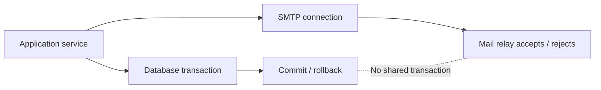
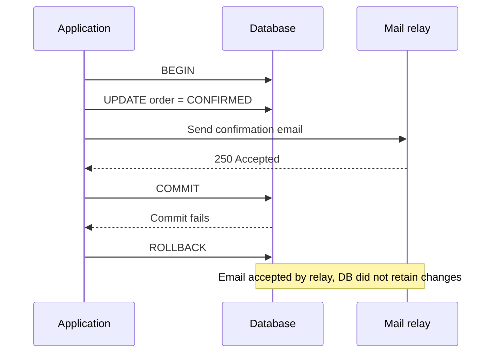
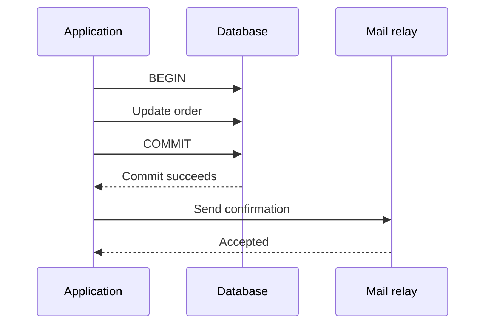
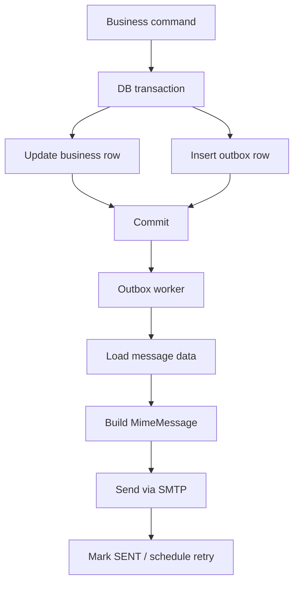

# Limitations of Calling SMTP Inside a Transaction

In a Spring application, a business operation often updates data in the database and then sends a notification email to the user. For example, when an order is confirmed, the system saves the order status and sends a confirmation email; when a user changes their password, the system updates account details and sends a security alert.

These two operations appear to belong to the same business workflow, yet they run across two different systems. A JDBC/JPA transaction can commit or roll back data in the database. SMTP is an external protocol; the mail server does not participate in the database transaction and cannot automatically roll back an email it has already accepted. Therefore, **an SMTP call inside a `@Transactional` method cannot be treated as an atomic part of the database transaction**.

If you send the email before the database commits, the recipient may receive a notification about data that ultimately rolls back. If you wait until after commit to send, the email may fail while the data is already committed. If the process stops between the two operations, the system may lose the notification or send duplicates on retry. This is the core limitation to understand before designing event and transaction flows.

This article explains the boundary between database transactions and SMTP, failures when sending before/after commit, using `@TransactionalEventListener(AFTER_COMMIT)` for simple notifications, transactional outboxes for high-reliability notifications, retries/idempotency, and testing. Examples use Spring Framework 6.x, Spring Boot 3.x, Java 21, Spring Data JPA, and Jakarta Mail.

## 1. A database transaction does not include SMTP

A database transaction normally manages operations on a transaction manager and a resource enlisted in the transaction, such as a JDBC connection or JPA persistence context. When the transaction commits, the database confirms the changes belonging to that transaction; when it rolls back, uncommitted changes are discarded.

A call:

```java
mailSender.send(message);
```

transmits data to the mail transport over SMTP. The mail server receives commands and data according to the SMTP protocol. The mail server has no knowledge of the application's database transaction state; nor does it accept a rollback command tied to a JDBC transaction ID.

Diagram of the two systems:



Two independent outcomes:

- The database can commit while SMTP sending fails.
- SMTP can accept the email while the database rolls back.
- The application can lose connectivity after the relay accepted the email but before receiving the response.

Even if the same Java method calls both a repository and `JavaMailSender`, placing two calls in the same call stack does not turn them into a distributed transaction. `@Transactional` controls the transaction manager configured for the method; it does not automatically turn SMTP into a rollbackable resource.

## 2. Why is sending SMTP before database commit dangerous?

Consider an order confirmation operation:

```java
@Transactional
public void confirmOrder(Long orderId) {
    Order order = orderRepository.findById(orderId).orElseThrow();
    order.confirm();
    orderRepository.save(order);

    mailService.sendOrderConfirmed(order);
}
```

Actual sequence:

1. Database transaction starts.
2. Application updates the order status inside an uncommitted transaction.
3. Application calls SMTP.
4. Mail relay accepts the email.
5. Database commit executes.

If step 5 fails, the database rolls back while the email has already left the application. The recipient may see "Order has been confirmed" even though the final status in the database remains unconfirmed.



A database rollback only undoes changes in the database. It cannot recall an email already accepted by a mail relay, nor can it delete the email from the recipient's mailbox.

### 2.1. An email can be sent while data is still uncommitted

In some setups, the SMTP server or downstream worker processes emails very quickly. The recipient may open a link while the application's transaction is still running. If the link queries newly inserted uncommitted data, the endpoint may fail to find the record or return stale state.

Examples:

- An email contains a URL to a newly created invoice, yet the transaction has not committed so the invoice page cannot read it.
- An email reports an account was activated, yet the activation transaction can still roll back.
- An email reports payment succeeded, yet the payment status update transaction fails.

The issue is not just inaccurate email content. The email can trigger follow-up actions based on data that does not durably exist.

### 2.2. Slow SMTP prolongs database transactions

SMTP is network I/O. A single send may wait on DNS, TCP connection, TLS handshake, authentication, MIME body transmission, and relay responses. When executed inside a database transaction:

- Database connections may be held longer than necessary.
- Row locks may persist throughout the send duration.
- Other transactions must wait or experience lock contention.
- An SMTP timeout can cause the transaction to roll back after holding significant locks.
- Business throughput becomes bounded by mail relay latency.

Do not hold a database transaction open while performing an external network operation of unbounded duration when the two stages can be separated.

## 3. What does sending after commit solve?

If you wait until the transaction commits successfully before calling SMTP, no email is sent for a rolled-back database change. This is an important improvement: notifications are triggered only after business state has committed.

Flow:



However, sending after commit does not create atomicity. A new gap appears:

1. Database commit succeeds.
2. Process stops abruptly before calling SMTP.
3. Business data is saved, yet no email is sent.

Or:

1. Database commit succeeds.
2. SMTP rejects or times out.
3. Email is not sent, yet the business operation is already complete.

After commit, you cannot roll back the old transaction to revert the database to its prior state. Failed mail sends must be handled as an independent task: recording errors, retrying, or routing to intervention.

### 3.1. Comparing the three invocation approaches

| Approach | Advantage | Risk |
|---|---|---|
| Send SMTP directly inside transaction | Simple code; send errors can make the method throw exceptions | Long transactions; emails can be sent despite DB rollback |
| Send after commit via callback/event | Does not send on transaction rollback; SMTP does not hold DB transaction during callback | Process can stop after commit before sending; send errors cannot roll back DB |
| Transactional outbox | Records send intent with business transaction; worker can retry after restart | Requires outbox table, worker, states, cleanup, and duplicate handling |

The choice depends on business requirements. A secondary notification email may tolerate rare notification loss and use an after-commit event. Critical transactional confirmation emails usually need an outbox to recover after process failures.

## 4. Using TransactionSynchronization after commit

Spring provides transaction synchronization to register callbacks that run after a transaction commits successfully:

```java
import org.springframework.transaction.support.TransactionSynchronization;
import org.springframework.transaction.support.TransactionSynchronizationManager;

public void registerAfterCommit(Runnable action) {
    if (!TransactionSynchronizationManager.isSynchronizationActive()) {
        throw new IllegalStateException(
                "Must be called inside an active transaction");
    }

    TransactionSynchronizationManager.registerSynchronization(
            new TransactionSynchronization() {
                @Override
                public void afterCommit() {
                    action.run();
                }
            });
}
```

Usage example:

```java
@Transactional
public void confirmOrder(Long orderId) {
    Order order = orderRepository.findById(orderId).orElseThrow();
    order.confirm();
    orderRepository.save(order);

    registerAfterCommit(
            () -> mailService.sendOrderConfirmed(order.getId()));
}
```

The `afterCommit()` callback is invoked only after a successful commit. If the transaction rolls back, the callback does not run. This prevents sending emails before the order status is committed.

Still, a callback is not a durable queue. If the JVM stops after commit before the callback runs, the send task has nowhere persisted to recover from. If the callback calls SMTP and fails, the database transaction has already committed; that exception cannot turn the commit into a rollback.

### 4.1. Checking for an active transaction

If code can be called both inside and outside a transaction, define the behavior:

- Require a transaction and reject calls without one.
- If no transaction exists, send directly.
- Or always publish an event and let listeners handle per policy.

Never silently assume a callback will run without a transaction. `TransactionSynchronizationManager.isSynchronizationActive()` helps detect whether synchronization is active. Understand the difference between active synchronization and an actual active transaction in applications using multiple transaction managers.

### 4.2. Callbacks are not the place for long-running work

After-commit callbacks run on the caller's transaction-completion thread unless the application explicitly offloads work to an executor. Synchronous SMTP calls here can make the request wait long even though the database already committed. For slow sends, use an executor or worker; for durability across restarts, use an outbox.

## 5. Using @TransactionalEventListener(AFTER_COMMIT)

Spring provides `@TransactionalEventListener` to bind a listener to a transaction phase. For email notifications, the common phase is `AFTER_COMMIT`.

### 5.1. Publishing the event in business logic

Define a small event carrying only the business ID:

```java
public record OrderConfirmedEvent(Long orderId) {}
```

Publish inside the transaction:

```java
import org.springframework.context.ApplicationEventPublisher;
import org.springframework.stereotype.Service;
import org.springframework.transaction.annotation.Transactional;

@Service
public class OrderApplicationService {

    private final OrderRepository orderRepository;
    private final ApplicationEventPublisher eventPublisher;

    public OrderApplicationService(
            OrderRepository orderRepository,
            ApplicationEventPublisher eventPublisher) {
        this.orderRepository = orderRepository;
        this.eventPublisher = eventPublisher;
    }

    @Transactional
    public void confirm(Long orderId) {
        Order order = orderRepository.findById(orderId).orElseThrow();
        order.confirm();
        orderRepository.save(order);

        eventPublisher.publishEvent(
                new OrderConfirmedEvent(order.getId()));
    }
}
```

The event carries only the order ID rather than the entire entity. The listener can reload committed data, reducing dependence on an entity managed in the persistence context and avoiding carrying a heavy object across event boundaries.

### 5.2. Listener runs only after commit

```java
import org.springframework.stereotype.Component;
import org.springframework.transaction.event.TransactionPhase;
import org.springframework.transaction.event.TransactionalEventListener;

@Component
public class OrderMailListener {

    private final OrderMailService mailService;

    public OrderMailListener(OrderMailService mailService) {
        this.mailService = mailService;
    }

    @TransactionalEventListener(phase = TransactionPhase.AFTER_COMMIT)
    public void onOrderConfirmed(OrderConfirmedEvent event) {
        mailService.sendConfirmation(event.orderId());
    }
}
```

With the default configuration, the listener is triggered only when the event is published inside an active transaction and that transaction reaches the matching phase. If published outside a transaction, the listener does not run because `fallbackExecution` defaults to false.

This can be declared explicitly:

```java
@TransactionalEventListener(
        phase = TransactionPhase.AFTER_COMMIT,
        fallbackExecution = false)
public void onOrderConfirmed(OrderConfirmedEvent event) {
    mailService.sendConfirmation(event.orderId());
}
```

### 5.3. What AFTER_COMMIT guarantees and does not guarantee

An `AFTER_COMMIT` listener guarantees that listener invocation timing is tied to the commit outcome of the current transaction. It prevents sending emails for rolled-back changes.

It does not guarantee:

- Event durability if the process crashes.
- That SMTP will always succeed.
- That an email accepted by a relay will reach the Inbox.
- Exactly-once execution across restarts or manual retries.
- That an error in the listener can roll back the just-committed transaction.

If the listener throws an exception while running after commit, the database has already committed. Depending on the call path and listener configuration, the exception may propagate to the transaction-completion thread or be handled by the event infrastructure; in all cases, it does not undo the completed commit. Handle send errors explicitly and never rely on exceptions to reverse business data.

### 5.4. Reloading data in the listener

The listener can invoke a service that loads the order by ID. If you need to write email status or update data after commit, intentionally use a new transaction, such as `@Transactional(propagation = Propagation.REQUIRES_NEW)` on a separate service. Never assume the old transaction can commit additional writes after the callback.

For a simple notification, the listener can call the mail service and log redacted errors. For notifications requiring durable retries, writing send intent to an outbox inside the business transaction is more suitable.

## 6. Why is @Async after commit still not durable enough?

You can combine the listener with `@Async`:

```java
@Async
@TransactionalEventListener(phase = TransactionPhase.AFTER_COMMIT)
public void onOrderConfirmed(OrderConfirmedEvent event) {
    mailService.sendConfirmation(event.orderId());
}
```

This offloads sending to an executor so the request thread does not wait on SMTP. However, the event is only dispatched to an in-memory executor after commit. If the process stops after commit before the task executes, the task can be lost.

An in-process executor is not a durable message broker. In-memory queues can be lost on restart; full queues or executor shutdowns can also prevent tasks from running. `@Async` solves thread dispatching, not atomicity between the database and SMTP.

If using an async listener for non-critical emails, add logging, metrics, and error monitoring. If losing an email causes business errors, use an outbox.

## 7. Transactional outbox bridges the post-commit gap

A transactional outbox stores a record describing the email-sending job inside **the same database transaction** as the business change. Because both sit inside one database transaction, either both the business change and the outbox record commit, or both roll back.

A separate worker reads the outbox after commit and performs SMTP sending. If the worker stops, the record remains in the database for another worker to process after the application restarts.



An outbox does not make SMTP part of the database transaction. It creates a durable record of send intent, allowing the system to continue the work after commit.

### 7.1. Creating the outbox table

A conceptual schema:

```sql
CREATE TABLE mail_outbox (
    id                  BIGINT GENERATED ALWAYS AS IDENTITY PRIMARY KEY,
    notification_key    VARCHAR(120) NOT NULL UNIQUE,
    recipient            VARCHAR(254) NOT NULL,
    template_id          VARCHAR(80) NOT NULL,
    template_version     INTEGER NOT NULL,
    payload_json         TEXT NOT NULL,
    status               VARCHAR(20) NOT NULL,
    attempts             INTEGER NOT NULL DEFAULT 0,
    next_attempt_at      TIMESTAMP NOT NULL,
    lease_until          TIMESTAMP NULL,
    created_at           TIMESTAMP NOT NULL,
    sent_at              TIMESTAMP NULL,
    last_error_code      VARCHAR(80) NULL
);
```

This is an illustrative schema using common SQL syntax; adjust identity types, JSON, timestamps, and locking to your actual database. `notification_key` has a unique constraint to stop business logic from unintentionally creating multiple identical intents.

Key fields:

- `notification_key`: application-level idempotency key.
- `template_id` and `template_version`: identify the chosen content.
- `payload_json`: minimal controlled data required for rendering.
- `status`: job state.
- `attempts`: number of send attempts.
- `next_attempt_at`: timestamp when a worker may try next.
- `lease_until`: timestamp when the worker's lease expires.
- `sent_at`: timestamp when the relay accepted the send per sender outcome.
- `last_error_code`: redacted error code, storing no credentials or sensitive content.

If attachments accompany the email, store storage keys and versions in the payload or a linked table. Never store an `InputStream` in the outbox. Attachment data must remain intact throughout the entire retry window.

### 7.2. Writing business data and outbox in the same transaction

Example:

```java
@Service
public class OrderApplicationService {

    private final OrderRepository orderRepository;
    private final MailOutboxRepository outboxRepository;

    public OrderApplicationService(
            OrderRepository orderRepository,
            MailOutboxRepository outboxRepository) {
        this.orderRepository = orderRepository;
        this.outboxRepository = outboxRepository;
    }

    @Transactional
    public void confirm(Long orderId) {
        Order order = orderRepository.findById(orderId).orElseThrow();
        order.confirm();
        orderRepository.save(order);

        MailOutboxEntry entry = MailOutboxEntry.pending(
                "order-confirmed:" + order.getId(),
                order.getCustomerEmail(),
                "order-confirmed",
                1,
                OrderMailPayload.from(order));

        outboxRepository.save(entry);
    }
}
```

`MailOutboxEntry.pending(...)` and `OrderMailPayload.from(...)` are application-defined factories/models. Note that the business repository and outbox repository must share the same transaction manager/database transaction. If the outbox is written to a different database or transaction manager without a coordination mechanism, atomicity is no longer guaranteed.

If the transaction rolls back, both the order update and the outbox insert roll back. If commit succeeds, both exist for the worker to process.

### 7.3. Worker sending outside short transactions

Do not keep a database transaction open while the worker calls SMTP. A common design is:

1. In a short transaction, the worker claims a batch of outbox rows and sets leases.
2. Commit the claim transaction.
3. Read payloads/attachments, build the MIME message, and call SMTP outside the claim transaction.
4. In a new transaction, update status to SENT or schedule a retry.

Pseudo-flow:

```text
claimDueMessages()      // short transaction, lease rows
commitClaim()

for each claimed message:
    renderAndValidate()
    createMimeMessage()
    sendViaSmtp()       // not holding claim DB transaction

    if relayAccepted:
        markSent()      // new transaction
    else if retryable:
        scheduleRetry() // new transaction
    else:
        markFailed()    // new transaction
```

Claiming must be safe when multiple workers exist. You can use row locking, optimistic locking, or lease tokens. Some databases support `FOR UPDATE SKIP LOCKED`; that is a database-specific option, not portable SQL syntax.

Leases let another worker take over if the current worker crashes. Leases must be long enough or renewed during slow sends; if a lease expires while a worker is still sending, another worker may claim the same row and cause duplicate sends.

## 8. Outbox does not create exactly-once delivery

An outbox ensures send intent is persisted in the business transaction and a worker can continue processing. However, SMTP remains an external system. One scenario cannot be eliminated by database transactions alone:

1. Worker sends the message.
2. Relay accepts the message.
3. Connection drops before the worker receives the response or before the worker updates the outbox to SENT.
4. Worker cannot tell for sure whether the relay received it.
5. Worker retries and may send a second email.

```mermaid
sequenceDiagram
    participant W as Outbox worker
    participant SMTP as Mail relay
    participant DB as Database
    W->>SMTP: SMTP DATA / message
    SMTP-->>SMTP: Accepts message
    SMTP--xW: Response lost
    W->>DB: Unable to record SENT
    Note over W,DB: Job is retried; relay may have accepted previous attempt
    W->>SMTP: Send again
```

Thus, the standard model is **at-least-once attempt**: the system keeps trying until recording success or reaching a terminal state per policy. When SMTP outcomes are uncertain, retries can produce duplicates.

Never claim exactly-once email delivery merely because the outbox has a unique key. A unique key stops creating duplicate outbox intents in the database; it does not force the SMTP relay to deduplicate repeated sends.

### 8.1. Idempotency keys at the business layer

Generate a stable key for a notification:

```java
String notificationKey = "order-confirmed:" + orderId;
```

Place a unique constraint on this key. When a command is resent due to client retries or an event is processed multiple times, the application detects the existing intent and avoids creating another outbox row.

The key should represent a specific notification, not just a generic template type. For example, one order can have several different notification types; the key must include the appropriate event type or business version.

### 8.2. Message-ID is not a deduplication guarantee

You can assign a stable Message-ID to a notification if your system has a valid operational reason. Some receiving systems may use it to aid investigation or deduplication. However, SMTP and mailbox providers are not required to discard every email sharing a Message-ID. Never rely on Message-ID as an exactly-once guarantee.

If your mail provider's sending API supports idempotency keys, review that specific provider's contract. That capability is not a universal SMTP feature.

## 9. Designing outbox states

A minimal state set can include:

| State | Meaning |
|---|---|
| `PENDING` | Waiting for a worker to process |
| `PROCESSING` | Claimed by a worker with a lease |
| `RETRY_WAIT` | Temporary failure, waiting for next attempt |
| `SENT` | Sender recorded that relay accepted the message |
| `FAILED` | Terminal error or exhausted retry policy |
| `CANCELLED` | Notification cancelled per business rules |

SENT status should only mean the sender/relay accepted the send operation per the received response. It does not mean the recipient read it, or that the email definitely landed in the Inbox. Bounces, spam filtering, and downstream delivery failures need a separate tracking workflow if required by the product.

### 9.1. Retries with backoff

Do not retry continuously at an overly short fixed interval. An example policy:

| Attempt | Wait time before next attempt |
|---:|---:|
| 1 | 30 seconds |
| 2 | 2 minutes |
| 3 | 10 minutes |
| 4 | 30 minutes |
| 5 | 2 hours |

In practice, use exponential backoff with jitter so multiple workers do not resend simultaneously. Cap attempt counts and total notification lifetime; afterward transition to FAILED or route to a manual-handling queue.

### 9.2. Classifying errors before retrying

| Error type | Example | Handling approach |
|---|---|---|
| Invalid data | Malformed recipient syntax, template missing variable | FAILED; fix data/template |
| Configuration error | Wrong SMTP credentials, disallowed sender domain | Stop or retry after configuration is fixed |
| Temporary error | SMTP 4xx, network unavailable | Retry with backoff |
| Permanent error | Recipient rejected by relay with unrecoverable error | FAILED or suppression per policy |
| Uncertain outcome | Timeout after relay may have received DATA | Record UNKNOWN status and handle per duplicate strategy |

Do not treat every `MailException` as retryable. Rendering errors or missing attachments are not solved by connecting to SMTP repeatedly.

### 9.3. UNKNOWN status

Some timeouts happen after the relay may have received the content while the application never got the final response. If the system cannot determine the outcome, store UNKNOWN status to handle it differently from definite rejections.

Depending on criticality:

- Retry and accept duplicate risk.
- Route to manual handling or reconciliation.
- Query status via provider API if the provider supports it.
- Mark notification as attempted but unconfirmed; do not resend immediately.

This decision is a business trade-off between losing an email and sending a duplicate.

## 10. Do not use SMTP exceptions to roll back committed business state

If sending happens after commit and SMTP fails, do not try opening a new transaction to reverse the order simply because the email failed to send. Email is a notification side effect; reversing order state can cause far worse business errors.

Example:

- Payment was confirmed by the payment provider and committed to the database.
- Payment confirmation email fails.
- The system must not flip payment to FAILED just because SMTP timed out.

Manage notification status separately from business status:

```text
Order status: CONFIRMED
Notification status: RETRY_WAIT
```

The two statuses reflect two distinct truths. Once the email sends successfully, update notification status; there is no need to alter order status.

If notification is a mandatory part of the business contract, explicitly define compensation workflows or a notification-pending state. Never use database rollback as a way to undo an external side effect that already occurred.

## 11. Transactional outbox and template/attachment versions

A worker may run later than when the business transaction committed. Meanwhile, templates or attachment files may change. Decide which content must remain fixed.

For transactional emails:

- Store the selected template ID and version.
- Store minimal payload or a snapshot of data required for rendering.
- Store attachment keys alongside object version/content hash.
- Retain data sources until the job completes or retention expires.
- Never let workers unintentionally render an old email with a new template.

For low-stakes notification emails, picking the current template when the worker runs can work if that is an explicit policy. For invoices or receipts, content and files usually need to match the exact transaction version that occurred.

Do not store access tokens or unnecessary sensitive data inside outbox payloads. The outbox is durable data, so enforce read controls, retention, encryption, and logging just like other business tables.

## 12. When to use AFTER_COMMIT and when to use an outbox?

| Criterion | AFTER_COMMIT event | Transactional outbox |
|---|---|---|
| Complexity | Low | Higher: table, worker, retries |
| Does not send on rollback | Yes | Yes |
| Recovers after process crash | Not guaranteed automatically | Recoverable from outbox row |
| Durable retries | Must build yourself | Natural part of the design |
| Per-notification status tracking | Must build yourself | Stored directly in outbox |
| Duplicate-send risk | Yes if listener is re-invoked or retried | Yes in the relay-accepted/DB-update window |
| Best suited for | Secondary notifications, best-effort acceptable | Transactional emails needing reliability and auditing |

You can combine events and an outbox: business logic writes the outbox inside the transaction, and after commit publishes a signal for a worker to process promptly. Still, the signal is only a worker wake-up optimization; the outbox row remains the source of truth. If the signal is lost, worker polling still finds the row.

## 13. Common design mistakes

**Calling `mailSender.send()` directly inside a `@Transactional` method.** SMTP may accept the email before the database rolls back. Move sending after commit or use an outbox.

**Assuming an SMTP exception rolls back the email.** SMTP relays do not join database transactions. An accepted email cannot be recalled via rollback.

**Assuming AFTER_COMMIT guarantees emails are never lost.** The process can stop after commit before the callback sends. Use an outbox when durable recovery is required.

**Using `@Async` as a message queue.** An in-process executor is not durable storage. Tasks can be lost on process restarts.

**Holding a database transaction open while sending SMTP.** Network I/O can be slow, tying up connections/locks and reducing throughput.

**Writing outbox in a different transaction from business data.** Two independent commits can still diverge. Business rows and outbox rows must share the same transaction manager/database transaction for atomicity.

**Sending SMTP then marking SENT without handling ambiguous timeouts.** The relay may have received the message before the response was lost. Retrying can create duplicates; you need an UNKNOWN/reconciliation policy.

**Claiming exactly-once because notification keys have a unique constraint.** Unique keys prevent duplicate intents in the database; they do not deduplicate a relay accepting the same message multiple times.

**Retrying every error.** Validation, template, attachment, or permanent recipient errors are not fixed by retrying SMTP. Classify errors.

**Deleting attachments right after the first attempt.** Jobs may need retries. Retain immutable sources until terminal states and retention allow cleanup.

**Marking an email SENT when merely queued to an executor.** An enqueued task does not mean the relay accepted it. Distinguish QUEUED/PROCESSING/SENT.

**Treating SENT as landed in the Inbox.** SMTP acceptance does not prove final delivery. If needed, track bounces/provider events separately.

## 14. Testing transaction boundaries

Tests must verify both ordering and failure modes. Do not merely mock `mailSender.send()` and assert it was called.

### 14.1. Testing that AFTER_COMMIT does not run on rollback

With Spring Test, you can use transactional tests and explicitly end the transaction:

```java
import static org.mockito.Mockito.never;
import static org.mockito.Mockito.verify;

import org.junit.jupiter.api.Test;
import org.springframework.test.context.transaction.TestTransaction;
import org.springframework.transaction.annotation.Transactional;

class OrderMailListenerIntegrationTest {

    @Test
    @Transactional
    void doesNotSendWhenTransactionRollsBack() {
        orderApplicationService.confirm(orderId);

        TestTransaction.flagForRollback();
        TestTransaction.end();

        verify(orderMailService, never())
                .sendConfirmation(orderId);
    }
}
```

Fixtures and test configuration must ensure the event listener is registered in the Spring context. `TestTransaction.end()` ends the test transaction; when flagged for rollback, the `AFTER_COMMIT` listener does not run.

### 14.2. Testing that the listener runs after commit

You can flag commit in the test:

```java
@Test
@Transactional
void sendsAfterSuccessfulCommit() {
    orderApplicationService.confirm(orderId);

    TestTransaction.flagForCommit();
    TestTransaction.end();

    verify(orderMailService).sendConfirmation(orderId);
}
```

Also verify that order state committed before the listener reads it back. Never have tests call the listener directly, as that skips testing the transaction phase.

### 14.3. Testing the outbox in the same transaction

Important integration tests:

1. When the business transaction commits, both the business row and outbox row exist.
2. When the transaction rolls back, neither exists.
3. When the worker sends successfully, the outbox transitions to SENT.
4. When SMTP returns a temporary error, the outbox transitions to RETRY_WAIT with a next attempt.
5. When a worker crashes after claiming, the lease expires and the row can be reclaimed.
6. When the worker restarts, PENDING/RETRY_WAIT rows still get processed.
7. When the same notification key is created twice, the unique constraint prevents duplicate intents.
8. When SMTP accepted but updating SENT fails, the system records duplicate risk and applies the chosen policy.

### 14.4. Using a mock SMTP server

Mailpit or an SMTP test server can inspect MIME messages and simulate transport errors:

```bash
docker run --rm --name mailpit -p 1025:1025 -p 8025:8025 axllent/mailpit
```

A mock SMTP server does not test database transactions by itself. Pair it with database tests to verify business/outbox rows and message delivery occur in the right order.

### 14.5. Do not assume default test transactions always commit

Spring tests normally roll back transactions after each test to isolate data. Consequently, a `@TransactionalEventListener(AFTER_COMMIT)` may not run in a test if the transaction ends in rollback. Explicitly call `TestTransaction.flagForCommit()` and `TestTransaction.end()` when testing after-commit behavior, or write integration tests with explicit transaction management.

## 15. End-to-end outbox flow example

An application model can consist of:

- `OrderApplicationService` updating the order and inserting an outbox row in the same transaction.
- `MailOutboxRepository` claiming due rows.
- `MailOutboxWorker` rendering templates, building MIME messages, and sending outside the claim transaction.
- `MailOutboxStatusService` updating SENT/RETRY_WAIT/FAILED in a new transaction.

Illustrative worker:

```java
public class MailOutboxWorker {

    private final MailOutboxClaimService claimService;
    private final MailOutboxStatusService statusService;
    private final MailMessageFactory messageFactory;
    private final JavaMailSender mailSender;

    public void dispatchBatch() {
        List<ClaimedMail> claimed = claimService.claimDueBatch(20);

        for (ClaimedMail item : claimed) {
            try {
                MimeMessage message = messageFactory.create(item);

                // Send outside the claim transaction.
                mailSender.send(message);

                statusService.markSent(item.id(), item.leaseToken());
            } catch (MailException | MessagingException ex) {
                RetryDecision decision = classify(ex, item.attempts());
                if (decision.retryable()) {
                    statusService.scheduleRetry(
                            item.id(),
                            item.leaseToken(),
                            decision.nextAttemptAt(),
                            decision.safeErrorCode());
                } else {
                    statusService.markFailed(
                            item.id(),
                            item.leaseToken(),
                            decision.safeErrorCode());
                }
            }
        }
    }
}
```

This is a skeleton illustrating boundaries; `claimDueBatch(...)` and status methods must use separate short transactions. `leaseToken` prevents a stale worker from updating a row after the lease was granted to another worker. `classify(...)` must recognize both definite failures and indeterminate outcomes.

Do not place `@Transactional` on the entire `dispatchBatch()` if doing so makes a transaction span the SMTP call. Instead, claim/status services execute their own transactions while sending runs outside any database transaction.

### 15.1. Status updates must check the lease

Conceptual example:

```sql
UPDATE mail_outbox
SET status = 'SENT',
    sent_at = CURRENT_TIMESTAMP,
    lease_until = NULL
WHERE id = :id
  AND status = 'PROCESSING'
  AND lease_token = :leaseToken;
```

If the updated row count is 0, the worker no longer owns the lease. It must not overwrite the newer state of another worker. Column names and timestamp syntax depend on your database.

### 15.2. Avoid holding locks while sending

The claim transaction should commit before sending. Holding row locks during SMTP means a slow server can hold locks for a long time, blocking other workers from processing batches and raising contention. Leases decouple work ownership from the send transaction.

Choose appropriate lease durations and implement heartbeats/renewals for long tasks. If a hung worker still sends after its lease expires, duplicates can still happen; fencing tokens or version checks on status updates prevent old workers from overwriting data, though they cannot recall already-sent emails.

## 16. Business decisions to clarify

Before choosing a strategy, determine:

**Is losing an email acceptable?** If it is a secondary notice, an after-commit event may suffice. If it is a critical transaction confirmation, use an outbox.

**Are duplicates acceptable?** If not, check whether your provider supports idempotency and design reconciliation. Plain SMTP offers no general exactly-once guarantee.

**Must content reflect the snapshot at commit or the latest state when sent?** Choose between persisting payload/version or re-querying data per policy.

**How long are attachments retained?** Define retention based on terminal states, retry windows, and audit requirements.

**What if the recipient opts out after the outbox entry is created?** Decide whether to check suppression at enqueue time, dispatch time, or both depending on email type.

**What when the SMTP outcome is uncertain?** Choose between retrying with duplicate risk, querying the provider, or routing to manual handling.

**Who monitors failed jobs?** You need metrics, alerts, dashboards, and handling procedures for FAILED/UNKNOWN instead of logging alone.

## 17. Implementation principles

Database transactions and SMTP are two independent boundaries. Sending mail before commit can emit notifications for data that eventually rolls back; sending after commit avoids that case while still leaving a gap if the process stops or SMTP fails. `@TransactionalEventListener(AFTER_COMMIT)` suits best-effort notifications needing post-commit execution, yet in-memory events are not a durable queue.

For transactional emails requiring recoverability, write business data and the outbox record in the same database transaction. Workers claim jobs in short transactions, send SMTP outside transactions, and then update status in a new transaction. Store idempotency keys, attachment/template versions, retry schedules, and UNKNOWN states to manage uncertain situations.

A transactional outbox ensures **send intent is stored alongside business changes** and can be reprocessed after restarts. It cannot make SMTP part of the database transaction and does not by itself guarantee exactly-once delivery. The system must still accept or intentionally handle the risk of duplicate sends when the relay accepted an email before the application recorded the outcome.
