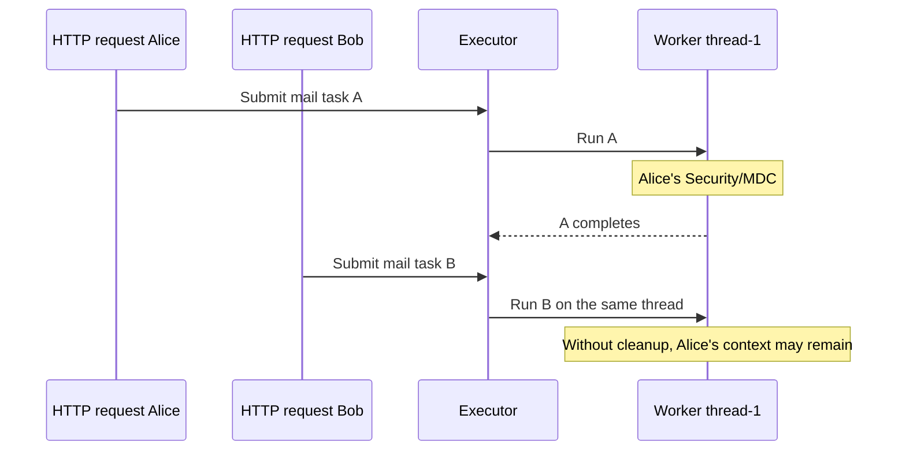
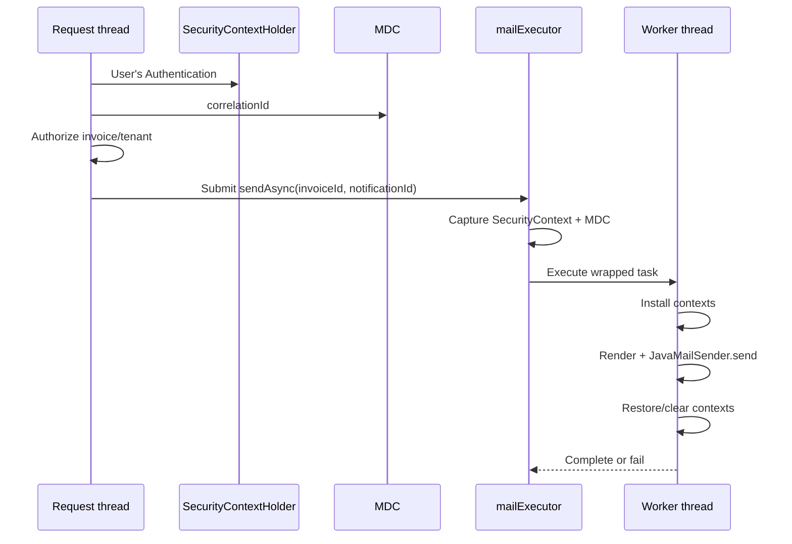

# Propagating Security Context and Correlation Context

In a Spring Framework Mail application, email sending is often moved to another thread so HTTP requests do not have to wait for SMTP connections, TLS handshakes, MIME data transfer, or responses from the mail relay. Spring supports this approach via `@Async` and `TaskExecutor`. However, once work leaves the request-handling thread, information bound to the original thread **does not automatically travel with it**.

Two categories of information are especially prone to being lost or misused:

- **Security context:** the authenticated user, authorities, and context used for access checks.
- **Correlation context:** identifiers for requests, notifications, tenants, traces, or values used to link logs and trace processing journeys.

If not handled properly, a mail-sending worker may see an empty `SecurityContextHolder`, logs may lack `correlationId`, it may be impossible to determine who triggered an event, or worse, a worker may accidentally retain context from a previous job due to thread pool thread reuse. Conversely, copying the entire security context into every job—especially jobs in durable queues—is not a safe design either.

This lesson explains context propagation in **in-JVM asynchrony**, the boundaries between `SecurityContextHolder`, SLF4J MDC, and distributed tracing, how to configure `DelegatingSecurityContextAsyncTaskExecutor` together with `TaskDecorator`, immutable metadata models for outboxes/queues, authorization and cleanup principles, and testing examples. Examples target Spring Framework 6.x, Spring Boot 3.x, Spring Security 6.x, and Java 21.

## 1. What Types of Context Does a Mail-Sending Task Have?

For example, a user clicks a “Send invoice” button:

```text
HTTP request
  User: alice
  Tenant: shop-42
  Correlation ID: 4c92a0f8-0e56-42b1-9929-bf292e6275d6
  Business event: invoice-ready:981

       |
       v
@Async mail task
       |
       +-- Read invoice data
       +-- Render template
       +-- Send SMTP
       +-- Log outcome
```

Information used in the task spans several categories and should not be lumped into a single “context” object passed everywhere:

| Data type | Example | Purpose | Should it be stored in outbox? |
|---|---|---|---|
| Authentication | Spring Security `Authentication` | Permission checks in short-lived execution context | **Do not** store the raw object |
| Actor ID | `user-128` | Audit: who initiated the action | Yes, if needed and permitted |
| Tenant ID | `shop-42` | Data isolation, selecting sender config | Yes, after authentication |
| Correlation ID | Flow UUID | Correlating logs across steps | Yes |
| Notification ID | `invoice-ready:981` | Identifying the job and preventing duplicate intents | Yes |
| Trace/span context | Trace ID, span ID, baggage | Distributed tracing, system observability | Depends on policy; do not store raw span objects |
| SMTP credentials | Username/password/token | Authenticating with mail relay | **Do not** place in job/context |
| HTTP request/session | `HttpServletRequest`, `HttpSession` | Bound to request lifecycle | **Do not** pass to long-lived workers |

A useful rule: **identity for audit, permissions for authorization, correlation ID for tracing, and notification ID for business identification are four distinct concepts**. A correlation ID is not an access token; knowing a correlation ID does not grant permission to read an invoice. Similarly, being able to log an actor ID does not prove the worker still has permission to act on that data.

## 2. Why Is Context Lost When Using @Async?

### 2.1. SecurityContextHolder Is Usually Thread-Bound

In standard servlet Spring Security applications, `SecurityContextHolder` uses a `ThreadLocal`-based strategy. The filter chain establishes the security context on the request-handling thread and clears it when the request finishes.

```java
Authentication authentication =
        SecurityContextHolder.getContext().getAuthentication();
```

The code above retrieves the authentication bound to **the currently running thread**. When work switches to another thread, the new thread does not automatically inherit the request thread's context.

Example:

```java
@Service
public class MailNotificationService {

    @Async
    public void sendAsync(Long invoiceId) {
        Authentication authentication =
                SecurityContextHolder.getContext().getAuthentication();

        // Cannot assume authentication is the request user.
        // Depending on configuration, it may be null or another context.
        sendInvoiceMail(invoiceId);
    }
}
```

### 2.2. MDC Is Also Usually Thread-Bound

SLF4J MDC (Mapped Diagnostic Context) is commonly used by logging backends to add contextual fields to every log line:

```java
MDC.put("correlationId", "4c92a0f8-0e56-42b1-9929-bf292e6275d6");
log.info("Accepted invoice notification");
```

If the worker calls:

```java
log.info("Sending invoice email");
```

the worker log will not necessarily carry the `correlationId` set on the request thread. MDC is not a distributed data store, and setting MDC on one thread does not automatically update another thread's MDC.

### 2.3. Thread Pools Complicate the Problem

`@Async` typically uses an executor that reuses threads. One thread may serve Alice's email, then later serve Bob's email:



The danger is not only an empty context. If you manually call `SecurityContextHolder.setContext(...)` or `MDC.put(...)` inside a worker without cleaning up in `finally`, a reused thread can carry metadata from an earlier task into a subsequent one.

## 3. Choosing a Context Propagation Strategy by Work Boundary

Not every asynchronous task should propagate the entire `Authentication` object.

| Boundary | Suitable Strategy |
|---|---|
| Request thread → `@Async` in same JVM, short-lived | Can use an executor wrapping security context and MDC; clean up context after task |
| After commit → task in same JVM | Can use listener/executor with propagation, though survival across restarts is not guaranteed |
| Request → database outbox | Store verified actor ID, tenant ID, correlation ID, and business intent; do not store `SecurityContext` |
| Outbox → worker minutes later or after restart | Initialize fresh processing context, read metadata safely, verify resource permissions |
| Application → SMTP relay | Pass only required email information; never send Spring Security context over SMTP |
| Service → service over HTTP/message broker | Use standard trace propagation mechanisms and appropriate service identity/authorization |

Distinguish **in-memory context propagation** from **durably persisted business metadata**. A `Runnable` wrapper suits tasks running on an in-process executor. It is not a mechanism for serializing security principals into queue payloads.

## 4. Approach 1: Propagating SecurityContext with Spring Security's Executor

Spring Security provides wrappers to execute tasks within the appropriate security context, including `DelegatingSecurityContextAsyncTaskExecutor`.

When using the constructor **without passing a fixed security context**, the wrapper can capture the submitting side's context per task and install it on the executing thread for the duration of the task. After the task finishes, the wrapper restores or clears the security context per its contract.

### 4.1. Configuring the Executor for Sending Email

```java
package com.example.mail.config;

import org.springframework.aop.interceptor.AsyncUncaughtExceptionHandler;
import org.springframework.context.annotation.Bean;
import org.springframework.context.annotation.Configuration;
import org.springframework.core.task.AsyncTaskExecutor;
import org.springframework.scheduling.annotation.EnableAsync;
import org.springframework.scheduling.concurrent.ThreadPoolTaskExecutor;
import org.springframework.security.task.DelegatingSecurityContextAsyncTaskExecutor;

@Configuration(proxyBeanMethods = false)
@EnableAsync
public class MailAsyncConfiguration {

    @Bean("mailExecutor")
    public AsyncTaskExecutor mailExecutor() {
        ThreadPoolTaskExecutor delegate = new ThreadPoolTaskExecutor();
        delegate.setThreadNamePrefix("mail-worker-");
        delegate.setCorePoolSize(2);
        delegate.setMaxPoolSize(8);
        delegate.setQueueCapacity(100);
        delegate.setTaskDecorator(new MdcCopyingTaskDecorator());
        delegate.initialize();

        // Do not pass a fixed SecurityContext: capture per task.
        return new DelegatingSecurityContextAsyncTaskExecutor(delegate);
    }
}
```

`@EnableAsync` enables `@Async` processing through Spring's proxy mechanism. The bean named `mailExecutor` is explicitly designated for mail-sending tasks. `ThreadPoolTaskExecutor` bounds workers and queue size; the values here are purely illustrative and must be tuned to SMTP capacity, timeouts, and backpressure requirements.

The `AsyncUncaughtExceptionHandler` import in the example is unnecessary when only defining the executor; if the project needs exception handling for `@Async void` methods, configure a handler via `AsyncConfigurer` or choose `CompletableFuture` to observe errors explicitly.

### 4.2. Using the Executor in a Service

```java
package com.example.mail;

import java.util.concurrent.CompletableFuture;

import org.springframework.scheduling.annotation.Async;
import org.springframework.stereotype.Service;

@Service
public class AsyncInvoiceMailService {

    private final InvoiceMailSender invoiceMailSender;

    public AsyncInvoiceMailService(InvoiceMailSender invoiceMailSender) {
        this.invoiceMailSender = invoiceMailSender;
    }

    @Async("mailExecutor")
    public CompletableFuture<Void> sendAsync(
            Long invoiceId, String notificationId) {

        invoiceMailSender.send(invoiceId, notificationId);
        return CompletableFuture.completedFuture(null);
    }
}
```

When this method is called through a Spring proxy from another bean, Spring submits the work to `mailExecutor`. The executor wraps the task with the submitting thread's security context, while `MdcCopyingTaskDecorator` (defined in the next section) copies the current MDC.

Notes:

- Calling `this.sendAsync(...)` from within the same bean is self-invocation and usually bypasses the proxy, so `@Async` has no effect.
- Do not assume `SecurityContextHolder` is always populated: tasks submitted from schedulers or unauthenticated workers may have no user authentication.
- Propagation lets code run with the context from submission time; it does not replace permission checks on the invoice.
- `CompletableFuture` allows callers to observe exceptions; failing to await or handle its outcome can still let send errors go unnoticed.

### 4.3. Avoid Constructors with Unintentionally Shared Security Contexts

Some wrappers accept a specific `SecurityContext` in their constructor. Passing a fixed context causes tasks to run under that same context regardless of who submitted them. That fits intentionally designed scenarios, yet is **unsuitable** if a shared executor serves requests from multiple users whose per-request identities you want to preserve.

Do not use an admin account or a broad-privilege context as a default for every email task just to “fix” permission errors. Doing so can mask authorization bugs, enable cross-tenant access, and render audits meaningless.

## 5. Approach 2: Propagating MDC with TaskDecorator

Spring provides the `TaskDecorator` interface to wrap a `Runnable` before the executor runs it. A decorator dedicated to MDC should:

1. Capture a copy of the MDC map on the submitting thread.
2. On the worker, save any prior context if present.
3. Install the task's MDC before running.
4. Execute the task.
5. Restore the prior MDC in `finally`, even if the task throws an exception.

### 5.1. Implementation with Cleanup

```java
package com.example.mail.config;

import java.util.Map;

import org.slf4j.MDC;
import org.springframework.core.task.TaskDecorator;

public final class MdcCopyingTaskDecorator implements TaskDecorator {

    @Override
    public Runnable decorate(Runnable task) {
        // Called when the task is submitted to the executor.
        Map<String, String> captured = MDC.getCopyOfContextMap();

        return () -> {
            Map<String, String> previous = MDC.getCopyOfContextMap();
            try {
                setOrClear(captured);
                task.run();
            } finally {
                setOrClear(previous);
            }
        };
    }

    private static void setOrClear(Map<String, String> values) {
        if (values == null || values.isEmpty()) {
            MDC.clear();
        } else {
            MDC.setContextMap(values);
        }
    }
}
```

The decorator holds no reference to the HTTP request and needs no knowledge of how email is sent. It simply manages a string-to-string map whose lifecycle is tied to the task.

Capturing the map with `MDC.getCopyOfContextMap()` is critical rather than reading a map that may mutate afterward. On the task-executing thread, always set or clear the entire MDC from the snapshot; overwriting only certain keys allows leftover keys from earlier tasks to persist.

The `finally` block ensures cleanup whether `task.run()` succeeds or fails. Restoring the previous context is safer than unconditionally calling `MDC.clear()` in systems with multiple nested decorators or instrumentation layers, because an outer layer may have already set valid context.

### 5.2. MDC Is Not SecurityContext

`MdcCopyingTaskDecorator` only copies MDC key/value pairs. It **does not propagate Authentication**. Conversely, `DelegatingSecurityContextAsyncTaskExecutor` propagates security context yet **does not automatically guarantee MDC is copied**.

Thus, the two mechanisms serve two distinct responsibilities:

```text
Request thread
  SecurityContextHolder  -----> DelegatingSecurityContextAsyncTaskExecutor
  MDC                   -----> MdcCopyingTaskDecorator

                               Worker thread
                                 SecurityContextHolder for task
                                 MDC for task
                                 try { run task } finally { restore }
```

Do not place usernames, roles, or raw JWTs into MDC just to compensate for missing security context propagation. MDC is a logging tool, not an authorization mechanism.

### 5.3. Copy Only Necessary Keys When Appropriate

Copying the entire MDC map is easy to implement, though an application may store sensitive or high-cardinality keys there. A safer variant captures only approved keys:

```java
String correlationId = MDC.get("correlationId");
String notificationId = MDC.get("notificationId");
String tenantId = MDC.get("tenantId");
```

Then the decorator installs only these three keys, keeping the `try/finally` save/restore pattern for prior context. Coordinate with tracing instrumentation, however: if the tracing library manages `traceId`/`spanId`, do not blindly overwrite them.

## 6. Generating Correlation IDs at the Request Boundary

A correlation ID is an identifier used to link logs across a processing flow. It can come from a trusted reverse proxy/gateway or be freshly generated by the application upon receiving a request.

Example:

```text
HTTP request:
  X-Correlation-ID: 7d4272f7-99ef-4972-ac96-a9589169acc1

Application log:
  correlationId=7d4272f7-99ef-4972-ac96-a9589169acc1 action=invoice_requested

Mail worker log:
  correlationId=7d4272f7-99ef-4972-ac96-a9589169acc1 action=smtp_attempt
```

Never implicitly trust header values supplied directly by clients. Clients can send huge strings, control characters, or intentionally collide IDs with other requests. Restrict format and length, and generate a new ID if the value fails policy.

### 6.1. Filter That Sets and Clears MDC

```java
package com.example.web;

import java.io.IOException;
import java.util.UUID;

import jakarta.servlet.FilterChain;
import jakarta.servlet.ServletException;
import jakarta.servlet.http.HttpServletRequest;
import jakarta.servlet.http.HttpServletResponse;

import org.slf4j.MDC;
import org.springframework.stereotype.Component;
import org.springframework.web.filter.OncePerRequestFilter;

@Component
public class CorrelationIdFilter extends OncePerRequestFilter {

    private static final String HEADER = "X-Correlation-ID";
    private static final String MDC_KEY = "correlationId";

    @Override
    protected void doFilterInternal(
            HttpServletRequest request,
            HttpServletResponse response,
            FilterChain chain) throws ServletException, IOException {

        String correlationId = resolveCorrelationId(
                request.getHeader(HEADER));
        String previous = MDC.get(MDC_KEY);

        try {
            MDC.put(MDC_KEY, correlationId);
            request.setAttribute(MDC_KEY, correlationId);
            response.setHeader(HEADER, correlationId);
            chain.doFilter(request, response);
        } finally {
            if (previous == null) {
                MDC.remove(MDC_KEY);
            } else {
                MDC.put(MDC_KEY, previous);
            }
        }
    }

    private static String resolveCorrelationId(String input) {
        if (input != null && input.length() <= 36) {
            try {
                UUID parsed = UUID.fromString(input);
                if (parsed.toString().equalsIgnoreCase(input)) {
                    return parsed.toString();
                }
            } catch (IllegalArgumentException ignored) {
                // Reject improperly formatted headers.
            }
        }
        return UUID.randomUUID().toString();
    }
}
```

This is an illustrative rule: the application uses UUIDs as correlation IDs. If the system already uses tracing/gateways issuing IDs in another standard format, standardize on one format rather than generating competing IDs.

The filter puts the ID into MDC so request logs can use it; `MdcCopyingTaskDecorator` carries the same ID into the worker when the task is submitted from the request thread. When the request finishes, the filter restores the previous key so context does not leak to other requests.

### 6.2. Do Not Use Correlation IDs for Authorization

A random UUID is not proof of access rights. Never build APIs like “anyone with the correlation ID can download the invoice”. Data-reading APIs still require authentication and authorization via user/tenant/business resources.

A correlation ID does not necessarily have to be secret, yet avoid embedding personal identifying data in the ID, such as concatenating an email address or phone number into the string. Using opaque IDs keeps logs safer and reduces data exposure risk.

## 7. Establishing Context for Short-Lived Mail Flows

Suppose a controller calls a service that performs business authorization and then submits the send job:



Notable order:

1. Authenticate and authorize on the request-receiving thread.
2. Prepare permitted data/IDs.
3. Submit the task via an executor with context propagation.
4. Worker uses context only within task scope.
5. Worker cleans up in `finally`.

This fits relatively short jobs running in the same JVM. If a task must survive restarts, be retried minutes later, or run on another machine, use durable metadata instead of trying to retain `SecurityContext`.

## 8. Do Not Substitute Security Context for Business Permissions

A worker seeing `Authentication` is insufficient to conclude it is authorized to send a specific invoice. `Authentication` may indicate a logged-in user with roles, yet permission for the specific resource must be checked separately.

Example to avoid:

```java
@Async("mailExecutor")
public void sendInvoice(Long invoiceId) {
    // Does not verify which user or tenant the invoice belongs to.
    Invoice invoice = invoiceRepository.findById(invoiceId).orElseThrow();
    send(invoice);
}
```

Instead, the service accepts the command along with the authenticated actor/tenant and verifies ownership before creating the send intent:

```java
public record InvoiceNotificationCommand(
        long invoiceId,
        String actorId,
        String tenantId,
        String correlationId,
        String notificationId
) {}
```

```java
@Transactional
public void requestInvoiceMail(long invoiceId) {
    Authentication authentication =
            SecurityContextHolder.getContext().getAuthentication();

    String actorId = currentActor.requireUserId(authentication);
    String tenantId = currentTenant.requireTenantId(authentication);

    Invoice invoice = invoiceRepository.findById(invoiceId).orElseThrow();
    invoicePolicy.requireCanReadAndEmail(
            actorId, tenantId, invoice);

    String notificationId = "invoice-ready:" + invoice.getId();
    String correlationId = correlationIdProvider.currentOrCreate();

    outboxRepository.insertIfAbsent(
            InvoiceNotificationCommand.of(
                    invoiceId,
                    actorId,
                    tenantId,
                    correlationId,
                    notificationId));
}
```

Components like `currentActor`, `currentTenant`, `invoicePolicy`, `correlationIdProvider`, and `insertIfAbsent(...)` are application-defined abstractions. The example illustrates the principle: **send permission is decided from the authenticated identity and business data**, while the outbox holds the minimal information needed to complete the work.

When the worker runs, it must not trust `actorId` or `tenantId` merely because they appear in a message sent by an external source. This metadata must come from storage/commands created by a trusted, access-controlled business flow. If using a message broker with multiple producers, authenticate producers and constrain payloads.

## 9. Security Context Is a Temporary Snapshot, Not a Permanent Login Session

Even when an executor propagates context, risks remain if you treat it as immutable authorization:

- The user may be locked or have permissions revoked after task submission.
- The user's tenant membership may change.
- `Authentication` or the principal may contain mutable objects.
- Copying the `SecurityContext` reference is not necessarily a deep copy of all attributes.
- The task may run delayed relative to the originating request.

Therefore:

1. **Use context to preserve identity and perform appropriate checks in short tasks.**
2. **Verify business permissions at the time the send request is accepted.**
3. **For delayed tasks, explicitly decide whether permission state, suppression, or ownership must be re-checked at dispatch time.**
4. **Never retain user access tokens or sessions so a worker can send emails hours later.**

A system may choose a policy of “permissions verified when the business event occurred” for issued invoices, or “re-verify permissions at send time” for cancelable notifications. Both are explicit business decisions, not default behaviors of `@Async`.

## 10. Why Not Use MODE_INHERITABLETHREADLOCAL for Thread Pools?

Spring Security supports multiple `SecurityContextHolder` strategies. `MODE_INHERITABLETHREADLOCAL` can pass context to child threads when threads are created. However, thread pools typically **create threads once and reuse them across many tasks**.

Therefore, do not try to solve executor propagation with:

```java
SecurityContextHolder.setStrategyName(
        SecurityContextHolder.MODE_INHERITABLETHREADLOCAL);
```

in a multi-user application expecting each task to automatically get the right authentication. Threads created early may lack context; threads created while request A was running may hold stale context when picking up task B. Inheritance strategies do not replace per-task capture and cleanup.

An executor wrapper such as `DelegatingSecurityContextAsyncTaskExecutor` is much clearer for thread pools. It captures context at submit/execute time and scopes its lifetime to the task rather than when the thread was spawned.

## 11. Correlation Context in Logs, Tracing, and Audits

To observe a mail-sending task, you typically need at least three IDs:

| ID | Scope | Example |
|---|---|---|
| `correlationId` | Single processing flow across request → job | UUID propagated from request |
| `notificationId` | Single business notification | `invoice-ready:981` |
| `attemptId` | Single specific SMTP attempt | Fresh UUID per attempt |

If retried three times, all three attempts share the same `notificationId` and potentially the same `correlationId`, while each attempt has its own `attemptId`. This lets you answer:

- Which request created the notification?
- Which notification was retried?
- Which attempt returned SMTP 451?
- Which attempt was accepted by the relay?
- Did two workers process the same notification concurrently?

Redacted log example:

```text
INFO correlationId=... notificationId=invoice-ready:981 attemptId=... event=mail_attempt_started
WARN correlationId=... notificationId=invoice-ready:981 attemptId=... event=smtp_temp_failure smtpCode=451
INFO correlationId=... notificationId=invoice-ready:981 attemptId=... event=mail_attempt_accepted
```

There is no need to log email bodies, password reset tokens, invoice details, or SMTP passwords to trace these steps.

### 11.1. Setting Notification ID Within Task Scope

Example worker handling one attempt:

```java
public void sendAttempt(MailJob job) {
    String previousNotification = MDC.get("notificationId");
    String previousAttempt = MDC.get("attemptId");

    try {
        MDC.put("notificationId", job.notificationId());
        MDC.put("attemptId", UUID.randomUUID().toString());

        log.info("Mail attempt started");
        mailComposerAndSender.send(job);
        log.info("Mail attempt accepted by sender");
    } finally {
        restoreKey("notificationId", previousNotification);
        restoreKey("attemptId", previousAttempt);
    }
}

private static void restoreKey(String key, String previous) {
    if (previous == null) {
        MDC.remove(key);
    } else {
        MDC.put(key, previous);
    }
}
```

The snippet is illustrative: `MailJob` and `mailComposerAndSender` are application components, and `MDC`/`UUID`/logger imports must be declared. `notificationId` remains stable across retries; `attemptId` is unique to each send attempt.

### 11.2. MDC Is Not Distributed Tracing

Copying a `traceId` string in MDC only makes logs display the same trace ID. It **does not create parent-child span relationships**, does not propagate sampling state, and does not manage span lifecycles.

If the application uses Micrometer Tracing, OpenTelemetry, or Spring Boot observability mechanisms, use the corresponding propagation tools and register appropriate context accessors. Micrometer Context Propagation provides abstractions such as `ContextSnapshot` to capture/restore supported contexts. A tracing `TaskDecorator` can use that abstraction, depending on library version and application configuration.

Do not mix two propagation mechanisms without defining ownership:

- Tracing instrumentation manages active spans and their MDC keys.
- Application decorators manage application-defined correlation/notification IDs.
- If a decorator copies all of MDC, understand setup/restore ordering relative to instrumentation; avoid overwriting `traceId`/`spanId` inconsistent with the active span.

### 11.3. W3C Trace Context and Correlation IDs

In distributed tracing, headers such as `traceparent` and `tracestate` propagate trace context across services by standard. Application-defined correlation IDs are a separate mechanism; both IDs can coexist.

Do not take a custom string named `traceId` and assume it suffices for a tracing backend to link spans. When using OpenTelemetry/Micrometer, let instrumentation create, activate, and end spans properly.

### 11.4. Baggage Can Carry Sensitive Information

Tracing baggage is sometimes propagated across service boundaries and can appear in downstream logs or headers. Never put JWTs, emails, phone numbers, session IDs, or private data into baggage. Allow only necessary values compliant with data policies.

## 12. What Context Needs to Be Sent to SMTP?

An SMTP relay does not need to know the Spring Security principal or the triggering user's roles. It needs the sender address, recipient, MIME content, and system-managed SMTP provider credentials.

There may be a need to correlate a specific email with a notification in the system. In that case, the application can add a custom header:

```java
MimeMessage message = mailSender.createMimeMessage();
MimeMessageHelper helper =
        new MimeMessageHelper(message, true, "UTF-8");

helper.setFrom(fromAddress);
helper.setTo(recipient);
helper.setSubject(subject);
helper.setText(plainText, html);

message.addHeader("X-Notification-ID", safeNotificationId);
```

This is optional, not mandatory. Headers can be visible to mail relays and recipients; do not put user access tokens, JWTs, SMTP secrets, permission details, or sensitive personal data here.

`safeNotificationId` must be normalized/validated for length and control characters before adding it to a header to prevent header injection. Never use unvalidated raw correlation headers supplied by clients.

Some providers offer lookup APIs or event webhooks by message/notification ID. If delivery outcome tracking is needed, use the provider's contract and store the appropriate ID mapping; do not assume every SMTP relay preserves custom headers.

## 13. Transaction Issues in Asynchronous Mail Sending

`@Async` and `@Transactional` govern two different mechanisms:

- `@Async` dispatches a call through an executor.
- `@Transactional` opens or joins a transaction on **the thread executing the proxy-managed method**.

The request thread's transaction does not automatically move to the worker thread. If a request is updating an order and immediately submits an email task, the worker may run before commit and read stale state.

Dangerous example:

```java
@Transactional
public void confirmOrder(Long orderId) {
    Order order = orderRepository.findById(orderId).orElseThrow();
    order.confirm();
    orderRepository.save(order);

    asyncMailService.sendAsync(orderId);
    // Transaction may not have committed yet when worker starts.
}
```

Propagating `SecurityContext` or MDC accurately **does not solve** this transaction inconsistency. Context propagation is not transaction propagation.

### 13.1. Sending After Commit

For best-effort emails, you can publish an event inside the transaction and handle it after commit:

```java
public record OrderConfirmedEvent(Long orderId, String correlationId) {}
```

```java
@Async("mailExecutor")
@TransactionalEventListener(phase = TransactionPhase.AFTER_COMMIT)
public void onOrderConfirmed(OrderConfirmedEvent event) {
    // ID was taken from the event; do not rely on a live HTTP request.
    mailService.sendOrderConfirmation(
            event.orderId(), event.correlationId());
}
```

Notes:

- `AFTER_COMMIT` avoids running when the transaction rolls back.
- `@Async` moves SMTP sending to an executor thread.
- Events should carry required metadata instead of HTTP requests or live JPA entities.
- If an event is published outside a transaction, the listener does not run by default when `fallbackExecution=false`.
- Events and tasks live only in memory; a JVM crash after commit and before sending can still lose the email.

### 13.2. Transactional Outbox for Reliable Notifications

If emails must survive restarts for retries, write the notification intent to an outbox in the same database transaction as the business logic:

```text
Business transaction:
  UPDATE order
  INSERT mail_outbox(
      notification_id,
      tenant_id,
      actor_id,
      correlation_id,
      template_id,
      payload,
      status='PENDING')
  COMMIT

Later, mail worker:
  Claim outbox row
  Establish correlation context for this attempt
  Validate resource access
  Render + send SMTP
  Update SENT / RETRY_WAIT / FAILED
```

The outbox preserves actor/tenant/correlation IDs across restarts without serializing `SecurityContext`. The worker does not use an expired user session; it runs under a least-privilege service identity and verifies tenant/resource ownership according to policy.

An important rule: **never copy an `Authentication` object into a database, broker message, or long-lived cache**. It can contain credentials, non-serializable details, expired tokens, and stale authorization state.

## 14. Rebuilding Correlation Context in an Outbox Worker

The worker picks up an outbox row containing:

```java
public record MailJob(
        String notificationId,
        String actorId,
        String tenantId,
        String correlationId,
        String templateId,
        long businessObjectId
) {}
```

Before each attempt, the worker actively sets the job's logging context and restores prior state when finished:

```java
public void dispatch(MailJob job) {
    Map<String, String> previous = MDC.getCopyOfContextMap();

    try {
        MDC.clear();
        MDC.put("correlationId", job.correlationId());
        MDC.put("notificationId", job.notificationId());
        MDC.put("tenantId", job.tenantId());
        MDC.put("attemptId", UUID.randomUUID().toString());

        mailJobPolicy.requireDispatchAllowed(
                job.tenantId(), job.businessObjectId());
        mailMessageFactory.createAndSend(job);
    } finally {
        if (previous == null) {
            MDC.clear();
        } else {
            MDC.setContextMap(previous);
        }
    }
}
```

`mailJobPolicy` and `mailMessageFactory` are application abstractions. Validate data coming from the outbox, including disallowing `null` or malformed strings in fields placed into MDC. Never let a job contain a tenant ID self-asserted by an untrusted producer and blindly authorize against that tenant.

Conditions for this code to operate properly in production:

- The worker has an appropriate service identity to access storage and SMTP.
- Business read queries are always scoped by a trusted tenant.
- Actor ID is used for auditing who requested it, not to synthesize worker permissions.
- Correlation ID is logging metadata, not proof of authorization.
- Each attempt has its own ID and context is cleaned up in `finally`.
- If distributed tracing is desired, create/restore spans via instrumentation rather than setting MDC alone.

### 14.1. Do Not Impersonate Users in the Worker

Do not construct a `UsernamePasswordAuthenticationToken` with username and roles supplied by the outbox to “impersonate” a user:

```java
// Do not reconstruct permissions from stale or untrusted payload.
Authentication auth = new UsernamePasswordAuthenticationToken(
        job.actorId(),
        "N/A",
        job.rolesFromPayload());
SecurityContextHolder.getContext().setAuthentication(auth);
```

Doing so can grant the worker revoked permissions or permissions forged by a payload. If a task genuinely needs to execute under delegated user authority, use an official delegation mechanism with expiration, explicit permission scopes, and a revocation policy; never use a serialized role list as proof of authority.

For typical transactional emails, it is better for workers to run under a least-privilege service identity, verify outbox intent and resource ownership, and store actor ID solely for auditing.

## 15. A Task's Security Context Is Not a Transaction Context

Different contexts have distinct lifecycles:

| Context | Typical Binding | Propagates Across Threads Automatically? |
|---|---|---|
| Spring Security `SecurityContext` | `ThreadLocal` via `SecurityContextHolder` | No, unless propagation is configured |
| SLF4J MDC | Logging thread context | No, unless copied/restored |
| Spring JDBC/JPA Transaction | Transaction resources bound to current thread | Should not be passed directly |
| HTTP request attributes | Request thread/lifecycle | Unsafe to retain after request |
| Tracing span context | Instrumentation/context mechanism | Depends on propagation configuration |
| Outbox metadata | Durable database row | Worker can re-read after restart |

If the worker needs a database transaction, open a fresh transaction inside the worker service for reading/updating status. Do not attempt to copy the request thread's transaction resources to the worker via `ThreadLocal`; doing so can break consistency and prolong connections/locks.

Similarly, `HttpServletRequest` and `HttpSession` must not be retained in mail-sending tasks. Once the request finishes, these objects' lifecycles end or they are recycled in ways incompatible with long-lived workers.

## 16. Protecting Personal Data and Secrets in Context

A good logging context provides enough information to trace execution without turning logs into storage for sensitive data.

**Use when needed and permitted:**

- Random correlation ID.
- Notification ID or redacted business reference.
- Verified tenant ID that does not expose sensitive data.
- Attempt ID.
- Template category, redacted SMTP error codes.

**Avoid placing in MDC, baggage, queue logs, or email headers:**

- Access tokens, refresh tokens, JWTs.
- Passwords, SMTP credentials, or API keys.
- Session IDs, cookies.
- Entire `Authentication` objects.
- Email bodies, attachment bytes, password reset URLs containing tokens.
- Plaintext recipient addresses unless strictly necessary.
- Sensitive customer profile information.

Loggers can automatically output MDC on every log line. Putting secrets into MDC therefore widens data exposure even when the log message itself never mentions the secret.

### 16.1. Sanitization and Bounding Cardinality

Correlation ID, template ID, and notification ID should have length limits and allowed character sets. Never accept multi-megabyte strings as MDC fields; doing so inflates log volume and strains log collection pipelines.

In metrics, do not use `correlationId`, `notificationId`, or recipient email addresses as labels, because cardinality is virtually unbounded. They belong in logs or trace attributes subject to sampling/redaction policies. Metrics should use low-cardinality labels such as template category, outcome, and error class.

## 17. Exception Handling and Async Lifecycle

Context propagation must clean up even when SMTP throws an exception. Wrappers using `try/finally` ensure MDC/security context does not linger on the worker after the task ends, yet the application still needs to observe failures.

### 17.1. With CompletableFuture

```java
CompletableFuture<Void> result =
        asyncInvoiceMailService.sendAsync(invoiceId, notificationId);

result.whenComplete((ignored, failure) -> {
    if (failure != null) {
        log.warn("Async mail attempt failed", failure);
    }
});
```

This snippet illustrates observing errors; in production, exception logs need redaction and should include the notification ID. If the caller ignores the future, failures may go unhandled.

### 17.2. With @Async void

An `@Async` method returning `void` gives the caller no future to inspect errors. Spring provides `AsyncUncaughtExceptionHandler` via `AsyncConfigurer` for such methods. Configure a handler or prefer a contract returning a future/outcome, especially when send status tracking is required.

### 17.3. Full Queue and Rejected Tasks

If the executor runs out of capacity, tasks can be rejected right at submission time. Proper context propagation does not solve queue overload. The application needs concurrency bounds, a rejection policy, retries, or an appropriate outbox. Never treat “submission did not throw an exception” as a guarantee the email was sent.

### 17.4. @Async Does Not Guarantee Durability

In-memory workers can lose tasks on JVM restarts. For transactional emails requiring retries, use an outbox, delivery statuses, and leases. Keep correlation metadata in the outbox so retries remain traceable; each attempt gets a fresh span/attempt ID.

## 18. Testing Propagation and Cleanup

Testing must verify two separate things:

1. **Task A receives the submitter's exact context.**
2. **Task B running on the same worker does not see leftover context from A.**

Testing only that the first task sees the username/correlation ID is not enough. Thread pools reuse threads; leakage bugs typically show up on the second task.

### 18.1. Directly Testing the Executor with Two Tasks

The following example uses a single-thread executor to make reuse easy to observe:

```java
import static org.junit.jupiter.api.Assertions.assertEquals;
import static org.junit.jupiter.api.Assertions.assertNull;

import java.util.List;
import java.util.concurrent.TimeUnit;

import org.junit.jupiter.api.Test;
import org.slf4j.MDC;
import org.springframework.core.task.AsyncTaskExecutor;
import org.springframework.scheduling.concurrent.ThreadPoolTaskExecutor;
import org.springframework.security.authentication.UsernamePasswordAuthenticationToken;
import org.springframework.security.core.authority.SimpleGrantedAuthority;
import org.springframework.security.core.context.SecurityContext;
import org.springframework.security.core.context.SecurityContextHolder;
import org.springframework.security.task.DelegatingSecurityContextAsyncTaskExecutor;

class MailContextPropagationTest {

    record ContextSeen(String principal, String correlationId) {}

    @Test
    void propagatesAndDoesNotLeakBetweenTasks() throws Exception {
        ThreadPoolTaskExecutor delegate = new ThreadPoolTaskExecutor();
        delegate.setCorePoolSize(1);
        delegate.setMaxPoolSize(1);
        delegate.setQueueCapacity(10);
        delegate.setTaskDecorator(new MdcCopyingTaskDecorator());
        delegate.initialize();

        AsyncTaskExecutor executor =
                new DelegatingSecurityContextAsyncTaskExecutor(delegate);

        try {
            SecurityContext context =
                    SecurityContextHolder.createEmptyContext();
            context.setAuthentication(
                    new UsernamePasswordAuthenticationToken(
                            "alice",
                            "N/A",
                            List.of(new SimpleGrantedAuthority("ROLE_USER"))));

            SecurityContextHolder.setContext(context);
            MDC.put("correlationId", "req-alice");

            ContextSeen first = executor.submit(() -> snapshot())
                    .get(5, TimeUnit.SECONDS);

            assertEquals("alice", first.principal());
            assertEquals("req-alice", first.correlationId());

            // Submitter no longer has Alice's context.
            SecurityContextHolder.clearContext();
            MDC.clear();

            ContextSeen second = executor.submit(() -> snapshot())
                    .get(5, TimeUnit.SECONDS);

            assertNull(second.principal());
            assertNull(second.correlationId());
        } finally {
            SecurityContextHolder.clearContext();
            MDC.clear();
            delegate.shutdown();
        }
    }

    private static ContextSeen snapshot() {
        var authentication =
                SecurityContextHolder.getContext().getAuthentication();
        String principal = authentication == null
                ? null : authentication.getName();
        return new ContextSeen(principal, MDC.get("correlationId"));
    }
}
```

With a test logging backend that actually supports MDC (such as Logback), the MDC map can be verified on the worker thread. In logging adapter environments without MDC support, `MDC.get(...)` may not return expected values; configure an appropriate test backend.

The test uses a single worker thread specifically to confirm the next task does not retain old context. Cleanup in the executor wrapper and decorator is what matters, not manually clearing context inside the worker test task.

### 18.2. Testing the Exception Path

Add a task that intentionally throws an exception after verifying MDC:

```java
var failed = executor.submit(() -> {
    if (MDC.get("correlationId") == null) {
        throw new AssertionError("Missing correlation ID");
    }
    throw new IllegalStateException("Simulated SMTP failure");
});

assertThrows(ExecutionException.class,
        () -> failed.get(5, TimeUnit.SECONDS));
```

Then submit a new task without context and verify it does not receive `correlationId` or authentication from the failed task. This tests the `finally` path when exceptions occur.

### 18.3. Testing Through the Spring Proxy

An integration test with a Spring context should call `@Async("mailExecutor")` from **another bean** rather than calling a method on the same instance. Verify the execution thread name, propagated authentication, and presence of the correlation ID in the logging context.

Also verify:

- The same executor serving multiple users does not mix contexts.
- Submitting without context leaves the worker without authentication from the previous task.
- Security context is cleaned up when a task throws an exception.
- MDC is restored whether a task succeeds or fails.
- A full queue produces a clear error signal.

### 18.4. Testing Outbox and Worker Restarts

For an outbox, do not test propagating a `SecurityContext` object through the database. Instead:

1. Create the intent using an authenticated and authorized actor.
2. Verify the outbox stores the exact actor ID, tenant ID, correlation ID, and notification ID.
3. End the request; clear the request's security context.
4. Worker reads the row and builds a fresh logging context.
5. Verify sending/reading attachments still checks tenant/resource ownership.
6. Simulate a retry or restart; correlation/notification IDs stay the same while attempt ID changes.
7. Verify the worker does not need the original actor's HTTP session or JWT.

This is the durable pattern when work runs outside the request lifecycle.

## 19. Common Mistakes

**Believing @Async automatically propagates Authentication.** Security context usually relies on ThreadLocal; you need an executor wrapper or explicitly designed metadata.

**Believing MDC is automatically present on every worker.** MDC is thread-bound; use capture/restore or proper observability propagation.

**Copying without cleaning up.** Thread pools reuse workers, easily leaking the prior task's tenant/user/correlation. Always use `finally`.

**Using MODE_INHERITABLETHREADLOCAL for thread pools.** Inheritance applies when threads are spawned, not on every task submission.

**Using a fixed SecurityContext on a multi-user executor.** Another user's tasks may run under the wrong permissions.

**Assuming a copied SecurityContext is immutable.** Authentication/principals can be mutable and permissions can change; avoid holding them for long.

**Storing Authentication, JWTs, or HttpServletRequest in an outbox.** These objects have lifecycles and security risks unsuitable for durable queues.

**Reconstructing worker permissions from actorId or roles in payload.** Audit metadata is not proof of authorization; use a service identity and check resource permissions.

**Using correlationId as an authorization key.** Correlation IDs exist for tracing, not as secrets.

**Copying traceId in MDC alone and treating it as a distributed trace.** Active spans and tracing framework propagation must be managed properly.

**Ignoring transaction boundaries.** @Async can run before commit; context propagation does not move database transactions to a new thread.

**Assuming enqueuing into an executor means SMTP sent it.** Tasks can be rejected, fail, or be lost when the process stops.

**Logging entire contexts for debugging.** This can leak tokens, recipient data, email contents, and private information.

**Using correlationId/notificationId as metric labels.** Cardinality is far too high; keep them in controlled logs/traces.

## 20. Comprehensive Practice Exercise

### Part A — Reproduce the ThreadLocal Issue

Create an endpoint that triggers an `@Async` email-sending task. On the request thread, read `SecurityContextHolder` and MDC; inside the worker, read them again. Observe the difference before configuring propagation.

### Part B — Configure Security Propagation

Define a dedicated mail executor using `DelegatingSecurityContextAsyncTaskExecutor`. Call it through a Spring proxy and confirm the worker receives the submitter's principal during short tasks.

### Part C — Configure MDC TaskDecorator

Add `MdcCopyingTaskDecorator`. Generate a correlation ID in a filter, place it into MDC, and send mail. Verify request logs and worker logs share the same ID. Test a task that throws an exception and confirm context is restored.

### Part D — Test Two Users

Submit tasks for Alice and Bob sequentially to a single-thread executor. Verify task A does not leave context in task B. Try submitting a third task without authentication; it must not see Alice's or Bob's principal.

### Part E — Authorize Before Sending

Create an invoice belonging to tenant B. Have a user from tenant A try to request an email. Verify the ownership policy rejects before enqueuing. Do not work around this by giving the mail worker an admin role.

### Part F — Correlation and Attempt IDs

Attach `correlationId` from the request, `notificationId` from business logic, and a separate `attemptId` for each send attempt. Simulate one SMTP failure followed by a retry; check logs to see the same notification with two distinct attempts.

### Part G — Outbox Without Storing SecurityContext

Persist actor ID, tenant ID, correlation ID, and notification ID in the outbox within the business transaction. Start a worker in a new execution context, read the metadata, check resource access, and send. Confirm the worker does not require the original actor's HTTP request/session or `Authentication`.

### Part H — Testing Tracing

If the application uses Micrometer Tracing/OpenTelemetry, confirm the async task's span has an appropriate relationship to the calling flow or is linked per tracing policy. Do not check only the trace ID string in MDC.

### Part I — Sensitive Data Check

Inject a dummy token into a test request. Confirm the token does not appear in MDC, queue payloads, logs, or email headers. Only permitted IDs should be propagated.

## 21. Deployment Checklist

Before taking an asynchronous mail-sending flow to production, answer:

- Does the task run within the same JVM or via a durable outbox/queue?
- Who is the actor that triggered the work? Was the actor ID obtained from a trusted source?
- Where are permissions checked for recipients, tenants, and business objects?
- Does the worker truly need the user's Authentication, or only a service identity?
- Which executor runs the task? Does `@Async` go through a Spring proxy?
- Is security context captured per task or pinned globally to the executor?
- Are MDC/correlation IDs captured and restored using `finally`?
- Is there any chance task B sees task A's context when sharing threads?
- Are active trace spans propagated properly by the framework rather than merely copying a traceId string?
- Could any sensitive data accidentally appear in MDC, baggage, or headers?
- If the task runs after commit, can events be lost on a process crash?
- If jobs retry across restarts, does the outbox store minimal and durable metadata?
- Are there distinct IDs for notifications and individual attempts?
- Are async errors observed via futures/handlers/status or ignored?
- Are concurrency limits, queue capacity, and rejected-task handling configured?

## 22. Conclusion

In Spring Framework Mail, moving SMTP sending to `@Async` avoids blocking request threads, yet simultaneously introduces a **thread boundary**. `SecurityContextHolder` and MDC are normally thread-bound and therefore do not automatically carry over accurately to workers. For short tasks in the same JVM, you can combine `DelegatingSecurityContextAsyncTaskExecutor` to propagate security context with `TaskDecorator` to copy/restore MDC. Any manual setup must be cleaned up in `finally` to prevent leakage across tasks in a thread pool.

**Propagating context does not replace authorization.** Actor IDs serve auditing; tenant IDs must be verified; correlation IDs serve logging; trace contexts must be managed by the tracing framework; and notification IDs identify work. Never pass full principals, sessions, or tokens through long-lived outboxes/queues. For durable jobs, store minimal verified metadata, run workers under a least-privilege service identity, and enforce resource permissions by policy.

Finally, context propagation is neither transaction propagation nor a delivery guarantee. `@Async` can still execute before database commit or lose tasks when the process stops. Critical emails should use after-commit coordination or an appropriate transactional outbox; correlation/notification/attempt IDs and retry states make every send attempt accurately traceable without depending on the HTTP request lifecycle.
