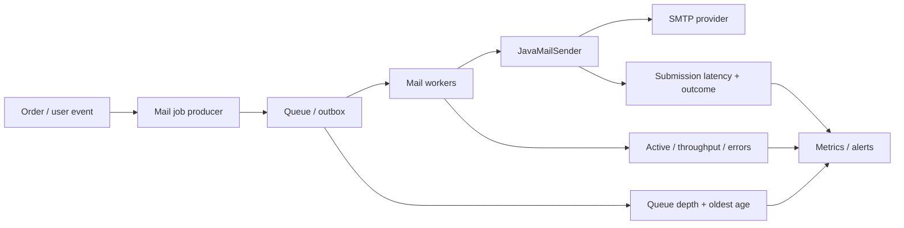
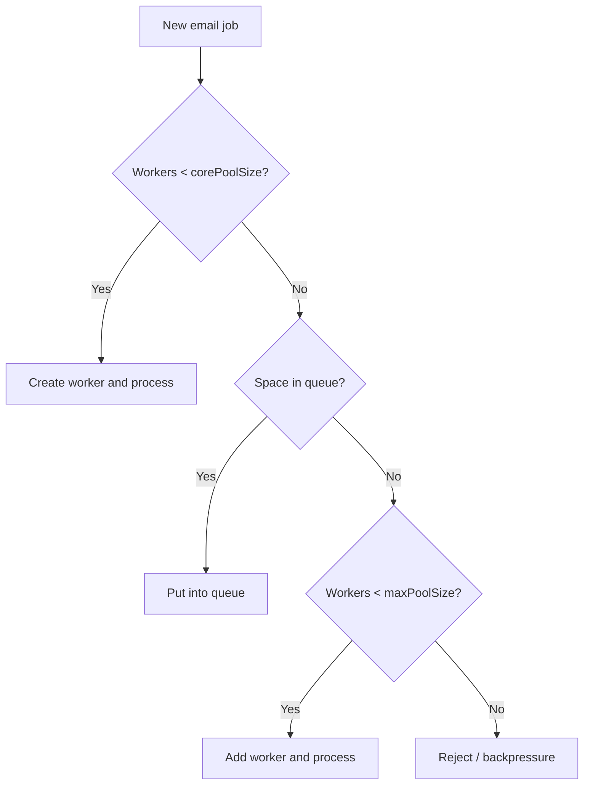

# Monitoring Queues and Pending Tasks When Sending Emails Asynchronously with Spring Framework Mail

Sending emails with `JavaMailSender` can take time because the application must build content, connect to SMTP, authenticate, transfer messages, and wait for responses from the mail server. If done directly inside an HTTP request or business processing thread, user response times depend on the SMTP provider. Therefore, many applications use `@Async`, `ThreadPoolTaskExecutor`, or durable job queues to send emails in dedicated workers.

However, switching to asynchronous processing does not mean the system can accept infinite requests. If new emails arrive faster than sending capacity, **the queue grows**; if workers fail or the provider throttles traffic, tasks can wait a long time, get rejected, or be lost if stored only in memory.

Monitoring queues is more than counting items in a single queue. Operations teams also need to know **how many tasks are running, how many are waiting, how long the oldest task has waited, arrival and completion rates, error rates, retries, rejections, and latency until submission succeeds**.

In Spring Framework Mail, how you observe this depends on where the queue lives: `ThreadPoolTaskExecutor` inside a JVM, a message broker, a database job table, or a transactional outbox. This lesson explains how to measure and operate each model, with Spring Boot, Micrometer, Spring Actuator examples, and practical scenarios.

## 1. Why Must Pending Task Counts Be Monitored?

Suppose the system generates 2,000 confirmation emails during a peak burst. Workers can only send 20 emails/second due to SMTP limits. Meanwhile, the API keeps pushing new emails into the queue. Without backlog monitoring, the application can hit these issues:

- OTP or confirmation emails arrive after they are still useful.
- The in-JVM queue fills up and `@Async` rejects tasks.
- Memory rises because the queue retains many objects or large MIME payloads.
- Workers continuously retry, clogging the queue even when new email volume stops growing.
- The SMTP provider returns transient errors or rate limits, yet dashboards only show HTTP requests succeeding.
- The queue appears empty on one instance while backing up on another, skewing system-wide metrics.
- Process restarts cause tasks waiting in an in-memory queue to disappear.

A proper dashboard must answer three distinct questions:

1. **Demand:** how many emails are being requested?
2. **Capacity:** how many emails per second is the system processing and completing?
3. **Latency and reliability:** how long does it take from request creation until SMTP accepts it, and is the request safe if a worker restarts?



**Note:** `send()` not throwing an error usually indicates the SMTP submission server accepted the message for processing; it does not confirm the email entered the inbox or was opened by the recipient. Distinguish submission metrics from delivery/bounce events provided by the provider.

## 2. Distinguishing Queued, Running, Delayed, Failed, and Delivered

Before building dashboards, define statuses clearly. A single `pending` number does not mean the same thing across all systems.

| Status | Meaning | Counted as immediately waiting task? |
|---|---|---|
| `QUEUED` / `PENDING` | Accepted, waiting for a worker | Yes, if due for processing |
| `RUNNING` / `PROCESSING` | Picked up by a worker and in progress | No; measure separately |
| `RETRY_SCHEDULED` | Waiting until next retry timestamp | Should not be merged into ready queue |
| `SUBMITTED` | SMTP server accepted the submission | No |
| `FAILED_PERMANENT` | Retries exhausted or permanently rejected | No; track errors/dead-letter |
| `DELIVERED` | Provider confirmed delivery per tracking capabilities | No |
| `BOUNCED` | Email bounced after submission | No; needs separate delivery metric |

Systems may name statuses differently. What matters is consistent counting on dashboards: **ready queue**, **in-flight**, **delayed retry**, **terminal failure**, and **delivery outcome** should not be collapsed into one number.

### 2.1. Queue Depth

`Queue depth` is the number of tasks sitting in the queue at a point in time. For an in-JVM executor, it typically corresponds to `executor.getThreadPoolExecutor().getQueue().size()`. For databases/brokers, use the metrics or queries of the corresponding queue source.

Queue depth is a **gauge**, meaning an instantaneous measurement. A queue depth of 0 can be a healthy sign, or it can mean no jobs are being enqueued because the producer is broken. Therefore, observe it alongside the job arrival rate.

### 2.2. Active Workers

The number of workers currently executing tasks, such as `ThreadPoolTaskExecutor.getActiveCount()`. Running workers are no longer in the waiting queue, yet still represent unfinished work.

For an executor, an estimate of pending or executing work inside the executor is:

```text
in_process_work ≈ active_count + queue_size
```

This is an estimate at the moment metrics are sampled. It does not include jobs in databases, brokers, retry schedulers, other systems, or already-submitted emails.

### 2.3. Queue Wait Time

`Queue wait time` is the duration from when a job enters the queue until a worker actually starts running it:

```text
queue_wait = started_processing_at - enqueued_at
```

A queue with 100 waiting tasks may be fine if throughput is high and each waits only 2 seconds; however, 20 tasks waiting over 15 minutes can be a severe outage. Thus queue depth must be paired with **wait time**, especially the age of the oldest job.

### 2.4. Oldest Pending Age

`Oldest pending age` is how long the oldest ready-to-process job has been waiting:

```text
oldest_ready_age = now - min(enqueued_at of ready jobs)
```

This metric is especially useful for database queues or outboxes where job timestamps can be queried. Do not confuse the age of a job that has not reached `next_attempt_at` with a stuck ready job; intentionally delayed retries should be measured separately.

### 2.5. Throughput, Failures, and Rejections

Beyond gauges, counters and timers are needed:

| Metric | Type | Meaning |
|---|---|---|
| `mail.jobs.enqueued` | Counter | Total send requests accepted into the queue |
| `mail.jobs.started` | Counter | Total jobs picked up by workers |
| `mail.jobs.submitted` | Counter | Total sends accepted by the SMTP server |
| `mail.jobs.failed` | Counter | Failed processing attempts, ideally classified retryable/permanent |
| `mail.jobs.rejected` | Counter | Tasks rejected by the executor/broker |
| `mail.queue.depth` | Gauge | Ready jobs currently waiting |
| `mail.queue.oldest.age` | Gauge | Age of the oldest ready job |
| `mail.worker.active` | Gauge | Jobs currently executing |
| `mail.queue.wait` | Timer | Time from enqueue to start of processing |
| `mail.submission.duration` | Timer | Duration of SMTP submission |

Metric names are illustrative conventions. Pick one consistent naming convention with low-cardinality labels to avoid overloading the monitoring system.

## 3. Identifying Where the Queue Lives

Not every application using `@Async` has a queue explicitly created by the engineering team. With `ThreadPoolTaskExecutor`, the queue is usually managed by the underlying `ThreadPoolExecutor`. In other architectures, the queue may reside in RabbitMQ, Kafka, SQS, or a database.

| Model | Where Waiting Jobs Live | Primary Measurement | Durability Across Restarts |
|---|---|---|---|
| `@Async` + `ThreadPoolTaskExecutor` | Current JVM memory | Executor queue size / active count | No |
| RabbitMQ | Broker queue | Ready, unacked, consumer metrics | Depends on queue/message durability and acks |
| Kafka | Topic partitions / consumer position | Consumer lag, processing rate | Per retention and committed offsets |
| Database job queue | Job table | Count by status/due time, oldest age | Yes if transaction commits |
| Transactional outbox | Outbox table in business transaction | Unprocessed/ready events and age | Yes if written in same transaction |

**Do not use a single executor metric to represent every job system-wide** if the application runs multiple instances or also uses broker queues. Build layered dashboards: durable queue, worker executors, and SMTP submission/delivery.

## 4. Configuring ThreadPoolTaskExecutor with a Bounded Queue

When using `@Async`, declare a dedicated executor for email so measurement and resource bounds are easier to manage. Example with Spring Boot 3+:

```java
package com.example.mail;

import java.util.concurrent.ThreadPoolExecutor;
import org.springframework.context.annotation.Bean;
import org.springframework.context.annotation.Configuration;
import org.springframework.scheduling.annotation.EnableAsync;
import org.springframework.scheduling.concurrent.ThreadPoolTaskExecutor;

@Configuration
@EnableAsync
public class MailExecutorConfiguration {

    @Bean(name = "mailExecutor")
    public ThreadPoolTaskExecutor mailExecutor() {
        ThreadPoolTaskExecutor executor = new ThreadPoolTaskExecutor();
        executor.setCorePoolSize(4);
        executor.setMaxPoolSize(8);
        executor.setQueueCapacity(200);
        executor.setKeepAliveSeconds(30);
        executor.setThreadNamePrefix("mail-worker-");
        executor.setRejectedExecutionHandler(
                new ThreadPoolExecutor.AbortPolicy());
        executor.setWaitForTasksToCompleteOnShutdown(true);
        executor.setAwaitTerminationSeconds(30);
        return executor;
    }
}
```

The numbers `4`, `8`, `200`, and `30` are examples, not universally optimal settings. They must be tuned to real SMTP send latency, provider connection limits, emails per second, memory, and application shutdown requirements.

### 4.1. How the Executor Accepts Jobs

With the configuration above, the executor fundamentally follows these rules:

1. When fewer than `corePoolSize` threads exist, create a new worker to run the task.
2. Once core threads exist, new tasks are placed in the queue if space remains.
3. When the queue is full, the executor can expand workers up to `maxPoolSize`.
4. When both queue and workers are full, new tasks are rejected per the rejection policy.



**Common misconception:** increasing `maxPoolSize` does not mean the executor immediately spawns up to the maximum number of threads. While space remains in the queue, tasks usually keep queuing before the thread pool grows past core size.

### 4.2. Avoiding Unbounded Memory Queues

`ThreadPoolTaskExecutor` has a very large default queue capacity. If left at default while receiving hundreds of thousands of emails in a short period, the queue can retain many objects in memory and put pressure on the heap.

With `queueCapacity > 0`, Spring typically uses a bounded queue backed by `LinkedBlockingQueue`. With `queueCapacity = 0`, it uses `SynchronousQueue`: no waiting jobs are stored; when no worker can pick it up immediately, the executor must grow threads or reject.

When the queue is too large, `maxPoolSize` may go almost unused because the queue never fills. Choose queue capacity based on acceptable backlog, not maximum RAM size.

### 4.3. Rejections Must Not Turn into Silent Mail Loss

With `AbortPolicy`, the executor rejects jobs when saturated; Spring typically wraps the error as `TaskRejectedException` at the execution boundary. The enqueuing layer or API must record the rejection and decide business behavior:

- Return an appropriate error and ask the caller to retry if the job is not yet durably persisted.
- Write the job to a durable outbox/queue first, then let workers pick it up later.
- Apply rate limiting or admission control on the producer side.
- Never report “email has been queued” if the executor actually rejected the task.

`CallerRunsPolicy` is sometimes used for backpressure: the calling thread may be forced to run the task itself, slowing down requests. However, that pulls SMTP work onto the producer thread and has edge cases when the executor has shut down. Do not choose this policy without analyzing latency and send-result semantics.

## 5. Sending Emails Using @Async with a Dedicated Executor

To ensure Spring uses the right pool, specify the executor name on `@Async`:

```java
package com.example.mail;

import java.util.UUID;
import org.springframework.scheduling.annotation.Async;
import org.springframework.stereotype.Service;

@Service
public class AsyncMailService {

    private final MailDeliveryService deliveryService;

    public AsyncMailService(MailDeliveryService deliveryService) {
        this.deliveryService = deliveryService;
    }

    @Async("mailExecutor")
    public void sendConfirmation(UUID jobId) {
        deliveryService.sendJob(jobId);
    }
}
```

`MailDeliveryService` is responsible for reading required data, building the MIME message, and sending via `JavaMailSender`. `jobId` is an application-managed ID, not necessarily an already-persisted durable job.

A few notes:

- `@EnableAsync` must be enabled and the bean managed by Spring.
- Async method calls must pass through a proxy; self-invocation within the same class usually fails to trigger async.
- Async threads do not inherit the originating thread's imperative transaction; database reads/writes need their own transaction.
- Exceptions in `void` methods do not automatically return to the caller; monitor errors/handlers inside the worker.
- `ThreadPoolTaskExecutor`'s in-memory queue does not survive restarts.

If jobs must be guaranteed received even if the application shuts down right after the HTTP response, **do not treat calling an `@Async` method as a durable job persistence mechanism**. Write to a database/outbox or persistent broker before returning an accepted status.

## 6. Reading Pending Job Counts Directly from ThreadPoolTaskExecutor

Spring exposes the underlying Java executor via `getThreadPoolExecutor()`:

```java
import java.util.concurrent.ThreadPoolExecutor;
import org.springframework.scheduling.concurrent.ThreadPoolTaskExecutor;

ThreadPoolExecutor pool = mailExecutor.getThreadPoolExecutor();

int queued = pool.getQueue().size();
int active = mailExecutor.getActiveCount();
int poolSize = mailExecutor.getPoolSize();
int maximum = mailExecutor.getMaxPoolSize();
int remainingQueueCapacity = pool.getQueue().remainingCapacity();
long completedTasks = pool.getCompletedTaskCount();
```

Meaning:

| Field | Meaning |
|---|---|
| `getQueue().size()` | Tasks sitting in the queue not yet picked up by a worker |
| `getActiveCount()` | Approximate number of workers currently executing |
| `getPoolSize()` | Total threads currently in the pool |
| `getMaxPoolSize()` | Maximum thread limit |
| `getQueue().remainingCapacity()` | Remaining free slots in the queue |
| `getCompletedTaskCount()` | Number of finished tasks per the executor's counter |

These values are **approximate** snapshots in a concurrent environment. They can change immediately after being read. Do not lock the entire executor just to build a dashboard; the goal is observing trends.

### Distinguishing Completed Tasks from Successfully Sent Emails

`getCompletedTaskCount()` increments whenever a `Runnable` finishes, even if the task caught an exception or performed a retry. Therefore:

```text
executor completed tasks != successfully submitted emails
```

To know how many emails succeeded, instrument at the `JavaMailSender.send(...)` layer after the call returns normally. Also record `mail.submission.failed` separately when `send` throws an error.

### When queueCapacity Is 0

With `SynchronousQueue`, `getQueue().size()` is usually always 0 because the queue stores no elements. This does **not** mean the system is unsaturated. Inspect active count, pool size, rejection count, and submission latency.

## 7. Exposing Queue Depth to Spring Boot Actuator and Micrometer

Spring Boot Actuator integrates with Micrometer to collect metrics. Add dependencies:

```groovy
dependencies {
    implementation 'org.springframework.boot:spring-boot-starter-mail'
    implementation 'org.springframework.boot:spring-boot-starter-actuator'
}
```

If exporting metrics to Prometheus, add the registry:

```groovy
dependencies {
    runtimeOnly 'io.micrometer:micrometer-registry-prometheus'
}
```

Some Spring Boot versions auto-instrument executors. However, to explicitly measure **a specific pool dedicated to mail** without depending on bean names or auto-instrumentation behavior, you can register custom gauges.

### 7.1. MeterBinder for the Mail Executor

```java
package com.example.mail;

import io.micrometer.core.instrument.Gauge;
import io.micrometer.core.instrument.binder.MeterBinder;
import org.springframework.beans.factory.annotation.Qualifier;
import org.springframework.context.annotation.Bean;
import org.springframework.context.annotation.Configuration;
import org.springframework.scheduling.concurrent.ThreadPoolTaskExecutor;

@Configuration
public class MailMetricsConfiguration {

    @Bean
    public MeterBinder mailExecutorMetrics(
            @Qualifier("mailExecutor") ThreadPoolTaskExecutor executor) {

        return registry -> {
            Gauge.builder(
                    "mail.executor.queue.depth",
                    executor,
                    e -> e.getThreadPoolExecutor().getQueue().size())
                .description("Number of mail tasks waiting in JVM queue")
                .register(registry);

            Gauge.builder(
                    "mail.executor.queue.remaining",
                    executor,
                    e -> e.getThreadPoolExecutor()
                          .getQueue().remainingCapacity())
                .description("Free slots in bounded mail executor queue")
                .register(registry);

            Gauge.builder(
                    "mail.executor.workers.active",
                    executor,
                    ThreadPoolTaskExecutor::getActiveCount)
                .description("Active mail worker threads")
                .register(registry);

            Gauge.builder(
                    "mail.executor.workers.pool",
                    executor,
                    ThreadPoolTaskExecutor::getPoolSize)
                .description("Current mail executor thread count")
                .register(registry);
        };
    }
}
```

Here the `executor` object is a Spring singleton bean so it lives for the application's lifetime; gauges read current state when the registry is scraped. Gauges do not require creating separate timers or polling threads.

The `remaining` metric is only useful for bounded queues. With an unbounded queue, remaining capacity can be enormous and misleading. Do not use this gauge as the sole criterion for concluding a pool is healthy.

### 7.2. Actuator Configuration

Example `application.yml`:

```yaml
management:
  endpoints:
    web:
      exposure:
        include: health,info,metrics,prometheus
  metrics:
    tags:
      application: mail-service
```

Once gauges are registered, the metrics endpoint allows querying:

```text
GET /actuator/metrics/mail.executor.queue.depth
GET /actuator/metrics/mail.executor.workers.active
```

If the Prometheus registry is configured, data scraped at the Prometheus endpoint is exported under the registry's metric name conversion rules, typically similar to:

```text
mail_executor_queue_depth
mail_executor_queue_remaining
mail_executor_workers_active
mail_executor_workers_pool
```

Final names in Prometheus may vary based on naming conventions or tag configuration in your system, so inspect the actual series before writing dashboards/alerts.

**Do not expose Actuator endpoints publicly just to watch queues.** Place metrics behind network protections, authentication, or internal scrape paths; operational metrics can reveal system load and deployment architecture.

### 7.3. Monitoring Multiple Instances

If a service has three pods, each pod has its own `ThreadPoolTaskExecutor`:

```text
pod A: queued = 18
pod B: queued = 75
pod C: queued = 4
```

Each gauge describes one pod's in-memory queue. Dashboards can display:

- `sum` by service to see total in-memory backlog.
- `max` by instance to spot a single stalled pod.
- Per-pod charts to detect imbalanced distribution.

Do not look only at the sum, because one saturated instance can be masked by the others. If a shared database/broker queue exists, measure that source's backlog too rather than only summing local queues.

## 8. Measuring Wait Time Before a Worker Starts

Queue depth is a count; queue wait time reveals whether users are actually waiting too long. With `ThreadPoolTaskExecutor`, you can use a `TaskDecorator` to record the elapsed time from when a task is decorated prior to executor submission until the task begins running.

Add to the `mailExecutor` configuration in section 4:

```java
import io.micrometer.core.instrument.MeterRegistry;
import io.micrometer.core.instrument.Timer;
import java.util.concurrent.TimeUnit;

// Add MeterRegistry registry parameter to @Bean mailExecutor(...).
Timer queueWaitTimer = Timer.builder("mail.executor.queue.wait")
        .description("Time from mail task submission to execution")
        .register(registry);

executor.setTaskDecorator(task -> {
    long submittedNanos = System.nanoTime();
    return () -> {
        long waitedNanos = System.nanoTime() - submittedNanos;
        queueWaitTimer.record(waitedNanos, TimeUnit.NANOSECONDS);
        task.run();
    };
});
```

In this example, `TaskDecorator` wraps each `Runnable` when the executor accepts work. The timer is recorded when the worker begins executing. This is **executor wait time**, not the total time from when the business event was created until the email reached SMTP.

Points to keep in mind:

- `TaskDecorator` must be attached before the executor is initialized and receives jobs.
- Immediately executed tasks still incur a tiny scheduling delay.
- If the executor rejects before running, the task records no queue wait to the timer; rejections need a separate metric.
- `TaskDecorator` is not a complete exception-catching mechanism for every `FutureTask`; do not use it to decide whether a job succeeded or failed.
- `System.nanoTime()` suits measuring elapsed time within the same process, not absolute timestamps.

### Calculating End-to-End Waiting Time

If a job is saved to the database at 10:00 and a worker only starts processing it at 10:03, measurements at `ThreadPoolTaskExecutor` alone may only show a few milliseconds after the worker pulled the job from the database. In that case, the executor timer misses the **3 minutes spent waiting in the database**.

Separate two kinds of latency:

```text
business_event_at
    |
    | database / broker wait
    v
worker_claimed_at
    |
    | executor queue wait
    v
worker_started_at
    |
    | rendering + MIME + SMTP submission
    v
smtp_submitted_at
```

Measure these intervals:

| Interval | Formula | Helps Detect |
|---|---|---|
| Broker/database queue wait | `worker_claimed_at - enqueued_at` | Backlog outside the JVM |
| Executor wait | `worker_started_at - executor_submitted_at` | Pool saturation |
| Processing duration | `processing_finished_at - worker_started_at` | Slow rendering, SMTP, or retries |
| End-to-end submission latency | `smtp_submitted_at - business_event_at` | Overall user experience |

For OTP emails, end-to-end wait time is especially critical because tokens expire; an email submitted quickly **after the worker starts** can still be useless if it sat in the outbox too long.

## 9. Recording Send Counts, Failures, and SMTP Latency

Executor metrics cannot tell whether an email was accepted by the SMTP server. Measure outcomes right at the layer calling `JavaMailSender.send(...)`.

Example metrics-recording adapter:

```java
package com.example.mail;

import io.micrometer.core.instrument.MeterRegistry;
import io.micrometer.core.instrument.Timer;
import jakarta.mail.internet.MimeMessage;
import java.util.concurrent.TimeUnit;
import org.springframework.mail.MailException;
import org.springframework.mail.javamail.JavaMailSender;
import org.springframework.stereotype.Service;

@Service
public class MeteredMailGateway {

    private final JavaMailSender sender;
    private final MeterRegistry registry;
    private final Timer submissionTimer;

    public MeteredMailGateway(
            JavaMailSender sender,
            MeterRegistry registry) {
        this.sender = sender;
        this.registry = registry;
        this.submissionTimer = Timer.builder(
                "mail.smtp.submission.duration")
                .description("SMTP submission call duration")
                .register(registry);
    }

    public void send(MimeMessage message) {
        long startedNanos = System.nanoTime();
        try {
            sender.send(message);
            registry.counter(
                    "mail.smtp.submission.attempts",
                    "outcome", "accepted")
                    .increment();
        } catch (MailException ex) {
            registry.counter(
                    "mail.smtp.submission.attempts",
                    "outcome", "failed")
                    .increment();
            throw ex;
        } finally {
            submissionTimer.record(
                    System.nanoTime() - startedNanos,
                    TimeUnit.NANOSECONDS);
        }
    }
}
```

Here, the outcome name `accepted` means the submission method returned successfully, **not delivered**. An email can still bounce afterward. If the provider offers delivery webhooks, maintain a separate metric such as `mail.delivery.events` with `delivered`, `bounced`, or `complaint` tags from actual event data.

To classify errors in greater detail, attach low-cardinality tags such as `failure_class=temporary/permanent/unknown` or `reason=auth/rate_limit/network/recipient`. Never use raw exception messages, email addresses, arbitrary tenant IDs, or message IDs as metric tags, as that can create millions of time series.

### Attempt Metrics Are Not Unique Email Counts

With retries, a single mail job can trigger three `send()` calls:

```text
job-42
   attempt 1 -> SMTP timeout
   attempt 2 -> rate limit
   attempt 3 -> accepted
```

The `mail.smtp.submission.attempts` counter increments three times while only one unique job existed. Record all of:

- Jobs created/accepted.
- SMTP send attempts.
- Jobs ultimately completed.
- Jobs retrying or permanently failed.

Looking only at attempts per second can make dashboards misjudge business throughput when many jobs are repeatedly retrying.

## 10. Monitoring Durable Queues with a Database/Outbox

For critical transactional emails, an in-memory queue is usually insufficient because process restarts can lose jobs. A common pattern writes `mail_job` or `outbox_event` into the database in the same transaction as the business event.

Example table structure:

```sql
CREATE TABLE mail_job (
    id              UUID PRIMARY KEY,
    mail_type       VARCHAR(80) NOT NULL,
    tenant_id       VARCHAR(80) NOT NULL,
    status          VARCHAR(30) NOT NULL,
    created_at      TIMESTAMPTZ NOT NULL,
    next_attempt_at TIMESTAMPTZ,
    started_at      TIMESTAMPTZ,
    completed_at    TIMESTAMPTZ,
    attempts        INTEGER NOT NULL DEFAULT 0,
    last_error_code VARCHAR(80)
);

CREATE INDEX idx_mail_job_ready
    ON mail_job (status, next_attempt_at, created_at);
```

This is an illustrative PostgreSQL schema. A production table needs controlled payloads, encryption and retention considerations, safe claim/lease mechanisms for multiple workers, attempt limits, and a dead-letter policy.

### 10.1. Counting Ready, In-Flight, and Due Retries

Sample PostgreSQL query:

```sql
SELECT
    COUNT(*) FILTER (
        WHERE status IN ('PENDING', 'RETRY')
          AND COALESCE(next_attempt_at, created_at) <= NOW()
    ) AS ready_jobs,

    COUNT(*) FILTER (
        WHERE status = 'PROCESSING'
    ) AS in_flight_jobs,

    COUNT(*) FILTER (
        WHERE status = 'RETRY'
          AND next_attempt_at > NOW()
    ) AS delayed_retry_jobs,

    EXTRACT(EPOCH FROM (
        NOW() - MIN(created_at) FILTER (
            WHERE status IN ('PENDING', 'RETRY')
              AND COALESCE(next_attempt_at, created_at) <= NOW()
        )
    )) AS oldest_ready_job_age_seconds
FROM mail_job;
```

In this example, `ready_jobs` is the count of jobs eligible to run immediately, `delayed_retry_jobs` is the count scheduled for retry but not yet due, and `in_flight_jobs` is the count currently being processed by workers. `oldest_ready_job_age_seconds` is the age since creation of the oldest ready job. If no ready jobs exist, the age aggregate returns `NULL` and dashboards should handle the “no backlog” state cleanly.

**Distinguish total job age from wait time since the latest retry became ready.** If you need both accurately, store an additional `ready_since` or `last_enqueued_at` timestamp and expose two separate metrics. A job retried multiple times can be old by `created_at` while having been ready for only a few seconds.

### 10.2. Do Not Treat PROCESSING Jobs as Finished

A worker may crash after claiming a job, leaving the row stuck in `PROCESSING`. Alongside queue depth, monitor:

- Jobs running far longer than normal processing duration.
- Expired leases where jobs have not yet been reclaimed.
- Average retry count.
- `FAILED_PERMANENT` or dead-letter job counts.
- Time elapsed from `created_at` to `completed_at`.

If you only count `PENDING`, dashboards may show an empty queue while thousands of `PROCESSING` jobs are stuck.

### 10.3. Outbox and Job Durability

With a transactional outbox:

```text
Order-creation transaction
├── INSERT order
└── INSERT mail_outbox
       |
       v
     COMMIT
       |
       v
Worker reads mail_outbox
       |
       v
JavaMailSender.send(...)
       |
       v
Update outbox/job status
```

If the transaction rolls back, both the order and the email send intent roll back. If commit succeeds, the job remains in the database even if the application restarts. However, a worker can finish sending via SMTP and crash before updating status. Hence **outboxes are typically at-least-once**, requiring idempotency, attempt tracking, and accepting/mitigating duplicate-send risk.

### 10.4. Avoid Heavy Polling Queries

Running `COUNT(*)` and `MIN(created_at)` every second across millions of rows can make monitoring itself place heavy load on the database.

Best practices:

- Index the columns filtered frequently.
- Cap polling frequency according to operational needs.
- Maintain summary statistics if tables grow very large.
- Separate metrics stores from mail-processing transactions.
- Never run full-table scan queries inside a `health` endpoint on every load-balancer check.

Dashboard numbers must be fresh enough for alerting, yet do not need to hit the database live on every HTTP request.

## 11. Monitoring RabbitMQ, Kafka, or Other Brokers

If mail jobs live in a broker, use broker and consumer metrics instead of treating the executor queue as the sole source of truth.

### RabbitMQ

Key concepts:

| Metric/Concept | Meaning |
|---|---|
| Ready messages | Messages sitting in the queue ready to be delivered to consumers |
| Unacknowledged | Messages delivered to consumers but not yet acked |
| Consumer count | Number of consumers currently connected to the queue |
| Publish/ack/deliver rates | Rate of messages entering and being processed |
| Redeliveries | Messages re-delivered; may reflect retries/crashes |

Low ready counts paired with high unacknowledged counts can mean workers are slow or blocked in SMTP. Do not interpret `ready = 0` as “every email has been sent”.

### Kafka

With Kafka, the commonly tracked concept is **consumer lag**, the offset difference between where consumers have processed/committed and the partition's latest offset. Lag shows how many records consumers still have to catch up on, yet does not directly show:

- Age of the oldest record.
- Actual SMTP submission duration.
- How many emails are retrying at another layer.
- Whether emails were delivered.

Measure lag, processing rate, record age, and business processing status together. If using partitions for ordering, one slow message can stall the partition's throughput.

### Broker Retries and Dead-Lettering

With RabbitMQ or architectures using retry topics/queues:

- Track job counts in the primary ready queue.
- Track delayed retry queues separately.
- Track dead-letter queues.
- Distinguish redeliveries caused by worker crashes from business retries.
- Never sum total messages while ignoring dead-letter growth.

Each provider has different naming conventions and metric exports. Read your broker's metric semantics so you do not sum metrics with incompatible meanings.

## 12. Designing a Mail Queue Dashboard

A useful operational dashboard can be organized into groups:

### 12.1. Backlog

- Ready queue depth, total and per instance/queue.
- Delayed retry depth.
- Processing/in-flight jobs.
- Oldest ready age.
- Jobs exceeding allowed processing duration.

### 12.2. Capacity

- Active workers, pool size, and max pool size.
- Queue remaining capacity or utilization.
- Executor rejection rate.
- CPU, memory, heap, and GC pauses.
- Active SMTP connections if observable from the library/provider.

### 12.3. Throughput and Latency

- Jobs enqueued per second.
- SMTP submission attempts, accepted, and failed per second.
- Job completions per second.
- P50/P95/P99 queue wait.
- P95 SMTP submission duration.
- End-to-end time from job creation to submission.

### 12.4. Reliability

- Retry rate and attempts per job.
- Permanent failures, dead-letter queue.
- Stalled jobs making no progress.
- Bounce/delivery events if provided by the provider.
- Rate of jobs created where no outbox record is found post-transaction.

Do not collapse all states into a single `mail_count` line. These groups distinguish root causes: producer spike, insufficient workers, slow SMTP, retry loops, or broker issues.

### Example Dashboard

```text
MAIL SYSTEM
=======================================================
Ready queue            120   | Oldest ready age     45s
Delayed retries         34   | In-flight              8
Active workers         8/8   | Executor queue      180/200
Enqueued/min           450   | Completed/min         390
Rejected/min             0   | Permanent failures      2
P95 queue wait         2.8s  | P95 SMTP duration    0.7s
=======================================================
```

These numbers are purely illustrative. If both queue depth and oldest age rise while active workers are maxed out, investigate whether throughput is constrained by workers, the SMTP provider, CPU, or downstream dependencies.

### Avoid High-Cardinality Metric Tags

Appropriate tags are typically `service`, `environment`, `queue`, `pool`, `mail_type` (small enum), and `outcome`. Never use `recipient_email`, `job_id`, `message_id`, payload hashes, or exception messages as per-series tags.

Job-identifying details belong in access-controlled structured logs/traces, not metric labels.

## 13. Alerting When Queues Grow or Tasks Wait Too Long

Do not configure naive alerts like “queue > 0”, because queues naturally grow briefly during peak hours while still draining normally. Alerts should reflect **risk of breaching processing deadlines**, capacity exhaustion, or sustained failures.

Common alert conditions:

| Alert | Example Criterion | Interpretation |
|---|---|---|
| Queue nearly full | Utilization over 80% for 5 minutes | Rejections imminent |
| Oldest job too old | Oldest ready job exceeds SLO threshold | Recipients waiting too long |
| No progress | Ready queue > 0 while completion rate near 0 | Workers stuck or stopped processing |
| High SMTP failures | Submission error rate elevated for 5 minutes | Provider or connectivity issue |
| Rejections occurring | Rejected tasks rising continuously | Executor cannot accept more load |
| Retry backlog growing | Delayed retries rising without draining | Provider throttling or repeating failures |
| Dead-letter growing | New permanent failures/poison jobs | Root cause or manual intervention needed |

Thresholds like 80% and 5 minutes are examples. For OTP emails expiring in a few minutes, thresholds must be much tighter than for non-urgent daily reports.

### 13.1. Prometheus Alert Example

Suppose the exported queue depth metric is named `mail_executor_queue_depth` and the executor capacity is configured to 200:

```yaml
groups:
  - name: mail-queue
    rules:
      - alert: MailExecutorQueueNearlyFull
        expr: mail_executor_queue_depth{application="mail-service"} > 160
        for: 5m
        labels:
          severity: warning
        annotations:
          summary: "Mail executor queue is nearly full"
          description: "Investigate worker saturation and SMTP latency"
```

This example evaluates each metric series; if each instance has its own queue, Prometheus alerts per corresponding instance. When using varying queue capacities, do not hardcode 160. Export capacity as a gauge or parameterize thresholds per pool.

If an outbox ready-job age metric exists, such as `mail_outbox_oldest_ready_age_seconds`:

```yaml
- alert: MailReadyJobTooOld
  expr: mail_outbox_oldest_ready_age_seconds > 120
  for: 3m
  labels:
    severity: critical
  annotations:
    summary: "Oldest ready mail job has waited too long"
```

The 120-second threshold is illustrative. When no jobs exist, export age as 0 or represent no-data intentionally so dashboards/alerts handle it cleanly; never turn `NULL` into negative numbers or arbitrary timestamps.

### 13.2. Distinguishing Spikes from Sustained Backlogs

Queue depth jumping to 150 and dropping back to 10 in 20 seconds may be a normal burst. Queue depth staying at 150 for 30 minutes while oldest age keeps climbing signals inability to keep up with load.

Therefore combine:

- `for` duration to avoid alert flapping from brief spikes.
- Queue depth and upward/downward trend.
- Completion rate and time since last completed job.
- Oldest ready age.
- Active workers and SMTP latency.

Metrics can be collected every 10–30 seconds depending on the system; scrape intervals must be shorter than desired reaction time. Never rely on a single point-in-time snapshot to declare a queue healthy.

### 13.3. Alerting by Mail Priority

Not every email needs the same SLO:

| Email Type | Time Sensitivity | Suggested Organization |
|---|---|---|
| OTP/password reset | Very high | Dedicated queue, short TTL, strict age alerts |
| Order/payment confirmation | High | Durable jobs, retries, age monitoring |
| Account update emails | Medium | Bounded queue and completion tracking |
| Periodic reports | Lower | Separate queue or batch workers |
| Marketing/bulk volume | Campaign-based | Rate limiting and isolation from transactional mail |

If all email types share one FIFO queue, a large marketing batch can make OTPs wait far too long. Consider separate pools/queues, priorities, or workload isolation; avoid letting bulk jobs monopolize all SMTP connections.

## 14. Estimating Capacity and Wait Time

Simple math helps reason about backlogs. Let:

- `λ` (lambda) be the arrival rate of new jobs into the queue, jobs/second.
- `μ` (mu) be the system completion rate, jobs/second.
- `L` be the average number of waiting jobs.
- `W` be the average wait time under steady-state conditions.

If `λ > μ` over an interval, the backlog tends to grow roughly as:

```text
backlog_growth_per_second ≈ arrivals_per_second - completions_per_second
```

Example:

```text
Arrival rate:     25 emails/sec
Processing rate:  20 emails/sec
Backlog growth:    5 emails/sec
Queue capacity:  200 tasks

If the queue starts empty, rates stay constant,
and nothing changes in workers or SMTP:
200 / 5 = ~40 seconds until the queue fills.
```

This is an idealized estimate ignoring bursts, warmup, variable latency, retries, and multi-instance distribution. Still, it shows **increasing queue capacity only delays filling up**, without solving sustained throughput deficits.

### Little's Law

In a stable system over a sufficiently long interval:

\[
L \approx \lambda W
\]

If an average of 10 jobs/second are processed and 50 jobs are waiting, average wait time is roughly 5 seconds where the law applies. For systems with growing unstable backlogs, do not use this formula as a completion-time promise.

### What Does Throughput Depend On?

SMTP sending throughput usually depends on:

- Number of concurrent sending workers.
- Template rendering and attachment assembly time.
- Connection, TLS, AUTH, and MIME transfer latency.
- Connection reuse if supported by the SMTP client/provider.
- Provider rate limits, quotas, and concurrent connection limits.
- Database/object storage speed when workers read data.
- Size of each message, especially with PDFs and inline images.

Adding workers only helps when the bottleneck permits. If the SMTP provider caps at 20 emails/second, raising the pool to 100 threads may trigger more timeouts, 4xx errors, and retries, making things worse.

### SLO-Driven Capacity Planning

Instead of picking a round number for queue capacity, start from:

1. Expected peak arrival rate.
2. P95/P99 SMTP submission service time.
3. Maximum concurrent requests permitted by the provider.
4. Maximum queue wait per mail type.
5. Retry rate and message sizes.
6. Handling policy when the queue is full.

Then load-test above expected real load with headroom and inspect queue depth, oldest age, latency, and rejections. Capacity validated by measurement beats guessing from CPU core counts alone.

## 15. Backpressure and Handling Full Queues

If the system receives work faster than it can process, an explicit policy is needed rather than blindly pushing jobs onto queues.

### 15.1. Bounded Queues

Cap in-memory queues and avoid unbounded queues. When capacity nears exhaustion, producers can slow down or fall back to durable mechanisms. Still, a bounded queue is only a guardrail; without handling rejections, emails can still be lost.

### 15.2. Counting Rejections with Micrometer

You can replace `AbortPolicy` in section 4's example with a handler that records a metric and then throws an exception:

```java
import java.util.concurrent.RejectedExecutionException;

executor.setRejectedExecutionHandler((task, pool) -> {
    registry.counter("mail.executor.rejected").increment();
    throw new RejectedExecutionException(
            "Mail executor capacity exceeded");
});
```

Place this **inside the executor factory method with access to `MeterRegistry registry`**, before initializing the pool. When Spring invokes the executor and a job is rejected, the exception propagates to the caller per API semantics; the application must recognize the job was not accepted and apply its handling policy.

The `mail.executor.rejected` metric is a rejection counter; it is not queue depth and does not tell how many jobs were lost if callers fail to handle retries.

### 15.3. Rate Limiting

Limit sending rate per provider or per tenant. If a provider only permits a certain send rate, workers should not burst hundreds of connections at once. Use a token bucket/rate limiter to smooth bursts.

Do not configure rate limiting on one instance while forgetting others: if the service runs multiple pods, aggregate send rate can exceed shared quotas. Use distributed limiters or split quotas per worker when needed.

### 15.4. Workload Isolation by Email Type

You can use:

```text
critical-mail-queue
  -> OTP / reset password

transactional-mail-queue
  -> order / payment confirmation

bulk-mail-queue
  -> report / campaign
```

Each queue has appropriate worker counts, retries, and alerts. Prioritization here is more than sticking a `priority` label on each job; configure schedulers/brokers/executors so bulk load cannot starve urgent emails of all capacity.

### 15.5. Job Expiration (TTL)

For OTPs, if a job has already expired before a worker starts, it is usually best to mark it `EXPIRED` and avoid sending an unusable code. This avoids confusing recipients and frees capacity.

For invoice emails, never delete jobs automatically just for waiting too long if business rules require delivering documents. TTL policies must match the mail type.

## 16. Retries: Separating Transient Errors from Permanent Errors

Not every SMTP error should be retried indefinitely.

| Error Group | Examples | Typical Handling |
|---|---|---|
| Transient | SMTP 4xx, network timeout, provider throttling | Retry with backoff and attempt limit |
| Permanent | Invalid address, permanent policy rejection | Mark failed, do not auto-retry forever |
| Configuration error | Wrong SMTP password, unverified sender | Alert operations; continuous retries are usually futile |
| Data error | Missing template variable, missing attachment | Fix data/logic before reprocessing |
| Ambiguous | Connection lost after sending DATA | Retry cautiously since it may have been accepted |

SMTP error codes and exceptions can be classified when sufficient detail exists; do not rely solely on exception wording to determine retryability.

### Exponential Backoff with Jitter

A common formula:

```text
retry_delay = min(max_delay, base_delay * 2^attempt) + jitter
```

With a 5-second base delay, a job might wait roughly 5s, 10s, 20s, and 40s before subsequent retries; jitter reduces the risk of many workers retrying in lockstep.

Jobs that have not reached `next_attempt_at` should be counted in `delayed_retry_jobs`, not `ready_jobs`. If a retry becomes due and continues waiting because workers lack capacity, it returns to ready/overdue and raises oldest ready age.

### Dead-Lettering

When retries are exhausted or an unrecoverable error occurs, transition the job to `FAILED_PERMANENT` or a dead-letter queue. Store error codes, attempt counts, and timestamps to aid investigation, while avoiding storing credentials or full sensitive email bodies in logs/metrics.

Monitor dead-letter counts separately. A shrinking ready queue can mean jobs are pouring into dead-letter queues rather than succeeding.

## 17. Testing Queue Behavior and Pending Task Counts

Real SMTP connections are not needed to test queues. You can create a small executor and hold the first worker with a latch to construct a deterministic queue state.

JUnit 5 example:

```java
import static org.junit.jupiter.api.Assertions.*;

import java.util.concurrent.CountDownLatch;
import java.util.concurrent.TimeUnit;
import org.junit.jupiter.api.Test;
import org.springframework.core.task.TaskRejectedException;
import org.springframework.scheduling.concurrent.ThreadPoolTaskExecutor;

class MailExecutorQueueTest {

    @Test
    void queueDepthAndRejectionAreObservable() throws Exception {
        ThreadPoolTaskExecutor executor = new ThreadPoolTaskExecutor();
        executor.setCorePoolSize(1);
        executor.setMaxPoolSize(1);
        executor.setQueueCapacity(1);
        executor.initialize();

        CountDownLatch started = new CountDownLatch(1);
        CountDownLatch release = new CountDownLatch(1);

        try {
            executor.execute(() -> {
                started.countDown();
                try {
                    release.await();
                } catch (InterruptedException ex) {
                    Thread.currentThread().interrupt();
                }
            });

            assertTrue(started.await(2, TimeUnit.SECONDS));

            // One worker is held; this job must wait in the queue.
            executor.execute(() -> {});
            assertEquals(
                    1,
                    executor.getThreadPoolExecutor().getQueue().size());

            // One worker + one queue slot has exhausted capacity.
            assertThrows(
                    TaskRejectedException.class,
                    () -> executor.execute(() -> {}));
        } finally {
            release.countDown();
            executor.shutdown();
        }
    }
}
```

This tests Spring executor behavior, not email sending. If a different Spring version wraps rejection exceptions differently, adjust assertions to match the actual API. Using latches controls timing deterministically instead of guessing durations with `Thread.sleep`.

### Integration-Level Testing

To verify the full pipeline, you can:

1. Use an SMTP sink like Mailpit instead of real SMTP.
2. Create multiple mail jobs with distinct IDs.
3. Intentionally slow down the sender or configure a small pool.
4. Read metrics for queue depth, active count, and queue wait.
5. Stop/restart workers while jobs are waiting.
6. With an outbox/broker, verify pending jobs are still picked up and processed.
7. Test retries and dead-lettering when the sender repeatedly fails.

With an in-memory queue, restart tests will show unexecuted jobs are not automatically recovered. With an outbox, job records must remain stored and reclaimable per policy.

### Never Use Tests to Send Real Emails

Sending large volumes during load tests can breach quotas or deliver unintended messages. Use a mock gateway, SMTP sink, or fake provider with controlled speed/outcomes; keep test credentials and recipient lists isolated from production.

## 18. Incident Response Runbook for Abnormal Backlogs

When queues grow, do not immediately raise thread counts before identifying the bottleneck. An operational runbook can follow this sequence:

### Step 1 — Confirm Symptoms

Inspect ready depth, oldest age, enqueued rate, completed rate, active workers, and rejections. Determine whether the backlog is rising steadily or is just a brief burst.

### Step 2 — Identify the Bottleneck

| Symptom | Likely Cause | Next Check |
|---|---|---|
| Active = max, high SMTP duration | Slow SMTP or throttling | Provider responses, connection limits, timeouts |
| Low active, large queue | Workers not scheduled, locks/leases, executor issues | Thread dumps, consumer status, queue claiming |
| Queued = 0, rising rejections | `SynchronousQueue` or pool refusing jobs | Pool configuration and rejection policy |
| High ready database rows, low executor queue | Workers not claiming enough jobs | Poller, query indexes, leases, broker |
| Retry queue surging | Repeating transient errors | SMTP 4xx codes, backoff configuration |
| Queue shrinking while dead-letter rises | Jobs failing out | Dead-letter reasons, alerts |
| One instance full, others empty | Imbalanced work distribution | Scheduler/consumer partitions/affinity |

### Step 3 — Check External Limits

Check SMTP quotas, 4xx/5xx responses, rate limits, authentication, TLS, DNS, network, message sizes, and concurrent connection counts. If the provider is already throttling, increasing concurrency can make errors and retries worse.

### Step 4 — Reduce Input Pressure

Temporarily throttle bulk jobs, apply rate limiting, pause non-urgent imports/batch replays, or isolate priority email queues. Do not discard unsent transactional emails if policy requires completion.

### Step 5 — Recover Safely

With durable queues, increase workers gradually while watching throughput and provider rate limits. Use leases/claims so multiple workers do not grab the same job. Isolate poison jobs into dead-letter queues rather than letting them block the whole queue.

### Step 6 — Post-Incident Verification

Watch oldest age drop, completion rate recover, rejections return to 0, and dead-letter growth stop. Audit data for missed or duplicated jobs; if re-sending is necessary, scope precisely by ID and status rather than replaying the entire queue.

## 19. Common Pitfalls

| Symptom | Cause | Fix |
|---|---|---|
| Queue size always 0 | `queueCapacity=0` or jobs run immediately | Check active, rejections, and throughput |
| Queue depth not decreasing | Workers stalled or SMTP hung | Inspect executor, timeouts, broker, provider |
| Pool not scaling to max | Queue still has room so executor doesn't spawn threads | Understand core/queue/max allocation order |
| OutOfMemoryError | Unbounded queue, each job holds large payload | Bounded queue, slim payloads, backpressure |
| `TaskRejectedException` | Both pool and queue full | Record rejections, handle admission/retries |
| HTTP 200 yet emails lost | Enqueued only in memory before process restart | Use durable outbox/broker |
| High completed task count while emails fail | Executor counts failed tasks too | Measure submission outcomes separately |
| Metrics look fine on one pod while service lags | Backlog sits on another pod or broker | Per-instance and shared-queue dashboards |
| High oldest ready age despite tiny queue | A few jobs stuck long | Measure age and lease timeouts, not just counts |
| Retries flood the queue | Backoff too short, prolonged provider outage | Exponential backoff, jitter, dead-lettering |
| More rate limits after scaling out | Aggregate concurrency exceeds SMTP quota | Global rate limit or quota sharing |
| Actuator missing metrics | Bean/config registry unregistered or endpoint unexposed | Verify meter registration, config, and scraping |
| Constant alerts from bursts | Alerting solely on instantaneous depth | Add `for`, trend, and age checks |
| No job seen after commit | Event published in memory only, no outbox | Persist durable job in business transaction |

## 20. Frequently Asked Questions

**How do you read the pending task count of `ThreadPoolTaskExecutor`?** Use `executor.getThreadPoolExecutor().getQueue().size()`. This is the count of tasks waiting in one executor's queue on a single instance, not sent email counts and not jobs in brokers/databases.

**How does `getActiveCount()` differ from queue size?** Active count measures currently executing workers; queue size measures waiting tasks not yet assigned to a worker. A single task should not be counted in both simultaneously, though snapshots can shift mid-read.

**Is `getCompletedTaskCount()` the number of successfully sent emails?** No. It is the count of tasks finished by the executor, including tasks whose send logic failed or ran retries. Record metrics after `JavaMailSender.send(...)` to measure submission outcomes.

**Why does queue size stay 0 when the pool is full?** If `queueCapacity=0`, Spring uses `SynchronousQueue`; there is nowhere to store waiting tasks. During saturation, symptoms appear in active/max, rejections, and latency rather than queue depth.

**Does raising `maxPoolSize` immediately shrink the queue?** Not necessarily. While queue capacity remains, `ThreadPoolExecutor` normally queues tasks before growing past core size. Review core size, queue capacity, and provider limits.

**Should an unbounded queue be used to avoid rejections?** Not by default. Unbounded queues can mask outages, stretch delays, and exhaust memory. Bounded queues combined with admission/retry policies provide clearer control.

**Can `@Async` be used without a durable queue?** Yes, for best-effort tasks where losing jobs on process stop is acceptable. For critical business emails, use durable jobs/outboxes/brokers.

**How high a queue depth is dangerous?** There is no universal number. It depends on throughput, queue capacity, and SLOs. Also track oldest age, queue wait, rejections, and backlog growth rate.

**Should oldest pending age include delayed retries?** Track them separately. Jobs not yet due for retry are not neglected by workers; measure delayed counts and due age separately to avoid false alerts.

**Do we need per-recipient metrics?** Never use email addresses or job IDs as metric tags due to high cardinality and data exposure. Use access-controlled structured logs/tracing to inspect specific jobs.

**Why are both executor metrics and SMTP metrics needed?** Executor metrics show scheduling/worker health; SMTP metrics show whether submissions succeed and how long they take. An executor finishing quickly may still be executing many failing send tasks.

**Does RabbitMQ ready = 0 mean all emails were sent?** No. There may still be unacked/in-flight messages, delayed retries, or jobs consumed yet failing to send. Track processing state and outcomes.

**Is Kafka consumer lag the same as queue wait time?** No. Lag usually measures offset distance. To know wait time, use timestamps and dedicated processing metrics.

**Does `SUBMITTED` email mean `DELIVERED`?** No. Acceptance by a submission server is only one stage. Delivery or bounces require provider/gateway events when available.

**What should be used if emails must not be lost on restart?** Write the send intent to a database/outbox in the same business transaction, or use a persistent broker with proper ack/retry rules. `@Async` and in-memory queues cannot guarantee recovery across restarts.

**Does adding workers always improve throughput?** No. If the provider throttles rate or connections, adding workers can increase errors. Scale based on measured bottlenecks and dependency limits.

## 21. Related Technical References

- **Spring Framework — Task Execution and Scheduling:** `@Async`, `@EnableAsync`, `TaskExecutor`, and `ThreadPoolTaskExecutor`.
- **Java SE — ThreadPoolExecutor:** `getQueue()`, `getActiveCount()`, `getCompletedTaskCount()`, and rejection policies.
- **Spring Boot Actuator:** metrics endpoints, `MeterBinder`, and endpoint management.
- **Micrometer:** `Gauge`, `Counter`, `Timer`, histograms/percentiles, and registry naming conventions.
- **Spring Framework Mail:** `JavaMailSender`, `MimeMessageHelper`, and submission error handling.
- **Spring Transaction Management:** transactional outbox, transaction-bound events, and post-commit processing.
- **Broker documentation:** RabbitMQ ready/unacked metrics, Kafka consumer lag, or equivalent metrics of the deployed system.
- **Prometheus/Alertmanager:** metric queries, alert `for` durations, label management, and notification routing.

---

**Key takeaway:** asynchronous email sending requires observing **pending task counts, active workers, oldest job age, arrival/completion rates, queue wait, SMTP latency, rejections, and retries**. With `ThreadPoolTaskExecutor`, use queue size and active count integrated with Micrometer/Actuator; with brokers/outboxes, pull backlog and age from the durable source. Use bounded queues and backpressure to avoid accepting unbounded load, distinguish submission from delivery, and apply outbox/retry/idempotency for critical emails so send requests are not lost after restarts.
