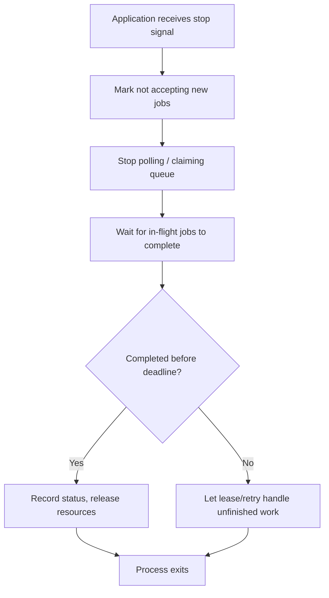

# Controlled Shutdown When the Application Stops

In a Spring Framework Mail system, sending emails asynchronously keeps HTTP requests or business threads from waiting on SMTP operations. However, when the application is redeployed, a container receives a stop signal, or a server needs maintenance, emails waiting in the executor or being sent by workers can be affected. If the application shuts down immediately, some unfinished tasks will be lost or left in an ambiguous state.

**Controlled shutdown** (*graceful shutdown*) is the process of actively stopping acceptance of new work, giving in-flight tasks a window to finish, recording outcomes, and releasing resources before the process exits. For emails, the goal is not merely “no threads still running”, but also knowing which send requests were accepted by SMTP, which need reprocessing, and which may have been sent without recording their status.

Spring provides components such as `ThreadPoolTaskExecutor`, lifecycle callbacks, and Spring Boot graceful shutdown configuration. If emails are stored in a durable queue or transactional outbox, workers must also coordinate stopping new job claims, completing in-flight jobs, and handling leases/retries after restart.

This lesson distinguishes graceful shutdown for in-memory `@Async` from workers backed by a durable queue/outbox, explains how to configure it, bound shutdown duration, manage uncertain SMTP outcomes, and establish a safe operational runbook.

## 1. Problems That Arise When an Application Stops

Suppose an email follows this flow:

```text
HTTP request / domain event
        |
        v
Submit mail task
        |
        v
Executor queue
        |
        v
Worker thread
        |
        v
Build MIME -> connect SMTP -> send
        |
        v
Record SMTP outcome
```

At the moment the application shuts down, a task may be in one of these states:

| State | What Can Happen on Abrupt Stop |
|---|---|
| New request not yet accepted | Caller needs a rejection response or durable request persistence. |
| Placed into an in-memory queue | Can vanish when the process terminates. |
| Rendering template or reading attachment | Can stop mid-way; may not have connected to SMTP yet. |
| Connecting/authenticating with SMTP | Can time out or be cut off. |
| Sent SMTP DATA command, waiting for reply | May be uncertain whether SMTP accepted it or not. |
| SMTP accepted, outcome not yet recorded | Risk of duplicate send on retry. |
| Outcome successfully recorded | State can be recovered from persisted records. |

A `mailSender.send(...)` call returning normally usually reflects **SMTP accepted the message at the transport layer**, not that the email reached the inbox. Graceful shutdown must preserve this distinction when reporting status.

### Controlled Shutdown Is Not Infinite Waiting

Applications normally have a finite shutdown time budget. Container orchestrators, service managers, or cloud platforms may send a forced termination signal once the deadline passes. Therefore, graceful shutdown requires **stopping new work intake**, **bounding wait time**, and **a recovery plan** when work cannot finish in time.

You cannot rely on process graceful shutdown as the sole mechanism guaranteeing emails are not lost. Power loss, kernel crashes, and `SIGKILL` give the application no chance to run shutdown hooks.

## 2. Goals of Proper Shutdown

A solid process must satisfy these goals:

1. **Stop accepting new work:** do not keep pushing new emails into a stopping executor.
2. **Stop pulling new work from queues:** workers claim no additional jobs once shutdown starts.
3. **Allow running work to finish within bounds:** avoid cutting off SMTP mid-flight if time remains.
4. **Persist outcomes:** save send status, attempt counts, and error causes.
5. **Do not lose confirmed requests:** critical jobs belong in durable storage.
6. **Avoid unnecessary concurrent retries:** prevent a new worker from processing the same job while an old worker has not yet stopped.
7. **Close resources in order:** finish workers before destroying dependencies workers still need.
8. **Exit within budget:** return control to the container/orchestrator on time.

Overview diagram:



Order matters greatly: closing the sender, database, or queue client too early while workers are still running can prevent workers from sending emails or saving outcomes.

## 3. Distinguishing Three Ways to Run Asynchronous Emails

In Spring, “asynchronous” can refer to different mechanisms:

| Mechanism | Where Waiting Work Lives | When Process Dies | What Shutdown Must Do |
|---|---|---|---|
| `@Async` + `ThreadPoolTaskExecutor` | Queue in application memory | Unstarted jobs can be lost; running jobs are interrupted by process exit | Stop submissions and drain executor within bounds. |
| Custom `ExecutorService` | Queue in process memory | Same | Actively call `shutdown()`, `awaitTermination(...)`, or let bean lifecycle manage it. |
| Message broker / database outbox | Durable storage outside the process | Jobs can be reprocessed by new workers | Stop consumers/claiming, finish in-flight, ack/commit properly, use retries/leases. |

**The decisive difference is where the mail send intent is stored.** With `@Async`, the caller may receive “handed to executor” yet the executor only stores the work in RAM. With an outbox, the send request is committed to the database; shutdown does not erase that intent.

Executor graceful shutdown reduces risk during normal stops. It does not turn a RAM queue into a durable queue.

## 4. Configuring ThreadPoolTaskExecutor to Drain Tasks

`ThreadPoolTaskExecutor` is the common executor when using `@Async` in Spring. You can configure thread counts, queue size, and behavior when the context closes.

Example:

```java
import org.springframework.context.annotation.Bean;
import org.springframework.context.annotation.Configuration;
import org.springframework.scheduling.annotation.EnableAsync;
import org.springframework.scheduling.concurrent.ThreadPoolTaskExecutor;

@Configuration
@EnableAsync
public class MailAsyncConfiguration {

    @Bean("mailExecutor")
    public ThreadPoolTaskExecutor mailExecutor() {
        ThreadPoolTaskExecutor executor =
                new ThreadPoolTaskExecutor();

        executor.setCorePoolSize(2);
        executor.setMaxPoolSize(4);
        executor.setQueueCapacity(100);
        executor.setThreadNamePrefix("mail-");

        executor.setWaitForTasksToCompleteOnShutdown(true);
        executor.setAwaitTerminationSeconds(30);

        return executor;
    }
}
```

Key meanings:

- `setCorePoolSize(2)`: baseline threads normally kept alive.
- `setMaxPoolSize(4)`: maximum threads per pool policy.
- `setQueueCapacity(100)`: cap on tasks waiting in memory.
- `setThreadNamePrefix("mail-")`: helps track threads in logs and thread dumps.
- `setWaitForTasksToCompleteOnShutdown(true)`: when the executor shuts down via lifecycle, attempts to keep executing queued tasks rather than canceling them immediately.
- `setAwaitTerminationSeconds(30)`: when shutting down the executor, waits up to the configured duration for the pool to terminate.

This is an illustrative configuration, not optimal defaults for every application. Pool size, queue capacity, and wait duration must be based on SMTP speed, email size, job arrival frequency, and the deployment environment's stop deadline.

### Two Different Settings

`waitForTasksToCompleteOnShutdown` governs **how already-accepted tasks are handled** when the executor starts shutting down. `awaitTerminationSeconds` governs **how long the shutdown thread may wait for the executor to terminate**.

Setting a wait duration does not mean every task is guaranteed to finish. If a mail-sending task hangs or too much work remains in the queue, the wait timeout can expire before workers finish. When the process is subsequently force-stopped, work in RAM can be lost.

### Note Lifecycle Differences Across Spring Versions

Exact behavior at context close, bean stop ordering, and new-task rejection can vary across Spring Framework versions and executor configurations. In some configurations, enabling wait-for-completion keeps the executor active later in the context-closing cycle.

Therefore, do not rely solely on these two setters to stop submitting new work. Add an explicit admission mechanism, and verify lifecycle order if workers need `JavaMailSender`, the database, or other beans while draining.

## 5. Using @Async with the Configured Executor

Example worker running via `@Async`:

```java
import java.util.concurrent.CompletableFuture;
import org.springframework.mail.javamail.JavaMailSender;
import org.springframework.scheduling.annotation.Async;
import org.springframework.stereotype.Service;

@Service
public class AsyncMailWorker {

    private final JavaMailSender mailSender;

    public AsyncMailWorker(JavaMailSender mailSender) {
        this.mailSender = mailSender;
    }

    @Async("mailExecutor")
    public CompletableFuture<Void> send(MailJob job) {
        mailSender.send(job.message());
        return CompletableFuture.completedFuture(null);
    }
}
```

`MailJob` is an illustrative model holding the task's message. A real job should carry a message ID, notification type, recipient, and data to build the email; never share a mutable `MimeMessage` across multiple workers.

Another service can submit:

```java
@Service
public class MailSubmissionService {

    private final AsyncMailWorker worker;

    public MailSubmissionService(AsyncMailWorker worker) {
        this.worker = worker;
    }

    public CompletableFuture<Void> submit(MailJob job) {
        return worker.send(job);
    }
}
```

Notes:

- `@EnableAsync` must be enabled.
- Calls must pass through a Spring proxy; internal calls to `@Async` methods within the same instance usually do not trigger thread switching.
- A job accepted into the executor does not mean SMTP accepted the email.
- If the worker throws an exception, `CompletableFuture` can complete exceptionally; callers or monitors must observe that outcome.
- With `void` `@Async` methods, exceptions do not automatically return to the caller; an `AsyncUncaughtExceptionHandler` or other logging/monitoring is needed.

**Without an outbox, this job still exists only in memory.** Even with executor graceful shutdown, an abrupt stop can lose the job.

## 6. Stopping New Work Acceptance Before Draining

A common issue is the executor starting to close while HTTP requests or event listeners keep submitting emails. This can cause `TaskRejectedException`, or callers may assume work was accepted even though it was never durably persisted.

Separate **whether the application accepts more work** from **whether the executor is still running**.

Example admission gate:

```java
import java.util.concurrent.atomic.AtomicBoolean;
import org.springframework.context.event.ContextClosedEvent;
import org.springframework.context.event.EventListener;
import org.springframework.stereotype.Component;

@Component
public class MailAdmissionGate {

    private final AtomicBoolean accepting =
            new AtomicBoolean(true);

    public void requireAccepting() {
        if (!accepting.get()) {
            throw new IllegalStateException(
                    "Mail submission is stopping"
            );
        }
    }

    @EventListener(ContextClosedEvent.class)
    public void stopOnContextClose() {
        accepting.set(false);
    }
}
```

The submitting service can check the gate before calling the worker:

```java
public CompletableFuture<Void> submit(MailJob job) {
    admissionGate.requireAccepting();
    return asyncMailWorker.send(job);
}
```

This illustrates blocking new work when the context closes. However, **checking the gate and submitting is not an atomic operation**. The context can still close between the two lines. The submission layer must catch `TaskRejectedException` from the executor and return a meaningful error or fall back to durable storage.

For mandatory operations that must not be lost, do not rely on a gate and then drop the job. Write the request to a database/outbox first, and let workers process only committed records.

### Readiness and Admission Are Two Different Layers

In environments with load balancers or Kubernetes, readiness probes can signal that an instance is no longer receiving new traffic. Nevertheless, in-flight routed traffic can still arrive, or internal tasks can still be spawned. An in-application admission gate helps enforce that boundary.

Readiness becoming false does not replace stopping schedulers, broker consumers, event listeners, or other internal sources of mail jobs.

## 7. Configuring Graceful Shutdown in Spring Boot

Several Spring Boot settings can serve as a foundation:

```yaml
server:
  shutdown: graceful

spring:
  lifecycle:
    timeout-per-shutdown-phase: 30s
  task:
    execution:
      shutdown:
        await-termination: true
        await-termination-period: 30s
  mail:
    host: smtp.example.org
    port: 587
    properties:
      "mail.smtp.connectiontimeout": 5000
      "mail.smtp.timeout": 5000
      "mail.smtp.writetimeout": 5000
```

These settings serve different purposes:

| Setting | Effect |
|---|---|
| `server.shutdown=graceful` | Instructs the web server to support graceful shutdown for in-flight requests. |
| `spring.lifecycle.timeout-per-shutdown-phase` | Bounds wait time for a Spring lifecycle phase. |
| `spring.task.execution.shutdown.await-termination` | Shutdown wait policy for Boot's auto-configured task executor. |
| `spring.task.execution.shutdown.await-termination-period` | Wait duration for the auto-configured executor to terminate. |
| `mail.smtp.connectiontimeout` | Limit waiting for an SMTP connection. |
| `mail.smtp.timeout` | Limit waiting to read on an SMTP connection. |
| `mail.smtp.writetimeout` | Limit waiting to write on an SMTP connection. |

Exact properties and behavior must be checked against your actual Spring Boot version. **`spring.task.execution.*` settings do not automatically override a custom-declared `ThreadPoolTaskExecutor` bean**. If the application creates its own `mailExecutor` bean, set shutdown policies directly on that bean or configure consistently.

### Web Server Graceful Shutdown Is Not Enough for @Async

The web server may wait for active HTTP requests, yet previously submitted `@Async` tasks can continue on a separate executor. An HTTP request finishing does not mean the background mail task has finished.

Therefore configure and control **both the web server lifecycle and the executor lifecycle**. If broker consumers or schedulers exist, manage their lifecycles separately as well.

### Timeouts Must Be Properly Ordered

Do not set executor wait durations longer than the total time the process is allowed to live and expect draining to always finish. Plan a holistic shutdown budget covering ingress, workers, transaction completion, and cleanup, leaving safety margin for the deployment platform.

## 8. SMTP Timeouts Enable Bounded Draining

A job calling `JavaMailSender.send(...)` can stall during connect, TLS, write, or read. Without proper timeouts, workers can hold threads far too long.

Example JavaMail SMTP properties:

```yaml
spring:
  mail:
    host: smtp.example.org
    port: 587
    properties:
      "mail.smtp.connectiontimeout": 5000
      "mail.smtp.timeout": 5000
      "mail.smtp.writetimeout": 5000
```

Values are in milliseconds and illustrative only. Choose timeouts based on network conditions, message size, provider limits, and available stop duration.

**Socket timeouts are not a total deadline for the entire job.** One send can perform multiple read/write operations. Total elapsed time can exceed a single timeout. If the business requires an overall attempt cap, build deadline tracking and appropriate cancellation/recovery handling; never assume interrupting a thread immediately aborts all socket I/O in every SMTP library.

### Do Not Rely Entirely on Interrupts

`Thread.interrupt()` only flags or attempts to interrupt certain waiting operations. It does not guarantee an already-sent SMTP command is rolled back, nor does it guarantee socket I/O across every transport cancels instantly.

When shutting down proactively, prefer letting running jobs finish within timeouts, recording outcomes, and closing resources. When deadlines expire and the process is force-stopped, accept that some outcomes may remain uncertain and let durable persistence handle recovery later.

## 9. Designing Shutdown for Queues or Transactional Outboxes

For critical emails, send requests should normally be saved to durable storage:

```text
Database transaction
    ├── Persist business state
    └── Insert mail_outbox(PENDING)
                |
                v
           Commit once
                |
                v
          Mail worker polls
                |
                v
           Claim with lease
                |
                v
        JavaMailSender.send(...)
                |
                v
        Persist SMTP outcome
```

During shutdown:

1. Mark workers to stop accepting new jobs.
2. Stop schedulers/pollers or broker consumers.
3. Claim no additional outbox records.
4. Let in-flight sends complete within bounds.
5. Record outcomes and commit transactions.
6. Exit workers; unfinished jobs remain in the outbox or await lease expiration.

In this model, **shutdown does not need to force draining the entire backlog**. The backlog remains saved and can be processed by other instances or after the application restarts. Draining focuses primarily on already-claimed, running jobs.

### Statuses of an Outbox Record

You can use statuses such as:

| Status | Meaning |
|---|---|
| `PENDING` | Waiting for a worker to process. |
| `PROCESSING` | Claimed by a worker with a lease/claim token. |
| `SMTP_ACCEPTED` | Submission to SMTP succeeded; inbox delivery not guaranteed. |
| `RETRYABLE_FAILURE` | Error classified as eligible for retry. |
| `PERMANENT_FAILURE` | Automatic retries stopped per policy. |
| `UNKNOWN` | Uncertain whether SMTP received the message. |

Status names may vary by system. What matters is **not merging “SMTP accepted” with “delivered”**, and not turning an ambiguous timeout into “never sent”.

## 10. Leases, Retries, and Interrupted Jobs

In multi-worker systems, an outbox job must be claimed safely. Workers typically record:

```text
jobId = mail-741
status = PROCESSING
claimedBy = mail-worker-3
leaseUntil = 2026-11-12T10:00:30Z
attempt = 2
claimToken = 8a12...
```

If a worker stops before recording the outcome, the job remains in the database. Once the lease expires, another worker can reclaim it per policy.

### Why Not Release Leases Immediately Upon Receiving SIGTERM?

If the old worker is still transferring via SMTP while the record is released immediately, a new worker can pick up the same job and send in parallel. This increases the risk of duplicate emails.

A safer approach is usually:

- Stop claiming new jobs.
- Let in-flight jobs complete and record outcomes while time remains.
- If a job does not finish, let its lease expire or use a tightly coordinated handoff mechanism.
- New workers only pick up jobs per claim/lease rules.
- Use a claim token or fencing mechanism to prevent an old worker from overwriting outcomes after lease ownership has transferred.

For long jobs, lease renewal (*heartbeat*) may be needed. When shutdown begins, the system must decide whether to keep renewing leases for draining jobs based on remaining deadline and ability to persist outcomes.

### Retry Does Not Mean Exactly-Once

SMTP and the database do not share a distributed transaction. The following can happen:

1. Worker calls `send`.
2. SMTP server accepts the email.
3. Worker is stopped before committing `SMTP_ACCEPTED`.
4. Lease expires.
5. Another worker resends.

The result can be two emails. Queues/outboxes usually provide **at-least-once** processing for send requests, not a default guarantee that recipients receive only a single message.

Duplicates can be reduced using idempotency keys at request creation, unique constraints in the outbox, message ID tracking, and controlled retries. However, a fixed MIME `Message-ID` does not force every SMTP server or mailbox to deduplicate messages.

## 11. Stopping Broker Consumers in the Right Order

When using RabbitMQ, Kafka, or another broker, graceful shutdown typically requires stopping incoming messages before closing processing resources.

Diagram:

```text
SIGTERM
    |
    v
Stop consumer / pause polling
    |
    v
Finish messages already being processed
    |
    +--> Submit to SMTP
    |
    +--> Persist local outcome if needed
    |
    +--> ACK / commit offset according to policy
    |
    v
Close consumer/channel
    |
    v
Stop application
```

**Never ACK a job before required work completes**, if the broker is the sole durable store for the send request and the application needs retry capability on failure. Conversely, if the job is persisted into a separate durable outbox, the ACK can reflect handing responsibility over to the outbox; this contract must be explicit.

Broker-specific notes:

- With RabbitMQ, unacked messages on a closed channel/connection may be requeued by the broker depending on configuration and message state.
- With Kafka, offset commits and consumer group rebalances determine whether messages are reprocessed; handle the boundary between SMTP sending and offset committing carefully.
- With database-polling schedulers, stop new ticks and manage leases of in-progress records.
- With multiple replicas, prevent double-claiming the same job via races or missing transactions/locking.

Do not apply a single “ACK recipe” to every broker. Design commit/ack ordering around your durable source of truth and system semantics.

## 12. Shutdown in Kubernetes or Containers

A common deployment uses Kubernetes. When a Pod is terminated, the platform starts a grace period, runs relevant hooks, and sends a signal for the process to exit; if the deadline expires, it force-kills the process.

A workflow should achieve:

```text
Pod termination begins
    |
    +--> Stop routing new work / readiness changes
    |
    +--> Application receives termination signal
    |
    +--> Stop mail admissions and pollers
    |
    +--> Drain in-flight jobs within budget
    |
    +--> Close resources and exit
    |
    +--> Force kill if grace period is exceeded
```

Example deployment settings:

```yaml
apiVersion: apps/v1
kind: Deployment
metadata:
  name: notification-service
spec:
  replicas: 2
  selector:
    matchLabels:
      app: notification-service
  template:
    metadata:
      labels:
        app: notification-service
    spec:
      terminationGracePeriodSeconds: 75
      containers:
        - name: application
          image: example/notification-service:1.0.0
          ports:
            - containerPort: 8080
```

This is an illustrative configuration. The grace period must cover hooks, draining, cleanup, and headroom; do not just set it equal to `awaitTerminationSeconds`.

### Readiness Does Not Take Effect Everywhere Instantly

A Pod can still receive in-flight requests while endpoints or load balancers propagate updates. Therefore:

- Mail-job creation APIs must handle an instance that is currently draining.
- If unable to accept new work, return a clear response or persist the request to durable storage.
- Do not build RAM-only queues on an instance about to stop.
- The system needs client-side retries or appropriate failover mechanisms.

A `preStop` hook can assist traffic draining, yet hook duration still counts toward the termination budget. Do not rely on arbitrary sleeps as the sole way to guarantee draining.

### PID 1 and Termination Signals

The Java process must receive the container's stop signal. When using a shell script entrypoint, ensure signals forward properly to the JVM, such as launching via `exec java ...`. If PID 1 is a shell that does not forward signals, Spring may fail to run its context-closing sequence as expected.

Forced kills like `SIGKILL` do not execute Java callbacks. That is why critical jobs must be persisted durably.

## 13. Phased Shutdown Procedure

An operational playbook can be divided into five phases.

### Phase A — Quiesce: Stop Accepting New Work

- Mark the instance as shutting down.
- Readiness or routing stops sending new traffic per policy.
- Block or redirect new mail-sending requests.
- Stop pollers, consumers, and scheduled triggers.
- Record shutdown start timestamp and current in-flight count.

### Phase B — Drain: Wait for In-Flight Work

- Give active SMTP attempts a chance to finish.
- Allow final outcomes to be written to the database.
- Restrict spawning extra follow-up work from workers themselves.
- Track in-flight counts and remaining deadline.
- Do not attempt to drain the entire durable backlog if time does not allow.

### Phase C — Reconcile: Account for Unfinished Work

- For finished jobs: write `SMTP_ACCEPTED` or classified error status.
- For uncertain outcomes: write `UNKNOWN` if possible, or let the lease expire.
- For queues: ensure acks/offsets match designed semantics.
- For RAM-only work: if it cannot be flushed to durable storage, accept potential task loss once the process exits.

### Phase D — Close: Release Resources

- Close consumers after stopping message intake and finishing in-flight work.
- Shut down executors per shutdown policy.
- Close connection pools, databases, and dependent resources once workers no longer need them.
- Avoid blocking indefinitely inside shutdown callbacks.

### Phase E — Exit: Terminate Within Budget

- Record summary shutdown outcome.
- Exit the process within the grace period.
- On startup, workers scan remaining `PENDING` jobs or expired leases and process per policy.
- Monitor interrupted jobs, duplicate retries, and recovery duration.

This is a directional procedure. Exact callback order depends on Spring lifecycle phases, executors, consumer containers, and the project's application context configuration.

## 14. Which Lifecycle Hooks Should Be Used?

Spring provides several relevant mechanisms:

| Mechanism | When Appropriate | Caveats |
|---|---|---|
| `ContextClosedEvent` | Notifies components context is closing, e.g., to block new job submissions | Runs while context is closing; do not wait indefinitely. |
| `@PreDestroy` | Bean resource cleanup | Insufficient to guarantee close order across all dependencies. |
| `DisposableBean.destroy()` | Low-level destroy hook | Use when integrating a specific bean's lifecycle. |
| `SmartLifecycle` | Coordinating start/stop with lifecycle phases | Must design phases and `stop(Runnable)` callback accurately. |
| Executor shutdown settings | Draining submitted tasks | Does not guarantee job durability across crashes. |
| Broker listener/container lifecycle | Stopping consumers and in-flight messages | Depends on broker technology and ack mode. |

### SmartLifecycle and Phases

`SmartLifecycle` lets components participate in application context start/stop. During shutdown, components in higher phases normally stop before lower phases; ordering among beans in the same phase also depends on dependencies and implementation.

Phases can ensure ingress/consumers stop accepting work before senders or data sources close. However, never guess default phases of every executor/consumer. Check your version's documentation and test actual shutdown order in the application.

A design concept:

```text
High phase: stop mail intake / broker consumer
     |
     v
Middle phase: drain worker tasks
     |
     v
Low phase: close shared services and data resources
```

If implementing `SmartLifecycle.stop(Runnable callback)` yourself, invoke the callback once stopping truly finishes. Never forget the callback, as doing so can stall context closing until timeout.

### Do Not Put All Shutdown Logic Inside @PreDestroy

A `@PreDestroy` running `Thread.sleep(...)` to “wait for emails to finish” does not know which jobs are running and can block other beans from closing properly. When draining is needed, use executor lifecycles, in-flight tracking, and explicit timeouts.

## 15. Controlling In-Flight Counts and Backlogs

To decide when it is safe to shut down, you must know how many jobs are processing and how many are waiting.

With `ThreadPoolTaskExecutor`, you can observe values such as:

- Active thread count.
- Pool size.
- Current queue length.
- Completed task count.

Conceptual example:

```java
int active = mailExecutor.getActiveCount();
int poolSize = mailExecutor.getPoolSize();
int waiting = mailExecutor.getThreadPoolExecutor()
        .getQueue()
        .size();
```

These numbers are snapshots. They can change immediately after reading. Do not build correctness on a single `active == 0` check; executors and admission/submission gates must synchronize with the shutdown procedure.

With an outbox, more important metrics typically include:

- `PROCESSING` job counts by worker ID.
- Age of the oldest `PENDING` job.
- Leases nearing expiration or expired.
- Retries and permanent failures.
- Average/p95/p99 duration of SMTP attempts.
- In-flight job counts at shutdown start and end.

A backlog can be large while shutdown still succeeds if jobs are stored durably and new workers keep processing. Conversely, with a RAM queue, a 100-job backlog is 100 tasks that can be lost if drain time runs out.

## 16. Designing Deadlines Instead of Only Counting Jobs

Suppose an SMTP send usually takes a few seconds, yet can stretch longer when the provider is slow. If an executor has four workers and 100 jobs sit in the queue, waiting for the entire backlog can exceed how long the Pod is allowed to stay alive.

Therefore distinguish:

- **Per-SMTP-attempt deadline:** based on connect/read/write timeouts and job policy.
- **Drain deadline:** remaining time before the application must stop.
- **Platform deadline:** time the process is allowed to exist before forced termination.

A guiding relationship:

```text
termination grace
    >= traffic drain
     + worker drain
     + resource cleanup
     + safety margin
```

This is a budgeting relationship, not a guaranteed formula. Activities can overlap, hooks consume part of the grace period, and the platform may shorten time due to external conditions.

When insufficient time remains for a new job, workers should stop taking jobs rather than claiming one only to abandon it mid-way. With durable queues, another worker will still pick it up later.

## 17. Failure Scenarios During Shutdown

| Symptom | Possible Cause | Resolution |
|---|---|---|
| Emails lost after redeploy | Jobs lived only in RAM queue | Use durable outbox/queue for critical jobs. |
| Mail-creation requests hit `TaskRejectedException` | Executor shutting down while submitters still active | Block admissions early and handle rejections explicitly. |
| Shutdown waits too long | Hung SMTP or oversized backlog | Set timeouts, deadlines, and cap in-flight work. |
| SMTP sent yet job stays `PROCESSING` | Worker stopped before committing outcome | Use leases, `UNKNOWN` status, and duplicate-aware retry policies. |
| Two replicas send the same email | Lease expired or released too early | Claim with locking, heartbeats, and fencing tokens. |
| Worker fails because database closed | Improper lifecycle ordering | Stop/drain workers before destroying dependencies. |
| `@Async` keeps running after web server stops | Executor has independent lifecycle | Coordinate shutdown across web, schedulers, and executors. |
| Grace period insufficient despite 60s wait | Platform kills process after 30s | Design a unified time budget. |
| Jobs retry endlessly after restart | ACKs/offsets or job states not committed | Check transaction boundaries and retry/backoff. |
| Users receive duplicate emails | SMTP accepted yet app failed to receive/save outcome | Business-level idempotency and deduplication; account for ambiguity. |
| Errors masked in `@Async void` | Exceptions do not return to caller | Return `CompletableFuture` or configure handlers and metrics. |
| Shutdown hooks never run | Process force-killed or JVM missed SIGTERM | Fix entrypoint configuration and persist jobs durably. |

### Do Not Retry Blindly After Timeouts

The riskiest scenario is when a worker does not know for sure whether SMTP accepted the message. When retrying, the system should record that this is a subsequent attempt for the same logical notification and apply duplicate-limiting policies. Never treat a timeout as proof the message was never sent.

## 18. Testing Controlled Shutdown

Shutdown tests should simulate stopping the application while jobs are at different stages, not merely shutting down an idle application.

### 18.1. Executor with Running and Waiting Jobs

In tests, create a small executor with tasks synchronized via latches:

1. Submit the first task, let it start and wait on a latch.
2. Submit a second task into the queue.
3. Trigger context closing.
4. Release the latch for the first task.
5. Verify accepted tasks finish per shutdown policy.
6. Verify the executor rejects new jobs after closing.

No real emails need to be sent; use a fake sender to verify thread behavior and ordering.

### 18.2. SMTP Slower Than Drain Time

Use an SMTP test server or fake sender with controlled delay. Let an attempt run past the deadline, then observe:

- Whether the process/bean terminates within the configured time.
- Whether RAM jobs can be lost if force-stopped.
- Whether durable jobs are retried after restart.
- Whether recorded statuses distinguish failures from uncertain outcomes.

### 18.3. Worker Dies After SMTP Accepted

This is a mandatory test case for queue/outbox systems:

```text
Worker sends mail
      |
      v
SMTP accepts message
      |
      X  worker stops before database commit
      |
      v
Lease expires -> another worker retries
```

Tests must verify send-request records are not lost and retry according to policy, while the system makes no unrealistic exactly-once promises.

### 18.4. Rolling Deployment with Multiple Replicas

While one replica is shutting down:

- Remaining/new replicas have enough capacity to process jobs.
- Stopping replica ceases claiming.
- In-flight jobs commit or expire leases cleanly.
- No two workers ever own the same claim token.
- Queue lag, send errors, and latency return to normal.

### 18.5. Testing SIGTERM and Force Kills

Verify the process receives SIGTERM and runs callbacks. Then simulate a force kill to confirm durable jobs still recover, rather than only testing “clean” shutdowns.

**Never send emails to real addresses** during testing. Use Mailpit/GreenMail or a controlled test SMTP server and inspect received messages.

## 19. Production Readiness Checklist

| Question | Expectation |
|---|---|
| Are critical emails persisted durably before acknowledging requests? | Yes, if job loss is unacceptable. |
| Does the application have a state to stop accepting new jobs? | Yes. |
| Do pollers/consumers stop claiming before the executor drains? | Yes. |
| Are executor queue size and thread count bounded? | Yes. |
| Does shutdown have explicit timeouts aligned with the platform? | Yes. |
| Are SMTP connect/read/write timeouts configured? | Yes. |
| Can workers persist outcomes before the database closes? | Yes. |
| Is there a lease/retry mechanism for interrupted jobs? | Yes, for durable queues/outboxes. |
| Are ambiguous-outcome timeouts distinguished from definite rejections? | Yes. |
| Do retries have business-level duplicate protection policies? | Yes. |
| Are metrics present for in-flight, queue lag, and shutdown duration? | Yes. |
| Have shutdowns been tested mid-send, under slow SMTP, and under force kill? | Yes. |

Not every requirement needs a complex queue system. For manual test emails, a small executor with wait-for-completion shutdown may suffice. Yet for transactional emails that must be sent reliably, **persisting requests durably** matters more than any tuning of executor wait durations.

## 20. Key Takeaways

- Graceful shutdown means **stopping new work intake, stopping job claiming, draining running tasks, and closing resources in order**, within a finite time budget.
- `@Async` and `ThreadPoolTaskExecutor` only keep queues in memory; waiting on shutdown does not protect against crashes, `SIGKILL`, or power loss.
- `setWaitForTasksToCompleteOnShutdown(true)` and `setAwaitTerminationSeconds(...)` control how the executor stops, yet do not guarantee every job completes.
- Block new submissions and handle `TaskRejectedException`; web server readiness alone does not stop schedulers or broker consumers.
- Spring Boot web graceful shutdown, task executor shutdown, and lifecycle phases are related yet distinct mechanisms. Custom executors must be configured explicitly.
- SMTP timeouts and drain deadlines must fit within the container's termination grace period.
- With queues/outboxes, stop claiming new jobs, finish in-flight work, persist status, and only then close dependencies; unprocessed backlogs stay in storage.
- Leases, heartbeats, claim tokens, and retries recover interrupted jobs across multi-worker systems.
- SMTP accepted does not equal delivered; workers can die between sending and saving status, creating duplicate risk on retry.
- Exactly-once email cannot be guaranteed solely by configuring an executor; use idempotency and workflows for uncertain outcomes.
- Test SIGTERM, bounded shutdowns, slow SMTP, multiple replicas, and force kills.

Controlled shutdown helps Spring Framework Mail applications minimize disruption during redeploys or maintenance. For low-importance, low-volume emails, configuring executors to await tasks within a deadline may be enough. For critical transactional emails, the solid approach is **persisting send intents durably, stopping consumers in order, and letting other workers resume unfinished jobs**.
