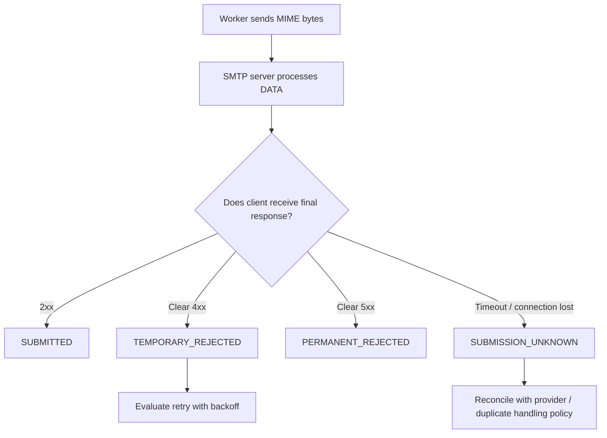
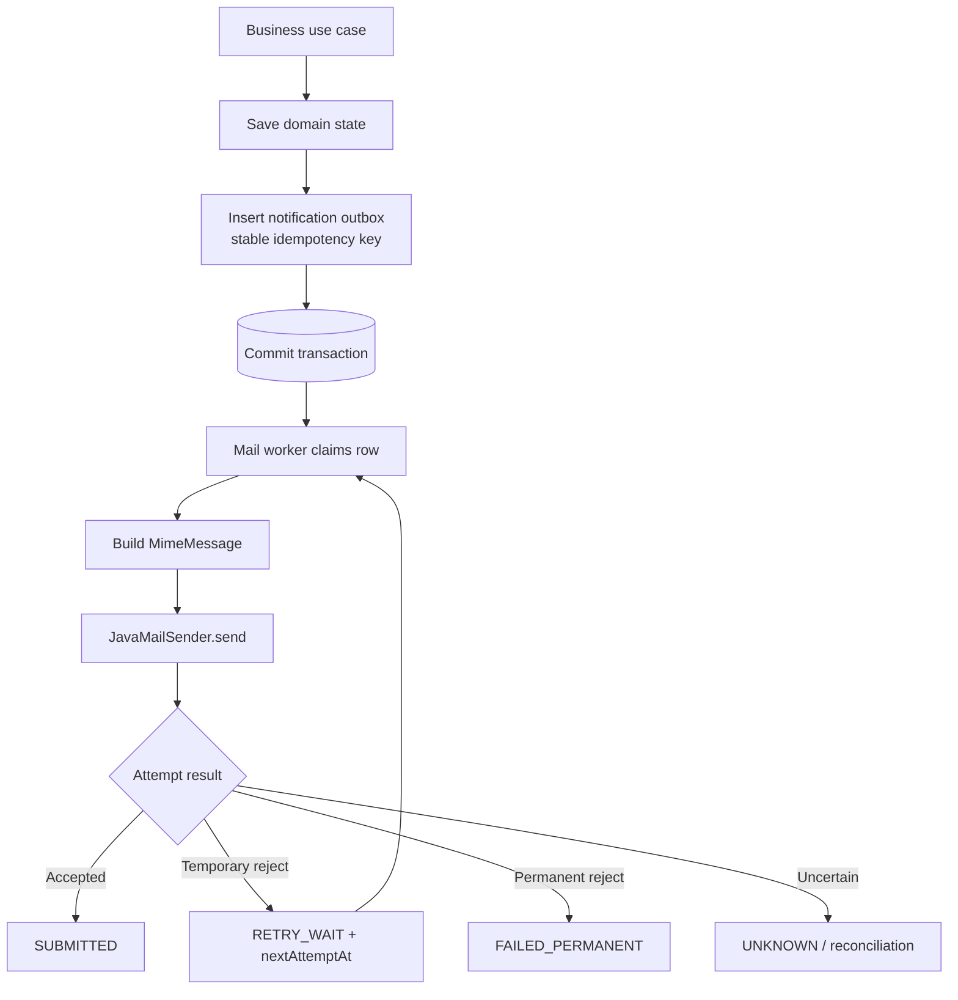

# Transient Errors and Retry Conditions

A Spring Boot system sends order confirmation emails using `JavaMailSender`. When the SMTP server is temporarily busy and returns code `451` or `421`, the application can resend after a waiting period. However, if the server returns `550` because the address does not exist, repeated retries are usually futile. Even trickier, when the connection drops right after the application finishes sending the email data, the server may have already accepted the message before the application could read the response. Retrying in that case can produce **two identical emails**.

Therefore, in **Spring Framework Mail**, you should not treat "send failure" as a single error type and call `mailSender.send(...)` multiple times in a loop. The system must distinguish **transient** errors from **permanent** errors, identify **at which stage the error occurred**, assess **whether the message handoff outcome is certain**, and only then decide **whether to retry, when to retry, and up to how many times**.

This lesson belongs to the **Retry and Idempotency** chapter. The focus is on retry conditions for emails sent via Spring Mail, including SMTP responses, connection errors, limit policies, durable queues, and the risk of duplicate sends.

## 1. Clarifying the States of an Email

First, distinguish the events in the email lifecycle:

| Concept | Meaning | What cannot be concluded |
|---|---|---|
| `Notification intent` | A logical request to send an email for a specific purpose | Does not mean SMTP has been called. |
| `Send attempt` | One attempt by a worker to execute the send request | Does not mean the provider has accepted it. |
| `SMTP submission accepted` | The SMTP server accepts responsibility for handling the message at the submission stage | Does not guarantee the recipient received it in their Inbox. |
| `Delivery` | The delivery system reports that the message has reached its destination per the provider's semantics | Does not guarantee the recipient opened or read it. |
| `Bounce / DSN` | A failed or delayed delivery notification | Not necessarily an error of the initial `send` call. |

For example, one notification may have three attempts while having only **one logical send request**:

```text
Notification ID: N-1024
      |
      +-- Attempt #1: SMTP 451 (temporary) --> RETRY_WAIT
      |
      +-- Attempt #2: SMTP 421 (temporary) --> RETRY_WAIT
      |
      +-- Attempt #3: SMTP 250 after DATA --> SUBMITTED
```

When retrying, continue processing **the same notification ID**. Do not create a new notification on each attempt, as this loses the history trail and increases the risk of creating multiple emails for the same business event.

## 2. "Transient" Is a Property of the Error, Not Every Exception

A transient error is an error that may resolve without changing the business request. Examples include an overloaded SMTP server, a time-window quota just hitting its threshold, or a brief network interruption.

A permanent error is an error with no basis to believe that resending the same request will succeed. Examples include an invalid recipient address, rejection due to a long-term policy, incorrect SMTP authentication credentials, or a MIME message that cannot be constructed due to invalid data.

However, classification must be based on **context**:

- `451` usually indicates a transient error, but a persistent broken configuration can also cause `451` to occur continuously. Retries must still have limits.
- `550` is usually a permanent error for the current recipient or policy; do not retry indefinitely just because the operations team might fix the data later.
- `IOException` could be a recoverable network error, a deleted source file error, or a situation where it is unknown whether the server received the message.
- `MailException` is a Spring exception type, **not a retry classification code**.

**Rule:** only retry when there is a reasonable basis that the cause is recoverable, the request is still valid, and retrying does not exceed the duplicate-send risk acceptable to the business.

## 3. The SMTP Stage Determines Retry Conditions

When using SMTP submission, a simple flow typically consists of:

```text
Client (Spring Mail / Jakarta Mail)       SMTP server
             |                                |
             |------ TCP connect ------------>|
             |<----- Greeting 220 ------------|
             |------ EHLO -------------------->|
             |<----- Capabilities 250 ---------|
             |------ STARTTLS (if used) ----->|
             |<----- TLS negotiation ----------|
             |------ AUTH (if used) --------->|
             |<----- Authentication result ----|
             |------ MAIL FROM --------------->|
             |<----- Result -------------------|
             |------ RCPT TO ----------------->|
             |<----- Result -------------------|
             |------ DATA -------------------->|
             |<----- 354 ----------------------|
             |------ MIME bytes + terminator ->|
             |<----- Final result after DATA --|
             |------ QUIT -------------------->|
             |                                |
```

### 3.1. Errors Before the Message Is Accepted

If the TCP connection cannot be opened, the STARTTLS handshake fails, or the server rejects `MAIL FROM` before receiving message data, the client generally has grounds to determine that **the message was not accepted in that attempt**.

Examples:

- The server cannot be reached due to a network error.
- SMTP returns `421` before accepting the message.
- The server returns `450` for a recipient at `RCPT TO`.
- The server returns `451` before the `DATA` stage.

If the cause is classified as transient, a retry may be appropriate. However, clearly record **which stage the attempt stopped at**, rather than inferring solely from a generic error string.

### 3.2. Errors After Sending DATA

The most critical stage is after the client has transmitted the MIME content and the DATA end-of-data marker. If the client receives the final `250` response, the SMTP server has accepted responsibility for processing the message under SMTP semantics.

If the client **does not receive a response** due to a timeout or lost connection, there are at least two possibilities:

1. The server has not finished processing or did not accept the message.
2. The server accepted the message, but the response was lost on the way back.

The client cannot reliably distinguish these two cases from a timeout alone.



For `SUBMISSION_UNKNOWN`, retrying can cause the recipient to receive two emails. Never automatically lump this state together with `TEMPORARY_REJECTED` and claim "not sent."

### 3.3. Bounces Can Still Occur After SMTP Acceptance

A message accepted at submission can still encounter errors during subsequent relay or delivery. These errors are usually reported via DSN/bounce or provider events, not via a synchronous exception from `JavaMailSender.send(...)`.

Do not automatically retry the entire message immediately upon receiving a bounce without classifying it first:

- Recipient permanently does not exist: suppress or require fixing the address.
- Mailbox temporarily full: there may be a retry or deferral policy depending on the provider.
- Destination server is failing: typically the provider/relay performs delivery retries itself; the application should not create another message while the provider is still responsible for retrying.

**Application-level retries and SMTP relay retries are two separate layers.**

## 4. Reading SMTP Reply Codes

SMTP uses three-digit reply codes. The first digit indicates the result category:

| Category | Meaning | Common handling approach |
|---|---|---|
| `2xx` | Positive completion | Continue the protocol or mark success at the corresponding step. |
| `3xx` | Positive intermediate | Continue the protocol (e.g., `354` requesting message data). |
| `4xx` | Transient negative completion | Can be retried after satisfying conditions and backoff. |
| `5xx` | Permanent negative completion | Typically do not retry the same request unless the cause changes. |

Do not just look at the first digit and immediately retry. Identify whether the reply applies to `MAIL FROM`, `RCPT TO`, `DATA`, or the authentication stage, and determine the provider's policy.

### 4.1. Common 4xx Codes

| Code | General meaning | Initial decision |
|---|---|---|
| `421` | Service not available; server may close the connection | Retry with backoff, monitor provider health. |
| `450` | Mailbox or recipient temporarily unavailable | Retry per recipient, with limits. |
| `451` | Temporary local processing error | Retry if evidence indicates the error is recoverable. |
| `452` | Insufficient system storage or temporary capacity issue | Slow down, check quota, and retry with limits. |
| `454` | Temporary authentication failure / TLS-related temporary condition in some contexts | Conditional retry; distinguish outages from configuration errors. |

Accompanying messages and SMTP stages can vary across servers. For example, `452` may reflect server resource limits rather than the recipient's mailbox necessarily being full. Rely on structured responses and provider documentation where available.

### 4.2. Common 5xx Codes

| Code | Common meaning | Handling approach |
|---|---|---|
| `550` | Mailbox unavailable, recipient does not exist, or policy rejection | Do not retry blindly; check recipient/policy. |
| `551` | Recipient is not local to this server; forwarding info may be provided | Handle per routing/provider policy; do not retry indefinitely. |
| `552` | Exceeded storage allocation or limit, depending on the server | Do not retry the same payload until the cause is clarified. |
| `553` | Mailbox/address name not allowed | Check format, address, and provider rules. |
| `554` | Transaction failed or rejected | Inspect detailed cause and policy; usually do not retry immediately. |

A `5xx` is a **permanent negative completion for that operation at the time of the response**. In operations, the root cause may be fixed later by an administrator, but the application should not treat it as an infinitely auto-retryable error.

### 4.3. Enhanced Status Codes

Many SMTP servers also provide extended codes such as:

```text
451 4.3.0 Temporary local problem
450 4.2.2 Mailbox temporarily unavailable
451 4.7.1 Temporary policy / greylisting
550 5.1.1 Recipient address rejected
```

An enhanced status code has the form `class.subject.detail`. Classes:

- `2.x.x`: success.
- `4.x.x`: temporary failure.
- `5.x.x`: permanent failure.

For example, `4.7.1` is often used for security policies, greylisting, or temporary limits; exact details vary by server. Do not build your own classifier by matching free-form provider text when structured status codes are available.

### 4.4. Greylisting and Throttling

Greylisting is a mechanism that temporarily rejects a message so the sender retries later. Throttling restricts message rate or volume.

In these two situations:

- Do not retry immediately hundreds of times.
- Use backoff and jitter.
- Respect quotas per account, IP, domain, or recipient.
- Reduce concurrency if many requests are rejected simultaneously.
- Stop retrying when the notification expires or the attempt limit is reached.

If the provider supplies an officially supported retry time, use that value as a lower bound. SMTP does not have a standard `Retry-After` header equivalent to HTTP that applies universally across all 4xx responses; do not infer a delay from an arbitrary response string.

## 5. Classifying Spring Mail Errors

Spring Mail provides `JavaMailSender` and exceptions under the `org.springframework.mail.MailException` hierarchy. Common types include:

| Spring Exception | Common stage or error type | Can it be retried immediately? |
|---|---|---|
| `MailAuthenticationException` | SMTP authentication failure | Usually no, unless the provider/auth service is proven to be having a temporary outage. |
| `MailParseException` | Invalid message parsing or construction | Usually no; fix the content/input. |
| `MailPreparationException` | Message preparation failed | Depends on cause; do not retry by default. |
| `MailSendException` | Error while sending the message | Must inspect root cause, SMTP stage, and submission outcome. |
| `MailException` | Base class for mail exceptions in Spring | Insufficient data to decide. |

In particular, `MailSendException` can wrap:

- Connection errors.
- Timeout errors.
- SMTP 4xx/5xx responses.
- Errors reading attachments while building/writing MIME.
- Partial failures when sending multiple messages in one call.

Therefore, **never write `catch (MailException e) { retry(); }`**. Classification must happen in the adapter where transport details are known.

### 5.1. Jakarta Mail and Provider-Specific Exceptions

At the lower layer, `MessagingException` may contain a cause or a chained exception via `getNextException()`. Some SMTP provider implementations have specialized exceptions that expose the SMTP reply code and rejected addresses.

Example classification flow:

```text
MailSendException
      |
      +--> MessagingException
                 |
                 +--> provider SMTP exception
                         code = 451
                         command = RCPT TO
                         recipient = ...
```

Concrete provider classes depend on the Jakarta Mail implementation and version. The infrastructure adapter should translate them into neutral outcomes such as `SMTP_TEMPORARY_REJECTED`, `SMTP_PERMANENT_REJECTED`, or `SUBMISSION_UNKNOWN` instead of letting the application import mail provider exceptions.

Do not simply traverse `Throwable.getCause()` and conclude you have all the data: `MessagingException` can carry its own **next exception**; some send exceptions also contain lists of accepted or rejected recipients.

### 5.2. Authentication Errors Can Fall Into Two Categories

If the username/password is wrong or the account is disabled, retrying will not help. If the provider's authentication service is temporarily unavailable, retrying later may succeed.

Consider:

- Explicit SMTP code, if present.
- Provider error documentation.
- Whether the error appeared system-wide or only on one account.
- Whether there are signs of recent credential/configuration changes.

Never log passwords, OAuth2 tokens, raw AUTH payloads, or full SMTP transcripts in production.

### 5.3. MIME/Attachment Errors Are Not SMTP Network Errors

If a PDF file was deleted before Jakarta Mail reads it, `send` may throw a mail exception wrapping an `IOException`. Retrying SMTP will not help if the file still does not exist.

Classify these separately:

- `FILE_MISSING`: check storage/lifecycle.
- `FILE_ACCESS_DENIED`: fix permissions; usually requires intervention.
- `MIME_INVALID`: fix data or template.
- `STORAGE_TEMPORARY`: may retry once storage recovers.

The message preparation stage should verify data sources, while still handling late read errors at the send boundary.

## 6. Conditions Required Before Retrying

Evaluate a failed attempt using multiple conditions, not just a single "isTransient" boolean.

| Condition | Decision question |
|---|---|
| **Error kind** | Is the error classified as temporary, permanent, policy, data, or unknown? |
| **Send stage** | Did the error occur before the server could receive the message, or after DATA was sent? |
| **Certainty** | Is there evidence the provider rejected or accepted it, or is the outcome unknown? |
| **Attempt count** | Has the retry limit been reached? |
| **Notification age** | Is the notification still meaningful after the waiting period? |
| **Provider quota** | Do we need to throttle down or wait for quota recovery? |
| **Recipient policy** | Is the recipient suppressed, unsubscribed, or blocked from sending? |
| **Idempotency** | Does the retry continue the same notification intent? |
| **Data sources** | Are the attachment, template, and recipient snapshot still valid and consistent? |
| **Circuit state** | Is the provider experiencing a widespread outage where dispatch should pause? |

### 6.1. Checking That the Request Is Still Valid

For example, an OTP email is only valid for a few minutes. If the provider is temporarily down for 20 minutes, retrying the old OTP is no longer useful.

Conversely, an invoice email can have a longer retry window because its business value persists.

Design notifications with:

- `createdAt`: timestamp when the intent was created.
- `expiresAt` or `maxAge`: business expiration limit.
- `maxAttempts`: maximum number of attempts.
- `nextAttemptAt`: scheduled time for the next attempt.

Do not apply the same retry window to OTPs, invoices, marketing emails, and operational alerts.

### 6.2. Checking Recipient and Suppression Status

Before each retry or before claiming a notification, check applicable policies:

- Has the address been determined permanently invalid?
- Has the recipient unsubscribed from this type of marketing email?
- Has a hard bounce or complaint triggered suppression?
- Has the domain/tenant been temporarily blocked from sending?
- Are there new legal constraints or contact policies?

Never use retries to bypass suppression or resend an email that the recipient is no longer eligible to receive.

### 6.3. Do Not Retry If Input Data Is Definitely Invalid

Examples:

- The email address is rejected by the parser due to invalid syntax.
- The template is missing a required variable.
- The attachment permanently does not exist.
- The message size exceeds the provider's fixed limit.
- SMTP credentials are misconfigured.

The right action is to log the error, alert, fix the data, or wait for operator intervention. Only after the root cause is fixed should there be a controlled requeue workflow—not an infinite automatic retry loop.

## 7. A Neutral Error Classification Model

The application should not depend directly on Spring Mail exceptions or SMTP provider implementations. Infrastructure can map technical details into neutral error data.

Example:

```java
public enum FailureKind {
    SMTP_TEMPORARY_REJECTED,
    SMTP_PERMANENT_REJECTED,
    NETWORK_BEFORE_SUBMISSION,
    SUBMISSION_UNCERTAIN,
    AUTH_OR_CONFIGURATION,
    MIME_OR_INVALID_INPUT,
    ATTACHMENT_UNAVAILABLE,
    PROVIDER_RATE_LIMIT,
    PROVIDER_OUTAGE
}
```

A result data type:

```java
public record MailFailure(
        FailureKind kind,
        Integer smtpCode,
        String diagnosticCode,
        Instant providerRetryAfter,
        String safeMessage) {
}
```

`diagnosticCode` is an internal code normalized by the adapter. `safeMessage` should only contain information safe for logs and operational support; do not copy raw exceptions or SMTP transcripts if they may contain PII or credentials.

### 7.1. Initial Classification Rules

| FailureKind | Default decision |
|---|---|
| `SMTP_TEMPORARY_REJECTED` | Retry with limits and backoff. |
| `SMTP_PERMANENT_REJECTED` | Stop automatically; record reason, possibly suppress. |
| `NETWORK_BEFORE_SUBMISSION` | Retry if data sources and quota remain valid. |
| `SUBMISSION_UNCERTAIN` | Requires reconciliation or a duplicate-aware retry policy. |
| `AUTH_OR_CONFIGURATION` | Usually stop and alert, unless a temporary auth outage is proven. |
| `MIME_OR_INVALID_INPUT` | Do not retry; fix template/input. |
| `ATTACHMENT_UNAVAILABLE` | Follow storage policy; usually do not retry SMTP. |
| `PROVIDER_RATE_LIMIT` | Wait for quota or provider retry deadline; throttle down. |
| `PROVIDER_OUTAGE` | Retry with backoff/circuit breaker if there is no risk of uncertain send outcome. |

These are **default rules** and do not supersede the provider's error documentation. For example, `PROVIDER_OUTAGE` might include a timeout after the provider already received the message; in that case, the outcome must be marked uncertain rather than definitely failed.

## 8. Designing RetryPolicy Separate From Sending Code

`JavaMailSender` should not decide retries according to business policy. The application or worker should have a `RetryPolicy` component that takes the classified failure and notification state and returns a decision.

### 8.1. Possible Decisions

```java
public enum RetryAction {
    RETRY_LATER,
    STOP_PERMANENTLY,
    NEED_RECONCILIATION
}
```

```java
public record RetryDecision(
        RetryAction action,
        Instant nextAttemptAt,
        String reason) {
}
```

For `NEED_RECONCILIATION`, `nextAttemptAt` can be `null` because the notification is placed into a reconciliation queue rather than immediately scheduled for another send.

### 8.2. Illustrative RetryPolicy Code

```java
import java.time.Duration;
import java.time.Instant;

public final class MailRetryPolicy {

    private static final int MAX_ATTEMPTS = 6;
    private static final Duration MAX_AGE = Duration.ofHours(24);

    private final BackoffPolicy backoffPolicy;

    public MailRetryPolicy(BackoffPolicy backoffPolicy) {
        this.backoffPolicy = backoffPolicy;
    }

    public RetryDecision decide(
            MailFailure failure,
            int attemptsAlreadyMade,
            Instant createdAt,
            Instant now) {

        if (attemptsAlreadyMade >= MAX_ATTEMPTS) {
            return new RetryDecision(
                    RetryAction.STOP_PERMANENTLY,
                    null,
                    "MAX_ATTEMPTS");
        }

        if (!now.isBefore(createdAt.plus(MAX_AGE))) {
            return new RetryDecision(
                    RetryAction.STOP_PERMANENTLY,
                    null,
                    "NOTIFICATION_EXPIRED");
        }

        if (failure.kind() == FailureKind.SUBMISSION_UNCERTAIN) {
            return new RetryDecision(
                    RetryAction.NEED_RECONCILIATION,
                    null,
                    "SUBMISSION_RESULT_UNKNOWN");
        }

        boolean retryable = switch (failure.kind()) {
            case SMTP_TEMPORARY_REJECTED,
                 NETWORK_BEFORE_SUBMISSION,
                 PROVIDER_RATE_LIMIT,
                 PROVIDER_OUTAGE -> true;

            default -> false;
        };

        if (!retryable) {
            return new RetryDecision(
                    RetryAction.STOP_PERMANENTLY,
                    null,
                    "NON_RETRYABLE_FAILURE");
        }

        Instant retryAt = backoffPolicy.nextAttemptAt(
                attemptsAlreadyMade, now);

        if (failure.providerRetryAfter() != null
                && failure.providerRetryAfter().isAfter(retryAt)) {
            retryAt = failure.providerRetryAfter();
        }

        if (!retryAt.isBefore(createdAt.plus(MAX_AGE))) {
            return new RetryDecision(
                    RetryAction.STOP_PERMANENTLY,
                    null,
                    "RETRY_AFTER_EXPIRY");
        }

        return new RetryDecision(
                RetryAction.RETRY_LATER,
                retryAt,
                "TEMPORARY_FAILURE");
    }
}
```

`BackoffPolicy` is an application-defined abstraction introduced in the next section. `MAX_ATTEMPTS` and `MAX_AGE` are only examples; in production they can be configured per notification type. This method assumes recipient policy, attachment availability, and circuit breaker state have already been checked before calling it or at dispatch time.

Important: if the SMTP code was `4xx` but the client **lost the connection after sending DATA and received no final response**, the failure kind must be `SUBMISSION_UNCERTAIN`, not forced into `SMTP_TEMPORARY_REJECTED`.

## 9. Exponential Backoff and Jitter

Immediate retries often make overload worse. If a thousand workers receive `421` and all retry after exactly 30 seconds, the server can get hammered again. This is the **thundering herd** problem.

### 9.1. Increasing Backoff

An illustrative schedule:

| Failed attempts | Base wait interval |
|---|---|
| 1 | 30 seconds |
| 2 | 60 seconds |
| 3 | 120 seconds |
| 4 | 240 seconds |
| 5 | 480 seconds |
| 6+ | Capped at 900 seconds |

That is exponential backoff with a 30-second base delay and a 15-minute cap. There is no single parameter set right for every provider; you need to combine provider limits with the business value of the email.

### 9.2. Full Jitter

With full jitter, the actual wait interval is chosen randomly between 0 and the current backoff ceiling. Workers are far less likely to retry in lockstep.

Java example:

```java
import java.time.Instant;
import java.util.concurrent.ThreadLocalRandom;

public final class ExponentialJitterBackoff
        implements BackoffPolicy {

    private static final long BASE_SECONDS = 30;
    private static final long CAP_SECONDS = 900;

    @Override
    public Instant nextAttemptAt(
            int attemptsAlreadyMade, Instant now) {

        int exponent = Math.min(
                Math.max(attemptsAlreadyMade - 1, 0), 10);
        long exponential = BASE_SECONDS * (1L << exponent);
        long capped = Math.min(exponential, CAP_SECONDS);
        long delaySeconds = ThreadLocalRandom.current()
                .nextLong(capped + 1);

        return now.plusSeconds(delaySeconds);
    }
}
```

Interface:

```java
import java.time.Instant;

public interface BackoffPolicy {
    Instant nextAttemptAt(
            int attemptsAlreadyMade, Instant now);
}
```

In this example, `attemptsAlreadyMade=1` means the first attempt just failed. The method returns a random retry time within 0–30 seconds. If you need to ensure retries do not happen too soon, set a minimum delay or use equal jitter.

### 9.3. Jitter Must Be Testable

For unit tests, do not depend on the actual `ThreadLocalRandom`. You can inject a random source or a fake `BackoffPolicy` that returns a fixed timestamp:

```java
BackoffPolicy fixedBackoff =
        (attempts, now) -> now.plusSeconds(60);
```

This allows `MailRetryPolicy` tests to assert the exact `nextAttemptAt` without becoming flaky due to randomness.

### 9.4. Provider Retry-After and Quotas

If a provider API returns `Retry-After` or a structured retry deadline, do not resend before that time. HTTP APIs often return `429 Too Many Requests` or `503 Service Unavailable` with corresponding headers or metadata.

With SMTP, a `4xx` response from the server does not automatically include a standard retry duration. Rely on provider documentation or an internal backoff policy.

**Do not use `Retry-After` to override other conditions**: if the recipient is suppressed, the payload is invalid, or the notification has expired, you still must not retry.

## 10. Outbox: Durable Retries Instead of In-Request Loops

Placing retries inside an HTTP request thread carries many risks:

- Requests become slow and time out.
- Process shutdown loses the retry schedule.
- HTTP client retries can create new email requests.
- There is no attempt history for investigation.
- Load cannot be throttled against system-wide quotas.

A **transactional outbox** persists the send request to the database for a worker to process later.



### 10.1. Illustrative Outbox Schema

```sql
CREATE TABLE mail_notification (
    notification_id UUID PRIMARY KEY,
    idempotency_key VARCHAR(240) NOT NULL UNIQUE,
    notification_type VARCHAR(100) NOT NULL,
    recipient_address VARCHAR(320) NOT NULL,
    payload_json TEXT NOT NULL,
    status VARCHAR(40) NOT NULL,
    attempts INTEGER NOT NULL DEFAULT 0,
    created_at TIMESTAMP WITH TIME ZONE NOT NULL,
    expires_at TIMESTAMP WITH TIME ZONE,
    next_attempt_at TIMESTAMP WITH TIME ZONE,
    claim_token UUID,
    lease_until TIMESTAMP WITH TIME ZONE,
    provider_message_id VARCHAR(240),
    last_failure_kind VARCHAR(80),
    last_smtp_code INTEGER,
    updated_at TIMESTAMP WITH TIME ZONE NOT NULL
);
```

A real-world model may add tenant ID, template version, recipient identity, and an attempt history table. Sensitive data such as passwords/tokens/secrets should not be stored in the JSON payload.

### 10.2. Retrying the Same Notification Row

Example:

```text
notification_id = N-1024
idempotency_key = ORDER_CONFIRMATION:E-400:C-25

attempts = 1, status = RETRY_WAIT, next_attempt_at = 10:02
attempts = 2, status = RETRY_WAIT, next_attempt_at = 10:08
attempts = 3, status = SUBMITTED, submitted_at = 10:08
```

`notification_id` and `idempotency_key` remain unchanged; only the status, attempt count, timestamps, and result change.

If reprocessing the same domain event creates a new outbox row, retries become a source of duplicates. Use a database unique key to ensure one event-purpose-recipient creates only one notification intent within the defined scope.

### 10.3. Safely Claiming Rows With Multiple Workers

Two workers must not send the same notification at the same time. In PostgreSQL, you can claim rows using a short transaction and `FOR UPDATE SKIP LOCKED`:

```sql
SELECT notification_id
FROM mail_notification
WHERE status IN ('PENDING', 'RETRY_WAIT')
  AND (next_attempt_at IS NULL
       OR next_attempt_at <= CURRENT_TIMESTAMP)
ORDER BY created_at
LIMIT 20
FOR UPDATE SKIP LOCKED;
```

Within the claim transaction, update the row to `PROCESSING` and set `claim_token`/`lease_until`, then commit before calling SMTP. Do not hold database transactions and row locks during network calls.

When the worker updates the outcome, use `claim_token` to prevent an old worker from overwriting the state of a newer worker. Lease/fencing mechanisms **do not by themselves prevent duplicate SMTP calls** if the old worker already began sending before the lease expired; you still need to handle ambiguous outcomes and provider idempotency where available.

### 10.4. Worker Recovery Mechanism

If a worker crashes in `PROCESSING`, recovery can return rows whose leases have expired back to a pending state. However, you must distinguish:

- Worker crashed **before SMTP acceptance**: can be retried.
- Worker crashed **after SMTP acceptance but before DB update**: the outcome may be unknown.

You cannot conclude an email was not sent just because a lease expired. For systems with strict requirements, also record the attempt stage/provider reference and apply a reconciliation policy.

## 11. Idempotency and Duplicate-Send Risk During Retries

An outbox unique key protects **notification intent creation**. It does not guarantee that each attempt produces only a single effect at the mail provider.

Example:

```text
Worker A -> SMTP server: DATA + end marker
SMTP server -> accepted 250
Connection lost before worker reads 250
Worker A -> saves UNKNOWN
Worker B -> retry N-1024
SMTP server -> may receive another identical message
```

### 11.1. Message-ID Helps With Tracing but Does Not Guarantee Deduplication

An application can construct a stable email identifier tied to the notification ID. However, SMTP servers and email clients have no global obligation to deduplicate emails with identical `Message-ID` values.

`Message-ID` can help correlate logs or email threads, but it **is not an idempotency guarantee**.

### 11.2. Idempotency of HTTP Mail Providers

Some mail providers sending over HTTP APIs support idempotency keys. If using such an API, pass the same key on retries of the same notification, strictly following the provider's contract:

- Is the key accepted on the send endpoint?
- How long does the provider retain the key?
- How is the same key with a different payload handled?
- Is there a way to look up the request after a timeout?
- Can the provider return the message ID from the previous call?

Do not assume every provider supports this. With plain `JavaMailSender`/SMTP, an arbitrary custom header carrying an idempotency key is usually **not enough** for the server to automatically deduplicate.

### 11.3. Policy for the UNKNOWN State

One strategy:

1. Record `UNKNOWN` and attempt metadata.
2. If the provider offers a lookup API, reconcile using the notification or provider request ID.
3. If the provider is known to have accepted it, transition to `SUBMITTED`.
4. If there is evidence the provider did not accept it, return to `RETRY_WAIT`.
5. If still unknown, apply business policy: either accept the risk of a duplicate, or halt for manual handling.

There is no single perfect automatic choice for all emails. For critical transactional emails, missing a message may be worse than sending a duplicate; for OTPs or marketing emails, resending carries different risks. The decision must be documented.

## 12. Partial Failures When Sending to Multiple Recipients

A message with multiple recipients can have different outcomes per recipient:

```text
To: a@example.net, b@example.net, c@example.net

a@example.net -> RCPT accepted
b@example.net -> 450 temporary rejected
c@example.net -> 550 permanent rejected
```

Depending on how the Jakarta Mail/SMTP transport, server, and provider implementation are configured, information about accepted, temporarily rejected, and permanently rejected addresses may be available. Never assume that an error sending to one recipient means **none of the recipients received the message**.

### 12.1. Do Not Blindly Retry the Entire List

If some recipients were already accepted and the application retries the whole message, those recipients can receive the email a second time.

A simple design for critical notifications is:

- Each notification intent has only one recipient.
- Each recipient has its own idempotency key.
- Status and retries are tracked independently.

If a single email with multiple recipients is a business requirement, you must model per-recipient outcomes and retry **only the appropriate recipients**, based on verified data from the provider.

### 12.2. BCC and Privacy

Do not put a list of customers in `To`/`Cc` just to save SMTP calls. Recipients would be able to see each other's addresses. For bulk sending, use a provider bulk API or individual notifications per policy.

### 12.3. MailSendException When Sending Multiple Messages

If you call `JavaMailSender.send(...)` with multiple `MimeMessage` instances, some messages may succeed while others fail. Spring's `MailSendException` can provide information about the failed messages.

Do not retry the entire batch based solely on a generic exception. You must know which messages were accepted, which failed, and which have unknown outcomes. Use a per-message notification ID for reconciliation.

## 13. Spring Boot: Configuring SMTP Timeouts

Failing to configure timeouts can leave workers hung for a long time, holding resources and blocking the queue.

Example `application.yml`:

```yaml
spring:
  mail:
    host: ${MAIL_HOST}
    port: 587
    protocol: smtp
    username: ${MAIL_USERNAME}
    password: ${MAIL_PASSWORD}
    default-encoding: UTF-8
    properties:
      "[mail.smtp.auth]": true
      "[mail.smtp.starttls.enable]": true
      "[mail.smtp.starttls.required]": true
      "[mail.smtp.ssl.checkserveridentity]": true
      "[mail.smtp.connectiontimeout]": 5000
      "[mail.smtp.timeout]": 10000
      "[mail.smtp.writetimeout]": 10000

app:
  mail:
    from: ${MAIL_FROM:notifications@example.com}
```

This is an example of SMTP submission on port 587 with STARTTLS; providers using implicit TLS on port 465 require corresponding settings. The timeout values are examples and should be tuned to actual latency and service-level objectives.

Common meanings:

| Property | Effect |
|---|---|
| `mail.smtp.connectiontimeout` | Timeout for establishing the TCP connection. |
| `mail.smtp.timeout` | Socket read / response read timeout. |
| `mail.smtp.writetimeout` | Timeout for writing SMTP data. |

Timeouts prevent waiting forever, **but they do not prove the server never received the message**. A write or read timeout near the end of DATA can be an uncertain-outcome failure.

### 13.1. Do Not Enable Unbounded Retries With @Retryable

Spring Retry supports `@Retryable` when the project has the appropriate dependency and configuration. It can be used for transient operations, but applying it directly as:

```java
@Retryable
public void sendEmail() {
    javaMailSender.send(message);
}
```

is an example that is **not safe enough** for systems needing duplicate prevention:

- It does not clearly classify SMTP 4xx/5xx codes.
- It does not handle timeouts after DATA.
- It does not persist retry schedules across restarts.
- It does not maintain notification intent and attempt state.
- It can cause sending to happen multiple times within a single request/transaction.

If using Spring Retry in the adapter, tightly restrict its scope and apply it only to errors with proof of non-acceptance. For critical emails, a persisted outbox and explicit retry policy are usually more appropriate.

## 14. Example Spring Mail Adapter Performing a Single Attempt

A good design has the mail adapter build and send **once**, then return a result or throw a classified error for the worker to evaluate.

```java
import jakarta.mail.MessagingException;
import jakarta.mail.internet.MimeMessage;

import org.springframework.mail.MailException;
import org.springframework.mail.javamail.JavaMailSender;
import org.springframework.mail.javamail.MimeMessageHelper;

public final class SpringMailAttemptSender {

    private final JavaMailSender javaMailSender;
    private final String fromAddress;

    public SpringMailAttemptSender(
            JavaMailSender javaMailSender,
            String fromAddress) {
        this.javaMailSender = javaMailSender;
        this.fromAddress = fromAddress;
    }

    public void submitOnce(OutgoingEmail email)
            throws MessagingException, MailException {

        MimeMessage message = javaMailSender.createMimeMessage();
        MimeMessageHelper helper =
                new MimeMessageHelper(message, true, "UTF-8");

        helper.setFrom(fromAddress);
        helper.setTo(email.recipient());
        helper.setSubject(email.subject());
        helper.setText(email.plainText(), email.html());

        javaMailSender.send(message);
    }
}
```

`OutgoingEmail` is an application-owned DTO, for example:

```java
public record OutgoingEmail(
        String recipient,
        String subject,
        String plainText,
        String html) {
}
```

This snippet only illustrates creating a `MimeMessage` and calling `send` once. Recipient, From, HTML content, and dynamic data must be validated/escaped according to context. A real-world adapter can wrap `MailException`/`MessagingException` into a classified result, recording the SMTP stage and provider code if supplied by the implementation.

**Never put a retry `for` loop inside `submitOnce`.** The worker at the application layer is responsible for retries, scheduling, and idempotency.

## 15. Worker Handling One Attempt and Persisting the Decision

A worker can be structured as follows:

```java
public final class MailOutboxWorker {

    private final NotificationRepository repository;
    private final MailAttemptPort attemptPort;
    private final MailRetryPolicy retryPolicy;
    private final Clock clock;

    public void processClaimed(Notification notification, UUID claimToken) {
        Instant now = clock.instant();

        if (notification.isExpiredAt(now)
                || notification.isRecipientSuppressed()) {
            repository.stopIfClaimMatches(
                    notification.id(), claimToken, "NO_LONGER_ELIGIBLE");
            return;
        }

        try {
            attemptPort.submitOnce(notification.email());
            repository.markSubmittedIfClaimMatches(
                    notification.id(), claimToken, clock.instant());

        } catch (MailAttemptFailureException ex) {
            MailFailure failure = ex.failure();

            RetryDecision decision = retryPolicy.decide(
                    failure,
                    notification.attempts() + 1,
                    notification.createdAt(),
                    clock.instant());

            repository.applyDecisionIfClaimMatches(
                    notification.id(),
                    claimToken,
                    decision,
                    failure);
        }
    }
}
```

In this example:

- `MailAttemptPort` and `MailAttemptFailureException` are hypothetical application abstractions; they do not come built into Spring.
- The worker is invoked with a claimed row and a claim token.
- `submitOnce` performs only a single attempt.
- `attempts() + 1` counts the attempt that just failed; if the repository already incremented attempts upon claiming, adjust accordingly to avoid double counting.
- The repository uses the claim token/fencing to prevent an older worker from updating the row after its lease has been claimed by another worker.
- Repository methods must update state atomically within a database transaction.

Do not mark `SUBMITTED` before the mail transport call succeeds. If the process crashes after the provider accepted the message but before the repository updates, the system must still handle the ambiguous case; the illustrative code above does not eliminate that possibility on its own.

### 15.1. State Transition Rules

A decision table:

| Result | Next state | Action |
|---|---|---|
| Send returns successfully | `SUBMITTED` | Record submission timestamp/metadata. |
| Clear SMTP 4xx before or at final response | `RETRY_WAIT` | Compute nextAttemptAt if not expired. |
| Clear SMTP 5xx | `FAILED_PERMANENT` | Stop retrying; consider suppression. |
| Timeout after DATA / uncertain if provider accepted | `UNKNOWN` | Reconciliation or duplicate-aware policy. |
| Invalid MIME/payload | `FAILED_PERMANENT` | Fix data or template. |
| File temporarily unreadable | `RETRY_WAIT` or dedicated storage state | Depends on recoverability and document lifecycle. |
| Exceeded max attempts or expired | `FAILED_PERMANENT` / `EXPIRED` | Stop automatic retries. |

Some errors lack clear stage information. When evidence is lacking, classify conservatively rather than asserting the failure is safe to retry.

## 16. Provider Outages, Rate Limits, and Circuit Breakers

If a provider experiences a widespread outage, thousands of notifications may simultaneously receive `421` or timeouts. Per-notification retry scheduling is necessary but not sufficient; the entire worker pool could keep hammering the provider.

### 16.1. Rate Limiting

Apply limits by:

- Sending account or API key.
- Tenant or notification type.
- Destination domain.
- Concurrent SMTP connections.
- Total messages and recipients within a time window.

When receiving structured throttling responses, slow down or pause the corresponding queue rather than only adjusting individual row delays.

### 16.2. Circuit Breaker

A circuit breaker pauses sending to a provider after the infrastructure failure rate exceeds a threshold. Once the wait period elapses, it tests a small number of requests to evaluate whether the provider has recovered.

A circuit breaker should not:

- Mask per-recipient permanent errors.
- Delete pending notifications.
- Turn submission-uncertain errors into definitely-unsent errors.
- Keep the queue paused indefinitely without monitoring.

### 16.3. Bulkheads and Concurrency Limits

Limiting concurrent workers prevents a single email queue from exhausting the entire application's thread/connection pools. Critical transactional emails can be prioritized over marketing emails using separate queues or policies.

### 16.4. Failure Storms and Retry Budgets

When too many errors occur simultaneously, apply a **retry budget** so retry attempts do not exceed a reasonable ratio or resource limit. This prevents retries from becoming a larger load source than new traffic.

## 17. Testing Retry Conditions

Important tests verify not only that a method is called again, but also **when it must not be called again**.

### 17.1. Unit Tests for RetryPolicy

Cases:

| Scenario | Expectation |
|---|---|
| SMTP `451` classified as temporary, attempts not expired | `RETRY_LATER`. |
| SMTP `550` is a permanent rejection | `STOP_PERMANENTLY`. |
| Invalid MIME payload | `STOP_PERMANENTLY`. |
| Attempt count reaches max | `STOP_PERMANENTLY`. |
| Notification exceeds maxAge | `STOP_PERMANENTLY`. |
| Provider retry deadline is later than backoff | Do not retry before the deadline. |
| Timeout after DATA | `NEED_RECONCILIATION`. |
| Network error with evidence it occurred before submission | `RETRY_LATER` if policy permits. |

JUnit/AssertJ example with fake backoff:

```java
@Test
void temporarySmtpFailureIsScheduledForRetry() {
    Instant now = Instant.parse("2026-11-12T08:00:00Z");
    BackoffPolicy backoff = (attempts, time) ->
            time.plusSeconds(60);
    MailRetryPolicy policy = new MailRetryPolicy(backoff);

    MailFailure failure = new MailFailure(
            FailureKind.SMTP_TEMPORARY_REJECTED,
            451,
            "SMTP_TEMPORARY",
            null,
            "Temporary provider rejection");

    RetryDecision decision = policy.decide(
            failure, 1, now.minusSeconds(300), now);

    assertThat(decision.action())
            .isEqualTo(RetryAction.RETRY_LATER);
    assertThat(decision.nextAttemptAt())
            .isEqualTo(now.plusSeconds(60));
}
```

For the permanent case:

```java
@Test
void permanentSmtpFailureIsNotRetried() {
    Instant now = Instant.parse("2026-11-12T08:00:00Z");
    MailRetryPolicy policy = new MailRetryPolicy(
            (attempts, time) -> time.plusSeconds(60));

    MailFailure failure = new MailFailure(
            FailureKind.SMTP_PERMANENT_REJECTED,
            550,
            "RECIPIENT_REJECTED",
            null,
            "Recipient rejected");

    RetryDecision decision = policy.decide(
            failure, 1, now.minusSeconds(120), now);

    assertThat(decision.action())
            .isEqualTo(RetryAction.STOP_PERMANENTLY);
}
```

### 17.2. Testing Time With Clock

Do not use `Thread.sleep` to test delays. Inject a `Clock` or use fixed `Instant` values, then assert the persisted `nextAttemptAt` value. The worker only claims rows whose retry schedule is due.

### 17.3. Testing Restarts and Durability

An integration test with a test database can:

1. Create a `PENDING` notification.
2. Simulate an SMTP temporary failure.
3. Assert the row transitions to `RETRY_WAIT` with `nextAttemptAt`.
4. Recreate the worker/application component.
5. Assert the row still exists and is only resent once due.

A plain in-memory `ScheduledExecutorService` cannot prove that retry schedules survive a process restart.

### 17.4. Testing Concurrent Worker Claims

Have two workers claim from the queue simultaneously:

- Only one worker acquires a given notification within a valid lease.
- The other worker can claim a different notification.
- A worker with a stale claim token cannot update the result after the lease has been replaced.
- An expired-lease row is recovered per policy and never gets stuck permanently.

This test requires a database with production-like concurrency semantics; a mock repository is not enough to prove `SKIP LOCKED` and unique keys work properly.

### 17.5. Testing Uncertain Submissions

A fake transport can simulate:

1. The provider recorded the message.
2. The client receives a timeout before the response.
3. The notification transitions to `UNKNOWN`.
4. The worker does not auto-retry if the policy requires reconciliation.
5. If the provider supports idempotency, retry with the same key and verify the provider does not create a new submission.

This tests the **application's reaction** when the outcome is unknown, not proof that SMTP has exactly-once delivery.

### 17.6. Testing Partial Failures

If sending to multiple recipients or in a multi-message batch, construct a scenario where:

- One recipient is accepted.
- One recipient receives 450.
- One recipient receives 550.

Verify that only the necessary recipients are scheduled for retry, without resending to recipients already accepted when that outcome can be determined with certainty.

## 18. Logging and Observing Retries

When investigating a delayed email, you need to know **why** and **when** it will be retried.

Information to log:

| Field | Purpose |
|---|---|
| `notificationId` | Correlate a single logical send request. |
| `eventId` / idempotency key | Identify the source and prevent duplicate creation. |
| `attemptNumber` | Know which attempt is executing. |
| `failureKind` | Classify temporary, permanent, unknown, storage, MIME. |
| `smtpCode` / enhanced code | Investigate structured responses. |
| `smtpStage` | Know whether failure occurred before or after DATA. |
| `nextAttemptAt` | Next scheduled retry time. |
| `providerReference` | Correlate submissions or webhooks. |
| `lease/claim token` | Investigate worker concurrency. |
| `notificationType` | Distinguish transactional, OTP, and marketing policies. |

Suggested metrics:

- Temporary failure rate per provider.
- Permanent rejection rate.
- Count of notifications in `RETRY_WAIT`, `UNKNOWN`, and `FAILED_PERMANENT`.
- Latency from intent creation to submission.
- Average attempts per notification.
- Max-attempt exhaustion rate.
- Expired worker lease count.
- Throttling/greylisting rate.
- Post-submission bounce and complaint rates.

Do not attach email addresses, notification IDs, or raw SMTP error messages as high-cardinality metric labels. Logs must limit PII and never record passwords, tokens, or attachment contents.

### 18.1. Alerting Should Be Impact-Based

A few isolated `450` errors can be normal. However, if a provider starts returning `421` across the board, queue lag climbs, and most notifications are approaching maxAge, an incident alert is needed.

Example signals:

- Rapid increase in `RETRY_WAIT` over a short period.
- Unusual spike in `UNKNOWN`.
- Critical notifications nearing expiration without submission.
- SMTP AUTH failing on every attempt after credential rotation.
- Prolonged provider rate limiting preventing queue drain.

Do not trigger urgent alerts for every isolated temporary failure; otherwise, the alerting system will become too noisy.

## 19. Common Mistakes

### 19.1. Retrying Every MailException

`MailException` encompasses many error types. You must inspect the cause, SMTP code, and send stage. Retrying a `MailParseException` or invalid address is usually pointless.

### 19.2. Treating Every 4xx as Infinitely Retryable

4xx responses are typically temporary, but there must be max attempts, max age, and backoff. A persistent infrastructure issue requires alerting or dead-lettering.

### 19.3. Treating Every IOException as Unsent

A timeout after DATA can occur even though the server already accepted the message. Mark `UNKNOWN` if there is no conclusive evidence.

### 19.4. Using a Retry While-Loop Inside an HTTP Request

This prolongs requests, risks timeouts, and makes state hard to preserve across restarts. Use a persisted outbox with workers.

### 19.5. Retrying Immediately When Throttled

Burst retries keep the provider overloaded. Use exponential backoff, jitter, and throughput limits.

### 19.6. Failing to Distinguish SMTP Errors From Attachment Errors

A deleted file cannot be fixed by retrying SMTP. Classify storage failures separately and manage file lifecycles.

### 19.7. Treating Successful send() as Inbox Delivery

Spring Mail succeeding at submission does not guarantee delivery. Handle bounces/DSNs or provider events separately when needed.

### 19.8. Creating a New Notification on Each Retry

This breaks idempotency and causes duplicates. Retry the same notification ID and store attempt history.

### 19.9. Two Workers Sending the Same Row Concurrently

Unique keys protect intent creation, not concurrent workers. Use claim/lease/fencing, while still accounting for external SMTP side-effect limits.

### 19.10. Deleting Records Immediately After Sending

Event replay can recreate the notification. Keep the deduplication ledger long enough to cover the replay horizon.

### 19.11. Retrying an Entire Batch When Some Messages Succeeded

Track outcomes per message or per recipient. Do not turn a partial failure into a full-batch duplicate.

### 19.12. Guessing Retry-After for SMTP

There is no universal standard `Retry-After` like in HTTP. Rely on the provider contract or an internal backoff policy.

### 19.13. Ignoring Business Expiration of Emails

An expired OTP or a suppressed recipient should not keep retrying just because the previous error was 451.

### 19.14. Masking AUTH Errors With Retries

Wrong credentials or broken TLS configuration usually require a fix. Infinite retries only increase errors and can trigger account lockouts.

### 19.15. Using One Retry Schedule for All Channels

Invoices, OTPs, marketing emails, and system alerts have different values and lifetimes. Apply separate policies per notification type.

## 20. Hands-On Exercises

### Exercise 1 — Classify SMTP Codes

A system receives `421`, `451`, `550`, and `554`. Classify each as temporary or permanent by default, state the conditions to check before retrying, and describe how to persist the state.

### Exercise 2 — Timeout After DATA

The client finishes sending the MIME body but loses the connection before receiving the final response. Why can you not claim "not sent"? Design the `UNKNOWN` state and reconciliation step.

### Exercise 3 — RetryPolicy

Write a `RetryPolicy` with `MAX_ATTEMPTS=5`, `MAX_AGE=2h`, and rules for `SMTP_TEMPORARY_REJECTED` and `SMTP_PERMANENT_REJECTED`. Explain the order in which conditions are checked.

### Exercise 4 — Backoff and Jitter

Design exponential backoff with a 10-minute cap and jitter. Explain why 1,000 workers should not all retry after exactly 30 seconds.

### Exercise 5 — Outbox

Design a notification outbox table with notification ID, idempotency key, attempts, nextAttemptAt, and status. Describe how a worker retries the same row after a process restart.

### Exercise 6 — Partial Failure

An email has three recipients: one recipient is accepted, one receives 450, and one receives 550. Design per-recipient retries and avoid sending duplicates to the accepted recipient.

### Exercise 7 — Attachment Error

`JavaMailSender.send` throws `MailSendException` with a filesystem cause because the PDF was deleted. Why is retrying SMTP the wrong action? At which layer should it be classified?

### Exercise 8 — Provider Rate Limit

A provider returns many 4xx errors due to exceeding the per-minute sending limit. Design a backoff, rate limiter, and circuit breaker to prevent a retry storm.

### Exercise 9 — Expired Email

An OTP is valid for 5 minutes, but the retry policy allows retries for 1 hour. Explain the `expiresAt` condition and how to stop retries when the notification is no longer meaningful.

### Exercise 10 — Crash After Submission

A worker sends successfully but crashes before updating the outbox. Propose how to record `UNKNOWN`/reconcile, retry conditions, and the limits of exactly-once delivery with SMTP alone.

### Exercise 11 — Spring Integration Test

Use an SMTP catcher to simulate a temporary failure response and verify the notification transitions to `RETRY_WAIT`. Separately test permanent rejection and uncertain-outcome timeouts; do not test by waiting with an actual `Thread.sleep`.

### Exercise 12 — Privacy

Propose the log fields needed to investigate retries without logging the full email body, recipient list, attachment bytes, or authentication secrets.

## 21. Key Takeaways and References

When handling **transient errors and retry conditions** in Spring Framework Mail:

1. Distinguish `notification intent` from `send attempt` and `SMTP submission`.
2. SMTP `4xx` usually indicates a temporary error; `5xx` usually indicates a permanent error, but you must consider the command, stage, and provider code.
3. Do not rely on the `MailException` type alone to decide retries. Classify the cause and SMTP code in the infrastructure adapter.
4. Identify the failure stage: before DATA, a clear final response, or a lost connection after DATA.
5. For uncertain submissions, use `UNKNOWN` and reconciliation or a retry policy that accepts duplicate risk.
6. Only retry when the notification is still valid, within max attempts/max age, the recipient is eligible, and the cause is recoverable.
7. Use exponential backoff with jitter, respect provider quotas, and reduce concurrency when throttled.
8. Persist notifications in an outbox; retry the same row and idempotency key rather than creating a new request on each attempt.
9. Use worker claim/lease/fencing and track state durably across restarts.
10. Handle partial failures per message or per recipient; do not blindly retry the whole batch.
11. Do not equate successful submission with delivery; bounces/DSNs are a separate stage.
12. Test **non-retry** conditions as well, especially permanent errors and uncertain submissions.

Recommended technical references:

- **Spring Framework Reference — Email:** `JavaMailSender`, `MimeMessageHelper`, and MIME mail sending mechanisms.
- **Spring Framework API — `MailException`, `MailSendException`, `MailAuthenticationException`:** distinguishing the exception hierarchy.
- **Jakarta Mail API — `MessagingException`, `SendFailedException`:** mail-layer errors and associated exception details.
- **RFC 5321 — Simple Mail Transfer Protocol:** SMTP stages, 4xx/5xx reply codes, DATA, and submission.
- **RFC 3463 — Enhanced Mail System Status Codes:** `2.x.x`, `4.x.x`, `5.x.x` status codes.
- **Transactional Outbox pattern:** persisting send requests durably within the business transaction.
- **Idempotent Consumer pattern:** handling event redelivery without creating duplicate notification intents.
- **Provider SMTP/API documentation:** quotas, rate limiting, reply codes, and retry conditions.

**Proper retrying is not about resending as many times as possible.** It is a conditional decision based on error signals, submission stage, time limits, and duplication risk. With Spring Mail, let the adapter classify errors and let the worker/outbox manage retries with backoff, durable state, and idempotency; that way the system can recover from transient errors without turning retries into a new source of failures.
