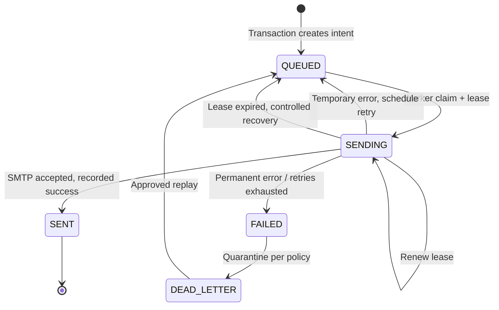
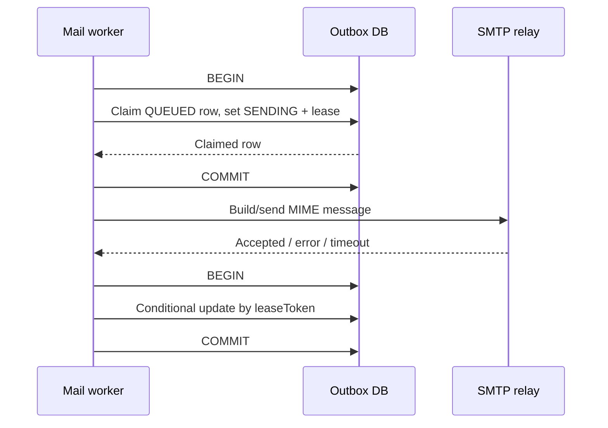

# Queued, Sending, Sent, Failed, and Dead Letter States

When a Spring Framework Mail application sends email directly with `JavaMailSender.send(...)`, the Java call typically finishes in one of two ways: it returns normally or throws an exception. That suffices for a quick "test send," but it is inadequate for building a notification system with queues, retries, multiple workers, and crash recovery. An email may be waiting, claimed by a worker, currently transmitting to the SMTP relay, accepted by the relay, unrecoverably failed, or quarantined for investigation.

Therefore, an email-sending system needs a **clear state model**. In this lesson, the five primary states are **`QUEUED`, `SENDING`, `SENT`, `FAILED`, and `DEAD_LETTER`**. State names are only useful when each name has a precise meaning, transition conditions, and rules for handling failures and concurrency.

A point to keep in mind from the start: **`SENT` does not mean the email is in the inbox**. With SMTP, the application usually knows only that the mail relay accepted a submission without reporting an error. Final delivery status, bounces, spam filtering, and whether the recipient read the message are separate concerns. Likewise, when a timeout happens after transmitting data, the application may not know for sure whether the relay accepted it; retrying can produce duplicate emails.

This lesson explains the state machine, outbox schema, claims and leases, retry/backoff, idempotency, dead-letter handling, Spring workers, testing, and operations. Illustrative examples use Spring Framework 6.x, Spring Boot 3.x, Java 21, Spring Mail, and PostgreSQL. SQL snippets using PostgreSQL syntax must be adapted if your project uses a different database engine.

## 1. Why States Instead of a Single Boolean?

A rudimentary design might store:

```java
boolean emailSent;
```

Yet when `emailSent == false`, the application does not know:

- Was the email never enqueued?
- Was it enqueued and waiting for its retry time?
- Did a worker claim it and is currently sending?
- Did SMTP just time out with an uncertain outcome?
- Did the send fail permanently?
- Was the job moved to a dead-letter queue for investigation?

A single boolean forces operators to guess from logs and makes bad retries likely. A state machine represents the processing state of **one notification intent** alongside metadata such as `attempts`, `nextAttemptAt`, `leaseToken`, and `lastErrorCode`.

Example:

```text
notificationId = invoice-issued:2026-00981
status         = QUEUED
attempts       = 2
nextAttemptAt  = 2026-11-12T12:30:00Z
lastErrorCode  = SMTP_TEMPORARY_FAILURE
```

This shows the notification was tried twice, is waiting for its next attempt, and has not been recorded as accepted by the relay. There is no need to open an SMTP connection to ask whether the job should run now; a worker simply compares `nextAttemptAt` with the current time and checks leases.

## 2. Defining the Five States

| State | Meaning in the system | Auto-retry eligible? |
|---|---|---|
| `QUEUED` | Send intent is durably stored; no worker currently owns the job. May be waiting for a retry time. | Yes, when due and allowed by policy |
| `SENDING` | A worker claimed the job, holds a lease, and is executing an attempt. | Do not claim again while lease is active |
| `SENT` | The send was accepted by the sender/relay per the outcome received by the app. | No |
| `FAILED` | The job reached a terminal failure per policy: no further automatic retries. | No; only via intentional remediation |
| `DEAD_LETTER` | The job was quarantined out of the normal send flow for analysis/remediation or controlled replay. | No, until handled by an operator/recovery workflow |

**Convention used in this lesson:** transient errors eligible for retry **do not** set status to `FAILED`; the worker transitions back to `QUEUED` with a future `nextAttemptAt` and records `lastErrorCode`. Here `FAILED` means **automatic retries have ended**. Some other systems mark `FAILED` on each failed attempt and schedule retries from there; that convention can also work if documented and implemented consistently. Never mix both conventions in the same table.

`DEAD_LETTER` differs from `FAILED` in **operational action**: `FAILED` records the failure outcome of the notification; `DEAD_LETTER` records that the job was moved to a quarantine path with investigation metadata and a review/replay workflow. A small system might use only `FAILED`, while larger systems often add a dead-letter workflow to isolate failures needing human or recovery intervention.

## 3. Basic State Machine



This is a normalized model. Some systems transition straight from `SENDING` to `DEAD_LETTER` when retries exhaust without saving `FAILED` as an intermediate state; if adopting that, clearly document the transition rules and dead-letter timing. This lesson uses `FAILED → DEAD_LETTER` to distinguish **send outcome** from **quarantine decision**.

Every transition must be defined by four pieces of information:

1. **Preconditions:** initial state, current attempt count, valid lease, and failure kind.
2. **Actor:** business API, mail worker, recovery worker, or operator.
3. **Side effects:** building the message, calling SMTP, recording status, updating retry timestamp, or storing the reason.
4. **Atomicity:** which database transaction protects the transition and prevents concurrent races.

A state machine where workers run an unconditional `setStatus("SENT")` is vulnerable to races when multiple workers run or a lease transfers to another worker.

## 4. The QUEUED State: Send Intent Recorded

`QUEUED` represents a notification intent persisted in durable storage, such as a transactional outbox table. It is not merely a `Runnable` sitting inside `ThreadPoolTaskExecutor`: an in-memory queue is lost on JVM restart.

A `QUEUED` row should include at least:

- A unique `notificationId` or `notificationKey` for the send intent.
- `recipient` or a reference to a validated recipient.
- `templateId` and, if needed, `templateVersion`.
- Minimal payload needed to render subject, plain text, and HTML.
- Durable attachment references, if any.
- `nextAttemptAt` indicating when sending is due.
- `attempts` tracking how many times it was claimed/tried.
- `createdAt` to evaluate notification age.

### 4.1. QUEUED Does Not Mean Sent via SMTP

An API might return:

```json
{
  "notificationId": "invoice-issued:2026-00981",
  "status": "QUEUED"
}
```

This means the send request was accepted and stored for processing. Do not return "Email sent successfully" merely because the outbox row transaction committed.

When designing an HTTP enqueue API, `202 Accepted` can fit well since processing happens asynchronously. The response should describe the job status or how to query it, without promising inbox delivery.

### 4.2. Retries Can Also Use QUEUED

Suppose a worker hits a temporary SMTP `451` and sets:

```text
status        = QUEUED
attempts      = 2
nextAttemptAt = 2026-11-12T12:30:00Z
lastErrorCode = SMTP_451
```

The job is eligible for claiming only when `nextAttemptAt <= now()`. Even though the status name is `QUEUED`, it does not run immediately. To display clearer status on a dashboard, derive a `RETRY_SCHEDULED` label from `status=QUEUED` and `attempts>0`, or extend the state machine with a dedicated state. Adding a separate status is optional if metadata already expresses it clearly.

## 5. The SENDING State: Worker Claimed the Job

`SENDING` must signify **temporary ownership** by one worker, not merely a flag. In a multi-instance deployment, if two workers read `QUEUED` and both call SMTP, the recipient can receive duplicate emails.

When transitioning `QUEUED → SENDING`, atomically:

- Increment `attempts` per your attempt-counting convention.
- Set `leaseOwner` or worker ID.
- Mint a new `leaseToken` for this claim.
- Set `leaseUntil`.
- Record `lastAttemptAt`.
- Change status to `SENDING`.

These fields must be updated **atomically** in the database. Do not split into "SELECT job, then UPDATE status" without locks/conditions, because another worker can slip in between.

### 5.1. What Is a Lease?

A lease is the time window a worker is allowed to own a job. Example:

```text
status      = SENDING
leaseOwner  = mail-worker-3
leaseToken  = 9b7f0e09-7c0e-4d50-82e8-1d0832aba651
leaseUntil  = 2026-11-12T12:42:00Z
attempts    = 3
```

If the worker crashes, the lease expires and a recovery worker can take over the job. If SMTP takes a long time, the worker needs heartbeats/lease extensions or properly sized timeouts. Too short a lease lets Worker B claim the job while Worker A is still sending; both may call SMTP.

**A lease does not guarantee exactly-once SMTP.** It reduces contention and enables recovery, yet cannot cancel an email already accepted by the relay.

### 5.2. Never Hold a DB Transaction Open While Sending

The proper flow is typically:



SMTP is network I/O, so never hold row locks and database connections across the send duration. A short claim transaction protects ownership; a short outcome transaction records the result.

## 6. The SENT State: Accepted by Relay, Not Delivered to Inbox

When `JavaMailSender.send(message)` returns normally with a standard synchronous SMTP sender, the application has grounds to record that the send was accepted at the sender/relay layer. That is the right moment to transition `SENDING → SENT` if the DB update also succeeds.

What **must not be inferred** from `SENT`:

- The email landed in the inbox.
- The recipient opened the email.
- The email was not flagged as spam.
- The email will not bounce on a downstream hop.
- A downstream relay cannot reject it later.

A notification may need separate downstream delivery states such as `DELIVERED`, `BOUNCED`, or `COMPLAINT` driven by provider webhooks. That is a separate post-send flow; do not alter the queue's `SENT` semantics without explicit design.

### 6.1. SENT and Message-ID

Each email may have a MIME `Message-ID` header. You can store this ID for investigation; however, `Message-ID` is not proof of inbox delivery, and SMTP does not require recipient servers to deduplicate emails with matching `Message-ID` values.

If the mail provider supplies its own tracking ID, store the mapping between `notificationId`, the provider's ID, and the attempt. Do not confuse a notification's ID with the ID of a single relay submission.

### 6.2. Only the Lease-Holding Worker May Record SENT

Example:

```sql
UPDATE mail_outbox
SET status = 'SENT',
    sent_at = now(),
    lease_owner = NULL,
    lease_token = NULL,
    lease_until = NULL
WHERE id = :id
  AND status = 'SENDING'
  AND lease_token = :lease_token;
```

The application must check the updated row count. If it is 0, the worker lost ownership or the status changed; never assume recording `SENT` succeeded. The SMTP operation already happened, while recording the status requires separate investigation.

## 7. The FAILED State: Terminal Failure per Policy

Under this lesson's convention, `FAILED` means the application **stops automatic retries** for that notification. Causes may include:

- Invalid data preventing safe message construction.
- Required template or attachment permanently missing and unrecoverable.
- Recipient permanently rejected with reliable evidence.
- Job exceeded maximum attempt limit.
- Job exceeded maximum age (TTL) even if attempts did not reach the limit.
- Business policy decided to stop sending.

Example:

```text
status            = FAILED
attempts          = 5
lastErrorCode     = SMTP_PERMANENT_RECIPIENT_REJECTION
failedAt          = 2026-11-12T12:45:00Z
nextAttemptAt     = null
leaseOwner        = null
leaseToken        = null
```

`FAILED` does not necessarily mean an unfamiliar, inexplicable exception. It is **the formal outcome** once policy determines no automatic retry path remains. A temporary `4xx` error can lead to `FAILED` if the retry window expires; a validation error can lead to `FAILED` on the very first attempt.

### 7.1. Distinguishing a Failed Attempt From a FAILED Job

An attempt can fail while the job continues:

```text
Attempt 1: SMTP 451 -> QUEUED, nextAttemptAt +30s
Attempt 2: SMTP 451 -> QUEUED, nextAttemptAt +2m
Attempt 3: Accepted -> SENT
```

Attempts 1 and 2 are **attempt failures**, yet the notification does not enter `FAILED`. They are captured in attempt history or `lastErrorCode` plus retry metadata. This lets dashboards tell "retrying normally" apart from "terminally failed."

## 8. DEAD_LETTER: Quarantine Area, Not a Trash Bin

A dead letter is a mechanism to move a notification that cannot be processed automatically into a separate area for investigation or intervention. It can be modeled using:

1. A `DEAD_LETTER` status in the same outbox table; or
2. A separate `mail_dead_letter` table / dead-letter queue (DLQ) with records linked to the original notification.

In this lesson, the state machine uses `DEAD_LETTER` inside the outbox table. If using a separate DLQ, ensure atomic transactions or durable mechanisms so records are not lost during transfer.

### 8.1. When to Move to Dead Letter

Policy examples:

- Job reached `FAILED` due to exceeding `maxAttempts`.
- Job has a configuration error requiring human intervention.
- Payload fails deserialization after a schema change.
- Template ID/version is no longer deployed.
- Attachment was deleted or points to an unauthorized storage location.
- Job may have been sent with an uncertain outcome needing reconciliation.

Not every `FAILED` job necessarily goes to dead letter. A system may keep permanent recipient errors in `FAILED` for reporting and route only investigable failures to `DEAD_LETTER`. Define transition rules in policy.

### 8.2. Metadata for Investigation

A dead-letter record should include:

- `notificationId`, tenant ID, and template ID/version.
- Enqueue timestamp, last attempt timestamp, attempt count.
- Normalized error code and failure step (validation, MIME, SMTP, storage).
- Whether the send outcome is certain or uncertain.
- Correlation/trace reference if available.
- Actor/system that performed any replay or discard action.
- Retention window and sensitive-data purge timestamp.

Never store SMTP passwords, JWTs, full email bodies, tokenized URLs, or attachment bytes in error logs. If payloads must be kept for replay, govern access control, encryption, and retention like business data.

### 8.3. DEAD_LETTER Does Not Auto-Reprocess

A `DEAD_LETTER` row must never be claimed by regular polling workers. Replaying must be a controlled action because the root cause might still be unresolved; unbounded auto-replay creates error loops, sends spam, or exhausts resources.

A typical workflow:

```text
DEAD_LETTER
  -> Triage / classify root cause
  -> Fix template, config, or attachment source
  -> Check permissions, suppression, TTL, and outcome
  -> Operator approves replay
  -> QUEUED with audit and fresh attempt budget (if policy allows)
```

If the relay may have accepted the email earlier, replaying risks creating a duplicate. Surface a warning and apply a dedicated workflow for **uncertain send outcomes**.

## 9. Designing the Outbox Table for Five States

An illustrative PostgreSQL schema:

```sql
CREATE TABLE mail_outbox (
    id                  UUID PRIMARY KEY,
    tenant_id           VARCHAR(80) NOT NULL,
    notification_key    VARCHAR(160) NOT NULL,
    recipient           VARCHAR(254) NOT NULL,
    template_id         VARCHAR(100) NOT NULL,
    template_version    INTEGER NOT NULL,
    payload_json        JSONB NOT NULL,

    status              VARCHAR(24) NOT NULL
                        CHECK (status IN (
                            'QUEUED', 'SENDING', 'SENT',
                            'FAILED', 'DEAD_LETTER'
                        )),
    attempts            INTEGER NOT NULL DEFAULT 0
                        CHECK (attempts >= 0),
    next_attempt_at     TIMESTAMPTZ NULL,
    lease_owner         VARCHAR(100) NULL,
    lease_token         UUID NULL,
    lease_until         TIMESTAMPTZ NULL,

    created_at          TIMESTAMPTZ NOT NULL DEFAULT now(),
    last_attempt_at     TIMESTAMPTZ NULL,
    sent_at             TIMESTAMPTZ NULL,
    failed_at           TIMESTAMPTZ NULL,
    dead_letter_at      TIMESTAMPTZ NULL,
    last_error_code     VARCHAR(100) NULL,
    last_error_phase    VARCHAR(40) NULL,
    smtp_message_id     VARCHAR(255) NULL,
    version             BIGINT NOT NULL DEFAULT 0,

    CONSTRAINT uq_mail_outbox_intent
        UNIQUE (tenant_id, notification_key)
);

CREATE INDEX ix_mail_outbox_due
    ON mail_outbox (next_attempt_at, created_at)
    WHERE status = 'QUEUED';

CREATE INDEX ix_mail_outbox_expired_leases
    ON mail_outbox (lease_until)
    WHERE status = 'SENDING';
```

This is a reference design, not a mandatory schema. Other systems may split `mail_attempt`, `mail_dead_letter`, recipient lists, and attachment references into separate tables.

### 9.1. Meaning of Selected Columns

`notification_key` is the business idempotency key for the **send intent**. The tenant-scoped unique constraint prevents accidentally enqueueing the same notification twice. If one event must notify multiple recipients, the key must distinguish each notification/recipient per policy.

In this schema, `attempts` increments upon claiming an attempt. Thus, if a worker crashes right after claiming and before starting SMTP, the counter still increments. This counts **claims for execution**, not emails confirmed accepted by the relay.

`lease_token` is a fencing token: the worker must supply its currently held token when updating the outcome. `version` can additionally support optimistic locking or UI update concurrency checks.

`sent_at` is when the application **recorded** success from the sender, not when the recipient read the email. `smtp_message_id` is optional tracing metadata; do not rely on it as the sole deduplication mechanism.

### 9.2. Invariants to Protect

Under these conventions:

- `SENDING` must have non-null `lease_token` and `lease_until`.
- `SENT` has no active lease.
- `FAILED` and `DEAD_LETTER` have no active lease or automatic retry schedule.
- `QUEUED` has no active lease and has `next_attempt_at` indicating when claiming is allowed.
- `attempts` never decreases, unless a replay policy intentionally starts a new execution generation.
- `notification_key` never changes during the intent's lifecycle.

Part of these invariants can be enforced with database `CHECK` constraints. Rules involving transitions, lease tokens, replay permissions, and pre/post state must be enforced in services and transactions.

## 10. Atomic Enqueue With Business Logic

For transactional emails, write the outbox row in **the same database transaction** as the business state change:

```java
@Service
public class OrderApplicationService {

    private final OrderRepository orders;
    private final MailOutboxRepository outbox;

    public OrderApplicationService(
            OrderRepository orders,
            MailOutboxRepository outbox) {
        this.orders = orders;
        this.outbox = outbox;
    }

    @Transactional
    public void confirm(long orderId) {
        Order order = orders.findById(orderId).orElseThrow();
        order.confirm();

        outbox.insertIfAbsent(
                MailIntent.orderConfirmed(
                        order.getTenantId(),
                        "order-confirmed:" + order.getId(),
                        order.getCustomerId(),
                        order.getId()));
    }
}
```

`MailIntent` and `insertIfAbsent(...)` are application abstractions. In practice, `insertIfAbsent` should rely on database unique constraints rather than an unlocked "SELECT then INSERT."

If the transaction rolls back, both the order update and outbox insert roll back together. If it commits, the notification intent is saved so a worker can send it even after a restart. This **does not** make SMTP part of the transaction; the worker still sends separately and duplicates remain possible on uncertain outcomes.

### 10.1. Avoid Sending SMTP Inside the Outbox-Creation Transaction

Do not write:

```java
@Transactional
public void confirm(long orderId) {
    updateOrder(orderId);
    mailSender.send(buildMessage(orderId)); // Risk before commit.
    saveOutboxStatus();
}
```

SMTP may accept the email right before the database rolls back, or slow SMTP calls may hold database locks too long. A true outbox records **the send intent** and never performs network I/O inside the business transaction.

## 11. Claiming Jobs Safely With Multiple Workers

One approach uses PostgreSQL `FOR UPDATE SKIP LOCKED` in a short transaction:

```sql
WITH picked AS (
    SELECT id
    FROM mail_outbox
    WHERE status = 'QUEUED'
      AND next_attempt_at <= now()
    ORDER BY next_attempt_at, created_at, id
    FOR UPDATE SKIP LOCKED
    LIMIT :batch_size
)
UPDATE mail_outbox AS m
SET status = 'SENDING',
    attempts = m.attempts + 1,
    last_attempt_at = now(),
    lease_owner = :worker_id,
    lease_token = gen_random_uuid(),
    lease_until = now() + interval '120 seconds',
    version = m.version + 1
FROM picked
WHERE m.id = picked.id
RETURNING m.id, m.notification_key, m.tenant_id,
          m.attempts, m.lease_token, m.lease_until;
```

This example requires PostgreSQL with its UUID-generation function and a surrounding transaction manager. `SKIP LOCKED` lets workers skip rows locked by other transactions, reducing contention when multiple instances poll simultaneously.

**Never hold the claim transaction open while calling SMTP.** Commit the claim first, then have the worker render/send and update the outcome in a separate transaction.

### 11.1. Counting Attempts at the Right Time

In this design, `attempts` increments when a worker claims:

```text
QUEUED attempts=0
claim -> SENDING attempts=1
SMTP 451 -> QUEUED attempts=1
claim -> SENDING attempts=2
SMTP accepted -> SENT attempts=2
```

If you also want to count only SMTP connections that actually started, track a separate field or an attempt history table. Never give `attempts` two conflicting meanings across metrics, retry policy, and reporting.

### 11.2. Per-Recipient Sends vs. One Multi-Recipient Message

When a notification has multiple recipients, `JavaMailSender` can encounter partial delivery or per-address errors. When accurate retries and idempotency matter, it is usually easier to manage **one outbox row per recipient**; rows can share a business event ID while having distinct notification keys.

If one job sends one message to multiple addresses, model per-recipient status separately or handle `MailSendException`/SMTP partial success carefully. Never mark the entire job `SENT` if a subset of recipients definitely failed.

## 12. Sending and Updating Status Outside the Claim Transaction

A Spring worker can organize services like this:

```java
@Component
public class MailDispatchWorker {

    private final MailClaimService claimService;
    private final MailStatusService statusService;
    private final MailMessageFactory messageFactory;
    private final JavaMailSender mailSender;
    private final MailFailureClassifier classifier;

    public MailDispatchWorker(
            MailClaimService claimService,
            MailStatusService statusService,
            MailMessageFactory messageFactory,
            JavaMailSender mailSender,
            MailFailureClassifier classifier) {
        this.claimService = claimService;
        this.statusService = statusService;
        this.messageFactory = messageFactory;
        this.mailSender = mailSender;
        this.classifier = classifier;
    }

    public void dispatchOnce() {
        List<ClaimedMailJob> jobs = claimService.claimDueBatch(20);

        for (ClaimedMailJob job : jobs) {
            dispatchOne(job);
        }
    }

    private void dispatchOne(ClaimedMailJob job) {
        try {
            // Create a new message for each attempt.
            MimeMessage message = messageFactory.compose(job);

            // SMTP happens outside the claim transaction.
            mailSender.send(message);

            boolean recorded = statusService.markSent(
                    job.id(), job.leaseToken());
            if (!recorded) {
                // Relay may have accepted, but worker lost the lease.
                // Record metric/incident; do not assume job was not sent.
                reportOwnershipConflict(job.notificationKey());
            }
        } catch (MessagingException | MailException ex) {
            FailureDecision decision =
                    classifier.classify(job, ex);
            statusService.applyFailure(
                    job.id(), job.leaseToken(), decision);
        }
    }

    private void reportOwnershipConflict(String notificationKey) {
        // Record metric/alert safely; never log email body or credentials.
    }
}
```

`MailClaimService`, `MailStatusService`, `MailMessageFactory`, `ClaimedMailJob`, `MailFailureClassifier`, and `FailureDecision` are application-defined abstractions; corresponding Spring/Jakarta/Java imports are required in the project. The example illustrates the ordering, not a standalone copy-pasteable package.

Note: **database exceptions when writing `SENT`** are excluded from `MessagingException`/`MailException`. That is intentional: if SMTP was accepted by the relay while the database write failed, it must not be treated as a definite SMTP failure for immediate retry. Let the job's lease expire and go through recovery policy while recording the risk of an ambiguous outcome.

### 12.1. Transition Services Need Separate Transactions

Example:

```java
@Service
public class MailStatusService {

    private final NamedParameterJdbcTemplate jdbc;

    public MailStatusService(NamedParameterJdbcTemplate jdbc) {
        this.jdbc = jdbc;
    }

    @Transactional
    public boolean markSent(UUID jobId, UUID leaseToken) {
        int updated = jdbc.update("""
                UPDATE mail_outbox
                SET status = 'SENT',
                    sent_at = now(),
                    lease_owner = NULL,
                    lease_token = NULL,
                    lease_until = NULL,
                    next_attempt_at = NULL,
                    last_error_code = NULL,
                    version = version + 1
                WHERE id = :jobId
                  AND status = 'SENDING'
                  AND lease_token = :leaseToken
                """,
                Map.of("jobId", jobId, "leaseToken", leaseToken));
        return updated == 1;
    }
}
```

Imports include `UUID`, `Map`, `@Transactional`, `@Service`, and `NamedParameterJdbcTemplate`. Calls to this service must go through a Spring proxy for the transaction to apply. Calling a `@Transactional` method on `this` inside the same bean bypasses the proxy.

The method checks the lease token without checking lease expiration by wall-clock time. That matches a policy allowing the current token holder to finish before another claim occurs. If policy strictly requires an unexpired lease when recording outcomes, add the time condition and coordinate with heartbeats/recovery to prevent surprises.

## 13. Retries: From SENDING Back to Scheduled QUEUED

When an error is classified as transient and budget remains, the worker transitions `SENDING → QUEUED` while setting a future `nextAttemptAt`:

```sql
UPDATE mail_outbox
SET status = 'QUEUED',
    next_attempt_at = :next_attempt_at,
    last_error_code = :error_code,
    last_error_phase = :error_phase,
    lease_owner = NULL,
    lease_token = NULL,
    lease_until = NULL,
    version = version + 1
WHERE id = :id
  AND status = 'SENDING'
  AND lease_token = :lease_token;
```

Check the updated row count just like the `SENT` transition. If 0 rows matched, the worker no longer owns the job; do not overwrite another worker's state.

### 13.1. Backoff and Jitter

Immediate retries can overload an already struggling SMTP relay. A common policy is capped exponential backoff with jitter.

Example with `baseDelay=30s` and `maxDelay=30m`:

| Attempt just failed | Base wait before next attempt |
|---:|---:|
| 1 | 30 seconds |
| 2 | 1 minute |
| 3 | 2 minutes |
| 4 | 4 minutes |
| 5 | 8 minutes |
| 6 | 16 minutes |
| 7 onward | Capped at 30 minutes |

After computing the delay, you can apply **full jitter**: pick randomly from 0 to the capped delay, or use a non-zero jitter floor per policy. The system also needs maximum retry limits and TTLs to avoid running forever. Do not treat table numbers as fixed SLAs for every SMTP provider.

Java pseudocode:

```java
static Duration nextDelay(int attempt, Duration base, Duration cap) {
    int safePower = Math.max(0, Math.min(attempt - 1, 20));
    long factor = 1L << safePower;
    long rawMillis = Math.multiplyExact(base.toMillis(), factor);
    long capped = Math.min(rawMillis, cap.toMillis());

    // Full jitter example; ensure both cap and base are valid.
    long millis = ThreadLocalRandom.current()
            .nextLong(capped + 1);
    return Duration.ofMillis(millis);
}
```

This snippet is illustrative; if config allows very large values, `Math.multiplyExact` can throw an overflow exception. Production code must validate base/cap configuration and handle overflow explicitly. Full jitter can yield 0 ms; to prevent immediate retries, enforce a lower bound or use equal jitter.

### 13.2. Limiting Retries by Attempts and Time

Example:

```text
maxAttempts = 5
maxJobAge   = 24 hours

Retry if:
  retryableError
  AND attempts < maxAttempts
  AND now < createdAt + maxJobAge
```

If budget is exhausted or TTL expires, the job transitions to `FAILED`. If the cause needs investigation, the system can move it onward to `DEAD_LETTER` per policy.

### 13.3. Retrying Does Not Mean Resending the Same MimeMessage/Stream

Each attempt should:

1. Read a pinned snapshot or template version.
2. Create a fresh `MimeMessage`.
3. Create an attachment source capable of opening a fresh stream.
4. Call `mailSender.send(message)`.
5. Record the result and transition under the lease.

Never store an already-opened `InputStream` in the outbox, never reuse a message that may already be serialized, and never delete attachments while retries remain possible.

## 14. Classifying Errors Before Transitioning State

Do not catch every `MailException` and always retry. Failures can stem from validation, templates, attachments, DNS, TLS, SMTP authentication, or recipient policies; some are permanent, some transient, and some **have unknown outcomes**.

| Error | Example | Typical decision |
|---|---|---|
| Invalid input/authorization | Unauthorized sender, malformed recipient | `FAILED`; do not connect to SMTP |
| Template rendering failed | Missing required variable, missing version | `FAILED` or `DEAD_LETTER` to fix config |
| Missing/unreadable attachment | Object key deleted, storage temporarily unavailable | Classify: permanently missing data → `FAILED`; temporary storage error → `QUEUED` |
| SMTP `4xx` | Relay reports temporary error | `QUEUED` with backoff if budget remains |
| SMTP `5xx` | Relay permanently rejects in context | `FAILED`; occasionally special handling per code |
| TLS/AUTH/config | Invalid certificate, wrong SMTP credentials | Usually requires config fix; avoid tight retries |
| Timeout before sending `DATA` | Failed to connect or never started transmitting message | May retry if proven not accepted |
| Timeout after `DATA` | Relay may have received it, response lost | `UNKNOWN` outcome; retrying risks duplicate |
| Rate limit | Relay temporarily throttles traffic | `QUEUED`; honor `Retry-After` if provider supplies one |

SMTP `4xx`/`5xx` codes are vital signals, though not the only classifier. `MailSendException` can also carry per-message or per-recipient errors. When sending to multiple recipients at once, determine which addresses were accepted before retrying.

### 14.1. Do Not Confuse FAILED State With UNKNOWN Outcome

Suppose:

```text
12:00:00 Worker sends DATA to SMTP.
12:00:01 Relay stores message and prepares to reply 250.
12:00:02 Connection lost; worker misses 250.
```

The application does not know whether the relay received the message. Writing `FAILED` as an assertion that "the message definitely was not sent" is inaccurate. Retrying risks sending the email twice.

You can keep the five main states while adding secondary metadata to capture ambiguity:

```text
status                 = QUEUED
lastOutcome            = UNKNOWN
lastErrorCode          = SMTP_RESPONSE_LOST
requiresReconciliation = true
```

Or choose to move to `DEAD_LETTER` for human review before replaying. In complex systems, add an explicit `UNKNOWN` state. Crucially, **never discard ambiguous outcome information** merely because the primary state machine has five states.

## 15. Idempotency at Two Different Boundaries

Idempotency has more than one layer. For mail, distinguish:

1. **Enqueue-time idempotency:** the same business event does not create multiple notification intents.
2. **Dispatch-time idempotency:** multiple workers or retries avoid duplicate sends where preventable, though plain SMTP does not guarantee exactly-once.

### 15.1. Idempotency Key for Intent

Example:

```java
String notificationKey =
        "invoice-issued:" + invoiceId + ":recipient:" + recipientId;
```

Place a unique constraint on `(tenant_id, notification_key)`. When a client retries an API call or an event fires twice, `INSERT ... ON CONFLICT DO NOTHING` (PostgreSQL) avoids duplicate rows.

Never mint a new random key for the same event if deduplication is the goal. The key must remain stable for the same intent. Equally, do not make keys so broad that two legitimate notifications collide; e.g., if an invoice can be intentionally reissued multiple times, include the corresponding version/event in the key.

### 15.2. Leases and Conditional Updates Reduce Concurrency Duplicates

Atomic claims normally ensure only one worker owns a job within a lease. Tokens prevent an evicted worker from overwriting state. Still, tokens protect only **database state**, not the SMTP relay from receiving two messages if both the old and new workers send concurrently.

### 15.3. When Exactly-Once Cannot Be Guaranteed

A classic failure window:

```mermaid
sequenceDiagram
    participant W as Worker
    participant SMTP as SMTP relay
    participant DB as Outbox DB
    W->>SMTP: Send message
    SMTP-->>SMTP: Accepted
    SMTP--xW: Response lost / process crash
    Note over W,DB: Database still SENDING
    W->>DB: Lease expires; another worker recovers
    W->>SMTP: Retry same notification
    Note over SMTP: Duplicate may occur
```

Even when a response arrives, the process can crash after SMTP acceptance and before committing `SENT`. The outbox can still be retried. This is the basis of **at-least-once sending attempts**: the system guarantees trying to complete the work while accepting duplicate risk in ambiguous cases.

Matching `Message-ID` headers are not a mandatory SMTP deduplication mechanism. If a provider exposes its own API supporting idempotency keys or lookups, rely on that provider's contract; never infer such guarantees from `JavaMailSender`.

## 16. Recovering SENDING Jobs When a Worker Is Lost

A worker can crash while a job is in `SENDING`. Without recovery, the job stays stuck forever.

Detection query:

```sql
SELECT id, notification_key, attempts, lease_until
FROM mail_outbox
WHERE status = 'SENDING'
  AND lease_until < now();
```

From here, two strategies exist:

**A. Controlled requeue.** Transition to `QUEUED`, set a retry timestamp, record `WORKER_LEASE_EXPIRED`, and flag that the outcome may be uncertain.

**B. Direct reclaim.** A new worker uses a locking transaction to claim expired-lease `SENDING` rows, mints a new lease token, and increments attempts. This requires an appropriate classifier/recovery policy.

Requeue example:

```sql
UPDATE mail_outbox
SET status = 'QUEUED',
    next_attempt_at = now() + interval '1 minute',
    lease_owner = NULL,
    lease_token = NULL,
    lease_until = NULL,
    last_error_code = 'WORKER_LEASE_EXPIRED',
    version = version + 1
WHERE status = 'SENDING'
  AND lease_until < now()
RETURNING id, notification_key;
```

Run this statement inside an appropriate transaction and batch-limit it when row counts are large. If the old worker is still running SMTP after its lease expired, it may finish sending; recovery carries duplicate risk. Thus, lease expiration means **lost DB ownership**, not proof SMTP never sent.

### 16.1. Lease Renewal

When sending large attachments or facing slow SMTP servers, a worker can send a heartbeat:

```sql
UPDATE mail_outbox
SET lease_until = now() + interval '120 seconds'
WHERE id = :id
  AND status = 'SENDING'
  AND lease_token = :lease_token;
```

Check the updated row count. If 0, the worker lost its lease; continuing to send can duplicate work with the new worker. In practice, an already-started SMTP operation cannot always be aborted immediately. Align SMTP timeouts, lease durations, heartbeats, and recovery delays as one coherent set.

### 16.2. Fencing Tokens Do Not Cancel Side Effects Outside the DB

Fencing tokens only stop an evicted worker from updating the outbox after the lease moved on. They do not send an "undo" command to the SMTP relay. Reducing duplicate risk further requires provider idempotency if available, ambiguous-outcome policies, and duplicate-tolerant message design.

## 17. Moving FAILED to DEAD_LETTER

When a job fails terminally and is selected for quarantine, persist the transition in a short transaction:

```sql
UPDATE mail_outbox
SET status = 'DEAD_LETTER',
    dead_letter_at = now(),
    next_attempt_at = NULL,
    lease_owner = NULL,
    lease_token = NULL,
    lease_until = NULL,
    version = version + 1
WHERE id = :id
  AND status = 'FAILED';
```

If using a separate DLQ table, insert the DLQ record and update the outbox status in the same database transaction. If publishing to an external message-broker DLQ, never assume database writes and broker publishes are automatically atomic; use an outbox for DLQ events or an idempotent workflow to avoid losing records.

### 17.1. Why Separate FAILED and DEAD_LETTER?

The two states answer different questions:

- `FAILED`: "Will the system keep automatically retrying this task?" — No.
- `DEAD_LETTER`: "Has this task been placed into an investigation/quarantine workflow?" — Yes.

Some failures are expected, such as permanently rejected addresses added to a suppression list. Not all of them require an investigation ticket. Conversely, a missing template after a deployment or an unparseable payload is a system error that should enter DLQ promptly and trigger an alert.

## 18. Replaying Dead Letters Properly

Replaying is not as simple as updating every `DEAD_LETTER → QUEUED`. Before replaying:

1. Verify the root cause has been fixed.
2. Confirm the notification still makes business sense (TTL, cancelled order, expired reset link).
3. Verify the recipient and suppression/opt-out rules per policy.
4. Check tenant, authorization, and attachment sources.
5. Check whether the relay might have already accepted the outcome earlier.
6. Choose between replaying the same intent or creating a new notification with a different idempotency key.
7. Audit: who replayed, when, why, and which replay generation.
8. Ensure two workers cannot replay the same row simultaneously.

### 18.1. Replay In-Place vs. Creating a New Job

**Replay in-place:** keep the same outbox ID, move `DEAD_LETTER` back to `QUEUED`, and refresh retry budget and recovery metadata. Fits when preserving one continuous status history; audit the recovery clearly.

**Create a new job:** create a new intent with `replayOfNotificationId` and an intentional new unique key. Fits when keeping the original record immutable; ensure the new key cannot accidentally duplicate a normally processed request.

In both models, never delete old attempt history just to make a dashboard look "clean." Audits and post-incident reviews need to know why the job entered the DLQ.

### 18.2. Managing Retry Generations

If resetting `attempts=0` on replay, record a `replay_generation` or keep attempt history so total sends executed are never lost. If not resetting, policy must define how the renewed attempt budget applies to previously exhausted jobs.

### 18.3. Never Blindly Replay Sensitive Emails

Password resets, OTPs, or verification links with short-lived tokens should usually not be replayed with stale contents. Instead, check expiration and optionally trigger a fresh token-issuance flow upon user request. For transaction receipts, verify attachments/snapshots reflect the finalized business version.

## 19. Retries After SMTP Errors and Uncertain Outcomes

A worker must distinguish **errors proven unaccepted by the relay**, **errors definitively rejected**, and **unknown errors**:

```text
SMTP temporary rejection (clear response)
    -> QUEUED + backoff

SMTP permanent rejection (clear response)
    -> FAILED, suppress per policy

SMTP accepted (success response)
    -> SENT after DB ack succeeds

Connection drops after DATA / DB ack fails
    -> outcome may be UNKNOWN
    -> recovery or DEAD_LETTER per policy
```

If the product prioritizes **never losing notifications**, you can retry `UNKNOWN` outcomes and accept duplicate risk. If the email is highly duplicate-sensitive, hold the job for provider reconciliation or manual handling. No single choice fits every email type.

An approach using secondary metadata:

```java
public enum SmtpAttemptOutcome {
    ACCEPTED,
    TEMPORARY_REJECTION,
    PERMANENT_REJECTION,
    UNKNOWN
}
```

Attempt outcomes do not necessarily match the job's overall state. For instance, a `QUEUED` job might hold `lastAttemptOutcome=TEMPORARY_REJECTION`, or a `DEAD_LETTER` job might hold `lastAttemptOutcome=UNKNOWN`.

## 20. Separating Job Status From Attempt History

Storing only a single `last_error_code` may suffice for a demo, yet is rarely enough for incident analysis. An attempt history table reveals the full timeline:

```sql
CREATE TABLE mail_attempt (
    id                  UUID PRIMARY KEY,
    outbox_id           UUID NOT NULL REFERENCES mail_outbox(id),
    attempt_number      INTEGER NOT NULL,
    lease_token         UUID NOT NULL,
    started_at          TIMESTAMPTZ NOT NULL,
    finished_at         TIMESTAMPTZ NULL,
    smtp_outcome        VARCHAR(40) NULL,
    error_code          VARCHAR(100) NULL,
    duration_ms         BIGINT NULL,
    UNIQUE (outbox_id, attempt_number)
);
```

With this table:

- The outbox row shows the notification's current state.
- Attempt history shows all tries, timestamps, outcomes, and errors.
- Dashboards can display "`QUEUED`, retry in 2 minutes, 3 attempts made."
- Operators can investigate why a job landed in `DEAD_LETTER`.

Never store raw MIME, attachment bytes, or SMTP credentials in attempt history. If storing provider replies, sanitize and cap data length.

## 21. Observing the System With Metrics and Logs

An email-sending pipeline needs visibility into **latency**, **volume**, **errors**, and **stuck queues**.

### 21.1. Useful Metrics

| Metric | Meaning |
|---|---|
| `mail_outbox_queued` | Notifications currently `QUEUED` |
| `mail_outbox_sending` | Notifications currently `SENDING` |
| `mail_outbox_failed` | Unhandled `FAILED` jobs |
| `mail_outbox_dead_letter` | Jobs in DLQ / quarantine |
| `mail_dispatch_attempts_total` | Total attempts by outcome |
| `mail_send_duration_seconds` | SMTP call duration |
| `mail_queue_age_seconds` | Age of oldest `QUEUED` job |
| `mail_lease_expired_total` | Count of lease expirations |
| `mail_retry_scheduled_total` | Count of scheduled retries |
| `mail_dead_letter_replays_total` | Count of replay actions |

For metrics, use low-cardinality labels like `templateCategory`, `outcome`, and `errorClass`. Never use recipient email, notification ID, or correlation ID as labels since their values are practically unbounded.

### 21.2. Structured Logs

Example:

```text
INFO event=mail_job_claimed notificationId=... attempt=3 workerId=mail-2
WARN event=mail_attempt_failed notificationId=... attempt=3 errorCode=SMTP_451
INFO event=mail_retry_scheduled notificationId=... nextAttemptAt=...
INFO event=mail_job_sent notificationId=... smtpOutcome=ACCEPTED
ERROR event=mail_job_dead_letter notificationId=... reason=RETRY_EXHAUSTED
```

Correlation IDs connect the API request, outbox insert, worker attempt, and SMTP reply. Each attempt should have its own `attemptId`. Never log URL tokens, invoice bodies, email bodies, or attachment bytes.

### 21.3. Actionable Alerts

You do not need to alert on every isolated transient error. Alert when:

- The `QUEUED` backlog climbs steadily or job age breaches SLA.
- Many jobs stall in `SENDING` with expiring leases.
- Retry / SMTP `4xx` rate spikes unusually.
- `FAILED`/`DEAD_LETTER` exceeds thresholds.
- Workers fail to claim jobs despite due items in the queue.
- Database `SENT` acks fail repeatedly.
- System-wide SMTP authentication/TLS failures occur.

Alerts should link to dashboards and runbooks so operators know how to respond rather than merely creating another stuck notification.

## 22. Operational Runbook for Each State

### 22.1. QUEUED Backlogged Too Long

Check `nextAttemptAt`, worker availability, queue depth, rate limits, and claim transactions. Do not force all jobs to run immediately if the relay is throttling. Adding more workers only helps if the SMTP provider and storage can handle extra throughput.

### 22.2. SENDING Exceeding Lease

Check for worker crashes, SMTP timeouts, attachment read latency, heartbeats, and lease duration. Never move all `SENDING` back to `QUEUED` and immediately resend; workers may still be sending or the relay may have accepted messages.

### 22.3. SENT, Yet Recipient Reports Non-Receipt

Check provider events, bounces, spam filtering, mailbox policies, and recipient address. `SENT` only reflects the outcome observed by the app. Do not delete `SENT` status and reflexively resend; if a resend is needed, create an audited business resend with its own idempotency.

### 22.4. Sudden Spike in FAILED

Group by `lastErrorCode`: permanent recipient, template, attachment, SMTP config, or timeout. A global configuration failure can misclassify the whole system into `FAILED` if attempt limits are small; classify errors accurately.

### 22.5. Growing DEAD_LETTER

Inspect root causes, data needing repair, whether jobs remain valid, and whether relays might have accepted them. Create tickets or group error reports; never mass-replay before understanding the root cause.

## 23. Testing the State Machine

Tests must verify **transitions, ownership guards, SMTP outcomes, and recovery behavior**, not just a status field after calling a method.

### 23.1. Decision-Table Unit Tests

You can write a pure policy function:

```java
public enum JobStatus {
    QUEUED, SENDING, SENT, FAILED, DEAD_LETTER
}

public enum FailureKind {
    TEMPORARY, PERMANENT, UNKNOWN
}

public record RetryDecision(
        JobStatus nextStatus,
        boolean scheduleRetry,
        boolean needsReconciliation
) {}

public final class RetryPolicy {

    public RetryDecision decide(
            FailureKind kind,
            int attempts,
            int maxAttempts,
            boolean expired) {

        if (kind == FailureKind.UNKNOWN) {
            return new RetryDecision(
                    JobStatus.DEAD_LETTER, false, true);
        }
        if (kind == FailureKind.PERMANENT
                || attempts >= maxAttempts || expired) {
            return new RetryDecision(
                    JobStatus.FAILED, false, false);
        }
        return new RetryDecision(
                JobStatus.QUEUED, true, false);
    }
}
```

This is a **policy example**, not a rule that all `UNKNOWN` errors must enter DLQ. Another system might retry `UNKNOWN` with duplicate warnings. What matters is testing consistency with your chosen policy.

Example test cases:

| Input | Expected result per example policy |
|---|---|
| `TEMPORARY`, `attempts=1`, `max=5`, not expired | `QUEUED` + retry |
| `TEMPORARY`, `attempts=5`, `max=5` | `FAILED` |
| `PERMANENT` on first attempt | `FAILED` |
| `TEMPORARY` but TTL expired | `FAILED` |
| `UNKNOWN` outcome | `DEAD_LETTER` + reconciliation |

### 23.2. Integration Test for Two-Worker Claims

Insert one due `QUEUED` row. Have two workers claim batches concurrently. Verify only one worker receives the job with a valid lease token; the other worker does not send the same job. This test needs a real database or equivalent environment, as mock repositories do not accurately simulate row locks and `SKIP LOCKED`.

### 23.3. Testing Token-Guarded SENT Transition

Given a `SENDING` job with token A, have Worker B call `markSent(id, tokenB)`. Expect an update count of 0 and unchanged state. Only Worker A using token A may update it.

### 23.4. Testing Retries and Backoff

Simulate an explicit SMTP `451`. Verify the job moves `SENDING → QUEUED`, `attempts` does not decrease, `nextAttemptAt` is in the future per retry policy, and no active lease remains. Once due, a worker can claim it again.

### 23.5. Testing Permanent Failures and DLQ

Simulate a permanent recipient error. Verify the job enters `FAILED` and is not claimed automatically. Run the dead-letter workflow per policy and verify `DEAD_LETTER` records the reason, timestamp, and audit info.

### 23.6. Testing Worker Crashes and Lease Expiration

Worker A claims a job, then simulates crashing before updating the outcome. Use a controllable clock instead of sleeping in real time. Once the lease expires, recovery handles the job per policy, while tests account for possible relay acceptance rather than mislabeling it "definitely unsent."

### 23.7. Testing Accepted-but-SENT-Write-Failed

A fake SMTP sender returns normally, yet `repository.markSent` throws a database error. The job stays `SENDING` or enters the matching recovery path; the system must not treat the DB error as proof SMTP failed. Tests should confirm logs/metrics flag the ambiguous-outcome risk.

### 23.8. Testing Idempotent Enqueue

Invoke the enqueue business action twice with the same `notification_key`. Verify the database holds one intent. If the same template must go to two recipients, use two distinct keys and verify each recipient gets one job.

### 23.9. Testing Controlled Replay

Given a `DEAD_LETTER` row, only an authorized operator can trigger replay. Check tenant permissions, suppression, TTL, template, and attachment source. If eligible, persist audit and generation; otherwise keep `DEAD_LETTER` and return a clear error.

### 23.10. Testing With a Simulated SMTP Server

You can run Mailpit to capture emails in a test environment:

```bash
docker run --rm --name mailpit -p 1025:1025 -p 8025:8025 axllent/mailpit
```

Combine with a test database to observe `QUEUED → SENDING → SENT` and inspect MIME bodies. An SMTP test server does not itself prove database transaction atomicity or crash recovery; test those failure modes separately.

## 24. Example Application Configuration

An application-defined configuration:

```yaml
app:
  mail:
    dispatch:
      batch-size: 20
      concurrency: 4
      lease-seconds: 120
      max-attempts: 5
      max-job-age-hours: 24
      base-retry-seconds: 30
      max-retry-minutes: 30
      dead-letter-retention-days: 30

spring:
  mail:
    host: localhost
    port: 1025
    properties:
      mail:
        smtp:
          connectiontimeout: 5000
          timeout: 10000
          writetimeout: 10000
```

Properties under `app.mail.dispatch` are **custom-defined** and must be bound to your project's `@ConfigurationProperties`. The SMTP properties are test-environment examples; production must configure TLS, authentication, secret management, and appropriate network policies. Never hardcode SMTP passwords in YAML committed to a repository.

Choose `lease-seconds`, SMTP timeouts, and concurrency consistently. If total timeouts can exceed the lease, add heartbeats or carefully raise the lease; if queue backlog grows huge, raising concurrency must respect provider rate limits.

## 25. Hands-On Practice

### Part A — Draw the State Machine

Create a transition table for `QUEUED`, `SENDING`, `SENT`, `FAILED`, and `DEAD_LETTER`. Specify preconditions, actor, and updated metadata. Decide whether `FAILED` is terminal or retryable per your project policy, and enforce one convention across the entire system.

### Part B — Create the Outbox Table

Create a PostgreSQL table with a unique notification key, attempts, `nextAttemptAt`, `leaseToken`, `leaseUntil`, `lastErrorCode`, and timestamps. Insert twice with the same idempotency key; verify only one intent exists.

### Part C — Run Two Workers

Write an atomic claim statement using `FOR UPDATE SKIP LOCKED`. Have two workers poll concurrently. Verify only one worker owns each row.

### Part D — Successful Send

A worker claims `QUEUED → SENDING`, creates a new `MimeMessage`, calls a fake sender that succeeds, and transitions to `SENT`. Verify `sent_at` is set and lease fields are cleared.

### Part E — Retry Temporary Failures

Simulate SMTP `451`. Set `nextAttemptAt` with exponential backoff, transition back to `QUEUED`, and verify workers do not claim it before due time. Let the next attempt succeed.

### Part F — Exhausted Retries and Dead Letter

Simulate consecutive failures. Upon hitting `maxAttempts`, transition to `FAILED`. Apply policy to move to `DEAD_LETTER`; verify reason, audit, and cessation of automatic retries.

### Part G — Worker Crash

Claim a job and stop the worker before recording the outcome. Advance a fake clock past lease expiry. Let recovery take over and note the duplicate risk if the relay may have accepted the message before the crash.

### Part H — Lost SMTP Response

Simulate the relay accepting the message while the client receives no reply. Decide your `UNKNOWN` policy: retry vs. reconciliation/DLQ. Write a test verifying ambiguous outcomes are never reported as "definitely not sent."

### Part I — Controlled Replay

Create a `DEAD_LETTER` job, fix a template bug, and execute an operator-authorized replay. Record reason, actor, generation, and outcome. Test replaying after an email token expired and verify the system rejects it or requires a new notification per policy.

### Part J — Dashboards and Alerts

Display counts of `QUEUED`/`SENDING`/`FAILED`/`DEAD_LETTER`, oldest job age, retry rate, and lease expiration count. Alert when `QUEUED` jobs breach SLA or DLQ grows. Never put recipient emails or notification IDs into metric labels.

## 26. Design Checklist

Before shipping to production, verify:

- Does `QUEUED` include retries waiting for their scheduled time?
- Does `FAILED` mean terminal or just a single failed attempt?
- Is `SENT` defined at relay acceptance or provider delivery events?
- Is `DEAD_LETTER` a DB status or a separate queue/table?
- Do business transactions and outbox inserts share the same transaction manager?
- Are idempotency keys stable by event, tenant, and recipient?
- Are claims atomic across multiple workers?
- Are lease tokens verified on `SENT`/`QUEUED`/`FAILED` updates?
- Do workers send SMTP outside the claim transaction?
- Are SMTP timeouts, lease durations, and heartbeats aligned?
- Are attempt histories stored and `UNKNOWN` outcomes preserved?
- Do retries enforce backoff, jitter, `maxAttempts`, and TTL?
- Are attachment/template versions durable across retries?
- Are accepted-but-DB-ack-failed cases and duplicate risks handled?
- Does the DLQ have triage, audited replays, and retention policies?
- Are metrics/logs/alerts sufficient to spot stuck jobs, provider errors, and backlogs?
- Do tests cover rollbacks, worker crashes, lease contention, and replays?

## 27. Summary

The five states **QUEUED → SENDING → SENT / QUEUED / FAILED → DEAD_LETTER** separate send intent, worker ownership, recorded outcome, terminal failure, and quarantine for investigation. `QUEUED` is a durable intent eligible for dispatch when due; `SENDING` must carry a lease and fencing token; `SENT` records only sender/relay acceptance; `FAILED` ends automatic retries per policy; and `DEAD_LETTER` opens a controlled triage and replay workflow.

The state machine must be paired with **short transactions**, atomic claims, token-guarded updates, backoff/jitter retries, enqueue-time idempotency keys, and attempt history. A transactional outbox persists the send intent alongside business data to survive restarts, yet SMTP is still not part of the database transaction. When a relay accepts a message while the app loses the response or fails to record `SENT`, retries risk creating duplicates—a limit that must be modeled explicitly rather than hidden behind a boolean flag.

A sound state model never promises "the email definitely reached the inbox." Instead, it lets the system answer accurately: **what step the email is at, who owns it, what attempts occurred, when it may retry, which failures need fixing, and how to recover without losing operational visibility**.
