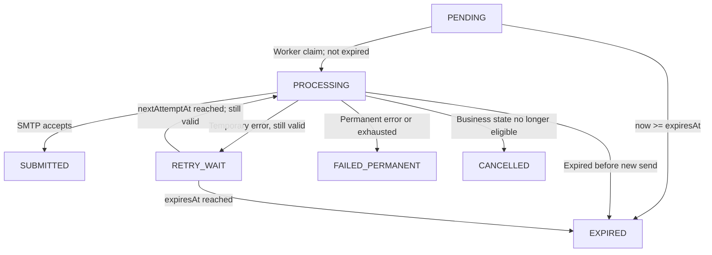
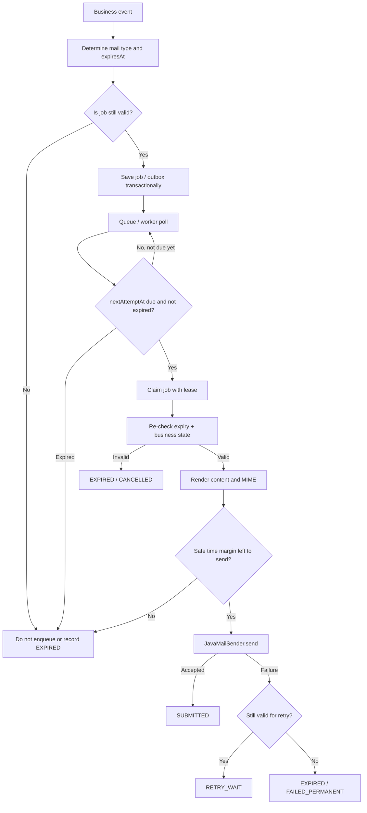

# Email Expiration Deadlines in Spring Framework Mail Retry and Idempotency

In an asynchronous email-sending system, a send request is not necessarily executed immediately. It may sit in a queue, wait for a free worker, be rate-limited by an SMTP server, or undergo retries after network errors. Consequently, an email that was valid when created can **lose its value** by the time a worker actually prepares to send it.

Examples:

- An OTP code is valid for three minutes, yet the email containing it gets stuck in a queue for five minutes.
- A password reset link expires before SMTP recovers.
- Today's payment reminder gets retried next week, after the invoice has already been paid.
- A "today's metrics" report arrives after its data has gone stale.
- A confirmation email for a cancelled action still gets sent because the retry job did not re-check business state.

**An email expiration deadline** is the rule defining the point after which the system **must not initiate a new send attempt** for a mail job. This rule must work alongside retries, idempotency, queues, and business state. It does not mean deleting an email already sitting in a recipient's mailbox, nor does it mean database record retention duration.

In Spring Framework Mail, `JavaMailSender` and `MimeMessageHelper` handle creating and sending messages, yet **there is no automatic business TTL** applied to every message. The application must define `expiresAt`, persist it with the job, and check it at processing boundaries.

## 1. Distinguishing Four Types of Deadlines

The phrase "expired email" can refer to several distinct events. Failing to separate them leads to flawed retry designs.

| Concept | Question | Example |
|---|---|---|
| **Mail job expiry** | Until when is the application allowed to start sending this email? | OTP email job expires after 2 minutes |
| **Token/link expiry** | Until when can the code or link inside the email be used? | Reset token expires after 15 minutes |
| **Content freshness** | Until when does the message content remain business-accurate? | Delivery reminder is no longer valid after order cancellation |
| **Storage retention** | How long are job records, logs, or artifacts retained? | Keep audit metadata for 30 days |

These four deadlines can differ.

For instance, an invoice download link might remain valid for 24 hours, yet the notification announcing the invoice was issued might still be sent many hours later if business rules require it. When a user clicks an expired link, the app can offer a flow to generate a fresh link after authentication. Conversely, an OTP email has a very short lifespan: sending an email with an already-invalidated code serves almost no purpose.

### Timeline Illustration

```text
10:00  User requests OTP
       |---- Mail job allowed to send for 2 minutes ----|
       |----------- OTP valid for 3 minutes -----------|

10:02  Job expired: do not initiate new send
10:03  OTP expired: code no longer verifies
10:05  SMTP recovers: DO NOT retry old OTP email
```

Setting the send deadline earlier than the code expiration leaves time for networking, the provider, and the user reading the email. Still, an email accepted by SMTP before 10:02 can arrive in the mailbox after 10:03; the application does not control the entire delivery path.

## 2. Why Must TTL Be a Business Rule?

There is no single optimal TTL for all email types. Deadlines must derive from the content's meaning:

| Email type | Typical appropriate strategy | Reason |
|---|---|---|
| Login OTP | Very short send deadline; drop job once expired | Codes quickly lose value |
| Password reset | Send deadline <= token expiry minus safety buffer | Avoid sending dead links |
| Signup confirmation | Send deadline tied to verification link validity | Link must still work when opened |
| Payment reminder | Deadline tied to due date and invoice status | Avoid reminding about completed payments |
| Appointment notice | Deadline before start time or business milestone | Avoid notifying after the meeting passed |
| Order confirmation | Usually kept long enough; verify order state | Often serves as a permanent record |
| Mandatory invoices/receipts | Do not drop silently after a long wait; escalate/compensate | May have legal or contractual requirements |
| Periodic reports | Deadline tied to reporting period and data freshness | Avoid sending overly stale summaries |
| Marketing | Tied to campaign window and active consent | Avoid sending outside campaign windows |

Production durations must be driven by business requirements and safety policies. For example, "OTP max 2 minutes in queue" is only an illustrative setting, not a mandatory Spring or SMTP parameter.

**Do not blindly set a 5-minute TTL for all emails.** Too short a deadline on legal receipts can drop essential sends. Too long a deadline on OTPs sends unusable codes.

### Policies Involve Multiple Conditions

A mail job can expire or become invalid because:

1. Absolute `expiresAt` has been reached.
2. The security token inside the email is no longer valid.
3. Business state changed, such as an order being cancelled.
4. The user requested a new code, revoking the old one.
5. The campaign or user consent no longer permits sending.
6. The job exceeded `maxAttempts` and reached a terminal state.

Not every condition can be captured by one timestamp. `expiresAt` handles time limits; the remaining conditions usually require **checking current business state** before sending.

## 3. Use an Absolute expiresAt Instead of Only Storing a TTL

For an asynchronous mail job, store an absolute expiration timestamp, e.g., ISO-8601 UTC:

```json
{
  "jobId": "mail-otp-00042",
  "type": "LOGIN_OTP",
  "createdAt": "2026-11-12T08:30:00Z",
  "notBefore": "2026-11-12T08:30:00Z",
  "expiresAt": "2026-11-12T08:32:00Z",
  "status": "PENDING",
  "attempts": 0
}
```

Fields:

- `createdAt`: timestamp when the job was created.
- `notBefore` or `nextAttemptAt`: earliest timestamp to start the next processing pass.
- `expiresAt`: timestamp after which no new send may start.
- `attempts`: number of processing/send passes executed, per consistent app definition.
- `status`: queue status.

At `now == expiresAt`, the job is considered **expired**:

```java
boolean expired = !clock.instant().isBefore(job.expiresAt());
```

This rule equals `now >= expiresAt`. Apply one consistent rule across enqueue, claim, retry, and worker checks.

### Why Not Store Only a Duration?

If every retry recomputed `now + Duration.ofMinutes(2)`, the deadline would keep sliding forward:

```text
10:00  create job, expected expiry 10:02
10:01  retry 1: if TTL reset, expiry becomes 10:03
10:02  retry 2: if TTL reset, expiry becomes 10:04
10:04  retry 3: content is stale yet job stays alive
```

The business deadline must be fixed from **the originating event or token issuance time**, never from each attempt. Retries update `nextAttemptAt` and `attempts`; they never refresh `expiresAt`.

### UTC, Instant, and Clocks

In Java, use `Instant` for timestamps; when local calendar math is needed, convert from `ZonedDateTime` with an explicit time zone. Follow these practices:

- Store timestamps in UTC.
- Inject `Clock` for testability.
- Synchronize clocks across workers and DB servers with proper time synchronization.
- Never compare deadlines using local time strings lacking time zones.
- Avoid `System.nanoTime()` for absolute deadlines; it is meant for in-process elapsed-time measurements.

If using database `NOW()` for claiming and Java `Clock.instant()` for final checks, account for clock skew. You can designate the DB as the time source for durable claims and add a safety margin before sending.

## 4. State Model of a Mail Job

States must clearly separate completion, expiration, temporary failures, and permanent failures:



This is an illustrative state machine, not built-in Spring Mail states. Organizations may add `LEASED`, `UNKNOWN_SUBMISSION`, `DELIVERY_CONFIRMED`, or provider-specific states.

| State | Needs immediate worker action? | Eligible for retry? |
|---|---:|---|
| `PENDING` | Yes, if `nextAttemptAt` is due and not expired | Yes |
| `PROCESSING` | Lease currently held by a worker | Per lease-recovery mechanism |
| `RETRY_WAIT` | Not until retry timestamp arrives | Yes, if unexpired and within attempts |
| `EXPIRED` | No | No, unless a new business request is created |
| `CANCELLED` | No | No, unless a new event occurs |
| `FAILED_PERMANENT` | No | Not automatically |
| `SUBMITTED` | No | Never retry as an unsent job |

If a new business request is created after an old job expires, it should generally receive a **new job ID, token, and idempotency scope**, rather than flipping `EXPIRED` back to `PENDING` and reusing stale data.

## 5. Overall Architecture: Checking Deadlines at Multiple Boundaries

A resilient design does not check expiration only once at job creation. A job can sit queued or change business state between steps.



Key boundaries:

1. **Enqueue:** compute the exact deadline and drop jobs that are already stale.
2. **Poll/claim:** skip expired jobs so they do not waste worker slots.
3. **Before rendering or expensive I/O:** drop expired or cancelled jobs.
4. **Right before SMTP send:** perform a final deadline check to avoid sending stale pre-built MIME.
5. **When scheduling retries:** do not schedule a new attempt if it will clearly fall past expiration.
6. **Cleanup:** move overdue jobs to terminal states, emit metrics, and retain audits per policy.

None of these checks can guarantee mailbox arrival before `expiresAt`; once accepted by the provider, the system can only monitor delivery/bounces if supported.

## 6. Expiration Policies by Email Type

Define policies in a typed Java structure rather than scattering `Duration.ofMinutes(...)` throughout the codebase:

```java
package com.example.mail;

import java.time.Duration;

public enum MailKind {
    LOGIN_OTP,
    PASSWORD_RESET,
    ORDER_CONFIRMATION,
    APPOINTMENT_REMINDER,
    DAILY_REPORT,
    INVOICE
}

public final class MailExpiryPolicy {

    private MailExpiryPolicy() {
    }

    public static Duration maxQueueAge(MailKind kind) {
        return switch (kind) {
            case LOGIN_OTP -> Duration.ofMinutes(2);
            case PASSWORD_RESET -> Duration.ofMinutes(10);
            case ORDER_CONFIRMATION -> Duration.ofHours(24);
            case APPOINTMENT_REMINDER -> Duration.ofHours(2);
            case DAILY_REPORT -> Duration.ofHours(12);
            case INVOICE -> Duration.ofDays(7);
        };
    }
}
```

This is an **illustrative policy**, not Spring defaults. An invoice might require handling beyond seven days or be barred from auto-expiring by regulations. In real applications, place durations in versioned, controlled configuration and validate them per mail kind.

### 6.1. Final Deadlines Must Account for Tokens, Events, and Schedules

Suppose an OTP token expires at `tokenExpiresAt` and policy lets the email wait at most two minutes from creation:

```java
import java.time.Clock;
import java.time.Instant;
import java.time.Duration;

public final class ExpiryCalculator {

    public Instant forOtp(
            Instant jobCreatedAt,
            Instant tokenExpiresAt,
            Duration queueWindow,
            Duration recipientSafetyMargin) {

        Instant queueDeadline = jobCreatedAt.plus(queueWindow);
        Instant tokenDeadline = tokenExpiresAt.minus(recipientSafetyMargin);
        return queueDeadline.isBefore(tokenDeadline)
                ? queueDeadline
                : tokenDeadline;
    }
}
```

Rule:

\[
\text{mailExpiresAt} = \min(\text{jobCreatedAt} + \text{queueWindow},\
\text{tokenExpiresAt} - \text{safetyMargin})
\]

If the computed value is not after job creation time, do not enqueue the email. For example, if a token has only seconds left while rendering and sending take longer, sending an unusable code creates poor UX; request a fresh token through the proper business flow instead.

### 6.2. Deadlines Relative to Event Milestones

For an appointment reminder starting at `appointmentStartsAt`, you might pick:

```java
Instant deadline = appointmentStartsAt.minus(Duration.ofMinutes(30));
```

That stops a worker from sending a "starting in 1 hour" email after the meeting has begun. If the appointment is rescheduled or cancelled, cancel the old job or re-verify state before sending.

### 6.3. Content With Time-Sensitive Displays

If a report is generated with data cut off at 08:00 while SMTP recovers at 23:00, the send deadline may depend on the data cutoff and report type. Never automatically relabel "Today's Report" to a new date while still using stale data.

For emails requiring snapshots, store `contentVersion` or `snapshotId` so retries send the exact issued information rather than silently re-rendering from changed data outside policy.

## 7. Persisting Expiry in a Job/Outbox Table

For transactional emails needing reliable delivery across restarts, use a job or transactional outbox table. PostgreSQL example:

```sql
CREATE TABLE mail_job (
    id               UUID PRIMARY KEY,
    idempotency_key  VARCHAR(160) NOT NULL UNIQUE,
    kind             VARCHAR(64) NOT NULL,
    status           VARCHAR(32) NOT NULL,
    recipient_id     VARCHAR(120) NOT NULL,
    payload_ref      VARCHAR(200) NOT NULL,
    created_at       TIMESTAMPTZ NOT NULL,
    next_attempt_at  TIMESTAMPTZ NOT NULL,
    expires_at       TIMESTAMPTZ NOT NULL,
    attempts         INTEGER NOT NULL DEFAULT 0,
    lease_owner      VARCHAR(120),
    lease_until      TIMESTAMPTZ,
    last_error_code  VARCHAR(80),
    submitted_at     TIMESTAMPTZ,
    CHECK (expires_at > created_at),
    CHECK (attempts >= 0)
);

CREATE INDEX idx_mail_job_due
    ON mail_job (next_attempt_at, created_at)
    WHERE status IN ('PENDING', 'RETRY_WAIT');

CREATE INDEX idx_mail_job_expiry
    ON mail_job (expires_at)
    WHERE status IN ('PENDING', 'RETRY_WAIT');
```

Illustrative schema; real tables may include tenant ID, template version, token reference, priority, lease token, provider message ID, errors, and last retry timestamp. `recipient_id` and `payload_ref` point to access-controlled data, avoiding embedding raw secrets/OTPs in tables or logs needlessly.

### 7.1. Why Persist expiresAt in the DB?

If expiration is only computed in RAM:

- After restarts, a new worker does not know the original creation/expiration time.
- Different instances might apply different TTL configs during rolling updates.
- Retries might accidentally extend deadlines by recreating objects.
- You cannot cleanly query expired backlogs via SQL.

Persisting `expires_at` as an immutable timestamp lets workers enforce the exact deadline decided when the job was created.

### 7.2. Writing the Job in the Business Transaction

Example when creating a confirmation email request:

```java
@Service
public class RegistrationService {

    private final RegistrationRepository registrationRepository;
    private final MailJobRepository mailJobRepository;
    private final Clock clock;

    public RegistrationService(
            RegistrationRepository registrationRepository,
            MailJobRepository mailJobRepository,
            Clock clock) {
        this.registrationRepository = registrationRepository;
        this.mailJobRepository = mailJobRepository;
        this.clock = clock;
    }

    @Transactional
    public void register(RegisterCommand command) {
        Registration registration = registrationRepository.save(
                Registration.from(command));

        Instant now = clock.instant();
        Instant expiry = now.plus(Duration.ofHours(1));
        mailJobRepository.save(MailJob.pending(
                registration.getId(),
                "registration-" + registration.getId(),
                now,
                expiry));
    }
}
```

`MailJob.pending(...)` is an application-defined factory method. When the transaction rolls back, both registration and job roll back. When it commits, the job persists durably for workers to process.

Never send SMTP directly inside this transaction. SMTP does not participate in database rollbacks; let workers send mail after the transaction commits.

### 7.3. Idempotency Keys Tied to Send Intent

`idempotency_key` can be derived from event type and business aggregate, e.g., `registration-<id>`. A unique constraint stops the same event from creating duplicate mail jobs within the same scope.

However, do not reuse one constant key across all times a user requests a new OTP code. **Issuing a fresh OTP is a new business intent**: it needs a new token, new expiry, and new idempotency key/sequence. Retries of **the same intent** must preserve the original key and expiry.

## 8. Selecting Unexpired Jobs via DB Queries

With multiple workers, claim jobs safely before sending. PostgreSQL can use `FOR UPDATE SKIP LOCKED` so workers do not pick the same row.

### 8.1. Batch Claim Example

```sql
WITH candidates AS (
    SELECT id
    FROM mail_job
    WHERE status IN ('PENDING', 'RETRY_WAIT')
      AND next_attempt_at <= NOW()
      AND expires_at > NOW()
    ORDER BY next_attempt_at, created_at
    FOR UPDATE SKIP LOCKED
    LIMIT 20
)
UPDATE mail_job AS job
SET status = 'PROCESSING',
    lease_owner = :worker_id,
    lease_until = NOW() + INTERVAL '2 minutes',
    attempts = attempts + 1
FROM candidates
WHERE job.id = candidates.id
RETURNING job.*;
```

Run this inside a **short transaction** and commit before starting SMTP submission. `SKIP LOCKED` avoids waiting on other workers' locks, though the system still needs recovery for `PROCESSING` jobs if a worker crashes. `lease_until` is part of that mechanism.

Never hold a database transaction open across SMTP sending, as that ties up locks, connections, and transactions for the duration of network latency.

### 8.2. Marking Expired Jobs

A cleanup job can transition expired pending jobs:

```sql
UPDATE mail_job
SET status = 'EXPIRED',
    last_error_code = 'MAIL_DEADLINE_EXCEEDED'
WHERE status IN ('PENDING', 'RETRY_WAIT')
  AND expires_at <= NOW();
```

Emit metrics for expired jobs by mail kind, along with minimal audit metadata. Do not confuse transitioning to `EXPIRED` with permanently deleting data: retention is a separate policy.

### 8.3. Jobs Claimed When the Worker Takes Too Long

The claim query only guarantees the job was unexpired **at claim time**. A worker might take minutes downloading data, rendering a PDF, or waiting on SMTP quotas. Therefore, re-check in code right before sending.

If a worker crashes, `lease_until` can expire. A reaper or another worker must check whether the job is still valid before returning it to `PENDING`. **Never resurrect an `EXPIRED` job just because its lease expired.**

### 8.4. Avoiding Races Between Workers

If Worker A's lease expires and Worker B reclaims the job, A may still be alive and about to send. Checking `expiresAt` alone does not prevent both workers from sending.

Use a lease/fencing token that changes on every claim, paired with conditional status updates:

```sql
UPDATE mail_job
SET status = 'SUBMITTED',
    submitted_at = NOW()
WHERE id = :job_id
  AND status = 'PROCESSING'
  AND lease_owner = :worker_id;
```

This condition prevents state corruption from a worker that lost ownership; however, if `worker_id` can be reused across claims, a unique token per claim is required. More importantly, **blocking a DB update does not recall an SMTP request already transmitted**. To minimize duplicates, verify ownership right before sending, size leases generously, renew leases on long tasks, and pair with downstream idempotency where supported.

## 9. Checking Deadlines in the Spring Worker

The code below illustrates separating sending from the job claim transaction. `MailJobStore`, `MailComposer`, and `RetryPlanner` are application-defined contracts, not built-in Spring classes.

```java
package com.example.mail;

import java.time.Clock;
import java.time.Instant;
import org.springframework.mail.MailException;
import org.springframework.stereotype.Service;

@Service
public class MailJobProcessor {

    private final MailJobStore store;
    private final MailComposer composer;
    private final MailGateway gateway;
    private final RetryPlanner retryPlanner;
    private final Clock clock;

    public MailJobProcessor(
            MailJobStore store,
            MailComposer composer,
            MailGateway gateway,
            RetryPlanner retryPlanner,
            Clock clock) {
        this.store = store;
        this.composer = composer;
        this.gateway = gateway;
        this.retryPlanner = retryPlanner;
        this.clock = clock;
    }

    public void process(ClaimedMailJob job) {
        if (isExpired(job.expiresAt())) {
            store.markExpired(job.id(), job.leaseToken());
            return;
        }

        if (!store.isStillRelevant(job)) {
            store.markCancelled(job.id(), job.leaseToken());
            return;
        }

        try {
            // Check expiry right after rendering, close to send time.
            PreparedMail mail = composer.compose(job);

            if (isExpired(job.expiresAt())) {
                store.markExpired(job.id(), job.leaseToken());
                return;
            }

            // Check lease/fencing token right before side effect.
            if (!store.stillOwnsClaim(job.id(), job.leaseToken())) {
                return;
            }

            gateway.send(mail);
            store.markSubmitted(job.id(), job.leaseToken());
        } catch (MailException ex) {
            Instant now = clock.instant();
            retryPlanner.scheduleFailure(job, ex, now);
        }
    }

    private boolean isExpired(Instant expiresAt) {
        return !clock.instant().isBefore(expiresAt);
    }
}
```

Notes on this example:

- `ClaimedMailJob` carries the immutable deadline and the claim's ownership token.
- `isStillRelevant` checks business state (e.g., whether the OTP was revoked or the order was cancelled).
- `PreparedMail` represents the rendered message; `MailGateway` wraps `JavaMailSender`.
- `store.markExpired`, `markCancelled`, and `markSubmitted` must be short transactions updating conditionally by lease token.
- `composer.compose(...)` may throw non-`MailException` errors such as template errors; real services must classify those.
- `store.stillOwnsClaim` addresses races and lease expiry. A single ownership read cannot make SMTP sending atomic; the design must accept that distributed limit.
- If SMTP accepted the message while `markSubmitted` failed, retries can send duplicates. Idempotency and uncertain outcomes must be managed at the job/provider level.

### 9.1. MailGateway Backed by JavaMailSender

Spring Mail adapter example:

```java
package com.example.mail;

import jakarta.mail.MessagingException;
import jakarta.mail.internet.MimeMessage;
import java.nio.charset.StandardCharsets;
import org.springframework.mail.MailException;
import org.springframework.mail.javamail.JavaMailSender;
import org.springframework.mail.javamail.MimeMessageHelper;
import org.springframework.stereotype.Component;

@Component
public class SpringMailGateway implements MailGateway {

    private final JavaMailSender sender;

    public SpringMailGateway(JavaMailSender sender) {
        this.sender = sender;
    }

    @Override
    public void send(PreparedMail mail) throws MailException {
        MimeMessage message = sender.createMimeMessage();
        try {
            MimeMessageHelper helper = new MimeMessageHelper(
                    message, false, StandardCharsets.UTF_8.name());
            helper.setFrom(mail.from());
            helper.setTo(mail.to());
            helper.setSubject(mail.subject());
            helper.setText(mail.plainText(), false);
        } catch (MessagingException ex) {
            throw new IllegalStateException(
                    "Unable to assemble mail message", ex);
        }

        sender.send(message);
    }
}
```

`PreparedMail` is an application-defined DTO containing `from`, `to`, `subject`, and `plainText`. For HTML, inline images, or attachments, use `MimeMessageHelper` in appropriate multipart mode and populate content from vetted templates.

**The gateway does not decide TTLs.** Deciding whether a job may still be sent belongs in the coordinator/worker using job metadata and business state. This allows one gateway to send multiple email kinds with differing policies.

### 9.2. Checking Right Before Sending Does Not Guarantee Timely Delivery

Suppose the check passes at 10:01:59.900, the job expires at 10:02:00.000, and the SMTP call starts right after. Network handshakes can stretch to 10:02:10.000. The app can avoid **initiating** sends past the deadline on a best-effort basis, yet cannot halt a message already submitted to SMTP once the clock passes the cutoff.

To guarantee a token cannot work past its expiry, **enforce expiration at the token-verification API**, not solely in the mail worker. Email TTL optimizes sending behavior; token expiry enforcement is the actual security boundary.

## 10. Retries Must Respect the Original Deadline

Retries are meant to overcome transient errors like network timeouts or SMTP `4xx`. Yet retries must never continue past `expiresAt`.

### 10.1. Principle for Computing nextAttemptAt

Suppose:

- `expiresAt` = 10:02:00
- First send fails at 10:01:45
- Next backoff = 30 seconds
- Computed `nextAttemptAt` = 10:02:15

The next retry would begin after the job expired; do not schedule that retry.

```java
Instant nextAttemptAt = now.plus(backoff);

if (!nextAttemptAt.isBefore(job.expiresAt())) {
    store.markExpired(job.id(), job.leaseToken());
} else {
    store.scheduleRetry(
            job.id(),
            job.leaseToken(),
            nextAttemptAt);
}
```

The condition must use strict comparison `nextAttemptAt < expiresAt`. If equal to the deadline, no time remains to start the pass.

### 10.2. RetryPlanner Example

```java
package com.example.mail;

import java.time.Duration;
import java.time.Instant;

public final class RetryDecision {

    public static Instant nextAttempt(
            Instant now,
            Instant expiresAt,
            int attemptNumber,
            int maxAttempts) {

        if (attemptNumber >= maxAttempts) {
            return null; // Stop due to attempt limit.
        }

        long seconds = Math.min(
                60L,
                5L * (1L << Math.min(attemptNumber - 1, 4)));
        Instant candidate = now.plusSeconds(seconds);

        return candidate.isBefore(expiresAt)
                ? candidate
                : null; // No valid retry remains within deadline.
    }
}
```

Example caps backoff at 60 seconds. Production should include jitter so jobs do not retry in lockstep, distinguish expiring from exhausting attempts, and never retry permanent errors. `attemptNumber` should be a positive integer controlled by the state machine.

### 10.3. Priority Order at Termination

A clear policy:

1. If current time has reached/passed `expiresAt` → `EXPIRED`.
2. If business state is cancelled/already handled → `CANCELLED`.
3. If error is non-retryable → `FAILED_PERMANENT`.
4. If `maxAttempts` exhausted before expiry → `FAILED_PERMANENT` or `RETRY_EXHAUSTED`.
5. If backoff pushes the next attempt past expiry → `EXPIRED`.
6. Otherwise → `RETRY_WAIT` with `nextAttemptAt`.

A job can both expire and hit a send failure. Pick a precedence order so metrics and audits stay consistent. Never mark `SUBMITTED` merely because a retry was scheduled.

### 10.4. Timeouts and Deadlines

Set SMTP connect/read/write timeouts so a worker cannot hold a job indefinitely. Spring Boot example:

```yaml
spring:
  mail:
    host: ${SMTP_HOST}
    port: 587
    username: ${SMTP_USERNAME}
    password: ${SMTP_PASSWORD}
    properties:
      "[mail.smtp.auth]": true
      "[mail.smtp.starttls.enable]": true
      "[mail.smtp.connectiontimeout]": 5000
      "[mail.smtp.timeout]": 5000
      "[mail.smtp.writetimeout]": 5000
```

Values are in milliseconds and illustrative only. SMTP timeouts do not automatically derive from a job's `expiresAt`. Choose sensible timeouts and deadline margins; overly short timeouts can increase transient network errors. Confirm TLS settings with your provider.

## 11. Combining @Async and @TransactionalEventListener

In Spring, `@Async` and `@TransactionalEventListener(phase = AFTER_COMMIT)` are often combined to send email after a business transaction commits:

```java
@Component
public class RegistrationMailListener {

    private final AsyncRegistrationMailService asyncMailService;

    @TransactionalEventListener(
            phase = TransactionPhase.AFTER_COMMIT)
    public void onRegistration(RegistrationCreatedEvent event) {
        asyncMailService.process(event.mailJobId());
    }
}

@Service
public class AsyncRegistrationMailService {

    @Async("mailExecutor")
    public void process(UUID jobId) {
        // Load job, check expiresAt and lease, then send.
    }
}
```

Meaning:

- `AFTER_COMMIT` prevents the listener from running if the originating transaction rolls back.
- `@Async` moves work off the request thread.
- The worker can read expiry metadata persisted with the job.

However, after-commit listeners and in-memory executors **do not guarantee job execution after a crash**. For critical emails, persist the job/outbox record durably and run an independent polling worker. Then the `AFTER_COMMIT` listener acts merely as an accelerator to wake the worker, not the sole source of data.

When using `@Async`, the original thread's transaction context is not propagated to the worker. Claiming jobs and updating `RETRY`/`EXPIRED`/`SUBMITTED` must execute in fresh transactions at the store/service layer.

## 12. Broker Message TTLs Do Not Replace Business Deadlines

Queueing systems may provide message TTLs or retention. These features are helpful, yet cannot completely replace checking `expiresAt` inside the mail job.

### RabbitMQ

RabbitMQ supports configuring TTL per message or queue at the broker level. Once TTL expires, messages can be discarded or dead-lettered per policy. However:

- Broker TTL mainly applies while a message sits in the queue, not once a consumer has picked it up and begun processing.
- Exact purge/dead-letter timing can depend on how the queue manages expiration.
- Broker TTL does not know whether an OTP is still valid or an order was cancelled.
- Retry queues and main queues can have differing TTLs.

Therefore, consumers must still check deadlines and business state before sending. If the broker dead-letters expired jobs, add metrics/audits so operators distinguish `EXPIRED` from `FAILED`.

### Amazon SQS

SQS provides message retention and visibility timeouts. Retention controls how long a message remains in the queue; visibility timeout hides a message while a consumer processes it. Neither is **the business deadline** of an OTP email.

A message with multi-day retention can represent a mail job useful for only two minutes. Workers must read `expiresAt` from the payload or durable metadata and drop stale jobs.

### Kafka

Kafka stores records by topic retention and tracks consumers by offset. Consumer lag shows how far behind a topic the consumer is, but does not automatically invalidate a mail job by business time. Consumers must compare against deadline timestamps before executing side effects.

### In-JVM Executors

`ThreadPoolTaskExecutor` has no per-`Runnable` TTL that automatically cancels tasks at business deadlines. `queueCapacity` only bounds queued task counts, not content validity. Hence workers must check expiry when starting execution and right before sending.

### Comparison Table

| Mechanism | Useful for | Cannot replace |
|---|---|---|
| Broker message TTL | Purging stale queued messages | Checks after a consumer receives the job |
| Queue retention | Bounding message storage duration | Meaningful validity of OTPs/tokens |
| Visibility timeout / lease | Enabling reclaims on worker crash | Blocking stale emails |
| Retry backoff | Spacing out attempts | Immutable job deadline |
| `expiresAt` in job | Business deadline | Token validation and delivery status |

## 13. Idempotency When an Expired Job Is Followed by a New Request

Expiration and idempotency are related yet solve two different problems:

- **Expiry:** Should we still execute this send intent?
- **Idempotency:** When re-executing the same intent, how do we reduce duplicate side effects?

### 13.1. Do Not Extend Old Jobs via Retries

Suppose a user requests OTP #1:

```text
request-1 -> token A -> mail-job-A -> expires 10:02
```

At 10:03, the user requests a new OTP:

```text
request-2 -> token B -> mail-job-B -> expires 10:05
```

`mail-job-A` must expire or be cancelled. Retries of job A must never update `expiresAt` to 10:05. If the verification API only accepts token B, sending token A later only causes confusion.

### 13.2. Scoped Idempotency Keys

For an order confirmation email, the key can combine `orderId` + `eventType` + `eventVersion`. If the same event is published twice, the unique constraint prevents creating two jobs.

For OTPs, keys must distinguish each fresh issuance. Use `challengeId` or `otpIssueId`, never solely user ID and mail type; sharing one key across all OTPs for a user can falsely deduplicate a legitimate new request as a repeat of an old one.

### 13.3. No Universal Exactly-Once SMTP

Suppose a worker sends via SMTP successfully, then loses the connection before receiving the reply, or crashes before updating the job to `SUBMITTED`. A retry can send a duplicate even when the state machine and database idempotency key are solid.

Reduce risk by:

- Conditional claims/leases and bounding concurrent workers.
- Persisting `attemptId` and provider message IDs when available.
- Using an email API with idempotency keys if supported by your specific provider.
- Setting a stable `Message-ID` if tracing needs it, without assuming SMTP automatically drops duplicates.
- Designing content to tolerate duplicates, such as confirming an already-existing order.

Job-layer idempotency prevents redundant job creation/claims, yet **does not prove the recipient will receive only one email**.

## 14. Can an Email Already Submitted to SMTP "Expire"?

This is a critical boundary:

```text
PENDING -> PROCESSING -> JavaMailSender.send() -> SMTP accepted
                                          |
                                          v
                                  Provider delivery queue
                                          |
                                          v
                                      Mailbox
```

Before `JavaMailSender.send(...)`, the application controls whether to initiate sending. Once the SMTP server accepts the message, the email can sit in the provider's queue, traverse multiple mail transfer agents, or land in the inbox late.

Spring Mail has no universal API to "recall" an email already submitted to SMTP. Specific providers may offer mechanisms to cancel undelivered messages, but you cannot rely on that as a general guarantee.

Therefore:

1. Never base security invariants on the recipient definitely receiving the email before a deadline.
2. Expire tokens server-side upon verification.
3. Links can route to a verification page or offer a "request new link" action.
4. Never revert `SUBMITTED` back to `EXPIRED` merely because time passed, if that hides the fact that an email was submitted.
5. Optionally store `contentExpiredAt` to record that the content/token expired even though the email was sent.

If an email was submitted before the deadline yet arrives at the mailbox afterward, the accurate state is **submission succeeded, token expired**. Never rewrite history as "not sent."

## 15. Handling Emails Containing Expired Links or Codes

For OTPs and password resets, pay special attention to safety when messages arrive late.

### 15.1. Server-Side Verification

Token check example:

```java
public boolean isTokenUsable(
        ResetToken token,
        Instant now) {
    return !token.isRevoked()
            && !token.isUsed()
            && now.isBefore(token.expiresAt());
}
```

Even when the email was sent or delivered before the deadline, an expired token must be rejected at the verification API. Never let email delivery determine whether a code remains valid.

### 15.2. Never Leak OTPs in Logs or Metrics

Logs may record `jobId`, email kind, creation time, `expiresAt`, attempt count, and general error codes. Never log raw OTPs, reset tokens, signed URLs containing secrets, or email bodies with sensitive details.

If payloads are stored in the outbox, encrypt and restrict read access on sensitive fields. For one-time tokens, consider storing a challenge reference instead of the raw token while checking that the challenge is still valid when the worker sends.

### 15.3. When the User Requests a New Code

A sound flow:

1. Create a new challenge/token and persist it inside a transaction.
2. Revoke the prior challenge per policy.
3. Cancel unsent mail jobs linked to the old challenge.
4. Create a new mail job with a new `expiresAt`, without modifying the old job's deadline.
5. Have the worker check that the challenge ID is still eligible before sending.

Even if the old job was already accepted by SMTP, the old token can be revoked server-side. Email text should clarify to use only the latest code if your product enforces that rule.

## 16. Observability for Expired Emails

If you only measure queue depth and SMTP success rate, expired jobs can silently vanish from the queue unnoticed. Measure expiration as an explicit processing outcome.

### Recommended Metrics

| Metric | Type | Meaning |
|---|---|---|
| `mail.jobs.expired` | Counter | Jobs terminated due to deadline |
| `mail.jobs.expired.before_claim` | Counter | Expired in queue before a worker claimed them |
| `mail.jobs.expired.before_send` | Counter | Expired after claim/render, before SMTP |
| `mail.jobs.cancelled` | Counter | Cancelled due to business state |
| `mail.jobs.retry_skipped` | Counter | Retry skipped due to deadline |
| `mail.jobs.ready` | Gauge | Unexpired, due jobs ready for processing |
| `mail.jobs.oldest_ready_age` | Gauge | Age of oldest ready job |
| `mail.jobs.submitted` | Counter | Accepted SMTP submissions |
| `mail.jobs.failed_permanent` | Counter | Permanent errors or exhausted attempts |
| `mail.jobs.time_to_expiry` | Timer/distribution | Remaining margin when job was claimed |

These names are suggested conventions. In Micrometer, record:

```java
registry.counter(
        "mail.jobs.expired",
        "kind", job.kind().name(),
        "phase", "before_send")
        .increment();
```

Only use low-cardinality tags such as email kind, processing phase, or outcome. Never use `jobId`, email address, token, or arbitrary tenant ID as metric tags due to high cardinality and data-exposure risks.

### Impact-Based Alerts

Examples:

- Sudden spike in OTP expiration rate over five minutes.
- Due jobs have `oldest_ready_age` breaching SLO.
- Prolonged SMTP throttling causing retries to be repeatedly skipped due to expiry.
- Zero workers processing while ready jobs climb.
- Elevated `EXPIRED` rate for a specific template/version.

Track both queue depth and retry backlog. A falling queue depth can mean jobs are sending smoothly—or expiring en masse.

### Minimal Structured Log

```json
{
  "event": "mail_job_expired",
  "jobId": "mail-00042",
  "mailKind": "LOGIN_OTP",
  "reason": "deadline_reached_before_send",
  "attempts": 2,
  "createdAt": "2026-11-12T08:30:00Z",
  "expiresAt": "2026-11-12T08:32:00Z"
}
```

You do not need to log email bodies, tokens, or SMTP passwords to diagnose an expired job. When tracing is enabled, correlate request ID and job ID in access-controlled logs/traces.

## 17. Testing Deadlines With a Fixed Clock

Tests must not rely on `Thread.sleep` to wait for a job to expire in real time. Use `Clock.fixed` or an adjustable clock to verify exact boundaries:

```java
import static org.junit.jupiter.api.Assertions.*;
import java.time.Clock;
import java.time.Instant;
import java.time.ZoneOffset;
import org.junit.jupiter.api.Test;

class ExpirationTest {

    @Test
    void jobExpiresExactlyAtDeadline() {
        Instant deadline = Instant.parse("2026-11-12T08:32:00Z");
        Clock atDeadline = Clock.fixed(
                deadline, ZoneOffset.UTC);

        boolean expired = !atDeadline.instant().isBefore(deadline);
        assertTrue(expired);
    }

    @Test
    void jobIsValidOneMillisecondBeforeDeadline() {
        Instant deadline = Instant.parse("2026-11-12T08:32:00Z");
        Clock before = Clock.fixed(
                deadline.minusMillis(1), ZoneOffset.UTC);

        assertTrue(before.instant().isBefore(deadline));
    }
}
```

This is a small test for the time rule. Processor tests should mock collaborators to verify behavior:

| Scenario | Expected outcome |
|---|---|
| Job expires before claim | Not claimed/sent; moves to `EXPIRED` |
| Expires during rendering | SMTP not called |
| `now == expiresAt` | Already expired |
| Token revoked before time is up | `CANCELLED`, not sent |
| Backoff exceeds deadline | No new retry created |
| Backoff within deadline | Saves `RETRY_WAIT` with `nextAttemptAt` |
| SMTP accepted before deadline | `SUBMITTED`; does not flip to `EXPIRED` over time |
| Provider timeout uncertain whether received | Records ambiguity and applies retry/idempotency policy |
| Worker loses lease | Does not assume ownership; avoids corrupting job state |
| Multiple workers claim simultaneously | Only one worker holds a valid claim |
| Process restart | Durable job/outbox persists and re-checks expiry |

### Testing Retry Selection

```java
@Test
void doesNotRetryPastExpiry() {
    Instant now = Instant.parse("2026-11-12T08:31:45Z");
    Instant expiresAt = Instant.parse("2026-11-12T08:32:00Z");

    Instant next = RetryDecision.nextAttempt(
            now, expiresAt, 4, 5);

    assertNull(next); // Backoff would fall after expiresAt.
}
```

In integration tests, use an SMTP sink such as Mailpit instead of production SMTP. Deliberately inject delays, failures, and retries to confirm no send is invoked when a job is already expired at the worker's check time. Never send test emails to real users in automated tests.

## 18. Concurrency and the Gap Between Check and Send

In distributed systems, "check not expired" and "send SMTP" cannot be combined into one atomic database transaction:

```text
Worker                        Database               SMTP provider
  |                              |                         |
  |-- check expiry ------------->|                         |
  |<-- still valid --------------|                         |
  |                              |                         |
  |-- start send ----------------------------------------> |
  |                              |          possible delay |
  |                              |                         |
  |<------------------------------------- accepted / error |
```

Between those two steps, milliseconds or longer can pass. When deadlines are strict, enforce a **submission safety margin**:

```java
Instant latestStart = job.expiresAt()
        .minus(Duration.ofSeconds(10));

boolean enoughTime = clock.instant().isBefore(latestStart);
```

Ten seconds is an example; choose based on P95/P99 SMTP latency and email nature. Never treat this margin as a guarantee of delivery before the deadline.

### When the Worker Sent but Missed the ACK

This is the hardest scenario for idempotency: the server may have accepted the message while the application timed out. You cannot infer "not sent" from a network timeout alone. Consider:

- Recording `UNKNOWN_SUBMISSION` or an uncertain attempt result.
- Using an idempotent provider API where appropriate.
- Applying retry policies per email type; OTPs may skip retries when near expiration.
- Never automatically resending sensitive emails past their deadline.
- Tracking provider events when available.

Do not wrap a long DB transaction around the network call hoping a rollback will "recall" the email; SMTP does not participate in that transaction.

## 19. Cleaning Up Expired Jobs and Retention

Once `expiresAt` passes, transition state so workers stop picking up the job. Deleting records, attachments, or raw payloads is a separate concern.

### Cleanup Procedure

1. Select pending jobs that have expired.
2. Update to `EXPIRED` conditioned on current state.
3. Emit metrics and a minimal audit event.
4. Ensure workers cannot reclaim the job.
5. Delete or redact sensitive payloads per retention policy.
6. Keep metadata needed for reconciliation within policy-defined retention limits.

Never delete a `PROCESSING` job while a worker still uses its artifacts or started an SMTP call without proper lease and state coordination. Cleanup must respect ownership.

### Token Revocation Is a Separate Step

Expiring a mail job does not replace expiring or revoking the token. Conversely, expiring a token does not automatically update `mail_job.status` without a worker/cleanup step. The two states should remain independent yet coordinated:

```text
mail_job: EXPIRED
auth_token: EXPIRED or REVOKED
```

Never retain raw tokens in mail jobs longer than product security needs. If a token must be invalidated immediately when the user requests a new one, update the token system directly rather than waiting for the mail queue worker.

### Legal or Compliance Emails

For documents required by regulation to be retained and delivered, do not make "drop completely at deadline" the default. Instead, **escalate/alert/recreate approved content** once a job breaches SLA, or track document delivery in a dedicated workflow. Business and legal requirements—not framework defaults—must dictate the rule.

## 20. Common Design Mistakes

| Mistake | Consequence | Fix |
|---|---|---|
| Computing TTL anew on each retry | Old jobs stay alive forever | Persist `expiresAt` from original request |
| Checking expiry only at enqueue | Stale queued jobs still get sent | Check at claim and right before send |
| Relying on broker TTL to protect tokens | Messages already pulled by consumers can still send | Check deadlines in worker and token API |
| Using queue retention as mail expiry | Old emails persist or vanish wrongly | Persist business deadline separately |
| Computing timestamps in timezone-less local time | Wrong deadlines across server timezones | Use UTC `Instant` |
| Using `isAfter(expiresAt)` | Allows sending right at deadline | Use `!now.isBefore(expiresAt)` |
| Extending expiry when moving to `RETRY_WAIT` | Retries stretch past original intent | Never change `expiresAt` during retries |
| Forgetting to check business state | Sends reminders for done tasks or revoked OTPs | Verify relevance before send |
| Reading lazy JPA entities in worker post-commit | Lazy loading errors or stale data | Use DTO snapshots or transactional queries |
| Sending SMTP inside a long DB transaction | Holds locks/connections across network; rollback cannot recall email | Separate claim, send, finalize |
| Reusing one key across all OTP issuances | Legitimate new code requests falsely deduped | Key per challenge/token issuance |
| Retrying security emails indefinitely | Users receive multiple dead links | Max attempts, expiry, terminal states |
| Marking `SUBMITTED` right at enqueue | Misrepresents actual send state | Update after SMTP acceptance |
| Deleting jobs immediately upon expiry | Loses audit/debug trails or races workers | Transition state; purge per retention |
| Concluding send success means delivered | Misreports status | Track provider delivery/bounces separately |
| Worker sends after losing lease | Can cause duplicates | Claim token/fencing, check lease, idempotency |
| Monitoring only queue depth | Jobs expire en masse while queue shrinks | Measure expired, cancelled, and completion outcomes |

## 21. Frequently Asked Questions

**Does Spring Framework Mail provide a default `mail.expire-after` property?** No universal business TTL property exists for `JavaMailSender`. Applications must define job deadlines themselves or use a queue/outbox with expiry metadata.

**Can a sent email be auto-deleted from the inbox after expiring?** Not through standard SMTP/Spring Mail mechanisms. Job expiration only stops initiating new sends prior to submission; it does not control emails already delivered to a mailbox.

**Should an OTP email's TTL equal the OTP token's TTL?** Usually it should be shorter to leave time for submission and user action. Even so, token expiration must still be enforced server-side during verification.

**What if a job expires right as a worker starts?** The recommended rule is `now >= expiresAt`, do not send. Check close to send time and optionally include an SLO safety margin.

**What if an email sent before expiry, yet the token expired before the recipient opened it?** Reject the token when used. Provide a flow to request a new code/link; never treat SMTP success as extending token validity.

**Should retries reset `expiresAt`?** Never for the same send intent. Retries keep the original deadline; only a new business event creates a new job and deadline.

**Do invoice emails need to expire?** There is no single answer. You may apply SLAs and escalation instead of dropping the send request, following business and legal rules.

**Why check business state in addition to expiry?** Because an email can lose relevance before reaching its deadline—such as a cancelled appointment, refunded order, or superseded OTP.

**Does `@Async` automatically drop overdue tasks?** No. The executor runs `Runnable` instances by schedule and capacity; worker logic must check `expiresAt`.

**Is RabbitMQ message TTL enough?** No. It cleans up waiting messages at the broker, yet cannot replace checks once a consumer pulled the job or when business state changes.

**Is SQS retention an email expiry?** No. Retention controls how long messages sit in the queue, not whether OTP contents remain valid.

**Should deadlines be extended when the SMTP provider is down?** Not automatically. For time-sensitive emails, drop old jobs once expired. For mandatory emails, escalate or create a new valid request per policy.

**Can an email still be sent twice even with an idempotency key?** Yes. SMTP can accept a message while the worker loses the ACK before updating the DB; retries can duplicate it. Use provider idempotency if available and design duplicate-tolerant side effects.

**Must data be deleted once a job becomes `EXPIRED`?** Possibly per retention/privacy policies, though expiry and retention are separate policies. Retain needed audit metadata and purge sensitive payloads on schedule.

**Why use `Clock` instead of calling `Instant.now()` directly?** Injecting `Clock` lets tests hit exact deadline boundaries, avoid sleeps, and enforce timezone determinism.

**Which metrics should track expiration?** At minimum: expired count by mail kind, oldest ready age, retries skipped due to expiry, submission success/failure, and queue depth. Never look solely at remaining queue count.

## 22. Related Technical Documentation

- **Spring Framework Mail:** `JavaMailSender`, `MimeMessageHelper`, `MailException`, and SMTP submission.
- **Spring Task Execution:** `@Async`, `ThreadPoolTaskExecutor`, executor queues, and rejection policies.
- **Spring Transaction Management:** `@Transactional`, `@TransactionalEventListener(AFTER_COMMIT)`, and the transactional outbox pattern.
- **Java Time API:** `Instant`, `Duration`, `Clock`, `ZonedDateTime`.
- **Spring Data JPA/JDBC:** repositories, conditional updates, optimistic locking, and short transactions.
- **PostgreSQL:** `TIMESTAMPTZ`, `FOR UPDATE SKIP LOCKED`, and batch claim patterns.
- **Micrometer / Spring Boot Actuator:** metrics for queue depth, expiry, retries, and SMTP submissions.
- **Broker documentation:** message TTL/retention, visibility timeouts, acknowledgments, and dead-letter policies for your broker.

---

**Takeaway:** an email expiration deadline is **a business deadline for initiating a send**, not a recall mechanism for already-submitted emails. Compute an immutable `expiresAt` from the originating event, persist it with the job/outbox, check it at enqueue, claim, pre-SMTP, and retry scheduling, and separately enforce token and business-state validity. `@Async`, broker TTLs, and retries cannot substitute for these checks. For high-reliability emails, combine a durable outbox, claims/leases, idempotency, metrics, and per-email-type error and expiration strategies.
