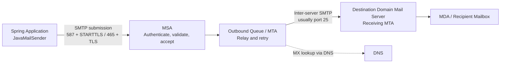
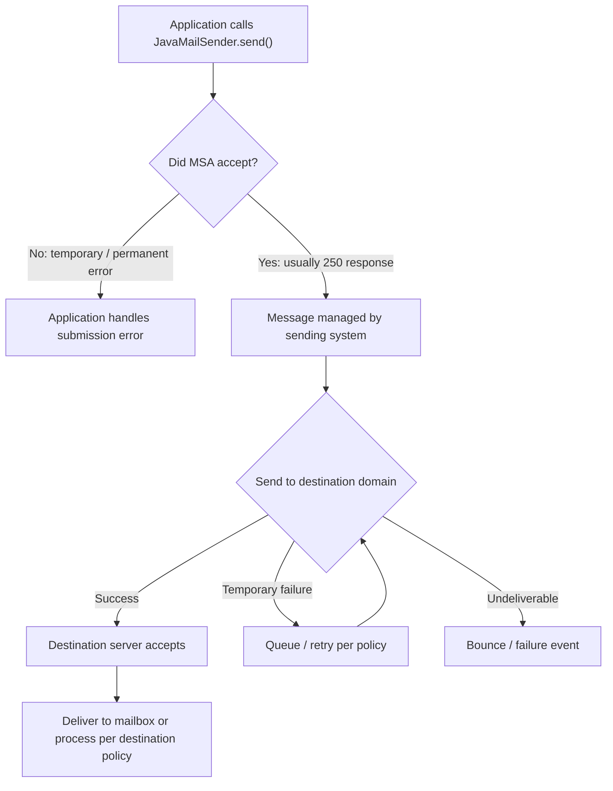

# Mail Submission Agent (MSA): Accepting Email from Applications

When a Spring application sends a registration confirmation, password reset, or transactional notification email, the application does not look up each recipient's mail server to deliver the message itself. Instead, it typically connects to a **Mail Submission Agent (MSA)**: the entry point that accepts outgoing mail from authorized applications or users. The MSA authenticates the sender, checks policies, and accepts the message so the email system can continue delivery.

In **Spring Framework Mail**, `JavaMailSender` acts as the **SMTP client** inside the Java application. The MSA is the SMTP service on the mail infrastructure side that the client connects to. Distinguishing these two roles helps you configure connections, security, error handling, and reliable email-sending mechanisms.

## 1. Where Does the MSA Sit in Email Architecture?

A typical outgoing mail flow:



The components have distinct responsibilities:

| Component | Primary Role | Example |
|---|---|---|
| Application / SMTP client | Builds message content, chooses recipients, connects, and sends SMTP requests | `JavaMailSender` in Spring |
| **MSA — Mail Submission Agent** | Accepts mail from authorized clients; enforces outgoing policies | Organization's or email provider's SMTP submission service |
| MTA — Mail Transfer Agent | Routes and relays mail between servers, queues, and retries when needed | SMTP relay server |
| MDA — Mail Delivery Agent | Places accepted mail into the recipient's mailbox or mail store | Internal delivery component of the destination server |

A single piece of software or provider may perform **multiple roles on the same system**. Therefore, the MSA/MTA boundary is a *functional* boundary, not necessarily two separate physical servers.

Key point to remember: a user clicks the "Send verification code" button in the application, Spring builds the email and **submits** it to the MSA; subsequent delivery steps are the mail system's responsibility. The MSA serves **outgoing mail from the application**, not an inbound service for displaying email in an inbox.

### Submission Differs from Server-to-Server Relay

In practice, three SMTP ports are commonly encountered:

| Port | Context | Connection Security |
|---|---|---|
| **587** | Message submission from an application/client to an MSA | Connects via SMTP then upgrades via **STARTTLS**; usually uses SMTP AUTH |
| **465** | Message submission with TLS from connection start | **Implicit TLS**; usually uses SMTP AUTH |
| **25** | SMTP mail transfer between MTAs | TLS and authentication policies depend on the relationship between servers |

When configuring an application to send email externally, use the **submission port specified by the provider**, typically 587 or 465. Do not treat port 25 as a default choice for an application to send directly to every recipient domain.

## 2. What Does the MSA Do When an Application Submits a Message?

The MSA is the "front door" of the outgoing mail system. Depending on the organization or provider, it may perform the following tasks:

1. **Establish a secure SMTP session.** The MSA advertises capabilities via `EHLO`, negotiates STARTTLS, or accepts TLS connections from the outset.
2. **Authenticate the client.** The MSA may require SMTP AUTH with an account, app password, or token mechanism supported by the provider. This authenticates that *the application is authorized to send*.
3. **Authorize the sender.** The MSA may verify whether the authenticated account has permission to send with the declared `From` address or sending domain.
4. **Validate the message and recipients.** It evaluates SMTP syntax, size limits, recipient counts, sending rate, anti-abuse policies, and other conditions.
5. **Accept or reject.** The MSA returns an SMTP response code. For accepted messages, it typically hands them off to the system's queue or relay component.
6. **Provide operational traces.** The system may attach queue IDs and record acceptance, rejection, or onward delivery events; visibility depends on the provider.

Not every MSA signs DKIM itself, handles bounces itself, or manages the entire queue itself. These functions may live at the MTA layer, a signing service, or an integrated email platform.

**Commitment boundary:** a `250` response after the `DATA` step means the server has **accepted the message for further processing**, *not* that the message has been placed into the recipient's inbox. Delivery to the destination server may take additional time, be rejected later, or result in a bounce.

## 3. What the MSA Receives: SMTP Envelope vs. Email Content

An email has two layers of information that are often confused:

- **SMTP envelope**: the sender address used for transport (`MAIL FROM`) and the list of recipient addresses (`RCPT TO`). The envelope serves routing and bounce handling.
- **Message headers/body**: visible fields in the message such as `From:`, `To:`, `Cc:`, `Subject:`, and the MIME body. This is the data transmitted inside `DATA`.

Example of a notification email:

```text
SMTP envelope:
  MAIL FROM:<bounces@example.com>
  RCPT TO:<lan@example.net>

Message data:
  From: "Demo App" <notifications@example.com>
  To: <lan@example.net>
  Subject: Registration confirmation
  MIME-Version: 1.0
  Content-Type: text/plain; charset=UTF-8

  Thank you for registering.
```

In this example, the bounce-receiving address (`bounces@example.com`) differs from the `From:` address the reader sees (`notifications@example.com`). The two addresses can differ because they serve different purposes; both must still satisfy the system's sending policies and domain authentication.

You should not manually add a `Return-Path:` header to try to decide where bounces go. `Return-Path` is tied to the envelope sender and is typically written into the delivered message by the final delivery system. If you need to change the envelope sender when using Jakarta Mail, you must follow the provider's policies and configure the corresponding transport; changing `From:` does not always mean setting a separate bounce address.

Similarly, `Bcc` can be an SMTP envelope recipient without appearing as a public recipient in the delivered copy. This is why you cannot infer the full set of recipients merely by looking at the `To:` field.

## 4. How Does an SMTP Submission Session Proceed?

Suppose the application connects to `smtp.example.com:587` and is required to use STARTTLS and SMTP AUTH. The general flow:

```mermaid
sequenceDiagram
    participant App as Spring / JavaMailSender
    participant MSA as MSA (submission)
    participant MTA as Relay System
    App->>MSA: TCP connect, EHLO
    MSA-->>App: Advertise STARTTLS
    App->>MSA: STARTTLS
    MSA-->>App: 220 Ready
    Note over App,MSA: Establish TLS; send EHLO again
    App->>MSA: SMTP AUTH
    MSA-->>App: 235 Authentication successful
    App->>MSA: MAIL FROM, RCPT TO, DATA
    MSA-->>App: 250 Message accepted
    MSA->>MTA: Enqueue message into delivery flow
    MTA-->>MSA: Onward processing result
```

A simplified SMTP conversation (`C:` lines are client, `S:` lines are server):

```smtp
C: EHLO app.example.com
S: 250-smtp.example.com
S: 250-STARTTLS
S: 250 SIZE 10485760
C: STARTTLS
S: 220 Ready to start TLS
   [TLS handshake succeeds; subsequent commands travel over encrypted connection]
C: EHLO app.example.com
S: 250-smtp.example.com
S: 250 AUTH PLAIN LOGIN
C: AUTH [credentials omitted]
S: 235 2.7.0 Authentication successful
C: MAIL FROM:<notifications@example.com>
S: 250 2.1.0 Sender OK
C: RCPT TO:<lan@example.net>
S: 250 2.1.5 Recipient OK
C: DATA
S: 354 End data with <CRLF>.<CRLF>
C: From: notifications@example.com
C: To: lan@example.net
C: Subject: Registration confirmation
C:
C: Your registration was successful.
C: .
S: 250 2.0.0 Accepted for delivery
```

This is a **protocol illustration**, not a snippet to copy into code. Actual AUTH data must be handled by the library and a secure connection; avoid logging passwords or tokens. An MSA may not advertise `AUTH` before the TLS session is established, and specific SMTP capabilities vary across providers.

A few notable details:

- `EHLO` queries the server's capabilities; after STARTTLS, `EHLO` must be sent again because advertised capabilities may change.
- `MAIL FROM` and `RCPT TO` supply the envelope. One message can have multiple `RCPT TO` commands; individual recipients may be rejected separately.
- `DATA` contains the message headers and body in email/MIME format. The Jakarta Mail library handles generating this format.
- The MSA returns `354` to request the message data and typically returns `250` once it finishes receiving an accepted message.
- If a failure occurs at any step, the application must rely on the response and error type to decide whether to retry; a successful TCP connection cannot by itself be treated as a successful email send.

## 5. How Does Spring Framework Mail Connect to an MSA?

Spring provides the `MailSender`, `JavaMailSender`, `SimpleMailMessage`, and `MimeMessageHelper` APIs. These APIs help applications construct and submit emails. The SMTP connection implementation is handled by Jakarta Mail and the SMTP transport; the MSA remains an external service.

With **Spring Boot 3.x/4.x**, projects typically use the Spring Boot Mail starter to get a `JavaMailSender` configured from `spring.mail.*` properties. Gradle example:

```groovy
dependencies {
    implementation 'org.springframework.boot:spring-boot-starter-mail'
}
```

> The Java examples below use the `jakarta.mail` namespace, corresponding to modern Spring generations. Legacy projects using Spring Boot 2 / Spring Framework 5 typically use the `javax.mail` namespace; do not mix the two sets of imports.

### Configuring the MSA via `application.yml`

For an MSA requiring STARTTLS on port 587:

```yaml
spring:
  mail:
    host: ${MAIL_HOST}
    port: 587
    username: ${MAIL_USERNAME}
    password: ${MAIL_PASSWORD}
    properties:
      "[mail.smtp.auth]": true
      "[mail.smtp.starttls.enable]": true
      "[mail.smtp.starttls.required]": true
      "[mail.smtp.ssl.checkserveridentity]": true
      "[mail.smtp.connectiontimeout]": 5000
      "[mail.smtp.timeout]": 10000
      "[mail.smtp.writetimeout]": 10000

app:
  mail:
    from: ${MAIL_FROM}
```

Meaning of key settings:

| Property | Effect |
|---|---|
| `spring.mail.host` and `port` | MSA address and submission port |
| `username`, `password` | SMTP AUTH identity if required by the MSA |
| `mail.smtp.auth` | Enables SMTP AUTH |
| `mail.smtp.starttls.enable` | Allows upgrading the SMTP connection to TLS |
| `mail.smtp.starttls.required` | Requires STARTTLS; fails if TLS cannot be established |
| `mail.smtp.ssl.checkserveridentity` | Verifies the server hostname against the TLS certificate |
| Timeouts | Caps connection, read, and write wait times to avoid hanging indefinitely |
| `app.mail.from` | Displayed sender address, which must be authorized by the MSA/provider |

The domain and login credentials are issued by the SMTP provider. The `MAIL_*` values should be sourced from environment variables or a secret management system. Do not put real passwords into source code, logs, or committed configuration files.

If the provider requires **implicit TLS on port 465**, switch to `port: 465` and enable `"[mail.smtp.ssl.enable]": true`; do not use the port 587 STARTTLS configuration as a universal recipe for both modes. If the provider uses OAuth2 or another mechanism, merely declaring username/password as above may not be sufficient: you must configure the authentication mechanism they support.

### Writing a Notification Sending Service

```java
package com.example.notification;

import jakarta.mail.MessagingException;
import jakarta.mail.internet.MimeMessage;
import java.nio.charset.StandardCharsets;
import org.springframework.beans.factory.annotation.Value;
import org.springframework.mail.javamail.JavaMailSender;
import org.springframework.mail.javamail.MimeMessageHelper;
import org.springframework.stereotype.Service;

@Service
public class NotificationMailService {
    private final JavaMailSender mailSender;
    private final String fromAddress;

    public NotificationMailService(
            JavaMailSender mailSender,
            @Value("${app.mail.from}") String fromAddress) {
        this.mailSender = mailSender;
        this.fromAddress = fromAddress;
    }

    public void sendWelcomeEmail(String recipient, String displayName) {
        try {
            MimeMessage message = mailSender.createMimeMessage();
            MimeMessageHelper helper = new MimeMessageHelper(
                    message, false, StandardCharsets.UTF_8.name());

            helper.setFrom(fromAddress);
            helper.setTo(recipient);
            helper.setSubject("Welcome");
            helper.setText(
                    "Hello " + displayName + ",\n"
                            + "Your account has been created successfully.",
                    false);

            mailSender.send(message);
        } catch (MessagingException ex) {
            throw new IllegalStateException(
                    "Unable to build email message", ex);
        }
    }
}
```

When `mailSender.send(message)` runs, Spring/Jakarta Mail sends the message to the **configured MSA**. This call typically executes synchronously within the current invocation. If the MSA accepts it, the method can return successfully even before the recipient sees the email. If authentication or submission fails, Spring may throw exceptions in the `MailException` family (such as authentication or send errors); `MessagingException` in the example above only handles errors while constructing the `MimeMessage`.

In real applications, separate the `From` address and message content from controllers; validate recipient addresses, do not interpolate user input directly into unescaped HTML, and use controlled templates for cases like OTPs or security alerts.

### Sending Plain Text Only

`JavaMailSender` can also send `SimpleMailMessage`:

```java
SimpleMailMessage message = new SimpleMailMessage();
message.setFrom("notifications@example.com");
message.setTo("lan@example.net");
message.setSubject("Notification");
message.setText("Your task has completed.");
mailSender.send(message);
```

`SimpleMailMessage` is suitable for simple plain-text content; `MimeMessage` is useful when you need HTML, multiple MIME parts, attachments, or complex header configuration. Both submit mail through the same MSA infrastructure.

## 6. What Happens After the MSA Replies "Accepted"?

This is critical when designing business flows: **successful submission does not equal successful delivery**.



Use accurate status terminology:

| Business Status | What Can Be Asserted |
|---|---|
| `PENDING` | The application has recorded the send request |
| `SUBMITTING` | A worker is communicating with the SMTP client/MSA |
| `SUBMITTED` | The MSA has accepted the submission |
| `DELIVERED` | Assigned only when delivery evidence exists from the provider or destination, with provider-specific semantics |
| `BOUNCED` / `FAILED` | There is a signal that the message bounced or could not be delivered further |

For high-reliability applications, send requests can be placed in a **job queue or transactional outbox**. Business logic writes domain data and the outbox record in the same transaction; a worker reads the outbox, submits the message to the MSA, and updates the result. This helps handle network failures and prevents user HTTP requests from waiting too long on SMTP.

However, SMTP **does not guarantee exactly-once delivery**. If the MSA received the message but the connection dropped right before the application read the `250` response, the application cannot be sure whether submission succeeded. Retrying may produce duplicate emails. For sensitive messages (OTPs, invoices, transactions), an appropriate strategy is needed: store a job ID, cap retry counts, record the provider's message ID/status when available, and accept that an internal idempotency key does not by itself make SMTP deduplicate messages.

### Temporary vs. Permanent Errors

SMTP codes starting with **4xx** usually indicate temporary errors (e.g., server busy or temporary throttling); **5xx** usually indicate permanent errors or policy rejections. Do not infinitely retry all errors the same way.

| Symptom | Common Causes | How to Handle |
|---|---|---|
| Cannot connect / timeout | Wrong host, port, DNS, firewall, MSA unresponsive | Check endpoint and network; bounded retry if temporary |
| STARTTLS failure | Wrong TLS mode/port, certificate, or TLS policy | Consult MSA documentation, fix TLS root cause; do not disable certificate checks just to "make it work" |
| `535` or SMTP AUTH error | Wrong credentials, AUTH mechanism disabled or disallowed | Check account, secret, permissions, and auth type |
| `550 5.7.1` | Possible unauthorized `From` address, relay denied, or policy violation | Read full response and verify sending permissions |
| `550 5.1.1` | Possible nonexistent recipient address | Fix or remove invalid recipient address; usually do not retry as-is |
| `421` / `451` | Server temporarily unavailable, overloaded, or deferring processing | Retry with backoff and limits |
| MSA returns `250` but user never receives it | Message still queued, rejected downstream, landed in spam, or otherwise handled | Inspect provider logs/message ID, delivery/bounce events, and domain configuration |

The codes in this table are **common examples**, insufficient to conclude a single cause on their own. When multiple recipients are in one SMTP transaction, outcomes can also vary per `RCPT TO` and depend on the library/provider's partial-send policy.

## 7. Security and Sending Domain Reputation

An MSA accepting mail from applications can be abused if controls are lacking. Production configurations should pay special attention to:

- **Correct TLS mode and certificate verification.** For 587, require STARTTLS; for 465, use implicit TLS. Never use options that trust all certificates in production.
- **SMTP AUTH and least privilege.** Use separate accounts/identities per environment and application where possible; grant minimal sending permissions; restrict allowed `From` addresses/domains.
- **Secret management.** Store passwords or tokens in a secret manager/environment variables with rotation; do not put message payloads containing sensitive data into public logs.
- **Rate limiting.** Control OTP sending, marketing emails, file sizes, recipients, and frequency to avoid spam, account suspension, or cost spikes.
- **Event tracking.** Log internal job IDs, notification type, send timestamp, submission result, and sanitized error codes; integrate provider webhooks/status if delivery tracking is needed.

Distinguish **SMTP client authentication** from **email domain identity authentication**:

| Mechanism | Question It Helps Answer |
|---|---|
| SMTP AUTH | Is the application authorized to submit mail to this MSA? |
| SPF | Is the sending IP/server authorized by the relevant domain to send? |
| DKIM | Does the message carry a valid cryptographic signature from the signing domain, and has the signed part remained unaltered? |
| DMARC | Does the domain identity in `From:` align with SPF/DKIM results under the domain's policy? |

An application that passes SMTP authentication can still suffer delivery issues if DNS, SPF, DKIM, DMARC, or sending-domain reputation are misconfigured. Setting up DKIM signing and DNS records typically belongs to mail system administration or the provider, not something `JavaMailSender` completes automatically just by calling `send()`.

## 8. Testing and Observing the Message Path

In development environments, you can point Spring to a local SMTP sink such as **Mailpit** to inspect emails in a test UI without sending them over the Internet. Example with Mailpit listening for SMTP at `localhost:1025`:

```yaml
spring:
  mail:
    host: localhost
    port: 1025
    properties:
      "[mail.smtp.auth]": false
      "[mail.smtp.starttls.enable]": false
```

This unauthenticated/no-TLS configuration is suitable **only for controlled local mock services**. When integration-testing against a real MSA, use a sandbox account or authorized sending domain, and test successful submission, AUTH rejection, sender rejection, connection errors, and rate limits.

When investigating an email that has not reached the recipient, pinpoint the exact failing stage:

1. **Did the application create a send request?** Check the job/outbox, target address, and error messages from Spring.
2. **Did the MSA receive and accept the message?** Check SMTP logs/submission responses; record the queue ID or provider ID if available.
3. **Did the relay system deliver the message to the destination server?** Read deferral, bounce, policy-block events, and provider status.
4. **How did the destination server handle it?** Check the mailbox, spam/quarantine, destination server responses, and accessible delivery traces.

Going stage by stage prevents falsely concluding that "`mailSender.send()` didn't throw an exception" means "the user definitely received the email."

## 9. Frequently Asked Questions

**Does Spring Framework provide an MSA?** No. Spring Mail provides email-sending APIs such as `JavaMailSender`; the MSA is the SMTP server/service the application configures to connect to. If an organization runs its own MSA, it is an independent infrastructure component.

**Is SMTP always required?** No. Some email-sending platforms offer an HTTP API. If an application uses that API, the integration path does not go through `JavaMailSender`/SMTP submission, even though the platform performs similar acceptance and delivery work behind the scenes.

**Does the MSA store the message in the recipient's inbox?** Usually no. The MSA handles the entry point for outgoing mail; relaying belongs to the MTA and placing mail into a mailbox belongs to the receiving infrastructure.

**If the MSA accepts the message, can the UI tell the user "email sent"?** It can report "email send request accepted" or "email handed off to the sending system." If the UI needs to assert that the email **was delivered to the destination server/mailbox**, rely on appropriate delivery events rather than only the SMTP submission response.

**Should an application choose an MSA or send directly to the recipient's MX?** In most Spring applications, an authorized MSA with TLS, authentication, and traffic management is the appropriate connection point. It centralizes sending policies and spares the application from operating the entire inter-domain SMTP delivery process itself.

---

**Mental model to remember:** `Spring Application → JavaMailSender/Jakarta Mail → SMTP submission → MSA → MTA → receiving server → mailbox`. Spring is responsible for constructing and submitting the message; the MSA is responsible for controlling acceptance; being accepted by the MSA and being delivered to the recipient are two distinct milestones.
