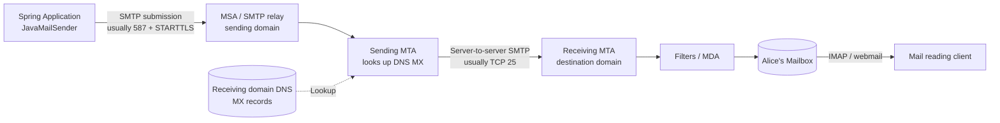

# Mail Transfer Agent (MTA): Routing Mail Between Domains

When a Spring application sends an email to an address in another domain, the message usually does not travel straight from the application to the recipient's mailbox. It passes through one or more **Mail Transfer Agents (MTAs)**, which are servers responsible for receiving mail via SMTP, determining where to forward it, queuing it when necessary, and handing it off to the next server. This lesson focuses on how MTAs **route email between domains** and clarifies Spring Framework Mail's share of responsibility in that chain.

Suppose `notification@shop.example` sends a notification to `alice@company.example`. The Spring application may hand the message to a provider's SMTP server. Then, the outbound MTA looks up DNS information for `company.example`, connects to the receiving MTA for that domain, and transfers the message using SMTP. `JavaMailSender.send(...)` returning successfully only tells you that the SMTP server the application connected to accepted the send request at that moment; it **does not guarantee** that the recipient received or read the email.

## 1. Where Does the MTA Sit in Email Architecture?

To understand the path of an email accurately, distinguish these roles:

| Component | Primary Responsibility | Example |
| --- | --- | --- |
| **MUA (Mail User Agent)** | Composes, sends, or reads mail on the user/application side | Email client, Spring application generating notifications |
| **MSA (Mail Submission Agent)** | Accepts mail submitted by users/applications, typically authenticates and applies sending policies | Provider's SMTP submission service |
| **MTA (Mail Transfer Agent)** | Relays mail from one server to another, determines the next hop, and manages queues | Postfix, Exim, Sendmail |
| **MDA (Mail Delivery Agent)** | Places arrived mail into the recipient's mailbox or mail store | Local delivery component of the mail system |
| **Mail store / mailbox** | Stores emails for recipient access | User mailbox |
| **IMAP/POP3 server** | Allows applications to read stored mail | IMAP/POP3 service |

These roles may be deployed on the same server or as separate services. A large email system also has anti-spam gateways, virus scanners, content filters, and multiple internal relay layers.



**Key point:** Spring Framework Mail provides an API to send emails over SMTP; finding a domain's receiving MTA, choosing the next hop, and managing queues are normally handled by the SMTP relay/MTA. Spring does not automatically turn into an MTA just because an application can send email.

### How Does Submission Differ from Inter-MTA Relay?

- **Submission:** the application sends to a configured SMTP server; commonly port **587** with STARTTLS and SMTP AUTH. Port **465** uses TLS from the start of the connection (implicit TLS) when supported by the service.
- **Relay between MTAs:** the sending MTA connects to the MTA advertised for the recipient's domain; commonly uses port **25**. Verification typically relies on server policies and domain authentication systems, not default login credentials like submission.
- **Mailbox access:** IMAP/POP3 or webmail serves reading mail; they are not responsible for MTA routing of mail to other domains.

## 2. Routing Is Based on the SMTP Envelope, Not Solely Headers

An email has **two layers of addresses** to keep separate:

1. **SMTP envelope:** the sender address in the `MAIL FROM` command (reverse-path) and the recipient list in `RCPT TO` commands. This is the data the MTA uses to transfer mail and handle delivery errors.
2. **Message headers:** fields like `From:`, `To:`, `Cc:`, `Subject:`, `Date:`… are the message content displayed by mail clients. They do not replace the `RCPT TO` list.

Example:

```text
SMTP envelope:
  MAIL FROM:<bounces@shop.example>
  RCPT TO:<alice@company.example>
  RCPT TO:<audit@shop.example>

Message headers:
  From: "Shop" <notification@shop.example>
  To: Alice <alice@company.example>
  Subject: Your order is ready
```

The MTA must process two recipients according to the **envelope**, even though the `To:` header only shows Alice. Therefore, messages sent via **Bcc** are still routed to the Bcc recipient when that address is present in `RCPT TO`; the Bcc address usually does not appear in the headers of the delivered copy. Conversely, editing the `To:` text in a string does not mean you have added an SMTP recipient.

The `MAIL FROM` address can also differ from `From:`: bulk sending services often place a bounce-handling address in the envelope sender. The final delivery server may add a `Return-Path:` header reflecting the envelope sender. Do not confuse `Reply-To:` (where users reply) with the bounce-receiving address.

## 3. How Does an MTA Find the Receiving Mail Server Using DNS MX?

The part after the `@` sign in a recipient's envelope address identifies the **destination domain**. For `alice@company.example`, the destination domain is `company.example`. The sending MTA needs to query DNS to find where mail for that domain is received.

Suppose the destination domain publishes:

```dns
company.example.  IN MX 10 mx-primary.company.example.
company.example.  IN MX 20 mx-backup.company.example.

mx-primary.company.example. IN A 192.0.2.10
mx-backup.company.example.  IN A 192.0.2.20
```

These are illustrative domain names and IP addresses, not real services to connect to.

Each MX record provides:

- **Preference**: a priority number; **lower numbers are preferred first** (10 before 20).
- **Exchange**: the mail-receiving hostname. The MTA then resolves this hostname to an IP address via A or AAAA records.

MTAs typically try the route with the better preference first; if that route cannot be reached or used, they may try another MX route according to policy and delivery state. Multiple MX records with the same preference allow load distribution; the display order of DNS results should not be treated as a mandatory order. A backup MX does not mean messages are duplicated to both servers.

### Conceptual Routing Flow

```text
for each recipient domain in the SMTP envelope:
    if domain is handled locally:
        route according to local mail policy
    else:
        lookup MX records for domain
        if domain explicitly publishes Null MX:
            treat the domain as not accepting email
        else if MX records exist:
            select reachable MX hosts by preference and policy
            resolve their A/AAAA addresses
        else if domain exists and has address records:
            apply SMTP implicit-MX fallback to domain's A/AAAA
        else:
            fail or defer according to DNS result and retry policy

        establish SMTP connection to next hop
        attempt recipient and message transfer
        record success, permanent failure, or retryable failure
```

That is an explanatory model; real-world algorithms are also affected by DNS caches, IPv4/IPv6, connection limits, IPv6 preference, message size limits, TLS policies, relay configurations, and loop-prevention rules.

### DNS Cases to Remember

| DNS Status | Interpretation and Handling |
| --- | --- |
| One or more valid MX records exist | Look up MX hosts and try according to preference/MTA policy |
| No MX, but domain exists and has A/AAAA | Traditional SMTP rules allow treating the domain itself as an implicit MX target |
| MX has value `0 .` (**Null MX**) | The domain declares it **does not accept email**; do not fall back to A/AAAA to attempt delivery |
| Domain does not exist (NXDOMAIN) | No valid destination; typically leads to permanent delivery failure after DNS resolution is confirmed |
| Temporary DNS error (e.g., timeout/SERVFAIL) | May defer and retry; does not mean the recipient address does not exist |
| MX points to a hostname without usable IP addresses | Cannot connect via that route; may try another MX or defer |

**Two common misconceptions:** MX records indicate where a domain **receives** mail, not a list of email accounts; and the sending domain's MX records do not dictate which SMTP relay a Spring application submits to. The first relay is whatever the application configures via `spring.mail.host` (or `JavaMailSenderImpl.setHost(...)`).

## 4. SMTP Transfers Mail Between Two MTAs

Once it has the target server's address, the sending MTA establishes an SMTP session. The condensed example below shows the basic behavior; each `C:` line is the sender, and `S:` is the receiver:

```smtp
S: 220 mx-primary.company.example ESMTP ready
C: EHLO relay.shop.example
S: 250-mx-primary.company.example
S: 250-STARTTLS
S: 250 SIZE 52428800
C: STARTTLS
S: 220 Ready to start TLS

[TLS handshake complete; resume SMTP exchange inside TLS]

C: EHLO relay.shop.example
S: 250 mx-primary.company.example
C: MAIL FROM:<bounces@shop.example>
S: 250 2.1.0 Sender OK
C: RCPT TO:<alice@company.example>
S: 250 2.1.5 Recipient OK
C: DATA
S: 354 End data with <CRLF>.<CRLF>
C: From: Shop <notification@shop.example>
C: To: Alice <alice@company.example>
C: Subject: Your order is ready
C:
C: Hello Alice, your order is ready.
C: .
S: 250 2.0.0 Message queued for delivery
C: QUIT
S: 221 2.0.0 Bye
```

Note: in real SMTP, a message is a sequence of octets with CRLF line endings; a line containing only a dot terminates the `DATA` block. If a data line naturally begins with a dot, SMTP uses **dot-stuffing** so it is not confused with the terminator. The illustration omits many extensions and header fields for readability.

Significant milestones:

1. **`EHLO`:** the sender introduces itself and receives the list of SMTP capabilities (ESMTP extensions) advertised by the receiver.
2. **`STARTTLS` (if supported/required by policy):** upgrades the connection to TLS; after establishing TLS, the sender sends `EHLO` again because session capabilities may change.
3. **`MAIL FROM`:** opens a mail transfer transaction and specifies the bounce notification address.
4. **`RCPT TO`:** declares each envelope recipient. The server can accept one recipient and reject another.
5. **`DATA`:** transmits headers and body. A `250` response after `DATA` means the receiving server has accepted responsibility for further processing at the SMTP level.
6. **`QUIT`:** closes the SMTP session cleanly.

As a message passes through multiple MTAs, each receiving/relaying MTA typically prepends a `Received:` header. Reading the `Received:` chain from bottom to top helps visualize the path across hops, though headers from untrusted hops can be forged; prioritize logs and traces from systems you manage.

## 5. Queues, Retries, Bounces, and SMTP Code Meanings

Cross-domain mail delivery is not always instantaneous. MTAs maintain a **mail queue** to store messages when the destination is temporarily unavailable. That is why an SMTP connection failure on the first attempt can still lead to successful delivery later.

| Response Group | Meaning | Typical Behavior |
| --- | --- | --- |
| `2xx` (e.g., `250`) | SMTP operation accepted | Continue session or confirm next server has accepted responsibility |
| `3xx` (e.g., `354`) | More data required | Transmit content according to protocol state |
| `4xx` (e.g., `421`, `450`, `451`) | Temporary error | Keep in queue and retry per MTA schedule/limits |
| `5xx` (e.g., `550`, `554`) | Permanent error for the current operation | Stop sending to the rejected recipient/route and report failure per policy |

For example: `company.example`'s MTA returns `451 Temporary local problem`. The sending relay can hold the message and try again after a few minutes or using backoff. Conversely, `550 User unknown` usually indicates the recipient is permanently rejected; repeatedly retrying the same address will not solve the problem.

When retries are exhausted or a permanent error occurs, the system may generate a **Delivery Status Notification (DSN)**, commonly called a *bounce*, sent to the envelope sender. Automated DSNs should use an empty reverse-path `MAIL FROM:<>` to reduce the risk of bounce loops. Not every rejected message generates a bounce: some errors are reported directly during submission; some messages are filtered/dropped by policy; sending bounces to forged addresses also risks creating *backscatter*.

Distinguish these states:

```text
Spring app calls JavaMailSender.send()
         |
         v
SMTP relay accepts message           = submitted / accepted by relay
         |
         v
MTA transfers to receiving domain    = accepted by destination SMTP hop
         |
         v
MDA delivers to mailbox              = delivered to mailbox
         |
         v
User opens message                   = read/opened (cannot be inferred from SMTP)
```

A `250` response from the first relay does not prove the message reached the mailbox. Even a `250` response from the destination MTA can precede scanning, moderation, and internal delivery steps.

### Scenarios Affecting Routing

- **Greylisting:** the receiving server temporarily rejects the first attempt with `4xx`; a legitimate sending MTA will retry later.
- **Multiple recipients:** a single message can be split into multiple transactions/routes by domain; delivery status per recipient may differ.
- **Forwarding:** the receiving domain may forward mail to another domain; additional hops occur, and forwarding loops can be detected via hop limits and headers.
- **Alias / mailing list:** a destination can expand into multiple internal or external addresses; the outcome for one address does not represent all of them.
- **Size limits or content policies:** an MTA may reject a message before/after `DATA`, or accept it and then handle it according to system filters.

## 6. Reliability, Authentication, and Security During Mail Transfer

MTAs do not merely find routes. Receiving servers also decide whether to trust the sending stream. The mechanisms below solve **different problems**:

| Mechanism | What Question Does It Answer? | Important Limitation |
| --- | --- | --- |
| **SMTP AUTH** | Is the application permitted to send through this submission server? | Primarily used for submission; not proof that every email across the Internet is trustworthy |
| **SPF** | Is the sending IP authorized by the domain used in the envelope sender/HELO? | Forwarding can break SPF; does not sign message content |
| **DKIM** | Can the digital signature on headers/body be verified against the DNS public key? | A valid signature does not guarantee harmless content |
| **DMARC** | Do SPF/DKIM pass *alignment* with the domain in the displayed `From:`, and what policy should apply on failure? | Depends on the receiving side checking and enforcing policy |
| **STARTTLS** | Can this SMTP hop connection be encrypted with TLS? | Hop-by-hop TLS does not encrypt email end-to-end |
| **MTA-STS / DANE** | Is there a policy or binding proof requiring TLS when transferring mail to the destination domain? | Requires corresponding infrastructure and configuration on sender/receiver sides |

MTA-STS publishes a TLS policy for MX hosts and uses policy-based certificate validation; DANE for SMTP relies on TLSA records protected by DNSSEC. On standard SMTP paths, STARTTLS may operate *opportunistically*: both sides use TLS if available, though it may not be mandatory on every route. Actual protection depends on sending policy, certificates, and destination domain support.

An important operational principle is **do not turn an MTA into an open relay**. If a server allows any source to relay mail to any domain without appropriate policy, it is easily abused for spam distribution. Submission servers must enforce sending permissions, rate limits, and credential protection. Public MX servers must accept mail for the domains they manage without freely relaying to arbitrary external domains.

Beyond MX records, administrators typically pay attention to PTR/reverse DNS, IP reputation, valid HELO/EHLO, sending rate limits, anti-spam policies, and consistency among `From:`, DKIM, SPF, and DMARC. These govern **deliverability and acceptance**, rather than replacing MX target selection.

## 7. How Does Spring Framework Mail Relate to an MTA?

In Spring applications, the common API is `JavaMailSender` from `spring-context-support` (along with Jakarta Mail). With Spring Boot, the `spring-boot-starter-mail` dependency and `spring.mail.*` properties help create and configure the sender when auto-configuration conditions are met.

### Configuring the Application's SMTP Relay

Gradle example for a Spring Boot application:

```groovy
dependencies {
    implementation 'org.springframework.boot:spring-boot-starter-mail'
}
```

```yaml
# application.yml
spring:
  mail:
    host: smtp.provider.example
    port: 587
    username: ${SMTP_USERNAME}
    password: ${SMTP_PASSWORD}
    properties:
      mail:
        smtp:
          auth: true
          starttls:
            enable: true
            required: true
          connectiontimeout: 5000
          timeout: 5000
          writetimeout: 5000

app:
  mail:
    from: notification@shop.example
```

This is a **submission configuration to an SMTP relay**. Do not set `host` to `company.example`'s MX record just because the recipient is in that domain; many providers do not allow applications to connect directly to arbitrary MX servers, and port 25 may be blocked. Secrets `SMTP_USERNAME`/`SMTP_PASSWORD` must come from environment variables or a secret store; never commit real values into source code.

### Building an Email and Handing It to the Relay

```java
import org.springframework.beans.factory.annotation.Value;
import org.springframework.mail.SimpleMailMessage;
import org.springframework.mail.javamail.JavaMailSender;
import org.springframework.stereotype.Service;

@Service
public class OrderNotificationMailService {

    private final JavaMailSender mailSender;
    private final String fromAddress;

    public OrderNotificationMailService(
            JavaMailSender mailSender,
            @Value("${app.mail.from}") String fromAddress) {
        this.mailSender = mailSender;
        this.fromAddress = fromAddress;
    }

    public void sendOrderReady(String recipient, String orderId) {
        SimpleMailMessage message = new SimpleMailMessage();
        message.setFrom(fromAddress);
        message.setTo(recipient);
        message.setSubject("Order " + orderId + " is ready");
        message.setText("Your order " + orderId + " is ready for pickup.");
        mailSender.send(message);
    }
}
```

Calling `sendOrderReady("alice@company.example", "ORD-123")` executes the following sequence:

1. Spring/Jakarta Mail constructs the message and connects to `smtp.provider.example:587` as configured.
2. The application authenticates with the submission server and transfers the message over SMTP.
3. The relay processes the envelope address `alice@company.example` and selects the next hop based on routing policy and/or DNS MX.
4. The destination domain's MTA accepts or rejects the message; if needed, the sending MTA queues and retries.
5. The receiving mailbox is updated only after the receiving system completes its delivery steps.

`SimpleMailMessage` suits simple plain-text messages. For HTML, attachments, or multipart, applications use `MimeMessage`/`MimeMessageHelper`; **MTA routing mechanics still rely on the SMTP envelope**, unchanged by whether the body is HTML or has attachments.

If using **plain Spring Framework** without Spring Boot auto-configuration, you must declare and configure a `JavaMailSenderImpl` bean yourself (host, port, credentials, TLS, timeouts) instead of assuming `spring.mail.*` takes effect automatically.

### Resilience of the Application's Sending Flow

When sending business-critical emails (such as order confirmations), distinguish:

- **Submission errors:** `JavaMailSender` may throw `MailException`; the application records it and decides to retry or report failure. Do not return a fake HTTP success if the business flow requires successful submission.
- **Errors after the relay accepts:** do not necessarily flow back through the `send()` call; monitor bounces/DSNs, events, or provider webhooks if final delivery status is required.
- **Sending within business transactions:** you can use an outbox/queue and a mail-sending worker to avoid depending on SMTP networking inside the main request. Design retries carefully because a timeout occurring after the relay already received the message can still cause duplicate sends.
- **Observability:** store business ID, recipient domain, submission timestamp, received SMTP error code, and message/provider ID if available; avoid logging passwords or full sensitive email contents.

## 8. Tracking and Diagnosing an Email Stuck Between Domains

When users say "Spring sent it successfully, but I don't see the email," do not look only at controller logs. You must identify the **exact last hop confirmed to have received the message**.

| Symptom | Possibilities to Check | Evidence to Look For |
| --- | --- | --- |
| Spring reports a connection error to SMTP host | Wrong host/port, DNS, firewall, TLS, or timeout | `JavaMailSender` exception, connection logs, submission config |
| Spring reports authentication failure | Wrong credentials or SMTP AUTH policy | `535` code/server response, account permissions, TLS settings |
| Relay accepted message, but it has not reached destination domain | DNS MX error, destination MTA unreachable, `4xx` deferral, queue still retrying | Mail queue, relay logs, DNS MX, and next-hop SMTP codes |
| Destination MTA returned `550` | Mailbox does not exist or permanent policy rejection | Per-recipient response, DSN/bounce, receiving server policy |
| Destination MTA accepted it, but user doesn't see it | Spam/quarantine, alias, filter rule, internal delivery delay | Gateway/MDA logs, mailbox, spam folder, provider status |
| Fails only for certain domains | Routing/TLS/reputation/policy issue specific to those domains | Compare MX, SMTP codes, TLS handshakes, and per-domain logs |

A few commands to inspect DNS routing (run in an environment with the corresponding tools):

```powershell
# Windows PowerShell: view MX records of the receiving domain
Resolve-DnsName -Name company.example -Type MX

# From an OS with nslookup
nslookup -type=mx company.example
```

If you have MTA operational access, administrators can inspect SMTP logs and the mail queue (e.g., `postqueue -p` on Postfix); log/command formats depend on the software. For inter-server TLS, you can test directly with appropriate SMTP/TLS tools and compare the destination domain's TLS policy. Failing to connect to TCP 25 from a developer machine **is not enough** to conclude MX is broken: ISPs or cloud networks often block outbound port 25.

### Investigation Procedure for a Specific Message

1. Confirm which domain the recipient address belongs to, the send time, and the request/business ID.
2. Check which relay the application sent to and what response/exception it received.
3. Locate the message in the relay's logs/provider dashboard by queue ID or message ID; check deferred, bounced, or sent status.
4. If deferred, inspect the `4xx` code, DNS MX, the MX address attempted, and the most recent retry.
5. If the relay reports handoff to the destination MTA, check destination gateway info/DSN/spam/quarantine instead of repeatedly resending from Spring.

## 9. Example: Reasoning Through a Message's Path

Suppose:

```text
Envelope sender: bounces@shop.example
Envelope recipient: alice@company.example
Spring SMTP relay: smtp.provider.example:587
MX company.example:
    10 mx-a.company.example
    20 mx-b.company.example
```

**Scenario A — `mx-a` is available.** The application submits the message to `smtp.provider.example`; the relay MTA looks up MX and tries `mx-a` first. When `mx-a` accepts `DATA` with `250`, the relay can mark it handed off to that hop; onward delivery belongs to `company.example`'s system.

**Scenario B — `mx-a` is unreachable.** The relay may try `mx-b` per policy, or defer and retry. Having MX preference 20 provides a backup target, does not guarantee immediate delivery, and does not mean sending two copies in parallel.

**Scenario C — server returns `451`.** This is a temporary failure: the message may remain in the relay's queue and be retried. Spring does not need to look up MX itself to choose `mx-b`, nor should it immediately resend whenever a user does not see the message yet.

**Scenario D — `company.example` publishes Null MX.** The domain declares it does not accept mail. The MTA does not fall back to the website's A record to attempt SMTP; the sender should be informed that the destination does not accept mail.

**Scenario E — two recipients in two domains.** One mail-sending call can create a message with two envelope recipients; the MTA still must determine routes per domain. `alice@company.example` may be accepted while `bob@partner.example` is deferred/bounced.

## 10. Knowledge Check Questions

1. **Why can an email still bounce even after Spring called `send()` successfully?** Because the first relay accepted the message, while later hops determine delivery to the destination domain; late failures do not necessarily appear in Spring's call stack.
2. **If the recipient is `alice@company.example`, should the application set `spring.mail.host=mx-a.company.example`?** Usually no. Applications use the SMTP submission server specified by the sending service; the relay/MTA is responsible for selecting the destination domain's MX.
3. **Do `MX 10` and `MX 20` mean sending two copies of the email?** No. Preference sets route priority order; failover/retry behavior depends on the MTA.
4. **Why might modifying `To:` not change the actual recipient?** Because MTAs route by `RCPT TO` in the envelope, not solely by display headers.
5. **Does STARTTLS guarantee content is encrypted from the application to the reader?** No. TLS protects each connection where used; intermediate MTAs may process messages in plaintext, and each hop has its own policies.

### Key Takeaway

In Spring Framework Mail architecture, **the application builds messages and submits them via SMTP**, while **MTAs route between domains using envelope recipients, DNS MX, and relay policies**. Queues, SMTP codes, DSNs, and filters across hops determine the final outcome. To diagnose an email accurately, trace it from `JavaMailSender` to the SMTP relay, through the receiving MTA, and finally to the mailbox rather than equating "submitted" with "successfully delivered."
