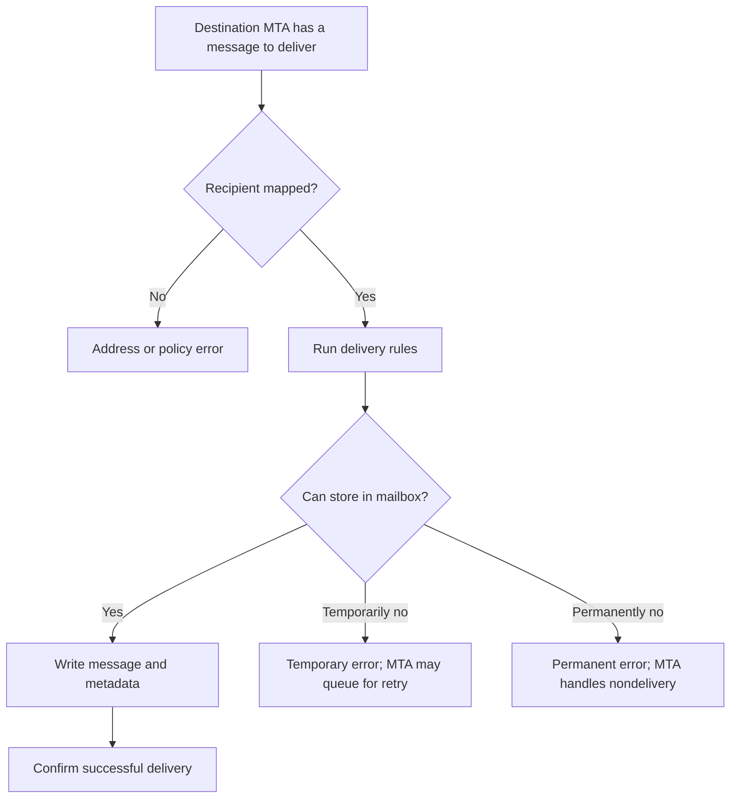

# Mail Delivery Agent Delivers Mail into the Mailbox

## 1. Where Does the Mail Delivery Agent Sit in Email Architecture?

In an email system, the **Mail Delivery Agent (MDA)** is the component that performs the **final delivery step**: taking an email already accepted by the mail transfer system and placing it into the recipient's **mailbox**, or handing it off to an internal storage/distribution destination according to server policy. The MDA usually operates on the destination server side; it is not the component users use to compose or read email.

A common flow:

```text
Sender
   |
   v
Mail User Agent (MUA) -- SMTP submission --> Mail Submission Agent (MSA)
                                               |
                                               v
                                      Mail Transfer Agent (MTA)
                                               |
                                    Inter-server SMTP
                                               |
                                               v
                                      Recipient's MTA
                                               |
                                     local delivery / LMTP
                                               |
                                               v
                                      Mail Delivery Agent
                                               |
                                               v
                                     Mailbox / message store
                                               |
                                      IMAP or POP3
                                               |
                                               v
                                      Recipient's MUA
```

For example, a Spring Boot application sends a notification via `JavaMailSender`: the application acts as an **SMTP client** sending the message to an SMTP server. After the email is routed to the recipient domain's server, the receiving MDA decides which mailbox to place the message into. `JavaMailSender` does not interact directly with the destination domain's MDA or mailbox.

### Distinguishing Easily Confused Components

| Component | Primary Responsibility | Common Protocol/Interface |
|---|---|---|
| MUA (Mail User Agent) | Composes, sends, views, and manages user email | SMTP submission, IMAP, POP3 |
| MSA (Mail Submission Agent) | Receives outgoing email from users/apps, authenticates, and checks sending policies | SMTP submission (usually port 587) |
| MTA (Mail Transfer Agent) | Transfers and routes email between servers; queues and retries when needed | SMTP |
| MDA (Mail Delivery Agent) | Delivers received email into the recipient's mailbox or message store | Local delivery, LMTP, or internal API |
| IMAP/POP3 server | Lets MUAs access stored mail | IMAP/POP3 |

The boundary between MTA and MDA is a **boundary of responsibility**, not necessarily two separate processes. One mail server may integrate both mail transfer and local delivery; another system may use a separate MTA and communicate with a delivery service over LMTP.

## 2. What Happens When an Email Arrives at the Destination Server?

Suppose `alice@example.com` sends an email to `bob@example.net`.

1. The SMTP server on `example.net` receives the message, checks whether it can accept recipient `bob@example.net`, enforces policies at SMTP receipt time, and places the message in the appropriate queue. Some checks may occur in the MTA, a gateway, or an independent filter.
2. The server resolves the local recipient, account, or alias, while locating delivery configuration such as the mailbox path or target storage service.
3. The MTA hands the message and relevant metadata to the internal delivery component. Depending on the system, this may be an invocation of a local delivery program or an **LMTP** (Local Mail Transfer Protocol) session.
4. The MDA applies configured delivery rules: recipient mapping, forwarding/alias, Sieve filters, folder sorting, quota checks, or storage status checks. The exact order depends on the product; spam/virus filtering may have already occurred before the MDA.
5. The MDA writes the message content and metadata to the message store according to the storage system's consistency guarantees, and only then reports delivery success or failure to the caller.
6. The IMAP server reads the message store and presents the email to the MUA when Bob opens his mailbox. **Successful delivery does not mean Bob has read the message.**



The diagram describes basic responsibilities. In practice, a message with multiple recipients may succeed for one recipient and fail for another; outcomes must be tracked **per recipient address**.

## 3. What Is a Mailbox and How Does the MDA Store Messages?

A **mailbox** is a logical storage space for a user's mail. It can be implemented using files, directories, a database, or distributed storage. A mailbox is not synonymous with a single file, and the **Inbox folder in an email client** is not necessarily a filesystem directory on the server.

Traditional and specialized storage mechanisms illustrate how an MDA may persist data:

| Mechanism | How Messages Are Stored | Notable Characteristics |
|---|---|---|
| **mbox** | Multiple messages concatenated in a single mailbox file | Requires careful locking and concurrent write handling; file can grow large |
| **Maildir** | Each message is a separate file, typically using `tmp`, `new`, `cur` directories | Supports write-to-temp-and-rename, suited for concurrent delivery on filesystems meeting the format's assumptions |
| **Dedicated message store** | Content and indexes stored by a provider's service/database | Enables quota management, indexing, replication, and access across different services |

Example of a simplified Maildir structure:

```text
/var/vmail/example.net/bob/Maildir/
├── tmp/     # Temporary file location while delivering
├── new/     # Newly delivered messages, not yet moved to cur
└── cur/     # Messages tracked with status/flags
```

The MDA may write the complete content into `tmp/`, complete safe storage operations per system mechanics, and move the file to `new/` using an atomic/appropriate rename. Details around unique filenames, `fsync`, quotas, and durability depend on the implementation. One should not assume that a successful `write()` call alone guarantees the email is durably saved.

Stored message content is typically an **RFC 5322/MIME message**: headers (`From`, `To`, `Subject`, `Date`, `Message-ID`, etc.) and a body that may contain multiple parts and attachments. The MDA may store additional metadata such as receipt timestamp, unread status, destination folder, flags, or search indexes. The SMTP envelope (`MAIL FROM`, `RCPT TO`) is transport information; it can differ from the `From`/`To` headers, so the delivery system must not infer the actual recipient solely from the `To` header.

## 4. Recipient Mapping and Delivery Rules

Not every `RCPT TO:<bob@example.net>` is written straight into an Inbox named `bob`.

**Recipient mapping.** The server may use OS accounts, virtual mailboxes, LDAP, SQL, or an identity service to map an email address to an actual mailbox. With virtual mailboxes, `bob@example.net` and `bob@another-domain.test` may share the same local part yet remain isolated by domain.

**Aliases and multi-target distribution.** `support@example.net` may be an alias to multiple recipients or a shared mailbox. This rule is often handled during MTA routing/expansion or by an address service, depending on configuration; do not assume every MDA supports aliases natively.

**Mail filters.** A system may use Sieve to sort messages by sender, subject, or other criteria. Illustrative rule example:

```sieve
require ["fileinto"];

if header :contains "subject" "Invoice" {
    fileinto "Finance";
    stop;
}
```

The rule above only works when the destination server supports Sieve, the `fileinto` extension, and the `Finance` mailbox exists or is created per policy. Filter rules can move mail to another folder, forward, discard, or reject depending on system capabilities/configuration. There is no universal rule forcing every message to be delivered into `INBOX`.

## 5. How Does the MDA Report Success and Failure?

In SMTP/LMTP, response codes are the mechanism by which the sending component learns whether a handoff was accepted. LMTP resembles SMTP but is designed for local mail delivery, specifically supporting **per-recipient** result responses after the message body.

| Response Group | Operational Meaning | Typical MTA Reaction |
|---|---|---|
| `2xx` | Destination confirms responsibility for processing/delivering the message | Marks the corresponding delivery attempt as successful |
| `4xx` | Temporary error, e.g., store unavailable or transient resource exhaustion | Keeps message in queue and retries per policy |
| `5xx` | Permanent error, e.g., invalid recipient or permanent policy rejection | Stops retrying for that recipient; may generate a nondelivery notification |

**Illustrative** LMTP session example, omitting handshakes and envelope declaration steps:

```text
C: DATA
S: 354 Start mail input
C: From: Alice <alice@example.com>
C: To: Bob <bob@example.net>
C: Subject: Monthly report
C:
C: Report attached.
C: .
S: 250 2.1.5 <bob@example.net> OK
```

Actual responses depend on the server and number of recipients. With multiple RCPT addresses, LMTP returns results sequentially for each recipient after the `DATA` terminator. A `250` for one recipient should not be treated as success for all.

Some typical situations:

* **Mailbox over quota:** may be a temporary or permanent error depending on server configuration and policy.
* **Nonexistent address:** usually rejected immediately during SMTP recipient validation; if discovered late, the delivery result may report a permanent error.
* **Storage unavailable:** usually reported as a temporary error so the queue retries instead of losing the message.
* **Filter rule causes rejection:** distinguish intentional policy rejections from storage failures.

The key milestone is the **point of transfer of responsibility**. The MTA must not delete the queued copy before receiving an appropriate delivery confirmation; the MDA must not report success before ensuring storage or assuming responsibility per the message store's contract. A network failure right while exchanging the response can leave the sender uncertain whether the receiver stored it; retrying therefore risks creating duplicates. Systems need appropriate duplicate detection and handling, rather than assuming SMTP/LMTP provides end-to-end exactly-once delivery.

## 6. Mailbox Security and Operations

The MDA handles sensitive recipient data. Common requirements include:

* **Mailbox isolation:** ensure users/tenants can only write to and access their assigned mailboxes; enforce file permissions or message store access controls.
* **Authentication and authorization at the delivery boundary:** network LMTP connections should restrict source access and protect the transport according to the deployment model. Never expose internal delivery endpoints to arbitrary clients.
* **Resource limits:** monitor per-mailbox storage, message size, file/index counts, and disk utilization; distinguish user quotas from infrastructure failures.
* **Deliverability monitoring:** monitor MTA queues, `4xx`/`5xx` error rates, delivery latency, store capacity, and logs tagged with appropriate message identifiers.
* **Content protection:** encrypt in transit and at rest per policy; avoid putting bodies, auth tokens, or personal information into logs.
* **Backup and recovery:** verify restoration of content, metadata, indexes, and permissions; backing up data without a consistent recovery plan may be insufficient.

An empty SMTP queue only reflects that the transfer side has finished its corresponding work; it does not prove the user saw the email in their client. If an email "disappears", inspect the entire flow: SMTP acceptance, queue, local delivery/LMTP logs, store write results, filters, and the folder displayed by IMAP.

## 7. Relationship to Spring Framework Mail

Spring Framework provides `JavaMailSender` to **construct and send** emails from a Java application through SMTP infrastructure. Spring Mail does not become an MTA/MDA just because the application calls `send()`.

Example of sending a plain-text notification:

```java
import org.springframework.mail.SimpleMailMessage;
import org.springframework.mail.javamail.JavaMailSender;
import org.springframework.stereotype.Service;

@Service
public class NotificationMailService {
    private final JavaMailSender mailSender;

    public NotificationMailService(JavaMailSender mailSender) {
        this.mailSender = mailSender;
    }

    public void sendStatus(String recipient) {
        SimpleMailMessage message = new SimpleMailMessage();
        message.setFrom("notifications@example.com");
        message.setTo(recipient);
        message.setSubject("Status update");
        message.setText("Your request has been recorded.");
        mailSender.send(message);
    }
}
```

With a valid SMTP configuration, `send()` succeeding usually means the SMTP server **accepted the message for processing** from the application at the send step. It **does not guarantee** that the final MDA wrote it to the mailbox, that the message appeared in the Inbox, or that the recipient opened it. Delivery happens afterward; the SMTP server may send a failure notification (bounce/DSN) to the envelope sender address if configured and able to do so.

Example outcome chain:

```text
Spring app: JavaMailSender.send() succeeds
       -> SMTP submission server accepted the message
       -> MTA transfers to destination MX
       -> MDA writes message to mailbox
       -> IMAP server allows reading the message
       -> User sees/interacts with the message
```

Each step can fail or be delayed independently. If a business requirement is "the user has read it," the application must use a suitable confirmation mechanism; read receipts or tracking pixels also have limitations and are not absolute proof of reading. In application design, distinguish at least the states **send request created**, **accepted by SMTP**, **delivery info received**, and **recipient interaction signal received** when data sources allow.

## 8. Troubleshooting Example: Sent, Yet Missing from the Inbox

Suppose Spring Boot logs `Mail sent`, yet Bob cannot find the email. How to analyze across each boundary:

1. **Application → SMTP submission:** check which server received the message, the timestamp, and any available message identifier. Success here does not tell you the final delivery result.
2. **MTA → destination domain:** inspect transfer queues/logs to see which MX handled it, and whether there were retries, timeouts, rejections, or bounces.
3. **Destination MTA → MDA:** check alias/virtual recipient mapping and local delivery or LMTP response codes per recipient.
4. **MDA → message store:** check quotas, write permissions, disk space, storage logs, Sieve filters, destination folder, and spam quarantine status.
5. **Message store → MUA:** inspect the mailbox via IMAP, folders other than Inbox, client-side filters, offline sync, and how the client groups conversations.

A `250` response at SMTP submission does not replace MDA logs. Conversely, if the MDA confirms storage succeeded but the client does not show it, check mailbox access and MUA synchronization rather than repeatedly resending and causing duplicate emails.

## 9. Architecture Takeaways

**MTAs transfer mail to whoever is responsible for receiving it; the MDA performs delivery into the mailbox/message store; the IMAP/POP3 server lets recipients access stored mail.** In Spring Framework Mail, the application typically participates only in the step of sending to SMTP. Explaining the status "email reached the mailbox" requires data from the delivery infrastructure/provider, not merely a successful call to `JavaMailSender.send()`.
