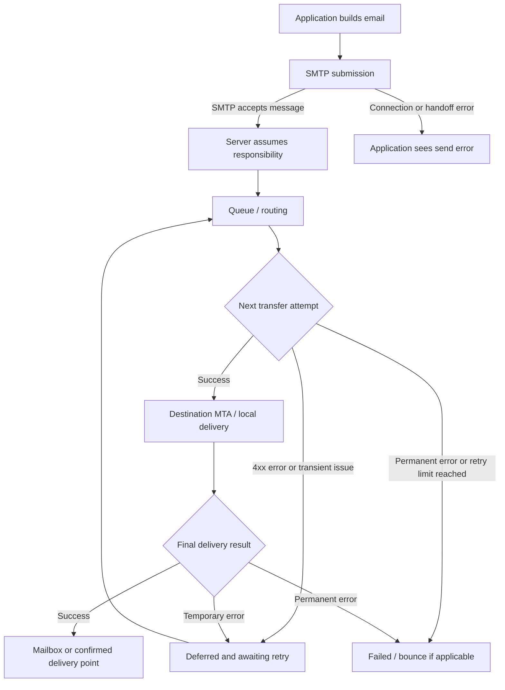
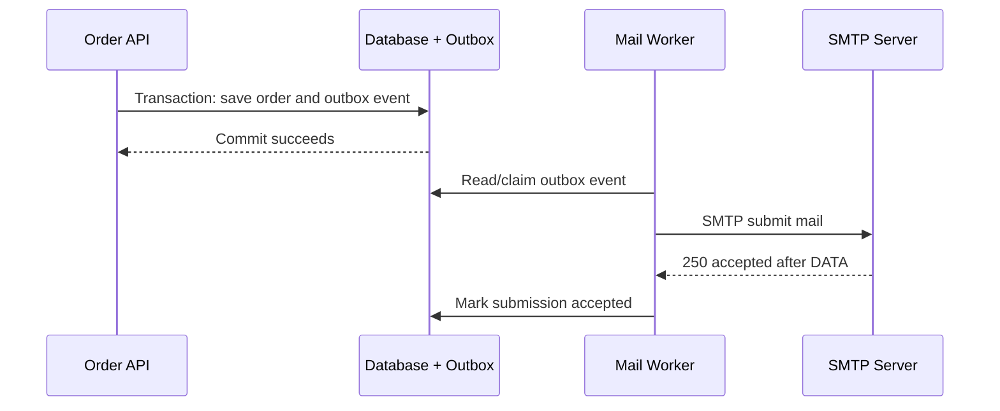

# Server-Side Mail Queues and When a Message Is Considered "Sent"

## 1. Why Does Email Need Queues?

Email is designed around a **store-and-forward** model: a server can **accept responsibility** for a message, store it in a **mail queue**, and only then attempt to transfer it to the destination server or mailbox. Sender and recipient do not have to be online at the same time. Network links can drop, receiving servers can be busy, DNS can hiccup, or mailboxes can be temporarily unavailable. Queues let systems retain work and **retry** according to policy instead of failing immediately whenever a destination is temporarily unreachable.

In **Spring Framework Mail**, applications typically use `JavaMailSender` to connect to an SMTP server. The application calling `send()` successfully and the recipient actually receiving the email are **two events at two different layers**. To interpret the "sent" state accurately, you must identify which component accepted the message, who currently holds it in a queue, and what evidence exists for the final delivery attempt.

### Components Along an Email's Path

```text
Spring Boot Application
    |
    | JavaMailSender / SMTP submission
    v
SMTP server / Mail Submission Agent (MSA)
    |
    | Accepts message, enforces policies, may enqueue
    v
Mail Transfer Agent (MTA) / outbound queue
    |
    | DNS MX, SMTP relay, retries when needed
    v
Recipient's MTA
    |
    | Local delivery / LMTP / internal mechanism
    v
Mail Delivery Agent (MDA) / message store
    |
    v
Recipient's mailbox
    |
    | IMAP/POP3 or webmail UI
    v
Recipient's email client
```

The queue in the diagram is a **logical concept**: a place holding messages waiting for processing, retry, or routing. Depending on the system, it may be a spool file on disk, a database, a distributed message store, or an internal service. Do not assume every system has only one queue or that queues always reside on the same server.

## 2. What States Does an Email Transition Through?

Exact status names vary by SMTP server and service provider, but you can use the following model to understand the flow:

| Stage | What Has Happened? | What Is **Not** Yet Guaranteed |
|---|---|---|
| `CREATED` | The application built the message content | No SMTP connection attempt has occurred yet |
| `SUBMITTING` | The SMTP client is connecting and transmitting the message | The server may not have accepted the whole message yet |
| `ACCEPTED` | The SMTP server replied with success after receiving the full message | The destination mailbox may not have the message yet |
| `QUEUED` | A server or service is holding the message for routing/further delivery | Downstream delivery is not guaranteed to have succeeded |
| `DEFERRED` | A transfer attempt hit a temporary error; the message awaits retry | Not yet a permanent failure |
| `DELIVERED` | The tracking component received confirmation of delivery to the target **as it defines it** | Not necessarily the final Inbox or read by the user |
| `BOUNCED` / `FAILED` | The system determined it cannot deliver to a recipient and stopped retrying | Does not mean every recipient on the same message failed |

**`ACCEPTED` and `QUEUED` can be two perspectives on the same handoff**: the SMTP server accepts the message and places it in its own queue. Another provider might report `queued` right before actually trying SMTP, or maintain multiple sequential queues. Therefore, define states according to the **event source**, not merely their English labels.



The diagram depicts the journey for a single recipient. With multiple addresses, each recipient can have a different outcome after the message enters the system.

## 3. At What Moment Does the SMTP Server Confirm "Received"?

In a standard SMTP session, the client sequentially sends `MAIL FROM`, one or more `RCPT TO` commands, and then `DATA`. After the server replies `354`, the client sends headers/body and terminates with a line containing only a single dot (`.`). **The success response after the terminating dot of `DATA`** is the critical milestone showing the server has accepted **the entire message** for the recipient addresses it agreed to handle in that transaction.

Condensed conversation example, purely to illustrate the flow:

```text
C: EHLO app.example.com
S: 250-mail.example.net Hello
S: 250 SIZE 10485760
C: MAIL FROM:<notifications@example.com>
S: 250 2.1.0 OK
C: RCPT TO:<bob@example.net>
S: 250 2.1.5 OK
C: DATA
S: 354 End data with <CR><LF>.<CR><LF>
C: From: Notifications <notifications@example.com>
C: To: Bob <bob@example.net>
C: Subject: Your order
C:
C: Order confirmed.
C: .
S: 250 2.0.0 OK queued as A1B2C3
```

The `queued as A1B2C3` part is an **example** of a queue identifier an SMTP server might return; it is neither a required field nor uniform syntax across providers. A real session may include `STARTTLS`, SMTP authentication, MIME encoding, and other extensions.

Interpret the milestones accurately:

* `250` after `MAIL FROM`: accepts the envelope sender address for the current transaction; does **not** confirm email receipt.
* `250` after `RCPT TO`: accepts a recipient during declaration; does **not** confirm receipt of the body.
* `354` after `DATA`: permits the client to begin transmitting content; is **not** a delivery result.
* `250` after the terminating dot of `DATA`: the server has accepted the message and assumed responsibility for processing/forwarding under the SMTP contract.

Under the SMTP model, a server returns a success confirmation once it can assume responsibility for the message; from that point onward, downstream delivery errors are the accepting infrastructure's responsibility, typically handled via retries or nondelivery notices. This **does not mean** the server has already completed relaying to the destination MX or writing to the Inbox.

### What If the Connection Drops Right Before the Client Receives `250`?

This is a crucial case in retry design. The server may have received and stored the message while the success reply was lost in transit. The client observes an error or timeout and **cannot know for sure** whether the message was accepted. If it immediately resends, the recipient may receive **two copies**. Hence, client-side error results must sometimes be recorded as **`UNKNOWN` or `SUBMISSION_UNCERTAIN`**, not necessarily "definitely not sent."

## 4. How Do Queues Work on the Server?

After acceptance, the MTA or mail service maintains a work record for one or more recipients. A queue record typically holds transfer data such as message content, envelope sender, envelope recipients, acceptance timestamp, attempt count, latest error, and next retry eligibility time. Field names and storage formats vary by product.

```text
Queue record (illustrative)
  queueId:          A1B2C3
  envelopeFrom:     notifications@example.com
  recipients:       bob@example.net, team@example.org
  acceptedAt:       2026-11-12T08:00:00Z
  attemptCount:     2
  nextAttemptAt:    2026-11-12T08:15:00Z
  lastResponse:     451 4.4.1 connection timed out
  state:            DEFERRED
```

**This is an illustrative data model**, not a standard SMTP queue file format. Systems may store a single shared record and track per-recipient state, or split into independent jobs.

Processing typically includes:

1. **Accept and persist:** receive the message from a client or another MTA, validate conditions, and persist responsibility for processing.
2. **Route:** determine the relay or destination domain, query DNS MX when needed, and apply routing rules and security policies.
3. **Attempt transfer:** open an SMTP/LMTP session or use an internal protocol to hand off the message to the next target.
4. **Record outcome:** update per-recipient state, error details, and next attempt time; if a target accepted it, no retry is needed for that recipient unless the transaction ended in an uncertain state.
5. **Finalize:** remove successfully delivered jobs, or handle terminal failures according to nondelivery notice policies, retry expiration, and loop prevention.

A useful mail queue is more than a waiting list. It is also a mechanism for **fault tolerance**, **rate limiting**, **load smoothing**, **backoff control**, and **observing system health**. A queue growing rapidly and continuously is usually a signal of infrastructure congestion or unsuitable sending policies.

## 5. Retries: Temporary Failures Differ from Permanent Failures

SMTP uses three-digit response codes; the first digit distinguishes success, temporary failure, and permanent failure. The specific reply text and enhanced status codes provide finer-grained causes.

| Response | General Meaning | Typical Reaction |
|---|---|---|
| `2xx` | Success at the **current SMTP step** | Proceed to next step or complete corresponding work |
| `4xx` | Temporary failure | Retain in queue, delay, and retry if within policy limits |
| `5xx` | Permanent failure in the reply's context | Stop retrying per policy for the rejected portion |

Examples:

```text
421 4.3.2 Service not available       # Temporarily not accepting connections
450 4.2.0 Mailbox temporarily busy      # Mailbox temporarily unable to receive
451 4.4.1 Temporary local error         # Temporary processing error
550 5.1.1 User unknown                  # Recipient does not exist
552 5.2.2 Mailbox full                  # May be treated as a permanent error
```

The codes and explanations above are common situations only; actual causes depend on the server. The same "mailbox full" condition can yield `4xx` or `5xx` depending on policy.

**Backoff** is spacing out the intervals between retry attempts. Illustrative schedule:

```text
08:00  Attempt 1: 451 temporary failure
08:05  Attempt 2: 451 temporary failure
08:20  Attempt 3: 451 temporary failure
09:20  Attempt 4: 250 accepted by next server
```

The actual retry schedule is determined by the MTA or provider. There is no single retry interval, attempt count, or queue retention window universal to all servers. Once limits are exceeded, the system may **give up and generate an appropriate DSN/bounce**, or report a failure status via API/webhook.

**Note on error notices:** generating a nondelivery email may be impossible if the envelope sender is empty (`MAIL FROM:<>`) or if sending a notice would cause a loop. Anti-spam systems may also suppress bounces depending on policy. Thus, "no bounce received" is not enough to assert the message reached the mailbox.

## 6. Multiple Recipients: Success Can Be Partial

A single message can have multiple `RCPT TO` commands:

```text
MAIL FROM:<notifications@example.com>
RCPT TO:<alice@example.net>
RCPT TO:<bob@example.net>
RCPT TO:<carol@example.org>
DATA
...
.
```

The submission server can accept some recipients and reject others before receiving `DATA`. After accepting a message, targets are routed separately: Alice succeeded, Bob is awaiting retry due to `4xx`, and Carol was permanently rejected. A blanket statement that "the whole email was sent successfully" discards essential information.

| Recipient | Status at a Point in Time | Interpretation |
|---|---|---|
| `alice@example.net` | `DELIVERED_TO_DESTINATION` | Tracked destination confirmed responsibility/delivery |
| `bob@example.net` | `DEFERRED` | Waiting for the next attempt |
| `carol@example.org` | `BOUNCED` | Delivery stopped for this address |

State should be tracked by **message + recipient + processing stage**. The header `Message-ID` helps correlate across logs, but it is supplied by the message creator, is not guaranteed globally unique, and does not replace infrastructure queue IDs or event IDs. A single email can have **multiple queue IDs** as it traverses different MTAs.

## 7. How Many Meanings Does "Sent" Have in Real Systems?

When building mail-sending APIs or UIs, name states according to the level of evidence:

| Assertion | Typical Evidence | Can You Say the Recipient Received It? |
|---|---|---|
| **Send request created** | Application saved request or outbox record successfully | No |
| **Enqueued in app job queue** | Broker/DB/outbox accepted the job | No; worker might not even have run yet |
| **Accepted by SMTP** | SMTP submission returned success after `DATA`; `JavaMailSender.send()` succeeded in that flow | No |
| **Provider processing** | Provider reports `queued`, `processed`, or `sent` per its own definition | Cannot conclude without reading event definitions |
| **Destination server accepted** | MTA received a successful SMTP reply from the destination hop | Confirmed at that hop; not guaranteed to be in Inbox |
| **Delivered to mailbox** | MDA logs, LMTP, or a provider event explicitly defined as mailbox storage | Strong delivery evidence; does not prove it was read |
| **Read** | Signal from client/recipient, if available | Not an SMTP milestone; read signals may be missing or unreliable |

In a system where you operate both the MTA and MDA yourself, many milestones can be observed accurately. When using an external email provider, the application relies on **webhooks, event streams, DSNs, or lookup APIs** exposed by the provider. A `delivered` event from many outbound services means **the receiving server accepted the message over SMTP**, not necessarily whether the provider knows it landed in the Inbox or spam folder. State definitions must be documented clearly in product specs.

Do not use a single boolean column `sent = true` to represent every meaning. A more flexible model:

```text
mail_request
  id                # Business ID of the send request
  recipient         # Recipient address
  subject           # Subject; avoid storing sensitive content unnecessarily
  state             # PENDING, SUBMITTING, SMTP_ACCEPTED,
                    # SUBMISSION_UNKNOWN, DEFERRED, DELIVERED,
                    # FAILED ... according to observability level
  providerMessageId # ID returned by provider, if any
  lastErrorCode     # Observable error code
  lastEventAt       # Timestamp of most recent event
```

This is only a conceptual model. Real systems need event histories, reliable update timestamps, and handling for late or out-of-order events. Never infer `DELIVERED` without supporting evidence.

## 8. Connection to `JavaMailSender` in Spring Framework Mail

`JavaMailSender` is Spring's interface for sending emails via Jakarta Mail and a configured SMTP transport. `send()` completing successfully indicates the mail library reported no error at that submission step. In standard SMTP setups, this reflects **the SMTP server accepting the message**, not final delivery to the mailbox.

Example:

```java
import org.springframework.mail.MailException;
import org.springframework.mail.SimpleMailMessage;
import org.springframework.mail.javamail.JavaMailSender;
import org.springframework.stereotype.Service;

@Service
public class ReceiptMailService {
    private final JavaMailSender mailSender;

    public ReceiptMailService(JavaMailSender mailSender) {
        this.mailSender = mailSender;
    }

    public void submitReceipt(String recipient, String receiptNumber) {
        SimpleMailMessage message = new SimpleMailMessage();
        message.setFrom("receipts@example.com");
        message.setTo(recipient);
        message.setSubject("Receipt " + receiptNumber);
        message.setText("Your receipt is ready: " + receiptNumber);

        try {
            mailSender.send(message);
            // Can record SMTP_ACCEPTED (if the SMTP transport confirmed it).
            // Do not record DELIVERED or READ from this call alone.
        } catch (MailException ex) {
            // Record submission error to investigate and decide on retry.
            // For timeout/connection drop, the outcome is sometimes UNKNOWN.
            throw ex;
        }
    }
}
```

An illustrative Spring Boot configuration:

```yaml
spring:
  mail:
    host: smtp.example.com
    port: 587
    username: ${SMTP_USERNAME}
    password: ${SMTP_PASSWORD}
    properties:
      mail.smtp.auth: true
      mail.smtp.starttls.enable: true
      mail.smtp.connectiontimeout: 5000
      mail.smtp.timeout: 10000
      mail.smtp.writetimeout: 10000
```

Timeout values are **illustrative examples in milliseconds** and must be tuned per environment. Port 587 commonly uses SMTP submission with STARTTLS; the actual server must support and be configured accordingly. Having timeouts keeps workers from hanging indefinitely, yet a timeout **does not prove** the server definitely did not receive the message: it can occur right after the server finished accepting it and before the app read the reply.

### What Should an HTTP API Return When Sending Mail?

If an HTTP endpoint calls `JavaMailSender.send()` directly, returning `200 OK` usually only describes that processing finished at the **SMTP submission step**. If the endpoint only records a job for a worker to send, `202 Accepted` expresses it more accurately: **the system accepted the work; sending is still in progress**. However, HTTP codes carry meaning only per the **API contract** defined by the development team; `200` does not automatically mean "the email arrived."

Example response for a job-creation endpoint:

```http
HTTP/1.1 202 Accepted
Content-Type: application/json

{
  "requestId": "mail-7f93",
  "status": "QUEUED_FOR_SUBMISSION",
  "message": "Email send request has been accepted"
}
```

Once the worker finishes SMTP submission, the system can update to `SMTP_ACCEPTED`; with an appropriate provider webhook, it can update delivery state based on documented event semantics.

## 9. Distinguishing the Application Queue from the SMTP Server Queue

A Spring system can have **two or more queue layers**:

```text
HTTP / business event
       |
       v
Database outbox / job queue / message broker
       |     (Executed by Spring worker)
       v
JavaMailSender
       |     (SMTP submission)
       v
MSA/MTA queue
       |     (SMTP relay, routing, retry)
       v
Mailbox or next receiving server
```

The **application queue** stores *the intent to send an email*. It avoids blocking business threads, prevents job loss on app restarts, and controls send rates. The **MTA queue** stores *the message or delivery responsibility* after the SMTP server accepts it. They have different error scopes, retries, and IDs. Seeing a job leave the broker after a worker processes it is **insufficient** to conclude the email reached the mailbox. Conversely, once the SMTP server has accepted the message, continuing to retry in the application queue can create unwanted duplicates.

### Outbox for Coordinating with Business Transactions

Suppose the application needs to send an email after an order is confirmed. Calling SMTP inside the database transaction risks the email being accepted by the server while the order transaction later rolls back. The **transactional outbox** pattern records the order change and the mail-sending request in **the same database transaction**, then processes sending asynchronously after commit.



An outbox ensures the send request is recorded alongside the business transaction, yet **does not by itself guarantee exactly-once email delivery**. For instance, a worker can submit via SMTP successfully and crash before updating the outbox: upon restart, it could resend the same email. Thus you need controlled retries, uncertain-state handling, duplicate tolerance, and business-appropriate deduplication. `Message-ID` or a business ID aids tracing; they do not force every SMTP server to deduplicate.

## 10. What Should You Do When the Application or Server Errors?

| Situation | Known Data | How to Handle |
|---|---|---|
| Failed to create job/outbox | Business transaction returned an error | Retry per the business operation's contract |
| Worker cannot connect to SMTP | No evidence server received the message | Bounded retry with backoff; classify connection/auth/config errors |
| SMTP returns `4xx` before assuming responsibility | Temporary rejection in current transaction | Can retry at the layer currently holding responsibility |
| SMTP returns `5xx` | Permanent rejection by server in that context | Record failure, fix address/policy; avoid infinite retries |
| Connection lost waiting for reply after `DATA` | Unknown whether server received it | Save `SUBMISSION_UNKNOWN`, reconcile before retrying if possible |
| SMTP returns `250` after `DATA`, MTA later defers | Submission succeeded; SMTP infrastructure owns onward transfer | Monitor queue/provider; avoid auto-sending a new email just because `delivered` hasn't appeared |
| MTA returns a bounce later | Delivery failed at a hop/recipient | Link DSN/event to original request to notify or handle in business logic |
| Provider reports delivered yet recipient sees nothing in Inbox | Provider confirmed up to its observable boundary | Check spam, filter rules, aliases, mailbox, and event definitions |

When catching Spring Mail errors, note that `MailException` can encompass multiple causes such as authentication, connection errors, or failures sending one or more messages. Inspect the exception subtype and transport cause details instead of treating every `MailException` as permanent. Still, never log SMTP passwords, tokens, full messages, or attachments to investigate errors.

## 11. Observing Queues and Tracing Messages via Logs

When operating a system, monitor **queue length**, **age of the oldest message**, **wait time until next attempt**, **retry rate**, **bounce rate**, **deferred message count**, and **latency from accepted to handoff outcome**. A queue of a few thousand messages is not necessarily abnormal under expected load, yet a steadily growing queue combined with rising message age warrants investigation.

Sample trace sequence:

```text
2026-11-12T08:00:00Z app    requestId=mail-7f93 event=SUBMIT_START
2026-11-12T08:00:01Z smtp   queueId=A1B2C3 event=ACCEPTED
2026-11-12T08:00:03Z mta    queueId=A1B2C3 recipient=bob@example.net
                             event=DEFERRED response="451 4.4.1 temporary error"
2026-11-12T08:05:03Z mta    queueId=A1B2C3 recipient=bob@example.net
                             event=DELIVERED_TO_NEXT_HOP response="250 2.0.0 OK"
```

These logs illustrate structure only and do not follow a mandatory logger standard. The final event indicates **the next hop accepted it**; if that next hop is an intermediate MTA, this is not yet proof the message sits in the final mailbox.

Practical guidelines:

* **Correlate IDs:** link `requestId`, outbox/job ID, provider ID, `Message-ID`, queue ID, and recipient where possible. Do not assume the same ID travels across every system.
* **Separate events by hop:** `SMTP_ACCEPTED`, `NEXT_HOP_ACCEPTED`, and `MAILBOX_DELIVERED` are distinct assertions.
* **Preserve history:** a single final state cannot explain how many times an email retried, which servers it passed through, or when it failed.
* **Handle asynchronous events safely:** webhooks can be redelivered or arrive out of order; verify webhook origin and handle duplicate events before updating state.
* **Monitor per recipient:** for multi-recipient messages, you cannot infer full delivery from one recipient's outcome.

### Questions When Investigating "Spring Says Send Succeeded, Yet Email Is Missing"

1. When did `JavaMailSender.send()` finish successfully? What was the actual SMTP host? Is there a queue ID or provider ID?
2. Did SMTP submission confirm after `DATA`, or did the app merely enqueue a job?
3. Is the message still in the MTA queue or has it left? If deferred, what is the specific error, last attempt, and retry schedule?
4. Did the final receiving server accept the message, return a temporary error, or return a permanent error? Which recipient does that result apply to?
5. If delivered to the message store, is the message in Inbox, another folder, spam quarantine, or another alias/mailbox?
6. If the provider only reports `delivered`, does their documentation define that as SMTP hop acceptance or mailbox delivery?

Checking only application logs or only the Inbox UI misses the middle stretch. Analyzing by **confirmation milestones and responsible parties** avoids wrong conclusions.

## 12. Limits of "Sent Successfully" and Design Decisions

**There is no single universal signal guaranteeing exactly-once delivery, Inbox placement, and that the user read it.** SMTP solves transport and handoff of responsibility. Mailbox storage, spam filtering, IMAP sync, read receipts, and tracking happen at different layers with different reliability and observability.

For Spring Mail applications, an operable design should:

1. Define the **state contract** of the mail-sending API: job recorded, SMTP accepted, or infrastructure delivery confirmation.
2. Persist send requests durably if emails are business-critical, typically via an outbox or job store.
3. Track submission separately from delivery; transition states only on authoritative events.
4. Retry based on cause and responsible party, avoiding having both the application queue and MTA queue unnecessarily duplicate work.
5. Plan for retries causing duplicates, especially when responses are lost after `DATA` or workers crash before recording results.
6. Monitor queues, backlog age, and per-recipient outcomes; clearly communicate the limits of `sent`/`delivered` statuses to system users.

Example of honest UI display for users:

```text
08:00:00  Notification send request recorded.
08:00:01  Outgoing mail server accepted the message.
08:00:03  Attempting transfer to recipient domain; target temporarily unavailable.
08:05:03  Recipient's email server accepted the message.
          (No confirmation yet that the recipient opened the message.)
```

Here, **the most accurate "sent" milestone for an application calling `JavaMailSender.send()` is when the SMTP server accepts the message at submission**, with no exception thrown and transport confirmation actually received. **The "delivered" milestone requires evidence from downstream transport/delivery infrastructure.** Keeping these two milestones distinct is the foundation for designing queues, retries, error tracing, and truthful email status reporting in Spring Framework Mail.
