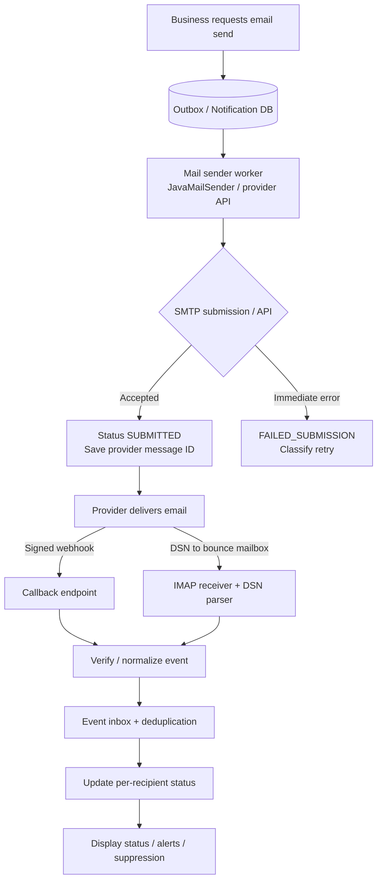

# Bounces, Delivery Status Notifications, and Asynchronous Feedback

A Spring Boot application calls `JavaMailSender.send(...)` to send an order confirmation email. The method returns normally, and the UI displays "Email sent." Ten minutes later, the recipient's email system returns a "User unknown" error. If the application relies solely on the result of `send(...)`, it will never know the email failed.

This is a classic scenario of **asynchronous feedback in the email ecosystem**. An email's path has multiple hops, each able to confirm a different level of success. **Bounces** and **Delivery Status Notifications (DSNs)** allow systems to exchange information about failed, delayed, or, in some cases, successful deliveries. For **Spring Framework Mail**, the challenge is not merely calling SMTP to send mail, but designing how to record what happens *after* the message has been accepted by an SMTP server.

## 1. At Which Hop Does "Sent Successfully" Mean Success?

Consider the processing flow of an email sent to `buyer@example.net`:

```mermaid
sequenceDiagram
    participant App as Spring Boot
    participant SMTP as SMTP submission server
    participant Relay as Mail transfer / queue
    participant MX as Receiving domain server
    participant Box as Recipient mailbox
    App->>SMTP: SMTP: MAIL FROM, RCPT TO, DATA
    SMTP-->>App: 250 Queued / Accepted
    Note over App,SMTP: App only knows the SMTP server accepted it
    SMTP->>Relay: Relay email
    Relay->>MX: Attempt delivery
    alt Receiving server accepts
        MX-->>Relay: 250 Accepted
        MX->>Box: Deliver / filter / store per policy
    else Temporary error
        MX-->>Relay: 4xx Temporary failure
        Relay->>Relay: Queue and retry
    else Permanent error
        MX-->>Relay: 5xx Permanent failure
        Relay-->>App: DSN/bounce to error address or provider event
    end
```

Outcomes that must be kept separate:

| Stage | Observable Evidence | What Cannot **Yet** Be Concluded |
|---|---|---|
| Application prepares message | Email object and send request created | No server has accepted the message yet. |
| SMTP submission accepts | `250` reply at submission hop; `send(...)` normally completes without error | Destination server may not have received it; message may not be in Inbox. |
| Receiving server accepts | SMTP `2xx` at receiving hop or provider-defined `delivered` event | User may not see it; spam, quarantine, or internal filtering may still apply. |
| Delayed | SMTP `4xx` or deferred/delayed event | Not yet a permanent failure; may still be retried. |
| Undeliverable | SMTP `5xx` or reliable `failed` bounce/DSN | Need to know which recipient failed and the specific reason. |
| User opens message | In-app interaction or open-tracking signal, if any | Open signals may be missing or skewed by proxies, image blocking, or privacy features. |

**SMTP is a store-and-forward protocol:** an intermediate server can accept forwarding responsibility and process it onward in a queue. Therefore, a `250` reply from the SMTP submission server is acceptance at one hop, **not end-to-end delivery confirmation**.

## 2. What Is a Bounce?

A **bounce** usually refers to a notice that an email could not be delivered to one or more recipients. A bounce is also called a **non-delivery report (NDR)** or returned-mail notice.

Examples:

- Destination mailbox does not exist: `550 5.1.1 User unknown`.
- Unroutable domain or address, depending on error context.
- Receiving system rejects due to anti-spam policy or authentication requirements.
- Mailbox stays full until the sending server stops retrying.
- Sending infrastructure exhausts its retry window without reaching the receiving system.

An email can fail at **two different points in time**.

### 2.1. Immediate Rejection During the SMTP Session — Synchronous Feedback

Suppose the application is sending via an SMTP server and receives:

```text
C: MAIL FROM:<bounce@example.com>
S: 250 OK
C: RCPT TO:<unknown@example.net>
S: 550 5.1.1 User unknown
```

The peer server **rejects the recipient immediately at the `RCPT TO` command**. The sender learns of the error within the same SMTP session. Depending on whether there are multiple recipients and how the library handles them, the sending API may throw an exception like `MailSendException`, containing further SMTP/Jakarta Mail error details.

This is a *synchronously* observable delivery failure; it does not necessarily generate a separate bounce email.

### 2.2. Rejection After an Intermediate Server Accepted — Asynchronous Feedback

Another flow:

```text
14:00  Application sends message to smtp.provider.example
14:00  Submission server returns 250 2.0.0 Queued
14:02  Provider attempts transfer to example.net MX
14:02  MX returns 451 4.7.1 Temporary failure
14:10  Provider retries; MX continues returning temporary errors
15:30  After retries, provider determines delivery is impossible
15:30  Provider generates DSN/bounce or "bounced" event callback
```

At 14:00, `JavaMailSender.send(...)` already finished. The information at 15:30 is **another message/event sent back later** and cannot automatically appear in the return value of the earlier call.

Key point: **a bounce is a reported delivery failure result, not identical to every SMTP `5xx` reply**. A `5xx` error can happen directly before a server accepts the email; a bounce can arrive after the message was already accepted at an earlier hop.

### 2.3. Hard Bounce vs. Soft Bounce

These are two **common business classifications**, not two independent message types rigidly defined in the SMTP protocol:

| Category | Common Meaning | Examples | Typical Handling |
|---|---|---|---|
| **Hard bounce** | Error assessed as permanent | Nonexistent address, nonexistent domain, permanent policy block | Stop automated sending to verified invalid addresses; allow user to update address. |
| **Soft bounce** | Temporary or inconclusive error | Temporarily full mailbox, rate limit, busy receiving server | Wait/retry per policy, cap attempts, re-evaluate if error persists. |

**Do not hardcode classification from a single error string.** SMTP `4xx` usually expresses temporary errors and `5xx` usually expresses permanent errors; however, how providers label `soft`/`hard` also depends on retry attempts, policies, and final state. For example, a persistent temporary error can lead to a **final bounce** once retries expire.

## 3. What Is a Delivery Status Notification (DSN)?

**DSN** is a standardized mechanism and format for email delivery status notices, enabling mail systems to exchange machine-readable information. Foundational documents include:

- **RFC 3461:** SMTP service extension for DSN requests.
- **RFC 3464:** structured MIME format for DSNs.
- **RFC 3463:** enhanced mail system status codes.

In practice, people often call every email delivery error notice a "bounce", whereas **DSN** has a broader meaning: notifications can report **failure** (`failed`), **delay** (`delayed`), and other outcomes when supported by the system. Not every provider or server generates full DSNs for every request.

### 3.1. What Statuses Can a DSN Carry?

In the per-recipient section of an RFC 3464 DSN, the `Action` field typically takes one of these values:

| `Action` | Meaning |
|---|---|
| `failed` | Undeliverable; reports final failure for that recipient. |
| `delayed` | Delayed; further delivery attempts may continue. |
| `delivered` | System reports successful delivery within its observable scope. |
| `relayed` | Forwarded to another system without final confirmation at the same level. |
| `expanded` | Address expanded into multiple recipients, e.g., when processing a distribution list. |

The `Action` status describes an **event for a specific recipient**, not a conclusion for the entire message if an email has multiple recipients. `delivered` in a DSN also does not mean the message was read or placed in the primary Inbox.

### 3.2. SMTP Codes and Enhanced Status Codes

An error response may contain both a three-digit SMTP code and an enhanced status code in `X.Y.Z` form:

```text
550 5.1.1 User unknown
451 4.7.1 Temporarily rate-limited
452 4.2.2 Mailbox full
550 5.7.1 Delivery not authorized
```

- **Three-digit SMTP code** such as `250`, `451`, `550`: outcome of the SMTP protocol command.
- **Enhanced status code** such as `5.1.1`, `4.2.2`: describes the condition more precisely. First digit `2` = success, `4` = temporary condition, `5` = permanent failure.
- **Explanatory string** such as `User unknown` is text that varies by provider; prefer structured codes and fields as primary signals when available.

Do not rely on substring matching "Mailbox full" or "blocked" as your sole conclusion. Retain the error code, reporting source, timestamp, and provider classification.

### 3.3. Structural Example of a DSN Email

Standard DSNs typically use MIME type `multipart/report; report-type=delivery-status`. **Condensed illustrative** example:

```text
Return-Path: <>
From: Mail Delivery Subsystem <mailer-daemon@mx.example.com>
To: bounce@example.com
Subject: Delivery Status Notification (Failure)
MIME-Version: 1.0
Content-Type: multipart/report;
  report-type=delivery-status;
  boundary="dsnboundary"

--dsnboundary
Content-Type: text/plain; charset=UTF-8

Your message could not be delivered to unknown@example.net.

--dsnboundary
Content-Type: message/delivery-status

Reporting-MTA: dns; mx.example.com
Arrival-Date: Thu, 12 Nov 2026 14:00:00 +0700

Final-Recipient: rfc822; unknown@example.net
Action: failed
Status: 5.1.1
Remote-MTA: dns; inbound.example.net
Diagnostic-Code: smtp; 550 5.1.1 User unknown
Last-Attempt-Date: Thu, 12 Nov 2026 14:02:00 +0700

--dsnboundary
Content-Type: text/rfc822-headers

From: notify@example.com
To: unknown@example.net
Subject: Your verification code

--dsnboundary--
```

Main parts:

1. **Human-readable part:** explains in natural language that delivery failed.
2. **Structured `message/delivery-status` part:** metadata about the reporting server and one or more per-recipient status blocks.
3. **Original message part (optional):** may contain only headers or original content, depending on privacy policies and system settings.

Some useful fields:

| Field | Meaning |
|---|---|
| `Reporting-MTA` | Server generating the report. |
| `Original-Envelope-Id` | Original envelope ID, if provided and preserved by systems. |
| `Final-Recipient` | Final recipient being reported on. |
| `Original-Recipient` | Original recipient, if available. |
| `Action` | Delivery outcome (`failed`, `delayed`, etc.). |
| `Status` | Enhanced status code, e.g., `5.1.1`. |
| `Diagnostic-Code` | Diagnostic details, possibly containing the received SMTP reply. |
| `Remote-MTA` | Server involved in the transfer attempt, if recorded. |
| `Last-Attempt-Date` | Timestamp of the most recent delivery attempt, if available. |

**Do not assume every bounce is an RFC 3464 DSN.** Some systems return messages in custom formats, send plain-text replies only, or surface statuses via a mail service's dashboard/API/webhooks.

### 3.4. Why Do Many DSNs Have `Return-Path: <>`?

In SMTP, the **envelope sender** (`MAIL FROM`) is the address receiving delivery failure notices. When a server emits a DSN for an error, it usually sends the notice using an **empty reverse-path**:

```text
MAIL FROM:<>
RCPT TO:<bounce@example.com>
```

The goal is loop prevention: if the failure notice itself cannot be delivered, the system **must not generate yet another bounce about that error**, looping forever.

`Return-Path` is added during delivery to a mailbox, reflecting the SMTP envelope's reverse-path within the scope processed by the system. **The displayed `From:` header and the envelope sender `MAIL FROM` are not the same**. For example, a message may have `From: notifications@example.com` while bounces return to `bounces.example.com` per `MAIL FROM`.

## 4. Requesting DSNs in an SMTP Session

SMTP has a **DSN** extension. A client can check whether a server advertises `DSN` in its `EHLO` response:

```text
C: EHLO app.example.com
S: 250-smtp.example.com
S: 250-STARTTLS
S: 250-DSN
S: 250 SIZE 52428800
```

When the server supports the extension, the client can use parameters such as:

```text
MAIL FROM:<bounce@example.com> RET=HDRS ENVID=order-4821
RCPT TO:<buyer@example.net> NOTIFY=FAILURE,DELAY ORCPT=rfc822;buyer@example.net
DATA
...
```

| Parameter | Position | Purpose |
|---|---|---|
| `RET=HDRS` or `RET=FULL` | `MAIL FROM` | Requests returning only headers or the full original message content if generating a failure DSN. |
| `ENVID` | `MAIL FROM` | Attaches an envelope identifier to aid DSN correlation. |
| `NOTIFY=FAILURE,DELAY` | `RCPT TO` | Requests notifications on failure or delay. `SUCCESS` can be requested when appropriate. |
| `NOTIFY=NEVER` | `RCPT TO` | Requests no DSN for that recipient; `NEVER` cannot combine with other values. |
| `ORCPT` | `RCPT TO` | Specifies the original recipient, useful when mail is forwarded or addresses are rewritten. |

Note: the first server supporting DSN or accepting parameters **does not guarantee the destination system will emit every notification type**, nor that tracking fields will survive across every intermediate server. In many mail-sending products, the provider's **event webhook** system is a more practical source of observability.

## 5. How Does Asynchronous Feedback Reach the Application?

After successfully sending an email at the submission stage, the application can receive status via:

1. **Bounce mailbox:** DSNs are sent to the envelope sender/bounce address. An inbound mail reader service (usually IMAP or a dedicated mail receiver) parses the DSN structure.
2. **Email provider webhooks:** the provider sends an HTTP request to the application's endpoint when events like `delivered`, `deferred`, `bounce`, or `complaint` occur.
3. **Event polling API:** the application periodically reconciles status with the provider, suitable when webhooks are unavailable or to backfill missed events.
4. **Internal infrastructure:** an in-house MTA or mail system publishes logs/events to a message broker for services to consume.

There is no single standard forcing all webhooks to use the same JSON structure. Each provider has different state definitions, callback authentication mechanisms, and retry policies; applications should **normalize into internal events** before affecting business logic.

### 5.1. An End-to-End Processing Flow



In this model, the **outbox** at the start is a record of sending intent persisted atomically with the business transaction; the **event inbox** on the receiving side is a store capturing callbacks/DSNs to achieve exactly-once business impact even if the provider redelivers them multiple times. The names `outbox`/`inbox` here are **data design patterns**, unrelated to an email mailbox's Inbox folder.

### 5.2. Internal Status Milestones

A system can store sending status **per recipient**, for example:

| Status | Application Meaning |
|---|---|
| `PENDING` | Send request exists but has not yet been sent to email infrastructure. |
| `SUBMITTING` | Worker has picked up the request; submission outcome not yet known. |
| `SUBMITTED` | SMTP/API accepted it or provider message ID was created. |
| `DEFERRED` | Mail system reported a temporary obstacle; retries may continue. |
| `DELIVERED` | Provider/DSN reported delivery per their definition. |
| `BOUNCED` | Terminal failure event occurred for this recipient. |
| `FAILED_SUBMISSION` | Application could not hand off email to sending infrastructure; may be temporary or permanent. |
| `UNKNOWN` | Insufficient evidence of outcome after the monitoring window. |

This is only an **illustrative business model**, not a mandatory Spring or SMTP state set. Some systems use a multi-dimensional model rather than a single enum, such as `submissionStatus`, `deliveryStatus`, `engagementStatus`, and `suppressionStatus`. This avoids confusing complaint or unsubscribe events with SMTP delivery outcomes.

## 6. Relationship to Spring Framework Mail

### 6.1. `JavaMailSender` Handles the Sending Side

Spring Boot typically integrates SMTP via the Mail starter:

```groovy
dependencies {
    implementation 'org.springframework.boot:spring-boot-starter-mail'
}
```

Example `application.yml` configuration for submission over port 587 with STARTTLS:

```yaml
spring:
  mail:
    host: ${MAIL_HOST}
    port: 587
    username: ${MAIL_USERNAME}
    password: ${MAIL_PASSWORD}
    properties:
      mail:
        smtp:
          auth: true
          starttls:
            enable: true
            required: true
          connectiontimeout: 5000
          timeout: 5000
          writetimeout: 5000
```

Environment variables must be supplied through your deployment environment's secret management mechanism. If the provider requires implicit TLS on port 465, use SSL/TLS configuration appropriate for that port.

A minimal mail-sending service:

```java
import org.springframework.mail.MailException;
import org.springframework.mail.SimpleMailMessage;
import org.springframework.mail.javamail.JavaMailSender;
import org.springframework.stereotype.Service;

@Service
public class OrderMailSender {
    private final JavaMailSender mailSender;

    public OrderMailSender(JavaMailSender mailSender) {
        this.mailSender = mailSender;
    }

    public void submitOrderConfirmation(String recipient, String orderCode) {
        SimpleMailMessage message = new SimpleMailMessage();
        message.setFrom("orders@example.com");
        message.setTo(recipient);
        message.setSubject("Order confirmation " + orderCode);
        message.setText("Order " + orderCode + " has been recorded.");

        try {
            mailSender.send(message);
            // Can only confirm submission at the SMTP level known to the library.
            // Cannot record DELIVERED or read status yet.
        } catch (MailException exception) {
            // Record submission error; classify retry by root cause.
            // Do not treat every error as a nonexistent recipient address.
            throw exception;
        }
    }
}
```

The pattern above emphasizes the **responsibility boundary**. In a complete system, instead of updating the final status directly at `send(...)`, the sending service should durably persist `notificationId`, recipient address, send attempt timestamp, and submission outcome. Actual sending should run from a worker/outbox when business logic requires reliable delivery without losing notifications.

**Important limitation:** `JavaMailSender` has no standard method like `waitUntilRecipientReceives(...)`. An SMTP exception describes an error the client observed at send time; DSNs and callbacks occurring afterward must enter through a **separate receiving mechanism**.

### 6.2. Receiving Events from Provider Webhooks

Suppose the provider delivers a normalized event with fields like:

```json
{
  "eventId": "evt_9421",
  "notificationId": "notify_4821",
  "providerMessageId": "provider-msg-571",
  "recipient": "buyer@example.net",
  "type": "BOUNCE",
  "bounceClass": "HARD",
  "smtpReplyCode": 550,
  "enhancedStatus": "5.1.1",
  "occurredAt": "2026-11-12T08:30:00Z"
}
```

**This is an illustrative internal schema, not every provider's standard payload.** The outer adapter must verify the sender, normalize the service's actual payload, and correlate the callback to the original send record.

Architecture-level HTTP controller example:

```java
@RestController
@RequestMapping("/internal/mail")
class MailEventController {
    private final MailWebhookVerifier verifier;
    private final MailEventIngestion ingestion;

    MailEventController(
            MailWebhookVerifier verifier,
            MailEventIngestion ingestion) {
        this.verifier = verifier;
        this.ingestion = ingestion;
    }

    @PostMapping("/events")
    ResponseEntity<Void> accept(
            @RequestHeader HttpHeaders headers,
            @RequestBody byte[] rawBody) {
        // Pseudocode for the contract; interfaces depend on the provider.
        if (!verifier.isValid(headers, rawBody)) {
            return ResponseEntity.status(HttpStatus.UNAUTHORIZED).build();
        }

        ingestion.persistForProcessing(rawBody);
        return ResponseEntity.ok().build();
    }
}
```

In the example above, `MailWebhookVerifier` and `MailEventIngestion` are **application-defined abstractions**; the snippet is not a complete application. Important implementation points:

- Verify callback signatures/tokens using the **raw request body** and the provider's exact mechanism; if timestamp/nonce exist, check against replay attacks.
- Persist the event to durable storage before returning HTTP `2xx`; if persistence fails, return a retryable error per the provider's contract.
- Use `eventId` or an appropriate unique key to ignore redelivered callbacks while still returning success for already-processed duplicate events.
- Offload business state transitions to a separate worker/transaction; do not hold the HTTP request open waiting for all business processing.
- Do not trust `recipient`, `type`, or `reason` fields in unauthenticated requests by default.

In a real codebase, you can organize into provider adapter → normalized event → event inbox → state machine/suppression service. The controller is responsible only for safe ingestion.

### 6.3. Receiving DSNs via a Mailbox

If using an SMTP server directly or lacking webhooks, the system can configure a dedicated bounce address like `bounce@example.com` and read incoming mail via **IMAP/Jakarta Mail** or **Spring Integration Mail**.

Suggested flow:

1. The mail server delivers DSNs into a dedicated mailbox.
2. A receiver reads emails with a least-privilege account, identifying `Content-Type: multipart/report` and the `message/delivery-status` part if present.
3. A parser extracts per-recipient metadata: `Final-Recipient`, `Action`, `Status`, `Diagnostic-Code`, and correlation info for the original message when available.
4. An adapter normalizes into internal events, persists durably, deduplicates, and updates send records.
5. After safe processing, the receiver marks/moves handled messages or saves its read checkpoint so nothing is missed on restart.

Be careful: **not every email from "MAILER-DAEMON" is an authentic DSN**. Spoofed messages, auto-responders, and malicious payloads can carry similar names. Relying solely on `From`, `Subject`, or the string "Delivery failed" is insufficient to automatically block a user's address.

Furthermore, the `Message-ID` header inside the original message part may be omitted or altered; do not design your system around a single field that is not guaranteed to be present.

## 7. Correlating Feedback to the Right Email and Recipient

This is one of the hardest parts of bounce handling. Beyond knowing "an email failed", the application must know **which business notification, which send attempt, and which recipient** were affected.

### 7.1. Distinguishing Identifiers

| Identifier | Created By | Purpose |
|---|---|---|
| `notificationId` | Application | Internal business key tracking a notification to send. |
| `attemptId` | Application | Tracks each submission attempt, supporting retry handling. |
| `providerMessageId` | Email provider | Links provider events to the request accepted by their system. |
| `Message-ID` | MIME message builder | Content-level message header; useful, though not a reliable unique key across all DSNs. |
| `ENVID` | SMTP client (when DSN extension is supported) | Aids correlation with the original envelope if preserved in the DSN. |
| `envelope sender / VERP` | Sending system | Can encode correlation keys into the bounce address to aid routing. |

**VERP (Variable Envelope Return Path)** is a technique that varies the bounce return address per send or per recipient, such as `bounce+notify4821.recipient7@example.com`. When a DSN returns to that address, the system gains extra correlation data. However, verify whether your provider supports custom return-path/bounce routing; many platforms manage their own envelope senders and provide separate event IDs.

Do not confuse the **`From:` header** with the **envelope sender `MAIL FROM`**. Editing the displayed `From:` does not automatically change where DSNs go. In Jakarta Mail, depending on the SMTP transport and configuration, the envelope sender can be controlled via properties such as `mail.smtp.from` or specialized SMTP message objects; the exact approach must align with Spring `JavaMailSenderImpl` and provider policies.

### 7.2. One Message with Multiple Recipients

Suppose the application sends the same email to A and B:

```text
MAIL FROM:<bounce@example.com>
RCPT TO:<a@example.net>  -> 250 OK
RCPT TO:<b@example.org>  -> 250 OK
DATA                       -> 250 Queued
```

Later A is delivered successfully, while B bounces. If the system only stores a single `DELIVERED` flag for the entire message, it loses B's status information.

A traceable data model looks like:

```text
notification
  id
  business_key
  created_at

notification_recipient
  notification_id
  recipient
  current_delivery_status

send_attempt
  attempt_id
  notification_id
  provider_message_id
  submission_status
  submitted_at

delivery_event
  source
  external_event_id
  attempt_id
  recipient
  event_type
  occurred_at
  received_at
  diagnostic_code
```

This is a conceptual schema. Appropriate unique keys for callback deduplication, provider/account scoping, and user PII retention policies are required.

## 8. Handling Retries, Duplicate Events, and Out-of-Order Events

### 8.1. Which Errors Should Be Retried?

- **Temporary errors at submission** (connection drop, timeout, SMTP `4xx`): can retry with exponential backoff and jitter, within bounded time/attempt limits.
- **Errors during post-submission delivery:** normally the SMTP/provider infrastructure retries automatically; the application should avoid sending a **brand-new email** simply because it sees `deferred`, as that risks duplicates.
- **Terminal errors** (DSN `failed`, reliable provider `hard bounce`): generally stop retrying that address until a valid change or explicit handling occurs.
- **Sending-account configuration/authentication errors**: fix configuration or permissions; repeatedly retrying with the same broken setup will not resolve the root cause.

A dangerous area is **timeouts during SMTP/API calls**: the application may not know whether the server accepted the message before the connection broke. Retrying can create duplicates. Use idempotency keys if supported by the provider API; otherwise, record attempts and design reconciliation, accepting that plain SMTP does not natively provide business-level exactly-once semantics.

### 8.2. Asynchronous Events Have No Strict Ordering

Suppose:

```text
10:00  provider records DEFERRED
10:03  provider records DELIVERED
10:04  DELIVERED webhook arrives at application
10:05  old DEFERRED webhook arrives at application
```

If you simply let "the latest received event" overwrite status, the system will regress from `DELIVERED` back to `DEFERRED` even though delivery succeeded.

Operational principles:

1. Persist an **immutable event history** for auditing.
2. Distinguish `occurredAt` (source event timestamp) from `receivedAt` (when the app received it); clocks across sources may drift.
3. Define valid state transition rules based on **attempt, recipient, event type, source, and reliability**, not naive "last write wins."
4. Deduplicate callbacks via unique keys to ensure idempotent processing.
5. When conflicting events occur (such as `BOUNCED` and `DELIVERED` for the same attempt/recipient), keep raw records and reconcile with the provider; never silently delete traces.

### 8.3. Suppression Addresses

A **suppression list** is a list of addresses excluded from automated future sending under specific conditions. For example:

- Verified hard bounce: avoid repeatedly sending to clearly nonexistent addresses.
- Spam complaint: enforce opt-out/stop-sending policies and handle feedback.
- User unsubscribed from marketing emails: respect their communication preferences.

Do not lump all reasons into a single uninformative `blocked` flag. Mandatory transactional emails, marketing emails, and security emails may follow different policies; each system needs appropriate overrides, address-update flows, history, and operational controls.

## 9. Common Scenarios and Pitfalls

### 9.1. Are Bounces and Auto-Replies the Same?

No. An out-of-office notice ("I am on vacation") is an **automated reply from the mailbox or user**; it does not prove delivery failure. DSNs represent transport status. **MDNs (Message Disposition Notifications)**, sometimes called read receipts, notify how the receiving client handled/displayed the message; they **differ from DSNs** and also do not guarantee a human read the content.

### 9.2. If There Is a Success DSN, Did It Definitely Reach the Inbox?

No. A `delivered` DSN or provider `delivered` event usually indicates the message was accepted within a specific technical boundary. Spam systems, quarantine, internal filters, and user behavior are separate stages. Provider policy defines the exact meaning of a "delivered" callback.

### 9.3. If No Bounce Is Seen, Did the Email Succeed?

No. DSNs may not have been requested, may be unsupported, blocked, or lost, or the provider may not emit callbacks in that case. **Absence of failure evidence** does not equal **evidence of success**. After a monitoring threshold, `UNKNOWN` may be more honest than `DELIVERED`.

### 9.4. Can Bounces Be Spoofed?

Yes. Senders can be forged in regular emails, creating **backscatter**: a server sending bounces to an innocent party because the envelope address was spoofed. Therefore, bounce-receiving systems must not blindly trust all DSN contents or lock user accounts solely because an unauthenticated email claims a delivery error.

For systems running their own MTA, reject invalid addresses **during the SMTP session** when possible rather than accepting first and generating a bounce to a potentially forged address. For webhooks, verify provider signatures/contracts; for mailboxes, correlate against send logs and multiple trust signals.

### 9.5. Do You Need to Store the Entire Bounced Email?

Not always. A DSN may attach headers, addresses, and even the original email body. For operational investigations, you usually only need the reference ID, recipient, status code, reason, timestamp, and event source. If storing originals, restrict access, limit retention, mask PII, avoid logging passwords/OTPs, and never render untrusted HTML as safe content.

## 10. Observability, Metrics, and Operations

A mail-sending system should track metrics by **source/provider, recipient domain, message type, and time window**, for example:

| Metric | Interpretation |
|---|---|
| `submission_acceptance_rate` | Ratio of requests accepted by SMTP/API to attempted submissions. |
| `temporary_failure_rate` | Rate of temporary errors at submission or delivery; separate stages clearly. |
| `hard_bounce_rate` | Ratio of send records/recipients with final hard bounces per reliable classification. |
| `delivery_confirmation_rate` | Ratio with delivery confirmations; depends on provider and event completeness. |
| `event_ingestion_lag` | Difference between when an event occurred and when it was processed. |
| `unknown_outcome_count` | Number of sends lacking an outcome past the monitoring threshold. |
| `duplicate_webhook_count` | Number of webhooks redelivered/already present in the event inbox. |

When computing rates, standardize the **denominator** (attempts, messages, or recipients) and time window; if events arrive late, rates for recent batches will be incomplete. One email with three recipients can yield three distinct delivery outcomes.

Operational alert examples:

- Spike in `5.1.1` bounces after importing a recipient list: likely bad address data.
- Rise in `4.7.x` errors on a destination domain: possible rate limiting or anti-abuse policy; inspect reputation and sending cadence.
- Many messages stuck in `SUBMITTED` with no events: check webhook endpoint, secret, latency, callback queues, and whether the provider emits events.
- Rising duplicate events: check callback HTTP status responses and processing time; provider retries are often normal behavior.

## 11. Practice Scenario

An application sends a payment confirmation email to `customer@example.net` and records:

```text
09:00:01  SMTP submission: 250 2.0.0 Accepted
09:01:30  Provider event: deferred, 451 4.7.1
09:07:00  Provider event: deferred, 451 4.7.1
09:12:20  Provider event: delivered
09:13:00  Deferred callback from 09:01:30 is redelivered
```

Answer for yourself:

1. At 09:00:01, should the application record `SUBMITTED` or `DELIVERED`? Why?
2. Should a brand-new email be sent at 09:01:30 upon seeing `deferred`?
3. After the 09:12:20 event, may the old callback arriving at 09:13:00 overwrite the final status to `DEFERRED`?
4. Which keys help distinguish a duplicate callback from a new send attempt?
5. If the provider emits no callbacks after `250 Accepted`, how should the application represent the status to avoid overclaiming?

In another case, SMTP returns `550 5.1.1` right at `RCPT TO`. Determine whether this is a synchronous or asynchronous error, whether to wait for a DSN before concluding, and how to log sufficient details to help the user fix the address.

## 12. Design Principles to Remember

**A reliable email pipeline has two independent yet connected halves:** submitting messages to SMTP/API infrastructure and ingesting delivery evidence that surfaces later. `JavaMailSender` implements the sending side; bounce mailboxes, DSN parsers, webhooks, and event processing handle the feedback side.

To make the system work reliably in production, persist send attempts durably, track recipients individually, verify event origins, handle duplicate or out-of-order callbacks, and distinguish **accepted for submission**, **delivery in progress**, **delivery confirmed**, **terminal failure**, and **unknown outcome**. When messages fail, status codes and diagnostic data guide decisions on retries, suppression, or prompting users to fix addresses.

**Protocol specifications worth consulting:** RFC 5321 (SMTP), RFC 3461 (SMTP DSN extension), RFC 3464 (DSN message format), RFC 3463 (enhanced mail status codes). During implementation, also cross-check the official event, retry, and webhook verification documentation of your email provider.
