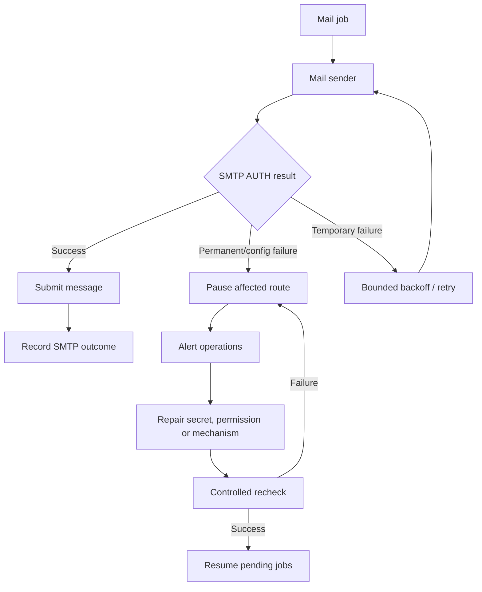

# MailAuthenticationException When Authentication Fails

In **Spring Framework Mail**, `MailAuthenticationException` is the exception used to report that **authentication with the mail server failed**. This error typically occurs when an application uses `JavaMailSender` to connect to SMTP with an account or authentication method not accepted by the server.

A typical example is an SMTP account with an incorrect password, a locked account, an application using a regular password when the provider requires an app password or OAuth2, or a server disallowing the `AUTH` mechanism the application is using. However, **not every email sending error is an authentication error**: network connection errors, TLS, recipient addresses, message size, and sending policies are different categories of failures.

The goal during diagnostics is to determine **when the error occurs**, **the SMTP response message**, **client configuration**, and **provider policies**, rather than just seeing `MailAuthenticationException` and repeatedly changing passwords or retrying. This lesson guides how to read the exception chain, identify causes, configure Spring Boot, handle OAuth2/TLS, design safe responses, and test.

## 1. Where Does MailAuthenticationException Sit in Spring Mail?

Spring provides the following related classes:

| Component | Role |
|---|---|
| `JavaMailSender` | Interface for creating and sending `MimeMessage`. |
| `JavaMailSenderImpl` | Sender implementation based on Jakarta Mail. |
| `MailException` | Base runtime exception of Spring Mail. |
| `MailAuthenticationException` | Error related to mail account authentication. |
| `MailSendException` | Error occurring while sending a message; may contain failed message details. |
| `MailPreparationException` | Error preparing message/MIME before sending in some flows. |
| `jakarta.mail.AuthenticationFailedException` | Authentication error at the Jakarta Mail layer, usually the root cause of `MailAuthenticationException`. |
| `jakarta.mail.MessagingException` | Checked exception related to message or transport operations. |

In Spring Framework 6 and Jakarta Mail, code typically imports:

```java
import org.springframework.mail.MailAuthenticationException;
import org.springframework.mail.MailException;
import org.springframework.mail.javamail.JavaMailSender;
import jakarta.mail.AuthenticationFailedException;
```

Older Spring applications may use the `javax.mail` namespace instead of `jakarta.mail`. Do not mix namespaces or use a Jakarta Mail dependency incompatible with the project's Spring version.

### Exception Relationship

```text
Spring MailException
    |
    +-- MailAuthenticationException
    |
    +-- MailSendException
    |
    +-- MailPreparationException

Jakarta Mail AuthenticationFailedException
    |
    v
Cause of MailAuthenticationException
(in cases where authentication is rejected)
```

`MailAuthenticationException` is a `MailException`, so code catching `MailException` will also catch authentication errors. However, if you need to classify errors properly, place `catch (MailAuthenticationException)` before `catch (MailException)`.

## 2. At Which Step Does SMTP Authentication Happen?

An email sending session via SMTP submission usually goes through these steps:

```text
Application
    |
    v
Connect smtp.example.org:587
    |
    v
SMTP greeting (220)
    |
    v
EHLO -> server capabilities
    |
    v
STARTTLS -> TLS handshake
    |
    v
EHLO again / negotiated capabilities
    |
    v
AUTH <mechanism>
    |
    +--> Success -> SMTP submission allowed
    |
    +--> Failure -> AuthenticationFailedException
    |
    v
MAIL FROM / RCPT TO / DATA
    |
    v
SMTP accepts message
```

The diagram illustrates a typical flow using port 587 and STARTTLS. With port 465, TLS is usually established immediately upon connection (*implicit TLS*), without needing a STARTTLS step in this manner.

**Successful authentication does not mean successful sending.** After the AUTH step, the server can still reject the `From` address, recipients, content, or sending limits. Conversely, connection or TLS errors occurring before AUTH are not necessarily password errors.

### SMTP Response Example

A failed authentication session may contain a response such as:

```text
535 5.7.8 Authentication credentials invalid
```

General meaning:

- `535`: authentication credentials were not accepted.
- `5.7.8`: extended status code related to authentication credentials.
- Descriptive text: provided by the server and may vary across providers.

This is an example, **not a fixed message that Spring always returns**. Providers may return different codes, different messages, or mask details for security reasons.

## 3. Common Symptoms in the Stack Trace

Abbreviated log example:

```text
org.springframework.mail.MailAuthenticationException:
  Authentication failed
Caused by: jakarta.mail.AuthenticationFailedException:
  535 5.7.8 Authentication credentials invalid
```

Points to read:

1. **Outer Spring exception**: `MailAuthenticationException`.
2. **Inner cause**: usually `AuthenticationFailedException`.
3. **SMTP code**: may indicate wrong credentials, disallowed AUTH mechanism, or account policy.
4. **Timing**: during connection/authentication or after the message has been handed to SMTP.
5. **Host/port/TLS mode**: identifies the actual server and submission mode.

Do not conclude solely from the words "Authentication failed". Some servers use a generic message for multiple policies: invalid password, account blocked from SMTP login, OAuth2 required, missing send permission, or IP rate-limited.

### Reading the Cause Chain in Java

```java
import org.springframework.mail.MailAuthenticationException;
import org.springframework.mail.MailException;

try {
    mailSender.send(message);
} catch (MailAuthenticationException exception) {
    Throwable cause = exception.getCause();

    logger.warn(
            "SMTP authentication failed, causeType={}",
            cause == null ? "unknown" : cause.getClass().getSimpleName()
    );

    throw exception;
} catch (MailException exception) {
    logger.error(
            "Mail submission failed, errorType={}",
            exception.getClass().getSimpleName()
    );
    throw exception;
}
```

Do not log username/password, raw AUTH commands, access tokens, or the entire `MimeMessage`. Some underlying messages may contain account addresses or internal data; control what information gets logged.

## 4. Distinguishing Authentication Errors from Related Errors

SMTP codes and processing stages help guide investigation, but you must consider the actual root cause.

| Symptom or response | Suspected group | Do not jump to conclusions |
|---|---|---|
| `535 5.7.8` | Credentials or authentication mechanism rejected | Could only be wrong password. |
| `534` with provider instructions | Account policy or sign-in method | Spring Mail has a bug. |
| `530 5.7.0 Authentication required` | Client has not AUTHed, or server requires AUTH before sending | Password is definitely wrong. |
| `504 5.5.4` with AUTH mechanism | AUTH mechanism not supported/accepted | Server does not allow sending email at all. |
| `454 4.7.0` | May be a transient authentication error or AUTH service unavailable | Need to change credentials immediately. |
| `421` or timeout on connect | Server/network/service unavailable | Password error. |
| TLS handshake exception | Certificate, protocol, or TLS configuration | AUTH error. |
| `550` at `MAIL FROM` or `RCPT TO` | Send permission, sender policy, or recipient rejection | Always `MailAuthenticationException`. |

Response codes are diagnostic signals, not an absolute error contract across all providers. Some systems do not expose extended codes; sometimes you need to check the admin dashboard, provider documentation, or SMTP server logs.

### What Does `530 Authentication required` Mean?

The message `530 Authentication required` usually indicates the client has not authenticated while the server requires AUTH to perform the next operation. In that case, check `mail.smtp.auth=true` and whether the server advertises AUTH support after STARTTLS.

It differs from the situation where the client already ran AUTH and credentials were rejected (`535`). Both errors can relate to authentication configuration, but their fixes are not the same.

## 5. Common Causes

### 5.1. Incorrect Username or Password

This can happen due to:

- Mistyped credentials.
- Secret not updated after a password change.
- Environment variable is empty, truncated, or has extra characters.
- Reading configuration from the wrong profile.
- Username must be a full email address, but code only uses the local-part.
- Account has been disabled or locked.

Example application configuration:

```yaml
spring:
  mail:
    username: ${SMTP_USERNAME}
    password: ${SMTP_PASSWORD}
```

If environment variables are not passed into the container, some environments may fail startup due to unresolved placeholders; in other environments, configuration defaults to empty so the error only surfaces at the AUTH step. Check configuration binding, but **do not print password values to logs**.

### 5.2. SMTP AUTH Not Enabled

Declaring a username/password should not be treated as a substitute for confirming AUTH configuration. For SMTP submission requiring authentication, typically set:

```yaml
spring:
  mail:
    properties:
      "mail.smtp.auth": true
```

The property `mail.smtp.auth=true` instructs Jakarta Mail to perform SMTP authentication. If missing or wrong, the server may reject sending with `530 Authentication required`, or the application may skip the AUTH step as intended.

Some internal SMTP relays rely on IP allowlists and do not use username/password. In that case, **do not enable AUTH out of habit**; follow the relay's actual policy.

### 5.3. Account Requires an App Password or OAuth2

Many providers do not allow SMTP applications to sign in with regular web login passwords, especially when MFA is enabled on the account or the organization restricts password authentication.

Depending on the provider and policy:

- App passwords may be permitted for certain accounts/applications.
- OAuth2/XOAUTH2 may be the required method.
- The account may have SMTP AUTH completely blocked by the organization.
- Password-based SMTP AUTH may have been deprecated.

**Do not disable MFA or weaken security policies just to get mail sending working.** Check officially supported sending methods; if the provider disallows SMTP AUTH, consider the provider's mail sending API or a service account with appropriate permissions.

### 5.4. Incompatible AUTH Mechanism

The SMTP server advertises a list of AUTH mechanisms, such as `PLAIN`, `LOGIN`, or `XOAUTH2`, depending on the service and configuration. If the client selects an unsupported mechanism, an AUTH mechanism error or auth failure may occur.

With Jakarta Mail, you can adjust the mechanism per provider requirements via property:

```properties
mail.smtp.auth.mechanisms=XOAUTH2
```

This property **only selects the mechanism**; it does not automatically fetch access tokens or configure OAuth2. If using XOAUTH2, the application must have a workflow for issuing, storing, refreshing tokens, and proper permissions.

### 5.5. Wrong Host, Port, or Encryption Mode

A service may provide multiple endpoints:

- Port 587: commonly used for SMTP submission with STARTTLS.
- Port 465: commonly used for SMTP submission with implicit TLS.
- Port 25: commonly used for server-to-server SMTP transfer or policy-based relay.

These ports are common conventions, **not absolute rules**. Always follow provider configuration.

If connecting to an unsuitable endpoint, the client may not see AUTH, hit handshake errors, or get rejected. Before rotating credentials, verify host/port and TLS setup.

### 5.6. Account Not Permitted to Send by Policy

Even with valid credentials, the provider may reject because:

- SMTP AUTH was disabled at the tenant/mailbox level.
- The account has not been granted permission to use the service.
- IP or network policy restricts the client.
- Login limits, quotas, or rate limits were exceeded.
- The account requires verification or unlocking.
- The `From` address is not allowed for that account.

Note: "From not permitted" errors usually happen during the send phase after AUTH, so they are not necessarily thrown as `MailAuthenticationException`.

## 6. Spring Boot Configuration for SMTP AUTH with STARTTLS

An example configuration when the provider requires SMTP submission on port 587:

```yaml
spring:
  mail:
    host: smtp.example.org
    port: 587
    username: ${SMTP_USERNAME}
    password: ${SMTP_PASSWORD}
    properties:
      "mail.smtp.auth": true
      "mail.smtp.starttls.enable": true
      "mail.smtp.starttls.required": true
      "mail.smtp.connectiontimeout": 5000
      "mail.smtp.timeout": 5000
      "mail.smtp.writetimeout": 5000
```

Explanation:

| Property | Purpose |
|---|---|
| `spring.mail.host` | SMTP host provided by the provider. |
| `spring.mail.port` | Appropriate submission port. |
| `spring.mail.username` | SMTP account name. |
| `spring.mail.password` | Password, app password, or credential per mechanism used. |
| `mail.smtp.auth` | Enables the SMTP AUTH step. |
| `mail.smtp.starttls.enable` | Allows upgrading the connection to TLS via STARTTLS. |
| `mail.smtp.starttls.required` | Requires STARTTLS; if the server does not support it, do not continue sending unprotected. |
| `mail.smtp.connectiontimeout` | Timeout waiting to establish TCP connection. |
| `mail.smtp.timeout` | Timeout waiting to read SMTP responses. |
| `mail.smtp.writetimeout` | Timeout waiting to write data. |

Timeouts are in milliseconds; values are illustrative only. For sensitive data, you can add TLS certificate identity verification according to deployment policy.

**STARTTLS only encrypts the connection when successfully negotiated.** When using username/password, avoid configurations that allow the client to silently downgrade to an unencrypted connection. Setting `required=true` clearly expresses the security requirement.

### Environment Variables and Secrets

Illustrative example of passing secrets:

```text
SMTP_USERNAME=mailer@example.org
SMTP_PASSWORD=<managed-secret>
```

Do not put real passwords in committed YAML files, documentation, logs, or code examples. Use a secret manager or the deployment platform's secret mechanism; restrict read permissions and establish a rotation process.

## 7. Configuring Implicit TLS SMTP on Port 465

If the provider requires implicit TLS:

```yaml
spring:
  mail:
    host: smtp.example.org
    port: 465
    username: ${SMTP_USERNAME}
    password: ${SMTP_PASSWORD}
    properties:
      "mail.smtp.auth": true
      "mail.smtp.ssl.enable": true
      "mail.smtp.connectiontimeout": 5000
      "mail.smtp.timeout": 5000
      "mail.smtp.writetimeout": 5000
```

In this mode, TLS begins immediately upon connection. Do not blindly copy the STARTTLS property set from port 587 to a 465 endpoint unless the provider requires it.

Comparison:

| Connection method | Common port | When does TLS start? |
|---|---|---|
| SMTP + STARTTLS | 587 | After greeting/EHLO and STARTTLS command. |
| SMTPS/implicit TLS | 465 | From the moment the connection is created. |

If TLS errors appear, diagnose handshake and certificates first; changing passwords cannot fix certificate or protocol incompatibility errors.

## 8. Configuring JavaMailSenderImpl Without Spring Boot

Plain Spring Framework can instantiate the sender manually:

```java
import java.util.Properties;
import org.springframework.context.annotation.Bean;
import org.springframework.context.annotation.Configuration;
import org.springframework.mail.javamail.JavaMailSenderImpl;

@Configuration
public class SmtpConfiguration {

    @Bean
    public JavaMailSenderImpl mailSender() {
        JavaMailSenderImpl sender = new JavaMailSenderImpl();

        sender.setHost("smtp.example.org");
        sender.setPort(587);
        sender.setUsername(System.getenv("SMTP_USERNAME"));
        sender.setPassword(System.getenv("SMTP_PASSWORD"));
        sender.setDefaultEncoding("UTF-8");

        Properties properties = new Properties();
        properties.put("mail.smtp.auth", "true");
        properties.put("mail.smtp.starttls.enable", "true");
        properties.put("mail.smtp.starttls.required", "true");
        properties.put("mail.smtp.connectiontimeout", "5000");
        properties.put("mail.smtp.timeout", "5000");
        properties.put("mail.smtp.writetimeout", "5000");

        sender.setJavaMailProperties(properties);
        return sender;
    }
}
```

The code illustrates plain Spring configuration. In production, validate environment variables, manage secrets securely, and use environment-specific configurations. Using `System.getenv` here does not mean it is the only or always best approach; platform-managed configuration properties can be used.

Important: `setUsername` and `setPassword` only set credentials on the sender. For many SMTP servers, `mail.smtp.auth=true` is still needed to perform AUTH.

## 9. Verifying Configuration Before Sending Real Email

Spring Boot has a configuration to test the mail connection at startup:

```yaml
spring:
  mail:
    test-connection: true
```

Depending on the version and auto-configuration, this check can fail startup if SMTP cannot connect or authenticate. It is useful when SMTP is a mandatory dependency and credential/config mistakes must be detected early.

However, when the provider experiences a brief outage, enabling fail-fast may prevent instances from starting. For systems using an outbox and able to tolerate temporary mail delays, consider separating connectivity checks into health/operational checks rather than hard-coupling to startup.

### Testing with `JavaMailSenderImpl.testConnection()`

`JavaMailSenderImpl` provides `testConnection()` to test connecting to the mail server without sending an email with content to recipients.

```java
import jakarta.mail.MessagingException;
import org.springframework.mail.javamail.JavaMailSenderImpl;

public class MailConnectivityProbe {

    private final JavaMailSenderImpl sender;

    public MailConnectivityProbe(JavaMailSenderImpl sender) {
        this.sender = sender;
    }

    public boolean canAuthenticate() {
        try {
            sender.testConnection();
            return true;
        } catch (MessagingException exception) {
            return false;
        }
    }
}
```

In the example, the bean is injected by concrete type `JavaMailSenderImpl`; this is suitable when the application actually uses that implementation. If there is a custom sender implementing only `JavaMailSender`, do not blindly cast it.

`testConnection()` helps detect many connection/authentication errors, **but does not test the entire email sending and delivery journey**. It does not verify that the `From` address is allowed to send, that recipients exist, that content is accepted, or that messages reach the inbox.

Do not call the SMTP probe on every HTTP request: repeated login attempts both add load and may trigger provider rate limits or anti-abuse policies.

## 10. Ordered Diagnostic Method

When receiving `MailAuthenticationException`, proceed from least sensitive information to account intervention steps.

### Step 1: Confirm the Exception and Root Cause

Record:

- Is it `MailAuthenticationException` or `MailSendException`?
- Is the cause `AuthenticationFailedException`?
- Is there an SMTP code such as `535`, `534`, `530`, or `454`?
- Did the error occur during connect/AUTH or after `MAIL FROM`?
- Does the error repeat every time, across all instances, or only in one environment?

A single line saying "Authentication failed" is not enough to pick a solution.

### Step 2: Check SMTP Endpoint and Transport

Verify host, port, and TLS mode against the provider's official configuration. Check whether the endpoint is reachable from the application's network, rather than relying only on a developer machine connecting successfully.

If using STARTTLS, confirm the server supports and allows that mechanism. If using implicit TLS, choose the right port and properties.

### Step 3: Check Configuration Without Exposing Passwords

Verify the environment variable/secret key name is correct and the value is present at runtime. You can log **presence/absence status of configuration**, without logging content:

```java
boolean usernameConfigured =
        username != null && !username.isBlank();

boolean passwordConfigured =
        password != null && !password.isBlank();

logger.info(
        "SMTP configuration present: username={}, password={}",
        usernameConfigured,
        passwordConfigured
);
```

This check does not verify that credentials are valid; it only detects missing configuration. Do not log secret lengths or fragments unless legitimately required.

### Step 4: Confirm Username Format and Valid Credentials

Check the provisioned SMTP account, whether a full email address or separate username is required, whether the account is active or locked, and whether the latest secret has been deployed.

If secret rotation occurred, check which instances picked up the new secret and which still hold old values. With multiple replicas, some instances succeeding while others fail often suggests inconsistent configuration/secret rollout.

### Step 5: Confirm Provider AUTH Policy

Check whether the provider allows:

- Password-based SMTP AUTH?
- App passwords?
- OAuth2/XOAUTH2?
- SMTP AUTH for that specific tenant/mailbox?
- The current client IP, region, or network path?

Do not apply one provider's instructions to another provider without verifying support.

### Step 6: Run a Controlled Connection Test

Use `testConnection()`, admin tools, or an independent controlled test. Avoid retrying wrong credentials consecutively many times as it can lock the account or trigger rate limits.

If manual testing is needed, prefer secure connection tools with secret management. Do not paste passwords into shell history, command-line arguments, or support tickets.

### Step 7: Classify and Remediate

- Wrong/expired credentials: fix the secret or account permissions; **do not retry continuously**.
- Unsupported AUTH mechanism: switch mechanism or select an appropriate API.
- Wrong TLS/endpoint: fix transport config.
- Transient AUTH error from provider: retry with backoff if policy permits.
- Tenant/mailbox policy: ask administrators to update permissions through proper channels.

After each change, verify with a small number of tests instead of immediately re-triggering the entire backlog.

## 11. Debugging SMTP Without Exposing Credentials

Jakarta Mail supports an SMTP debug mode to observe the connection process and protocol steps.

Example configuration for diagnostic environments only:

```yaml
spring:
  mail:
    properties:
      "mail.debug": true
```

Debug output can reveal information about EHLO, STARTTLS, AUTH mechanisms, and SMTP replies. However, protocol logs can contain email addresses, hostnames, session data, or sensitive information. **Do not enable arbitrarily in production.**

Some versions/configurations have a separate debug option for authentication content, such as `mail.debug.auth`. Do not enable logging of authentication content or tokens. The goal is to find the failing stage, not to collect credentials.

Guidelines:

1. Enable debug only briefly and in controlled environments.
2. Do not use privileged production accounts when a test account can be used.
3. Redact or remove sensitive data before sharing logs with others.
4. Protect logs with proper access controls and retention.
5. Turn off debug once the issue is identified.

### Reading AUTH Capabilities from an SMTP Session

A server may return capabilities after EHLO:

```text
250-STARTTLS
250-AUTH PLAIN LOGIN
250 SIZE 10485760
```

This is only an example. Some servers advertise AUTH only after the client completes STARTTLS. Not seeing AUTH before TLS is insufficient grounds to conclude the server does not support authentication.

Do not send strings containing passwords or tokens to untrusted debug tools just to see how the server responds.

## 12. When the Provider Requires OAuth2 or XOAUTH2

Some SMTP services support authenticating with an OAuth2 access token instead of a regular password.

Conceptually:

```text
Application
    |
    v
Obtain access token with correct SMTP scope/permissions
    |
    v
Connect + establish TLS to SMTP
    |
    v
AUTH XOAUTH2 using token
    |
    v
Server validates token and mailbox permissions
    |
    v
Submit message
```

With Jakarta Mail, configuration to select the mechanism can use:

```yaml
spring:
  mail:
    properties:
      "mail.smtp.auth": true
      "mail.smtp.starttls.enable": true
      "mail.smtp.starttls.required": true
      "mail.smtp.auth.mechanisms": XOAUTH2
```

This is only selecting the **AUTH mechanism**, not a complete OAuth2 integration.

A real implementation requires:

- Registering the application with the identity provider.
- Correct SMTP permissions/scopes for the sending account.
- Distinguishing user tokens vs. application tokens as supported by the provider.
- Storing tokens/refresh credentials using a secure mechanism.
- Refreshing access tokens before expiration.
- Passing the token into Jakarta Mail using the method supported by the library/provider.
- Classifying expired, revoked, or insufficient-permission token errors.
- Limiting concurrency and avoiding simultaneous token refreshes when multiple workers send at once.

You cannot fix `MailAuthenticationException` merely by setting `XOAUTH2` without a valid token. Also, do not assume every SMTP server supports XOAUTH2 or every organization allows clients to obtain tokens via the same OAuth flow.

## 13. Is an App Password Always the Right Solution?

No. An app password is only suitable if the provider **supports it and organizational policy allows it**.

| Method | When to use | Limitations |
|---|---|---|
| Regular password | Provider allows password-based SMTP AUTH | May be blocked by MFA/security policies. |
| App password | Provider supports it and account is allowed to create one | May be disabled at the org level or nonexistent. |
| OAuth2/XOAUTH2 | Provider and account type support it | Requires token lifecycle, scopes, and permissions. |
| IP/service-based SMTP relay | Organization manages a trusted relay | Must restrict sending sources and apply appropriate safeguards. |
| Provider mail-sending API | SMTP AUTH is unsuitable or API offers needed features | Requires separate API integration, permissions, and retry mechanism. |

If the provider blocks legacy sign-in methods, do not try to enable "less secure" options to bypass controls. Choose an authentication solution approved by the provider and organization.

## 14. Distinguishing AUTH Errors from From-Address or Send-Permission Errors

A confusing case is logging into account A while setting:

```java
helper.setFrom("billing@example.org");
```

whereas the SMTP account only has permission to send on behalf of `notifications@example.org`.

AUTH may succeed, yet the server rejects the `MAIL FROM` command or message because the sender is not allowed. Depending on the implementation and rejection timing, the error may be wrapped in `MailSendException` or a Jakarta Mail transport cause, rather than necessarily `MailAuthenticationException`.

Distinguish clearly:

- **Authentication:** "Which account are you?"
- **Authorization:** "What is this account allowed to do?"
- **Sender policy:** "Which addresses/domains are you allowed to send from?"
- **Recipient policy:** "Are the destination and content accepted?"

Do not fix this by escalating global account privileges when you only need Send As permission or to use a `From` address compliant with provider policy.

## 15. Handling MailAuthenticationException in a Service

A service can distinguish authentication errors from other sending errors:

```java
import org.springframework.mail.MailAuthenticationException;
import org.springframework.mail.MailException;
import org.springframework.mail.javamail.JavaMailSender;
import org.springframework.stereotype.Service;

@Service
public class NotificationMailGateway {

    private final JavaMailSender mailSender;

    public NotificationMailGateway(JavaMailSender mailSender) {
        this.mailSender = mailSender;
    }

    public SubmissionResult submit(MimeMessage message) {
        try {
            mailSender.send(message);
            return SubmissionResult.acceptedBySmtp();
        } catch (MailAuthenticationException exception) {
            return SubmissionResult.failed(
                    "SMTP_AUTHENTICATION_FAILED",
                    false
            );
        } catch (MailException exception) {
            return SubmissionResult.failed(
                    "SMTP_SUBMISSION_FAILED",
                    true
            );
        }
    }
}
```

`SubmissionResult` here is an illustrative application model containing status and a flag indicating whether to consider retrying. Setting `false` for authentication errors is a **basic policy** to avoid continuous retries when credentials are wrong; real systems should classify causes in more detail. Also, not every `MailException` is retryable: invalid message errors or rejected addresses may be permanent failures.

**Do not expose raw exception messages in end-user APIs.** SMTP server error strings can reveal account details, internal hosts, policies, or operational details. User interfaces only need safe error codes and appropriate guidance.

### Do Not Catch and Still Report Success

Pattern to avoid:

```java
try {
    mailSender.send(message);
} catch (MailAuthenticationException exception) {
    logger.error("Authentication failed", exception);
}

return "Email sent";
```

The code swallowed the error and still reported success. If email is the primary goal of the operation, return a failure result. If email is a side effect of an already-succeeded business operation, record the failed state in an outbox/delivery record for later handling rather than losing track of the job.

## 16. Retries and Circuit Breakers When Authentication Fails

There are two groups of errors requiring different handling.

### Potentially Persistent Authentication Errors

Examples:

- Wrong or rotated password.
- SMTP AUTH disabled on the tenant.
- Insufficient OAuth2 scopes.
- Account locked or missing permissions.

Retrying the same credentials every second is usually pointless; it also adds load, risks rate-limiting, and pollutes logs.

Remediation steps:

1. Record `AUTH_CONFIG_ERROR` or a status requiring intervention.
2. Pause workers sending via the affected credentials.
3. Alert operations at an appropriate severity.
4. Update secret/permissions/AUTH mechanism.
5. Perform controlled testing and resume the backlog.

### Transient Authentication Errors

For example, the server returns a temporary 4xx response related to the authentication service. When confirmed transient, retry with exponential backoff and jitter:

```text
Attempt 1 -> temporary auth failure
Wait with backoff
Attempt 2 -> temporary auth failure
Wait longer
Attempt 3 -> success or stop by retry policy
```

All retries must have bounded attempt counts, total duration limits, and observability. Do not rely solely on the name `MailAuthenticationException` to conclude whether an error is retryable.

### When Is a Circuit Breaker Beneficial?

If AUTH errors happen across the board, opening a circuit to prevent thousands of failed login attempts can protect both the provider and your system. However, a circuit breaker does not fix credentials and does not replace alerting/diagnostics. Once configuration is fixed, a mechanism is needed to probe again and close the circuit per policy.

## 17. Asynchronous Sending and Outbox When SMTP AUTH Fails

For emails sent via `@Async` or worker queues, authentication errors can occur after the HTTP request has already returned successfully.

```text
Business action
    |
    v
Persist mail request (PENDING)
    |
    v
Async mail worker
    |
    v
SMTP AUTH
    |
    +--> Success -> send -> record SMTP outcome
    |
    +--> Failure -> AUTH_CONFIG_ERROR
                      |
                      v
                 Alert / pause / repair
```

If using only `@Async void`, exceptions do not automatically propagate back to the caller. You need a handler, `CompletableFuture`, or a mechanism to record job/delivery results.

With an outbox, you can use statuses such as:

| Status | Meaning |
|---|---|
| `PENDING` | Job has not been processed yet. |
| `PROCESSING` | Worker has claimed the job. |
| `SMTP_ACCEPTED` | SMTP accepted the message. |
| `AUTH_CONFIG_ERROR` | Send route hit an authentication error; configuration/permissions need fixing. |
| `RETRYABLE_FAILURE` | Transient error per policy. |
| `PERMANENT_FAILURE` | Must not be retried automatically. |

When persistent authentication errors are detected, many jobs sharing the same SMTP route can be affected. It is better to flag the failure at the **credential/provider route** level and pause sending over that route, rather than retrying every job en masse only to hit the same error.

### Preserving Sending Intent

Wrong credentials are an operational error; they do not mean the business event did not happen. If an order was already created successfully, do not roll back the business action or pretend the email succeeded. Persist the email request, raise an alert, and allow reprocessing once credentials are fixed.

## 18. Do Not Confuse SMTP Errors with Deliverability

If AUTH fails before SMTP receives the message, that attempt was not accepted for sending. Once credentials are fixed, a new send attempt can be executed per policy.

However, if an error happens at a later stage after sending content—for example, connection drops after the server processes DATA—the state may be uncertain. The caller may not know whether the mail was received.

Therefore, record:

- Failure stage if deducible.
- SMTP response code.
- Cause category.
- Attempt ID and logical message ID.
- Confirmation result from transport.
- Whether it is retryable or unknown.

Do not automatically label every `MailException` as "not sent". For a `MailAuthenticationException` that genuinely occurred at the AUTH step, no submission succeeded in that attempt; other exception types may carry uncertain-outcome semantics.

## 19. Monitoring and Alerting

An AUTH incident typically impacts batches of emails rather than a single recipient. Metrics to monitor include:

- Count of `MailAuthenticationException` by mail route/provider.
- SMTP authentication failure rate.
- Successful mail submission rate.
- Continuous duration of AUTH errors.
- Count of `PENDING` emails and age of the oldest job.
- Count of paused SMTP routes.
- Retry count caused by configuration errors.
- Ratio of instances with inconsistent config/credentials after rollout.

Structured log example without secrets:

```text
event=SMTP_AUTH_FAILURE
providerRoute=transactional-mail-primary
smtpHost=smtp.example.org
smtpPort=587
tlsMode=STARTTLS
errorType=MailAuthenticationException
causeType=AuthenticationFailedException
smtpReplyCategory=535
messageId=mail-8721
retryPolicy=PAUSED_UNTIL_REPAIRED
```

It is not necessary to log full usernames. If distinguishing accounts is needed, use a non-sensitive account alias or internal configuration key. Do not log raw access tokens, app passwords, AUTH commands, or email bodies.

### When to Alert Urgently?

If all transactional emails are blocked by an AUTH failure, this may be a user-impacting incident. Systems should alert on **error rates and backlog**, avoiding sending an individual alert per job and causing an alert storm.

For non-critical emails, lower alert thresholds can be used and handled according to defined SLOs.

## 20. Testing Authentication Errors

Test at least at two layers: application exception-handling logic and real integration with a test SMTP server.

### 20.1. Unit Test for Exception Classification

Example with Mockito and AssertJ:

```java
@Test
void authenticationFailureIsClassifiedWithoutRetry()
        throws Exception {

    MimeMessage message = mailSender.createMimeMessage();

    doThrow(new MailAuthenticationException(
            new jakarta.mail.AuthenticationFailedException(
                    "Invalid test credential"
            )
    )).when(mailSender).send(message);

    SubmissionResult result = gateway.submit(message);

    assertThat(result.errorCode())
            .isEqualTo("SMTP_AUTHENTICATION_FAILED");
    assertThat(result.retryable()).isFalse();
}
```

The illustrative code assumes `mailSender` is a mock and `gateway` is an instance using that mock. `SubmissionResult` is the application's result model. This test does not connect to real SMTP and requires no production credentials.

### 20.2. Integration Test Using an SMTP Test Server

Using GreenMail or a test SMTP server supporting AUTH:

1. Configure the server with a test account.
2. Configure the sender with the right username but wrong password.
3. Call `send(...)` or `testConnection()`.
4. Assert the application receives the corresponding error.
5. Switch to valid test credentials.
6. Assert connection/sending succeeds against the test server.

Exact outcomes depend on how the test server implements AUTH and how Jakarta Mail translates exceptions. Inspect both cause and SMTP response rather than requiring every test server to return the exact same text string.

Do not use real mailboxes or repeatedly test production credentials in CI.

### 20.3. Testing Mismatched AUTH Mechanisms

If the application supports multiple SMTP providers, you can test:

- Server supports only mechanism A while client forces B.
- Server requires STARTTLS before AUTH.
- Client lacks `mail.smtp.auth`.
- Provider rejects expired credentials.

### 20.4. Testing Operational Handling

For workers/outboxes:

- AUTH failure does not delete the send request.
- Jobs do not retry continuously when credentials are wrong.
- Alerts/metrics are emitted.
- After fixing the secret, the worker can resume.
- Duplicate jobs are not generated when multiple instances restart together.

## 21. Troubleshooting Checklist by Symptom

| Question | What to check |
|---|---|
| Is there a `MailAuthenticationException` and an AUTH-related cause? | Inspect exception class and cause chain. |
| Are host and port right for the environment? | Compare against SMTP provider configuration. |
| Is the connection using the right STARTTLS or implicit TLS mode? | Check transport mode and TLS handshake. |
| Does the server require AUTH? | Check capabilities and `mail.smtp.auth` config. |
| Is the username in the right format? | Full email or username per provider. |
| Does the secret exist and was it rolled out properly? | Secret manager, env binding, and version. |
| Is the account locked/disabled? | Provider dashboard or administrator. |
| Does MFA require an app password/OAuth2? | Provider and tenant policies. |
| Is the AUTH mechanism accepted by the server? | PLAIN/LOGIN/XOAUTH2 or supported mechanism. |
| Is the error caused by `From` permissions? | Distinguish AUTH step from `MAIL FROM`. |
| Are wrong credentials being retried infinitely? | Pause route and fix configuration. |
| Has it been tested against an SMTP test server? | Safely reproduce errors before deploying. |
| After fixing, is the backlog drained with rate limits? | Throttle, retry, and monitor outcomes. |

## 22. Common Operational Pitfalls

### Error Occurs Only After Deployment

Possible causes:

- Secret was not mounted into the new Pod/container.
- Wrong Spring profile or namespace.
- Secret rotation not yet synchronized.
- New environment's network/IP is not on the allowlist.
- SMTP provider policy differs from the local environment.

Remediation: compare **configuration names, binding status, secret versions, and network routes**; do not copy passwords into logs to compare.

### Error Appears After Enabling MFA

MFA may invalidate regular password-based SMTP AUTH. Check app password or OAuth2 options permitted by the provider. Do not disable MFA just to avoid changing code.

### Error After Changing the `From` Address

If credentials still use the old account while `From` is changed to another alias or domain, a sender authorization error can occur after AUTH succeeds. You need Send As permission or to adjust the `From` address per policy, not necessarily change the password.

### Error Exists Only on One Replica

Check whether all instances share the same host/port config, secret version, profile, and AUTH mechanism. One replica might still hold an expired token or may not have restarted after a secret change.

### Error Occurs After Running for a While

If it succeeded initially and then failed, investigate OAuth2 token expiration, refresh failures, account rate limits, password rotation, session lifecycle, or provider policy changes. With OAuth2, tokens cannot be used indefinitely.

## 23. Architecture for Handling Authentication Incidents

A simple yet operable design:



Components have clear responsibilities:

- **Mail sender:** performs SMTP connection and sending.
- **Error classifier:** distinguishes AUTH configuration errors, transient errors, and other send errors.
- **Route controller:** pauses the sending route with broken credentials instead of failing every job continuously.
- **Outbox/delivery store:** retains sending intent and attempt status.
- **Operations alerting:** detects incidents and provides safe metadata.
- **Recovery flow:** validates new credentials and then drains backlog with rate limits.

For small apps sending only manual test emails, building this entire architecture is unnecessary. However, when email is a critical business component, detection and recovery capabilities for AUTH failures should be designed in from the start.

## 24. Key Takeaways

- `MailAuthenticationException` is a Spring Mail error indicating mail authentication failed; it usually has cause `jakarta.mail.AuthenticationFailedException`.
- Authentication errors are distinct from TCP errors, TLS errors, sender authorization, recipient rejections, and delivery after SMTP accepts the message.
- Read the **exception chain, SMTP response code, and failure stage** before changing configuration.
- Check hostname, port, `mail.smtp.auth`, STARTTLS/implicit TLS, username format, and secret binding.
- Providers may require app passwords, OAuth2/XOAUTH2, or other mechanisms. Follow official policy instead of disabling MFA or lowering security levels.
- `test-connection` configuration or `JavaMailSenderImpl.testConnection()` can help detect errors early, but does not prove emails reach the inbox.
- Do not log passwords, tokens, raw AUTH commands, or email content; enable SMTP debug only under strict control.
- Do not retry infinitely when credentials are wrong or AUTH is disallowed. For persistent config errors, pause the mail route and alert to fix.
- For async sending, persist send requests in a durable queue/outbox and record outcomes; do not let exceptions get lost inside `@Async void`.
- Test with mocks and an SMTP test server supporting AUTH; do not use real credentials in CI.
- After fixing errors, verify with a few test emails and resume the backlog with rate limiting.

When encountering `MailAuthenticationException`, start with **evidence-based authentication diagnostics**, not blind retries or guessing passwords. Distinguishing credentials, AUTH mechanisms, TLS, account policies, and sending permissions helps Spring Framework Mail applications recover quickly, safely, and without losing pending notifications.
