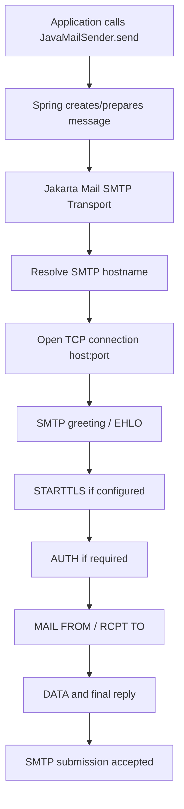

# MailConnectException When Unable to Connect to the Mail Server

A Spring Boot application has configured `spring.mail.host`, `spring.mail.port`, and an SMTP account. When calling `JavaMailSender.send(...)`, the application fails to send email and logs show `MailConnectException`, such as "Couldn't connect to host" or "Connection refused". This often makes developers immediately think of a wrong password or recipient address. However, **`MailConnectException` primarily points to a problem establishing a connection to the SMTP server**, before the system can complete a mail-sending transaction.

To handle it accurately, note that this exception comes from the **Jakarta Mail/JavaMail provider**, not by default a class in `org.springframework.mail`; Spring may wrap it in `MailSendException`. Operators must distinguish unresolvable hostnames, closed ports, firewall blocks, connection timeouts, mismatched TLS configuration, and authentication errors occurring at a later step. Retries must also be based on the failing stage so duplicate emails are not generated.

This lesson belongs to the **Errors and Diagnostics** chapter of **Spring Framework Mail**. Content covers how the exception arises, reading the cause chain, Spring Boot configuration, diagnosing with network tools, and testing and operating when SMTP connections fail.

## 1. What Is MailConnectException?

`MailConnectException` is the exception name commonly used by the SMTP/JavaMail provider when a connection to the mail server cannot be established. The exact package name depends on the library and version:

- In some older JavaMail versions, you may see `com.sun.mail.util.MailConnectException`.
- In **Eclipse Angus Mail** implementations used with modern Jakarta Mail, you may see the corresponding class in package `org.eclipse.angus.mail.util`.
- At the Spring Mail boundary, applications usually observe a Spring exception such as `org.springframework.mail.MailSendException`; the connection cause lies deeper in the exception chain.

Therefore, do not assume the application can import `org.springframework.mail.MailConnectException` — that is **not** a corresponding exception name in the Spring Mail API.

### 1.1. What Does This Error Typically Indicate?

When preparing to send an email, the Jakarta Mail SMTP transport must connect to a host and port. If the connection operation cannot complete, the provider may throw an exception containing information such as:

- The host it attempted to connect to.
- The port it attempted to connect to.
- Timeout duration or socket error.
- Cause being `java.net.ConnectException`, `SocketTimeoutException`, `UnknownHostException`, or another network error.

Illustrative log example, **not a fixed output across all providers**:

```text
org.springframework.mail.MailSendException:
  Mail server connection failed
  nested exception is:
    org.eclipse.angus.mail.util.MailConnectException:
      Couldn't connect to host, port: smtp.example.com, 587
    Caused by: java.net.ConnectException: Connection refused
```

Reading from the inside out:

1. `MailSendException` indicates Spring did not complete the send call.
2. `MailConnectException` points to an issue opening the connection to the SMTP server.
3. `ConnectException: Connection refused` suggests the destination may be reachable at the network level, but the TCP connection to the port was refused; you still need to investigate host/port, listeners, and firewalls.
4. There is no evidence yet to conclude a wrong password, recipient, or MIME content.

### 1.2. Not Every Network Error Carries This Exact Class

A connection setup failure may appear as `MessagingException`, `MailSendException`, or another exception depending on the provider and timing. A TLS handshake failure after TCP has opened usually has cause `SSLHandshakeException`, not necessarily `MailConnectException`. Similarly, an AUTH failure after connecting is usually reported as an authentication error.

**Diagnose based on stage, message, and root cause**, not just the class name of the outermost exception.

## 2. How Is Mail Sent Through Spring?

In Spring Boot, you typically declare `spring-boot-starter-mail` and inject `JavaMailSender`:

```java
@Service
public class NotificationMailService {
    private final JavaMailSender mailSender;

    public NotificationMailService(JavaMailSender mailSender) {
        this.mailSender = mailSender;
    }

    public void sendText(String recipient) {
        SimpleMailMessage mail = new SimpleMailMessage();
        mail.setFrom("notifications@example.com");
        mail.setTo(recipient);
        mail.setSubject("Notification");
        mail.setText("The order has been confirmed.");

        mailSender.send(mail);
    }
}
```

A conceptual sending flow:



Actual steps vary by SMTP transport type and server, but this sequence helps identify where an exception can occur.

- `createMimeMessage()` primarily creates a message object; **does not prove SMTP is reachable**.
- `MimeMessageHelper.setTo(...)` and `setText(...)` prepare the message; **do not perform a TCP connect**.
- With standard `JavaMailSenderImpl`, the SMTP connection is established inside the `send(...)` path or when calling a dedicated connection test.
- DNS/TCP errors usually appear **before** the `MAIL FROM`, `RCPT TO`, `DATA` transaction.
- Errors occurring **after** transmitting DATA require special handling because the submission outcome may be unclear.

### 2.1. Distinguishing from `MailAuthenticationException`

`MailAuthenticationException` in Spring usually points to a failure at the authentication step. If the server requires AUTH and username/password are wrong, check credentials and authentication mechanisms rather than changing DNS/port by default.

Conversely, if the client has not connected over TCP yet, the server has not had a chance to verify the password. **Do not rotate credentials just because logs contain `MailConnectException`.**

### 2.2. Distinguishing from `MailParseException` and MIME Errors

If an email address is invalid or the message was built incorrectly, errors can arise during MIME preparation. Those errors are not solved by opening a firewall.

### 2.3. Distinguishing from SMTP 4xx/5xx Replies

Replies such as `421`, `450`, `451`, or `550` are **SMTP reply** codes from the server at some stage of the protocol session. That means the client exchanged at least part of the protocol with the server. A `ConnectException: Connection refused` usually occurs before any valid SMTP reply.

| Scenario | Stage | Diagnostic hint |
|---|---|---|
| Cannot resolve `smtp.example.com` | DNS | Hostname/config/DNS resolver. |
| TCP connect refused | Connection | Port/listener/firewall reject. |
| TCP connect timeout | Connection | Routing/firewall drop/egress/provider unreachable. |
| SSL handshake rejected | TLS | Wrong TLS mode, certificate, trust, protocol. |
| SMTP AUTH 535 | After connect | Credentials or authentication mechanism. |
| SMTP RCPT 550 | SMTP transaction | Recipient/policy, not inability to connect. |
| Timeout after DATA | Submission | Risk of uncertain outcome and duplicate sends. |

## 3. Common Causes

### 3.1. Wrong Hostname

Example configuration:

```yaml
spring:
  mail:
    host: smpt.example.com
    port: 587
```

`smpt` is a typo for `smtp`. If the name does not exist in DNS, Java may throw `UnknownHostException`; depending on the provider, the error is wrapped in a `MessagingException`/Spring exception.

It is also possible the host is an internal name resolvable only over VPN or a private network, while the application runs in a cloud environment.

**Verify the hostname from the deployment environment itself, not just from a developer's laptop.**

### 3.2. Wrong Port

Common SMTP ports:

| Port | Common purpose/mode | Notes |
|---|---|---|
| `587` | Message submission, usually using STARTTLS | Initial unencrypted TCP connection upgraded via STARTTLS when supported by server. |
| `465` | Message submission with TLS upon connect (implicit TLS) | Requires SSL-on-connect config; do not mechanically substitute STARTTLS. |
| `25` | SMTP relay between mail servers and some internal systems | Many clouds/networks block outbound 25; do not use by default for app submission. |
| `2525` | Alternative port offered by **some** providers | Not a universal SMTP submission port; must confirm provider support. |

Wrong ports can cause `Connection refused`, timeouts, or connecting to a non-SMTP service. The same hostname with a different port can enforce completely different network and TLS policies.

### 3.3. SMTP Server Not Running or Not Listening on Port

Causes:

- SMTP service is stopped or restarting.
- Server binds only to `127.0.0.1`, not listening on the network interface needed by the application.
- Listener opens only port 465 while the application calls 587.
- Load balancer has no healthy backends.
- Firewall on the server rejects the port.

If the connection receives an immediate refusal, inspect the service listener and destination endpoint first.

### 3.4. Firewall, Network Egress, and Routing

In container/cloud environments, a machine may reach the Internet via HTTPS yet **lack** permission to open TCP connections to an SMTP port. Blocking points include:

- Host/container host firewall.
- Cloud security groups or network ACLs.
- Kubernetes NetworkPolicy.
- Corporate firewall/proxy allowing only HTTP(S).
- ISP or cloud provider restricting outbound SMTP.
- Missing route/VPN/private link.
- DNS returning a private network IP outside routable scope.

A `connect timed out` is usually a signal to check the network path, **but is insufficient to prove a firewall is the cause**. Hung servers, routing issues, or proxies can produce similar symptoms.

### 3.5. DNS Returns Wrong IP or Stale Address

A hostname may resolve yet point to an old endpoint, a private subnet IP, or an unroutable IPv6 address. Inspect `A` and `AAAA` records along with TTLs, and test from the application's actual runtime environment.

A successful DNS query **is not enough**: the right IP still needs a TCP listener on the chosen port.

### 3.6. IPv4 vs. IPv6 Differences

Some environments resolve both `A` and `AAAA` records, yet only have working network routes for one of them. If the provider/JVM picks an unreachable address, the application may time out or report network unreachable.

Do not rush to set `java.net.preferIPv4Stack=true` as a global fix. First determine:

1. Which addresses DNS returns.
2. Which endpoint the JVM selects (if logging/network tracing supports it).
3. Whether the pod/VM network has an IPv6 route.
4. How the SMTP provider advertises IPv6 support.

If changing the IP strategy is required, follow platform policy and test impacts on other JVM connections.

### 3.7. Port Open but SSL/TLS Configuration Mismatched

On port 465, servers typically expect a TLS handshake immediately after TCP connect. On 587, clients typically connect first, read the SMTP greeting/EHLO, and then use `STARTTLS` to upgrade.

A mismatched pair can lead to hanging for replies, EOF, timeouts, or handshake errors. Not every case throws `MailConnectException` specifically.

Anti-pattern examples:

```text
Port 465 -> configured as plain SMTP/STARTTLS-only
Port 587 -> forcing TLS as soon as socket opens
```

Use **the exact TLS configuration per provider documentation**, rather than just changing the port and keeping all other properties identical.

### 3.8. Proxy Does Not Support SMTP

Some enterprises have an HTTP proxy but disallow direct outbound TCP sockets to the Internet. Jakarta Mail/SMTP does not automatically route through an HTTP proxy just because the JVM has HTTP proxy settings.

If policy requires sending through an internal relay, the application should use that relay endpoint. Do not configure unauthorized bypasses/proxies just to "make it connect".

### 3.9. Exhausted Connection/Socket Resources

When too many workers send concurrently, the JVM or OS can exhaust file descriptors, ephemeral ports, connection pools, or other resources. Logs may show `BindException`, "Too many open files", or unstable connection failures.

This is not simply a wrong-host error. Check concurrency, open sockets, timeouts, transport lifecycle, and connection creation rate.

## 4. Error Messages and How to Read Them

The following examples illustrate common message patterns; exact class names and wording vary by version.

### 4.1. Connection Refused

```text
MailConnectException: Couldn't connect to host, port: smtp.example.com, 587
Caused by: java.net.ConnectException: Connection refused
```

Hints:

- TCP connect was not accepted.
- Check host, port, listener, firewall reject, and load balancer endpoint.
- Do not conclude an AUTH error because there is no evidence that step was reached.

### 4.2. Connection Timed Out

```text
MailConnectException: Couldn't connect to host, port: smtp.example.com, 587
Caused by: java.net.SocketTimeoutException: Connect timed out
```

Hints:

- No connection established before the `connectiontimeout` limit.
- Check routing, egress, firewall, service outage, and IP addresses.
- Retry only if the error is likely transient and with limits/backoff.

### 4.3. Unknown Host

```text
Caused by: java.net.UnknownHostException: smtp.internal.example
```

Hints:

- The hostname could not be resolved by DNS/JVM at that time.
- Check hostname, DNS search domain, VPN, private DNS, and resolver.
- Could be a permanent misconfiguration or a temporary DNS outage.

### 4.4. No Route to Host / Network Unreachable

```text
Caused by: java.net.NoRouteToHostException: No route to host
```

Hints:

- The route to the endpoint is unavailable or blocked by the network.
- Check subnet, gateway, routing table, VPN, IPv4/IPv6, and network policies.

### 4.5. SSL Handshake Exception

```text
Caused by: javax.net.ssl.SSLHandshakeException:
  PKIX path building failed
```

Hints:

- TCP may have connected, but TLS validation failed.
- Check server certificate, truststore, hostname verification, and TLS mode.
- **Do not disable certificate validation** in production just to bypass the error.

### 4.6. Authentication Failed

```text
535 5.7.8 Authentication credentials invalid
```

Hints:

- The server already processed at least part of the SMTP/AUTH protocol.
- Check username/password, tokens, SMTP AUTH policy, and account.
- Do not treat this as `MailConnectException` merely because both appear inside `MailSendException`.

## 5. Spring Boot Configuration for STARTTLS on Port 587

Typical configuration example for an SMTP provider using STARTTLS:

```yaml
spring:
  mail:
    host: ${MAIL_HOST}
    port: 587
    protocol: smtp
    username: ${MAIL_USERNAME}
    password: ${MAIL_PASSWORD}
    default-encoding: UTF-8
    properties:
      "[mail.smtp.auth]": true
      "[mail.smtp.starttls.enable]": true
      "[mail.smtp.starttls.required]": true
      "[mail.smtp.ssl.checkserveridentity]": true
      "[mail.smtp.connectiontimeout]": 5000
      "[mail.smtp.timeout]": 10000
      "[mail.smtp.writetimeout]": 10000
```

Explanation:

- `spring.mail.host`: SMTP server hostname; obtain from official provider/relay configuration.
- `spring.mail.port`: TCP port.
- `spring.mail.protocol`: transport, typically `smtp`.
- `mail.smtp.auth=true`: enables authentication when required by the provider.
- `mail.smtp.starttls.enable=true`: asks the client to attempt TLS upgrade via STARTTLS when advertised by the server.
- `mail.smtp.starttls.required=true`: refuses to continue an unencrypted SMTP connection when the server does not support STARTTLS.
- `mail.smtp.ssl.checkserveridentity=true`: enables server identity verification against the hostname for TLS connections.
- Timeouts bound socket wait times per phase.

**Note:** `starttls.enable` and `starttls.required` cannot open TCP if the hostname/port is wrong or a firewall blocks it. STARTTLS happens **after** the connection and initial SMTP exchange already work.

The configuration above assumes the provider actually uses STARTTLS on 587. Do not copy verbatim if the provider only supports implicit TLS or an internal relay with different policies.

### 5.1. Configuring Implicit TLS on Port 465

For providers requiring TLS immediately upon opening the connection:

```yaml
spring:
  mail:
    host: ${MAIL_HOST}
    port: 465
    protocol: smtp
    username: ${MAIL_USERNAME}
    password: ${MAIL_PASSWORD}
    properties:
      "[mail.smtp.auth]": true
      "[mail.smtp.ssl.enable]": true
      "[mail.smtp.ssl.checkserveridentity]": true
      "[mail.smtp.connectiontimeout]": 5000
      "[mail.smtp.timeout]": 10000
      "[mail.smtp.writetimeout]": 10000
```

In this example, `mail.smtp.ssl.enable=true` tells the `smtp` transport to use a TLS socket from the start. There is no need to force STARTTLS on a connection already protected by TLS upon connect, unless specifically instructed by the provider.

Some providers configure a separate `smtps` protocol; if used, you must use the corresponding `mail.smtps.*` property namespace and verify library version behavior. The example here uses `smtp` + `mail.smtp.ssl.enable` for consistent configuration.

### 5.2. Using Environment Variables for Secrets

Deployment environment example:

```text
MAIL_HOST=smtp.example.com
MAIL_USERNAME=mailer-account
MAIL_PASSWORD=<secret-from-secret-manager>
```

In practice, passwords should come from a secret manager/Kubernetes Secret or an organization-approved credential store. Never commit real credentials into repositories or put tokens in diagnostic logs.

### 5.3. Confirming Effective Configuration

A common mistake is having the right host in YAML, while a profile or environment variable overrides it:

- `application-dev.yml` has a test host.
- `application-prod.yml` has an internal host.
- `SPRING_MAIL_HOST` environment variable overrides the property.
- Docker/Kubernetes ConfigMap contains an old host.
- A custom `JavaMailSenderImpl` bean prevents auto-configuration from applying as expected.

Therefore, verify the **effective values** of host, port, and TLS properties at runtime within safe logging bounds. Log only hostname/port/protocol and necessary boolean flags; never log passwords.

## 6. How Do the Timeouts Differ?

Jakarta Mail SMTP transport typically accepts the following socket timeout properties (in milliseconds):

| Property | Phase | Meaning |
|---|---|---|
| `mail.smtp.connectiontimeout` | TCP connect | Time limit waiting to open a socket to host/port. |
| `mail.smtp.timeout` | Socket read | Time limit waiting to read replies/data from the SMTP server. |
| `mail.smtp.writetimeout` | Socket write | Time limit writing data over the socket per provider mechanism. |

### 6.1. Do Not Confuse Connect Timeout with Read Timeout

Example:

```text
connect timeout = 5 seconds
read timeout    = 10 seconds
write timeout   = 10 seconds
```

- If the network fails to complete the TCP handshake within 5 seconds, the error relates to `connectiontimeout`.
- If TCP opened but the server sends no greeting/SMTP response within 10 seconds, the error may relate to `timeout` (read).
- If a write hangs due to connection/network issues, the error may relate to `writetimeout`.

In many default configurations, timeouts are unbounded; the system can hang indefinitely. Always configure controlled timeouts for mail-sending workloads.

### 6.2. Per-Attempt Duration Is Not Just One Timeout

A single send may go through multiple read/write steps. Total attempt duration can exceed any single timeout. Applications should budget scheduling/timeouts appropriately, yet never conclude "the email was not sent" merely because the overall attempt timed out.

### 6.3. Timeout Values Should Be Based on SLOs

- Too short: easily causes false failures during transient network latency.
- Too long: ties up workers and connection slots.
- No timeout: risk of stuck jobs.
- Immediate retry after timeout: can create a connection storm when the SMTP server is overloaded.

Choose values based on observed latency, provider policy, concurrency, and notification priority. The numbers 5000/10000 in examples are **illustrative values**, not mandatory standards.

## 7. Layer-by-Layer Diagnostic Process

When encountering `MailConnectException`, work from closest to farthest to avoid fixing the wrong thing.

### 7.1. Step 1 — Confirm Configuration Details

Safely gather:

```text
Environment: production / staging / local
SMTP host: smtp.example.com
SMTP port: 587
Protocol: smtp
TLS mode: STARTTLS required
Auth enabled: true
Connect timeout: 5000 ms
Application node/pod: mail-worker-3
Time of failure: 2026-11-12T10:00:00Z
```

Never copy passwords into tickets or logs. If profiles/config overrides differ across pods, identify which pod has the misconfiguration.

### 7.2. Step 2 — Check DNS Directly in the Application Environment

On Windows PowerShell:

```powershell
Resolve-DnsName smtp.example.com
```

On Linux:

```bash
getent ahosts smtp.example.com
# Or when tools are available:
dig A smtp.example.com
dig AAAA smtp.example.com
```

Check:

- Does the name resolve?
- Are there any unusual `A`/`AAAA` records?
- Does the result from the application machine differ from a personal machine?
- Is the host private DNS working only inside a specific VPC/VPN?
- Did DNS change around the time of failure?

Do not infer SMTP is healthy merely because DNS returns an IP.

### 7.3. Step 3 — Check TCP `host:port`

Windows PowerShell:

```powershell
Test-NetConnection -ComputerName smtp.example.com -Port 587
```

The result usually includes `TcpTestSucceeded`. If `False`, the application likely cannot open a connection from that environment either.

Linux:

```bash
nc -vz -w 5 smtp.example.com 587
```

`nc` only tests TCP reachability; it does not test SMTP AUTH or guarantee the server accepts mail.

**Important:** Run from a container/pod/VM sharing the same network namespace and egress policy as the application, when operations allow. A passing test from a laptop does not prove production pods have the same network path.

### 7.4. Step 4 — Check SMTP/TLS Protocol

For port 587 supporting STARTTLS:

```bash
openssl s_client \
  -starttls smtp \
  -connect smtp.example.com:587 \
  -servername smtp.example.com
```

For implicit TLS on 465:

```bash
openssl s_client \
  -connect smtp.example.com:465 \
  -servername smtp.example.com
```

Inspect:

- Can TCP open?
- Does the server respond to the corresponding STARTTLS/TLS mode?
- Is the certificate validly verified by the appropriate truststore?
- Does the hostname on the certificate match the endpoint?
- Are TLS protocols/ciphers compatible?

`openssl s_client` helps observe the handshake, but trust check results depend on OpenSSL flags and CA stores; it does not automatically prove the application's Java truststore accepts that certificate. If needed, use the tool's CA/hostname verification flags and verify separately inside the JVM.

### 7.5. Step 5 — Only When Connectivity Is Healthy, Check AUTH

If TCP and TLS succeed yet `send` fails at AUTH, check:

- Username/password or OAuth2 token.
- Is SMTP AUTH enabled on the account/tenant?
- Does the provider require an app password or OAuth2 method?
- Is there a policy blocking logins from the deployment IP/region?
- Is a credential rotation mechanism failing?

Never send real credentials over `telnet` or an unencrypted test tool lacking TLS protection.

### 7.6. Step 6 — Check Replies at `MAIL FROM` / `RCPT TO` / `DATA`

Once connect/TLS/AUTH are healthy, inspect:

- Sender address or envelope sender rejected.
- Recipient rejected.
- Provider rate limit.
- Message too large.
- SPF/DKIM/DMARC or sending policies (when reported by provider).
- SMTP 4xx/5xx at each stage.

That is a **different failure layer** from `MailConnectException` when TCP cannot open.

## 8. Diagnosing in Docker and Kubernetes

An application that runs on a laptop yet fails to send mail inside a container is a common scenario.

### 8.1. Test from the Container, Not Just the Host

A container may:

- Lack a direct route to the Internet.
- Be subject to different firewall/egress rules than the host.
- Use a separate DNS resolver.
- Lack appropriate CA certificates/truststores.
- Use a different `SPRING_MAIL_HOST` than the local environment.

In authorized environments, run DNS/TCP tools from the container or a debug pod with the **same network policy** as the application. If a minimal application image lacks `nc`/`dig`, use an ephemeral/debug container per operational procedures. Do not bake diagnostic tools into production images solely for troubleshooting.

### 8.2. Kubernetes NetworkPolicy

For example, a cluster has default-deny egress. The mail worker pod can reach the internal database, yet cannot reach external port 587. SMTP connect then usually times out.

Check:

- Does NetworkPolicy allow traffic from the namespace/pod to the SMTP endpoint and port?
- Do the VPC/security group/NAT gateway allow outbound traffic?
- Does the SMTP provider allowlist source IPs?
- Is the endpoint a private relay inside the cluster or VPC?

Do not open all egress for a namespace as an uncontrolled workaround. Open only the required paths per security policy.

### 8.3. DNS Inside the Cluster

Pods may be configured with DNS search domains that alter how unqualified hostnames resolve. Use the **exact FQDN** published by the provider; avoid short hostnames without domains in multi-namespace environments.

### 8.4. Clouds Restricting Outbound Port 25

Many cloud providers restrict outbound port 25 to combat spam. Applications should use policy-compliant submission ports/providers, usually 587 or 465, or an approved internal relay. Switching to 587 only helps if the provider supports it and the account is properly configured.

## 9. `JavaMailSenderImpl.testConnection()` to Isolate Connection Errors

Spring provides `JavaMailSenderImpl` with a `testConnection()` method to test connecting to the mail server without sending an actual email.

Example in an internal diagnostic tool:

```java
import jakarta.mail.MessagingException;
import org.springframework.mail.javamail.JavaMailSenderImpl;

public final class SmtpConnectionDiagnostic {
    private final JavaMailSenderImpl sender;

    public SmtpConnectionDiagnostic(JavaMailSenderImpl sender) {
        this.sender = sender;
    }

    public boolean canConnect() {
        try {
            sender.testConnection();
            return true;
        } catch (MessagingException ex) {
            return false;
        }
    }
}
```

### 9.1. What Does `testConnection()` Verify?

It can verify the mail transport's connection steps with the actual configuration, depending on transport/provider: TCP, SMTP negotiation, TLS, and configured authentication.

However, it does **not** prove:

- Specific recipients will be accepted.
- The sender is allowed to use the `From` address.
- MIME/attachment messages are valid.
- Remaining sending quota is sufficient for a real message.
- Emails will be delivered to the Inbox.

### 9.2. Do Not Call `testConnection()` on Every Request

Each check opens a network connection. If called before every `send(...)`, the system can **double the number of SMTP connections**, increase load, and generate extra false errors.

Use it for:

- On-demand diagnostic tools.
- Intentional startup validation.
- Rate-limited, timeout-bounded, low-impact health checks.
- Operational incidents needing connectivity re-verification.

If using Spring Boot property `spring.mail.test-connection=true`, Spring Boot may check connectivity at startup. This is helpful in some environments, but can prevent the application from starting during a temporary SMTP outage. Consider carefully whether email is a mandatory startup/readiness dependency.

### 9.3. Distinguishing Readiness and Liveness

A mail provider outage does not necessarily mean the application is "dead":

- **Liveness:** the process is still healthy; it should not restart endlessly just because external SMTP is down.
- **Readiness:** may reflect ability to serve email-related use cases, depending on design.
- **Mail subsystem health:** can expose degraded status and queue lag separately.

If the system uses an outbox, the application can accept new requests and store notifications to retry later; marking the entire service unready just for a temporary SMTP error is sometimes inappropriate.

## 10. Reading the Cause Chain in Spring Mail

Connection errors may be wrapped across multiple layers:

```text
org.springframework.mail.MailSendException
    -> jakarta.mail.MessagingException
        -> Provider's MailConnectException
            -> java.net.SocketTimeoutException
```

Two important points:

1. `Throwable.getCause()` provides one link in the cause chain.
2. `jakarta.mail.MessagingException` also has `getNextException()`; walking only `getCause()` may miss details stored by the provider in its own exception chain.

Additionally, `MailSendException` may store a list of message errors via its own API when sending multiple messages.

### 10.1. Example Helper Extracting Error Layers

The following example traverses both the cause chain and `MessagingException.getNextException()`, while preventing infinite loops on cyclic links:

```java
import jakarta.mail.MessagingException;
import org.springframework.mail.MailSendException;

import java.util.ArrayDeque;
import java.util.ArrayList;
import java.util.Collections;
import java.util.IdentityHashMap;
import java.util.List;
import java.util.Set;

public final class MailExceptionTree {

    private MailExceptionTree() {}

    public static List<Throwable> flatten(Throwable root) {
        if (root == null) {
            return List.of();
        }

        Set<Throwable> visited =
                Collections.newSetFromMap(new IdentityHashMap<>());
        ArrayDeque<Throwable> pending = new ArrayDeque<>();
        List<Throwable> result = new ArrayList<>();

        pending.add(root);

        while (!pending.isEmpty()) {
            Throwable current = pending.removeFirst();
            if (!visited.add(current)) {
                continue;
            }

            result.add(current);

            if (current.getCause() != null) {
                pending.addLast(current.getCause());
            }

            if (current instanceof MessagingException mailError) {
                Exception next = mailError.getNextException();
                if (next != null) {
                    pending.addLast(next);
                }
            }

            if (current instanceof MailSendException sendError) {
                for (Exception item : sendError.getMessageExceptions()) {
                    if (item != null) {
                        pending.addLast(item);
                    }
                }
            }
        }

        return result;
    }
}
```

Usage in an adapter or diagnostic utility:

```java
try {
    javaMailSender.send(message);
} catch (MailException ex) {
    for (Throwable cause : MailExceptionTree.flatten(ex)) {
        log.warn("Mail failure cause type={}",
                cause.getClass().getName());
    }
    throw ex;
}
```

The example assumes `org.springframework.mail.MailException` is imported and `log` is configured. In production, log only class names and necessary error codes; **do not automatically log full exception messages/stacktraces for every message** if they contain recipient addresses, internal hosts, or sensitive information.

### 10.2. Classifying Causes at the Infrastructure Layer

You can check for socket error types:

```java
import java.net.ConnectException;
import java.net.NoRouteToHostException;
import java.net.SocketTimeoutException;
import java.net.UnknownHostException;
import javax.net.ssl.SSLHandshakeException;

public enum ConnectionFailureKind {
    DNS_RESOLUTION,
    CONNECTION_REFUSED,
    CONNECTION_TIMEOUT,
    ROUTING_OR_NETWORK,
    TLS_HANDSHAKE,
    OTHER_MAIL_FAILURE
}
```

After retrieving `List<Throwable> causes`, iterate:

```java
ConnectionFailureKind classify(List<Throwable> causes) {
    for (Throwable c : causes) {
        if (c instanceof UnknownHostException) {
            return ConnectionFailureKind.DNS_RESOLUTION;
        }
        if (c instanceof ConnectException) {
            return ConnectionFailureKind.CONNECTION_REFUSED;
        }
        if (c instanceof NoRouteToHostException) {
            return ConnectionFailureKind.ROUTING_OR_NETWORK;
        }
        if (c instanceof SSLHandshakeException) {
            return ConnectionFailureKind.TLS_HANDSHAKE;
        }
        if (c instanceof SocketTimeoutException) {
            return ConnectionFailureKind.CONNECTION_TIMEOUT;
        }
    }
    return ConnectionFailureKind.OTHER_MAIL_FAILURE;
}
```

This is a **preliminary classifier** for illustration. A `SocketTimeoutException` during the read phase after DATA is not the same as a `connection timeout`. In a real adapter, combine the **SMTP stage**, provider-specific exceptions, and send timing so not every timeout is marked "safe to retry".

### 10.3. Why Not Import `MailConnectException` Directly in the Application Layer?

If the application or domain layer imports provider-specific classes, the code becomes coupled to library versions:

```text
domain/application
        |
        | import org.eclipse.angus.mail.util.MailConnectException
        v
provider-specific implementation
```

Instead:

- The infrastructure adapter can know about provider exceptions.
- The adapter translates them into neutral error codes, e.g., `SMTP_CONNECT_REFUSED` or `SMTP_CONNECT_TIMEOUT`.
- The application layer decides retry/backoff.
- The domain layer knows only business states, not SMTP.

## 11. Enabling JavaMail Debug When Diagnostics Are Needed

In development environments or under an approved diagnostic procedure, JavaMail/Angus supports protocol debugging. Example configuration:

```yaml
spring:
  mail:
    properties:
      "[mail.debug]": true
```

Debug output can reveal:

- Which hostname/port the provider read.
- Connection setup sequence.
- EHLO/STARTTLS/AUTH stages.
- How far progress went before the error.

**Warning:** SMTP debug can expose metadata, email addresses, SMTP conversations, or other details depending on provider and debug level. Do not leave debug enabled long-term in production, do not log message bodies/secrets, and do not share raw transcripts outside operational boundaries.

### 11.1. Controlling Debug Duration and Scope

A safe procedure:

1. Pick a single instance/canary or staging environment if possible.
2. Enable logging for a brief period.
3. Reproduce the failure using a test notification containing no sensitive data.
4. Collect stage, host, port, and DNS/TCP results.
5. Turn off debug and delete sensitive data per retention policy.

### 11.2. Do Not Conclude From "DEBUG SMTP: useEhlo true"

A debug line confirming the client intends to send EHLO does not mean TCP connected or the server replied. Read in order and identify **the last line before the exception**.

## 12. Do Not Confuse "Works on Laptop" with "Production Can Connect"

Differences that can cause failures:

| Local environment | Production environment |
|---|---|
| Public DNS | Private DNS or cluster resolver. |
| Outbound 587 open | Security group/network policy blocks 587. |
| No proxy | Corporate egress through proxy. |
| Developer's own truststore | Different JRE/container truststore. |
| SMTP credentials in local profile | Production secret wrong or missing. |
| At most a few emails/minute | Many workers opening concurrent connections. |
| IPv4 working | Container prefers IPv6 with no route. |
| Sending via localhost relay | Container `localhost` points to the container itself, not the host running the relay. |

Especially with Docker:

```text
spring.mail.host=localhost
```

inside a container usually means **that container itself**, not the host machine. If the SMTP catcher/relay runs in another container, use the right service name/network alias. If running on the host, use the environment-supported networking hostname rather than assuming `localhost`.

## 13. Example Adapter Design Isolating Connection Errors

An application can define neutral errors so the application layer knows how to respond without depending on Angus/JavaMail:

```java
public enum MailFailureCategory {
    CONNECTIVITY,
    TLS,
    AUTHENTICATION,
    SMTP_TEMPORARY_REJECTION,
    SMTP_PERMANENT_REJECTION,
    MIME_OR_DATA,
    SUBMISSION_UNKNOWN
}

public record MailFailure(
        MailFailureCategory category,
        String diagnosticCode,
        boolean mayRetry,
        String safeExplanation) {
}
```

At the infrastructure layer:

```java
public interface MailAttemptPort {
    void submitOnce(OutgoingMail mail) throws MailAttemptException;
}

public record OutgoingMail(
        String recipient,
        String subject,
        String plainText,
        String html) {
}

public class MailAttemptException extends RuntimeException {
    private final MailFailure failure;

    public MailAttemptException(MailFailure failure, Throwable cause) {
        super(failure.safeExplanation(), cause);
        this.failure = failure;
    }

    public MailFailure failure() {
        return failure;
    }
}
```

Spring Mail adapter:

```java
import jakarta.mail.MessagingException;
import jakarta.mail.internet.MimeMessage;

import org.springframework.mail.MailException;
import org.springframework.mail.javamail.JavaMailSender;
import org.springframework.mail.javamail.MimeMessageHelper;

public final class SmtpMailAttemptAdapter implements MailAttemptPort {

    private final JavaMailSender sender;
    private final SmtpFailureClassifier classifier;
    private final String fromAddress;

    public SmtpMailAttemptAdapter(
            JavaMailSender sender,
            SmtpFailureClassifier classifier,
            String fromAddress) {
        this.sender = sender;
        this.classifier = classifier;
        this.fromAddress = fromAddress;
    }

    @Override
    public void submitOnce(OutgoingMail mail) {
        try {
            MimeMessage message = sender.createMimeMessage();
            MimeMessageHelper helper = new MimeMessageHelper(
                    message, true, "UTF-8");

            helper.setFrom(fromAddress);
            helper.setTo(mail.recipient());
            helper.setSubject(mail.subject());
            helper.setText(mail.plainText(), mail.html());

            // Single transport call, no retry here.
            sender.send(message);

        } catch (MessagingException | MailException ex) {
            MailFailure failure = classifier.classify(ex);
            throw new MailAttemptException(failure, ex);
        }
    }
}
```

`SmtpFailureClassifier` in the example is an application-defined interface/implementation, not a built-in Spring class. It can read the cause chain, SMTP codes, and failure stage rather than only checking exception types.

### 13.1. Layer Responsibilities

| Layer | Responsibility |
|---|---|
| Domain | Rules: order confirmed, invoice issued. |
| Application | Create notification intent, determine retry policy and state. |
| Infrastructure mail adapter | Build MIME, call `JavaMailSender`, classify connection/SMTP errors. |
| Outbox/worker | Schedule attempts, hold idempotency keys, recover after restart. |
| Observability | Safe logs/metrics/alerts. |

### 13.2. Do Not Assume the Message Constructor Opens a Connection

In the sample code, `createMimeMessage()`/`MimeMessageHelper` construct message data. Opening TCP normally happens when `send` executes transport. Hence, a test showing "MimeMessage builds" is **not** a connectivity test.

### 13.3. HTML Data Must Be Escaped

The example adapter receives already-rendered content and does not concatenate strings from user input. Template rendering should occur at the appropriate layer using context-aware HTML and URL escaping. Fixing `MailConnectException` does not replace content-security requirements.

## 14. Retry Conditions for Connection Errors

If an error **definitely occurred before the message could be accepted by the SMTP server**, retrying typically carries lower duplicate risk than a timeout at the end of DATA.

Even so, not every connection error should be retried automatically.

| Error group | Should retry? | Conditions |
|---|---|---|
| TCP connect timeout due to temporary outage | Maybe | Attempt cap, backoff, notification still valid. |
| Connection refused due to server restarting | Maybe | Correct endpoint, provider shows signs of recovery. |
| Brief DNS outage | Maybe | Valid host config, DNS error is transient. |
| Typo in hostname | No | Fix configuration. |
| Wrong port or unsupported by provider | No | Fix port/transport mode. |
| Blocked by outbound network policy | Do not retry infinitely | Requires approved network policy change. |
| Invalid TLS certificate | Do not retry blindly | Fix trust/certificate/hostname. |
| AUTH 535 due to wrong credentials | No | Fix credentials/policy. |
| SMTP 4xx after connect | Maybe | Depends on stage, reply code, and provider guidance. |
| Timeout after DATA, outcome unclear | Do not treat as safe connect error | Reconcile with provider or use duplicate-aware policy. |

### 14.1. At Least Four Bounds Are Needed

A practical retry policy should include:

1. **Max attempts:** maximum number of tries, e.g., 5.
2. **Max age / `expiresAt`:** how long the notification remains meaningful.
3. **Exponential backoff + jitter:** avoid hammering retries.
4. **Provider/tenant rate limits:** prevent many workers from overloading together.

For short-lived OTP emails, retry windows must be shorter than OTP expiration. For invoice emails, longer windows can be used with alerts if delivery fails.

### 14.2. Illustrative Backoff

```text
Attempt 1: as soon as notification is ready
Attempt 2: after ~30 seconds
Attempt 3: after ~1 minute
Attempt 4: after ~2 minutes
Attempt 5: after ~4 minutes
Afterwards: stop / dead letter / manual review
```

This schedule is illustrative only. In practice add jitter so multiple workers do not retry at the exact same instant. If the provider specifies valid retry timings, follow that contract.

### 14.3. Circuit Breaker During Widespread SMTP Outage

If nearly all connections to the same SMTP provider fail, continuously trying to open TCP from hundreds of workers can worsen the problem. A circuit breaker can temporarily pause dispatching to the provider, then probe a few requests to detect recovery.

A circuit breaker **does not delete notifications**; the outbox keeps them in pending/retry status per policy. Do not use a circuit breaker to mask a persistent wrong host/port configuration without alerting.

## 15. Outbox and Idempotency: Why They Matter for `MailConnectException`

A connect error can cause an HTTP request to time out. If the client retries the HTTP request and the use case creates a new email intent, the system may generate multiple notifications even though the first failure was just a network glitch.

Persist **a single notification intent** with a stable idempotency key, then let workers retry the same row:

```text
OrderConfirmed event: E-200
       |
       v
Outbox notification: N-400
idempotency_key: ORDER_CONFIRMATION:E-200:CUSTOMER-12
       |
       +--> Attempt 1: connect timeout
       |                  -> RETRY_WAIT
       |
       +--> Attempt 2: connection refused
       |                  -> RETRY_WAIT
       |
       +--> Attempt 3: SMTP accepted
                          -> SUBMITTED
```

In total, there is only one intent `N-400`, despite three send attempts. A unique constraint on the idempotency key protects intent creation when an event is reprocessed.

### 15.1. Why "One Outbox Row" Still Cannot Prevent Every Duplicate

If a worker finishes sending DATA and the server receives the message, yet the application crashes before updating state, recovery may resend it. A unique outbox key does not prevent that external effect.

Distinguish:

- **Duplicate intent:** creating multiple rows from the same event — unique constraints can prevent this.
- **Duplicate attempt:** the same notification sent multiple times — worker claims/leases help limit this.
- **Duplicate acceptance/delivery:** provider receives the same email multiple times due to uncertain outcomes — SMTP has no universal idempotency mechanism.

### 15.2. `SUBMISSION_UNKNOWN` Differs from `MailConnectException` at the TCP Stage

If there is proof a TCP connection was never established, the SMTP server could not have received the message body in that attempt. However, if there is only a generic `MailSendException` and a timeout without stage visibility, **do not assume it is a pre-DATA connect failure**.

Adapters need to collect signals from causes, provider exceptions, and proper instrumentation. When uncertain, classify conservatively as `SUBMISSION_UNKNOWN`.

## 16. Workers Handling Connection Errors via Durable State

A state model:

```text
PENDING
   |
   v
PROCESSING
   |
   +--> SUBMITTED              (transport accepted)
   |
   +--> RETRY_WAIT             (temporary, safe enough, within limits)
   |
   +--> FAILED_CONFIGURATION   (host/port/credential invalid)
   |
   +--> FAILED_PERMANENT       (not retryable)
   |
   +--> UNKNOWN                (submission outcome uncertain)
```

Workers should store:

- `notificationId` and idempotency key.
- `attemptCount`.
- `lastFailureCode`/cause kind.
- `nextAttemptAt`.
- `createdAt` and `expiresAt`.
- `smtpHostAlias` or provider key (no need to log raw host).
- `leaseUntil` and claim token when multiple workers run.

### 16.1. Safe Row Claiming

If multiple workers share a queue, two workers should not both send the same `PENDING` row. With PostgreSQL, one way to pick work is:

```sql
SELECT notification_id
FROM mail_outbox
WHERE status IN ('PENDING', 'RETRY_WAIT')
  AND (next_attempt_at IS NULL
       OR next_attempt_at <= CURRENT_TIMESTAMP)
ORDER BY created_at
LIMIT 20
FOR UPDATE SKIP LOCKED;
```

In a short transaction, the worker claims rows, saves `PROCESSING` and claim token/lease, then commits before opening TCP to SMTP. Never hold a database transaction or row lock open during a network call.

### 16.2. Workers Must Not Overwrite Outcomes After Lease Expiration

When worker A hangs, the lease expires, and worker B claims the row, worker A may wake up later. A fencing token lets the DB reject A's update if its token is no longer valid.

That protects **stored state**, though it cannot recall an SMTP call already started. Timeouts and policies for ambiguous submissions are still required.

### 16.3. Do Not Call `send` Inside a Business Database Transaction

If sending over SMTP directly inside `@Transactional` of an order confirmation use case:

- Database locks can be held while the network times out.
- SMTP may accept the mail and then the DB rolls back.
- Client request retries can spawn new events/sends.

A transactional outbox decouples committing domain state and intent from network I/O, persisting pending work without blocking business transactions for long.

## 17. Testing Connection Failure Scenarios

Tests can be split across layers; a real SMTP server is not needed for every unit test.

### 17.1. Unit Testing the Classifier

Test typical causes:

```java
@Test
void classifiesConnectionRefused() {
    Throwable error = new ConnectException("Connection refused");

    ConnectionFailureKind kind =
            classify(MailExceptionTree.flatten(error));

    assertThat(kind).isEqualTo(
            ConnectionFailureKind.CONNECTION_REFUSED);
}
```

The example uses `classify` from earlier along with corresponding JUnit/AssertJ/`ConnectException` imports. It verifies classifier logic, not whether any real port is actually refused.

### 17.2. Unit Testing Retry Decisions

Recommended cases:

| Input | Expectation |
|---|---|
| `CONNECTION_TIMEOUT`, attempt 1, notification not expired | `RETRY_WAIT` per policy. |
| Wrong host marked `CONFIGURATION_ERROR` | No automatic retry. |
| `TLS_HANDSHAKE` due to trust failure | Do not retry blindly. |
| Attempt reaches max | `FAILED_PERMANENT` or escalate for intervention. |
| Notification expired | `EXPIRED`. |
| Submission unknown | `UNKNOWN`/reconcile, do not assume safe retry. |

Use a `Clock` or fixed timestamps; do not write tests that wait in real time with `Thread.sleep`.

### 17.3. Integration Testing with an SMTP Catcher

You can use GreenMail, Mailpit, or MailHog to verify connection settings and send messages to a local test server.

Scenarios:

1. Server running on right port: `testConnection()` or test email send succeeds.
2. Server stopped or port has no listener: connection open fails.
3. Network delay/timeout simulated via a controlled test proxy: verify timeout handling.
4. STARTTLS configured properly with TLS-enabled test server: connection succeeds.
5. STARTTLS required while server lacks support: handle negotiation error per provider.
6. Wrong AUTH credentials: verify it is classified as authentication error, not "host unreachable".

Never intentionally send real emails to customers in integration tests. Use test addresses/SMTP sinks and do not attach sensitive data.

### 17.4. Unit Testing with Mock `JavaMailSender`

An adapter-layer test can mock `JavaMailSender`:

```java
@Test
void translatesSpringSendFailure() {
    JavaMailSender sender = mock(JavaMailSender.class);
    MimeMessage message = new MimeMessage(
            Session.getInstance(new Properties()));

    when(sender.createMimeMessage()).thenReturn(message);

    doThrow(new MailSendException("SMTP unavailable"))
            .when(sender).send(message);

    // Build adapter with test classifier and sample OutgoingMail.
    // Expect adapter to throw MailAttemptException and preserve cause.
}
```

The example assumes Mockito and Jakarta Mail test dependencies. To test real `MailConnectException` classification, construct an exception chain with causes matching your mail provider version or test the classifier with explicit socket cause types.

### 17.5. Testing in Container Environments

If failures occur only in Kubernetes/staging:

- Check DNS from the exact pod/network policy.
- Check TCP from the same environment.
- Confirm effective ConfigMap/Secret/profile values.
- Send a test email through an approved SMTP sink/relay.
- Compare errors before/after network rule changes.

Do not use production mailboxes as arbitrary test targets and do not disable security controls for "quick checks".

## 18. Runbook for Diagnosing `MailConnectException`

During an incident, a short runbook cuts investigation time:

### Step A — Gather Signals

Record:

```text
Incident ID:
Application / environment / pod:
SMTP provider key:
Host/port/protocol:
TLS mode:
Exception outer class:
Nested root cause:
Connect/read/write timeout:
Time first observed:
Affected notification count:
```

Do not paste passwords or raw message content into incident tickets.

### Step B — Quick Triage

| Symptom | Check first |
|---|---|
| `UnknownHostException` | DNS, typo, private hostname, search domain. |
| `Connection refused` | Port, SMTP listener, firewall reject, load balancer. |
| `Connect timed out` | Routing, firewall drop, egress, provider outage. |
| `No route to host` | Routing/VPN/subnet/IP family. |
| `SSLHandshakeException` | TLS mode, certificate, truststore, hostname. |
| `AuthenticationFailedException` | Credentials/account/auth method. |
| SMTP `4xx/5xx` reply | SMTP stage, sender/recipient/provider policy. |

### Step C — Reproduce from the Same Network Path

Check DNS → TCP → TLS → AUTH in order; do not start by changing all configurations at once. Record which step succeeds and which step fails.

### Step D — Determine Blast Radius

- One pod or all pods?
- One environment or all environments?
- One provider account or all accounts?
- One SMTP endpoint or multiple endpoints?
- Did the error appear after a deploy/credential rotation/firewall change?

If only one pod fails, prioritize checking that pod's node/network policy/config. If all pods fail together, prioritize provider outage, shared egress, and shared configuration.

### Step E — Remediate at the Right Layer

- Wrong host/port: fix config, deploy safely.
- DNS outage: fix resolver/route, wait for recovery per incident process.
- Egress block: apply approved rule change.
- Server down: fail over to backup relay/provider if architecture supports it, or hold in outbox.
- TLS mismatch: fix implicit TLS/STARTTLS and certificate trust.
- Wrong AUTH: rotate credentials/fix policy.
- Quota: throttle, back off, adjust capacity per provider contract.

### Step F — Handling Pending Emails

Do not purge queues to "silence errors". Assess:

- How many notifications are still valid?
- Which intents definitely have not been sent?
- Are there `UNKNOWN` notifications needing reconciliation?
- Have any OTP/marketing messages expired or require suppression?
- Will retries create a spike after the provider recovers?

Use rate limiters and backoff to recover gradually rather than releasing all pending items at once.

## 19. Logging, Metrics, and Alerting

A system may log an exception once yet still be hard to diagnose if it lacks structured metadata.

### 19.1. What Should Logs Contain?

| Field | Example | Purpose |
|---|---|---|
| `notificationId` | `notif-abc` | Trace a single intent. |
| `attemptNo` | `3` | Distinguish retries. |
| `smtpProvider` | `primary-relay` | Group by endpoint. |
| `smtpPort` | `587` | Spot misconfiguration. |
| `transportMode` | `STARTTLS_REQUIRED` | Verify TLS mode. |
| `failureKind` | `CONNECT_TIMEOUT` | Alert/classify. |
| `rootCauseClass` | `SocketTimeoutException` | Investigate socket errors. |
| `nextAttemptAt` | ISO 8601 timestamp | Know retry schedule. |
| `node/pod` | `mail-worker-3` | Isolate environment. |
| `networkZone` | `production-vpc` | Correlate egress. |

Avoid logging:

- Passwords, access tokens, AUTH transcripts.
- Full recipient addresses in metric labels.
- Email bodies, attachment bytes.
- URLs containing tokens.
- Raw messages containing personal data.

### 19.2. Useful Metrics

- `smtp_connect_attempts_total` by provider/environment.
- `smtp_connect_failures_total` by error kind.
- `smtp_connect_duration_seconds` for connection open attempts.
- `mail_retry_wait_count`.
- `mail_unknown_submission_count`.
- `mail_notification_oldest_pending_age_seconds`.
- `mail_submitted_total`.
- `mail_permanent_failures_total`.

Do not use high-cardinality `notificationId`, recipients, or raw hostnames as metric labels. Use provider keys or environments instead of individual email addresses.

### 19.3. Impact-Based Alerting

A single timeout may be transient network jitter. Alert if:

- Nearly all connections to an SMTP endpoint fail for several minutes.
- Queue lag grows rapidly.
- Transactional notifications are nearing expiration.
- `Connection refused` rate spikes right after deployment.
- One group of pods hits DNS/TCP errors while another works.
- `UNKNOWN` increases without reconciliation.

Alerts should tie to notification delivery capability and business impact, not merely stacktrace line counts.

## 20. Common Mistakes

### 20.1. Changing Passwords During `Connection refused`

The server has not even reached the AUTH step. Check DNS, TCP, port, and listener first.

### 20.2. Thinking Host Resolution Means SMTP Works

DNS only returns an IP; the TCP port can still be blocked or the server may not be running.

### 20.3. Testing Only on a Laptop

Production/container environments can differ completely in DNS, routes, network policies, and TLS truststores.

### 20.4. Toggling SSL/STARTTLS Indiscriminately

Ports 465 and 587 initiate TLS differently. Mismatches can cause timeouts/EOF/handshake failures.

### 20.5. Disabling Hostname Verification to Fix `SSLHandshakeException`

This weakens security and does not solve the root connection issue. Fix the certificate, hostname, or truststore properly.

### 20.6. Omitting Socket Timeouts

Workers can hang indefinitely. Configure connect/read/write timeouts and evaluate total attempt duration.

### 20.7. Catching `MailException` and Retrying Infinitely

`MailException` does not mean transient error. Classify root cause, SMTP stage, attempt limits, and max age.

### 20.8. Retrying Immediately When the Provider Is Overloaded

This can trigger retry storms and prolong outages. Use backoff, jitter, circuit breakers, and rate limiters.

### 20.9. Sending Mail Inside Business Transactions

SMTP does not participate in database transactions. Use an outbox if durability and retries are needed.

### 20.10. Assuming `MailConnectException` Always Guarantees Zero Mail Was Sent

If looking only at an outer exception or a timeout without knowing the stage, you cannot conclude submission did not occur. Only when there is evidence the failure happened **before sending the message over that connection** should duplicate risk be assessed as low.

### 20.11. Treating `MailSendException` as `MailConnectException`

`MailSendException` is a broad Spring class that can wrap many errors. Inspect the cause chain and message-level exceptions.

### 20.12. Leaving `mail.debug` Enabled Long-Term in Production

It can leak data/metadata and cause huge log volumes. Enable with strict scope, time limits, and access controls.

### 20.13. Misusing `localhost` in Docker

Inside a container, `localhost` usually points to the container itself. Use an environment-appropriate hostname/service name.

### 20.14. Treating `testConnection` as a Delivery Test

`testConnection()` does not send email to recipients, nor does it verify delivery or MIME content.

### 20.15. Fixing Firewalls by Opening All Outbound Traffic

Grant least-privilege access only to required SMTP relays/hosts/ports; preserve change logs and security policies.

## 21. Practice Exercises

### Exercise 1 — Reading a Stacktrace

Application logs:

```text
MailSendException
  -> MailConnectException: Couldn't connect to host smtp.example.com:587
  -> ConnectException: Connection refused
```

Explain the failure stage, order of checks, and why credentials should not be changed yet.

### Exercise 2 — Distinguishing Timeouts

Given three cases: timeout during TCP connect, timeout waiting for SMTP greeting, and timeout after sending DATA. For each case, determine confidence that the server did not receive the message and the appropriate retry policy.

### Exercise 3 — Comparing Ports 465 and 587

Write two Spring Boot configurations: STARTTLS for 587 and implicit TLS for 465. Explain why changing the port without changing the TLS mode can cause errors.

### Exercise 4 — Troubleshooting on Kubernetes

A laptop connects to `smtp.example.com:587` successfully, but a pod cannot connect. List the steps to check DNS, NetworkPolicy, NAT, VPC routes, and ConfigMap/Secret without requesting all outbound egress be opened.

### Exercise 5 — DNS and IPv6

DNS returns both A and AAAA records, yet the cluster lacks an IPv6 route. Propose verification steps and how to coordinate with the platform team to fix it rather than arbitrarily tweaking JVM flags.

### Exercise 6 — Traversing the Exception Chain

Write a function taking `MailException` that detects causes `UnknownHostException`, `ConnectException`, `SocketTimeoutException`, and `SSLHandshakeException`. Extend it to traverse `MessagingException.getNextException()`.

### Exercise 7 — `TestConnection`

Create a diagnostic tool using `JavaMailSenderImpl.testConnection()`. State three things it verifies and three things it cannot prove.

### Exercise 8 — Retry Policy

Design a policy for:
- Transient TCP connect timeout.
- Misconfigured host.
- Invalid TLS certificate.
- Timeout after DATA with submission unknown.

Explain why they should not be retried identically.

### Exercise 9 — Outbox and Idempotency

An `OrderConfirmed` command creates notification N-400. The first two SMTP connection attempts fail. Describe how to persist `attempts`/`nextAttemptAt` and ensure only one notification intent is created.

### Exercise 10 — Region-Wide DNS Outage

All mail workers start reporting `UnknownHostException` for 10 minutes. Propose alerts, circuit breaker behavior, how to preserve the pending queue, and a rate-limited recovery sequence.

### Exercise 11 — Incorrect TLS

The server supports STARTTLS on 587. The application enables `mail.smtp.ssl.enable=true` on the same port and hits EOF/timeouts. Explain the difference between TLS-on-connect and STARTTLS after EHLO.

### Exercise 12 — Safe Logging

Design logs/metrics to aid `MailConnectException` investigations without recording passwords, tokens, raw MIME, or customer addresses as metric labels.

## 22. Key Takeaways and References

When encountering **`MailConnectException` when unable to connect to the server** in Spring Framework Mail:

1. `MailConnectException` usually belongs to the Jakarta Mail/JavaMail provider; Spring may wrap it in `MailSendException`.
2. Determine whether the error is at **DNS, TCP, TLS, AUTH, or SMTP transaction**, rather than relying solely on the outer exception name.
3. `Connection refused` usually points to host/port/listener/firewall reject; `Connect timed out` points to connections failing to complete within the timeout.
4. `UnknownHostException` suggests hostname/DNS issues; `NoRouteToHostException` suggests routing/network policy issues.
5. Choose the right SMTP host, port, and TLS mode: commonly 587 + STARTTLS or 465 + implicit TLS per provider.
6. Configure `mail.smtp.connectiontimeout`, `mail.smtp.timeout`, and `mail.smtp.writetimeout` to prevent workers from hanging indefinitely.
7. Test from **the application runtime environment**, especially pods/containers/clouds with different egress and DNS from a laptop.
8. Traverse the cause chain and `MessagingException.getNextException()`; do not retry every `MailException`.
9. `JavaMailSenderImpl.testConnection()` is useful for isolating connectivity errors, but is not a delivery test.
10. Retry with limits/backoff and persist in an outbox; keep the notification intent's idempotency key.
11. If the submission outcome is unclear, assess duplicate risk before retrying.
12. Enable protocol debug with bounds and never log secrets or message content.

Recommended technical references:

- **Spring Framework Reference — Email:** `JavaMailSender`, `JavaMailSenderImpl`, and sending Simple/MIME emails.
- **Spring Framework API — `MailSendException`, `MailAuthenticationException`:** Spring Mail exception model.
- **Spring Framework API — `JavaMailSenderImpl.testConnection()`:** testing SMTP connectivity.
- **Jakarta Mail / Eclipse Angus Mail API:** SMTP transport, `MessagingException`, and connection-related exceptions.
- **RFC 5321 — Simple Mail Transfer Protocol:** SMTP greeting, EHLO, `MAIL FROM`, `RCPT TO`, DATA, and reply codes.
- **RFC 3207 — SMTP Service Extension for Secure SMTP over TLS:** STARTTLS.
- **RFC 8314 — Cleartext Considered Obsolete: Use of TLS for Email Submission and Access:** implicit TLS for submission.
- **Spring Boot Reference — Mail:** `spring.mail.*` and customizing Jakarta Mail properties.
- **Java Networking API:** `ConnectException`, `SocketTimeoutException`, `UnknownHostException`, and `NoRouteToHostException`.

**`MailConnectException` is a signal to investigate the connection path to the SMTP server, not a ready-made answer for the root cause.** Move from effective configuration to DNS, TCP, and TLS before examining AUTH and SMTP transactions; combine cause-chain inspection, testing from the right environment, and controlled retries. This approach resolves incidents faster without creating security leaks, retry storms, or duplicate emails.
