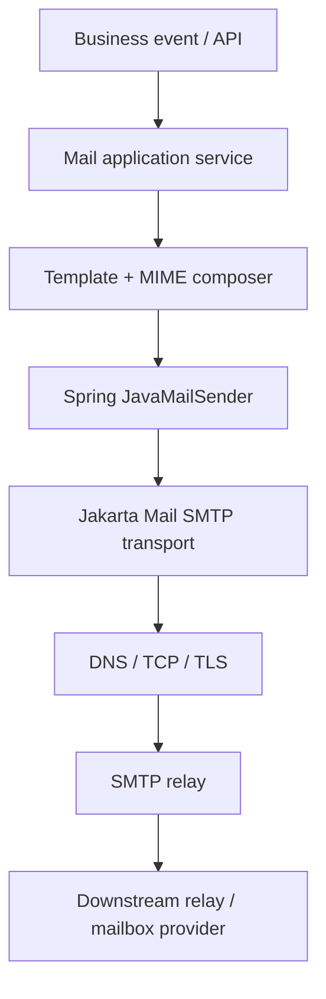
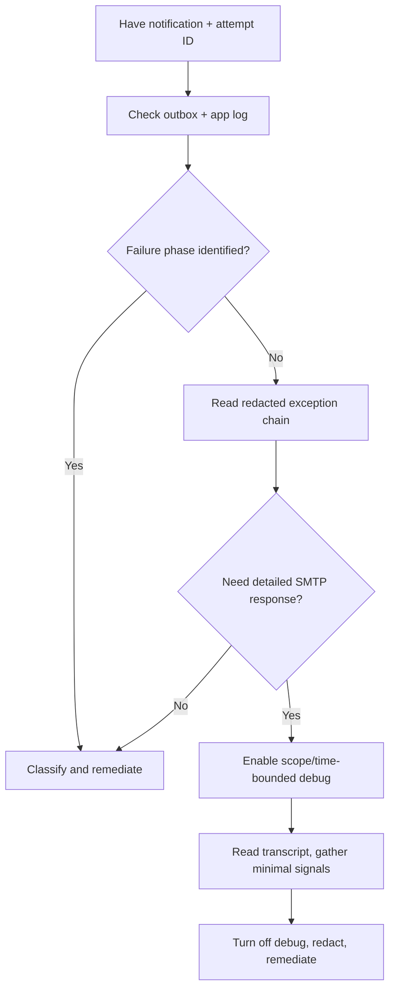
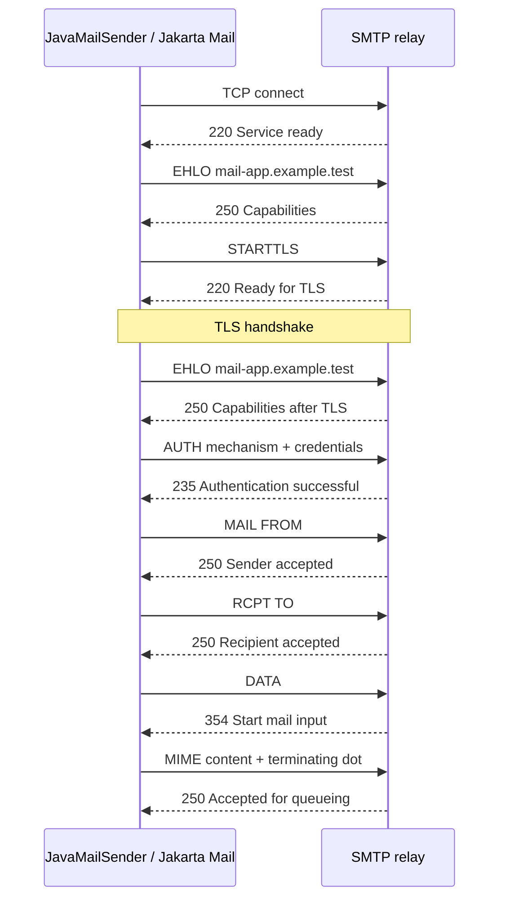

# Reading SMTP Logs at the Right Level

When a Spring Framework Mail application fails to send an email, the natural reaction is to turn on debug mode and search for lines containing `ERROR`. However, overly broad debugging generates massive, hard-to-read logs and risks exposing recipient addresses, headers, message bodies, attachments, URL tokens, or SMTP authentication secrets.

Effective email diagnostics is not about collecting as many logs as possible. What matters is **reading the right log layer at just enough detail to pinpoint the failing stage and next action**. Some incidents need only outbox status and the Spring Mail exception; some need relay response codes; only certain situations warrant temporarily enabling SMTP transcripts or TLS handshake logs in a controlled environment.

This lesson guides how to read SMTP logs in Spring Framework Mail: distinguishing application logs, Spring exceptions, Jakarta Mail debug, and provider logs; understanding `EHLO`, `STARTTLS`, `AUTH`, `MAIL FROM`, `RCPT TO`, and `DATA`; reading `2xx`/`3xx`/`4xx`/`5xx` and enhanced status codes; isolating DNS/TCP/TLS/AUTH/recipient/content errors; handling uncertain timeouts; enabling debug safely; logging with correlation IDs; and testing diagnostics. Examples target Spring Framework 6.x, Spring Boot 3.x, Java 21, and Jakarta Mail.

## 1. Log Layers in the Mail Sending Flow

A send request can pass through many components:



| Layer | Commonly seen signals | Appropriate questions |
|---|---|---|
| Business/outbox | Notification ID, `QUEUED`/`SENDING`/`SENT`/`FAILED`, attempt | Was the job created, claimed, and retried properly? |
| Application | Template ID, email type, error category | Did it fail before SMTP or during sending? |
| Spring Mail | `MailException`, nested cause, failed messages | Which step of the mail sender reported the error? |
| Jakarta Mail SMTP | Command and reply code | Did the relay reply at `EHLO`, `TLS`, `AUTH`, `MAIL`, `RCPT`, or `DATA`? |
| Network/TLS | Socket timeout, handshake, certificate | Was a secure connection established? |
| Provider | Queue ID, bounces, deferred/delivery events | What happened after the relay received the email? |

Do not use a signal from one layer to assert the outcome of another. `mailSender.send(...)` returning cleanly or a log showing `250 accepted` after DATA normally indicates the relay accepted the message; it does **not** prove the message reached the inbox or was read.

### 1.1. Three Questions Before Raising Log Levels

1. **Which notification?** Use `notificationId`, not necessarily the recipient's email as the search key.
2. **Which attempt?** A notification can retry multiple times, even across different workers. You need `attemptId` and timestamps.
3. **Which phase failed?** Template/MIME, DNS, TCP, TLS, AUTH, sender, recipient, DATA, or writing `SENT` status to the database?

Without separating attempts, an SMTP `451` line from the first try can be misattributed to the third try that succeeded. Without knowing the phase, a post-DATA timeout can be mistakenly treated as "definitely not sent", causing duplicate emails on retry.

## 2. Choosing Log Levels Based on Goal

| Application level | Information to log | When to use |
|---|---|---|
| `INFO` | Enqueue, claim, attempt start, relay accepted, state transitions | Daily monitoring |
| `WARN` | Retries, transient errors, rejected recipients, expired leases | Recoverable anomalies |
| `ERROR` | System config failures, dead-letter spikes, widespread send inability | Incidents and alerts |
| Bounded `DEBUG/TRACE` | Exception chain, SMTP command phase, controlled transcripts | Targeted incident reproduction |

These are application logging conventions, **not a rigid mapping between SMTP codes and logger levels**. A `550` for one bad address may just be a business `WARN`, whereas widespread `535` errors from a rotated secret may be a system `ERROR`.

### 2.1. When Is SMTP Debug Unnecessary?

If the error is a missing template, empty recipient data, missing attachment in storage, job not yet due, or worker not deployed, SMTP transcripts tell you nothing. Those steps fail **before opening an SMTP socket**.

An escalation workflow:



Never leave protocol debug running continuously just because an incident happened in the past.

## 3. Phases of an SMTP Session

SMTP is a request-response protocol. The client sends a command, and the relay returns a three-digit code, sometimes with an enhanced status code and description. A session over port 587 with STARTTLS might look like:



This is an **illustrative diagram**, not a mandatory transcript for every server. Some relays require no AUTH, some use implicit TLS, and some advertise different extensions or reject at earlier phases.

### 3.1. Connect and SMTP Banner

Relays typically reply `220` when ready for commands. If the application hits `Connection refused` or `Connect timed out`, there probably was no SMTP session to see a banner. That usually points to network/endpoint checks, not recipients.

### 3.2. `EHLO` and Server Capabilities

The client uses `EHLO` to query capabilities such as `STARTTLS`, `AUTH`, `SIZE`, and `8BITMIME`. Advertised capabilities before and after TLS can differ; the client may send `EHLO` again after `STARTTLS` succeeds.

Do not read a truncated `EHLO` log snippet and conclude the relay does not support `STARTTLS`. Check whether the transcript is complete and whether that `EHLO` occurred before or after TLS upgrade.

### 3.3. `STARTTLS` and SSL Handshake

With `STARTTLS`, the client sends `STARTTLS` over the plaintext connection and begins the TLS handshake once accepted. Certificate, hostname, or cipher/TLS version errors are often explained more clearly by a nested `SSLHandshakeException` than a single SMTP code.

### 3.4. `AUTH`

If the relay requires authentication, the client uses the negotiated `AUTH` mechanism. A common success reply is `235`. An error like `535` suggests authentication rejection, though you must also check provider policies, secrets, TLS mode, and the exact phase. **Do not enable credential logging to hunt for wrong passwords.**

### 3.5. `MAIL FROM` and `RCPT TO`

`MAIL FROM` is the envelope sender; `RCPT TO` is the envelope recipient. They do not have to match the MIME `From`, `To`, and `Cc` headers identically. When rejected at `MAIL FROM`, check sender/domain permissions; at `RCPT TO`, check recipients and relaying policies.

### 3.6. `DATA` and Final Reply

After `DATA`, `354` indicates the relay is ready for content. The client sends the MIME message plus the end-of-data marker; the reply **after DATA ends** determines whether the relay accepted the content for further processing. If the socket drops right after the client transmits DATA without a final reply, the outcome may be **uncertain**.

## 4. Example of a Redacted SMTP Transcript

```text
S: 220 smtp.example.test ESMTP service ready
C: EHLO mail-app.example.test
S: 250-smtp.example.test
S: 250-STARTTLS
S: 250-AUTH PLAIN LOGIN
S: 250 SIZE 26214400
C: STARTTLS
S: 220 Ready to start TLS
[TLS handshake completed]
C: EHLO mail-app.example.test
S: 250-AUTH PLAIN LOGIN
S: 250 SIZE 26214400
[AUTH exchange intentionally omitted]
S: 235 2.7.0 Authentication successful
C: MAIL FROM:<sender@example.test>
S: 250 2.1.0 Sender OK
C: RCPT TO:<recipient@example.test>
S: 250 2.1.5 Recipient OK
C: DATA
S: 354 End data with <CRLF>.<CRLF>
[MIME body intentionally omitted]
S: 250 2.0.0 Message accepted; queue id [REDACTED]
C: QUIT
S: 221 Closing connection
```

`C:` and `S:` are directional labels added for readability. Actual Jakarta Mail/Angus debug output may use different prefixes, such as `DEBUG SMTP:`, or print only partial commands. Never write parsers tightly coupled to one provider version's log format.

Interpretation:

1. First `220`: relay ready for SMTP connection.
2. `250-...` after `EHLO`: advertised capabilities.
3. `STARTTLS -> 220` then handshake: TLS upgraded.
4. `235`: AUTH succeeded for this session.
5. `MAIL FROM -> 250`: envelope sender accepted.
6. `RCPT TO -> 250`: recipient accepted in RCPT phase.
7. `DATA -> 354`: client permitted to start content transfer.
8. `250` **after DATA**: relay accepted the message for subsequent processing.
9. `221`: normal session close.

Do not confuse `250` from `EHLO` or `RCPT` with `250` after `DATA`. Same numeric code, different meaning depending on the command receiving the reply.

## 5. SMTP Reply Code Groups

SMTP replies consist of three digits. The leading digit usually indicates the outcome category:

| Group | General meaning | How to interpret in diagnostics |
|---|---|---|
| `2xx` | Command accepted/completed | Proceed to next phase or record success at current phase |
| `3xx` | More data needed from client | Not final success of the message |
| `4xx` | Temporary error | Usually consider retry with backoff and limits |
| `5xx` | Error cannot complete with current request | Inspect details/policy; do not retry verbatim endlessly |

Do not assume every `4xx` should be retried immediately or every `5xx` means "mailbox does not exist". Some providers enforce anti-abuse policies, quotas, or custom rules; read **phase + primary code + enhanced code + context**.

### 5.1. Common Codes Table

| Reply code | Common context | What to check |
|---|---|---|
| `220` | Server ready or ready for TLS | Connect/STARTTLS phase |
| `221` | Closing channel | Session termination |
| `235` | AUTH successful | Authentication accepted |
| `250` | Command accepted | Reply to `EHLO`, `MAIL`, `RCPT`, or `DATA`? |
| `251` | User not local, forwarding | Relay routing |
| `354` | Start mail input | Only signal to begin DATA |
| `421` | Service unavailable | Server/connection overloaded, maintenance |
| `450` | Mailbox/action temporarily unavailable | Retry per policy |
| `451` | Temporary processing error | Backoff, check provider |
| `452` | Temporary storage/capacity shortage | Quotas, system pressure |
| `530` | AUTH or policy condition required | Authentication, TLS requirements |
| `535` | Authentication rejected | Secret, AUTH mechanism, account policy |
| `550` | Mailbox unavailable or policy rejection | Enhanced code: mailbox or relay policy? |
| `552` | Storage/quota/message limit | MIME size, quota |
| `553` | Address/mailbox name rejected | Syntax, sender/recipient policy |
| `554` | Transaction/policy refusal | Failure phase, security/filtering |

These are common meanings, not substitutes for actual relay documentation. `550 5.1.1` and `550 5.7.1` can call for very different remediation actions.

## 6. Enhanced Status Codes

Some relays append an `x.y.z` code after the primary reply code:

```text
550 5.1.1 Recipient address rejected
451 4.3.0 Temporary system problem
550 5.7.1 Not authorized to relay
```

The first digit of the enhanced code denotes success/transient/permanent; subsequent digits classify the cause group and detail. Relays can customize text messages, so classifiers should not rely solely on free-form text.

Example:

```text
C: RCPT TO:<recipient@example.test>
S: 550 5.1.1 User unknown
```

Likely needs checking for address/recipient/suppression. Whereas:

```text
C: RCPT TO:<recipient@example.test>
S: 550 5.7.1 Relaying denied
```

Likely relates to relay permissions, sender/domain authorization, or account policy. Same `550` primary code, different action.

Do not build a classifier by searching for `"550"` in `exception.getMessage()` and deleting the recipient. Messages can contain multiple replies or nested exceptions; prefer structured codes and phases provided by the SMTP provider when available, then normalize for application policy.

## 7. Enabling Jakarta Mail Debug via Spring Boot

In Spring Boot, properties can be passed to Jakarta Mail under `spring.mail.properties`. A configuration **strictly for controlled diagnostics**:

```yaml
spring:
  mail:
    host: smtp.example.test
    port: 587
    username: ${SMTP_USERNAME}
    password: ${SMTP_PASSWORD}
    properties:
      "[mail.smtp.auth]": "true"
      "[mail.smtp.starttls.enable]": "true"
      "[mail.smtp.starttls.required]": "true"
      "[mail.smtp.connectiontimeout]": "5000"
      "[mail.smtp.timeout]": "10000"
      "[mail.smtp.writetimeout]": "10000"

      # Enable temporarily only; should be false in normal production.
      "[mail.debug]": "true"
      "[mail.debug.auth]": "false"
```

This configuration is for a relay using STARTTLS on port 587. For implicit TLS (usually on port 465), the provider may require `mail.smtp.ssl.enable` and different properties. Do not randomly enable both STARTTLS and implicit TLS and guess from errors.

`mail.debug.auth=false` helps suppress printing sensitive AUTH details on implementations supporting this property. However, **it does not guarantee every sensitive item is hidden**. Never enable AUTH credential logging in environments with real accounts.

### 7.1. Debug Output Does Not Necessarily Go Through SLF4J

Jakarta Mail implementations may print debug output to a `PrintStream`, often tied to stdout. This means:

- `logging.level.root=WARN` does **not guarantee** filtering output from `mail.debug=true`.
- `logging.level.org.springframework.mail=DEBUG` does **not necessarily** produce SMTP protocol transcripts.
- Container runtimes and log collectors may capture stdout even when application loggers do not log `DEBUG`.

Spring loggers and Jakarta Mail protocol debugging are two distinct observability mechanisms. Know where actual output goes before enabling.

### 7.2. Enabling on JavaMail `Session`

Jakarta Mail `Session` also exposes APIs:

```java
Session session = Session.getInstance(properties);
session.setDebug(true);
```

Implementations allow redirecting debug output:

```java
session.setDebugOut(debugPrintStream);
```

`debugPrintStream` must be a private, bounded sink handled per security policy; do not pipe every transcript into production logs. Never enable debug on a singleton `Session` shared across requests just to trace one notification, as it will record sessions from other jobs too.

### 7.3. Safe Debugging Rules

1. Reproduce with a test recipient on an SMTP sandbox or diagnostic instance.
2. Bound the scope: instance, provider, environment, and duration.
3. Ensure AUTH data and MIME bodies are not written to uncontrolled locations.
4. Restrict log access, retention, and debug volume.
5. Capture a redacted transcript showing phases and reply codes.
6. Turn off debug, verify it is off, and dispose of raw captures per retention policy.

Never turn on protocol debug across all of production just because one recipient was rejected, especially in systems sending password resets, OTPs, invoices, and private documents.

## 8. Three SMTP Timeouts to Distinguish

| Property | Wait type | Symptom |
|---|---|---|
| `mail.smtp.connectiontimeout` | Establishing TCP/socket connect | Cannot connect to host/port within time limit |
| `mail.smtp.timeout` | Reading replies from relay | Connected, yet slow/unresponsive |
| `mail.smtp.writetimeout` | Writing data to socket | Client stalls while transmitting data |

Client-layer timeouts are not outbox job TTLs, and do not themselves tell whether the relay received the message.

### 8.1. Connection Timeout vs. Connection Refused

Abbreviated cause chain example:

```text
MailSendException
  -> MailConnectException
     -> SocketTimeoutException: Connect timed out
```

Investigate hostname, DNS, port, egress firewall, proxy/NAT, and relay status. `Connection refused` usually means the TCP endpoint rejected the connection; `UnknownHostException` usually involves name resolution. These errors differ from AUTH rejection.

### 8.2. Read Timeout

```text
MailSendException
  -> MessagingException
     -> SocketTimeoutException: Read timed out
```

Read timeouts can happen at many phases. A read timeout after `EHLO` differs from a read timeout **after transmitting all DATA**. If the client finished sending content yet received no final reply, the outcome may be `UNKNOWN`.

### 8.3. Write Timeout

A write timeout while sending MIME content does not necessarily prove the relay received zero bytes. Part of the data may have arrived, or the server may have received everything while the client still failed. Never infer definitive send state from a lone exception name.

## 9. Diagnosing TLS and Certificates

Some symptoms:

```text
MessagingException: Could not convert socket to TLS
SSLHandshakeException: PKIX path building failed
SSLHandshakeException: No subject alternative DNS name matching ...
```

These are example messages; exact wording depends on JDK, provider, and truststore. Check:

1. Are host, port, and TLS mode right?
2. Does the provider use STARTTLS or implicit TLS?
3. Does the relay advertise STARTTLS after `EHLO`?
4. Is `mail.smtp.starttls.required` enabled appropriately?
5. Is the certificate chain trusted by the truststore?
6. Does the hostname match the certificate?
7. Do the JDK and relay share compatible TLS protocols/ciphers?

**Never fix errors by disabling certificate checks or accepting every hostname in production.** Doing so opens risks of eavesdropping and connecting to untrusted endpoints.

When deeper handshake insight is genuinely needed, the JDK supports:

```text
-Djavax.net.debug=ssl,handshake
```

Enable only temporarily for a controlled process/test traffic. TLS debugging generates large output, can expose session metadata, and should not be collected long-term in production.

| Port | Common role | Note |
|---|---|---|
| 25 | SMTP relay/server-to-server | May have egress blocked by cloud networks |
| 587 | Submission with STARTTLS | Requires provider-aligned config |
| 465 | Submission via implicit TLS | Do not treat as plaintext STARTTLS |
| Other ports | Custom sandbox/relay | Do not infer TLS mode from port alone |

## 10. Reading AUTH Failures: `530` and `535`

Redacted example:

```text
C: AUTH [REDACTED]
S: 535 5.7.8 Authentication credentials invalid
```

Check username/password/token, secret rotation, tenant SMTP account, AUTH mechanism, account status, provider security policy, TLS requirements, and provider SMTP AUTH configuration.

A widespread AUTH failure should not be retried rapidly like a per-recipient `451`. You may need to pause dispatchers, alert on configuration, and resume only after secrets or provider settings are fixed.

### 10.1. Base64 Does Not Make AUTH Payloads Safe

Some AUTH mechanisms encode data in Base64. This is not encryption. If transcripts contain AUTH payloads, anyone with logs can decode the data and read credentials. **Never enable `mail.debug.auth=true` on real accounts; never paste raw AUTH exchanges into tickets or chats.**

### 10.2. `530` Does Not Always Mean Wrong Password

`530 Authentication required` can appear when the client sends `MAIL FROM` before `AUTH`, or when the server requires STARTTLS/another policy. Read the command right before the reply; do not conclude "530 = wrong password" without sufficient evidence.

## 11. Sender and Recipient Errors at `MAIL FROM` / `RCPT TO`

Even after AUTH succeeds, the relay can reject the envelope sender or recipient:

- Sender not in a verified domain.
- SMTP account not permitted to send as the chosen `From` address.
- Tenant lacks a valid sender identity.
- Recipient does not exist or mailbox is disabled.
- Relay disallows the current account from forwarding to external domains.
- Recipient/domain is on a suppression list or blocked by anti-spam policy.

Example:

```text
C: MAIL FROM:<notifications@example.test>
S: 550 5.7.1 Sender address not authorized
```

Differs from:

```text
C: RCPT TO:<recipient@example.test>
S: 550 5.1.1 Recipient mailbox unavailable
```

In the first example, investigate sender/domain authorization. In the second example, investigate the recipient address. Both use code `550`, yet require completely different actions.

### 11.1. Envelope Sender Can Differ from `From` Header

A MIME message may have:

```text
From: "System notifications" <notifications@example.test>
To: Recipient <recipient@example.test>
```

yet the SMTP envelope sender may be a bounce/return-path address or an address selected by transport/provider. When failures occur at `MAIL FROM`, know which envelope address was actually sent. Do not just read `MimeMessageHelper.setFrom(...)` and assume all sender identities match.

### 11.2. Do Not Log Entire Recipient Lists

Email addresses are personal data. When diagnosing multi-recipient jobs, prefer authorized internal recipient references or properly masked addresses. An unsalted email hash remains vulnerable to dictionary attacks; do not treat simple hashing as full anonymization.

## 12. Errors at `DATA`: Size and Content

The relay may accept `MAIL FROM` and `RCPT TO`, yet reject after receiving content. Common causes:

- MIME message exceeds the relay's maximum size.
- Content blocked by spam/policy filters.
- Disallowed attachment or suspected malware.
- Invalid headers, body, transfer encoding, or MIME structure.
- Sender domain not authorized under policy.
- Account quota, provider rate limits, or storage limits.

Example:

```text
C: DATA
S: 354 Start mail input
[MIME content omitted]
S: 552 5.3.4 Message size exceeds fixed maximum
```

The relay let the client start DATA, yet ultimately rejected the message. Never mark `SENT` just because `354` arrived.

### 12.1. MIME Size Is Larger Than Raw Files

Attachments may be Base64-encoded, plus headers and boundaries. Total SMTP transfer size therefore exceeds raw file sizes. Do not compare only raw file sizes against the exact provider limit. Leave headroom for overhead, cap attachment counts/types, and measure actual serialized sizes when needed.

### 12.2. Do Not Dump MIME Bodies for Routine Troubleshooting

A MIME message can contain personal info, invoices, token links, inline images, and attachments. When diagnosing "why 552", start with message size, attachment count, content types, and provider limits. Capture raw MIME only in test environments with dummy data or under an authorized investigation workflow with strict access and retention.

## 13. Reading Spring Mail Exceptions

Spring Mail uses `org.springframework.mail.MailException` (a runtime exception) and its subclasses. Common types:

| Exception | Common scenario | Where to inspect next |
|---|---|---|
| `MailAuthenticationException` | AUTH failed | Account, secret, nested provider cause |
| `MailPreparationException` | Callback/service building message failed | Template, attachments, helper |
| `MailSendException` | One or more messages failed to send | Failed messages, cause, SMTP reply |
| `MailParseException` | Invalid address/header/message parsing | Input, MIME construction |
| `Other MailException` | General mail error | Failure phase and nested exceptions |

An application directly constructing `MimeMessage` can also encounter `jakarta.mail.MessagingException`. Spring's mail sender may wrap Jakarta Mail errors in its hierarchy depending on implementation and call path.

### 13.1. Reading the Cause Chain

Example error tree (illustrative only):

```text
org.springframework.mail.MailSendException
  nested: jakarta.mail.MessagingException: Could not connect
    nested: java.net.ConnectException: Connection refused
```

The outer exception indicates sending failed; the nested `ConnectException` points investigation toward network/endpoint. Do not treat it as a recipient or body issue.

Another example:

```text
org.springframework.mail.MailAuthenticationException
  nested: Authentication rejected (provider-specific)
```

This case requires investigating credentials and policy. If a classifier returns only `SEND_FAILED` for all of the above, retry policies cannot be accurate.

### 13.2. `MailSendException` and Failed Messages

`MailSendException` can provide a mapping between failed messages and exceptions:

```java
import org.springframework.mail.MailSendException;

void inspectBatchFailure(MailSendException ex) {
    for (Exception failure : ex.getFailedMessages().values()) {
        String category = mailErrorClassifier.categoryOf(failure);
        recordFailureCategory(category);
    }
}
```

`mailErrorClassifier` and `recordFailureCategory` are application abstractions. **Never log** `ex.getFailedMessages().toString()` or map keys directly: keys can be MIME messages containing headers/bodies/addresses. If per-recipient outcomes are needed, design separate notification/recipient references.

### 13.3. `getCause` and `getNextException` Are Not Always Identical

Some Jakarta Mail `MessagingException` instances maintain an extra chain via `getNextException()`, alongside `Throwable.getCause()`. When deeply investigating or building classifiers, inspect both so provider-specific `SendFailedException` or address failures are not missed.

SMTP providers may expose custom subclasses carrying reply codes; those are implementation-dependent APIs. When code checks provider-specific classes, include fallback branches so the entire system is not locked to one exception format.

## 14. Writing Application Logs at the Right Level

Pattern to avoid in production:

```java
try {
    mailSender.send(message);
} catch (Exception ex) {
    log.error("Send mail failed: {}", ex.getMessage(), ex);
}
```

Exception text and stack traces from providers can contain addresses, internal hostnames, or sensitive metadata; if the exception is also swallowed, the application may mark job state wrongly. There is no reason to print full stack traces for every single rejected recipient.

Build a stable error category:

```java
public enum MailFailureCategory {
    AUTHENTICATION,
    CONNECTION,
    TLS,
    TEMPORARY_SMTP,
    PERMANENT_SMTP,
    MESSAGE_PREPARATION,
    UNKNOWN_OUTCOME,
    UNCLASSIFIED
}
```

And a logger using validated fields:

```java
import org.slf4j.Logger;
import org.slf4j.LoggerFactory;
import org.springframework.stereotype.Component;

@Component
public final class MailAttemptLogger {

    private static final Logger log =
            LoggerFactory.getLogger(MailAttemptLogger.class);

    public void relayAccepted(
            String notificationId,
            String attemptId,
            long durationMillis) {
        log.info(
                "event=mail_smtp_accepted notificationId={} " +
                "attemptId={} durationMs={}",
                notificationId, attemptId, durationMillis);
    }

    public void attemptFailed(
            String notificationId,
            String attemptId,
            MailFailureCategory category,
            String safeCode) {
        log.warn(
                "event=mail_attempt_failed notificationId={} " +
                "attemptId={} category={} code={}",
                notificationId, attemptId, category, safeCode);
    }
}
```

`safeCode` should be an application-normalized code, **not** `ex.getMessage()`. Validate notification/attempt ID format, length, and absence of CR/LF to prevent log injection. When stack traces are required for investigation, write them to an access-restricted sink under redacted incident/debug policies.

### 14.1. Illustrating an Attempt

```java
public void sendOne(MailJob job) {
    String attemptId = UUID.randomUUID().toString();
    long started = System.nanoTime();

    MimeMessage message;
    try {
        message = composer.compose(job);
        mailSender.send(message);
    } catch (MailException | MessagingException ex) {
        FailureDecision decision = classifier.classify(ex, job);
        attemptLogger.attemptFailed(
                job.notificationId(), attemptId,
                decision.category(), decision.safeErrorCode());
        statusService.applyFailure(
                job.id(), job.leaseToken(), decision);
        return;
    }

    long millis = Duration.ofNanos(
            System.nanoTime() - started).toMillis();
    attemptLogger.relayAccepted(
            job.notificationId(), attemptId, millis);

    // Recording SENT has its own errors; must not be treated as SMTP rejection.
    boolean recorded = statusService.markSent(
            job.id(), job.leaseToken());
    if (!recorded) {
        incidentRecorder.recordStateConflict(
                job.notificationId(), attemptId);
    }
}
```

This is a skeleton: `MailJob`, `composer`, `classifier`, `FailureDecision`, `statusService`, and `incidentRecorder` are application-defined; corresponding Java/Spring/Jakarta imports must be added. Crucially, **distinguish SMTP outcome from database state persistence outcome**.

### 14.2. SMTP Accepted Yet Recording `SENT` Failed

If `mailSender.send(...)` returns cleanly yet the `markSent(...)` transaction fails to commit, the relay may have accepted the email while the outbox remains `SENDING`. When the lease expires, a retry can create a duplicate. Log these as two distinct events:

```text
event=mail_smtp_accepted notificationId=... attemptId=...
event=mail_state_recorded notificationId=... state=SENT
```

If only the first event exists, that is an error or missing proof of **database acknowledgment**, not proof of SMTP rejection.

## 15. Correlation ID, Notification ID, and Attempt ID

A notification may retry multiple times across multiple workers:

| ID | Scope | Changes on retry? |
|---|---|---|
| `correlationId` | Original request flow or trace | Usually kept to link origin |
| `notificationId` | One send intent | No |
| `attemptId` | One specific attempt | Yes |
| `providerMessageId` | ID returned by provider if any | May differ per attempt |

Example:

```text
09:01 correlationId=REQ-77 notificationId=mail-981 attemptId=A1
      event=smtp_temporary_error code=451
09:03 correlationId=REQ-77 notificationId=mail-981 attemptId=A2
      event=smtp_temporary_error code=451
09:08 correlationId=REQ-77 notificationId=mail-981 attemptId=A3
      event=mail_smtp_accepted code=250
09:08 correlationId=REQ-77 notificationId=mail-981
      event=outbox_transition status=SENT
```

No need to log recipient emails to link retries. When using Micrometer Tracing or OpenTelemetry, let instrumentation manage spans; MDC correlation fields do not by themselves create distributed traces.

### 15.1. Metric Labels Should Have Bounded Cardinality

```text
mail_smtp_attempts_total{outcome="temporary",phase="rcpt"}
mail_smtp_attempts_total{outcome="accepted",phase="data"}
mail_smtp_duration_seconds{provider="primary"}
mail_outbox_backlog{status="QUEUED"}
```

Provider, phase, outcome, and error category are suitable metric labels when values are bounded. Recipient emails, notification IDs, correlation IDs, or full SMTP replies are unsuitable due to high cardinality and potential private data exposure.

## 16. Partial Success: One Message with Multiple Recipients

If a MIME message has multiple recipients, some addresses may be accepted by the relay while others are rejected:

```text
C: RCPT TO:<recipient-a@example.test>
S: 250 2.1.5 Accepted
C: RCPT TO:<recipient-b@example.test>
S: 550 5.1.1 User unknown
```

Seeing `550` does not mean every recipient failed. Retrying the entire batch without tracking which addresses were accepted puts recipient A at risk of duplicates.

### 16.1. Design Simplifying Diagnostics

For personalized emails or accurate retries, it is usually easier to manage **one outbox row per recipient**, each with its own notification ID/idempotency key. If batch sending is required, track per-recipient state or outcomes and read `MailSendException`/SMTP partial success accurately.

### 16.2. Do Not Mis-Mark `SENT`

Do not mark the entire job `SENT` just because one recipient returned `250`. Conversely, do not retry every address just because one returned `550`. Inspect all `RCPT TO` results, DATA outcomes, and per-recipient errors before updating state at your designed granularity.

## 17. SMTP Accepted Yet Recipient Does Not See the Email

A transcript ending with:

```text
250 2.0.0 Message accepted for delivery
```

does not prove the inbox received it. Queueing, relay hops, content filtering, mailbox quotas, bounces, or spam placement happen afterwards. If a user reports missing email despite the app logging `SENT`:

1. Check provider dashboard/message traces if available.
2. Check queue ID and provider message ID.
3. Check bounce, complaint, deferred events, and suppression lists.
4. Verify the system stored/selected the right recipient.
5. Check SPF, DKIM, DMARC, and sender reputation if deliverability-related.
6. Check spam/quarantine with proper access and evidence.
7. Do not immediately resend before checking whether the prior email is still in transit.

Not every environment has delivery webhooks. If unavailable, clearly state the observability limit; absence of a bounce event is **not proof** of inbox delivery.

## 18. Reading Logs with Multiple Workers and Retries

Example:

```text
10:00 worker-A claimed job-123 lease=L1
10:01 worker-A submitted DATA, waiting for response
10:02 lease L1 expires
10:02 worker-B claimed job-123 lease=L2
10:03 worker-B SMTP accepted
10:03 worker-A receives delayed response; markSent(L1) returns zero rows
```

Filtering only by job ID while ignoring `leaseToken`/`attemptId` can hide why two sends happened. Log worker ID, attempt ID, lease reference, claim time, SMTP call time, submit outcome, and state transitions.

**Lease tokens guard database updates**, not an already-started SMTP call. A worker whose lease expired can still finish sending the email; blocking its `SENT` write does not pull the email back from the relay.

### 18.1. `UNKNOWN` Outcomes Must Have Phase Evidence

```text
notificationId=mail-981
attemptId=A3
smtpPhase=AFTER_DATA
outcome=UNKNOWN
errorCode=SMTP_RESPONSE_LOST
retryDecision=REQUIRES_RECONCILIATION
```

Record `AFTER_DATA` only if instrumentation has sufficient proof the client finished transmitting data and awaited the final reply. Never infer the phase from a bare `SocketTimeoutException`. If unknown, log `phase=UNKNOWN` and classify per cautious policy.

## 19. Collecting Logs Without Leaking Data

### 19.1. Signals to Preserve

- Timestamps with timezone; synchronized clocks across workers.
- Notification ID, attempt ID, worker/instance.
- Normalized provider or endpoint identifier.
- SMTP phase, primary reply code, enhanced status code.
- Error category and classified exception class.
- Latency and timeout configs (excluding secrets).
- Outbox transitions and retry decisions.

### 19.2. Data to Redact or Avoid Logging

- SMTP username/password, OAuth tokens, AUTH payloads.
- Headers/bodies containing personal info and attachments.
- Reset URLs, OTPs, session cookies, JWTs.
- Full `To`/`Cc`/`Bcc` lists.
- Raw provider responses containing sensitive addresses or data.
- Internal storage paths and unrelated authorization details.

### 19.3. Redaction Must Still Preserve Failure Signals

```text
Input concept:
RCPT TO:<private-person@company.test>
550 5.1.1 User unknown

Sanitized:
RCPT TO:<recipient-[REDACTED]>
550 5.1.1 User unknown
```

The redacted snippet still shows the recipient was rejected during RCPT with enhanced code `5.1.1`, without exposing the real address.

### 19.4. Log Injection and Retention

External server messages and headers may contain CR/LF or long strings. When emitting structured logs, cap lengths and escape control characters to prevent log injection. Do not treat raw SMTP response text as a trusted classification field.

Raw debug transcripts must have restricted access, short retention, and policy-driven deletion. Never paste logs with AUTH or customer bodies into public tickets or broad chat channels.

## 20. Symptom-Based Runbook

| Symptom | Layer/phase to read first | Action |
|---|---|---|
| No attempt recorded | API/outbox/worker | Check enqueue, due time, scheduler, lease |
| `UnknownHostException` | DNS | Hostname, DNS configuration |
| `Connection refused` | TCP/connect | Port, firewall, relay listening |
| `Connect timed out` | Network | Egress policy, routing, provider reachability |
| `SSLHandshakeException` | TLS | STARTTLS/implicit TLS, certificate, truststore |
| `530` at `MAIL FROM` | SMTP AUTH/policy | Check AUTH/TLS requirements |
| `535` at `AUTH` | Authentication | Secret, auth mechanism, provider policy |
| `550 5.1.1` at `RCPT` | Recipient | Address, suppression, mailbox state |
| `550 5.7.1` at `RCPT`/`MAIL` | Relay policy | Domain, sender permissions, relay authorization |
| `451` | Temporary SMTP | Backoff, server status, retry window |
| `552` after `DATA` | Content/size | MIME size, quota, policy |
| Timeout after `DATA` | SMTP outcome | `UNKNOWN`, duplicate risk |
| Accepted yet outbox still `SENDING` | Database/lease | Ack update, race, crash |
| Accepted yet missing from inbox | Delivery provider | Bounces, queues, spam, mailbox policies |

### 20.1. A Concrete Investigation Workflow

**Step 1:** Gather notification ID, attempt ID, environment, and timestamps; normalize timezones when correlating events.

**Step 2:** Check whether the job reached `QUEUED`, `SENDING`, and has an attempt. If it never entered SMTP, protocol debug is unnecessary.

**Step 3:** Use exceptions/states to pinpoint the phase: connect, TLS, AUTH, `MAIL FROM`, `RCPT TO`, DATA, or database ack.

**Step 4:** Read redacted codes/exception classes/responses and cross-check provider policies.

**Step 5:** Only when necessary, reproduce with tightly scoped debug without logging AUTH credentials or MIME bodies.

**Step 6:** Decide temporary, permanent, or unknown; apply retry, suppression, and duplicate policies.

**Step 7:** Remediate, run a controlled test, verify state transitions, turn off debug, and retain filtered evidence.

## 21. Practicing with an SMTP Sandbox and Controlled Tests

An SMTP sandbox such as Mailpit captures emails locally/in test and lets you inspect MIME structure. Run:

```bash
docker run --rm --name mailpit -p 1025:1025 -p 8025:8025 axllent/mailpit
```

Example Spring Boot configuration strictly for local environments:

```yaml
spring:
  mail:
    host: localhost
    port: 1025
    properties:
      "[mail.smtp.auth]": "false"
      "[mail.smtp.starttls.enable]": "false"
      "[mail.smtp.connectiontimeout]": "3000"
      "[mail.smtp.timeout]": "5000"
      "[mail.smtp.writetimeout]": "5000"
      "[mail.debug]": "false"
```

This is a sandbox configuration without SMTP AUTH/TLS; **never copy to production**. Mailpit lets you inspect emails sent to the sandbox, yet does not by default reproduce every `4xx`/`5xx` reply, TLS handshake, or timeout. For those failures, use a reply-controllable SMTP test server, fault injection, or dedicated integration tests.

### 21.1. Testing Each Error Category

Create cases for:

1. Template/MIME validation failing before opening a connection.
2. DNS failing to resolve hostname.
3. Connection refused at `host`/`port`.
4. TLS handshake failure.
5. SMTP authentication rejected.
6. Recipient rejected with permanent code.
7. Relay returning temporary `451` error.
8. Relay accepting after DATA.
9. Lost response after DATA, outcome `UNKNOWN`.
10. `mailSender.send(...)` succeeding yet updating outbox `SENT` failing.

For each scenario, tests should assert the matching **error category, phase, status, and retry policy**. Do not merely assert an `ERROR` line exists in logs; the goal is ensuring the system makes the right decision.

### 21.2. Testing Without Secret Leaks

In tests, use dummy SMTP credentials, email bodies with a marker string, and dummy URL tokens:

```text
SECRET_TEST_MARKER_DO_NOT_LOG
```

Capture application logger output and verify the marker, dummy password, token, and MIME body **do not appear** in production-format logs. Test both success and exception branches. If testing `mail.debug=true`, inspect stdout separately since output may bypass SLF4J appenders.

### 21.3. Testing Ambiguous Timeouts and Idempotency

Simulate a relay accepting DATA while the worker receives no final reply. A good test ensures:

- The classifier does not record `PERMANENT_REJECTION` without a rejection response.
- The outbox preserves `lastAttemptOutcome=UNKNOWN` or equivalent metadata.
- Retries follow policy, accounting for duplicate risk.
- On replay, the notification ID/idempotency intent stays stable while attempt ID is new.

If the provider exposes lookup/tracking ID APIs, test reconciliation too. Never assume `Message-ID` gives SMTP exactly-once delivery.

### 21.4. Testing Partial Success

Simulate two recipients: A accepted by relay, B rejected. If using one outbox row per recipient, verify only B retries per policy. If one message has multiple recipients, verify per-address state tracking avoids duplicating A.

### 21.5. Testing Clocks, Queues, and Leases

Simulate an SMTP attempt slower than the lease. Verify logs contain worker ID, attempt ID, and the lease-expired event without mixing up the two sends. Use an injectable clock so tests do not sleep in real time. Conditional update failures after relay acceptance must be distinguished from SMTP errors.

## 22. Common Mistakes When Reading SMTP Logs

**Enabling `DEBUG` across all of production.** Increases noise, storage costs, and data-leak risk. Enable only with tight scope and duration controls.

**Assuming `logging.level=DEBUG` and `mail.debug=true` are the same mechanism.** Protocol debug may go straight to stdout, bypassing SLF4J filters used by the app.

**Enabling `mail.debug.auth=true` to check passwords.** Risks exposing credentials, especially Base64-encoded AUTH payloads. Never do this on real accounts.

**Seeing `250` and concluding it reached the inbox.** Know whether `250` belongs to `EHLO`, `MAIL FROM`, `RCPT TO`, or post-DATA; SMTP accepted differs from final delivery.

**Seeing `354` and immediately marking `SENT`.** `354` is only an invitation to begin DATA, not message acceptance.

**Seeing `550` and immediately deleting the recipient.** `550` can involve mailbox or relay policy; inspect enhanced codes and command phases.

**Seeing a timeout and immediately retrying.** Post-DATA timeouts may be `UNKNOWN`; retrying risks duplicates.

**Reading only the outer `MailSendException`.** Nested causes may be `ConnectException`, `SSLHandshakeException`, SMTP statuses, or failed recipients.

**Dumping `MailSendException.getFailedMessages()` into logs.** The map can hold MIME messages/recipients and sensitive metadata.

**Using raw exception messages as metric labels.** High cardinality, unstable format, and potential email address leaks.

**Lumping every failure into "SMTP server error".** Template, storage, DNS, TLS, AUTH, RCPT, DATA, and database acknowledgment errors have distinct causes.

**Equating SMTP accepted with outbox `SENT`.** A gap exists between relay acceptance and committing state in the database.

**Failing to distinguish multiple attempts of one notification.** Easy to misdiagnose when workers retry or leases expire.

**Forgetting to turn off debug after an incident.** Sensitive data keeps accumulating, raising risk and burying new signals in noise.

## 23. Practice Exercises

### Part A — Reading Transcripts by Phase

Given a transcript with `EHLO`, `STARTTLS`, `AUTH`, `MAIL FROM`, `RCPT TO`, `DATA`, and `QUIT`, locate `220`, `235`, `250`, and `354`. Explain why `250` after DATA differs from `250` at `EHLO`.

### Part B — Reading Enhanced Status Codes

Given replies `451 4.3.0`, `535 5.7.8`, `550 5.1.1`, and `550 5.7.1`, state the phase to check, hypothesis, and safest first action for each code.

### Part C — Distinguishing Timeouts

Simulate a connection timeout, a read timeout before DATA, and a lost response after DATA. Decide retry/`UNKNOWN` and describe duplicate likelihood.

### Part D — Enabling Controlled Protocol Debug

Create a test Spring Boot profile, send to an SMTP sandbox using dummy accounts/recipients, and temporarily enable `mail.debug=true`. Observe whether output goes to SLF4J or stdout, then turn it off and confirm config returns to normal.

### Part E — Writing a Classifier

Build a classifier from exception type, cause chain, SMTP phase, and primary/enhanced reply codes. Return `CONNECTION`, `TLS`, `AUTHENTICATION`, `TEMPORARY_SMTP`, `PERMANENT_SMTP`, or `UNKNOWN_OUTCOME`. Write tests for each category.

### Part F — Logging by Notification and Attempt

Create a notification through an outbox, simulate two `451` failures followed by one success. Reuse the same notification ID, generate distinct attempt IDs, and log retry times. Reconstruct the timeline without recipient addresses.

### Part G — Failure After SMTP Acceptance

Simulate `mailSender.send(...)` succeeding while `markSent(...)` fails. Verify the application logs `database_ack_failure`/state conflict rather than classifying it as a recipient rejection.

### Part H — Redaction

Place a dummy secret marker and dummy URL token into a test email. Verify production logs retain only phase, status code, category, and permitted IDs—never the marker, MIME body, attachments, or AUTH.

### Part I — Provider Runbook

For your project's actual SMTP relay, document hostname, port, TLS mode, authentication mechanism, size limits, rate limits, provider-specific response codes, message trace tools, and support channels. Exclude secrets from the runbook.

## 24. Checklist Before Concluding a Send Outcome

- Do you have notification ID, attempt ID, and timezone-aware timestamps?
- Do logs belong to the same worker/lease and the same send attempt?
- Was the message built successfully before opening SMTP?
- Did TCP connect to the right host/port?
- Were TLS mode and certificates verified?
- Was AUTH required and successful?
- Was the envelope sender accepted by the relay?
- Was the recipient rejected at RCPT or accepted?
- Did DATA start and receive a final reply?
- Which command did the reply code belong to? What was the enhanced code?
- Was there partial success across multiple recipients?
- Did the timeout happen before or after the stage where the relay could have received the message?
- Did both `mailSender.send(...)` and the `SENT` update succeed?
- Is the failure temporary, permanent, or `UNKNOWN`?
- Do retries obey backoff, TTL, suppression, and duplicate policies?
- Does the provider expose bounce/delivery events to inspect?
- Did debug logs accidentally spill into stdout/log aggregators?
- Were AUTH, passwords, bodies, recipients, and tokens redacted?
- Was debug turned off and raw data handled per retention?

## 25. Summary

Reading SMTP logs at the right level starts by **identifying one notification and one attempt**, then finding the **last phase with evidence**: pre-SMTP, connect, TLS, AUTH, `MAIL FROM`, `RCPT TO`, `DATA`, or post-SMTP state update. From there, inspect reply codes, enhanced status codes, and nested exceptions to classify the error. Never pluck a `250` or `550` out of context to judge the entire flow.

In daily operations, prefer structured application logs with correlation IDs, notification IDs, attempt IDs, phases, outcomes, and normalized error codes. Enable Jakarta Mail protocol debug only narrowly when needed, as output can bypass SLF4J straight to stdout and include sensitive data. Never enable AUTH credential logging, never dump MIME bodies, and never use raw exception messages as metric labels.

Finally, **SMTP accepted does not mean delivered**, and a post-DATA timeout can be an **indeterminate outcome**, not proof the email was definitely never sent. A reliable Spring Framework Mail system connects log reading with outbox states, retry policies, and idempotency to fix root causes without generating duplicate emails.


