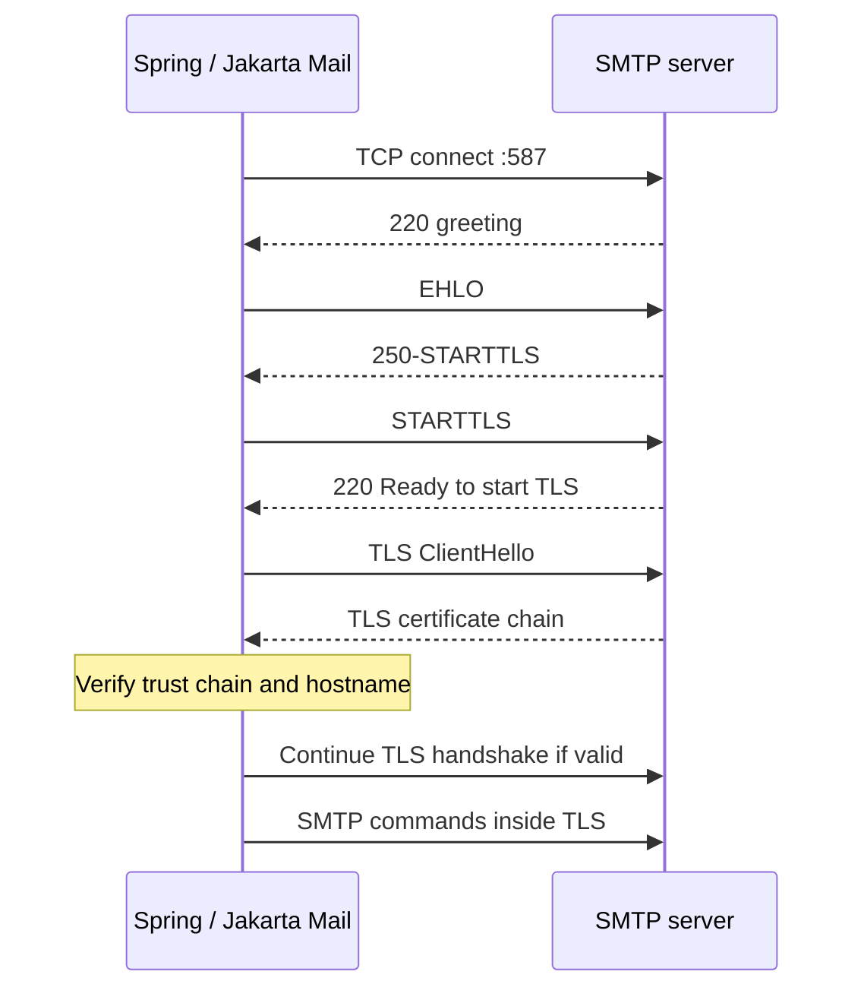
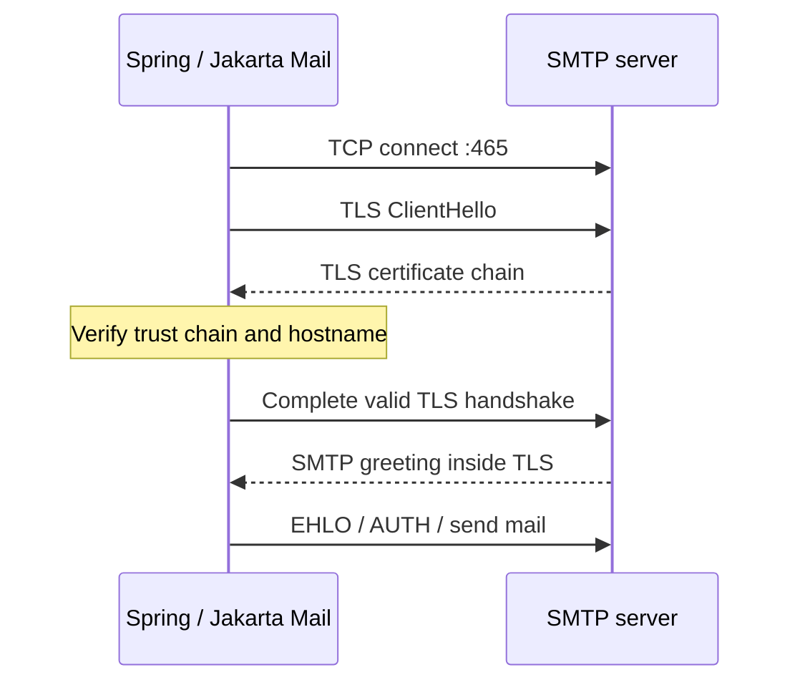

# Trust Stores and How to Avoid Disabling TLS Verification

When configuring Spring Boot to send email over SMTP, an application may encounter errors such as `SSLHandshakeException: PKIX path building failed`, `unable to find valid certification path to requested target`, or `No subject alternative DNS name matching smtp.example.com found`. A “quick fix” often suggested on forums is setting `mail.smtp.ssl.trust=*`, disabling `mail.smtp.ssl.checkserveridentity`, or creating a `TrustManager` that accepts every certificate. After that change, emails might go through, yet **the application has traded away its ability to verify the SMTP server's identity in exchange for error-free connections**.

In **Spring Framework Mail**, a secure configuration must protect both: **encrypting the transport channel** and **verifying that the endpoint is genuinely the SMTP server the application intends to connect to**. A trust store is the repository of certificates/trust anchors Java trusts to verify the server's certificate chain. A trust store does not replace hostname verification; conversely, hostname verification is not strong enough if the client accepts any certificate from any source.

This lesson in the **SMTP Security** chapter explains how trust stores work in Java/Jakarta Mail, how to configure TLS with `JavaMailSender`, how to fix certificate errors **without disabling verification**, and procedures for testing, deployment, rotation, and diagnosis in real Spring Boot environments.

## 1. The threat that TLS verification must prevent

Suppose the application intends to connect to `smtp.example.com:587` to send invoices. Along the connection path there may be routers, corporate proxies, cloud networks, or a misconfigured endpoint. If an attacker redirects the connection to another machine, merely encrypting traffic with TLS is not enough: the client must also verify that the machine it is talking to **is actually the trusted endpoint**.

TLS has three related goals:

1. **Confidentiality:** network observers cannot read transmitted content once valid TLS is established.
2. **Integrity:** data transmitted over the TLS session is protected against undetected modification.
3. **Server authentication:** the client verifies that the server's certificate belongs to a trusted chain and matches the hostname the client intends to connect to.

If certificate verification is disabled, any machine could present a self-signed certificate and still be accepted by the application under certain configurations. In that case, SMTP usernames/passwords, message content, and attachments risk being disclosed to a spoofed server.

**Protection scope note:** TLS between the application and the SMTP submission server is **hop-by-hop protection**, not end-to-end encryption for the recipient. Subsequent SMTP relays or mailbox providers can still process content under the standard email model. SPF, DKIM, and DMARC solve other domain authentication/mail policy problems; they do not replace TLS certificate verification on the SMTP connection.

## 2. STARTTLS and implicit TLS: two points where security begins

Two common submission configurations:

| Mode | Common port | When TLS starts | Typical Jakarta Mail configuration |
|---|---|---|---|
| STARTTLS | `587` | TCP connects first; client reads SMTP greeting/EHLO and upgrades via STARTTLS. | `mail.smtp.starttls.enable=true` and `mail.smtp.starttls.required=true`. |
| Implicit TLS (TLS-on-connect) | `465` | TLS handshake happens immediately upon opening the TCP connection. | `mail.smtp.ssl.enable=true`. |

These ports are common conventions, **not a guarantee that every provider supports the exact same mode**. Always obtain the hostname, port, and TLS mode from your SMTP provider's documentation or internal mail relay.

### 2.1. STARTTLS flow



In STARTTLS mode, the client must ensure it does not send credentials or content requiring protection over an un-upgraded session. Setting `mail.smtp.starttls.required=true` causes sending to **fail rather than silently continue without TLS** when the server does not support STARTTLS.

A downgrade/STARTTLS stripping attack may try to hide the STARTTLS capability from the client. If the application only turns on `enable` without `required`, some configurations may proceed with the protocol without TLS established. For SMTP submission involving AUTH and sensitive data, require TLS per provider policy.

### 2.2. Implicit TLS flow



Implicit TLS differs from STARTTLS in **exchange order**, yet both require certificate and hostname verification. Never “fix” an SSL handshake failure by arbitrarily switching ports or disabling server checks.

## 3. What is a trust store?

A **trust store** is the repository of trust material Java uses to build and verify the certificate path presented by a server. Typically it contains one or more CA (Certification Authority) certificates trusted by the organization or system.

Example:

```text
Application trust store
└── Corporate Root CA 2026 (trust anchor)

SMTP server sends certificate chain:
  smtp.internal.example.com (leaf/server certificate)
       |
       v
  Corporate Issuing CA 2026 (intermediate)
       |
       v
  Corporate Root CA 2026 (root/trust anchor)
```

Java checks whether the server's chain can be linked to an accepted trust anchor and whether the associated validation conditions are met.

### 3.1. Distinguishing trust store and key store

| Store | Typical contents | Purpose |
|---|---|---|
| **Trust store** | CA certificates, allowed trust anchors | Verifies the **remote party's** certificate in TLS. |
| **Key store** | Private key along with the application's own certificate (when present) | Proves the **application's own identity** when mTLS/client authentication is required. |

In typical email submission, JavaMail uses a username/password or OAuth2 for SMTP AUTH, while client-side TLS verifies the server certificate via the trust store. Most mail-sending applications **do not need client certificates/mTLS**; only if an internal relay requires mTLS do you also configure a key store, client identity, and secret lifecycle.

**Do not confuse importing a CA into a trust store with provisioning a private key for the application.** A trust store is for verifying peers; a key store may contain private keys and requires special protection.

### 3.2. Root CA, intermediate CA, and leaf certificate

- **Root CA:** the root certificate accepted as a trust anchor by policy.
- **Intermediate CA:** an intermediate CA signed by the root CA and used to sign server certificates.
- **Leaf/server certificate:** the SMTP endpoint's certificate, typically containing the hostname in `subjectAltName`.
- **Certificate chain:** the sequence linking signatures and attributes from the leaf through intermediates up to the trust anchor.

A server needs to present a proper chain, especially required intermediates. A valid leaf certificate alone is not enough if Java cannot build a chain to a trusted trust anchor.

### 3.3. A trust store is not a dumping ground for every certificate you see

When hitting a PKIX error, do not blindly grab the certificate from the failing connection and import it into the trust store. An attacker or unwanted proxy may be serving that exact certificate.

Only add a CA/trust anchor when:

1. The certificate's origin is confirmed through an **independent trusted channel**.
2. That CA is genuinely authorized to sign certificates for the SMTP endpoint.
3. The fingerprint or identifying details match the official source.
4. The trust scope and rotation plan are approved.

Trusting a CA means granting verification authority to certificates that CA can issue within the applicable check scope. This is a security decision, not merely a technical step to clear an exception.

## 4. Which trust store does Java use?

Java TLS typically relies on **JSSE (Java Secure Socket Extension)**. Without a custom trust store, JSSE uses the Java runtime's trust anchor set according to the active configuration/distribution. Many JDK builds store the default trust store under `$JAVA_HOME/lib/security/cacerts`, and `jssecacerts` may take precedence if present.

However, never assume that:

- Java uses the same CA set as a web browser.
- Java uses the same certificate store as Windows or Linux.
- Every container has the same version of `cacerts`.
- Build machines and production machines run the same JDK/trust anchors.
- A CA newly imported into the OS will definitely be used by the JVM.

Depending on the distribution, Java runtime, or custom trust manager, behavior can vary. **The source of truth is the effective TLS/trust store configuration of the JVM running the application.**

### 4.1. JSSE system properties

Common JVM properties:

| System property | Meaning |
|---|---|
| `javax.net.ssl.trustStore` | Path to the configured JSSE trust store. |
| `javax.net.ssl.trustStoreType` | Store type, such as `PKCS12`. |
| `javax.net.ssl.trustStorePassword` | Password to open/verify integrity of the store when needed. |
| `javax.net.debug` | SSL/TLS, handshake/trustmanager debugging; enable only under control. |

Conceptual example when an application needs a dedicated trust store:

```text
-Djavax.net.ssl.trustStore=/etc/security/smtp-truststore.p12
-Djavax.net.ssl.trustStoreType=PKCS12
```

The trust store password (if needed) must be supplied through an approved secrets management and bootstrap mechanism. Never write passwords directly into demo commands, Dockerfiles, repositories, or logs; system properties containing passwords may be exposed via command-line/process inspection depending on the environment.

**Important:** `javax.net.ssl.*` system properties typically affect the **default JSSE for the entire JVM**, not just SMTP. If the application also calls HTTPS/databases or other TLS endpoints, changing the default trust store can break their ability to verify certificates.

### 4.2. Trust store configuration does not go in ordinary `spring.mail.properties`

Properties like `mail.smtp.starttls.enable` and `mail.smtp.ssl.checkserveridentity` are **Jakarta Mail properties**. Meanwhile, `javax.net.ssl.trustStore` is a **JSSE/JVM** setting, typically supplied at application startup.

Do not invent a property like `mail.smtp.ssl.trustStore=/path/...` expecting JSSE to pick it up automatically. If you need a custom socket factory/trust manager per SMTP client, it must be implemented and tested in the infrastructure layer using the provider's specific APIs.

### 4.3. Does a custom trust store replace default CAs?

When an application specifies a custom trust store for default JSSE, the new store normally **replaces the default trust anchor source**, rather than automatically merging all CAs from `cacerts`. If the store only contains an internal CA, HTTPS connections to public endpoints by other libraries may fail.

Strategies:

- **No custom trust store** if the SMTP endpoint uses a public CA already trusted by the Java runtime.
- **Use an organization-managed full trust store** if the organization actively controls trust anchors for the whole application.
- **Use a dedicated TLS configuration for the SMTP adapter** if you want to restrict trust scope without affecting other TLS connections; requires an appropriate custom `SSLContext`/socket factory and separate hostname verification.
- **Manage CAs via base image/JDK** if organizational policy requires it and change control is strong.

Do not mechanically copy the entire public trust store into a project file and then forget future CA updates or revoked certificates.

## 5. Certificate chain verification and hostname verification are two separate checks

Suppose a server sends a certificate signed by a public CA that Java trusts. That is **not enough** if the hostname in the certificate belongs to another server.

Example:

```text
Application connects:
  smtp.billing.example.com

Presented certificate:
  subjectAltName = DNS:smtp.marketing.example.com

Signing CA: a CA trusted by Java
```

The chain may be valid, yet the certificate does not represent `smtp.billing.example.com`. If hostname verification is skipped, the application could accept the wrong endpoint.

### 5.1. Subject Alternative Name (SAN)

For modern TLS server certificates, the hostname should be declared properly in `subjectAltName`, for example:

```text
X509v3 Subject Alternative Name:
    DNS:smtp.example.com
    DNS:mail.example.com
```

In practice:

- `smtp.example.com` must match an appropriate DNS SAN.
- If connecting directly by IP address, the corresponding IP SAN check rules must be satisfied; do not use an IP instead of a hostname and disable verification when it fails.
- Connecting through a DNS alias/CNAME must still verify **the hostname the client is configured to connect to**, not arbitrarily trust a backend name appearing in logs.
- Wildcard certificates have limited matching rules; do not assume `*.example.com` matches every subdomain level or every hostname.
- Common Name (CN) is not a mechanism to rely on instead of SAN on modern systems.

### 5.2. SNI (Server Name Indication)

An SMTP endpoint may serve multiple domains/certificates on the same IP. During the TLS handshake, SNI tells the server which certificate to present. If the client does not send the expected SNI or the hostname is wrong, the server may return a mismatched default certificate.

When diagnosing with OpenSSL, provide `-servername smtp.example.com` so the behavior closely mirrors hostname-based connection. Also keep in mind that Java/SMTP provider configuration and actual TLS protocols may differ from your OpenSSL version.

### 5.3. Why is `mail.smtp.ssl.checkserveridentity=true` important?

The JavaMail/Jakarta Mail SMTP transport supports the property:

```properties
mail.smtp.ssl.checkserveridentity=true
```

It mandates verifying the server's identity against the appropriate hostname on the transport's TLS connection. Across many provider versions, do not assume hostname verification is enabled by default if the application omits this setting.

**Explicitly set it to `true`** in both STARTTLS and implicit TLS configurations when using `mail.smtp.*` properties.

Still, both requirements must hold:

1. **Trust chain validation** must work with a proper trust store.
2. **Hostname verification** must be enabled and the hostname must match.

Enabling hostname verification while disabling chain validation **is not equivalent** to full TLS verification.

## 6. Secure Spring Boot configuration for SMTP STARTTLS

Example `application.yml` for a provider using STARTTLS on port 587:

```yaml
spring:
  mail:
    host: ${SMTP_HOST}
    port: 587
    protocol: smtp
    username: ${SMTP_USERNAME}
    password: ${SMTP_PASSWORD}
    default-encoding: UTF-8
    properties:
      "[mail.smtp.auth]": true
      "[mail.smtp.starttls.enable]": true
      "[mail.smtp.starttls.required]": true
      "[mail.smtp.ssl.checkserveridentity]": true
      "[mail.smtp.connectiontimeout]": 5000
      "[mail.smtp.timeout]": 10000
      "[mail.smtp.writetimeout]": 10000
```

Each property addresses a different part:

| Property | Role |
|---|---|
| `spring.mail.host` | Hostname to connect to and verify against certificate identity. |
| `spring.mail.port` | TCP port, 587 in this example. |
| `mail.smtp.starttls.enable` | Allows upgrading SMTP to TLS via STARTTLS. |
| `mail.smtp.starttls.required` | Refuses to continue if STARTTLS cannot be established as required. |
| `mail.smtp.ssl.checkserveridentity` | Enables hostname verification of the SMTP server certificate. |
| `mail.smtp.auth` | Uses SMTP AUTH per provider requirements. |
| `mail.smtp.connectiontimeout` | TCP connection timeout limit. |
| `mail.smtp.timeout` | Socket read timeout limit. |
| `mail.smtp.writetimeout` | Socket write timeout limit. |

Timeout values are examples to tune for reality. Trust chain validation still relies on the TLS provider/JSSE trust configuration—no `starttls.enable` property can fix a broken CA chain by itself.

### 6.1. Preventing STARTTLS downgrade

Setting only:

```yaml
"[mail.smtp.starttls.enable]": true
```

may be insufficient for policies requiring security, because STARTTLS can remain optional when the server does not advertise the extension or fails to upgrade. You need:

```yaml
"[mail.smtp.starttls.enable]": true
"[mail.smtp.starttls.required]": true
```

If the server does not support STARTTLS while policy mandates it, connection/sending must fail and be investigated. **Never fall back to plain SMTP just to let emails go through.**

### 6.2. SMTP AUTH still needs the right mechanism

Even when TLS verifies cleanly, SMTP AUTH can fail due to credentials, OAuth2 tokens, or account policy. That is a different error layer. Use only AUTH mechanisms supported by the provider and allowed by policy; never disable TLS to “test if AUTH works”.

## 7. Secure configuration for implicit TLS on port 465

If the SMTP provider requires TLS immediately upon TCP connect:

```yaml
spring:
  mail:
    host: ${SMTP_HOST}
    port: 465
    protocol: smtp
    username: ${SMTP_USERNAME}
    password: ${SMTP_PASSWORD}
    default-encoding: UTF-8
    properties:
      "[mail.smtp.auth]": true
      "[mail.smtp.ssl.enable]": true
      "[mail.smtp.ssl.checkserveridentity]": true
      "[mail.smtp.connectiontimeout]": 5000
      "[mail.smtp.timeout]": 10000
      "[mail.smtp.writetimeout]": 10000
```

In this example:

- `mail.smtp.ssl.enable=true` requires TLS immediately on connect.
- `mail.smtp.ssl.checkserveridentity=true` remains mandatory per verification policy.
- There is no need to enable STARTTLS on a transport already using TLS from connection start, unless specifically instructed by the provider.
- Trust store and CA validation still need to be right just as with STARTTLS.

Some libraries/versions support a separate `smtps` protocol. If choosing that transport, use the proper `mail.smtps.*` namespace per provider. The example here uses `smtp` with `mail.smtp.ssl.enable=true` to avoid ambiguity.

## 8. Insecure ways to fix TLS errors

Certain configurations can make the handshake “succeed” while defeating server verification.

### 8.1. Trusting all certificates/hosts

Configuration **not to use in production**:

```yaml
spring:
  mail:
    properties:
      "[mail.smtp.ssl.trust]": "*"
```

In some Jakarta Mail/JavaMail providers, this setting allows trusting certificates for every SMTP host via a custom trust override mechanism. It can bypass standard CA chain validation, opening the door to spoofed servers with untrusted certificates.

**This is not how you import a valid CA.** It alters trust policy rather than fixing the underlying PKIX cause.

### 8.2. Disabling hostname verification

Configuration **not to use**:

```yaml
spring:
  mail:
    properties:
      "[mail.smtp.ssl.checkserveridentity]": false
```

Even when the chain is signed by a public CA, skipping hostname verification risks accepting a certificate from a valid CA for the wrong target. This is especially dangerous if DNS, proxies, or relays change.

### 8.3. Trusting a hostname via `mail.smtp.ssl.trust`

Some examples write:

```properties
mail.smtp.ssl.trust=smtp.example.com
```

Restricting by hostname looks safer than `*`, yet this is still a **mechanism that overrides the provider's trust decision**, not equivalent to standard CA chain verification. It can be used to trust certificates outside the trust store according to provider-specific behavior.

Do not choose it as the default fix for PKIX errors in production. The preferred approach is fixing the chain or using a verified trust anchor. If an organization has a specialized trust-override requirement, it needs security review, hostname verification, restricted scope, and exact documentation of the provider's semantics.

### 8.4. Creating a TrustManager that accepts everything

Another anti-pattern is a custom trust manager whose server verification method checks nothing. Never use this for production SMTP.

Even when the connection uses TLS 1.3 and strong ciphers, **encrypting to an unverified server provides no protection against a man-in-the-middle**.

### 8.5. Swapping in a custom socket factory without checking hostname

A custom `SSLSocketFactory` or `SSLContext` can be useful for applying a dedicated trust store to the SMTP adapter, but you must ensure:

- The TrustManager actually validates the chain against expected trust anchors.
- Endpoint identification/hostname verification is enabled.
- STARTTLS/implicit TLS configuration is right.
- No trust-all factory is used.
- Tests fail when the server presents a mismatched-hostname or untrusted certificate.

If you replace the socket factory and forget hostname checking, connections may “work” yet still fail security requirements.

### 8.6. Disabling certificate validation in test environments and forgetting to re-enable it

If tests use self-signed certificates, a better approach is creating a **test CA**, signing a certificate for the test SMTP server, and providing a test trust store containing that test CA. Do not use trust-all in tests as a template for production code.

Security tests should include negative cases: untrusted CA must fail, hostname mismatch must fail, and missing STARTTLS must fail when `required=true`.

## 9. Common TLS errors and their real causes

### 9.1. PKIX path building failed

Example message:

```text
javax.net.ssl.SSLHandshakeException:
  PKIX path building failed:
  unable to find valid certification path to requested target
```

This usually indicates the client could not build a chain from the server certificate to a trusted trust anchor. Possibilities:

- The SMTP server uses an internal CA missing from the Java trust store.
- The server omits a required intermediate certificate.
- An older Java runtime lacks the current root CA.
- The application points to the wrong trust store or an empty file.
- A TLS interception proxy substitutes a certificate signed by an untrusted internal CA.
- The container runs a different JRE than the tested environment.

Do not jump to conclusions from the `PKIX` line alone. Inspect the chain presented by the server and the effective trust store.

### 9.2. Hostname mismatch

Example:

```text
No subject alternative DNS name matching smtp.example.com found
```

Possibilities:

- The application uses the wrong hostname.
- The server/load balancer returns another service's certificate.
- The certificate lacks the right SAN.
- A DNS alias/endpoint routes to a machine with a mismatched certificate.
- SNI is not sent or not handled by the server as expected.

**Do not fix by disabling `checkserveridentity`.** Fix the hostname, certificate SAN, or SNI/endpoint configuration.

### 9.3. Certificate expired / not yet valid

Example:

```text
CertificateExpiredException: NotAfter ...
CertificateNotYetValidException: NotBefore ...
```

You need to:

- Check the certificate's validity dates.
- Check host/container/JVM clock and NTP.
- Renew/rotate the certificate on the SMTP provider or relay.
- Verify the server deployed the new certificate to every backend node.

Do not import an expired certificate into the trust store hoping the error will go away. A trust store **does not disable** certificate expiration checks.

### 9.4. Certificate chain missing intermediate

The server may send the leaf certificate without the intermediate CA. Some browsers fetch intermediates via cache/AIA, whereas the Java runtime does not necessarily behave the same way; thus a browser “showing no error” does not prove the SMTP chain is correct.

Preferred fix: configure the **SMTP server/load balancer to serve the full required chain**. Do not force every client to import a leaf certificate to mask a server flaw.

### 9.5. Unsupported protocol / handshake_failure

Example:

```text
SSLHandshakeException: Received fatal alert: handshake_failure
SSLException: Unsupported or unrecognized SSL message
```

Possible causes:

- Using implicit TLS on a port that only supports STARTTLS, or vice versa.
- No common TLS version/cipher suite.
- Server/Java runtime is too old.
- Middleware/proxy interrupts the handshake.
- Provider TLS policy changed.

Do not enable TLS 1.0/1.1 or weak ciphers for “compatibility”. Upgrade the JDK/provider, fix endpoint settings, or work with the mail relay to support modern TLS.

### 9.6. Connection refused / connect timed out

`ConnectException` or `SocketTimeoutException` while opening TCP belongs to **connectivity**, occurring before TLS. Check DNS, port, firewall, routes, and egress. Importing a CA will not open a blocked port.

### 9.7. SMTP AUTH failure

`535` or `MailAuthenticationException` occurs after the client reaches the SMTP authentication step. Check credentials, account policy, and OAuth2/app password per the provider. This is not a trust store error if TLS already verified cleanly.

## 10. Diagnosing chains with OpenSSL without disabling verification

OpenSSL is useful for inspecting the certificate chain presented by an SMTP server.

### 10.1. STARTTLS on port 587

```bash
openssl s_client \
  -starttls smtp \
  -connect smtp.example.com:587 \
  -servername smtp.example.com \
  -verify_hostname smtp.example.com \
  -verify_return_error \
  -showcerts
```

Options:

- `-starttls smtp`: performs SMTP STARTTLS negotiation prior to TLS.
- `-connect`: actual TCP endpoint.
- `-servername`: requests SNI for the hostname.
- `-verify_hostname`: checks that the certificate matches the hostname.
- `-verify_return_error`: returns failure when a verification error occurs.
- `-showcerts`: prints the chain provided by the server.

Inspect `Verify return code`, the presented certificates, Subject, Issuer, SAN, and validity dates. Do not merely see `CONNECTED` and conclude TLS is valid: that line may only prove TCP connection.

### 10.2. Implicit TLS on port 465

```bash
openssl s_client \
  -connect smtp.example.com:465 \
  -servername smtp.example.com \
  -verify_hostname smtp.example.com \
  -verify_return_error \
  -showcerts
```

Do not pass `-starttls smtp` on a standard implicit TLS port 465. Using the wrong mode can cause timeouts or protocol errors unrelated to the certificate chain.

### 10.3. Using an internal CA in OpenSSL

If your organization has an official root CA PEM:

```bash
openssl s_client \
  -starttls smtp \
  -connect smtp.internal.example.com:587 \
  -servername smtp.internal.example.com \
  -verify_hostname smtp.internal.example.com \
  -verify_return_error \
  -CAfile /etc/security/corporate-root-ca.pem
```

The CA file must come from a trusted source. `openssl s_client` reporting OK with a CAfile confirms checks in the OpenSSL environment, **not automatically that the JVM's JSSE shares the same CA/trust behavior**.

### 10.4. Diagnosis must run from an environment with the same network path

Testing from a laptop differs from testing from:

- A Kubernetes pod with its own egress policy.
- A Docker container using a different JRE truststore.
- A VM inside a VPC reaching an internal SMTP relay.
- A production machine behind a TLS-inspecting proxy.

When possible, use an authorized test pod/debug container on the same egress path. Never arbitrarily open firewalls or install tools into production images just to run a single command.

## 11. Checking CA certificates before importing

If an internal SMTP relay uses an organization-managed CA, confirm the CA file comes from a trusted source.

### 11.1. Inspecting a certificate from a file

```bash
keytool -printcert \
  -file corporate-smtp-root-ca.pem \
  -v
```

Fields to review:

- Subject and Issuer.
- SHA-256 certificate fingerprint.
- Validity period.
- Basic Constraints (whether it is a CA certificate).
- Key Usage/Extended Key Usage where relevant.
- Public key algorithm and signature algorithm.

**Important:** compare the fingerprint against an independent source such as a PKI inventory or internal security documentation. A fingerprint retrieved from the very SMTP connection throwing errors is not enough to authenticate the CA's origin.

### 11.2. Considerations when importing a CA

Importing a CA means the application will trust compliant server certificates signed by that CA chain. Prefer CAs with controlled organizational scope, clear lifecycle management, and rotation/revocation policies.

For public SMTP services using standard CAs, you normally **do not need** a separate trust store. If Java does not recognize a public CA, check the server chain, JDK updates, and default trust anchor source first.

## 12. Creating a dedicated trust store with a verified CA

Suppose an organization has an internal SMTP relay, the root CA has been verified by the security team, and the application needs to trust this CA.

### 12.1. Creating a PKCS12 trust store

Example:

```bash
keytool -importcert \
  -trustcacerts \
  -alias corporate-smtp-root-2026 \
  -file corporate-smtp-root-ca.pem \
  -keystore smtp-truststore.p12 \
  -storetype PKCS12
```

`keytool` may prompt for a password and confirmation to trust the certificate. **Verify the fingerprint independently before answering yes.** Do not use `-noprompt` in manual operation guides without a controlled automated verification workflow.

This creates/updates the trust store at the specified path. There is no need to modify Java's global `cacerts` for every app if only one service uses the internal CA.

### 12.2. Inspecting the store after import

```bash
keytool -list \
  -v \
  -keystore smtp-truststore.p12 \
  -storetype PKCS12 \
  -alias corporate-smtp-root-2026
```

Check the alias, Subject, fingerprint, and CA validity. The trust store file must be stored and distributed via your organization's configuration/secrets workflow. In some environments, the CA certificate is public, yet **permission to alter the trust store** remains sensitive because it changes which endpoints the application will trust.

### 12.3. Supplying the trust store to the JVM

Example JVM options:

```text
-Djavax.net.ssl.trustStore=/opt/app/security/smtp-truststore.p12
-Djavax.net.ssl.trustStoreType=PKCS12
```

If the store requires a password to load and verify integrity, supply it via the platform's secure bootstrap/secrets handling mechanism. Never hardcode passwords into `application.yml`, source code, or commands visible to other users.

**Remember:** setting this default trust store can affect all TLS connections in the JVM. Do not assume public CAs remain trusted if the new store contains only an internal CA.

### 12.4. Checking file access permissions

A common mistake is a path that exists on a dev machine but not inside a container. With Docker/Kubernetes:

- Mount the trust store at an explicit path in the container.
- Ensure the Java process has read permissions.
- Ensure the intended version/certificate is distributed to all instances.
- Never place the trust store where untrusted users can modify it.
- Audit trust store changes as security configuration changes.

If the trust store file is missing or cannot be loaded, Java may lack the expected trust anchors and TLS connections will fail. Never handle this by falling back to trust-all.

## 13. When should you avoid replacing the JVM-wide trust store?

If an application simultaneously calls:

- An internal SMTP relay using a Corporate CA.
- A public HTTPS payment API using a public CA.
- An object storage service using a public CA.
- An internal service mesh using a separate CA.

then a trust store containing only the Corporate SMTP CA can cause other connections to fail with PKIX errors. Several strategies exist:

### 13.1. Using an organization-managed JVM-wide trust store

A single truststore file can hold approved CAs for all of the application's workloads. You need:

- Automated CA updates per policy.
- Reviews for added certificates/trust anchors.
- Controlled rollouts.
- Testing of other TLS connections, not just SMTP.
- Rotation and rollback procedures.

Do not blindly copy `cacerts` into a repository and forget subsequent CA updates.

### 13.2. Isolating TLS configuration for the SMTP adapter

For applications needing **different CA sets per endpoint**, you can build an `SSLContext` using a `TrustManagerFactory` initialized from a specific trust store and provide a socket factory to the SMTP transport. This requires knowledge of the Jakarta Mail provider and testing hostname verification.

Conceptual example of building a **safe trust manager**, without trust-all:

```java
import javax.net.ssl.SSLContext;
import javax.net.ssl.TrustManagerFactory;
import java.io.InputStream;
import java.nio.file.Files;
import java.nio.file.Path;
import java.security.KeyStore;
import java.security.SecureRandom;

public final class SmtpTlsContextFactory {

    public static SSLContext fromTrustStore(
            Path trustStorePath,
            char[] trustStorePassword) throws Exception {

        KeyStore store = KeyStore.getInstance("PKCS12");

        try (InputStream in = Files.newInputStream(trustStorePath)) {
            store.load(in, trustStorePassword);
        }

        TrustManagerFactory factory =
                TrustManagerFactory.getInstance(
                        TrustManagerFactory.getDefaultAlgorithm());
        factory.init(store);

        SSLContext context = SSLContext.getInstance("TLS");
        context.init(
                null,
                factory.getTrustManagers(),
                new SecureRandom());

        return context;
    }
}
```

This snippet creates an `SSLContext` using the trust anchors in the store. It **does not automatically wire itself into JavaMailSender** and **does not automatically enforce hostname verification on the endpoint using it**. For SMTP, the adapter must attach the `SSLSocketFactory`/context per APIs supported by your Jakarta Mail version while keeping `mail.smtp.ssl.checkserveridentity=true`. Actually test both untrusted-chain and wrong-hostname cases.

If there is no requirement to isolate trust anchors per connector, the simpler solution is usually using a managed JVM trust store and avoiding custom TLS code.

### 13.3. Avoid writing your own trust manager

Do not implement `X509TrustManager` from scratch just to import a CA. JSSE already provides `TrustManagerFactory` to perform standard path validation. Custom hand-rolled logic easily misses certificate validity, chain signatures, algorithm constraints, or endpoint verification.

If an enterprise needs a specialized PKI policy, let the security/PKI team design, review, and test it. Never paste a “trust all” snippet copied from a forum.

## 14. Should you import a leaf certificate directly?

A “quick fix” is grabbing the leaf certificate of `smtp.example.com` and importing it into the trust store as a trust anchor.

This causes problems:

- Leaf certificates rotate frequently.
- When the certificate changes, connections can break even though the server still uses the same valid CA.
- You are altering trust anchors without evaluating CA policy.
- If the leaf was retrieved over an already intercepted path, you risk trusting the wrong certificate.
- A certificate with a broken SAN or expired date is not “fixed” simply by importing it.

For a public SMTP endpoint, **prefer a valid chain to a trusted CA**. For internal servers, prefer a verified internal CA and issuing certificates with the right SAN.

Leaf/public-key pinning can be a distinct security strategy in tightly controlled environments, but it requires designing rotation/backup pins and should not be conflated with a default fix for PKIX errors.

## 15. The certificate chain must be served properly by the server

Suppose an SMTP server uses:

```text
Leaf: smtp.example.com
Issuer: Intermediate CA B
Intermediate CA B
Issuer: Root CA A
Root CA A: trusted in Java
```

If the server sends only the leaf without intermediate B, Java may fail to build the chain even though root A is already in the trust store.

Preferred remediation:

1. Inspect the actual chain using a verifying TLS tool.
2. Cross-check leaf/issuer against CA documentation.
3. Configure the SMTP server/load balancer to serve the leaf along with required intermediates.
4. Re-verify against the target Java runtime.
5. Do not force all clients to import mismatched certificates to hide server misconfiguration.

Some environments cache intermediates or perform AIA retrieval, allowing other apps to connect. Never treat browser success as proof that JavaMail should succeed.

## 16. Distinguishing TLS errors across multiple layers

A `JavaMailSender.send` call may be wrapped by Spring into `MailSendException`; inside are `MessagingException`, SSL exceptions, or network errors.

| Signal | Error layer | Proper handling |
|---|---|---|
| `PKIX path building failed` | Trust chain/CA | Check CA, intermediate, JDK runtime, configured trust store. |
| `No subject alternative DNS name matching` | Hostname verification | Fix SMTP hostname, SAN, DNS/SNI/certificate endpoint. |
| `CertificateExpiredException` | Certificate validity | Renew certificate and check clock. |
| `CertificateNotYetValidException` | Certificate validity/clock | Check clock and certificate validity dates. |
| `handshake_failure` | TLS negotiation | Check TLS mode, protocol/cipher, provider/server. |
| `Connection refused` | TCP connectivity | Check listener/host/port/firewall. |
| `Connect timed out` | TCP connectivity | Check routing/egress/network; not a PKIX error. |
| `535 Authentication failed` | SMTP AUTH | Check credentials/account policy. |
| `550 Recipient rejected` | SMTP transaction | Check recipient/policy, do not edit trust store. |

Do not conclude a trust store error solely from seeing the outer `MailSendException`. Read the cause chain and the phase where it occurred.

### 16.1. Traversing the cause chain

JavaMail `MessagingException` may hold `getNextException()` in addition to `getCause()`. When diagnosing, inspect both, and for `MailSendException`, inspect per-message details if sending a batch of messages.

Example pattern:

```java
try {
    mailSender.send(message);
} catch (MailException ex) {
    // In the infrastructure adapter:
    // - classify nested cause and Jakarta Mail next exception;
    // - extract SMTP stage/code if provided by the provider;
    // - log a safe diagnostic code;
    // - translate to an application-level failure.
    throw ex;
}
```

The example assumes `org.springframework.mail.MailException` and a defined adapter; do not log raw SMTP transcripts or email bodies just to inspect TLS errors.

### 16.2. Classifying whether handshake failures are safe to retry

An invalid certificate, hostname mismatch, or missing root CA is usually a **configuration/security error**, not a transient SMTP rejection. Retrying repeatedly with the same configuration will not make a CA magically appear.

Do not automatically turn every `SSLHandshakeException` into `RETRY_WAIT`. A transient outage during TLS negotiation might recover, yet requires evidence and a retry budget; trust/identity failures should alert and pause until fixed.

## 17. Debugging TLS in the JVM

When OpenSSL produces a different result from Java, inspect JSSE and the actual trust store.

### 17.1. Enabling limited debug

A JVM option for test or approved diagnostic environments:

```text
-Djavax.net.debug=ssl,handshake,trustmanager
```

Depending on the JDK, debug output may print certificate chains, trust manager actions, TLS messages, and other metadata. Never leave it enabled across the whole production cluster for long periods: logs are verbose and may expose sensitive data or infrastructure topology.

### 17.2. Reading the key signals properly

Look for indicators:

- Which trust store is the JVM using?
- Which CAs did the trust manager load?
- Which leaf/chain did the server present?
- Are there path building, validity, or algorithm constraint errors?
- Is there a hostname verification failure?
- At which stage did TLS stop?

**Do not replace certificates solely because a log line mentions `certificate_unknown`.** A TLS alert is often a symptom at one end of the connection; locate the underlying verification error in the cause chain.

### 17.3. JavaMail protocol debug vs. JSSE debug

Jakarta Mail also provides SMTP protocol debugging via settings such as:

```yaml
spring:
  mail:
    properties:
      "[mail.debug]": true
```

Protocol debug helps inspect EHLO/STARTTLS negotiation. JSSE debug focuses on TLS handshake/trust. Choose the right tool for the right error layer and scope it tightly.

Never send real credentials or customer data into debug environments; protect logs and turn debugging off once investigation finishes.

## 18. Verifying the actual running Java version and provider

A PKIX error may occur only in production even when staging sends email fine. The cause is sometimes the **runtime environment**:

- Production image runs an older JRE.
- `JAVA_HOME` points to a different runtime than CI.
- One pod did not mount the updated trust store volume.
- A corporate CA was added to the OS cert bundle, but Java does not use that bundle.
- Some instances still have an old `javax.net.ssl.trustStore` setting.
- Upgraded Angus/Jakarta Mail provider changed default TLS behavior or property parsing.

Record:

```text
Application version:
Java runtime vendor/version:
Jakarta Mail provider/version:
SMTP host and port:
TLS mode:
JVM trustStore path/type:
Trust store deployment version:
Server certificate SAN/issuer/expiry:
Failing pod/node:
```

Never log truststore passwords or secret manager tokens.

### 18.1. Why does updating the JDK sometimes solve PKIX?

If an older runtime lacks a current root CA or has outdated/different algorithm policies, updating the JDK can make verification succeed. Still, prove the root cause; do not use “upgrade Java” as a catch-all answer for a server missing an intermediate or having a hostname mismatch.

### 18.2. Container images and base layers

If the certificate store is baked into the image, rotation may require rebuilding and rolling out. If mounted outside the image, rotation requires syncing volumes and an appropriate reload/restart mechanism. JSSE/`SSLContext` does not necessarily reload trust anchors automatically when a file on disk changes.

Therefore, plan a **reload/rolling restart strategy** after updating trust stores and test connectivity on the new instances.

## 19. Rotation and trust store lifecycle

A CA trust solution must not only work today, it must also stay safe during certificate changes.

### 19.1. A CA rotation scenario

Suppose an organization migrates from Root CA A to Root CA B:

1. The PKI team publishes Root CA B via a verified channel.
2. Create a transitional trust store containing both A and B during the approved transition window.
3. Deploy the updated trust store to applications.
4. Confirm applications trust the new certificate in staging and production canary.
5. Switch the SMTP server to the chain signed by B.
6. Monitor connections from all mail workers.
7. Once A is no longer needed and the transition period ends, remove A per policy.
8. Record versions, fingerprints, and rollout/rollback timestamps.

The key point is that **clients must trust the new CA before the server switches to the new chain** to avoid outages.

### 19.2. Leaf certificate rotation

With a public CA or stable internal CA, renewing a leaf certificate with the right SAN usually does not require modifying the Java trust store. If every renewal forces a truststore update, the system may be pinning leaf certificates unnecessarily.

### 19.3. Expiry monitoring

Track:

- Leaf certificate expiration dates.
- Intermediate/root CA expiration dates in relevant chains.
- Whether hostname/SAN remain valid after DNS changes.
- Trust store version and update time on each instance.
- Results of proactive TLS handshake checks with verification enabled.
- Rates of `SSLHandshakeException` and mail queue lag.

Alert sufficiently ahead of expiry per organizational procedure. Never place certificate renewal inside the automated retry loop of individual notifications.

### 19.4. Revoking a CA or certificate

A trust store containing a CA does not mean the system automatically checks revocation for every certificate in every mode; revocation checking behavior in JSSE depends on configuration, provider, and PKI policy. If your organization requires CRL/OCSP, design, enable, and test it explicitly.

Never claim “having the CA in the trust store guarantees absolute safety”. You also need certificate validity, hostname checks, policy/algorithm constraints, and revocation/rotation workflows.

## 20. TLS-inspecting proxies and trust boundaries

Some corporate networks perform TLS interception using an internal CA. In that setup, the application may see a certificate issued by the proxy rather than the original certificate from the public SMTP provider.

Before importing a proxy CA, determine:

- Is that proxy authorized to intercept **SMTP/TLS**?
- Is its operation approved by the security team?
- Under what policy does the proxy handle email data and credentials?
- Is hostname verification still preserved accurately?
- Can an official outbound relay be used instead of interception?

If policy prohibits TLS interception for email, the solution is routing via an approved network path/relay, not importing a CA to blindly trust every proxy.

### 20.1. Do not skip verification for private SMTP relays

Even an internal relay can suffer from attacks, misconfigured DNS, or misrouted traffic. If an enterprise manages an internal CA, issue server certificates with proper SANs and place the CA in the trust store per policy. “It runs inside the VPC so it doesn't need cert checks” is not a strong security argument.

## 21. Safe TLS testing in Spring Framework Mail

A good test suite must verify both **failing properly** and **succeeding properly**.

### 21.1. Creating a TLS-enabled SMTP test server

Use an SMTP test server supporting STARTTLS/implicit TLS, such as GreenMail when properly configured, or a test SMTP relay managed by the QA/test team.

Recommended setup:

- A test CA.
- A server certificate whose SAN is the test hostname, e.g., `smtp.test.local`.
- A trust store containing only the test CA.
- Another certificate with a mismatched hostname.
- A certificate signed by an untrusted CA.

Never send real emails to customers during testing. If mail delivery simulation is needed, use an SMTP catcher/test mailbox.

### 21.2. Positive test scenarios

| Test | Expectation |
|---|---|
| Server cert signed by trusted CA, SAN matches | TLS handshake succeeds. |
| STARTTLS 587 supported, `required=true` | Connection upgrades and test email is submitted. |
| Implicit TLS 465 supported | Handshake succeeds before SMTP greeting. |
| Dedicated trust store loaded properly | Test runtime connects to valid test SMTP endpoint. |

### 21.3. Mandatory negative test scenarios

| Test | Expectation |
|---|---|
| Server cert signed by untrusted CA | Handshake fails. |
| SAN mismatches hostname | Connection rejected when hostname verification is on. |
| Expired certificate | Handshake rejected. |
| Server omits STARTTLS while client sets `required=true` | No fallback to cleartext SMTP. |
| Client uses implicit TLS against a STARTTLS-only server | Protocol fails; does not silently drop TLS. |
| Wrong/unreadable trust store path | Configuration cannot verify server; fails closed. |

**A secure system must fail these negative cases.** If every certificate “succeeds”, the test environment may have accidentally enabled trust-all or omitted hostname verification.

### 21.4. Testing with JavaMailSenderImpl.testConnection()

Spring provides `JavaMailSenderImpl.testConnection()` to test connectivity:

```java
import jakarta.mail.MessagingException;
import org.springframework.mail.javamail.JavaMailSenderImpl;

public final class SmtpTlsDiagnostic {
    private final JavaMailSenderImpl sender;

    public SmtpTlsDiagnostic(JavaMailSenderImpl sender) {
        this.sender = sender;
    }

    public void verifyConnection() throws MessagingException {
        sender.testConnection();
    }
}
```

When `JavaMailSenderImpl` uses real SMTP/TLS configuration, this check traverses TCP/TLS/AUTH and can catch certificate errors. However, it **does not prove** a recipient is accepted or an email is delivered.

Do not call `testConnection()` before **every** email as a mandatory pre-check; that increases network connections and does not prevent failures between the two calls. Use it in tests/diagnostics at bounded frequency with timeouts.

### 21.5. Testing application and adapter configuration

Automated checks can verify:

- `mail.smtp.ssl.checkserveridentity=true`.
- `mail.smtp.starttls.required=true` when using STARTTLS submission.
- `mail.smtp.ssl.enable=true` when choosing implicit TLS.
- No `mail.smtp.ssl.trust=*` in production configs.
- No custom trust-all `TrustManager`.
- Trust store mounted at the right path with read permissions in containers.
- Negative SAN/CA tests actually fail.

This tests configuration/security behavior, not merely Java object unit tests. Use a test environment with real certificate chains to prove the client rejects untrusted endpoints.

## 22. Applying in Hexagonal / Ports and Adapters architecture

In large applications, the domain layer should not know about trust stores, `MimeMessage`, or TLS protocols. The architecture can separate:

```text
Domain
  OrderConfirmed / InvoiceIssued
       |
       v
Application
  MailNotificationPort + OutgoingEmail
       |
       v
Infrastructure SMTP adapter
  JavaMailSender
  MimeMessageHelper
  TLS config / trust store / provider error mapping
       |
       v
SMTP relay / provider
```

The infrastructure adapter is responsible for:

- Using the configured and approved hostname/port/TLS mode.
- Never disabling TLS certificate/hostname verification.
- Classifying `SSLHandshakeException` and infrastructure errors.
- Surfacing errors to the application via neutral codes without leaking implementation exceptions.
- Logging safely for diagnosis.

The application/worker is responsible for:

- Persisting notification intent durably.
- Setting bounded retries/backoff.
- Maintaining an idempotency key per send request.
- Escalating trust configuration errors to alerts/manual intervention rather than retrying indefinitely.
- Never reporting “delivered” solely because `JavaMailSender.send()` did not throw.

## 23. Retrying is not a fix for trust failures

A TLS error may be transient in certain cases, but the following groups **should generally not be retried automatically with the same configuration**:

- Incorrect CA/trust anchor.
- Hostname/SAN mismatch.
- Expired leaf certificate.
- Server only supports TLS protocols/ciphers forbidden by policy.
- Client uses the wrong implicit TLS/STARTTLS mode.
- Missing/unreadable trust store.

Retrying after 30 seconds will not change the hostname on a certificate. The worker may need to halt/mark `FAILED_CONFIGURATION` or `BLOCKED_SECURITY` and alert.

If the SMTP provider just rotated a certificate and experienced a verified deployment issue, once configuration is fixed and connectivity tests pass, you can requeue still-valid notifications. Do not keep jobs retrying endlessly while trust policy remains broken.

### 23.1. Be cautious with unknown submission outcomes

If the error occurs **during the TLS handshake before sending SMTP DATA**, the chance that the server accepted the email in that attempt is much lower than for a timeout after DATA. Still, do not infer “not sent” purely from a generic `MailSendException` if the adapter has not identified the failure stage.

If a timeout occurs after sending DATA, handle it separately as `SUBMISSION_UNKNOWN`. A unique outbox row does not by itself guarantee exactly-once submission over SMTP.

## 24. Operating trust stores in Docker/Kubernetes

A common scenario:

```text
Developer's laptop:
  Java 21, up-to-date public CAs
  SMTP TLS OK

Production container:
  Older JRE or custom truststore missing CA
  PKIX path building failed
```

To avoid discrepancies:

1. Pin base image and Java runtime versions explicitly.
2. Verify the actual trust store inside the image/pod.
3. If using an internal CA, mount a managed version of the truststore.
4. Check read permissions of the Java process.
5. Perform a rolling restart when updating the truststore if clients do not reload automatically.
6. Test TLS handshakes with hostname validation from the **actual deployment environment**.
7. Monitor the health of every pod after rollout.
8. Keep a **safe truststore rollback plan**, never falling back to trust-all.

### 24.1. Read-only mounts and integrity

Trust store files should be mounted read-only in containers and protected from unauthorized changes. Public root CAs are not secrets, yet unauthorized addition of a trust anchor alters verification policy and can open a path to MITM.

### 24.2. Secret managers and passwords

Some organizations store truststore passwords in a secret manager even when the store only holds CAs. Avoid passing passwords via easily visible process arguments when infrastructure lacks strict isolation. Depending on the platform, bootstrap scripts can fetch secrets and configure JSSE via dedicated mechanisms; the workflow must undergo security review.

### 24.3. Connecting to multiple endpoints

If a service has primary and failover providers, both SMTP hostnames need valid certificates under trust policy. Never enable trust-all just to make failover work. Verify CAs/hostnames and consistency before activating production failover.

## 25. Runbook for handling PKIX/hostname errors during SMTP sending

A consistent runbook helps development teams avoid accidentally disabling TLS.

### Step 1 — Gather incident details safely

```text
Environment:
Application / pod / node:
JDK vendor + version:
Jakarta Mail provider version:
SMTP hostname:
SMTP port:
STARTTLS or implicit TLS:
Trust store path/type/version:
Exception outer class:
Nested SSL exception:
First failure timestamp:
Affected notification count:
```

Never log passwords, key material, raw email bodies, or attachments to debug TLS.

### Step 2 — Classify the failing layer

- **DNS/TCP:** `UnknownHostException`, `ConnectException`, connect timeout.
- **TLS trust:** PKIX/path building/trust anchor.
- **TLS identity:** SAN/hostname mismatch.
- **TLS version/config:** handshake_failure, unexpected plaintext/TLS mode.
- **SMTP AUTH:** 535/`MailAuthenticationException`.
- **SMTP transaction:** MAIL FROM/RCPT TO/DATA 4xx/5xx.

Do not swap the trust store before confirming the fault actually lies in the trust chain.

### Step 3 — Verify endpoint and TLS mode

Check official provider hostname/port. Use OpenSSL `-starttls smtp` for 587 or TLS-on-connect for 465. Enable hostname verification during the check.

### Step 4 — Verify server certificate chain

Check leaf, SAN, Issuer, intermediates, validity dates, and SHA-256 fingerprint. Compare the CA against an independent trusted source; if the server lacks an intermediate, fix the server chain.

### Step 5 — Verify JVM trust store

Check JDK, `javax.net.ssl.trustStore`, file path/permissions, CA alias, and fingerprint. For an internal CA, import through managed procedures; never grab an unverified certificate and import it directly.

### Step 6 — Fix the true root cause

| Cause | Action |
|---|---|
| Missing public CA root due to old JDK | Upgrade JDK/trust anchors per policy. |
| Untrusted internal CA | Install official trust anchor via managed truststore. |
| Server missing intermediate | Fix SMTP server to send complete chain. |
| Wrong certificate SAN | Reissue certificate or use the right SMTP hostname. |
| Expired certificate | Renew/rotate certificate. |
| Wrong STARTTLS/implicit TLS | Fix port and mail properties per provider. |
| Container points to wrong store | Fix mount, JVM flags, permissions, rollout. |
| Out-of-policy TLS interception | Route traffic through an approved relay/network path. |

### Step 7 — Test negative cases

Confirm the client rejects untrusted CAs and mismatched-hostname certificates. Do not only test “sending works” after the fix.

### Step 8 — Controlled queue recovery

After fixing TLS and passing connectivity tests, requeue still-valid notifications per retry policy. Do not flush the entire queue at once and trigger SMTP rate limits. Inspect `UNKNOWN` notifications before retrying if there is a risk the provider already accepted them.

## 26. Logging, metrics, and alerting

A system can track:

| Data | Purpose |
|---|---|
| `smtpProviderKey` | Group by provider/relay. |
| `tlsMode` | STARTTLS or implicit TLS. |
| `failureCategory` | TRUST_CHAIN, HOSTNAME, TLS_PROTOCOL, CONNECT, AUTH. |
| `rootCauseClass` | `SSLHandshakeException`, `CertPathValidatorException`, etc. |
| `jdkVersion` | Detect differing images/JREs. |
| `trustStoreVersion` | Correlate with CA rollouts. |
| `certificateExpiryDays` | Alert prior to expiry. |
| `notificationType` | Assess business impact. |
| `queueLag` | Wait time before sending. |

Metrics should use low-cardinality labels such as provider key, failure category, and environment. Do not put email addresses, message IDs, full certificates, or unsanitized raw exception messages into metric labels.

Useful alerts:

- Sharp spike in TLS handshake failures after a deployment.
- A subset of pods running an outdated truststore version.
- Certificate nearing expiration.
- Transactional email queue lagging due to PKIX errors.
- A failover endpoint failing hostname verification.
- Production config accidentally containing `mail.smtp.ssl.trust=*` or `checkserveridentity=false`.

If a trust-all configuration is discovered in production, treat it as a **server verification control vulnerability**, not just a performance bug. Plan remediation following your organization's incident/security process.

## 27. Common mistakes

### 27.1. Using `mail.smtp.ssl.trust=*` as a “PKIX solution”

That changes trust policy rather than fixing the CA chain. It can cause the client to trust a spoofed server.

### 27.2. Disabling `mail.smtp.ssl.checkserveridentity`

The chain may be valid while the hostname differs. Fix the SAN/endpoint instead of dropping identity verification.

### 27.3. Immediately importing a certificate retrieved from a failing endpoint

Without an independent verification source, you may end up trusting a certificate supplied by a proxy/MITM.

### 27.4. Importing a leaf certificate instead of a managed CA

Leaf rotations easily cause outages. Use valid CA trust and proper server chains whenever possible.

### 27.5. Confusing trust store with key store

A trust store verifies peers; a key store typically holds private keys/client identities for mTLS.

### 27.6. Replacing the JVM-wide trust store and forgetting other HTTPS calls

A dedicated trust store may omit public CAs, breaking other JSSE connections.

### 27.7. Testing only with a browser or OpenSSL

The Java runtime may use different trust anchors and TLS behavior. Test with the real JVM.

### 27.8. Assuming TCP CONNECTED means TLS is valid

TCP connect only verifies the socket path. Chain and hostname checks are still required.

### 27.9. Dropping `starttls.required=true`

When STARTTLS is absent, the client may continue in plaintext under permissive settings. When policy requires TLS, fail closed.

### 27.10. Treating port 465 like 587

Implicit TLS and STARTTLS differ in when TLS starts, which can cause EOF/timeouts.

### 27.11. Using an SMTP hostname alias absent from the SAN

Fix the hostname/certificate rather than disabling hostname verification.

### 27.12. Forgetting rotation/truststore reload

New certificates/CAs must be deployed and actually reloaded by clients. Do not assume replacing a file on disk is enough.

### 27.13. Leaving `javax.net.debug` enabled unrestricted in production

It produces huge logs and may contain sensitive info. Enable only under strict control.

### 27.14. Retrying `SSLHandshakeException` indefinitely

Trust/hostname configuration errors usually need fixing; they do not heal themselves via retries.

### 27.15. Writing a custom trust-all `X509TrustManager`

Nullifies the foundation of TLS verification; never use as a workaround.

## 28. Practice exercises

### Exercise 1 — Reading a PKIX error

A Spring Mail application receives:

```text
SSLHandshakeException: PKIX path building failed
```

List possible causes and the diagnostic sequence. When do you fix the server chain versus adding a CA to the trust store?

### Exercise 2 — Valid chain, wrong hostname

The application connects to `smtp.billing.example.com`; the certificate is signed by a public CA, but the SAN only contains `smtp.marketing.example.com`. Why is a complete trust store still insufficient? What is the right fix?

### Exercise 3 — STARTTLS anti-downgrade

Write an `application.yml` configuration for 587 with `mail.smtp.starttls.enable=true`, `mail.smtp.starttls.required=true`, and `mail.smtp.ssl.checkserveridentity=true`. Describe what must happen if the server does not support STARTTLS.

### Exercise 4 — Implicit TLS

Write a configuration for 465 using `mail.smtp.ssl.enable=true` and hostname verification. Explain how it differs from STARTTLS and the harm of enabling the wrong mode.

### Exercise 5 — Internal CA

The PKI team provides a Corporate Root CA. Design a workflow to verify its fingerprint through an independent channel, create a PKCS12 truststore, distribute it to containers, and test the handshake.

### Exercise 6 — JVM-wide trust store

A Spring Boot service uses internal SMTP, a public HTTPS payment API, and object storage. If `javax.net.ssl.trustStore` points to a file containing only the internal CA, what can happen? Propose two suitable architectural options.

### Exercise 7 — Testing an untrusted certificate

Configure an SMTP test server with a certificate signed by test CA A, while the trust store only contains test CA B. Write the expected outcome and explain why the test must fail.

### Exercise 8 — Testing hostname mismatch

Create a valid server certificate with SAN `smtp.test-a.local`, while the client connects to `smtp.test-b.local`. Which property must be enabled, and what connection outcome is expected?

### Exercise 9 — Different JDKs

Local sending works, but the production container reports PKIX. List how to inspect runtime version, truststore path, CA fingerprints, and container mounts.

### Exercise 10 — Rotation

Root CA A is about to expire, and the SMTP relay will migrate to Root CA B. Write a truststore rollout plan with a phase trusting both A+B, canary testing, switching the server chain, and removing A after the transition period.

### Exercise 11 — TLS interception

A corporate proxy replaces public SMTP certificates with certificates signed by a Corporate CA. Describe the questions to verify regarding policy, privacy, hostnames, and choosing an approved relay before trusting the proxy CA.

### Exercise 12 — Anti-pattern review

Identify and securely replace the following configurations/snippets:

```properties
mail.smtp.ssl.trust=*
mail.smtp.ssl.checkserveridentity=false
mail.smtp.starttls.enable=true
mail.smtp.starttls.required=false
```

Propose the new configuration, how to handle the CA chain, and required negative tests.

### Exercise 13 — Retrying on TLS errors

The application has an outbox and hits PKIX on every attempt. Design the failure category, notification status, alerting, and requeue conditions after the truststore is fixed.

### Exercise 14 — TestConnection

Use `JavaMailSenderImpl.testConnection()` to test SMTP TLS in a test environment. Explain why success does not mean emails were delivered to recipients.

## 29. Takeaways and references

When implementing **trust stores and avoiding disabling TLS verification** in Spring Framework Mail:

1. Secure TLS requires both **certificate chain validation** and **hostname verification**; encryption alone is not enough.
2. Trust stores hold trust anchors for Java/JSSE; do not confuse them with key stores holding client private keys for mTLS.
3. For STARTTLS 587, enable `starttls.enable=true`, `starttls.required=true`, and `ssl.checkserveridentity=true` per provider policy.
4. For implicit TLS 465, use `mail.smtp.ssl.enable=true` and `mail.smtp.ssl.checkserveridentity=true`.
5. Never use `mail.smtp.ssl.trust=*`, a trust-all `TrustManager`, or `checkserveridentity=false` as a production workaround.
6. When encountering PKIX, inspect the server chain, CA, JDK trust anchors, effective truststore, and container runtime before deciding to import.
7. When encountering a hostname mismatch, fix the SAN/hostname/SNI; never disable identity verification.
8. Only import CAs verified through an independent trusted channel, with managed fingerprints, lifecycle, and change permissions.
9. Consider the JVM-wide impact of `javax.net.ssl.trustStore`; use dedicated TLS configuration for SMTP when isolating trust anchors is truly needed.
10. Test **negative cases**: untrusted CA, wrong hostname, expired certificate, and unavailable STARTTLS when required.
11. Monitor expiry/rotation and ensure every instance loads the updated truststore.
12. Do not retry trust/identity errors indefinitely; keep notifications in the outbox, alert, and requeue only after the root cause is fixed.

Recommended technical references:

- **Spring Framework Reference — Email:** `JavaMailSender` and `MimeMessageHelper`.
- **Spring Boot Reference — Sending Email:** `spring.mail.*` and Jakarta Mail properties.
- **Eclipse Angus Mail / Jakarta Mail SMTP provider documentation:** `mail.smtp.starttls.enable`, `mail.smtp.starttls.required`, `mail.smtp.ssl.enable`, `mail.smtp.ssl.checkserveridentity`, and `mail.smtp.ssl.trust`.
- **Java Secure Socket Extension (JSSE) Reference Guide:** `SSLContext`, `TrustManagerFactory`, trust store properties, and certificate path validation.
- **Java `keytool` documentation:** `-printcert`, `-importcert`, `-list`, and PKCS12 format.
- **RFC 3207 — SMTP Service Extension for Secure SMTP over TLS:** STARTTLS.
- **RFC 8314 — Cleartext Considered Obsolete: Use of TLS for Email Submission and Access:** securing submission with TLS and implicit TLS.
- **RFC 5280 — Internet X.509 Public Key Infrastructure Certificate and CRL Profile:** certificate chain, validation, and CA.
- **RFC 6125 and RFC 9525 — Service Identity:** principles for verifying service identity in TLS certificates.
- **RFC 8446 — The Transport Layer Security (TLS) Protocol Version 1.3:** modern TLS handshake.

**Never solve a certificate error by disabling certificate verification.** Verify the exact SMTP hostname, TLS mode, certificate chain, and trust anchors used by the JVM; then fix the CA, server chain, SAN, or deployment configuration at the right layer. A mail-sending configuration is only truly secure when emails reach the right server **and** the client still rejects untrusted endpoints.
