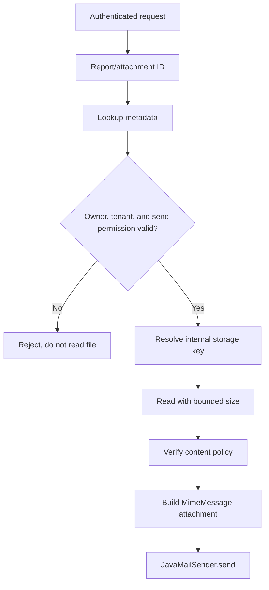
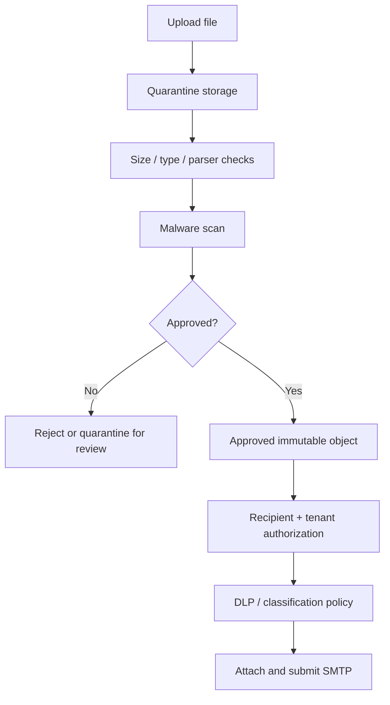

# Protecting Attachments and Resource Paths

In **Spring Framework Mail**, an email may carry PDFs, invoices, reports, inline images, or application-generated data. `MimeMessageHelper` makes adding attachments straightforward: call `addAttachment(...)` with a filename and a data source. However, **the source path, file read permissions, file contents, and attachment display name are all security boundaries**.

If an application passes a user-supplied path straight to `FileSystemResource`, an email-sending request can inadvertently turn into an arbitrary server file read-and-exfiltrate feature. Fetching images from arbitrary URLs exposes the application to SSRF. Sending files from multi-tenant storage without ownership checks can attach one customer's document to another customer's email. Even when reading the file is permitted, its contents may contain malware, sensitive data, or exceed SMTP provider limits.

This lesson focuses on **sending only approved files, to authorized recipients, from controlled sources**. It covers the threat model, `Resource` types, preventing path traversal and symlink attacks, tenant authorization, filename and MIME type controls, size limits, content scanning, lifecycle management, and security testing.

## 1. Why are attachments an attack surface?

Consider an API letting users email an attached file:

```text
POST /reports/email
  recipient = user@example.net
  filePath  = /data/reports/invoice.pdf
```

If the server trusts `filePath` and reads from the filesystem, callers may try substituting:

```text
../../config/application-prod.yml
/etc/passwd
C:\service\secrets\smtp.properties
/data/reports/another-customer/invoice.pdf
```

Even if the server never returns file bytes in the HTTP response, it can still **send that file out via email**, creating a *data exfiltration* channel.

Beyond reading out-of-scope files, risks include:

- **Path traversal:** using `..` or alternate path forms to escape the allowed directory.
- **Symlink attacks:** a path appears inside the allowed directory while a symlink points outside.
- **TOCTOU:** a file is swapped after validation but before reading.
- **Broken object-level authorization:** a user is allowed to send emails yet unauthorized to read the referenced attachment.
- **Cross-tenant leakage:** accidentally pulling a document belonging to another tenant.
- **SSRF:** using a URL resource to reach internal services or metadata endpoints.
- **Header/filename injection:** attachment names containing control characters, separators, or misleading names.
- **Malicious content:** files containing malware, macros, or harmful payloads when opened by recipients.
- **Oversized attachments:** exhausting memory, exceeding SMTP limits, or clogging the send queue.
- **Sensitive data exposure:** mailing confidential documents to unauthorized addresses.

Protecting attachments is more than checking a `.pdf` extension. Design access controls and file sources from the start, then enforce checks at every data handoff.

## 2. Understanding the data sources supported by `MimeMessageHelper`

`MimeMessageHelper` provides overloads to add attachments from Spring or Jakarta Mail data sources.

Example:

```java
helper.addAttachment("invoice.pdf", resource, "application/pdf");
```

Common sources:

| Source | Example | Characteristics and risks |
|---|---|---|
| `ClassPathResource` | `new ClassPathResource("mail/logo.png")` | Suitable for resources packaged with the app; path should be a controlled constant. |
| `FileSystemResource` | `new FileSystemResource(path)` | Reads files on the server; dangerous if `path` comes from arbitrary input. |
| `ByteArrayResource` | `new ByteArrayResource(bytes)` | Re-readable data source; requires bounding byte counts and managing memory. |
| `InputStreamResource` | `new InputStreamResource(stream)` | Often wraps a single-read stream; may not suit MIME libraries needing to reopen the source. |
| `UrlResource` | `new UrlResource(url)` | Can trigger network requests; needs SSRF, redirect, and DNS rebinding defenses if URL is input-influenced. |
| `DataSource` | `FileDataSource`, `ByteArrayDataSource` | Used at the Jakarta Mail layer; read permissions and source control remain the app's responsibility. |

**`Resource` is merely a data-source abstraction.** It does not automatically enforce authorization, file-type checks, malware scanning, or data classification.

### Two independent decisions

Before calling `addAttachment(...)`, answer:

1. **Is sending this data permitted?** This is an authorization and data policy decision.
2. **How do we read this data safely?** This is a filesystem, object storage, streaming, and MIME serialization decision.

Choosing `ByteArrayResource` does not make data safe by itself. If bytes were read from a secret file using an unchecked path, the vulnerability still exists.

## 3. Anti-pattern: using a file path directly from the request

Insecure example:

```java
@PostMapping("/mail/send")
public void sendMail(
        @RequestParam String recipient,
        @RequestParam String filePath
) throws MessagingException {

    MimeMessage message = mailSender.createMimeMessage();
    MimeMessageHelper helper =
            new MimeMessageHelper(message, true, "UTF-8");

    helper.setTo(recipient);
    helper.setSubject("Your document");
    helper.setText("See attachment.");

    helper.addAttachment(
            "document.pdf",
            new FileSystemResource(filePath)
    );

    mailSender.send(message);
}
```

Here, any path readable by the Java process can become an attachment. If the application has read access to secrets or another tenant's files, this endpoint can expose them.

Checks like `filePath.endsWith(".pdf")` or `filePath.contains("..")` are **insufficient**:

- Filenames can spoof extensions.
- Separators, absolute paths, and symlinks can bypass naive string checks.
- Windows/Linux differences, Unicode, or decoding passes can create variants.
- No ownership check runs even if the path sits inside the “right” directory.

**Recommended design:** requests pass only the **ID of an application-managed document**, never a filesystem path.

```text
POST /reports/email
{
  "reportId": "rpt-7f42",
  "recipientId": "contact-19"
}
```

The server looks up the report, verifies the current principal's permissions, resolves the internal file source, and then sends.

## 4. Business-layer security: use IDs instead of paths

Recommended flow:



Information to store in metadata:

| Field | Purpose |
|---|---|
| `attachmentId` | Logical ID for client requests. |
| `tenantId` | Partitions data by organization/customer. |
| `ownerId` | Owner or business scope. |
| `storageKey` | Internal file or object key, never an arbitrary client URL. |
| `originalFilename` | User-supplied upload name; treat as untrusted. |
| `safeDownloadName` | App-approved display name for use in emails. |
| `declaredMediaType` | Declared MIME type; must be verified per policy. |
| `contentLength` | Recorded size; must be re-verified when reading. |
| `scanStatus` | Content scan status when required by workflow. |
| `classification` | Sensitivity level and sharing policy. |
| `createdAt`, `expiresAt` | Resource lifecycle. |

For example, the service must **authorize against the record**, not merely check that the caller is logged in:

```java
public ApprovedAttachment requireApprovedAttachment(
        String attachmentId,
        String actorId,
        String tenantId
) {
    AttachmentRecord record = attachmentRepository
            .findById(attachmentId)
            .orElseThrow(() -> new NotFoundException("Attachment"));

    if (!record.tenantId().equals(tenantId)) {
        throw new AccessDeniedException("Attachment is not accessible");
    }

    if (!attachmentPolicy.canEmail(actorId, record)) {
        throw new AccessDeniedException("Attachment cannot be emailed");
    }

    if (record.scanStatus() != ScanStatus.CLEAN) {
        throw new IllegalStateException("Attachment is not approved");
    }

    return ApprovedAttachment.from(record);
}
```

`AttachmentRecord`, `ApprovedAttachment`, `AttachmentPolicy`, and the repository are illustrative application models.

Key points:

- **Sending permissions** may be stricter than download permissions.
- `tenantId` should come from the authenticated security context or principal, never trust a client-claimed `tenantId` field.
- `storageKey` must come from internal metadata, never chosen by the client.
- Do not reveal whether a file exists in another tenant via overly detailed error messages.

## 5. Preventing path traversal when reading from the filesystem

If the application stores attachments on the filesystem, use a controlled root directory, for example:

```text
/srv/app/approved-attachments/
    tenant-a/
        reports/
            invoice-001.pdf
    tenant-b/
        reports/
            invoice-002.pdf
```

Even when the file key comes from a database, verify that the resolved path resides inside the allowed root. Corrupted metadata or misconfiguration can also cause reading the wrong file.

### Why is string path concatenation unsafe?

Avoid:

```java
String path = root + "/" + storageKey;
FileSystemResource resource = new FileSystemResource(path);
```

`storageKey` might contain `../`, an absolute path, or other path forms. Use Java NIO `Path` to resolve, normalize, and verify the real path.

### Example path verification

```java
import java.io.IOException;
import java.nio.file.Files;
import java.nio.file.LinkOption;
import java.nio.file.Path;

public final class ApprovedFileLocator {

    private final Path baseDirectory;

    public ApprovedFileLocator(Path configuredBase)
            throws IOException {
        this.baseDirectory = configuredBase.toRealPath();
    }

    public Path locate(String storageKey) throws IOException {
        if (storageKey == null || storageKey.isBlank()) {
            throw new IllegalArgumentException("Missing storage key");
        }

        Path relative = Path.of(storageKey);

        if (relative.isAbsolute()) {
            throw new SecurityException("Absolute path is forbidden");
        }

        Path candidate = baseDirectory.resolve(relative).normalize();

        if (!candidate.startsWith(baseDirectory)) {
            throw new SecurityException("Path escapes approved directory");
        }

        // Follow symlinks to detect real targets outside the base directory.
        Path realFile = candidate.toRealPath();

        if (!realFile.startsWith(baseDirectory)) {
            throw new SecurityException("Symlink escapes approved directory");
        }

        if (!Files.isRegularFile(realFile, LinkOption.NOFOLLOW_LINKS)) {
            throw new SecurityException("Not a regular approved file");
        }

        return realFile;
    }
}
```

This example blocks many traversal and symlink-escape cases. However, **it is not immune to TOCTOU** if an actor can swap directory entries while the application is reading. Actual safety also depends on filesystem permissions, how the file is opened, and storage immutability.

### How does `normalize` differ from `toRealPath`?

- `normalize()` removes `.` and `..` segments syntactically without necessarily accessing the filesystem.
- `toRealPath()` accesses the filesystem, checks existence, and resolves the real path including symlinks by default.
- `Path.startsWith(...)` compares path components, safer than `String.startsWith(...)`, which can confuse `/data/reports` with `/data/reports-private`.

Do not validate paths using hand-rolled string prefix comparisons.

### Windows-specific considerations

Windows has drive paths, separators, and UNC paths differing from Linux:

```text
C:\app\attachments\invoice.pdf
..\..\secret.txt
\\server\share\private.txt
```

Never write validation that checks only `/` and assume it is safe across platforms. Use `Path` and test on the target deployment OS. Policies can also reject absolute paths and storage keys that do not match the expected schema.

## 6. Symlinks and TOCTOU: why path checks alone are insufficient

Suppose:

1. The application checks `/srv/app/approved-attachments/reports/a.pdf`.
2. This path points to a normal file.
3. An actor with write access replaces it with a symlink to a secret file.
4. The application opens the path and reads different data than what was checked.

This is a **time-of-check to time-of-use (TOCTOU)** race.

```text
Check path is allowed
         |
         v
Attacker changes directory entry
         |
         v
Open file from same path string
         |
         v
Read unexpected content
```

Mitigations:

- Store attachments in a dedicated directory where untrusted users or processes lack write access.
- Never use client-chosen filenames as physical storage names; use random storage keys or internal object IDs.
- Prohibit symlink creation in attachment storage workflows.
- Open and read files using filesystem-restricted mechanisms rather than checking early and opening much later.
- Under threat models where an attacker can modify directory entries, consider APIs supporting relative operations on directory handles with no-follow file opens, or use object storage with explicit keys and permissions.
- Copy approved files to an immutable/private area before placing them in the send queue.

Java NIO offers mechanisms like `LinkOption.NOFOLLOW_LINKS` and `SecureDirectoryStream`, yet support and race resistance depend on the filesystem/provider. Never claim `normalize()` + `startsWith()` is an absolute TOCTOU defense.

### Protect the filesystem with least privilege

Even with validation, the mail-sending process should not have read access across the whole server. Run the app under an unprivileged account, restrict volume mounts, and grant access only to files the service genuinely needs.

**Restricting filesystem permissions** limits damage if application validation has a bug.

## 7. Bounding the actual bytes read

You cannot blindly trust sizes recorded in a database, upload `Content-Length`, or external metadata. Files can change after upload or metadata can be wrong.

When loading moderate files into a `ByteArrayResource`, cap the byte count while reading rather than checking size beforehand and calling `Files.readAllBytes(...)`.

Example:

```java
import java.io.ByteArrayOutputStream;
import java.io.IOException;
import java.io.InputStream;
import java.nio.file.Files;
import java.nio.file.Path;

public final class BoundedFileReader {

    private BoundedFileReader() {}

    public static byte[] readAtMost(
            Path approvedFile,
            long maxBytes
    ) throws IOException {

        if (maxBytes <= 0) {
            throw new IllegalArgumentException("Invalid maxBytes");
        }

        try (InputStream in = Files.newInputStream(approvedFile);
             ByteArrayOutputStream out =
                     new ByteArrayOutputStream()) {

            byte[] buffer = new byte[8192];
            long total = 0;
            int count;

            while ((count = in.read(buffer)) != -1) {
                total += count;

                if (total > maxBytes) {
                    throw new IOException("Attachment is too large");
                }

                out.write(buffer, 0, count);
            }

            return out.toByteArray();
        }
    }
}
```

This method caps how many bytes accumulate in the output buffer before completing. It does not replace access checks, eliminate TOCTOU, or mean all bytes are benign.

**Memory note:** `ByteArrayOutputStream` and `toByteArray()` can temporarily hold multiple copies of the data. With many concurrent emails or large attachments, buffering everything on the heap can cause memory pressure. Consider suitable storage/streaming and cap concurrency, ensuring the stream source can be reopened when Jakarta Mail needs it.

## 8. Designing an attachment-sending service using approved IDs

A controllable three-layer design:

```text
Authenticated caller
      |
      v
AttachmentAccessService
  - ownership/tenant check
  - recipient/share policy
  - classification/scan status
      |
      v
ApprovedAttachmentStore
  - internal storage key
  - safe bounded read
      |
      v
MailMessageBuilder
  - safe filename
  - approved MIME type
  - addAttachment
      |
      v
JavaMailSender
```

Example service:

```java
import jakarta.mail.MessagingException;
import jakarta.mail.internet.MimeMessage;
import java.io.IOException;
import java.util.Set;
import org.springframework.core.io.ByteArrayResource;
import org.springframework.mail.javamail.JavaMailSender;
import org.springframework.mail.javamail.MimeMessageHelper;

public class SecureAttachmentMailService {

    private static final long MAX_ATTACHMENT_BYTES =
            8L * 1024 * 1024;

    private static final Set<String> ALLOWED_MEDIA_TYPES =
            Set.of("application/pdf", "image/png", "image/jpeg");

    private final JavaMailSender mailSender;
    private final AttachmentAccessService accessService;
    private final ApprovedAttachmentStore attachmentStore;

    public SecureAttachmentMailService(
            JavaMailSender mailSender,
            AttachmentAccessService accessService,
            ApprovedAttachmentStore attachmentStore
    ) {
        this.mailSender = mailSender;
        this.accessService = accessService;
        this.attachmentStore = attachmentStore;
    }

    public void sendApproved(
            String attachmentId,
            String authenticatedActorId,
            String authenticatedTenantId,
            String recipient
    ) throws MessagingException, IOException {

        ApprovedAttachment approved = accessService.requireApproved(
                attachmentId,
                authenticatedActorId,
                authenticatedTenantId,
                recipient
        );

        if (!ALLOWED_MEDIA_TYPES.contains(approved.mediaType())) {
            throw new SecurityException("Attachment type not allowed");
        }

        String safeName = approved.safeFilename();
        if (!safeName.matches("[A-Za-z0-9._-]{1,80}")) {
            throw new SecurityException("Unsafe attachment filename");
        }

        byte[] bytes = attachmentStore.readAtMost(
                approved.storageKey(),
                MAX_ATTACHMENT_BYTES
        );

        // Assume accessService/store already ensured the document
        // has an allowed scanStatus and valid content type.

        MimeMessage message = mailSender.createMimeMessage();
        MimeMessageHelper helper = new MimeMessageHelper(
                message,
                MimeMessageHelper.MULTIPART_MODE_MIXED,
                "UTF-8"
        );

        helper.setFrom("reports@example.org");
        helper.setTo(recipient);
        helper.setSubject("Your report");
        helper.setText("Please see the attached file.");

        helper.addAttachment(
                safeName,
                new ByteArrayResource(bytes),
                approved.mediaType()
        );

        mailSender.send(message);
    }
}
```

`AttachmentAccessService`, `ApprovedAttachmentStore`, and `ApprovedAttachment` are application-implemented abstractions, not built-in Spring Mail classes. The goal of the example is showing **the mail-sending API accepts only verified data**.

In a real application:

- `recipient` must also be authorized for document sharing, not only read permissions.
- Metadata MIME types must be verified during ingest, never trusted blindly.
- `safeFilename` should be server-generated or normalized per policy.
- Bound total email size, not only each individual file.
- If files hold confidential data, also enforce policies on sending to external domains.

## 9. Authorize by recipient, not only by sender

A common security flaw: user A has permission to download a file, so the application lets A email that file to **any email address**.

Read permission and email-sharing permission are two distinct actions.

Examples:

- An employee can view internal payroll sheets yet must not email them to personal addresses.
- A support agent can view order details yet may send invoices only to verified customer contacts.
- A tenant can export its own reports yet must not use another tenant's report-sending template.
- A file labeled “Internal” may be prohibited from leaving organizational domains.

A policy to consider:

```text
allowEmail(actor, attachment, recipient)
    = canRead(actor, attachment)
      AND canShare(actor, attachment)
      AND tenantIsCorrect
      AND recipientIsApproved
      AND classificationAllowsChannel
      AND scanStatusIsApproved
```

This is a business authorization model, not a built-in API expression. Recipient selection should rely on verified contact IDs, account IDs, or business relationships rather than arbitrary typed addresses.

**Never place user-entered recipient emails into confidential document-sending APIs without proper egress policies.**

## 10. Protecting filenames in `Content-Disposition`

The display name goes into MIME headers, typically `Content-Disposition`:

```text
Content-Disposition: attachment; filename="invoice-401.pdf"
```

User-uploaded filenames are untrusted data. They may contain:

- Forward slashes `/` and backslashes `\`.
- Newlines `\r` or `\n`.
- Other control characters.
- Unicode bidirectional control characters reversing visual text order.
- Very long names breaking headers or UIs.
- Misleading names like `invoice.pdf.exe`.
- Duplicate names or characters unsupported by email clients.

For automatically generated files, the simplest approach is **building safe names from verified metadata**, for example:

```java
String displayName = "invoice-" + invoiceNumber + ".pdf";
```

where `invoiceNumber` already passed domain format validation, such as digits or alphanumeric-hyphen characters only. Never concatenate arbitrary input directly into filenames.

### Example checking a server-generated name

```java
public static String requireSafeAttachmentName(String filename) {
    if (filename == null
            || !filename.matches("[A-Za-z0-9._-]{1,80}")
            || filename.equals(".")
            || filename.equals("..")) {
        throw new IllegalArgumentException("Invalid attachment filename");
    }

    return filename;
}
```

This is a very narrow allowlist, yet easy to operate for system-generated filenames. If Vietnamese diacritics or international Unicode names are needed, handle normalization, control/directional characters, length, and Jakarta Mail/client encoding. For maximum compatibility, use stable ASCII attachment names and present rich names inside the email body.

### Never build raw MIME headers manually

Use:

```java
helper.addAttachment(
        safeFilename,
        new ByteArrayResource(fileBytes),
        "application/pdf"
);
```

Never concatenate `Content-Disposition` strings manually from user-supplied names. Jakarta Mail/Spring handle header encoding, yet using the standard API **does not replace filename validation and sharing policies**.

## 11. MIME types and extensions do not prove a file is safe

If a client uploads `report.pdf`, ending in `.pdf` does not prove the bytes are a PDF. The HTTP `Content-Type: application/pdf` header is also client-declared.

A file may:

- Carry a `.jpg` extension while actually being an executable.
- Contain polyglot bytes valid as multiple file types.
- Be a PDF with scripts, embedded content, or payloads risky for recipients.
- Be an Office file containing macros.
- Be a ZIP containing dangerous paths or extreme compression ratios.

A sound ingest policy:

1. Identify which file types the business genuinely needs.
2. Enforce an allowlist of permitted MIME types and extensions.
3. Detect content type using appropriate magic-byte signatures/parsers.
4. Validate file structural integrity to the required degree.
5. Scan for malware when required by the threat model.
6. Persist scan results and approval status.
7. Permit sending only approved, unexpired objects.
8. Invalidate prior scan results if the file is modified or transformed.

**A valid MIME type does not mean a file is benign.** Malware scanning also does not guarantee 100% detection; combine with least privilege and data policies.

### Server-generated content still requires control

A server-rendered PDF report may carry less malware risk than user uploads, yet still requires checking access permissions, tenant ownership, size, and sensitive content. An authorization bug can leak a completely well-formed report.

## 12. Malware scanning, DLP, and quarantine workflows

For systems permitting sending uploaded files, design a workflow:



**Quarantine storage** receives files before they are cleared for use. Email-sending apps must never grab freshly uploaded, unscanned files and send them immediately.

Cases requiring DLP (Data Loss Prevention):

- Invoices containing addresses, payment details, or personal identifiers.
- Financial files containing account numbers or accounting data.
- Internal documents carrying confidentiality labels.
- Exports of customer or HR data.
- Tenant reports where contacts may sit outside the organization.

DLP can rely on classification metadata, recipient domain policies, and content inspection per organizational rules. Do not rely solely on regexes to assert a file contains no sensitive data.

## 13. URL resources and SSRF risk

`UrlResource` reads data from a URL. If the application accepts user-specified URLs, **Server-Side Request Forgery (SSRF)** can occur.

Example to avoid:

```java
String inputUrl = request.getParameter("attachmentUrl");

Resource remote = new UrlResource(inputUrl);
helper.addAttachment("file.pdf", remote);
```

Attackers can try forcing the server to call:

- Services reachable only inside the internal network.
- Admin endpoints on `localhost` or private networks.
- Cloud metadata endpoints.
- Services holding network-bound credentials or API tokens.
- URLs redirecting to a different host than the initial host.

Reading internal data and mailing it out combines SSRF with data exfiltration.

### Preferred solution: never fetch arbitrary URLs

If you only need to send invoices, logos, or reports from app-managed sources, use internal storage keys or constant `ClassPathResource` paths. Mail-sending APIs do not need arbitrary URL parameters.

If business logic strictly requires fetching from URLs:

- Allow only appropriate schemes, typically HTTPS.
- Enforce an allowlist of approved hosts/domains.
- Block loopback, link-local, private networks, and metadata endpoints.
- Guard DNS resolution and DNS rebinding.
- Re-validate every redirect, or disable redirects.
- Configure connect/read timeouts and response size caps.
- Never forward credentials, cookies, or sensitive headers from the incoming request.
- Enforce network-level egress restrictions.
- Store, scan, and approve downloaded data before sending.

**Checking hostnames as strings is insufficient against SSRF**, since DNS, redirects, and alternative IP notations can route requests elsewhere. If safe network fetching cannot be implemented, forbid URL resources.

## 14. `ClassPathResource`: safer, yet still requires discipline

`ClassPathResource` fits static application files such as email logos:

```java
Resource logo = new ClassPathResource("mail/brand/logo.png");

helper.addInline("brand-logo", logo, "image/png");
```

When the classpath string is a developer-controlled constant, the attack surface is far smaller than `FileSystemResource` with request-derived paths.

However, never accept arbitrary classpath names:

```java
// Avoid: client decides the resource path.
Resource resource = new ClassPathResource(request.getResourcePath());
```

The classpath may contain configuration files or internal resources never meant for emailing. Use a mapping between an enum/ID and defined resources:

```java
public enum BrandImage {
    PRIMARY_LOGO("mail/brand/primary-logo.png"),
    FOOTER_ICON("mail/brand/footer-icon.png");

    private final String classpath;

    BrandImage(String classpath) {
        this.classpath = classpath;
    }

    public Resource resource() {
        return new ClassPathResource(classpath);
    }
}
```

That way callers pick only from an allowed list instead of supplying paths. When multi-tenant apps have different logos, verify the tenant is authorized for the corresponding resource before lookup.

## 15. How do attachments differ from inline resources in security?

In MIME, attachments normally use `Content-Disposition: attachment`, whereas inline images use `Content-Disposition: inline` and a `Content-ID` referenced by HTML.

Example:

```text
multipart/mixed
├── multipart/related
│   ├── text/html; 
│   └── image/png; Content-ID: <logo-401>; inline
└── application/pdf; attachment; filename="invoice-401.pdf"
```

With Spring:

```java
MimeMessageHelper helper = new MimeMessageHelper(
        message,
        MimeMessageHelper.MULTIPART_MODE_MIXED_RELATED,
        "UTF-8"
);

helper.setText(html, true);

helper.addInline(
        logoCid,
        new ClassPathResource("mail/brand/logo.png"),
        "image/png"
);

helper.addAttachment(
        "invoice-401.pdf",
        new ByteArrayResource(approvedPdfBytes),
        "application/pdf"
);
```

Protection principles apply to **both**:

- Never let callers pick arbitrary file paths.
- Check content and tenant permissions.
- Bound count and sizes.
- Verify content types and scan policies.
- Never embed sensitive data in HTML or inline images when recipients lack viewing rights.

Setting `Content-Disposition: inline` does not make content “safer” or “more confidential”. Recipients can save inline images/content, and CID is not an authentication mechanism.

## 16. `InputStreamSource` and when Jakarta Mail reads content

An important detail: calling `addAttachment(...)` typically only configures the MIME part structure. Actual bytes may be read later when the message is serialized or sent.

This causes issues if the resource relies on a closed or single-read stream.

Error-prone example:

```java
InputStream inputStream = Files.newInputStream(filePath);

helper.addAttachment(
        "report.pdf",
        new InputStreamResource(inputStream),
        "application/pdf"
);

// Close the stream before the message is serialized.
inputStream.close();

mailSender.send(message);
```

`InputStreamResource` typically does not provide a fresh stream per read. Some MIME processing steps may need to reopen content, so use an `InputStreamSource` with matching semantics.

Options:

- `ByteArrayResource` for small/already-buffered files, allowing repeated stream opens.
- `FileSystemResource` for stable internal files with verified paths/authorization kept intact throughout sending.
- Custom `InputStreamSource` whose `getInputStream()` returns a fresh stream reading safely from internal storage.
- For large data, use Jakarta Mail-compatible streaming backed by lifecycle-managed storage.

Never open streams from external URLs or user paths lazily during SMTP serialization without prior permission checks, size bounds, and timeouts.

### Asynchronous sending adds lifecycle risks

If an upload request creates a temp file, submits `@Async`, and deletes the temp file when the HTTP request ends, the worker may fail to read the file.

```text
HTTP upload/request
    |
    +-- creates temp file
    +-- submits async mail
    +-- deletes temp file
                |
                v
        async worker runs later
        -> resource no longer exists
```

To avoid this:

1. Persist files into durable storage with appropriate access controls.
2. Record the storage key in the mail job/outbox.
3. Define retention until the job completes or retry deadlines expire.
4. Workers read and verify permissions/policies per contract.
5. Clean up once no job references the file, or via an explicit retention lifecycle.

Never put local temp absolute paths into a queue expecting a worker on another instance to share the same filesystem.

## 17. Limiting attachment size and count

An email carrying 8 MB of PDF data does not occupy only 8 MB on the SMTP wire. Binary attachments are normally base64-encoded, inflating payload size by roughly one-third before counting line breaks and MIME headers.

Therefore, bound:

- Size of **each individual file**.
- Total number of attachments.
- Total raw bytes across all files.
- Total serialized MIME size if the provider enforces strict limits.
- Concurrent emails with attachments in flight.
- Total storage consumption and retention periods.

Illustrative policy example:

```text
maxAttachmentCount = 5
maxEachAttachmentBytes = 8 MiB
maxTotalRawBytes = 15 MiB
maxMimeBytes = 25 MiB
```

These are only sample figures, **not Spring Framework Mail limits**. SMTP providers, recipient mailboxes, and applications enforce varying caps.

To check real MIME size, you can serialize into a counting output stream in an appropriate environment. Be cautious because serialization may read the resource; avoid doing it multiple times on single-read sources.

### Resource exhaustion and concurrency

If each job loads an 8 MB file into a byte array, concurrent jobs can consume hundreds of MB of heap, on top of HTML templates and encoding overhead.

With Spring `ThreadPoolTaskExecutor`, configure bounded threads and queue capacity. Worker counts for heavy attachments should reflect heap, network throughput, and SMTP provider capacity—not CPU cores alone.

## 18. Compressed archives and complex content

If the application permits sending ZIP, TAR, or complex formats, define explicit policies:

- Pass files through untouched or extract/inspect them?
- Are encrypted archives allowed?
- Are uncompressed size limits enforced?
- Is malware scanning performed inside archives?
- Are executables, scripts, or macros blocked per business use case?

If the application **extracts** archives to inspect or transform data, also defend against:

- **Zip Slip:** entry paths like `../../secret` escaping the target directory.
- **Zip bombs:** extreme compression ratios or nested archives exhausting CPU/disk.
- Symlinks inside archives.
- Excessive entry counts, huge filenames, or oversized uncompressed totals.

Even if archives are only attached untouched, malicious contents still endanger recipients. Enforce file-type policies and appropriate scanning workflows.

## 19. CSV, Excel files, and formula content

A CSV or spreadsheet attachment may hold user-supplied data. When recipients open it in spreadsheet software, cells starting with formula characters can execute as formulas depending on the program and settings.

Untrusted data examples:

```text
=HYPERLINK("https://untrusted.example","Open")
+1+2
@SUM(1,2)
```

If the application generates CSVs for email, defend against **formula injection** per intended use by neutralizing values for the CSV/spreadsheet context. Do not use HTML escaping to protect CSVs; they are completely different contexts.

For XLSX, construct explicit text-typed cells for untrusted data instead of formulas. These details belong to attachment generation, yet email security depends on safe generated files.

## 20. Sensitive data and SMTP limitations

SMTP can use TLS to protect transit between the application and mail server or between servers, yet that is not automatic end-to-end encryption for attachments.

Once a provider or recipient receives the message, they can save, copy, or forward attachments. You cannot “revoke” a distributed file simply by deleting the original on your server.

If an attachment carries sensitive data:

- Question whether attaching the file directly is truly necessary.
- Restrict recipients and verify contacts.
- Follow data classification policies.
- Use properly configured TLS when sending.
- Consider S/MIME, OpenPGP, or file protection mechanisms per organizational standards.
- For revocable access, consider sending a **controlled download link** instead of attaching the file.
- Design link expiration and authorization; never put long-lived tokens in public URLs.
- Protect attachments at rest in storage.

### Attachment vs. download link?

| Requirement | Attachment | Secure download link |
|---|---|---|
| Recipient reads offline immediately | Better suited | Usually needs network access first. |
| Revoke access after sending | Very hard or impossible on delivered copies | Can revoke access to the server-hosted copy. |
| Large files | Easily hits SMTP limits | Usually better suited. |
| Dynamic access policies | Hard to govern once distributed | Easy to enforce authorization on download. |
| External recipients | Simple for moderate files | Requires designing auth and download UX. |

Links are not automatically safer: mis-scoped sharing URLs, leaked tokens, and unsafe redirects also cause leaks. Pick the channel based on business needs and access control capabilities.

## 21. Protecting files in object storage

When using S3, Azure Blob Storage, or similar systems, apps typically fetch files by object key. Avoid accepting arbitrary object keys from requests.

Safe flow:

```text
attachmentId
    |
    v
Authenticated metadata lookup
    |
    v
Authorization (tenant/owner/recipient)
    |
    v
Approved bucket + internal object key
    |
    v
GetObject with least-privilege credentials
    |
    v
Bounded read / scan policy
    |
    v
MimeMessageHelper.addAttachment
```

Principles:

- Keep buckets/containers private by default.
- Give service accounts least-privilege permissions.
- Never let callers pick arbitrary buckets.
- Store server-generated object keys, avoiding reliance on original filenames.
- If files can be replaced, track object versions or checksums per contract.
- Never treat public presigned URLs as proof of sending authorization.
- Bound download URL lifetimes if used.
- When queueing jobs, store managed IDs/versions/object keys—not short-lived URLs that expire before workers run.

In object storage, `../` does not always carry filesystem traversal semantics, yet arbitrary keys can still access the wrong object or wrong tenant. **Authorization is mandatory in both models.**

## 22. Auditing, logging, and correlation IDs

When emails carry sensitive attachments, audits should answer:

- Who requested the send?
- Under which policy was the recipient approved?
- Which attachment ID and version were used?
- Which tenant and classification did the document belong to?
- Did the file pass scan/policy checks?
- What were the byte count and MIME type?
- Did SMTP accept the message?
- If sending failed, were retries or failovers performed?

Structured log example:

```text
event=MAIL_ATTACHMENT_APPROVED
correlationId=corr-7a1
notificationId=mail-91d
attachmentId=att-442
tenantRef=tenant-8
classification=INTERNAL
mimeType=application/pdf
sizeBytes=742981
policyVersion=v4
```

After submission:

```text
event=MAIL_SMTP_ACCEPTED
correlationId=corr-7a1
notificationId=mail-91d
smtpRoute=transactional-primary
attachmentCount=1
```

Never log raw bytes, secret attachment paths, access tokens, presigned URLs, or full email bodies. Use attachment IDs, managed checksums, and metadata to diagnose without leaking content.

### A correlation ID is not an access credential

Someone knowing a `correlationId` or `attachmentId` must never be allowed to download files or send emails without authorization. IDs are for lookup/correlation, not secrets protecting resources.

## 23. Security testing for attachments

A test suite must cover both invalid inputs and valid paths.

| Scenario | Expectation |
|---|---|
| User sends an attachment ID from another tenant | Rejected before reading the file. |
| User has view permission yet lacks email-sharing permission | Rejected per sharing policy. |
| Storage key is `../config.yml` | Rejected; never reads outside root. |
| Storage key is an absolute path | Rejected. |
| Symlink inside root points outside | Never reads data outside root. |
| Attachment expired or permissions revoked | Not sent. |
| File exceeds size limit | Rejected without buffering entire file onto heap. |
| Filename contains CR/LF or path separators | Rejected or replaced with safe server-generated name. |
| `.pdf` extension with non-PDF bytes | Not auto-approved solely by extension. |
| Incomplete scan status or malware detected | Not sent. |
| Valid inline CID image for wrong tenant | Disallowed from reading/attaching. |
| URL pointing to loopback/private network | Not fetched. |
| Async worker runs after temp file deleted | Durable storage lifecycle handles jobs and errors cleanly. |
| Two users submit reports with guessed IDs | Authorization checks owner/tenant, not just IDs. |
| Email with multiple attachments exceeding total size | Rejected by total-size policy. |

### Example unit test for access permissions

```java
@Test
void cannotEmailAnotherTenantsAttachment() {
    String actorId = "user-a";
    String tenantId = "tenant-a";
    String foreignAttachmentId = "att-tenant-b";

    assertThatThrownBy(() -> accessService.requireApproved(
            foreignAttachmentId,
            actorId,
            tenantId,
            "recipient@example.net"
    )).isInstanceOf(AccessDeniedException.class);

    verifyNoInteractions(attachmentStore);
}
```

Example using AssertJ and Mockito; set up dependencies/fixtures appropriately in real tests. The goal is confirming authorization fails **before storage is accessed**.

### Example unit test for path traversal

```java
@Test
void rejectsTraversalOutsideApprovedDirectory() throws Exception {
    Path tempRoot = Files.createTempDirectory("mail-attachments");

    ApprovedFileLocator locator =
            new ApprovedFileLocator(tempRoot);

    assertThatThrownBy(() ->
            locator.locate("../../outside-file.txt")
    ).isInstanceOf(SecurityException.class);
}
```

Real tests should clean up temp directories via JUnit utilities and test path handling on the CI OS. Add symlink tests where the OS/filesystem permits creating symlinks.

### Testing the real email flow

Use `MimeMessage` and an SMTP test server like GreenMail/Mailpit to verify an approved attachment creates the right MIME part:

- Appropriate `Content-Type`.
- `Content-Disposition: attachment`.
- Safe filename value.
- Byte content matches the expected file.
- No unapproved extra attachments.
- HTML/inline images reference no out-of-scope data.

Never use real customer data or production credentials in integration tests.

## 24. Common issues and remediation

| Symptom | Possible cause | Remediation |
|---|---|---|
| Email accidentally contains configs/secrets | Input path used directly | Stop accepting raw paths; use IDs and authorization before reading. |
| Wrong customer's invoice sent | Missing tenant/owner/recipient check | Enforce object-level authorization in service layer. |
| Path check passes yet symlink escapes root | String normalization only, no real-path check | Verify real paths and tighten filesystem permissions; address TOCTOU. |
| Email fails with `FileNotFoundException` | Temp file deleted or missing storage key | Manage file lifecycle and retention per job. |
| `InputStream` closed before send | Single-read stream source | Use re-openable sources or bounded byte arrays. |
| Corrupted attachment | Incomplete source/stream or wrong MIME type | Verify bytes, content length, stream source, and serialization. |
| Email exceeds SMTP limit | Base64/MIME overhead omitted | Set total limits with headroom. |
| Filename renders garbled | Incompatible encoding or characters | Use simple/safe names; test target clients. |
| Unscanned uploaded file sent | Missing quarantine/approval gate | Send only objects in approved state. |
| URL attachment reads internal data | SSRF via `UrlResource` | Stop accepting arbitrary URLs; control egress/redirects/DNS. |
| File altered after scan | Mutable storage object or no versioning | Use object versions/immutable keys and rescan policies. |
| Recipient opening file faces risk | Macros/malware or risky format | File policies, scanning, and recipient guidance. |
| SMTP has TLS yet file gets forwarded | TLS does not ensure end-to-end confidentiality | Minimize attached data; use secure links/encryption as needed. |
| Audit lacks which file was sent | Logged only “mail sent” | Log attachment ID/version, notification ID, and policy outcome. |

## 25. Pre-deployment checklist

Before enabling emails with attachments:

1. API accepts only attachment/document IDs, never arbitrary paths or URLs.
2. Principal and tenant are authenticated from trusted sources.
3. Both read permission **and recipient-sharing permission** are verified.
4. Storage keys come from internal metadata, never directly from clients.
5. For filesystems, verify root/path/symlinks and restrict write access.
6. For object storage, buckets are private and credentials follow least privilege.
7. Files remain immutable or versioned/checksummed during sending/retries.
8. MIME types, extensions, scan status, and classifications satisfy policies.
9. Attachment display names are safely generated/validated.
10. File count, per-file size, total MIME size, and concurrency are bounded.
11. Resource/stream lifecycles match serialization and send timing.
12. Arbitrary URL resources are banned or hardened against SSRF.
13. Never log raw files, secrets, presigned URLs, or sensitive info.
14. SMTP uses provider-compliant transport security; confidential data follows encryption/sharing rules.
15. Tests cover cross-tenant, traversal, symlinks, oversize, scan gates, and end-to-end sending.
16. For async email, files persist across worker retries and restarts.

## 26. Takeaways

- `MimeMessageHelper.addAttachment(...)` only creates a MIME attachment; it **does not verify read/share permissions**, block path traversal, or scan for malware.
- Never let users dictate `FileSystemResource`, `ClassPathResource`, or `UrlResource` via arbitrary path/URL strings.
- Use **attachment IDs**, internal metadata, tenant/owner authorization, and recipient policies to select the right document.
- For filesystems, use `Path`, normalize, verify real paths, and enforce root boundaries; still account for symlinks/TOCTOU and filesystem permissions.
- For object storage, use internal keys/versions, private buckets, and least-privilege credentials.
- Filenames and MIME types must be verified; never trust client-declared extensions or `Content-Type` headers blindly.
- Bound actual bytes read, total email size, and concurrent jobs; remember MIME/base64 overhead.
- Resources must be readable at serialization time; single-use streams or deleted temp files easily break sends.
- Uploaded files must pass quarantine, malware scanning, and data policies before sending is allowed.
- Inline images require the same access controls and safe data sources as attachments.
- SMTP TLS does not replace end-to-end encryption or access revocation on attached files.
- Test **reading the wrong file**, **sending to the wrong person**, **unsafe files**, and **async job lifecycles**.

Protecting attachments starts with design: **requesters pick only logical documents, the system authorizes actors and recipients, storage supplies approved data, and only then does Spring Mail package files into MIME messages**. When these boundaries are enforced, applications avoid turning email sending into arbitrary file-read or cross-tenant data-leak channels.
