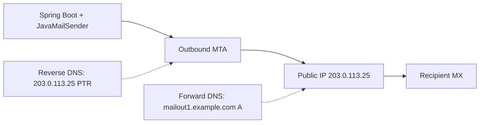

# Configuring PTR, Reverse DNS, and IP Reputation

A Spring Boot service uses `JavaMailSender` to send registration confirmation emails. In the development environment, messages are accepted by the SMTP test server; in production, some mailbox providers reject, defer, or route messages to Spam. SMTP logs may mention `reverse DNS`, `PTR`, `IP reputation`, or `sending IP`. The developer tries changing `spring.mail.host`, adding an SPF record, or changing `From`, yet delivery rates still do not improve.

The core issue: **when the recipient's SMTP server evaluates the sending source, it sees the public IP address of the SMTP server communicating directly with it**, not necessarily the IP of the Spring Boot application. The reverse DNS (PTR) domain name, the hostname sent in `EHLO/HELO`, forward DNS (A/AAAA) records, and the behavioral history of that IP are signals that help the receiving mail system identify and evaluate the sending source. These signals must be configured at the **right network layer and by the right owner**.

This lesson belongs to the **Deliverability** chapter in **Spring Framework Mail**, focusing on the role of PTR/reverse DNS and IP reputation in sending mail, how to identify the actual sending IP, DNS configuration, interaction with SPF/DKIM/DMARC, external verification, and stable operations. No `MimeMessageHelper` setting or single `application.yml` line creates IP reputation on its own.

## 1. Distinguishing Successful Send, Delivery, and Inbox Placement

Before examining PTR, agree on what each outcome means:

| Stage | What Happened | What Is Not Yet Guaranteed |
|---|---|---|
| `JavaMailSender.send(...)` returns without error | The application completed handoff via transport under conditions at send time | Does not prove the message reached the Inbox |
| SMTP relay accepts message | The relay accepted responsibility for processing/forwarding | Does not yet prove the final server accepted it |
| Recipient's MX accepts message | The receiving server accepted responsibility per SMTP | Not guaranteed to be classified into Inbox instead of Spam/quarantine |
| Provider emits delivery event | The provider reports delivery status per service contract | Does not guarantee the user opened or read the message |
| Recipient sees message in Inbox | The message passed relevant classification steps | Does not prove all subsequent messages will also land in the Inbox |

**Deliverability** refers to the likelihood that messages are accepted by receiving systems and reach the desired destination. A proper PTR is an important infrastructure hygiene condition, yet **it is not a guarantee that messages will land in the Inbox**.

Some providers may reject SMTP directly when the sending IP lacks valid reverse DNS; other providers may accept it and use that signal in their filters. Policies vary by provider and over time, so do not turn one provider's rule into a universal law.

## 2. SMTP Topology: Which IP Is Actually Checked?

### 2.1. Sending Directly from Company Servers

```text
Spring Boot
  |
  | JavaMailSender -> SMTP
  v
Outbound MTA (mailout1.example.com)
  Public egress IP: 203.0.113.25
  |
  | SMTP delivery: EHLO mailout1.example.com
  v
Recipient MX (mx.recipient.example)
  |
  +--> Observes peer IP 203.0.113.25
  +--> Looks up PTR (reverse DNS) for 203.0.113.25
  +--> Checks forward DNS of the PTR name
  +--> Evaluates SPF/DKIM/DMARC, IP behavior, content, and policy
```

In this model, IP `203.0.113.25` is the IP **connecting to the MX**, so PTR and reputation relate directly to it. The name `mailout1.example.com` is the expected hostname of the sending machine.

### 2.2. Sending Through an SMTP Relay or Email Service Provider

```text
Spring Boot application
  |
  | Submission: smtp.provider.example:587
  v
Email service provider
  |
  | Relay system / outbound IP selection
  v
Outbound relay IP: 203.0.113.80
  |
  | SMTP to recipient MX
  v
Recipient MX
```

In this model, the recipient MX typically sees the **provider's relay IP**, for example `203.0.113.80`. The IP of the machine running Spring Boot, the VPC's NAT IP, or the application's hostname is **not** the direct source for the recipient MX to look up PTR, unless that machine itself sends SMTP directly to the MX.

Consequences:

- `spring.mail.host` is the **relay address the application connects to**, not the PTR name of the relay IP.
- `mail.smtp.localhost` can affect the `EHLO` name that the **application presents to the first relay**, not automatically changing the `EHLO` name the provider's relay uses when sending to the MX.
- If using a shared/dedicated IP from an email provider, check reverse DNS, outbound IP pool, and reputation settings within the **provider's** service.
- Changing the Spring Boot container's hostname does not change the PTR of the email-sending IP managed by the provider.

### 2.3. NAT and Multi-Homed Host Pitfalls

A mail server may bind a socket to a private address like `10.0.4.20` while connecting to the Internet via NAT with public IP `203.0.113.25`. The recipient MX checks the **public source IP after NAT**.

If a server has multiple NICs, multiple public IPs, IPv4 and IPv6, or uses an outbound load balancer, identify **every IP actually used to connect**. A correct A record/PTR for the intended IP will not fix errors on another egress IP used in rotation.

## 3. How Do PTR Records and Reverse DNS Work?

### 3.1. Forward DNS: Name → IP Address

Normally, applications query DNS to find out which address a hostname has:

```text
mailout1.example.com.  IN A    203.0.113.25
```

For IPv6:

```text
mailout6.example.com.  IN AAAA 2001:db8::25
```

An `A` record maps a hostname to IPv4; `AAAA` maps a hostname to IPv6. A hostname can have multiple A/AAAA records, for example for IPs of the same service.

### 3.2. Reverse DNS: IP Address → Name

Reverse DNS for IPv4 uses the `in-addr.arpa` branch. Illustrative example:

```dns
25.113.0.203.in-addr.arpa. IN PTR mailout1.example.com.
```

The reverse name is constructed by reversing the octets of the IPv4 address:

```text
203.0.113.25
     |
     v
25.113.0.203.in-addr.arpa
     |
     v
PTR mailout1.example.com
```

For IPv6, reverse DNS uses `ip6.arpa` and reverses the **hexadecimal nibbles**, not simply reversing hextet groups. Most operators should use `dig -x` or their ISP's rDNS management system rather than manually writing long reversed strings.

### 3.3. A PTR Value Is a Hostname

A PTR value should be a **fully qualified domain name** (FQDN) that can be forward-resolved, such as `mailout1.example.com.`, not an IP address placed in the name field, not an `https://...` URL, and not an email address `admin@example.com`.

The trailing dot `mailout1.example.com.` in a zone file indicates an absolute domain name. In an admin UI, the provider may add the trailing dot automatically; follow the format required by the platform.

### 3.4. Example Addresses in This Article Are Documentation Addresses

The IPs `203.0.113.0/24` and `2001:db8::/32` are used **for illustration only**. They are not public IPs assigned to a real mail-sending system. Internet DNS queries are not expected to return these example records.

## 4. Forward-Confirmed Reverse DNS (FCrDNS)

**FCrDNS** stands for *forward-confirmed reverse DNS*: after looking up the PTR name from an IP, the system resolves that name forward via A/AAAA to see whether it includes the original IP.

Good example:

```text
Step 1 — Reverse:
  203.0.113.25
    PTR --> mailout1.example.com

Step 2 — Forward:
  mailout1.example.com
    A   --> 203.0.113.25

Result:
  The sending IP is in the forward address set of the PTR hostname.
```

Mismatch example:

```text
203.0.113.25
  PTR --> mailout1.example.com

mailout1.example.com
  A   --> 203.0.113.99

Original IP 203.0.113.25 is not in the forward DNS.
```

Under some receiving policies, a mismatch can reduce trust or cause rejection. Do not blame all Spam placement solely on FCrDNS, yet it is a technical requirement that should be resolved.

### 4.1. What If One Name Has Multiple A Records?

Suppose:

```dns
mailout1.example.com. IN A 203.0.113.25
mailout1.example.com. IN A 203.0.113.26
```

If the PTR of `203.0.113.25` points to `mailout1.example.com`, then that IP is in the A set; a forward check in the sense of **membership** can match. You do not need to assume a hostname may only contain a single A record.

However, for diagnostics and keeping a consistent identity per mail server, it is usually better to use a **distinct explicit name per egress IP** such as `mailout1.example.com` and `mailout2.example.com`. This reduces confusion when rotating IPs, configuring EHLO, and monitoring.

### 4.2. Can an IP Have Multiple PTR Records?

DNS allows flexible data structures; in email operations, multiple different PTRs for one IP can produce inconsistent results across checking systems. A configuration with **one clear PTR per sending IP**, pointing to a hostname with matching forward A/AAAA, is generally easier to operate.

Do not assume that multiple PTRs increase reputation or improve deliverability.

### 4.3. Must PTR and EHLO/HELO Hostname Match Identically?

In SMTP, the client introduces a name in `EHLO` or `HELO`. Some receiving systems compare this name with the DNS/PTR hostname and treat their consistency as an additional signal.

A good operational target is:

```text
Public outbound IP: 203.0.113.25
PTR:                mailout1.example.com
A:                  mailout1.example.com -> 203.0.113.25
EHLO:               mailout1.example.com
```

However, **PTR, EHLO, and sender domains do not have to be the exact same name in every valid architecture**; for instance, an ESP uses its relay hostname while From belongs to a customer's domain. SMTP RFCs also do not define this match as an authentication mechanism replacing SPF/DKIM/DMARC. Ensure values are accurate, consistent, and compliant with provider/receiver requirements, rather than treating "all three strings must be equal" as an absolute law.

## 5. Who Has Authority to Configure PTR?

This is the most critical point in real deployments. **PTR records belong to the reverse DNS management of the IP block**, usually managed by the ISP, cloud provider, datacenter, or the owner/delegated entity of the IP range.

That is separate from the company's domain DNS zone.

| Record/Setting | Where Typically Managed | Who Needs to Coordinate |
|---|---|---|
| `mailout1.example.com A 203.0.113.25` | `example.com` DNS zone | Domain DNS admin |
| `PTR of 203.0.113.25` | IP provider or delegated reverse DNS | ISP/cloud/network team |
| `EHLO` of outbound MTA | Actual MTA/SMTP relay | Mail operations/ESP |
| `SPF` of envelope-sender domain | That domain's DNS | Domain owner/ESP |
| `DKIM selector` | Signing domain DNS and mail signing system | Mail platform/domain owner |
| `DMARC` | Visible From domain DNS | Domain security/mail team |
| `IP pool`, warm-up, and pacing | MTA/ESP and mail-sending application | Deliverability/operations |

### 5.1. Why Adding PTR to the example.com Zone Does Not Work

If you write in the `example.com` zone file:

```dns
mailout1.example.com. IN PTR mailout1.example.com.
```

this is **not** the record that answers reverse lookup queries for IP `203.0.113.25`. Reverse queries go to `25.113.0.203.in-addr.arpa`, belonging to the `in-addr.arpa` tree delegated by the IP administrator.

To set a PTR for a public IP, use:

- The cloud/ISP rDNS/reverse DNS portal.
- The IP-managing provider's API.
- A support ticket requesting the provider to set the PTR.
- A reverse DNS zone properly delegated to the organization itself (if managing its own IP block).

No Spring Boot method can change an ISP-owned PTR through application configuration alone.

### 5.2. Some Cloud Providers Require Forward DNS First

Some cloud/ISP rDNS services verify that your requested PTR hostname already has a valid A/AAAA pointing to the corresponding IP. Thus, a useful deployment order is usually:

1. Identify the actual public outbound IP.
2. Create the forward A/AAAA hostname pointing to the IP.
3. Ask the provider to configure the IP's PTR to point to the hostname.
4. Verify reverse and forward records on public DNS.
5. Configure EHLO on the outbound MTA if you own the MTA.
6. Cross-check against provider/receiver requirements.

The exact order of operations may vary due to each IP provider's portal, API, and policies.

## 6. Scenario A: Organization Self-Hosts the Outbound MTA

Suppose the organization operates its own Postfix or public SMTP relay, and an IP `203.0.113.25` is permitted to send directly to recipient MX servers.

Architecture:



### 6.1. Technical Configuration Checklist

- Public egress IP remains stable throughout sending.
- PTR belonging to that IP points to `mailout1.example.com`.
- Hostname `mailout1.example.com` has an A record containing the corresponding public IP.
- Outbound MTA introduces `EHLO mailout1.example.com` when talking to MX if appropriate to the design.
- MTA has TLS/SMTP parameters, retries, and queues configured per policy.
- Envelope sender domain has appropriate SPF, signing system signs DKIM, and From domain has DMARC alignment as required.
- IP is not a source of spam/bad bounces; sending rate is managed.
- Outbound IPv6, if enabled, also has appropriate reverse/forward DNS and sending policies.

### 6.2. Example Host Identity in Postfix

Conceptual configuration in `main.cf`:

```ini
myhostname = mailout1.example.com
smtp_helo_name = $myhostname
```

In Postfix, `myhostname` defines the mail host's name, while `smtp_helo_name` controls the name Postfix's SMTP client uses in outbound communication. This is **MTA configuration**, not a Spring Boot property, and must be reviewed by mail server admins alongside routing, transport, and security settings.

Do not edit `main.cf` by copying these couple of lines and assume the mail server is sufficiently secure. A relay also needs open-relay prevention, sending limits, TLS, AUTH on submission, and queue management.

### 6.3. When the Egress IP Changes

If cloud infrastructure switches the public IP from `203.0.113.25` to `203.0.113.26`, check:

- PTR of the **new IP**.
- Forward DNS of the new PTR hostname.
- Sender authorization/SPF, if using the IP directly.
- EHLO/relay identity.
- IP reputation of the new IP.
- Firewall/provider allowlists.
- Whether traffic has fully switched or is split across two IPs.

Do not only update the A record and forget reverse DNS/IP pool. The old IP's PTR does not automatically follow the new IP.

## 7. Scenario B: Spring Boot Sends via an External Email Service

This is a common architecture for transactional applications:

```text
Spring Boot
  spring.mail.host = smtp.mail-provider.example
        |
        | SMTP submission over 587 / STARTTLS
        v
ESP/SMTP provider
  shared pool or dedicated IP
        |
        | Provider outbound MTA, EHLO, PTR, IP rotation
        v
Recipient MX
```

### 7.1. What the Organization Needs to Configure

The organization is usually responsible for:

- Verifying the sending domain per ESP requirements.
- Creating appropriate SPF, DKIM, and DMARC records.
- Configuring bounce/Return-Path domains depending on the provider model.
- Managing recipient lists, consent, and suppression.
- Choosing sending domains/subdomains by purpose.
- Choosing shared or dedicated IP and configuring warm-up if offered.
- Monitoring delivery/rejection/bounce/complaints via the provider.
- Working with support when a provider IP/pool has PTR or reputation issues.

### 7.2. What the ESP Typically Manages

When messages actually egress from the ESP's infrastructure, the provider typically controls:

- Outbound public IPs.
- PTR/rDNS for IPs in their pools.
- EHLO identity of the MTA sending to MX.
- Delivery-layer queues and retries.
- Routing/traffic shaping.
- Shared-pool reputation, IP allocation, and warm-up features.

Therefore, if an MX reports `reverse DNS missing` for a provider's IP, the remedy is to **identify the IP in SMTP rejections/logs and work with the ESP**. Changing `spring.mail.host` or adding a PTR to the application's domain DNS will not change the PTR of an IP owned by the provider.

### 7.3. Dedicated IP Does Not Equal Better Reputation

A shared IP can help low-volume senders benefit from stably operated infrastructure and shared pool reputation, though it can also be affected by other senders in the pool if the provider lacks strong controls.

A dedicated IP allows better reputation isolation by IP, but:

- A new IP may lack sending history.
- Requires reasonable and steady volume.
- Requires controlled warm-up.
- Must handle bounces, complaints, and recipient lists properly.
- If volume is very low or sporadic, a dedicated IP may offer no clear benefit.
- A dedicated IP can still earn poor reputation if content or sending behavior is bad.

There is no universal volume threshold for choosing a dedicated IP; rely on the ESP's current guidance and business needs.

## 8. Spring Boot Configuration: What Can and Cannot Be Controlled

Here is an example of an application sending to a managed SMTP relay:

```yaml
spring:
  mail:
    host: ${SMTP_RELAY_HOST}
    port: 587
    protocol: smtp
    username: ${SMTP_USERNAME}
    password: ${SMTP_PASSWORD}
    default-encoding: UTF-8
    properties:
      "[mail.smtp.auth]": true
      "[mail.smtp.starttls.enable]": true
      "[mail.smtp.starttls.required]": true
      "[mail.smtp.ssl.checkserveridentity]": true
      "[mail.smtp.connectiontimeout]": 5000
      "[mail.smtp.timeout]": 10000
      "[mail.smtp.writetimeout]": 10000

app:
  mail:
    from: ${MAIL_FROM:notifications@example.com}
```

This configuration **connects the application to the relay**, enables authentication, and requires TLS for submission. It does not:

- Create PTR records.
- Deterministically pick the public IP the ESP uses for onward delivery.
- Build good IP reputation.
- Set up SPF/DKIM/DMARC on behalf of the domain owner/ESP.
- Guarantee Inbox placement.

Timeouts are illustrative only; tune them to actual latency and SLA. SMTP credentials should be supplied via a secret manager or platform security mechanism.

### 8.1. What Is `mail.smtp.localhost` Used For?

Jakarta Mail's SMTP transport has a `mail.smtp.localhost` property to specify the client hostname presented in the `EHLO/HELO` greeting to the server it connects to.

Example:

```yaml
spring:
  mail:
    properties:
      "[mail.smtp.localhost]": app-mailer.internal.example
```

In an ESP architecture, this name is the name the **Spring Boot SMTP client sends to the relay**. It does not replace the EHLO hostname the ESP's relay uses when talking to the recipient MX.

If an application **sends directly to MX** (usually not a good design for business apps), the EHLO name emitted by the client must fit policy. However, choosing `mail.smtp.localhost` still **does not change the public IP's PTR** or sending track record.

### 8.2. Header From, Envelope MAIL FROM, and Return-Path

These three concepts can differ:

| Property | Role |
|---|---|
| Header `From:` | Author/sender identity displayed to the recipient per RFC 5322. |
| Envelope `MAIL FROM` | Reverse-path in the SMTP transaction; typically related to SPF and bounce handling. |
| `Return-Path` | Header added at the final delivery stage per SMTP semantics; should not be set manually as a way to control the envelope. |

An example:

```text
Header From: notifications@example.com
Envelope MAIL FROM: bounce.mail.example.com
Outbound IP: 203.0.113.25
EHLO: mailout1.example.com
PTR: mailout1.example.com
```

The names do not need to be identical for the system to be valid; they serve different purposes. What matters is SPF/DKIM/DMARC alignment and ESP/provider requirements.

### 8.3. Jakarta Mail's Envelope Sender Property

In some setups, you may use:

```yaml
spring:
  mail:
    properties:
      "[mail.smtp.from]": bounce@example.com
```

`mail.smtp.from` controls the SMTP transport's envelope sender as supported by Jakarta Mail. **Do not use it arbitrarily**: the ESP may overwrite it or require a separately verified bounce domain; SPF/DMARC alignment must be designed holistically.

Setting `mail.smtp.from` does not change the outbound IP's PTR to `example.com`.

### 8.4. JavaMailSender with a Verified From Address

```java
import jakarta.mail.internet.MimeMessage;
import org.springframework.beans.factory.annotation.Value;
import org.springframework.mail.javamail.JavaMailSender;
import org.springframework.mail.javamail.MimeMessageHelper;
import org.springframework.stereotype.Service;

@Service
public class TransactionalMailService {

    private final JavaMailSender sender;
    private final String verifiedFrom;

    public TransactionalMailService(
            JavaMailSender sender,
            @Value("${app.mail.from}") String verifiedFrom) {
        this.sender = sender;
        this.verifiedFrom = verifiedFrom;
    }

    public void sendConfirmation(String recipient, String orderCode)
            throws Exception {
        MimeMessage message = sender.createMimeMessage();
        MimeMessageHelper helper =
                new MimeMessageHelper(message, true, "UTF-8");

        helper.setFrom(verifiedFrom);
        helper.setTo(recipient);
        helper.setSubject("Order confirmation " + orderCode);
        helper.setText(
                "Order " + orderCode + " has been confirmed.",
                "<p>Order <strong>"
                    + escapeHtml(orderCode)
                    + "</strong> has been confirmed.</p>");

        sender.send(message);
    }

    private static String escapeHtml(String value) {
        return value.replace("&", "&amp;")
                .replace("<", "&lt;")
                .replace(">", "&gt;")
                .replace("\"", "&quot;")
                .replace("'", "&#39;");
    }
}
```

This example illustrates using a From address from a verified domain and sending alternative content. For production, use a template engine with context-aware escaping, recipient/URL validation, outbox/retry, and infrastructure-layer exception handling.

No line in `MimeMessageHelper` above configures PTR or IP reputation; these are two distinct layers of responsibility.

## 9. SPF, DKIM, DMARC: Related to PTR but Do Not Replace PTR

PTR provides information about the **hostname of the sending IP**. SPF, DKIM, and DMARC are domain authentication or policy mechanisms with different objectives.

### 9.1. SPF — Authorizing IPs or Infrastructure to Send on Behalf of the Envelope Domain

SPF is published via a TXT record on the domain used for the SPF identity (typically envelope MAIL FROM, or HELO in certain contexts).

Example for a self-sending corporate domain:

```dns
example.com. IN TXT "v=spf1 ip4:203.0.113.25 -all"
```

This is only an **illustrative value** for a documentation IP. In production, do not copy this record; declare the exact outbound IPs/ESPs actually permitted to send.

If using an ESP, the provider may require `include:`, a custom MAIL FROM domain, or its own model; read official instructions, check SPF DNS lookup limits, and avoid creating multiple `v=spf1` SPF records for the same domain.

**SPF pass does not fix a PTR error**: they are two different checks.

### 9.2. DKIM — Signing Parts of the Email

DKIM allows the MTA/provider to sign emails with a private key, and the receiving system verifies the signature against a public key published in DNS under a selector.

Abbreviated example record (not a real usable public key):

```dns
s1._domainkey.example.com. IN TXT "v=DKIM1; k=rsa; p=<PUBLIC_KEY>"
```

DKIM is verified based on signature/headers/body per the standard. It does not require PTR to match DKIM `d=`. A provider can sign with an authorized domain while the egress IP has a PTR under the ESP's infrastructure domain.

### 9.3. DMARC — Aligning with the Visible From

DMARC evaluates alignment between the domain in the `From:` header and the domain of SPF or DKIM when those mechanisms pass per policy. It allows a domain to publish a handling policy for emails failing alignment and receive reports.

Starting example for monitoring, not a default policy for every domain:

```dns
_dmarc.example.com. IN TXT "v=DMARC1; p=none; rua=mailto:dmarc-reports@example.com"
```

Moving from `p=none` to `quarantine` or `reject` should follow a process of verifying legitimate sending sources, reports, and domain owner policy. Do not change policy just to work around a PTR error.

### 9.4. Comparison Table

| Mechanism | Primary Question | Who Typically Manages It? |
|---|---|---|
| PTR/rDNS | What reverse DNS hostname does the connecting IP have? | IP owner/ISP/cloud |
| FCrDNS | Does the PTR hostname forward-resolve back to the connecting IP? | Coordination between IP owner and domain DNS |
| EHLO/HELO | What name does the SMTP client introduce itself with? | Outbound MTA/relay |
| SPF | Is the IP/host authorized to send for the SPF identity? | Envelope domain owner/ESP |
| DKIM | Does the message have a valid signature from domain `d=`? | Signing MTA/ESP and domain DNS |
| DMARC | Does SPF/DKIM align with the visible From per policy? | Visible From domain owner |
| IP reputation | What is the history and behavior of the sending source? | Receiving systems/ESP/operations |

A sound configuration usually requires **simultaneously** proper PTR/rDNS, appropriate SPF/DKIM/DMARC, secure outbound TLS, quality recipient lists, and steady sending behavior.

## 10. IPv4 and IPv6: Both Need Configuration If Both Are Used

If an MTA makes outbound connections over both IPv4 and IPv6, receiving systems may see different IPs depending on the connection session.

Example:

```text
IPv4 egress:
  203.0.113.25 -> PTR mailout1.example.com
  mailout1.example.com -> A 203.0.113.25

IPv6 egress:
  2001:db8::25 -> PTR mailout6.example.com
  mailout6.example.com -> AAAA 2001:db8::25
```

Verify:

- Reverse DNS for every IP permitted to send.
- Forward A/AAAA of the PTR name.
- EHLO identity and MTA policy when using each IP.
- SPF for IP4/IP6 or appropriate provider mechanism.
- Separate reputation and rate limiting when needed.
- Stable IPv6 routing without unexpected address changes.

### 10.1. Do Not Enable "Automatic" Outbound IPv6 Before Being Ready

Some environments have an IPv6 interface without configured reverse DNS, IP reputation, or egress routing. The MTA might unexpectedly use IPv6 for part of traffic and be evaluated differently from IPv4 by recipient MX servers.

If not ready to operate IPv6 SMTP, manage outbound policy at the MTA/network layer. Do not decide by disabling IPv6 across the entire Spring Boot JVM without understanding impacts on other connections.

### 10.2. Command to Check IPv6 PTR

On systems with `dig`:

```bash
dig -x 2001:db8::25 PTR +short
```

The tool constructs the `ip6.arpa` query automatically. Once you have the PTR result, continue:

```bash
dig AAAA mailout6.example.com +short
```

Documentation example IPs will not have real DNS data on the Internet; substitute your assigned IP when testing production.

## 11. Checking PTR and FCrDNS with DNS Tools

Suppose the system's real egress IP is an address supplied by the ISP. In the examples below, a documentation IP is used to illustrate syntax.

### 11.1. Checking Reverse PTR on Linux/macOS

```bash
dig -x 203.0.113.25 PTR +short
```

Hypothetical output once properly configured in a corresponding environment:

```text
mailout1.example.com.
```

Continue checking forward:

```bash
dig A mailout1.example.com +short
```

Hypothetical output:

```text
203.0.113.25
```

Do not just check that the returned name looks plausible; confirm that forward DNS actually contains the source IP.

### 11.2. Checking on Windows PowerShell

```powershell
Resolve-DnsName -Name 203.0.113.25 -Type PTR
Resolve-DnsName -Name mailout1.example.com -Type A
```

Depending on the Windows version and resolver, reverse lookup can also be done via:

```powershell
nslookup 203.0.113.25
```

`nslookup` may display resolver-dependent results. Do not use it to infer the full verification behavior of a recipient MX without cross-checking on public DNS and the exact IP.

### 11.3. Checking from Different Resolvers

Right after changing a PTR, resolvers may return stale results due to TTL/caching. You can query different recursive DNS resolvers and, when necessary, query the authoritative name server of the reverse zone.

Illustrative example:

```bash
dig -x 203.0.113.25 @1.1.1.1 +short
dig -x 203.0.113.25 @8.8.8.8 +short
```

Using public resolvers must comply with network/company policy. If private reverse DNS entries are not public, Internet resolvers may not be able to reach them; when evaluating SMTP sent to public MXs, focus on the **actual public rDNS records visible from the Internet**.

### 11.4. Distinguishing NXDOMAIN, NODATA, and SERVFAIL

An empty output from `dig +short` does not give the full reason. Inspect the status section:

```bash
dig -x 203.0.113.25 PTR
```

- `NXDOMAIN`: the queried reverse name does not exist per the received DNS response.
- `NOERROR` without a PTR: the name may exist, but has no record of the requested type.
- `SERVFAIL`: the resolver could not complete the query; may involve DNS authority/DNSSEC/upstream issues.
- `TIMEOUT`: may be a network/resolver issue rather than a missing PTR.

Before filing a ticket with the ISP, identify the exact error and check from more than one source when needed.

### 11.5. Identifying the Reverse Zone Owner

If you do not have permission to set PTR in the domain's DNS dashboard, that is normal. Public IP reverse zones are typically managed by the ISP/cloud. Provide the network/provider team with:

```text
Public outbound IP: <actual IP>
Desired PTR target: mailout1.example.com
Forward A/AAAA target: <actual IP>
Purpose: outbound SMTP delivery
Contact: mail operations
```

Do not submit a ticket simply saying "please fix email DNS" without the IP, hostname, and evidence.

## 12. Verifying the Actual IP Seen by the Recipient MX

Sometimes the hardest part is not creating a PTR, but **knowing for sure which IP is being used**.

### 12.1. Do Not Take Spring Boot's IP as the Conclusion

When the application sends to `smtp.provider.example:587`, the application's public IP is on the **client submission** side. The recipient MX will observe a different outbound IP belonging to the provider when the message is relayed onward.

### 12.2. Using SMTP Relay or ESP Logs

Suitable sources:

- ESP dashboard: sending IP, pool, delivery events.
- SMTP MTA logs: source interface, outbound IP, queue ID, and remote MX.
- Provider support: list of actual IPs assigned to the account/region.
- NAT infrastructure: outbound source IP mapping for actual SMTP traffic.

It is best to trace **a message ID/provider reference** through submission → relay → MX logs, rather than guessing the IP from UI configuration.

### 12.3. Selectively Reading Received Headers

A test email sent to a controlled mailbox may contain headers like:

```text
Received: from mailout1.example.com
        (mailout1.example.com [203.0.113.25])
        by mx.recipient.example with ESMTPS ...
```

This is an illustrative header; formatting depends on the receiving system. A `Received` line written by a trusted receiving MX can help identify the peer IP it observed.

Keep in mind:

- A message has multiple `Received` headers across multiple relays.
- Earlier headers added by the sender should not be trusted by default.
- An email sent internally or through a forwarding service takes a different path.
- Anonymized or stripped headers may not provide sufficient evidence.

If the ESP provides structured outbound IP information, use it alongside headers and logs.

### 12.4. Do Not Use "What Is My IP" Websites to Conclude

An HTTPS request to an IP-checking service may go through a different NAT/proxy than outbound SMTP. The public IP of HTTPS egress is not necessarily the SMTP egress IP.

To determine the actual peer IP for SMTP, obtain evidence from the MTA/ESP, network flows, or the receiving MX.

## 13. PTR When Using Dynamic or Residential IPs

An application running on a residential line, a cheap VPS with dynamic IP, or a brand-new cloud IP can run into issues:

- The ISP does not allow changing reverse DNS.
- The default PTR has a generic/dynamic host name.
- The IP belongs to a range often viewed by receivers as unsuitable for direct SMTP.
- Port 25 may be blocked.
- Changing IPs causes inconsistent SPF/PTR/reputation.
- The IP may carry prior abuse history.

**Do not try to send directly to MX from an IP whose lifecycle and reverse DNS the organization cannot control.** Using a managed SMTP relay/ESP is usually much better suited for Spring Boot applications.

### 13.1. Is a Generic PTR Always an Error?

A PTR like `vm-1234.cloud-provider.example` may forward-resolve cleanly yet not reflect a corporate mail server name. Some receiving systems may treat generic/dynamic names as a risk signal; the impact varies by provider, IP history, and other signals.

The goal should be a stable, clear hostname belonging to authorized mail-sending infrastructure; there is no need to try hiding the sending source or picking misleading names.

## 14. What Is IP Reputation?

**IP reputation** is an assessment by receiving systems and service providers of a sending IP's sending history, traffic quality, and abuse risk. There is no single reputation score that applies across the entire Internet.

Signals can include:

- Invalid address/hard bounce rate.
- Spam complaints from recipients.
- Sending to spam traps or poor-quality lists.
- Sending rate and volume volatility.
- Stability of the sending source.
- Email security/authentication signals.
- Content, URL/domain reputation, and engagement patterns depending on the provider.
- History of the IP/prefix, pool, or related infrastructure.
- Compliance with technical requirements such as PTR/rDNS when enforced by the provider.

Two mailbox providers can evaluate the same IP differently because they have different data, policies, and users.

### 14.1. Reputation Does Not Reside Only on the IP

Modern deliverability also considers:

- **Domain reputation:** domain in visible From, DKIM signing domain, link/tracking domains.
- **IP/pool reputation:** SMTP source and traffic history.
- **Recipient relationship:** whether recipients opted in, engage, and mark spam.
- **Message characteristics:** content, URLs, attachments, formatting, and consistency.
- **Authentication:** SPF, DKIM, DMARC, and alignment.
- **Operational hygiene:** unsubscribe, suppression, bounce handling, sending rate.

A correct PTR solves infrastructure identification, **it cannot compensate for poor recipient data or spam-like sending behavior**.

### 14.2. Reputation Is Cumulative

A new IP may lack a clear good or bad history. Constantly switching IPs to route around spam filters is not a sustainable deliverability strategy. It can erase stable history and raise suspicion.

An IP with damaged reputation is not automatically "cleaned" just by changing its PTR. The root cause of bounces/complaints/abuse must be fixed first.

## 15. Shared IP, Dedicated IP, and IP Pools

| Option | Advantages | Risks/Conditions |
|---|---|---|
| Shared IP | Provider operates the pool; fits low/fluctuating volume | Reputation is affected by other senders and provider pooling policies. |
| Dedicated IP | Better isolation of the organization's sending history, control over schedule/traffic | Needs steady volume, warm-up, and active operations; a new IP may lack reputation. |
| Multiple IPs/pools | Separates transactional, marketing, or geographic traffic strategically | Increases PTR/SPF/monitoring complexity; risks fragmenting reputation if split poorly. |

A startup sending a few hundred transactional emails per day usually should not buy a dedicated IP by default just as an "upgrade." Conversely, an organization with large, steady volume and reputation isolation needs may benefit from a dedicated IP per ESP advice.

### 15.1. Separating Transactional and Marketing Traffic

Transactional emails such as OTPs, receipts, and password resets have different latency requirements and recipient expectations than marketing emails.

Separation can be achieved via:

- Sending domain or subdomain.
- ESP account/config set.
- IP pool if supported by the provider and volume fits.
- Separate queues, rate limits, and SLAs.
- Separate suppression/unsubscribe policies per message type.

Do not separate only by changing the subject header while still sending everything through one unmanaged pipeline.

### 15.2. Pool Separation Still Requires Full DNS and Authentication

If there are multiple sending IPs, **each actual IP** still needs PTR/forward DNS evaluation. Splitting pools does not exempt SPF/DKIM/DMARC or valid hostname requirements.

## 16. IP Warm-Up: Building Sending History Under Control

**IP warm-up** is gradually increasing sending volume on a new source, prioritizing recipients with a clear relationship, so receiving systems have a basis to evaluate sending history.

There is no fixed ramp-up schedule that fits every case; it depends on target volume, provider, recipient list, content type, and feedback rates.

### 16.1. An Applicable Warm-Up Roadmap

1. Verify DNS/PTR/FCrDNS and authentication before sending.
2. Run controlled internal/seed-account tests.
3. Start with **opted-in** recipients who engaged recently.
4. Set per-provider/domain rate limits.
5. Watch temporary deferrals, bounces, complaints, delivery, and queue lag.
6. Increase volume step by step while signals remain stable.
7. Slow down or pause when error/complaint rates rise.
8. Expand to less-engaged recipient segments only with justification and consent compliance.

Do not buy email lists or try to fake engagement to "warm up reputation." That does not solve recipient source quality.

### 16.2. Guarding Against Sudden Spikes

An application launching a newsletter feature may jump from 100 messages/day to 50,000 messages in a single run. Even with a valid PTR, a sudden spike can trigger throttling or unwanted classification.

Technical mitigations:

- Bounded queues.
- Per-domain pacing.
- Retry/backoff with jitter.
- Traffic shaping per provider.
- Circuit breakers on provider outages.
- Monitoring and adjusting volume based on live feedback.

For urgent emails like OTPs, ensure queue prioritization and isolation so they are not blocked by marketing batches.

## 17. How Do Bounces, Complaints, and Suppression Affect Deliverability?

An IP can have flawless DNS configuration yet still suffer poor deliverability if it sends to many nonexistent addresses or recipients repeatedly mark messages as spam.

### 17.1. Hard Bounce and Soft Bounce

- **Hard bounce:** usually indicates long-term inability to deliver, such as a nonexistent mailbox. Typical action is suppression or requiring address correction.
- **Soft bounce:** usually indicates a temporary condition, such as a temporarily full mailbox or transient server error, though final classification depends on DSN/provider codes.

Do not merely match the string "bounced" and retry infinitely. Use structured status/enhanced codes and provider policies.

### 17.2. Spam Complaints

A recipient clicking "Report spam" is an important signal. You need to:

- Respect consent and preferences.
- Stop sending unwanted mail types to complainants.
- Limit frequency.
- Review content, branding, address acquisition sources, and links.
- Use feedback loops/provider events when supported.

### 17.3. Proper Unsubscribe

Marketing emails should have a clear unsubscribe mechanism and comply with legal requirements/provider policies. Some providers require one-click unsubscribe mechanisms for certain sender groups/bulk traffic; verify current requirements of each provider.

For transactional emails, likewise keep content genuinely transactional, without stuffing advertisements into messages to evade marketing email obligations.

### 17.4. SPF/DKIM Pass Yet Reputation Remains Low

When authentication passes, it indicates the domain identity has valid signals, **not that recipients want the email**. Reputation can still drop due to bounces, complaints, spam traps, or content.

## 18. SMTP Responses That Help Diagnose PTR/Reputation

Some MX servers return SMTP rejections or temporary deferrals with messages hinting at the cause.

**Hypothetical** example:

```text
550 5.7.1 Message rejected:
    connecting IP has no valid reverse DNS
```

Or:

```text
421 4.7.0 Temporarily deferred:
    sending IP reputation or rate limit
```

Record:

- Three-digit SMTP code.
- Enhanced status code if present.
- Phase: `CONNECT`, `EHLO`, `MAIL FROM`, `RCPT TO`, or after `DATA`.
- Responding provider/MX.
- Public outbound IP on that attempt.
- Message/queue ID and notification ID.
- PII-sanitized safe diagnostic text for investigation.

Do not assume every `421` is a PTR error; it can be rate limiting, greylisting, or an outage. Do not claim every `550` can be fixed by swapping IPs. Provider-specific diagnostic messages and official documentation are what matter.

### 18.1. Rejection After the Application Sent Successfully

If `JavaMailSender` sends to the ESP successfully, the ESP may receive a `550` from an MX minutes later. The Spring application **does not necessarily receive an exception at send time**.

Integrate:

- ESP delivery events/webhooks.
- Bounce/DSN processing.
- Provider logs/dashboards.
- Reconciliation by provider message ID.
- Separate notification statuses for `SUBMITTED`/`DELIVERED`/`BOUNCED` per contract.

This is why deliverability cannot be measured solely by how many times `send()` did not throw an error.

## 19. Observing Authentication-Results Information

A test email arriving at an organization-controlled mailbox may contain headers like:

```text
Authentication-Results: mx.recipient.example;
  spf=pass smtp.mailfrom=bounce.example.com;
  dkim=pass header.d=example.com;
  dmarc=pass header.from=example.com
```

This header helps evaluate SPF/DKIM/DMARC status on the receiving side. Some systems may include additional IP or policy details.

Remember:

- `Authentication-Results` is written by **an authentication service**, and trustworthiness depends on the header's position/source in the Received chain.
- Do not trust all such headers if they could have been injected by the sender.
- The header does not by itself indicate PTR pass/fail unless a specific provider publishes that signal.
- Passing SPF/DKIM/DMARC still does not guarantee Inbox placement.

Combine Authentication-Results with sending IP info, ESP logs, and DNS lookups when investigating.

## 20. Deliverability Metrics Worth Monitoring

No single dashboard covers every provider, yet you can start with:

| Metric | What Is It Used For? |
|---|---|
| `submitted_total` | Requests accepted by transport/ESP |
| `delivered_total` | Messages reported delivered by provider |
| `temporary_deferrals_total` | Detecting throttling, greylisting, outages |
| `hard_bounce_total` | Evaluating address quality |
| `complaint_total` | Tracking recipient spam-report signals |
| `suppressed_recipients_total` | Preventing further sends to unsuitable recipients |
| `queue_oldest_age_seconds` | Detecting queue backlogs |
| `unknown_submission_total` | Detecting attempts with unknown outcomes |
| `dns_ptr_missing_total` or equivalent check | Monitoring missing PTRs on managed outbound IPs |
| `fcrdns_mismatch_total` | Monitoring forward-confirmation mismatches |
| `mail_ip_pool`/`provider` | Grouping sending performance by source |
| `spf_dkim_dmarc_fail_total` | Tracking authentication failures from verifiable sources |

Metrics should carry labels like provider key, pool, notification type, and error category. Do not use full recipient addresses, notification IDs, or message IDs as labels due to cardinality and information leakage risks.

### 20.1. Inbox Rate Requires Appropriate Data Sources

Provider "delivered" does not necessarily mean "Inbox." To measure Inbox placement, you need data from supporting tools/providers or bounded measurements with test mailboxes. Do not compute "Inbox rate = successful SMTP submissions / total sends."

### 20.2. Monitoring by Recipient Domain

If Gmail-like recipients are slow while a corporate domain receives cleanly, analyze by destination domain/provider, IP pool, and message type instead of averaging everything into one rate.

Do not assume every provider applies the same thresholds for complaints/bounces; criteria vary by sender requirement programs.

## 21. Do PTR Changes Take Effect Immediately?

Not always. Recursive DNS resolvers have caches and TTLs; email filters may cache infrastructure data or maintain IP history independently of DNS.

Example:

1. The ISP changes PTR from `old-host.example.com` to `mailout1.example.com`.
2. One resolver still returns the cached old record.
3. Another resolver already sees the new record.
4. SMTP receivers still hold historical policies/reputation for the sending IP.

Therefore, after a change:

- Query authoritative rDNS and several recursive resolvers.
- Confirm forward A/AAAA is active.
- Wait for caches to refresh per TTL and resolver policies.
- Measure actual SMTP responses after the change.
- Do not conclude IP reputation has improved solely because `dig -x` returns the right name.

PTR is one of many signals; **fixing DNS does not erase bad sending history**.

### 21.1. Should TTL Be Lowered Before Changing?

If the organization controls the reverse zone/TTL, you can schedule a sensible TTL reduction ahead of migration per DNS policy. If the ISP manages it, they may dictate the TTL. Optimizing TTL does not replace preparing the new IP, warmed-up traffic, and complete DNS/authentication.

## 22. Strategy When Changing Outbound IPs

A migration can destabilize deliverability if all traffic is shifted at once to an IP lacking proper DNS/reputation.

### 22.1. Before Migration

- Identify the list of new egress IPs.
- Confirm IP usage rights and rDNS edit authority.
- Create forward hostnames and PTRs for each IP.
- Verify SPF/ESP authorization if the new IP sends for the envelope domain.
- Check DKIM and DMARC alignment of streams.
- Configure MTA EHLO identity.
- Test connectivity/TLS from sending points.
- Plan warm-up, pacing, and rollback.
- Prepare metrics/dashboards by old/new pool.

### 22.2. During Migration

- Start with small volume/appropriate traffic.
- Monitor rejections, deferrals, bounces, and complaints.
- Verify actual egress IPs in logs/Received headers.
- Do not let backend fail over to an IP without a PTR.
- Keep per-IP/per-pool telemetry for investigation.

### 22.3. After Migration

- Confirm traffic moved to the new IP as expected.
- Cross-check PTR and A/AAAA of old/new IPs.
- Monitor queue lag, delivery, and reputation signals.
- Retain old IP long enough per plan/queue drainage.
- Remove obsolete configs and unneeded sending authorizations.
- Do not delete or change the old IP's PTR while queued sends remain on that IP.

## 23. Diagnostic Runbook When Rejected for Reverse DNS

### Step 1 — Gather Error Evidence

Internal ticket example:

```text
Timestamp UTC:
Notification ID:
SMTP provider/relay:
Destination MX:
SMTP reply code/enhanced status:
Clean diagnostic text:
Observed public source IP:
Outbound IP pool:
EHLO hostname:
Forward/Reverse lookup result:
Message/provider reference:
```

Do not paste email bodies, attachments, or credentials into the ticket.

### Step 2 — Identify the Exact IP Being Evaluated

Use relay/ESP logs or trusted `Received` headers from the receiving side. Do not substitute the application container's IP.

### Step 3 — Query the PTR of That IP

```bash
dig -x <PUBLIC_SENDING_IP>
```

In the example above, `<PUBLIC_SENDING_IP>` is a placeholder and must be replaced with the real IP before running; output may be `NXDOMAIN`, `NOERROR` without PTR, or a specific hostname.

### Step 4 — Query Forward DNS of the PTR Hostname

```bash
dig A mailout1.example.com
dig AAAA mailout1.example.com
```

Compare against the original IP. For IPv4, check the A set; for IPv6, check the AAAA set. If PTR points to a hostname without a forward record back to the IP, both the PTR owner and domain DNS side must fix it.

### Step 5 — Identify Who Has Authority to Fix

- IP belongs to company/ISP/cloud: network or reverse DNS owner.
- IP belongs to ESP: ESP support/admin.
- New IP from NAT/load balancer: network team checking source NAT and IP list.

Do not try to fix PTR with Java code or in the `example.com` zone when you lack reverse delegation.

### Step 6 — Check EHLO/HELO

Obtain the actual EHLO the outbound MTA uses when talking to MX. If using an ESP, ask the provider for the MTA's hostname. If self-hosted, check MTA config and logs.

Ensure the hostname is meaningful, managed, and meets receiver requirements; do not assume it must equal the `From` header.

### Step 7 — Check SPF, DKIM, and DMARC

If messages are also rejected due to authentication, fixing PTR alone is not enough. Inspect `Authentication-Results`, logs, and DNS to verify each mechanism.

### Step 8 — Evaluate Reputation and List Quality

If DNS and auth are correct yet messages are still deferred/marked spam:

- Check bounces/complaints.
- Check for volume spikes.
- Check recipient sources/consent.
- Check shared pool or new IP status.
- Cross-check current sender guidance and provider signals.
- Consider throttling down, cleaning suppression, and warm-up.

### Step 9 — Controlled Retry

For transient errors, use queues/backoff. For infrastructure errors requiring fixes, avoid retry storms. Do not delete notifications and recreate duplicate requests; preserve idempotency and distinguish `SUBMITTED`/`BOUNCED`/`RETRY_WAIT`.

### Step 10 — Post-Fix Monitoring

- Do PTR/FCrDNS remain valid from relevant resolvers?
- Did MX rejections/deferrals decrease?
- Did the ESP change IP pools?
- Are transactional emails meeting SLA?
- Were any DNS/auth records changed unexpectedly?
- Is there evidence from test mailboxes/provider events?

## 24. Common Mistakes When Handling PTR and IP Reputation

### 24.1. Changing `spring.mail.host` to Fix an ESP's PTR

`spring.mail.host` selects the SMTP relay for submission. The PTR of the public outbound IP belongs to the ESP/network owner. The two settings are not the same thing.

### 24.2. Adding a PTR Record to the Forward Zone

PTR records for public IPs live in the reverse namespace `in-addr.arpa` or `ip6.arpa`. Adding a PTR under `example.com` will not make `dig -x <IP>` return the desired result.

### 24.3. Creating an A Record Without Setting PTR

Forward DNS only confirms name → IP. Receivers may require reverse IP → name. Both are needed per policy.

### 24.4. PTR Points to a Name That Does Not Forward-Resolve to the IP

Reverse lookup returns a result, yet FCrDNS fails to match. Check A/AAAA records of the PTR hostname.

### 24.5. Fixing Only IPv4 While the MTA Sends Over IPv6

Receivers see the IP that actually connected. If IPv6 is used, DNS/auth/reputation is needed for IPv6.

### 24.6. Believing PTR Is a Domain Authentication Mechanism

PTR can be set to a hostname by the IP administrator; it does not replace SPF/DKIM/DMARC and does not prove the From header owner authorized sending.

### 24.7. Assuming EHLO Must Equal the From Address

EHLO is the SMTP client/relay name. Header From is the displayed domain identity. They serve different purposes and do not have to be equal.

### 24.8. Using `localhost`/Private Hostnames in Outbound MTA EHLO

An MTA emitting an EHLO inconsistent with its public identity may be penalized or rejected by receivers per policy. Set a valid FQDN hostname for the MTA rather than relying on internal container names.

### 24.9. Using Dynamic/Residential IPs for Direct Sending

You lack control over PTR, reputation, and outbound ports. For typical applications, use a managed SMTP relay.

### 24.10. Thinking a New IP Automatically Has Good Reputation

A new IP lacks history. Proper warm-up is required; bursting immediately can trigger throttling.

### 24.11. Rotating IPs Continuously to Evade Complaints

This does not fix bad recipient lists, content, or consent problems. It can degrade reputation further.

### 24.12. Buying a Dedicated IP for Every Volume Level

Dedicated IPs require appropriate operations and traffic volume. A well-managed ESP shared IP can be more sensible.

### 24.13. Treating Successful `send()` as Inbox Delivery

That is usually just submission to the relay. Delivery/bounces happen afterward.

### 24.14. Retrying the Entire Batch When an ESP Has a Partial Failure

This can send duplicates for requests already accepted. Track per-notification and provider events.

### 24.15. Assuming Bounces Are Always Temporary Errors

Hard bounces require suppression; blind retries degrade sending quality.

### 24.16. Ignoring IPv6 After Enabling Dual-Stack Outbound

Both IP4 and IP6 can have distinct DNS and reputation requirements. Verify actual egress.

### 24.17. Testing Only Against Internal Resolvers

Recipient MX servers see public reverse DNS through their resolvers. You must know the actual public DNS data.

### 24.18. Trusting a Single IP Reputation Score

Mailbox providers have their own data and policies. Do not treat a score from one listing tool as global truth; analyze multiple signals.

### 24.19. Changing Only PTR and Expecting Spam to Drop Immediately

DNS caches and reputation history do not vanish instantly. Monitor over time and fix sending behavior.

### 24.20. Opening Port 25 Regardless of Cloud Policy

Use an SMTP submission relay/ESP per policy. Arbitrarily opening egress and self-operating MX-to-MX delivery is not suitable for every application.

## 25. Layered Technical Design in Spring Boot

A system with clear separation of responsibilities can look like:

```text
domain/
  OrderConfirmed
  InvoiceIssued

application/
  NotificationIntent
  MailDeliveryPort
  NotificationRetryPolicy
  RecipientSuppressionPolicy

infrastructure/mail/
  SpringMailDeliveryAdapter (JavaMailSender)
  ProviderEventWebhookHandler
  BounceClassifier
  OutboundIpPoolMetadata

infrastructure/persistence/
  NotificationOutboxRepository
  DeliveryEventRepository

operations/
  DNS/PTR/FCrDNS verification
  ESP configuration and dashboards
  IP warm-up and rate limits
  SPF/DKIM/DMARC management
```

**Domain** does not need to import `MimeMessage` or manage PTR. **Application** decides which notification must be sent, to whom, under which policy. **Infrastructure/Operations** manages SMTP, IPs, DNS, provider events, and reputation.

### 25.1. One Notification Intent, Multiple Transport Attempts

If the SMTP relay fails transiently, the worker retries the same notification intent with a stable idempotency key. It does not generate multiple email requests from the same `OrderConfirmed`.

However, SMTP has cases of **unknown submission outcome** after sending DATA; a unique outbox row does not by itself guarantee exactly-once external delivery. With ESPs offering idempotency APIs, use that capability per actual contract; otherwise, accept the trade-off and reconcile when needed.

### 25.2. Attaching Metadata Without Exposing Content

A notification can carry:

```text
notification_id
event_id
notification_type
provider_key
pool_name
submission_timestamp
provider_message_id
outbound_ip_when_known
smtp_result_code
delivery_status
bounce_category
retry_count
```

This is data for investigation; do not use arbitrary email addresses/subjects as metric labels. Credentials and sensitive content must be protected in logs and event storage.

## 26. Testing DNS and Deliverability

### 26.1. Spring Mail Unit Tests Cannot Prove PTR

A test using Mockito:

```java
verify(javaMailSender).send(any(MimeMessage.class));
```

only proves the adapter called the API, **it does not prove DNS PTR or IP reputation**. A localhost SMTP catcher also does not fully simulate a recipient MX's filters.

### 26.2. Technical Integration Tests

You can verify:

1. Spring Boot configures the SMTP relay correctly.
2. STARTTLS/TLS connection and AUTH are valid.
3. The SMTP test server receives the MIME message.
4. Header From and envelope sender match the design.
5. Provider message ID is persisted.
6. Webhooks handle bounces/deferrals properly.
7. Retries do not create duplicate notification intents.

These are application/adapter tests; they cannot replace public DNS checks.

### 26.3. DNS Verification in Operational Pipelines

You can design a read-only task over the managed IP inventory:

- Fetch the list of outbound IPs from an authoritative inventory.
- Query PTR for each IP.
- Query A/AAAA for the PTR hostname.
- Confirm the forward set contains the corresponding IP.
- Record results with resolver, timestamp, and DNS status.
- Alert on missing/mismatched records against expected configuration.

Do not use scripts that automatically mutate PTRs at the application level without DNS permissions and processes. Modifying reverse zones is an infrastructure change requiring review/rollback.

### 26.4. Testing Against Real Mailboxes/ESPs

To evaluate effectiveness, use test accounts or consented real recipient cohorts, per policy:

- Send an appropriate test volume.
- Cross-check outbound IP from logs/Received.
- Verify SPF/DKIM/DMARC.
- Monitor SMTP rejections/deferrals.
- Observe provider delivery events.
- Assess Inbox placement using genuinely measurable data sources.

Do not send unsolicited test messages to unconsented addresses or use real personal data for technical testing.

## 27. Practice Exercises

### Exercise 1 — Tracing the Path and Finding the Sending IP

Spring Boot runs at `10.2.0.10`, sending to `smtp.provider.example:587`. The provider relays to MX from `203.0.113.80`. Question: which IP's PTR does the recipient MX check? Why does changing `10.2.0.10`'s DNS hostname not resolve a PTR error?

### Exercise 2 — Designing Forward and Reverse DNS

A self-hosted MTA uses public IP `203.0.113.25` and hostname `mailout1.example.com`. Write an illustrative A record and reverse PTR. Explain why you must work with the IP owner to configure PTR.

### Exercise 3 — Detecting FCrDNS Mismatch

`dig -x 203.0.113.25` returns `mailout1.example.com`, but that name's A record only contains `203.0.113.30`. State why there is a mismatch and which two parties must coordinate to fix it.

### Exercise 4 — Outbound IPv6

An MTA has a valid IPv4 PTR yet sends nearly half its traffic over IPv6 lacking a PTR. Design an IPv6, `ip6.arpa`, AAAA, and SPF checklist based on real configuration.

### Exercise 5 — EHLO and From

An email has From `billing@example.com` while the outbound relay uses EHLO `mailout1.mailprovider.example`. Must the two hostnames be identical? Which mechanisms verify the From domain?

### Exercise 6 — Identifying the Right Owner

An IP rejected by an MX belongs to an ESP's shared pool. You have DNS admin rights for `example.com` but do not own the IP. Who must change the PTR? List the information to send to support.

### Exercise 7 — Reading an SMTP Rejection

An MX returns `550 5.7.1 missing reverse DNS`. List the investigation order from provider IP, PTR/FCrDNS, and EHLO to other authentication mechanisms.

### Exercise 8 — Checking via CLI

Write `dig` or PowerShell commands to check PTR → A/AAAA and explain the difference between NXDOMAIN, NODATA, and SERVFAIL.

### Exercise 9 — Shared vs. Dedicated IP

An application sends low volume, mostly transactional emails. Compare shared vs. dedicated IP across operations, reputation, and warm-up. Why is a dedicated IP not automatically better?

### Exercise 10 — IP Warm-Up

A company expects volume to increase severalfold after launch. Propose steps to send by consented recipient cohorts, monitor deferrals/bounces/complaints, and throttle load per provider.

### Exercise 11 — Deliverability After PTR Is Fixed

After PTR and FCrDNS match, messages still go to Spam. Propose checking SPF/DKIM/DMARC, list quality, domain reputation, complaints, and content before blaming DNS.

### Exercise 12 — IP Migration

The outbound IP changes after a cloud NAT upgrade. Plan preparing A/PTR, SPF, EHLO, IP warm-up, phased rollout, and monitoring.

### Exercise 13 — Analyzing Received Headers

A message passing through three relays has three `Received` lines. Identify which line is trustworthy to prove the IP connecting to the final MX; explain why early lines inserted by the sender may be untrustworthy.

### Exercise 14 — Spring Boot Configuration

Write an `application.yml` for submission on 587 with AUTH, STARTTLS required, hostname verification, and timeouts; explain why none of those properties change the ESP's PTR.

### Exercise 15 — Testing at the Right Layer

Separate three test groups: mail adapter unit tests, SMTP catcher integration tests, and external PTR/FCrDNS + provider deliverability verification. What does each group prove, and what can it not prove?

### Exercise 16 — Monitoring

Design a dashboard by provider and outbound IP pool with deferrals, hard bounces, complaints, queue age, DNS mismatches, and authentication failures. Choose metric labels that do not expose recipients or cause high cardinality.

## 28. Key Takeaways and References

When implementing **PTR, reverse DNS, and IP reputation configuration** for Spring Framework Mail:

1. **Identify the exact public outbound IP connecting to the recipient MX**; that is usually the MTA/ESP's IP, not the application's IP.
2. **PTR** maps IP → hostname in reverse DNS (`in-addr.arpa` for IPv4, `ip6.arpa` for IPv6).
3. **A/AAAA** maps hostname → IP; **FCrDNS** verifies forward resolution back to the queried IP.
4. PTR is usually managed by the **IP owner/ISP/cloud/ESP**, not the `example.com` forward DNS zone.
5. Use a stable hostname with matching A/AAAA and an EHLO identity appropriate to the actual outbound MTA.
6. `spring.mail.host` selects the application's SMTP relay; `mail.smtp.localhost` affects the JavaMail client's own EHLO to the relay, not automatically changing the ESP's outbound PTR/EHLO.
7. **PTR does not replace SPF, DKIM, or DMARC**; each mechanism evaluates a different aspect.
8. If sending over IPv6, manage reverse/forward DNS and authorization for each IPv6 egress just like IPv4.
9. **IP reputation is behavioral history**, not a DNS flag. A valid PTR is not enough if there are spam complaints, bounces, or anomalous volume.
10. Choose shared/dedicated IP based on volume and isolation needs; use warm-up, pacing, suppression, and feedback loops.
11. Monitor provider rejections, deferrals, delivery events, and queue age; `JavaMailSender.send()` succeeding does not mean Inbox.
12. When changing IPs, prepare DNS, authentication, reputation, and a traffic migration plan before shifting volume.
13. Use read-only DNS check scripts and runbooks; do not try to modify rDNS via Java code when you do not own the reverse zone.
14. Respect current mailbox provider sender requirements and consent/unsubscribe regulations.

Recommended reading:

- **RFC 1034 / RFC 1035 — Domain Names:** DNS principles, PTR, and reverse namespaces.
- **RFC 1912 — Common DNS Operational and Configuration Errors:** operational recommendations for forward/reverse DNS.
- **RFC 5321 — Simple Mail Transfer Protocol:** EHLO/HELO, MAIL FROM, RCPT TO, SMTP stages, and connection source identification.
- **RFC 5322 — Internet Message Format:** From header and email structure.
- **RFC 7208 — Sender Policy Framework (SPF):** authorization checks based on SPF identity and connecting IP.
- **RFC 6376 — DomainKeys Identified Mail (DKIM):** signatures and signing domains.
- **RFC 7489 — Domain-based Message Authentication, Reporting, and Conformance (DMARC):** alignment and policy.
- **RFC 8601 — Message Header Field for Indicating Message Authentication Status:** `Authentication-Results`.
- **Spring Framework Reference — Email / JavaMailSender:** APIs for sending email via Spring Mail.
- **Eclipse Angus Mail/Jakarta Mail SMTP provider documentation:** `mail.smtp.localhost`, `mail.smtp.from`, TLS, and transport properties.
- **ISP, cloud, and specific ESP DNS/rDNS documentation:** PTR edit authority, outbound IP policies, warm-up, bounce/complaint handling, and sender requirements.
- **Sender guidelines from target mailbox providers:** authentication requirements, reverse DNS, recipient lists, and complaint rate thresholds updated over time.

**PTR and FCrDNS help receiving systems identify SMTP infrastructure; IP reputation reflects the history and quality of how that infrastructure is used.** To improve deliverability, find the real IP seen by the recipient MX, configure reverse/forward DNS where you have authority, ensure sensible SPF/DKIM/DMARC and EHLO, and build steady, consented sending behavior monitored with real data.
