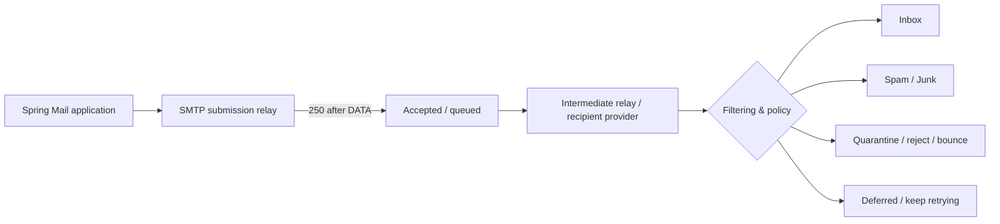
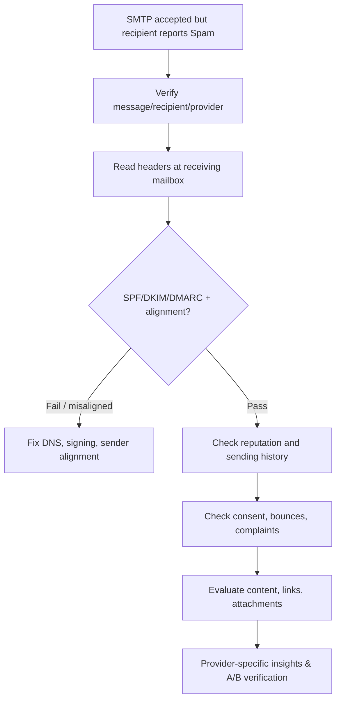
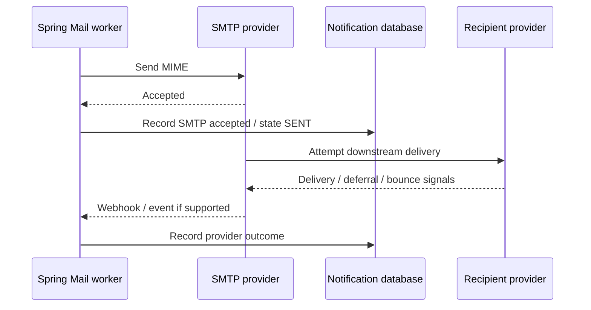

# Emails Marked as Spam Despite SMTP Returning Accepted

When sending emails with Spring Framework Mail, a commonly misunderstood outcome is that `JavaMailSender.send(...)` returns normally, or the SMTP relay returns `250 2.0.0 accepted`, yet the recipient still finds the message in the Spam/Junk folder. Developers may assume "SMTP reported success so the bug is in Spring" or "just resend a few times and the message will land in the Inbox." Neither conclusion is correct.

**SMTP accepted only confirms one point in the message transfer.** The relay accepted responsibility for processing the message at the time of the response; it does not promise the email landed in the Inbox, does not promise it will not be filtered at subsequent hops, and does not indicate the recipient read it. After accepted, the message may still pass through relays, domain authentication layers, anti-spam/phishing/malware filters, and policies specific to the mailbox provider or receiving organization.

To diagnose, separate **ability to submit to the relay**, **sender identity authentication**, **sending-stream trustworthiness**, **content/recipient-list quality**, and **final classification at the mailbox**. This lesson belongs to the *Deliverability* chapter of Spring Framework Mail: how to understand SMTP boundaries, verify SPF/DKIM/DMARC, analyze headers, improve lists and content legitimately, monitor bounces/complaints, configure Spring Mail, and handle cases where messages are accepted yet land in spam.

Examples target Spring Framework 6.x, Spring Boot 3.x, Java 21, and Jakarta Mail. Domain names `example.test`, `example.org`, and illustrative addresses are sample data only. Mail filtering policies and each provider's requirements can change, so provider-specific thresholds or rules should be checked against current documentation during implementation.

## 1. Three Concepts to Distinguish: Accepted, Delivered, and Inbox Placement

Email delivery has multiple milestones and should not be collapsed into one boolean `sent=true`:



| Concept | Exact Meaning | Is It Inbox Success? |
|---|---|---|
| `Submitted` | The application attempted to send the message to SMTP/provider | No |
| `Accepted` | An SMTP relay or provider accepted the message for further processing | No |
| `Deferred` | The provider delayed transfer/delivery due to a temporary condition | No |
| `Delivered` in provider dashboard | The provider recorded delivery to the destination system/mailbox per its own definition | Not necessarily: may land in Spam |
| `Inbox placement` | The message actually sits in the recipient's inbox based on verifiable observation | Yes, at check time |
| `Spam/Junk placement` | The mailbox provider or client sorted the message into the spam folder | No |
| `Bounced` | There is an undeliverable or returned notification, possibly after the initial relay accepted | No |
| `Opened` | An engagement/read signal was recorded, typically via pixel or client | Not absolute proof of message placement |

In particular, a provider dashboard labeled `delivered` does not necessarily tell whether the message is in Inbox or Spam; its meaning must be checked against the specific contract. Conversely, an email marked Spam may still have been delivered to the mailbox and opened by the user.

### 1.1. Distinguishing Four Types of Failure

1. **Transport failure:** The application cannot connect to SMTP, authentication fails, or the relay rejects during the SMTP transaction.
2. **Delivery failure:** The initial relay accepted the message, yet downstream rejects, defers for long, or bounces.
3. **Placement failure:** The mailbox receives the message, yet filters place it in Spam/Junk or quarantine.
4. **Engagement failure:** The message sits in the Inbox, yet recipients do not open, read, or take action.

Proper diagnosis starts by identifying which category the problem belongs to. You do not need to tweak SMTP timeouts to fix a reputation or opt-in issue.

## 2. Reading SMTP Code 250 Properly: Which Phase Does It Belong To?

An SMTP session has multiple 250 responses. A single 250 response at the wrong phase is not enough to conclude the relay fully accepted the message.

Abbreviated transcript example:

```text
S: 220 smtp.provider.test ESMTP
C: EHLO mail-app.example.org
S: 250-smtp.provider.test
S: 250 SIZE 26214400
C: MAIL FROM:<bounce@example.org>
S: 250 2.1.0 Sender accepted
C: RCPT TO:<customer@example.test>
S: 250 2.1.5 Recipient accepted
C: DATA
S: 354 End data with <CRLF>.<CRLF>
C: [MIME content redacted]
C: [end-of-data marker]
S: 250 2.0.0 Queued as [provider-id-redacted]
```

The `C:` and `S:` prefixes only indicate exchange direction, not a mandatory logger format. Addresses and content have been replaced with dummy data.

- `250` after `MAIL FROM` only says the envelope sender was accepted.
- `250` after `RCPT TO` only says the recipient was accepted for this transaction.
- `354` means the server is ready to receive content, **not yet** accepting the complete message.
- `250` **after DATA ends** is typically the signal that the relay took responsibility for the message for further processing.

Even in the final case, the provider may still encounter issues when delivering to the destination domain or when mailbox filters classify it.

### 2.1. Spring Mail Returns Without Exception

With `JavaMailSender` using standard synchronous SMTP, `send(...)` returning normally can be recorded as an SMTP call that reported no error. Yet Spring has no generic API to guarantee inbox placement for recipients. A successful `send` call **does not** cover the downstream lifecycle of the email.

When sending to multiple recipients, some addresses may also be accepted by the relay while others are rejected. Check per-recipient results or design one notification per recipient if accurate retry/tracking is needed.

### 2.2. Accepted Does Not Mean the Email Cannot Bounce

A relay may accept a message and then attempt delivery to another server. If downstream returns a permanent error, the relay may generate a bounce/DSN or provider event. This does not contradict the earlier `250` response: systems report outcomes at **different times**.

## 3. What Determines Whether an Email Goes to Inbox or Spam?

Mailbox providers do not look at a single property in JavaMailSender. Filters typically evaluate many combined signals, such as:

- Domain authentication and alignment with the displayed From address: SPF, DKIM, DMARC.
- Trustworthiness of the sending domain, sending IP, and mail provider infrastructure.
- Sending history, volume, sudden spikes, and consistency.
- Complaints, invalid recipients, bounces, and recipient behavior.
- Consistency of content, branding, links, and landing pages.
- Spoofing/phishing indicators, dangerous URLs, suspicious attachments.
- List quality: whether permission was obtained and whether suppression/unsubscribe exists.
- Receiving organization policies, enterprise filters, and personal user settings.

There is no single public formula or universal "spam score" across all mailbox providers. One email may land in Inbox at provider A, Spam at provider B, and quarantine at enterprise system C. Some providers may evaluate differently per individual user.

### 3.1. A Sensible Diagnostic Sequence



Fixing domain authentication is a foundational prerequisite, yet never promise that passing SPF/DKIM/DMARC alone puts every email into the Inbox.

## 4. SPF: Authenticating IPs Authorized to Send for the Envelope Domain

SPF (Sender Policy Framework) uses DNS TXT records to publish which IPs or sending sources are permitted to send mail for the domain SPF checks. In SMTP, SPF typically relies on the `MAIL FROM`/envelope sender domain; in certain special cases it may evaluate the HELO/EHLO identity.

Key point: **SPF is not simply checking the From address users see in the email**.

Example:

```text
Header From: invoices@example.org
SMTP MAIL FROM: bounce.mail.example.org
Connecting IP: 192.0.2.30
```

The receiver may evaluate SPF for `bounce.mail.example.org`, not directly for `example.org`. If IP 192.0.2.30 is permitted under the envelope domain's SPF, SPF can pass. Yet whether an SPF pass suffices for DMARC pass still depends on **alignment** with the domain in the From header.

### 4.1. Example SPF DNS Record

An illustrative record:

```dns
example.org. IN TXT "v=spf1 include:_spf.sender.example.net -all"
```

- `v=spf1`: declares an SPF record.
- `include:...`: incorporates the SPF policy of a sending source designated by the provider.
- `-all`: default fail mechanism if authorized sources do not match; use only after auditing all sending flows.

The host name above is only an example. In a real system, use the provider's official hostname/SPF include rather than copying an illustrative record and hoping it works.

### 4.2. Common SPF Mistakes

- Domain has **multiple SPF TXT records** starting with `v=spf1`, causing evaluation errors.
- Forgetting to add a new mail provider to the authorized sending sources.
- Using an old sending source that changed IPs without updating SPF.
- Exceeding SPF's DNS lookup evaluation limit (certain mechanisms have a limit, typically 10 lookups during evaluation), causing permerror.
- Using `+all` or overly broad authorization, weakening authentication value.
- Checking the From header instead of inspecting the provider's envelope domain.
- Forwarded messages causing the forwarder's IP to no longer match the original domain's SPF.

Do not "fix" SPF by allowing every IP. Inventory all legitimate sending sources, merge into **one SPF policy**, and optimize lookups per provider guidance.

## 5. DKIM: Signatures Tied to Content and Signing Domain

DKIM (DomainKeys Identified Mail) enables the recipient server to verify selected headers and the body signed with a private key. The public key is published in DNS; the message carries a `DKIM-Signature` header indicating signing domain `d=` and selector `s=`.

Abbreviated header example:

```text
DKIM-Signature: v=1; a=rsa-sha256;
 d=example.org; s=mail2026;
 h=from:to:subject:date:mime-version;
 bh=[REDACTED]; b=[REDACTED]
```

DNS public key example:

```dns
mail2026._domainkey.example.org. IN TXT "v=DKIM1; k=rsa; p=[PUBLIC_KEY]"
```

The `[PUBLIC_KEY]` string is a placeholder only, not a valid record for real use. The private key must remain in protected signing infrastructure; never place it in repositories, logs, or documentation.

### 5.1. What Does a DKIM Pass Provide?

A DKIM pass proves the signature matches the public key of domain `d=` and the signed parts have not been altered in a way that breaks the signature. It helps authenticate a domain identity, yet **does not prove the sender has good reputation** and does not guarantee Inbox placement.

DKIM does not mean message content is safe or trustworthy in all contexts; a domain controlled by a malicious actor can still validly sign its own messages.

### 5.2. Why Does DKIM Fail?

- Wrong DNS selector or missing corresponding public key.
- Signature misconfigured by provider regarding domain, selector, or key rotation.
- Email modified at an intermediate step after signing, such as a gateway adding a footer to the body or rewriting signed headers.
- New sending infrastructure deployed without enabling DKIM signing for the custom domain.
- Certain mail flows through forwarders/mailing lists altering signed content.

When DKIM fails, inspect `d=`, `s=`, verifier output, and where signing/MIME modification occurs. Do not fix it by manually adding a "pass" DKIM header or fabricating an unsigned/invalid `DKIM-Signature`.

### 5.3. Does Spring Sign DKIM Automatically?

`JavaMailSender` and `MimeMessageHelper` build/send MIME messages; they **do not automatically guarantee custom-domain DKIM signing**. In typical deployments, the outbound provider or MTA performs DKIM signing after the application submits. Operators must enable domain signing at the provider, publish DNS keys, and inspect headers on emails arriving at a test mailbox.

If the application signs DKIM itself, understand MIME content finalization order: any subsequent modification to signed headers/body can invalidate the signature. For most applications using managed SMTP, managing DKIM at the provider is easier to operate.

## 6. DMARC: Checking Alignment with the Displayed From Address

DMARC (Domain-based Message Authentication, Reporting and Conformance) links SPF/DKIM authentication to the domain of the `From:` header visible to users. DMARC does not simply require any random SPF or DKIM pass: the passing method must have **domain alignment** matching the RFC5322.From domain.

**Core rule:** DMARC passes if at least **one** of two conditions holds:

1. SPF passes **and** the SPF-authenticated domain aligns with the From domain; or
2. DKIM passes **and** the `d=` domain of the DKIM signature aligns with the From domain.

Both SPF and DKIM do not have to pass/align simultaneously for DMARC to pass, though running both generally improves resilience.

### 6.1. Successful Alignment Example

```text
Header From: billing@example.org
Envelope MAIL FROM: bounce.example.org
SPF: pass for bounce.example.org
DKIM: pass, d=example.org
DMARC: pass
```

Under relaxed alignment, subdomains can align with the organizational domain per DMARC rules. Specifically in this example, DKIM `d=example.org` aligns directly with From, so DMARC can pass even if SPF failed alignment in another flow.

### 6.2. SPF Pass but DMARC Fail

```text
Header From: invoices@example.org
Envelope MAIL FROM: bounce.smtp-provider.example.net
SPF: pass for smtp-provider.example.net
DKIM: pass, d=smtp-provider.example.net
DMARC: fail for example.org
```

SPF and DKIM may pass for the provider's domain, yet **neither aligns with the `example.org` From header**. To fix, configure the provider to sign DKIM with `d=example.org` or an appropriate aligned domain; or configure an aligned custom envelope MAIL FROM domain if supported by the provider. Do not switch everything to a random domain just to "get a pass" while discarding brand identity.

### 6.3. Example DMARC DNS Record

```dns
_dmarc.example.org. IN TXT "v=DMARC1; p=none; rua=mailto:dmarc-reports@example.org; adkim=r; aspf=r"
```

- `v=DMARC1`: declares a DMARC record.
- `p=none`: observation policy, not asking receivers to quarantine/reject under the domain policy (receivers may still filter spam by their own criteria).
- `rua=...`: address receiving aggregate reports from supporting receivers.
- `adkim=r` and `aspf=r`: relaxed alignment in the example policy.

`p=quarantine` and `p=reject` policies should only be escalated after inventorying, validating, and covering legitimate sending sources. They tell receivers how to handle **DMARC-failing emails**, not a button forcing DMARC-passing emails into the Inbox.

### 6.4. How Are DMARC Reports Useful?

Aggregate reports can show which IP sources are sending with your domain and SPF/DKIM/alignment results from supporting receivers' perspectives. They are helpful for spotting unconfigured sending services, spoofing sources, or infrastructure changes. However:

- Not every receiver sends reports.
- Reports typically arrive periodically, not in real time for every notification.
- Report data may contain metadata about sending sources and needs restricted access.
- "Receiving DMARC reports" does not mean knowing inbox placement.

### 6.5. Forwarding, Mailing Lists, and ARC

Forwarders can cause SPF to fail because the IP connecting to the final mailbox is no longer in the original sender's SPF. DKIM may still pass if signed content/headers remain intact, yet mailing lists appending footers or altering subjects can break DKIM.

ARC (Authenticated Received Chain) lets intermediaries record authentication results across hops. Receivers may use ARC as a **supporting signal per their own policies**, not a guarantee of DMARC pass or Inbox placement. Do not "fix DMARC" by manually adding ARC headers without trusted infrastructure.

## 7. Start with Full Headers at the Receiving Mailbox

When recipients report emails going to Spam, the most useful evidence is usually not the application's `mailSender.send(...)` log, but the **full message headers** of the actual email that arrived at the receiving mailbox, if obtainable via a test account or with the recipient's permission.

Headers commonly worth inspecting:

| Header / Information | Diagnostic Question |
|---|---|
| `From` | Which domain is displayed to the recipient? |
| `Return-Path` | What is the final recorded envelope/bounce sender? |
| `Authentication-Results` | How did the receiver evaluate SPF/DKIM/DMARC? |
| `Received` | Which hops/relays occurred, and at what timestamps? |
| `DKIM-Signature` | What are `d=`, selector `s=`, and what signatures exist? |
| `Message-ID` | Does the message have a sensible ID traceable via the provider? |
| `List-Unsubscribe` | Do bulk/subscription emails have an appropriate unsubscribe mechanism? |
| `List-Unsubscribe-Post` | Is one-click unsubscribe info present when required by the use case? |
| `Date` | Message creation timestamp and whether clocks are consistent? |
| Provider-specific headers | Queue IDs, spam classification hints, or other metadata if viewable |

### 7.1. Authentication-Results Example

```text
Authentication-Results: mx.recipient.example;
    spf=pass smtp.mailfrom=bounce.example.org;
    dkim=pass header.d=example.org header.s=mail2026;
    dmarc=pass header.from=example.org
```

This illustrates a receiver checking SPF, DKIM, and DMARC. If the message still lands in Spam, do not conclude the headers contradict each other: passing authentication is only **one signal**, not the placement decision.

### 7.2. Reading a Problematic Case

```text
From: Billing <billing@example.org>
Return-Path: <bounce@mailer.provider.example.net>
Authentication-Results: mx.recipient.example;
    spf=pass smtp.mailfrom=mailer.provider.example.net;
    dkim=pass header.d=provider.example.net;
    dmarc=fail header.from=example.org
```

Analysis:

1. SPF verified the provider's envelope domain, not the From domain.
2. DKIM signed with the provider's domain, unaligned with From.
3. Because there is no SPF/DKIM path that both passes **and** aligns, DMARC fails.
4. Investigate custom-domain DKIM or provider envelope sender configuration rather than just changing `spring.mail.host`.

### 7.3. Do Not Trust Sender-Injected Authentication-Results

`Authentication-Results` is a header added by verifying systems. Headers may exist from multiple hops, and an untrusted sender can also inject text resembling authentication results. When concluding, inspect the header added by the **receiver or trusted boundary**, based on the Received chain/trust policy of the receiving system. Do not trust an arbitrary "dkim=pass" line in raw MIME supplied by an untrusted source.

### 7.4. No Permission to Read the Recipient's Inbox

If full headers cannot be retrieved from a real mailbox, use an authorized test account at the target provider, the provider dashboard, or ask the recipient for **redacted headers**. Never ask for mailbox passwords, never tell recipients to forward emails containing tokens, and never access data without authorization.

## 8. Domain Reputation and IP Reputation

Even with SPF/DKIM/DMARC passing, a sender lacking a trusted history or carrying a poor history can still be filtered to Spam.

Commonly related signals:

- Email volume by domain/IP and trend changes.
- Nonexistent recipient, bounce, and complaint rates.
- Recipient engagement levels (as appropriate under each provider's policies).
- Frequency of sending to inactive or previously rejected lists.
- Reputation of the From domain, DKIM domain, and linked domains.
- IP infrastructure reputation and co-tenants sharing an IP.
- History of spam/phishing/malware from the sending stream.

A new system may have a new domain and an IP with no history. Suddenly sending tens or hundreds of thousands of messages right at launch can make receivers cautious, even if authentication is configured properly.

### 8.1. Shared IP vs. Dedicated IP

| Infrastructure | Advantages | Things to Watch |
|---|---|---|
| Provider shared IP | Easy to start; provider operates much of the infrastructure | IP reputation is influenced by provider policies and co-tenant senders |
| Dedicated IP | Better control over sending history on the IP | Requires steady enough volume, warm-up, DNS/rDNS operations, and reputation monitoring |

Not every organization needs a dedicated IP. For low or variable volume, a high-quality shared IP can be more suitable. A dedicated IP does not automatically guarantee Inbox placement and does not replace list quality.

### 8.2. Controlled Warming and Volume Ramping

When using a new domain/IP, start with flows **expected by recipients** and increase volume based on live signals. Monitor bounces, complaints, deferrals, and breakdown by provider. Never try to "warm up" with fake engagement, purchased lists, or test sends to unconsented recipients.

If spam jumps suddenly after a migration, check:

1. Did From domain, DKIM, and bounce domain change?
2. Did sending volume per receiving provider spike abnormally?
3. Did the IP pool and TLS/SMTP path differ from before?
4. Did bounce, complaint, or deferral rates rise?
5. Is only one mailbox provider classifying as Spam, or all providers?

### 8.3. Reverse DNS, HELO, and Infrastructure

When self-hosting MTAs/dedicated IPs, reverse DNS (PTR), forward DNS, EHLO hostname, and consistent routing can be important signals in assessing infrastructure validity. With managed SMTP providers, this is usually handled by the provider, yet you still must verify domain authentication and custom sender settings.

A valid PTR does not equal good reputation; and rDNS does not replace SPF/DKIM/DMARC.

## 9. Recipient Lists: Consent, Suppression, and List Hygiene

A common cause of deliverability issues is sending to people who **do not expect the email**. The SMTP relay may still accept it, yet recipients mark Spam, delete unread, or providers receive negative signals.

Good design distinguishes email types:

- **Transactional/service email:** Notifications triggered by an actual business action, such as invoices, receipts, or security alerts.
- **Marketing/subscription email:** Recipients actively subscribed to periodic/promotional content or contact lists with a clear permission basis.
- **Operational/system email:** Operational alerts or internal notifications to governed lists.

Never relabel "marketing" as "transactional" just to skip unsubscribe/consent or spam filtering. Regulations and provider requirements for each mail type can differ by region, recipient type, and platform.

### 9.1. List Management Principles

1. Collect explicit consent and store appropriate source/timestamp evidence.
2. Validate address format; if needed, use double opt-in to reduce typos or fake signups.
3. Stop marketing sends when recipients opt out; update the suppression list.
4. Remove or pause hard-bounced addresses per policy.
5. Handle spam complaints and stop sending the same mail type to complainants.
6. Segment inactive recipients to reduce unnecessary sends.
7. Never buy, scrape, or import email lists without permission.
8. Separate mail streams with different purposes when helpful for reputation and operations.

Consent, bounces, and suppression should be checked at enqueue **and** at dispatch if jobs can wait long in queues.

### 9.2. Why Does Resending Not Fix Spam?

If the root cause is unwanted mail, poor domain reputation, or suspicious content, retrying the same email repeatedly usually will not solve it. It can also raise complaints, send duplicates, and hurt reputation. Retries make sense only for **classified temporary errors**, not for a message already accepted by the relay and placed in Spam.

## 10. Unsubscribe for Subscription and Bulk Mail

A marketing/subscription email needs a clear, easy-to-use, and genuinely functional unsubscribe path per applicable policy. Lacking an unsubscribe mechanism or making it intentionally difficult drives recipients to click "Report spam" instead of opting out.

In addition to a link in the body, email standards include unsubscribe headers:

```text
List-Unsubscribe: <https://mail.example.org/u/opaque-token>,
                  <mailto:unsubscribe@example.org>
List-Unsubscribe-Post: List-Unsubscribe=One-Click
```

The `List-Unsubscribe-Post` header is described in RFC 8058 for one-click unsubscribe over HTTPS in a way supporting systems can invoke. Simply adding the headers does not complete integration: the endpoint must implement the right semantics, handle requests safely, and update suppression promptly.

### 10.1. Safe One-Click Endpoint

- Use HTTPS.
- Unpredictable tokens bound to subscriber/list and unsubscribe purpose; limit permission scope.
- Support standard POST one-click; **do not** let GET requests from link scanners automatically unsubscribe users.
- Ensure idempotency: repeated calls from users or providers do not fail or trigger side effects.
- Do not require login or complicate the one-click action per applicable policy.
- Do not write raw tokens to application logs or metrics.
- Protect against enumeration and abuse; apply appropriate rate limiting.
- Persist suppression state durably with minimal auditing.

Do not use links containing plaintext email addresses as the sole authorization key. If offering `mailto:` unsubscribe, have a process receiving and acting on actual messages; adding an unmonitored address is purely cosmetic.

### 10.2. Do Not Apply Mechanically to Every Transactional Message

Password reset notices or security alerts may not belong to the same category as marketing subscriptions. Define the mail type and policy per template. Do not let users "unsubscribe from all emails" in a way that blocks mandatory security alerts; nor use the transactional label to bypass consent for promotional emails.

### 10.3. Provider Requirements Can Change

Some mailbox providers enforce specific requirements on bulk senders regarding authentication, unsubscribe, and complaint handling. Applicable volume/domain thresholds and timelines can change. During implementation, consult current sender policy pages from major providers rather than relying on fixed numbers in this lesson.

## 11. Email Content, Links, and Attachments

Emails can be classified as Spam or phishing because of presentation even when domain authentication passes. The goal is not finding "tricks to bypass filters," but sending **transparent, expected, and easily verifiable content**.

### 11.1. Consistent Subject and Sender Identity

- Subject accurately describes content; avoid misleading promises or impersonation.
- Display name, From header, linked domains, and brand do not conflict.
- Reply-To (if present) is a valid address with a response channel where appropriate.
- Never use third-party brand names without permission.
- Never write subjects like fake urgent notices, fake invoices, or phishing lures.

There is no universal list of "banned words": a single word rarely explains placement on its own. Evaluate messages in context alongside real recipient feedback.

### 11.2. Valid HTML and Plain-Text Alternative

Provide clean, responsive, readable HTML content alongside a semantically matching plain-text part. Avoid sending only one giant image in place of all text; use sensible alt text, clear link purposes, and valid MIME structure.

Spring `MimeMessageHelper` supports multipart/alternative:

```java
MimeMessage message = mailSender.createMimeMessage();
MimeMessageHelper helper =
        new MimeMessageHelper(message, true, "UTF-8");

helper.setFrom("notifications@example.org");
helper.setTo(recipientAddress);
helper.setSubject("Your invoice is ready");
helper.setText(
        "Your invoice is ready. View in your account.",
        "<html><body><p>Your invoice is ready.</p>"
        + "<p><a href=\"https://app.example.org/invoices\">"
        + "View in your account</a></p></body></html>");

mailSender.send(message);
```

This example shows creating both content versions; production code must generate business-specific URLs, verify access permissions, apply context-aware HTML escaping, and never hardcode user-specific data. Having a plain-text alternative is a good practice for readability and compatibility, **not** a guarantee of Inbox placement.

### 11.3. Links and Redirects

Check links in the body:

- Use HTTPS and domains owned by the application or approved providers.
- Avoid shorteners or redirect chains with unclear destinations.
- Never display one URL while linking to an unrelated domain.
- Never embed long-lived secrets; single-use tokens need expiration and narrow scope.
- Check website health, certificates, and landing page content.
- Use tracking links transparently, avoid overuse, and note that gateway link rewriting can affect user experience.

If an email displays `account.example.org` yet actually routes through multiple unrelated hosts, filters or recipients may grow suspicious. Do not obscure real destinations with complex redirects.

### 11.4. Attachments

Large attachments, risky file types, wrong MIME types, or malware-bearing files can trigger policy filtering. For invoices, prefer common document formats from controlled sources; where appropriate, send an HTTPS link to a secure authenticated portal instead of attaching excessive data.

Do not assume setting `Content-Type: application/pdf` makes a file safe. Declared MIME types can differ from actual file content. Apply appropriate file validation and scanning before sending.

### 11.5. Do Not Arbitrarily Alter Content to "Evade Spam"

Tactics such as inserting random characters, replacing letters with special symbols, hiding text, spoofing, or using deceptive redirects reduce trust, increase phishing indicators, and violate provider policies. Focus on consent, authentication, reputation, and content recipients genuinely need.

## 12. Separating Transactional and Marketing Reputation When Needed

A system may send two categories:

- Transactional emails: invoices, login notices, account confirmations.
- Marketing emails: newsletters, promotional campaigns, content recommendations.

If marketing has high frequency or poor list quality, negative signals can affect the transactional stream when sharing the same domain/IP/sender setup depending on the provider model.

Consider separating streams via:

- Purpose-specific sending subdomains, such as `notify.example.org` and `news.example.org`.
- Separate provider streams/pools or configurations.
- Appropriately aligned DKIM domains and bounce domains.
- Per-mail-type rate limits, retry policies, and suppression.
- Separate reputation dashboards for transactional/marketing.

Separating subdomains does not mean completely isolating every reputation factor. Some receivers still evaluate the organizational domain and related signals. Never rotate new domains repeatedly to escape consequences of unwanted sending behavior.

## 13. Spring Boot Mail Configuration: Application vs. Provider Responsibilities

Example Spring Boot configuration for a managed SMTP provider:

```yaml
spring:
  mail:
    host: smtp.provider.example.net
    port: 587
    username: ${SMTP_USERNAME}
    password: ${SMTP_PASSWORD}
    properties:
      "[mail.smtp.auth]": "true"
      "[mail.smtp.starttls.enable]": "true"
      "[mail.smtp.starttls.required]": "true"
      "[mail.smtp.connectiontimeout]": "5000"
      "[mail.smtp.timeout]": "10000"
      "[mail.smtp.writetimeout]": "10000"
```

This is an illustrative configuration, not real provider connection details. Timeouts are sample values. Use a secret manager or protected environment variables; never commit credentials to repositories. For providers requiring implicit TLS, configuration differs.

What **Spring Boot SMTP config** controls:

- Connecting to the right SMTP host/port.
- AUTH and TLS per the relay's contract.
- Timeouts and how the client submits messages.
- MIME charset, headers/body/attachments built by the application.
- Envelope sender where supported by transport/provider configuration.

What **does not appear automatically** when adding `spring-boot-starter-mail`:

- Domain ownership verification for From on the provider.
- DNS SPF, DKIM signing, DMARC records/alignment.
- Domain/IP reputation and consented sending.
- Unsubscribe/suppression workflows.
- Ingestion of bounces, complaints, and delivery events.
- Inbox placement decisions by mailbox providers.

### 13.1. Customizing Envelope MAIL FROM

Common Jakarta Mail SMTP providers support the `mail.smtp.from` property to choose the SMTP envelope sender in some setups:

```yaml
spring:
  mail:
    properties:
      "[mail.smtp.from]": "bounce@example.org"
```

This **does not automatically configure SPF/DMARC alignment** and may be overridden or rejected by the provider if the sender domain is not registered. Some managed services configure custom MAIL FROM/bounce domains via dashboard/API. Prefer the provider's official contract rather than assuming any property takes effect.

### 13.2. Separating From, Reply-To, and Return-Path

| Component | Function |
|---|---|
| `From:` in MIME header | Displayed sender identity, critical for DMARC |
| `Reply-To:` | Where replies go when the recipient clicks Reply |
| SMTP `MAIL FROM` | Envelope sender, tied to SPF and bounce routing |
| `Return-Path:` | Header usually added by final delivery system from the envelope sender |

Setting `helper.setReplyTo(...)` does not change the From domain for DMARC. Setting `helper.setFrom(...)` also does not guarantee the envelope sender or DKIM d= is configured properly at the provider. Cross-check raw headers and SMTP/provider settings.

### 13.3. Example Service Sending with Clear Identity

```java
@Service
public class InvoiceMailService {

    private final JavaMailSender sender;
    private final MailTemplateRenderer renderer;

    public InvoiceMailService(
            JavaMailSender sender,
            MailTemplateRenderer renderer) {
        this.sender = sender;
        this.renderer = renderer;
    }

    public void sendInvoiceReady(
            String recipient,
            InvoiceMailData data) throws MessagingException {

        RenderedMail rendered = renderer.renderInvoice(data);
        MimeMessage message = sender.createMimeMessage();
        MimeMessageHelper helper =
                new MimeMessageHelper(message, true, "UTF-8");

        helper.setFrom("billing@example.org");
        helper.setReplyTo("support@example.org");
        helper.setTo(recipient);
        helper.setSubject(rendered.subject());
        helper.setText(rendered.plainText(), rendered.html());

        sender.send(message);
    }
}
```

`MailTemplateRenderer`, `RenderedMail`, and `InvoiceMailData` are application abstractions. In production, recipient data and authorization must be validated before creating messages; sender configuration comes from trusted policy, never arbitrarily from requests.

This snippet only shows clean MIME creation. It **does not configure DNS or sign DKIM**. After deployment, send real test emails through the provider to verify `Authentication-Results` at the mailbox.

## 14. Recording Events After SMTP Accepted

To find why emails go to Spam, a "mail sent" log alone is insufficient. Combine application data with provider events:



Example event model:

```java
public enum MailProviderEventType {
    ACCEPTED,
    DEFERRED,
    DELIVERED,
    BOUNCED,
    COMPLAINT,
    UNSUBSCRIBED
}

public record MailProviderEvent(
        String providerEventId,
        String providerMessageId,
        String notificationId,
        MailProviderEventType type,
        Instant occurredAt,
        String safeReasonCode
) {}
```

Actual event names and semantics depend on the provider. Notably, `DELIVERED` may not reflect Inbox placement. Never synthesize a `DELIVERED` event from `JavaMailSender.send(...)` results; that result belongs to the SMTP submission layer.

### 14.1. Webhooks Must Be Authenticated

An endpoint receiving provider webhooks should not trust every HTTP request bearing `type=DELIVERED` or `type=COMPLAINT`. You must:

- Verify the provider's signature or authentication mechanism.
- Validate event ID, timestamp, payload schema, and size limits.
- Handle idempotently because webhooks can be redelivered.
- Update notification/recipient state within an appropriate transaction.
- Never use forged events to clear suppression or reopen sending permissions.
- Log controlled event codes and IDs, avoiding payloads containing PII.

### 14.2. Do Not Mix States Across Layers

A record may hold:

```text
notificationStatus = SENT
smtpSubmission     = ACCEPTED
providerDelivery   = DELIVERED
mailboxPlacement   = UNKNOWN
```

This is not contradictory. The fields reflect different layers. When only `smtpSubmission=ACCEPTED` exists, `providerDelivery=UNKNOWN` is the accurate conclusion without downstream evidence; never fabricate DELIVERED to make a dashboard look nicer.

## 15. Bounces and Complaints: Critical Negative Feedback

### 15.1. Hard Bounce and Soft Bounce

Typically:

- **Hard bounce** indicates permanent inability to deliver per provider classification, such as a nonexistent mailbox.
- **Soft bounce** is typically a temporary failure, such as a full mailbox or destination server not ready.

However, event names and classifications vary across providers; read specific codes and semantics. Prolonged "soft" errors do not mean retry forever; enforce attempt caps, TTLs, and suppression policies.

Upon receiving a reliable hard bounce, the application should update suppression by mail type to avoid pointlessly emailing the same address. If the bounce stems from sending-domain configuration rather than the recipient, fix the configuration instead of suppressing the entire list.

### 15.2. Complaints Are Signals from Recipients

Spam complaints may arrive via feedback loops or provider events if supported. This is a serious signal about whether recipients expect the mail. You must:

1. Record verified complaint events.
2. Correlate notification and mail type.
3. Suppress relevant streams per consent/policy.
4. Investigate signup sources, segments, and content.
5. Never immediately resend to someone who just complained.

Not every mailbox provider offers full feedback loops. Observed complaint rates may reflect only **a subset** of reality; document provider coverage and measurement methodology.

### 15.3. Decide Retries by Root Cause, Not by Inbox Goal

Retries are appropriate when transport hits a transient error **before accepted** or when the provider defers per policy. If an email was already accepted and landed in Spam, immediately resubmitting the same message usually increases volume and duplicate risk. Fix the root cause instead—authentication, list hygiene, reputation, or content—then evaluate on subsequent legitimate sends.

## 16. Measuring Deliverability with Clear Definitions

A dashboard can break down:

| Metric | Interpretation | Limitation |
|---|---|---|
| Submitted | Notifications/attempts calling transport | May include retries and duplicates |
| SMTP accepted | Times provider/relay accepted submission | Does not indicate inbox placement |
| Deferred | Processing/delivery deferral events | Multiple events may exist per message |
| Bounced | Notifications with bounces per policy | May arrive late and vary across providers |
| Complaints | Complaints received from feedback/events | Coverage depends on provider |
| Delivered reported | Messages provider reported delivered | Does not guarantee message is in Inbox |
| Inbox placement observed | Observations from authorized test mailboxes/tools | Sample only; does not represent all users |
| Unsubscribes | Users requesting to stop subscription mail | Must measure at recipient/list level |

When computing rates, explicitly specify **denominator, unit, and time window**. For example, bounce rate can be defined as bounced notifications divided by provider-accepted notifications in the same cohort/window per reporting policy. Using attempts as the denominator during retries distorts the metric. When reading provider dashboards, check official definitions before comparing with internal metrics.

### 16.1. Segmenting by Mailbox Provider

A domain may have trouble only with one recipient group:

```text
Provider A: authentication passes, test mailbox lands in Inbox
Provider B: authentication passes, test mailbox lands in Spam
Provider C: policy rejection at RCPT
```

These are three distinct problems. Segmenting by receiving provider/domain, mail type, source IP pool, and time avoids changing global configuration when only one group is affected.

### 16.2. Do Not Treat Open Rate as Absolute Truth

Tracking pixels can be blocked, prefetched by proxies, or affected by email client privacy protections. Hence, open rate is not exact proof that a human read the message or that it landed in the Inbox. Clicks likewise need contextual interpretation and may include requests generated by link scanners.

Never automatically mark someone as having opted in to marketing just because a pixel open was logged. Consent requires separate evidence.

### 16.3. Testing with Seed Mailboxes

You can use authorized test accounts at major receiving providers, send representative content, and observe Inbox/Spam. Yet seed testing has limits:

- Test mailboxes have different engagement histories than real mailboxes.
- Filters can personalize per recipient.
- A sample of a few addresses is insufficient to infer Inbox rate across the whole customer base.
- The exact same email sent at another time can get a different result.

Seed tests aid investigation and regression detection; they are not proof that every recipient will receive messages in the same folder.

## 17. Real-World Incident Diagnosis Workflow

Suppose a user reports: "Invoice emails are still going to Spam, yet the application shows SENT." Follow these steps:

### Step 1 — Confirm the Exact Message

Obtain notification ID, attempt ID, send timestamp, sender domain, recipient provider, and provider message ID (if available). Do not search by dumping all email bodies. If multiple attempts exist, identify which message actually landed in Spam.

### Step 2 — Confirm the SMTP-Layer Outcome

Check logs to see whether the relay returned accepted after DATA or only `250` at MAIL/RCPT. Check for timeouts or partial recipient failures. If `mailSender.send(...)` succeeded yet the database update failed, handle the acknowledgment and duplicate-risk issue separately.

### Step 3 — Collect Headers at a Test/Authorized Mailbox

Inspect `Authentication-Results` added by a trusted receiver, along with From, Return-Path, DKIM-Signature, and Received. Record SPF, DKIM, DMARC **and alignment** results. Without full headers, do not conclude DNS authentication passes merely because the provider dashboard says "domain verified."

### Step 4 — Check DNS and Provider Configuration

Verify SPF envelope domain, custom DKIM d=/selector, DMARC From alignment, DNS visibility/cache/TTL, provider sender verification, and custom MAIL FROM settings. Check for recent migrations or template/sender changes.

### Step 5 — If Auth Passes, Investigate Reputation and Segments

Review volume history, deferrals, hard bounces, complaints, domain/IP reputation signals (if supplied by provider), and differences across mailbox providers. Do not blame content from a single seed mailbox alone.

### Step 6 — Check Mail Type, Consent, and Content

Do recipients expect this email? Does the template describe it accurately? Do links clearly reflect the destination domain? Does marketing have working unsubscribe? Are there suspicious attachments or redirects? Did a campaign change drive up complaints?

### Step 7 — Choose Actions with Lasting Effect

Examples:

- Fix alignment and DKIM signer.
- Fix SPF records or undeclared sender routing.
- Temporarily reduce volume/stop sending to unexpecting lists.
- Process suppression, bounces, and complaints.
- Fix broken links/HTML or unclear sender identity.
- Contact provider support with message IDs and redacted evidence.

### Step 8 — Monitor After Changes

Send **valid, expected** notifications, verify authentication at mailboxes, and measure events and placement across multiple observation points. DNS updates do not always take effect immediately due to caches/TTLs. Reputation can also take time and good behavioral history; do not promise instant Inbox recovery.

## 18. Sample Analysis Scenarios

### Scenario A — SMTP Accepted, SPF Pass, DMARC Fail

```text
SMTP: 250 2.0.0 accepted
Header From: receipts@example.org
SPF: pass, smtp.mailfrom=provider.example.net
DKIM: pass, header.d=provider.example.net
DMARC: fail, header.from=example.org
Placement: Spam
```

**Sound conclusion:** SMTP submission succeeded, yet authentication is unaligned with the From domain. Prioritize configuring custom-domain DKIM or aligned MAIL FROM at the provider. There is not enough evidence to call alignment the *sole cause* of Spam placement, yet it is a foundational flaw that must be fixed.

### Scenario B — SPF/DKIM/DMARC All Pass, Still Goes to Spam

```text
SPF: pass
DKIM: pass, aligned
DMARC: pass
Placement: Spam
Campaign: sudden volume spike, many complaints
```

**Sound conclusion:** Authentication passed, so inspect reputation, consent sources, segments, complaints, content, and receiver policies. Adding a second SPF record or rotating DKIM selectors endlessly without reason will not help.

### Scenario C — Only One Receiving Provider Marks Spam

```text
Provider A: Inbox in test mailbox
Provider B: Spam in test mailbox
Provider C: insufficient data
```

**Sound conclusion:** Diagnose per provider rather than claiming all emails are marked spam. Inspect headers at Provider B, B's reputation signals, content variations, recipient history, and test sample quality. Do not generalize from one test mailbox.

### Scenario D — Email Forwarded Then DKIM Fails

```text
Original sender: SPF pass, DKIM pass, DMARC pass
Forwarding hop: modifies signed content
Final receiver: SPF fail, DKIM fail, DMARC fail
```

**Sound conclusion:** Check the forwarder/mailing list that altered signed content and note how forwarding affected SPF. If ARC from trusted hops is present, the final receiver may consider it as a supporting signal, though Inbox selection cannot be guaranteed.

### Scenario E — SMTP Accepted Then Bounced

```text
T0: Submission relay returns 250 accepted
T1: Downstream delivery attempt fails
T2: Provider emits BOUNCED event
```

**Sound conclusion:** Spring did not "falsely report success"; it reported the submission outcome at T0. Record the bounce at T2, classify hard/soft, and update suppression/retries per policy.

### Scenario F — Transactional Email Mixed with Marketing Reputation

```text
Transactional and campaign mail use same sender setup
Marketing volume spikes; recipients complain
Invoice notifications begin landing in Spam
```

**Sound conclusion:** Evaluate separating transactional/marketing streams, tightening consent/list hygiene, and reviewing provider pools. There is not enough evidence to blame shared IPs entirely; inspect concrete data.

## 19. Diagnosing with Tools, Without Confusing Measurements with Causes

Depending on the environment, use these tool groups:

- DNS lookups for SPF, DKIM selectors, and DMARC records.
- Provider domain verification and sending-domain dashboards.
- Mailbox raw-header view for `Authentication-Results`, `Received`, and `Return-Path`.
- Provider message trace/queue IDs, bounce/complaint events.
- Postmaster/reputation dashboards supported by providers.
- SMTP sandboxes, test recipients, and internal observability systems.

Example generic DNS queries in an environment with `dig`:

```bash
dig TXT example.org
dig TXT _dmarc.example.org
dig TXT mail2026._domainkey.example.org
dig TXT bounce.example.org
```

Some records may be published under other names depending on the provider. Do not check DKIM TXT only on the root domain; take the actual selector `s=` and signing domain `d=` from the message and query `s._domainkey.d`.

### 19.1. DNS Cache and Propagation

DNS does not synchronize instantaneously to every receiver. Resolvers may cache records per TTL, and distributed infrastructure has its own update lag. After fixing SPF/DKIM/DMARC, verify from relevant resolvers and retest with new emails; older emails already in Spam will not necessarily be reclassified automatically.

### 19.2. Provider "Domain Verified" Is Not Enough

A dashboard saying a sender domain is verified may only confirm one configuration step. To verify in practice, inspect raw headers of an **email that passed through the exact provider stream, exact sender, and test recipient**. A system with multiple providers or tenants may sign properly on stream A yet fail on stream B.

## 20. Safe Logging and State Tracking in the Application

Avoid logging only:

```text
INFO Email sent successfully to user@example.test
```

This line both exposes the recipient address and is ambiguous about what "success" means. Log layered events instead:

```text
INFO event=mail_queued notificationId=... template=invoice_ready
INFO event=smtp_submit_started notificationId=... attemptId=...
INFO event=smtp_submit_accepted notificationId=... attemptId=...
INFO event=outbox_state_updated notificationId=... status=SENT
INFO event=provider_delivered notificationId=... providerMessageId=...
WARN event=provider_complaint notificationId=... category=spam_report
```

Provider event lines should appear only after receiving and verifying actual events. Never synthesize `provider_delivered` from `smtp_submit_accepted`.

### 20.1. Do Not Turn Accepted into a Final Certainty State

A storage model:

```java
public record MailDeliverySnapshot(
        String notificationId,
        boolean smtpAccepted,
        String providerMessageId,
        MailProviderEventType latestProviderEvent,
        String inboxPlacement // UNKNOWN if unmeasurable
) {}
```

In a real system, enums or multiple tables/events can be used instead of strings. What matters is separating submission results, provider delivery, and Inbox placement while preserving `UNKNOWN` when evidence is absent.

### 20.2. Avoid Logging Sensitive Data

- Never log email bodies, reset tokens, OTPs, attachments, or SMTP passwords.
- Never dump entire `MimeMessage` objects or `MailSendException.getFailedMessages()`.
- Normalize error codes and truncate response text before logging.
- Never use recipient emails or notification IDs as high-cardinality metric labels.
- Store only necessary message IDs/recipient references per data policy.
- Enforce permissions, retention, and redaction on webhook payloads.

## 21. Beware of Auto-Resending After Accepted

This is a critical intersection between Deliverability and retry/idempotency:

1. Worker calls SMTP.
2. Relay returns `250 accepted`.
3. Email lands in Spam at the mailbox.
4. User reports not seeing it.
5. Application auto-retries as if it were a transport error.

Step 5 is unjustified: the first send **was already accepted**. Retrying can create duplicates, raise complaints, and does not fix why spam filtering triggered. If a user genuinely wants a receipt resent, design an explicit resend action with auditing, authorization checks, rate limits, and clear separation from transient-error retries.

A different case is a timeout **after DATA** where the client receives no final response. Then the outcome may be uncertain; retrying also risks duplicates, though the decision may differ depending on non-loss requirements. Distinguish the two cases:

| Situation | Evidence Relay Accepted? | Action |
|---|---|---|
| Received final `250` after DATA | Yes | Monitor downstream/placement; do not auto-retry to fix Spam |
| No final response after DATA | Uncertain | Apply UNKNOWN/reconciliation policy; weigh duplicate risk |
| Relay returned clear temporary `4xx` before accepted | Evidence of temporary rejection | Retry with backoff if appropriate |
| Relay returned clear permanent `5xx` | Evidence of rejection | Fix data/config/suppression; do not retry verbatim |

## 22. Testing Deliverability in Spring Mail Systems

You cannot unit-test every mailbox provider's spam filter with Mockito alone. However, many useful tests reduce configuration risk and catch regressions.

### 22.1. Unit Testing MIME Structure

With a mock `JavaMailSender` and locally built messages, verify:

- `From` comes from trusted sender configuration.
- `Reply-To` fits the intended purpose.
- `Subject` contains no CR/LF and uses appropriate charset encoding.
- Plain text and HTML are consistent in content.
- Links use HTTPS and allowlisted domains.
- Attachments, MIME types, and filenames are validated.
- Unsubscribe headers are attached only when the mail type and endpoint meet requirements.

These tests do not guarantee Inbox placement, yet prevent input bugs that make messages suspicious or violate policy.

### 22.2. Integration Testing with an SMTP Sandbox

You can use Mailpit in test environments:

```bash
docker run --rm --name mailpit -p 1025:1025 -p 8025:8025 axllent/mailpit
```

Send into the sandbox and inspect raw MIME, content, From/Reply-To headers, multipart alternatives, and recipient counts. An SMTP sandbox **does not represent** the spam filters and reputation of a real mailbox provider.

### 22.3. Checking DNS and Signing in Staging

A test through the configured provider:

1. Send a message to an authorized test mailbox.
2. Retrieve raw headers.
3. Verify SPF, DKIM, and DMARC pass/alignment.
4. Compare d=/selector against expected domains.
5. Confirm bounce domain and From consistency.
6. Check sender/provider routing by tenant/mail type.

If DNS was recently changed, record timestamp and TTL to avoid testing stale cache and drawing false conclusions.

### 22.4. Testing Suppression and Complaints

Simulate an authenticated complaint webhook. Verify the recipient is placed on the appropriate suppression list and subsequent marketing jobs are not dispatched. Test duplicate webhooks and late-arriving events; do not let a webhook replay write incorrect state.

### 22.5. Testing One-Click Unsubscribe

For subscription mail, test links/headers and endpoints:

- One-click POST actually updates status.
- Repeated POST calls remain idempotent.
- GET requests from link scanners do not unintentionally unsubscribe.
- Tokens are not logged.
- Unsubscribed users do not receive new campaigns.

### 22.6. Testing Accepted Followed by Later Bounce

Fake SMTP sender returns normally; outbox records SENT. Later, the provider emits a BOUNCED event. Verify the system updates delivery/suppression state appropriately without rewriting SMTP acceptance history.

### 22.7. Testing Provider Placement with Permitted Samples

A set of test mailboxes can monitor Inbox/Spam by provider, template, and sender stream. Document test sample, timing, methodology, and inference limits. Never use results from a few seed mailboxes as a promise that all customers land in the Inbox.

## 23. Common Mistakes

**"SMTP 250 means the email landed in the Inbox."** False; accepted is a relay milestone, distinct from delivery and placement.

**"Spring Mail threw no exception, so the spam filter must be wrong."** Spring does not control mailbox filters. Inspect headers and provider events.

**"If SPF passes, DMARC definitely passes."** False if the SPF domain is unaligned with the From header and there is no aligned DKIM pass.

**"If DKIM passes, it will never be marked spam."** DKIM proves the signature, not good content or reputation.

**"Create an extra SPF record for each provider."** Multiple separate SPF records can cause permerror. Maintain one unified SPF policy.

**"Switch DMARC to p=reject to force Inbox."** DMARC policy directs how receivers handle DMARC-failing messages, not guaranteeing placement of passing ones.

**"Keep rotating domains/IPs to escape Spam."** Fails to fix consent and reputation; makes operations harder to control.

**"Just use a dedicated IP."** Dedicated IPs require good sending history and steady operations; not an automatic cure.

**"Keep resending accepted messages until they reach the Inbox."** Creates duplicates and raises complaints; fails to fix the root cause.

**"Label marketing as transactional to drop unsubscribe."** Misclassifying purpose makes opting out harder and violates policies.

**"Inserting a List-Unsubscribe header is enough."** Requires a working endpoint, proper token/POST semantics, and real suppression.

**"Provider delivered proves the user read it."** Delivered and opened have different definitions, accuracy, and limitations.

**"One seed mailbox landing in Inbox proves a 100% rate."** Filters can be personalized and sample size is tiny.

**"Users reported Spam because the body had a forbidden keyword."** Do not infer from a single word; check authentication, consent, reputation, links, and history.

**"Log entire email bodies for debugging."** Exposes personal data and tokens. Prefer logging by ID, phase, and normalized error codes.

## 24. Practice Exercises

### Part A — Distinguishing States

Given a transcript with 250 after RCPT, 354 after DATA, and 250 after DATA ends, explain at which point SMTP accepted can be marked, and why Inbox delivered cannot be marked from that transcript alone.

### Part B — SPF and Domain Alignment

Given Header From `sales@example.org`, MAIL FROM `bounce.mailer.example.net`, and SPF pass for the provider's domain, explain why SPF pass is insufficient for DMARC without alignment.

### Part C — DKIM

Given a DKIM header with `d=provider.example.net`, `s=selector1`, describe how to look up the DNS public key and check whether the signing domain aligns with From. Walk through a scenario where a mailing list appends a footer after signing.

### Part D — DMARC

Write a DMARC record in monitoring mode and describe a sound process to review reports, audit sending sources, and only then consider stricter policies. Explain why `p=reject` is not a fix for passing messages still landing in Spam.

### Part E — Comparing Two Mailbox Providers

Send the same template to authorized test mailboxes at two providers. Save headers and folder placement outcomes, analyzing differences without asserting a single cause when data is lacking.

### Part F — MIME and Content

Use `MimeMessageHelper.setText(plain, html)` to send an invoice email with clear From, Reply-To, Subject, and link. Verify HTML escaping, HTTPS URLs, and attachment size.

### Part G — Consent and Suppression

Create a subscriber list with consent, hard bounce, and complaint flags. Write a preflight filter to exclude recipients not permitted to receive marketing before enqueueing. Test that opted-out users are not sent to again.

### Part H — One-Click Unsubscribe

Design an idempotent HTTPS POST endpoint with narrow-scope tokens, verifying GET does not remove subscriptions. Add both appropriate unsubscribe headers and verify tokens do not appear in logs.

### Part I — Provider Events

Simulate SMTP accepted followed by DELIVERED or BOUNCED via provider events. Verify submission and downstream states remain separate; webhooks are authenticated and handled idempotently.

### Part J — Runbook

Create an investigation checklist for a notification landing in Spam: fetch message ID, full test headers, SPF/DKIM/DMARC/alignment, provider reputation, complaints/bounces, consent, content, and post-remediation results.

## 25. Implementation Checklist

Before drawing conclusions or changing configurations, ask yourself:

- Was `250` returned after DATA or only at MAIL/RCPT?
- `JavaMailSender.send(...)` succeeded, but did the outbox record the right status?
- Is there a provider message ID or downstream event?
- Did the email actually go to Spam/Junk, or was it rejected/bounced/quarantined?
- Do you have full headers from a test mailbox or an authorized recipient?
- Which domain did SPF pass for? What is the exact envelope sender?
- With which `d=` and `s=` did DKIM pass?
- Did DMARC pass or fail, and does it align with the From header?
- Is there a new sending source missing SPF/DKIM or a new domain post-migration?
- Could DNS selector/DMARC/SPF records be affected by cache/TTL?
- Do all sender streams/tenants share valid domain configurations?
- Did domain/IP reputation, volume, or complaints/bounces change?
- Do recipients actually expect this type of email?
- Does marketing have opt-in, suppression, and working unsubscribe?
- Are From, Reply-To, subject, links, and landing pages consistent?
- Are plain text/HTML, attachments, and MIME valid?
- Is the issue isolated to only one mailbox provider?
- Does the "delivered" dashboard actually measure Inbox or only server handoff?
- Are you relying on an overly small seed sample or skewed open rates?
- Is there duplicate risk from resending already-accepted messages?
- Are logs, headers, and webhook payloads properly redacted?
- After fixing, are you monitoring across multiple valid sends and multiple providers?

## 26. Concluding Principles

**SMTP accepted is success at the submission boundary, not a promise of Inbox placement.** Messages can still be filtered as Spam/Junk even when SPF/DKIM/DMARC pass, and can bounce after the initial relay accepted them. Before editing Spring Mail code, pinpoint the SMTP milestone, gather header evidence from a receiving mailbox, check alignment, reputation, sending history, consent, and content.

SPF authenticates the sending source for the envelope domain; DKIM authenticates signatures tied to the signing domain; DMARC requires an SPF or DKIM branch to pass **and align with the From header**. This is a vital foundation, yet not an "Inbox ticket." Sustainable deliverability requires recipients who expect the mail, clean lists, proper unsubscribes, transparent content, stable sending infrastructure, and disciplined bounce/complaint handling.

In Spring applications, separate **SMTP submission status**, **provider delivery events**, and **mailbox placement**. Log notification/attempt/provider IDs carefully, ingest authenticated webhooks, and never auto-retry accepted messages simply because a user does not see them in the Inbox. When placement data is absent, the accurate conclusion is **unknown**, rather than claiming Inbox delivery or certain failure.
