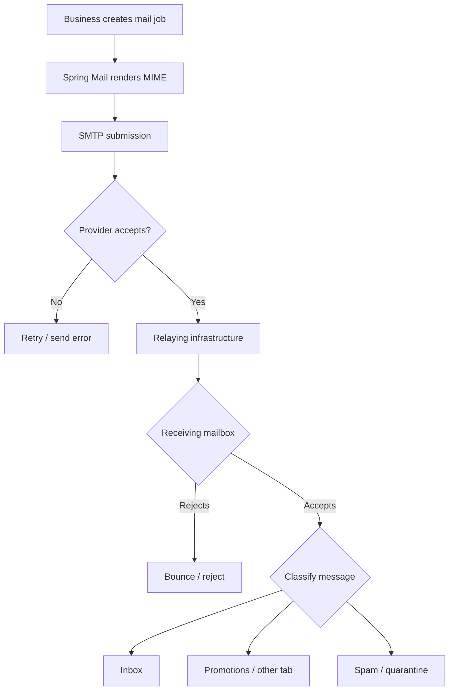

# How Content, Links, and Images Affect Deliverability in Spring Framework Mail

An email sent successfully by `JavaMailSender.send(...)` is not guaranteed to reach the Inbox. The sending SMTP server may accept the message, and the receiving system may accept it and then route it to Spam, Promotions, Quarantine, or reject it at a later step. **Deliverability** is the likelihood that an email is accepted by receiving systems and delivered to where the recipient can actually use it; when analyzing deeply, clearly separate delivery capability from Inbox placement.

Many factors affect deliverability: domain/IP reputation, SPF–DKIM–DMARC authentication, recipient lists, sending frequency, bounces/complaints, SMTP configuration, provider policies, and **the message content itself**. Within content, three areas deserve attention:

1. **Copy:** Subject, preheader, opening lines, text/plain, HTML, consistency, and relevance to the recipient.
2. **Links:** Destination domains, URL presentation, redirects, tracking, TLS certificates, landing page safety, and spoofing risk.
3. **Images:** Reliance on remote images, image-only emails, inline CID images, dimensions, alt text, privacy, and mail client experience.

There is no fixed formula like "40/60 image-to-text ratio" or "avoid these exact ten spam keywords" that guarantees Inbox placement. Mailbox providers evaluate many signals simultaneously, can change algorithms, and differ across receiving domains. The application's goal is to produce **clear, helpful, safe emails consistent with the sender identity and aligned with recipient expectations**, then measure results with real data.

In Spring Framework Mail, `MimeMessageHelper` helps create text/plain and text/html versions and attach inline images or files. The library helps build valid MIME structure; however, content quality and link trustworthiness must be governed by the application, templates, and operational processes.

## 1. Understanding the Milestones of the Sending Process

Separate concepts that are easily conflated:

| Concept | Meaning | Does It Prove Inbox Placement? |
|---|---|---|
| `ENQUEUED` | The application recorded the send request | No |
| `PROCESSING` | A worker is rendering or sending the message | No |
| `SUBMITTED` | The SMTP submission server accepted the message | No |
| `DELIVERED` | The system/provider has evidence the receiving server accepted it | Not necessarily |
| `INBOX_PLACEMENT` | The message was actually placed in the Inbox | Separate outcome to verify |
| `BOUNCED` | The message was rejected/returned | No |
| `COMPLAINED` | The recipient reported the message as spam | Adverse signal |
| `OPENED` | An image/pixel load or interaction signal occurred | Does not guarantee a human read it |
| `CLICKED` | A link access signal occurred | Not absolute proof of a human due to link scanners |

Example sending flow:



A successful `send()` call is a necessary signal for many flows, yet insufficient to conclude good deliverability. If the application wants to measure post-submission outcomes, it must integrate events from the provider/gateway or mail monitoring systems while understanding the limits of each metric.

### How Do Deliverability and Content Relate?

A syntactically valid email can still be judged unfavorably when:

- Domains in URLs are unrelated to the sending brand.
- Recipients do not know why they received the message.
- An email claims to be from Company A yet links through an unfamiliar domain.
- Content is just one large image, leaving zero readable information when images are blocked.
- The message contains excessive links, redirects, or unexpected promotional copy.
- The subject promises one thing while the body/links lead to another action.
- Promotional emails go to unconsented lists or keep sending after opt-out.

These signals do not necessarily trigger identical decisions at every provider. Evaluate them through the lens of **trust, safety, accessibility, and recipient experience**, rather than trying to trick filters.

## 2. Content Must Match the Email's Purpose

First, clearly determine whether an email is **transactional** or **marketing/bulk**.

| Type | Example | Recipient Expectation |
|---|---|---|
| Transactional | OTP, password reset, order confirmation, invoice | Tied to an existing action or relationship |
| Service notification | Appointment change, shipping status update | Specific and timely information |
| Marketing | Promotions, newsletters, launch campaigns | Sent under valid consent/contact permission |
| Bulk operational | Periodic reports, system notices to many accounts | Predictable cadence and content |

An order confirmation email should get straight to order details and next steps. Do not turn every transactional email into a long promotional campaign, as doing so reduces clarity and can cause users to miss critical info.

### 2.1. Honest and Consistent Subjects

A good subject tells recipients what the message is about:

```text
Order confirmation #A-1042

Password reset request for your Example account

Your appointment on 15/11 has been updated
```

Subjects should avoid creating fake urgency, impersonating someone else, or misleading readers:

```text
URGENT!!! YOU MUST OPEN NOW!!!

You received money!!! Click here!!!

Reply to CEO's email (when the sender is not the CEO)
```

Capital letters or exclamation marks do not automatically put mail in Spam. The bigger issue is whether the content is trustworthy and matches expectations. A misleading subject triggers negative recipient reactions, harming reputation long-term.

**Never put secrets in the Subject:** OTPs, reset tokens, access codes, sensitive financial data, or private info must not appear in subjects because subjects routinely display on lock screens, notifications, previews, and logging systems.

### 2.2. Preheaders Matching the Content

A preheader is text many mail clients show as a preview snippet next to the Subject. You can start the email with a brief opening line, for example:

```text
Subject: Order confirmation #A-1042
Preheader: We received your order and will notify you upon shipment.
```

If an HTML template includes a hidden preheader to optimize previews, it must match the body; never use a hidden preheader to "stuff" keywords or convey a different message than the main content. Mail clients may ignore preheaders or pull other text as the preview.

### 2.3. Recipients Must Recognize Why They Received the Email

For marketing emails, display the brand, why they receive it, contact details, and an opt-out option per policy and applicable law. For transactional emails, describe the triggering event:

> We sent this email because you recently requested a password change for your Example account. If you did not make this request, you may ignore this message and review your account security.

Overly vague text like "You have an important notice, click the link below" looks far more suspicious than a notice stating exact purpose, timing, and expected action.

### 2.4. Personalization Must Be Accurate and Bounded

Showing an order code, product name, or recipient name increases relevance, yet consider:

- Is the personal data actually needed in the email?
- Have values from the database/CRM been validated and contextually escaped?
- Could a user change their display name into HTML markup or a malicious link?
- Which details might appear on a lock screen or in a forwarded email?
- If data is missing, does the template have a sensible fallback?

Never embed verification codes or sensitive data into third-party tracking links merely for personalization.

## 3. Text/Plain and Text/HTML Should Convey the Same Message

An HTML email may look great on desktop, yet recipients may also:

- Use a client displaying text/plain only.
- Block HTML or remote images under corporate policy.
- Use accessibility modes/screen readers.
- Receive mail through content-converting gateways.
- Have slow connections or small devices.

Therefore, supply a **useful plain-text version** alongside the HTML version inside `multipart/alternative` whenever emails are formatted in HTML.

### 3.1. Example of Both Versions of the Same Email

**Plain text:**

```text
Hello An,

We have received order A-1042.

View status at:
https://account.example.org/orders/A-1042

If you did not place this order, please contact
https://support.example.org/help

Example Team
```

**HTML:**

```html
<!doctype html>
<html lang="en">
  <head>
    <meta charset="UTF-8">
    <title>Order Confirmation</title>
  </head>
  <body>
    <h1>Order A-1042 Received</h1>
    <p>Hello An,</p>
    <p>We have received your order.</p>
    <p>
      <a href="https://account.example.org/orders/A-1042">
        View order status
      </a>
    </p>
    <p>
      Need help?
      <a href="https://support.example.org/help">
        Help Center
      </a>
    </p>
    <p>Example Team</p>
  </body>
</html>
```

Both versions express the same event and point to the same destinations. Never build a text/plain part completely different from HTML—for instance, plain text linking to an unfamiliar site while HTML links to the official site. Unexplained discrepancies confuse recipients and filtering systems.

### 3.2. Using MimeMessageHelper.setText(plainText, htmlText)

```java
MimeMessage message = mailSender.createMimeMessage();

MimeMessageHelper helper = new MimeMessageHelper(
        message,
        MimeMessageHelper.MULTIPART_MODE_MIXED_RELATED,
        "UTF-8");

helper.setFrom("notifications@example.org");
helper.setTo("customer@example.net");
helper.setSubject("Order confirmation A-1042");

helper.setText(plainText, htmlText);
mailSender.send(message);
```

`setText(plainText, htmlText)` lets Spring Mail/Jakarta Mail construct a properly structured MIME alternative message. For simple plain-text-only mail, `SimpleMailMessage` can be used; for HTML and resources, use `MimeMessage`/`MimeMessageHelper`.

**Never assemble MIME boundaries, Content-Transfer-Encoding, and CRLF via String concatenation.** A malformed MIME message can render broken or be rejected by gateways; the mail library handles encoding, boundaries, and transport details far better than manual string joining.

### 3.3. Real Content Must Exist Outside Images

A body like:

```html

```

conveys nothing if images are blocked. Instead, put primary content in real HTML text:

```html
<h1>Your order has been confirmed</h1>
<p>Order code: A-1042</p>
<p>
  <a href="https://account.example.org/orders/A-1042">
    View order details
  </a>
</p>

```

Images support branding or illustration, while critical content remains readable without loading images.

## 4. Clean and Compatible HTML Email Structure

HTML email is not a full webpage. Many mail clients strip or restrict JavaScript, complex CSS, forms, iframes, remote fonts, and certain HTML tags.

Sound approach:

- Use simple, structured HTML with readable text.
- Feature one clear primary call-to-action when appropriate.
- Use headings and paragraphs that directly state the purpose.
- Use inline CSS where needed for broad client compatibility.
- Set sensible image dimensions and responsive layouts.
- Never depend on JavaScript to reveal content or buttons.
- Never embed forms asking for passwords/OTPs directly inside emails.
- Control links, image sources, and template-rendered HTML.

### 4.1. CTA Buttons Must Be Real Links

HTML email example:

```html
<a
  href="https://account.example.org/orders/A-1042"
  style="display:inline-block;padding:12px 18px;
         background:#1459a8;color:#fff;
         text-decoration:none;border-radius:4px">
  View order
</a>
```

This is a real link styled to look like a button. Even if CSS is stripped, recipients still see the text and destination URL via the link. Never build CTAs solely out of images or JavaScript.

### 4.2. Do Not Stuff Hidden Content to "Bypass Spam"

Some tactics try injecting white text, tiny font sizes, or hidden blocks packed with keywords to fool filters. Such tactics make content untrustworthy, break accessibility, and backfire.

If using a hidden preheader for preview support, keep it brief, honest, and tied to the main body. Never use hidden HTML to emit signals different from what recipients actually see.

### 4.3. HTML Size and Complexity

Oversized HTML emails load slowly, get clipped by clients, or increase rendering bugs. Some mail clients enforce specific clipping thresholds that can change over time.

Recommendations:

- Avoid bundling CSS frameworks or thousands of lines of unnecessary markup.
- Strip unused template sections, long comments, and large base64 images.
- Place important footers/unsubscribes where they are easy to find.
- Put primary content early, especially on mobile.
- Check raw message size, not just HTML character count.

Do not treat a word-of-mouth size threshold as a universal rule across providers. Test on the clients your product's users actually use.

## 5. Links: A Major Signal of Trustworthiness

Receiving systems frequently inspect URLs and domains cited in emails. A message with a valid `From` header containing links to strange hosts, unrelated new domains, or malicious pages can be flagged as risky.

### 5.1. Use Clear, Organization-Controlled Domains

Example:

```text
From: notifications@example.org

View order:
https://account.example.org/orders/A-1042

Support:
https://support.example.org/help
```

Recipients see a logical relationship between the sending domain and the link domains. Visible paths are specific enough for them to understand where links lead.

Every link does not have to share the **exact same hostname** as `From`; companies may use multiple subdomains or external providers. What matters is that the relationship between domains is clear and credible, without sending recipients through unexpected hosts.

### 5.2. Avoid Unclear URL Shorteners

Example reducing transparency:

```text
Click: https://short.example.invalid/a8X2k
```

Short links hide true destinations, make verification hard for recipients, and force security scanners to chase redirects. Not every shortener is blocked; the issue is **control, reputation, and redirect-chain transparency**.

If short links are needed, prefer an organization-controlled host with fixed, managed redirects. Minimize unnecessary multi-hop redirect chains.

### 5.3. Anchor Text Must Match the Actual URL

Anti-pattern:

```html
<a href="https://unrelated.example.invalid/session">
  https://account.example.org/login
</a>
```

Readers see one domain yet clicking takes them to a different domain. This pattern is commonly abused in phishing.

Better:

```html
<a href="https://account.example.org/login">
  Sign in to Example
</a>
```

If displaying a URL as text, that URL must match the link target. When using a "Sign in" CTA, ensure the destination is genuinely the product's official login page.

### 5.4. Avoid Excessive Unnecessary Links

Too many unrelated links obscure the main action. A transactional email rarely needs dozens of marketing links tacked on.

There is no universal link-count limit guaranteeing deliverability. Choose based on content:

- One primary CTA for the specific task.
- One support/help link when needed.
- A preference management or unsubscribe link for appropriate mail types.
- Legal/sender-entity footer per policy.

When HTML includes links, plain text should also include the corresponding URLs for task-critical links.

## 6. Redirects and Tracking Links

Marketing emails sometimes use tracking URLs:

```text
Email CTA
    -> click.example.org/t/opaque-id
    -> account.example.org/orders/A-1042
```

Tracking aids campaign measurement yet adds a redirect hop and security, privacy, or domain-reputation risks. Some mail clients and security gateways inspect, rewrite, or prefetch URLs.

### 6.1. Principles for Tracking Domains

- Use an organization-owned host or properly configured reputable provider host.
- Keep TLS active with valid certificates.
- Avoid multi-tier redirects or unexpected destination changes.
- Never let a tracking endpoint become an **open redirect** to user-supplied URLs.
- Never place plaintext emails/OTPs/reset tokens in tracking queries.
- Define retention for click events and obtain consent/offer opt-outs per privacy policy.
- Never use click tracking to alter destinations after a user confirmed a sensitive action.

### 6.2. Open Redirects Harm Reputation

Example never to deploy:

```text
https://click.example.org/redirect?url=https://arbitrary-host.invalid
```

If an endpoint redirects to any URL from a query parameter, attackers can abuse the organization's trusted domain as an intermediary to phishing sites. This creates phishing exposure and undermines trust in your email links.

Alternative design: bind an **opaque identifier** to a server-generated, approved destination; validate destinations before storing and govern any subsequent target edits.

### 6.3. Do Not Use Click Tracking as the Sole Metric

Email security gateways may fetch links to scan for safety before recipients click; some clients also prefetch. Thus a recorded click event does not prove a human actively engaged.

When measuring conversions, rely on business events inside the website/application (e.g., user logged in and completed the action), not merely counting HTTP GET hits on a redirect endpoint.

## 7. Validating URLs in Code Before Rendering into Emails

URLs placed into templates need provenance and destination rules. For account, confirmation, or order links, the server should construct URLs from a configured base URL:

```java
URI orderUrl = UriComponentsBuilder
        .fromUriString("https://account.example.org")
        .pathSegment("orders", order.getPublicCode())
        .build()
        .encode()
        .toUri();
```

`UriComponentsBuilder` is a Spring Web utility. In real applications, the base URL should come from verified per-environment or per-tenant config, never straight from an HTTP `Host` header or user-controlled query parameter.

### 7.1. A URL Allowlist for System-Used Links

When you truly must accept URLs from another source, constrain schemes/hosts via an allowlist:

```java
package com.example.mail.security;

import java.net.IDN;
import java.net.URI;
import java.util.Locale;
import java.util.Set;

public final class MailLinkPolicy {

    private static final Set<String> ALLOWED_HOSTS = Set.of(
            "account.example.org",
            "support.example.org");

    private MailLinkPolicy() {
    }

    public static URI requireApprovedHttpsUrl(String raw) {
        URI uri = URI.create(raw);
        String host = uri.getHost();

        if (!"https".equalsIgnoreCase(uri.getScheme())
                || host == null
                || uri.getUserInfo() != null
                || uri.getFragment() != null) {
            throw new IllegalArgumentException("Unapproved mail URL");
        }

        String asciiHost = IDN.toASCII(host)
                .toLowerCase(Locale.ROOT);

        if (!ALLOWED_HOSTS.contains(asciiHost)
                || (uri.getPort() != -1 && uri.getPort() != 443)) {
            throw new IllegalArgumentException("Unapproved mail URL");
        }

        return uri;
    }
}
```

This is a conservative policy for email links and a fixed set of hostnames. It is not a general-purpose SSRF/network URL validator, nor does it control redirects on the destination server.

Key points:

- **Compare parsed hosts**, do not check `raw.contains("example.org")`.
- `evil-example.org` is not `example.org`.
- Disallow `javascript:`, `data:`, or `file:` schemes.
- Check userinfo (`user:password@host`), ports, and unusual syntax when unneeded.
- For internationalized hostnames, apply IDN normalization and check against approved names.
- Validate paths/routes as well if the product permits only certain endpoints.
- Handle special characters with URI builders/HTML attribute escaping during rendering.

If pulling content from an external domain, maintain the allowlist deliberately and update it when providers change. Never replace an allowlist with a "hostname ends with X" check if that could admit uncontrolled hosts.

### 7.2. Difference Between Displayed URL and HTML Attribute

In HTML:

```html
<a href="https://account.example.org/orders?sort=desc&amp;page=2">
  View orders
</a>
```

The `&` inside an attribute must be escaped as `&amp;` for valid HTML. That differs from URL encoding (e.g., encoding a path segment). URL building, HTML escaping, and header validation are three distinct steps.

To reduce mistakes, use a template engine like Thymeleaf with context-aware escaping rather than concatenating raw user input into `href`. After escaping, still validate that the destination URL is permitted, since HTML escaping does not neutralize a policy-violating URL.

## 8. Tokenized Links: Security First, Tracking Second

Account activation, password reset, or one-time verification emails often contain tokenized links. These links carry extra security requirements:

- Tokens must be unpredictable, time-limited, and usage-capped per policy.
- Never place tokens in Subjects or logs.
- Never route tokenized links through uncontrolled third-party redirects/tracking.
- Never append unnecessary personal data to the URL.
- Never expose tokens to external scripts, images, or analytics on the landing page.
- The landing page must handle referrers, caching, and access history properly.
- Account for mail link scanners opening URLs before the user.

### 8.1. GET Should Not Complete Sensitive Actions Automatically

Some security scanners fetch links to check safety. If a single HTTP GET to a reset URL automatically changes a password, swaps an email address, or confirms a transaction, actions can occur without user intent.

For sensitive operations, GET pages should render an appropriate status/form, while state-changing actions require explicit user interaction, CSRF/authentication controls, and business token validation.

### 8.2. Avoid Leaking Tokens via Tracking

Example to avoid:

```text
https://click.thirdparty.invalid/track?
  user=user@example.net&
  resetToken=TOP_SECRET&
  redirect=https://account.example.org/reset
```

Even if the final redirect lands on the right website, the token and email were already exposed to the tracking provider, access logs, referrers, and browser history. For reset links, prefer direct URLs to an official, controlled domain.

## 9. Images in Email: Benefits and Risks

Images aid brand recognition and visual clarity, yet not every mail client loads images automatically. Remote images may be blocked by privacy settings, network policies, or security gateways.

Common risks:

- Image-only emails appear blank when clients block images.
- Image hosts run slowly, have expired TLS, or are blocked.
- Oversized images bloat emails or break layouts.
- Image URLs use strange hosts unrelated to the brand.
- Clickable images link to unexpected pages.
- Images embed tiny critical text with no alt text.
- Tracking pixels skew open metrics or raise privacy concerns.
- Attachments/inline images complicate MIME and inflate message size.

### 9.1. Do Not Send Single-Banner-Only Emails

Hard-to-use example:

```html

```

The entire message "Order confirmed, view here" sits inside a bitmap. When images fail to load, recipients see nothing readable.

Alternative:

```html
<h1>Your order is confirmed</h1>
<p>We will notify you when your order is handed off.</p>
<p>
  <a href="https://account.example.org/orders/A-1042">
    View order status
  </a>
</p>

```

The image is now a supporting element; content and CTA exist as real text and links.

### 9.2. Alt Text and Dimensions

Example:

```html

```

- `alt` helps users understand the image when blocked or using assistive technology.
- For purely decorative images, `alt=""` can be appropriate.
- `width` and `height` help mail clients reserve layout space, though CSS/attribute support varies.
- Never place legal notices, OTP expiry times, or payment details **only inside images**.
- Never use alt text for meaningless "keyword stuffing."

### 9.3. Choosing Image Formats

PNG/JPEG are widely supported across email clients. Animated GIFs may show only the first frame in some clients. SVG, WebP, CSS background images, and newer formats must be tested against your target device/client audience.

No single format is optimal everywhere. For simple logos, prioritize crispness and small byte size; for photos, compress sensibly. Balance visual quality against total payload weight.

## 10. How Do Remote Images, CID, and Attachments Differ?

In HTML emails, there are three common ways to supply images:

| Method | Example | Advantages | Notes |
|---|---|---|---|
| Remote HTTPS | `` | Small MIME, cacheable assets | Clients may block; host must stay available |
| Inline CID | `` | Asset travels inside MIME message | Increases email size; compatibility varies |
| Attachment | Attached `logo.png` | Recipient can download file | Usually shown as a file, not inline in body |

### 10.1. Remote Images

Images load from an HTTPS URL when the client or image proxy fetches the asset. Some providers use image proxies or caches, so:

- Image server access logs do not reflect exact per-view counts.
- IP/user-agent may be a proxy, not the actual device.
- Images may be cached and not hit origin on every open.
- Emails can be read without generating image requests.
- Image blocking prevents tracking events from firing.

Image hosting should be reliable, have valid TLS, stable URLs, and require no login/cookies for non-sensitive images. If an image URL expires right after sending, recipients reopening the email days later see broken images.

### 10.2. Inline CID

HTML references the asset by Content-ID:

```html

```

Java/Spring:

```java
helper.setText(plainText, htmlText);

helper.addInline(
        "brand-logo",
        new ClassPathResource("mail/images/logo.png"),
        "image/png");
```

Call `setText(...)` before `addInline(...)` per `MimeMessageHelper` usage guidance so inline parts attach in the right MIME relationship. The Content-ID in HTML (`cid:brand-logo`) must match the ID passed to `addInline`.

**CID does not guarantee better deliverability than HTTPS images.** It merely changes how assets are packaged. Some clients display inline images as attachments; emails with many CID images grow substantially larger.

### 10.3. Data URIs and Base64 in HTML

Example:

```html

```

Data URIs have inconsistent support across mail clients and bloat HTML. Do not treat them as a default workaround for blocked remote images. When embedding images is needed, use `addInline` or remote HTTPS depending on requirements.

### 10.4. File Attachments

Attachments add utility yet increase MIME size and the risk of mail gateway policy blocks. Note especially:

- Executables, macros, or risky formats may be blocked.
- Gateways enforce attachment size and MIME type limits.
- Unusual filenames or control characters can cause errors.
- Attachments must be scanned and format-verified per policy.
- Base64 encoding inflates wire bytes beyond the original file size.

For large files, send a download link from an authenticated HTTPS portal instead of attaching them, if consistent with security and archival needs. Ensure download links remain valid long enough and do not route through suspicious domains.

## 11. Example Email with Plain Text, HTML, and CID Image in Spring Mail

The following example sends an order confirmation with both content versions and an inline logo. DTOs and addresses are illustrative; never send secrets to logs.

```java
package com.example.mail;

import jakarta.mail.MessagingException;
import jakarta.mail.internet.MimeMessage;
import java.nio.charset.StandardCharsets;
import java.util.Objects;
import org.springframework.core.io.ClassPathResource;
import org.springframework.mail.javamail.JavaMailSender;
import org.springframework.mail.javamail.MimeMessageHelper;
import org.springframework.stereotype.Service;

@Service
public class OrderConfirmationMailService {

    private final JavaMailSender mailSender;

    public OrderConfirmationMailService(JavaMailSender mailSender) {
        this.mailSender = mailSender;
    }

    public void send(OrderMailData data) throws MessagingException {
        Objects.requireNonNull(data, "data");

        String publicCode = safePublicOrderCode(data.orderCode());
        String orderUrl = "https://account.example.org/orders/"
                + publicCode;

        String plain = """
                Order %s has been recorded.

                View status:
                %s

                Need help:
                https://support.example.org/help

                Example Team
                """.formatted(publicCode, orderUrl);

        String html = """
                <!doctype html>
                <html lang="en">
                  <body style="font-family:Arial,sans-serif;
                               line-height:1.5;color:#222;">
                    <p>
                      
                    </p>
                    <h1>Order Recorded</h1>
                    <p>Order code: <strong>%s</strong></p>
                    <p>
                      <a href="%s">View order status</a>
                    </p>
                    <p>
                      Need help?
                      <a href="https://support.example.org/help">
                        Help Center
                      </a>
                    </p>
                  </body>
                </html>
                """.formatted(publicCode, orderUrl);

        MimeMessage message = mailSender.createMimeMessage();
        MimeMessageHelper helper = new MimeMessageHelper(
                message,
                MimeMessageHelper.MULTIPART_MODE_MIXED_RELATED,
                StandardCharsets.UTF_8.name());

        helper.setFrom("notifications@example.org");
        helper.setTo(data.recipientEmail());
        helper.setSubject("Order confirmation " + publicCode);
        helper.setText(plain, html);
        helper.addInline(
                "brand-logo",
                new ClassPathResource("mail/images/logo.png"),
                "image/png");

        mailSender.send(message);
    }

    private String safePublicOrderCode(String value) {
        if (value == null || !value.matches("[A-Za-z0-9-]{1,40}")) {
            throw new IllegalArgumentException(
                    "Invalid public order code");
        }
        return value;
    }
}
```

Here, `OrderMailData` is an application-defined DTO providing `orderCode()` and `recipientEmail()`. In production, recipients must come from authorized sources, be parsed/validated with `InternetAddress`, and obey sending limits; the example does not replace those steps.

**Why does this pattern benefit email quality?**

- The subject accurately describes the event.
- Plain text and HTML share the same purpose and links.
- CTAs use domains clearly related to the sending brand.
- The logo is purely supportive; primary content remains text.
- CID images attach cleanly to MIME via `MimeMessageHelper`.
- Order codes are constrained to a safe character set before entering Subject, URL, and HTML.
- UTF-8 charset ensures Vietnamese text transmits accurately.
- No URL shorteners or tracking containing sensitive data.

When dynamic data can contain special HTML/URL characters, do not rely solely on the illustrative regex above; use a context-escaping template engine and URI builder. The example uses a public code restricted to ASCII letters/digits/hyphens so it is safe to illustrate in HTML/URLs, yet that rule cannot be applied verbatim to customer names or product descriptions.

### 11.1. Accompanying SMTP Configuration

Spring Boot example:

```yaml
spring:
  mail:
    host: ${SMTP_HOST}
    port: 587
    username: ${SMTP_USERNAME}
    password: ${SMTP_PASSWORD}
    properties:
      "[mail.smtp.auth]": true
      "[mail.smtp.starttls.enable]": true
      "[mail.smtp.starttls.required]": true
      "[mail.smtp.connectiontimeout]": 5000
      "[mail.smtp.timeout]": 5000
      "[mail.smtp.writetimeout]": 5000
```

STARTTLS and SMTP AUTH protect the connection/login per provider policy, yet do not replace domain reputation or content quality. Never hard-code passwords or enable protocol debug logging containing sensitive data in production.

### 11.2. When Is a Template Engine Needed?

When emails vary heavily (multi-line orders, locales, complex HTML), separate rendering:

```java
String plainText = plainTextRenderer.render(
        "order-confirmation.txt", safeModel);

String htmlText = thymeleafTemplateEngine.process(
        "mail/order-confirmation", context);

helper.setText(plainText, htmlText);
```

`plainTextRenderer`, `safeModel`, and `context` are provided by the application. Choose the template engine's context-aware escaping; never concatenate user data straight into `href` attributes or HTML markup. Successful rendering does not prove URLs are safe; links still require domain policy checks.

## 12. Content and Links Consistent with Sender Identity

Deliverability does not rest on HTML strings alone. An email from `notifications@example.org` should align with:

- A sender domain owned or authorized by the organization.
- A domain verified at the SMTP/email service provider.
- An envelope sender/bounce domain configured per the provider.
- DKIM signatures and DMARC policies where applicable.
- Link domains inside the email.
- Display name and branding across headers and body.

### What Roles Do SPF, DKIM, and DMARC Play?

| Mechanism | Scope | Relationship to Content/Links |
|---|---|---|
| SPF | Checks whether the sending server is authorized for the envelope/HELO domain | Does not validate destination URLs |
| DKIM | Verifies signatures over selected headers/body | Proves signed content was not altered within signature scope; does not prove URLs are benign |
| DMARC | Handling policy based on From alignment with SPF/DKIM | Helps identify sending domains; does not fix malicious links |
| SMTP AUTH/TLS | Login and transport protection | Does not guarantee Inbox placement |

An email with valid SPF/DKIM/DMARC can still be sorted to Spam if recipient lists are poor, recipients complain, content looks suspicious, or reputation is weak.

Conversely, polished content with unauthenticated senders can still suffer deliverability trouble. Treat content and infrastructure as complementary layers.

### Are Link Domains Different from the Sender Domain Forbidden?

There is no universal rule requiring every link to share the exact same hostname as From. For instance, a business using `example.org` for mail and `shop.example.org` for orders is normal. Sometimes links point to official help pages on another domain.

Evaluate each link individually: is it approved, does branding explain it clearly, how does it redirect, does it use HTTPS and protect the landing page, and can recipients recognize the page as legitimate?

## 13. Footers, Contact Information, and Unsubscribe

Emails should never leave recipients wondering what they signed up for or unable to stop unwanted messages.

For marketing/bulk mail, depending on legal rules, provider policies, and message types, include:

- Clear identification of the sending organization.
- Appropriate contact information/physical address.
- An accessible unsubscribe mechanism.
- Enforcement of unsubscribes and suppression lists on subsequent sends.
- Safeguards preventing unsubscribed users from being re-added by unchecked imports/syncs.

For transactional mail, obligations differ. Never bundle password resets or mandatory invoices with marketing just to evade consent management. Classify messages at the business/job layer before choosing templates and headers.

### 13.1. List-Unsubscribe and One-Click

Some mailbox providers and bulk-mail standards use `List-Unsubscribe` and one-click unsubscribe mechanisms, such as RFC 8058, alongside the visible body unsubscribe link.

Crucially, these headers must reflect a **genuinely working, secure, policy-compliant unsubscribe endpoint**. Never add headers just to "score deliverability points" when the server cannot handle the request.

For mail types requiring one-click:

- The endpoint must identify the exact subscription to cancel without forcing a complex multi-step flow.
- Requests must resist abuse and replays via proper token/idempotency design.
- A successful cancellation must take effect before the next send.
- Do not add `List-Unsubscribe-Post` before implementing proper semantics and testing the receiver path.
- Consult current mailbox provider requirements and regional laws.

Do not assume every transactional email needs an unsubscribe button. Likewise, do not try labeling every email transactional to dodge marketing rules.

### 13.2. Optimizing for Recipient Trust

A solid footer includes organization name, official support link, and reason for receiving the message. For marketing, provide preference management. These details help recipients tell legitimate mail apart from phishing and reduce the chance they hit "Report spam" merely because they do not know how to stop emails.

## 14. Sending Frequency, Recipient Lists, and Content Are Interconnected

Even a great template suffers poor deliverability if sent too often or to the wrong audience.

Factors to manage:

1. Does the recipient have permission/consent for that email type?
2. Are email addresses kept current and validated through workflows?
3. Are suppression lists maintained for hard bounces, complaints, and unsubscribes?
4. Are limits enforced per user, tenant, mail type, and provider quota?
5. Do schedules respect time zones, urgency, and message types?
6. Are urgent emails (OTPs) isolated from bulk campaigns to prevent backlogs?

**Never buy or use email lists without a valid permission basis.** List hygiene and consent matter far more than tweaking Subject keywords to "avoid spam."

### Separating Transactional and Marketing

```text
Business events
   |
   +--> transactional-mail
   |      OTP, invoices, order confirmations
   |
   +--> marketing-mail
          newsletters, campaigns, promotions
```

Separate sender identities, queues, templates, and rate limits when volume and policies warrant. Separation keeps essential emails from being delayed by marketing campaigns and lets you observe complaints/bounces per category.

Do not spin up numerous sending domains just to scatter reputation or evade policies. Sender identity architecture should be transparent, organization-owned, and verified.

## 15. Impact of Attachments and External Resources

An email carrying a PDF attachment, images, and multiple links is much larger than a simple text email. Larger payloads affect:

- SMTP connection/transmission duration.
- Quotas and message size limits.
- Gateway scanning and file acceptance.
- Mobile download experience.
- Storage and bandwidth costs.

### 15.1. MIME Size Does Not Equal Original File Size

Binary attachments require transfer encoding such as base64, which adds overhead; beyond the raw file, there are MIME headers, boundaries, and HTML/text bodies.

Therefore, if a provider caps `maximum message size`, do not check `Files.size(pdfPath)` alone. Cap total attachment size sensibly and account for encoding overhead in policy.

### 15.2. When to Send a Link Instead of an Attachment?

For instance, a 30 MB report may fit better stored in a secure document system with a link sent by email:

```text
Your report is ready.

Sign in and download:
https://account.example.org/reports/4cf...
```

However, links must enforce access controls and reasonable lifetimes. Never send a signed URL with such a short TTL that opening it hours later fails. If tokens appear in URLs, prevent accidental leaks via analytics, referrers, or logs.

For invoices/legal records, sending files vs. links may carry regulatory rules; never switch delivery methods solely to shrink email size without checking business requirements.

### 15.3. Using ClassPathResource and ByteArrayResource

Spring Mail allows:

```java
helper.addAttachment(
        "invoice.pdf",
        new ByteArrayResource(pdfBytes),
        "application/pdf");
```

Never convert a PDF's `byte[]` into a `String` and embed it in raw MIME yourself. Jakarta Mail handles transfer encoding, while the application still must validate file type, size, filename, and permitted content.

## 16. Mobile Experience and Accessibility

Many people read emails on phones. A template that looks polished on desktop yet clips on small screens makes CTAs hard to tap or pushes key details far down.

Guiding principles:

- Use layouts that adapt to narrow screens; avoid overly wide fixed widths.
- Keep opening paragraphs brief and state purpose immediately.
- Make CTAs legible with generous tap targets.
- Never make an image the sole interactive target for a critical link.
- Maintain clear text/background contrast.
- Use functional alt text; avoid "drawing" text inside images.
- Always supply a text/plain version.
- Use clear heading hierarchy; avoid long strings of all-caps text.
- Never rely on CSS or remote fonts for core content to appear.

### Background Images May Be Ignored

Some email clients do not support `background-image` or certain CSS properties. Placing white text over a dark background image can leave white text on a white background when the image is blocked.

Unsafe example for visibility:

```html
<div style="background-image:url('https://assets.example.org/dark.png');
            color:white">
  Order code A-1042
</div>
```

Safer design includes a fallback background color ensuring text stays readable without images:

```html
<div style="background-color:#16365c;color:#ffffff;
            padding:20px">
  Order code A-1042
</div>
```

CSS support differs across clients, so test on target mail clients rather than judging from web browser rendering.

## 17. Reading Deliverability Metrics Accurately

Build a staged metric pipeline rather than measuring only "emails sent successfully":

| Metric | Meaning | Limitation |
|---|---|---|
| Jobs enqueued | Sending demand | Not yet sent via SMTP |
| SMTP accepted/submitted | Submission accepted | Does not reveal mailbox placement |
| Hard bounce | Permanent rejection per provider | Must identify concrete root cause |
| Soft bounce/deferred | Temporary rejection/delay | May require policy-based retry |
| Delivery events | Provider recorded delivery | Does not guarantee Inbox |
| Complaint rate | Users flagged as spam | Depends on provider/reporting |
| Unsubscribe rate | Users leaving marketing | Does not capture full quality alone |
| Open proxy/pixel events | Image/pixel fetched | Skewed by privacy proxies or bots |
| Click events | Link accessed | Link scanners may auto-click |
| Conversion/action | Real in-product action | Requires clear business event definition |
| Inbox placement tests | Placement checks on test mailboxes | Never fully represents the entire list |

### 17.1. Never Trust Open Rate Blindly

Open pixels are typically small images loaded when clients open messages. Privacy systems and image proxies may prefetch or cache images; some users read without loading images. Thus:

```text
image request != guaranteed genuine human read
```

Open rate can serve as a bounded signal in context, never the sole number driving content or deliverability decisions.

### 17.2. Likewise, Clicks Include Bots

Click-tracking endpoints receive HTTP requests from security scanners checking URLs. For important confirmation links, servers must authenticate users or tokens and require intentional actions where needed, never relying on email-link GETs.

### 17.3. Bounces and Complaints Must Feed Suppression

When providers report hard bounces/complaints, update recipient status per policy. Repeatedly sending to invalid addresses or users continually reporting spam damages sending reputation.

Keep historical data needed for investigation while restricting access and retention on recipient, provider-event, and reason records.

## 18. Measuring by Mail Type and Template Changes

To tell whether content/links/images contributed to a shift in results, track by **template version** and mail category.

Example:

```text
mailType = ORDER_CONFIRMATION
templateVersion = 2026-11-a
senderIdentity = transactional-primary

enqueued = ...
submitted = ...
hardBounce = ...
complaint = ...
medianSubmissionLatency = ...
```

Comparing before and after a content change requires accounting for confounding variables:

- Did the recipient list change?
- Did the sender domain or SMTP IP/provider change?
- Did sending rate or volume change?
- Were there DNS, TLS, or queue backlog incidents?
- Are time windows, seasonality, and cohorts comparable?
- Did tracking domains or link redirects change?

Do not conclude "a word in the Subject caused Spam" simply because a Subject edit coincided with rising bounces. Bounces, spam classification, inbox placement, and complaints reflect distinct mechanisms.

### Controlled Experimentation Cohorts

If the business has proper sending consent and sufficient volume, you can A/B test:

- Clear Subjects phrased in two ways.
- CTA placement.
- HTML with vs. without decorative images.
- Direct links vs. compliant tracking links.
- Thorough plain-text formatting.

Never run A/B tests by sending unwanted mail or misleading users to boost opens. The aim is improving real experience and effectiveness, not "beating" filters.

## 19. Testing Across Mail Clients and Mailbox Providers

Before releasing a template, send tests to an authorized set of test mailboxes:

| Test Group | What to Observe |
|---|---|
| Plain-text client | Information and links remain complete |
| Desktop HTML client | Layout, CSS, logo, CTA, and footer |
| Mobile | Width, font sizes, easily tappable links |
| Images blocked | No loss of primary information |
| CID images | Content-ID matches, no stray attachment icons |
| Dark mode | Contrast and image legibility |
| Screen reader | Alt text, reading order, headings |
| Gmail/Outlook/Apple Mail and target clients | Rendering differences, clipping, asset loading |
| Company-controlled receiving mailbox | Received headers, MIME, and filtering outcome |
| Link scanner | Does not auto-complete sensitive actions |

### 19.1. SMTP Sinks Test Only Part of the Picture

Mailpit or a mail test sink helps:

- Inspect MIME source.
- Check plain text and HTML.
- Check attachments/inline images.
- Confirm the application built messages properly.

However, an internal SMTP sink **does not simulate Gmail/Outlook spam filtering or domain/IP reputation**. It is a functional check, not proof of production deliverability.

### 19.2. Inspecting Raw Source to Understand MIME

When a client renders HTML poorly, check:

- Does `Content-Type: multipart/alternative` place plain and HTML in the right order?
- Is UTF-8 charset declared/encoded properly?
- Does `multipart/related` include matching CID resources?
- Does `Content-Disposition` cause logos to appear as attachments?
- Are remote images blocked or returning 403/404?
- Is HTML oversized or using unsupported client CSS?

When inspecting raw sources with real data, protect recipients, OTPs, tokens, and attachments. Never dump raw emails into centralized logs or public tickets.

## 20. Reference Implementation: Separating Link Control, Rendering, and Mail Sending

An architecture separating responsibilities:

```text
Domain/Application Service
    |
    +--> Validate business logic, recipient, and mail type
    |
    v
Mail Job / Event (ID + template version)
    |
    v
Mail Content Service
    +--> Fetch approved template
    +--> Normalize input and escaping
    +--> Build URLs from trusted base URLs
    +--> Generate consistent text/plain and HTML
    |
    v
Spring Mail Sender
    +--> MimeMessageHelper
    +--> Charset / multipart / CID / attachments
    |
    v
SMTP Provider
    |
    v
Event Handling / Monitoring
    +--> Submission, bounces, complaints
    +--> Retries/suppression and template diagnostics
```

### 20.1. Do Not Let Controllers Construct Raw Subjects and URLs

A service like:

```java
public void sendAnyEmail(
        String recipient,
        String subject,
        String html,
        String link) {
    // ...
}
```

exposed directly to clients makes content, spam, and security impossible to govern. Instead, APIs accept a business intent such as `orderId`, and the application service verifies permissions and picks the template.

### 20.2. Versioned Templates

Storing a `templateVersion` in mail jobs or event metadata aids traceability:

- Which content version was sent?
- Did link tracking/domains change in that version?
- Did new images increase message size?
- Did a rendering bug occur only in one locale?
- After rolling back a template, which version are retrying backlog jobs using?

When retrying older jobs, decide whether to re-render with the new version or keep a snapshot based on business rules. For example, OTPs must tie to still-valid challenges/tokens; invoices may need to preserve content as issued.

### 20.3. Logging Without Private Content

Example:

```java
log.info(
        "mail submitted jobId={} kind={} templateVersion={}",
        job.id(),
        job.kind().name(),
        job.templateVersion());
```

Never log raw MIME, Subjects with private data, URL tokens, recipients, HTML bodies, or attachment bytes. For deliverability, aggregate dimensions like `mailType`, `provider`, `outcome`, and `templateVersion` are far more useful than logging entire emails.

## 21. Diagnosing When Emails Land in Spam or Miss the Inbox

There is no generic exception named "Spam" in `JavaMailSender`. Once SMTP accepts a message, subsequent classification lies outside the application's send call.

A sensible diagnostic workflow:

### Step 1 — Pinpoint Where It Failed

**SMTP reject:** inspect transport errors, 4xx/5xx codes, auth/TLS/quotas, and retry policies.

**Delivery/bounce:** inspect provider events, recipient state, suppression lists, and bounce reasons.

**Delivered yet landed in Spam/other tab:** inspect sender reputation, auth alignment, recipient list, complaints, templates, links, and images.

**Mail never created or stuck in queue:** check queue depth, job state, retries, and deadlines; do not blame spam filters before the email was actually sent.

### Step 2 — Check Sender Identity

- Does the From domain belong to the organization?
- Are SPF/DKIM/DMARC configured and properly aligned?
- Is the sending domain/IP experiencing reputation trouble?
- Is the provider reporting throttles, bounces, or policy rejections?
- Were there sudden changes in volume, sender identity, or recipient lists?

### Step 3 — Check Content, Links, and Images

- Is the Subject accurate and non-misleading?
- Do recipients know why they received the email?
- Does plain text match HTML content?
- Are link domains valid and brand-consistent?
- Are there suspicious open redirects, shorteners, or tracking chains?
- Do links use HTTPS and point to working landing pages?
- Does the email rely too heavily on images?
- Are remote images failing or redirecting to odd hosts?
- Are attachments oversized or blocked by gateways?
- Is unsubscribe present as required for marketing mail and current policies?

### Step 4 — Compare by Template and Recipient Cohort

If only one template is affected, inspect its specific links, HTML, and recipient cohort. If many templates are affected together, sender reputation, auth, provider health, or sending policy shifts are more likely culprits.

### Step 5 — Remediate Deliberately

Do not "fix" by constantly rotating domains/sender addresses or using deceptive copy to dodge filters. Address root causes:

- Clean recipient lists and honor unsubscribes.
- Fix URLs/link tracking; eliminate open redirects and unauthorized domains.
- Provide readable plain text and HTML when images are blocked.
- Trim unrelated promotional copy from transactional emails.
- Fix domain auth/alignment errors.
- Tune rate limits/queues during backlogs or throttling.
- Monitor results using metrics and recipient feedback.

## 22. Common Misconceptions

| Misconception | What to Remember |
|---|---|
| "Using Spring Mail guarantees Inbox delivery" | Spring Mail builds and submits emails; mailbox providers decide classification |
| "SMTP 250 means delivered to Inbox" | 250 at an SMTP step means acceptance at that step, not inbox placement |
| "Adding plain text prevents Spam" | Plain text improves compatibility; deliverability depends on many signals |
| "Just avoid words like FREE/SALE" | No universal banned-word list exists; context and reputation matter |
| "Emails must be exactly 60% text, 40% images" | There is no universal magic ratio |
| "CID images are always better than remote images" | CID carries size and compatibility trade-offs |
| "A remote image request proves a human read it" | Proxies/prefetching and image blocking make the metric imperfect |
| "DKIM signed means every URL is safe" | DKIM verifies the signature, not that links are benign |
| "Tracking URLs are harmless because they just redirect" | Redirects obscure targets and introduce privacy/security/reputation risks |
| "More CTAs always mean higher click rates" | Too many actions confuse recipients |
| "Marketing emails skip unsubscribe if the Subject is good" | Consent/unsubscribe stem from policy and regulations, not Subjects |
| "Mailpit proves production deliverability" | Mailpit tests MIME and SMTP flows, not real reputation or filters |
| "Increasing retries cures Spam placement" | Retries do not change inbox classification; resending harms reputation |
| "A brand-new domain solves everything" | New domains still require authentication, reputation, and healthy history |

## 23. Checklist for Designing High-Deliverability Emails

When building a new template, use this practical checklist:

### Content and Semantics

- [ ] Clearly classify transactional vs. marketing mail.
- [ ] Subject honestly describes the event or purpose.
- [ ] Primary content appears early and reads cleanly when images are blocked.
- [ ] Preheader, plain text, and HTML are consistent.
- [ ] No tokens/secrets or overly sensitive data in Subjects.
- [ ] Template applies context-aware escaping for dynamic data.
- [ ] Support details or unsubscribe included per policy.

### Links

- [ ] Primary URLs are built from trusted configured base URLs.
- [ ] Hosts and schemes are parsed and validated against policy.
- [ ] No open redirects or unnecessary tracking chains.
- [ ] Anchor text/CTAs accurately reflect destination pages.
- [ ] No OTPs, passwords, or personal data inside tracking links.
- [ ] Landing pages work, use valid HTTPS, and avoid suspicious prompts.
- [ ] Link scanners cannot trigger sensitive actions automatically.

### Images and MIME

- [ ] No image-only emails for primary content.
- [ ] Appropriate alt text and sensible display dimensions.
- [ ] Remote images use stable HTTPS hosts without ultra-short-lived URLs.
- [ ] If using CID, `cid:...` matches Content-ID with the right multipart mode.
- [ ] Plain text and HTML are built via `MimeMessageHelper` rather than raw MIME.
- [ ] Attachments included only when needed, size-capped, and file-type checked.
- [ ] Avoid embedding large base64 images inside HTML by default.

### Operations and Measurement

- [ ] Sender domain is verified with proper auth/alignment.
- [ ] Mailing lists have consent/suppression and appropriate rate limits.
- [ ] Track submission, bounces, complaints, and job retries separately.
- [ ] Never treat opens/clicks as absolute proof.
- [ ] Record template versions and link domain changes for troubleshooting.
- [ ] Tested across key target clients/mailboxes.
- [ ] Never log raw MIME, tokens, or sensitive recipient data.

## 24. Frequently Asked Questions

**Is deliverability the same as SMTP send success?** No. Successful SMTP submission only proves the server at that step accepted the message. Delivery and inbox placement occur in subsequent steps.

**Does HTML content land in Spam more often than plain text?** There is no blanket rule like that. Valid, clean HTML with a plain-text alternative usually improves compatibility. Untrustworthy content, suspicious links, or poor recipient lists cause trouble whether using text or HTML.

**Must a fixed text/image ratio be enforced?** No. Ensure key information is readable when images fail to load, images serve a clear purpose, payload size stays reasonable, and content stays consistent.

**Should I use remote images or CID?** Remote HTTPS keeps MIME smaller yet depends on clients/networks; CID bundles images inside the message yet increases size and rendering variance. Pick based on audience and function, not as an "Inbox trick."

**If remote images are blocked, was the email marked Spam?** Not necessarily. Mail clients often block remote images by default for privacy even when the email sits in the Inbox.

**Should tracking pixels be used to measure email opens?** Only when aligned with privacy policies and measurement goals. Numbers can be skewed by image proxies, prefetching, and image blocking.

**Why can click tracking hurt reputation?** It can obscure destinations, add redirects, involve untrusted domains, or be abused as an open redirect. Control hosts, targets, and tracking data.

**What should be done if security scanners open links automatically?** Design landing pages so GET alone never performs sensitive actions. Require additional authentication/confirmation when needed.

**Can third-party URL shorteners be used?** Possibly in limited cases, yet they obscure targets and make reputation/redirect control harder. For critical transactional emails, direct links or organization-controlled domains build more trust.

**Does HTTPS guarantee a link is safe?** No. HTTPS secures transport to a host without proving the host belongs to the brand or is benign. Parse hosts and enforce allowlists.

**Should a logo appear in every email?** Depending on brand needs; logos never replace primary text. If included, provide alt text and keep message weight light.

**Can an image-only email be sent?** Technically yes, yet recipients cannot read it when images are blocked and accessibility suffers. Never use it for important notifications.

**Should an HTML login form be embedded in emails?** No. Most clients block forms/scripts, and users cannot distinguish them from phishing. Link to an official, transparent HTTPS page with proper auth controls.

**If emails go to Spam, will increasing retries help?** Not directly. Retries address transient sending errors, not mailbox provider classification after receipt. Inspect reputation, lists, content, and links.

**Are SPF, DKIM, and DMARC still needed if content is good?** Yes, per sender/provider policies, and they are vital pillars of email authenticity. Good content does not replace domain configuration and vice versa.

**Must every marketing email carry List-Unsubscribe-Post?** Requirements depend on sending scale, message type, mailbox provider, applicable standards, and current dates. Check real requirements rather than adding fake headers when endpoints lack support.

**Should open rate or inbox placement be measured?** Use multiple metrics. Open rate suffers privacy-proxy skew; inbox placement needs dedicated sampling methods and is not absolute either. Bounces, complaints, conversions, and user feedback round out the picture.

**Does Mailpit tell whether Gmail/Outlook marks mail as Spam?** No. It verifies message construction and SMTP flows in test environments without simulating full mailbox provider policies.

**Should large PDFs be attached to emails?** Only when necessary and within provider limits. For large files, authenticated HTTPS download links often fit better, provided access control and link lifetimes are protected.

**Can one template serve both OTPs and marketing?** Separate them by purpose, copy, recipient list, rate limit, and consent state. Security emails optimize for clarity and speed; bulk marketing requires dedicated unsubscribe/suppression handling.

## 25. Related Technical References

- **Spring Framework Mail:** `JavaMailSender` and `MimeMessageHelper`, especially `setText(plainText, htmlText)`, `addInline(...)`, and `addAttachment(...)`.
- **Jakarta Mail / Angus Mail:** `MimeMessage`, `MimeMultipart`, Content-Type/charset, and Content-Transfer-Encoding.
- **RFC 2045–2049 — MIME:** MIME part structures and transfer encodings.
- **RFC 2392 — Content-ID and Message-ID URLs:** `cid:` URLs for inline resources.
- **RFC 5322 — Internet Message Format:** Subject, From, To, and message syntax.
- **RFC 6376 — DKIM:** email authentication signatures.
- **RFC 7208 — SPF:** sending host authorization.
- **RFC 7489 — DMARC:** domain alignment and authentication policies.
- **RFC 8058 — One-Click Unsubscribe:** single-step unsubscribe mechanism in applicable contexts.
- **Spring Web — UriComponentsBuilder:** controlled URL construction and component encoding.
- **Micrometer / Spring Boot Actuator:** metrics for jobs, submissions, latency, and send errors.
- **Documentation for your active email/mailbox provider:** bulk sending rules, authentication, unsubscribe, bounces/complaints, and deliverability dashboards per current versions.

---

**Key takeaway:** no single Subject, image-to-text ratio, or HTML snippet guarantees Inbox placement on its own. In Spring Framework Mail, build emails with **consistent plain text and HTML**, honest Subjects, transparent HTTPS links, supporting images with fallbacks, and valid MIME via `MimeMessageHelper`. Pair content discipline with **sender authentication, consented lists, suppression, rate limiting, and observability**. Measure submission, delivery, complaints, and inbox placement separately; use real data to improve message quality rather than trying to evade filters.
