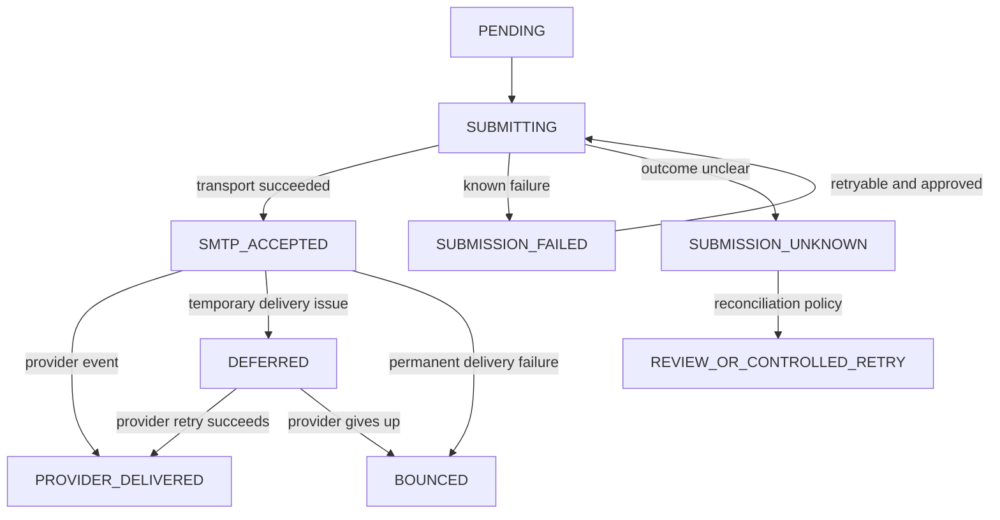

# Do Not Infer Delivery Solely from Send Returning Successfully

In **Spring Framework Mail**, applications usually send emails using `JavaMailSender.send(...)`. When the method returns normally, developers easily log "email delivered," set `DELIVERED` in the database, or tell users "The message reached your inbox." **That conclusion goes beyond what the `send` call actually confirms.**

When an SMTP-backed `JavaMailSender` sends a message successfully, the result normally means **handing off the message to the SMTP server the application connects to completed per protocol**. That server may be an internal relay, a mail submission server, or a third-party email service. It may still need to forward the message through other servers, encounter temporary errors, get rejected on the recipient side, or be filtered into spam. Even when a provider reports "delivered," that event may reflect only **the destination receiving server accepting SMTP**, without proving the user saw the email in their inbox.

The foundational principle is:

> **Successful submission does not mean delivery; delivery does not mean inbox; inbox does not mean the recipient read it.**

This lesson clarifies each milestone in an email's journey, the semantics of `JavaMailSender.send`, how to structure states and logs, tracking bounces/deferrals via providers, handling uncertain retries, and testing so applications never emit false success notices.

## 1. Separating Stages in an Email's Journey

An email-sending flow can consist of:

```text
Spring application
    |
    | Build MimeMessage
    v
JavaMailSender.send(...)
    |
    | SMTP submission
    v
SMTP relay / Email service provider
    |
    | Queue, routing, policy checks, retries
    v
Recipient mail exchange (MX) / Receiving server
    |
    | Spam filtering, mailbox policy, local delivery
    v
Recipient mailbox
    |
    | Inbox / spam / quarantine / rules
    v
Recipient mail client
    |
    | Display / interaction (may not be observable)
    v
Recipient reads or acts
```

These stages do not necessarily appear as distinct steps in every infrastructure. For instance, a provider may handle multiple steps inside one service, or a destination server may route internally through additional filters.

However, the critical boundary remains: **the application directly observes only communication with the next-hop SMTP or submission API it calls**. Events occurring later require additional data sources.

### Commonly Confused Terms

| Concept | What Can It Confirm? | What Does It Not Confirm Yet? |
|---|---|---|
| `CREATED` | The application created a send request. | Not yet sent over the network. |
| `QUEUED` | The request was placed in a queue; verify whether the queue is durable. | SMTP may not have been called yet. |
| `SUBMITTING` | A worker is attempting to hand off the message to SMTP/provider. | No result yet from the receiving side. |
| `SMTP_ACCEPTED` | The next-hop SMTP accepted the message per transport outcome. | Does not guarantee the destination server accepted it. |
| `PROVIDER_ACCEPTED` | The API/provider accepted the request per its contract. | Does not guarantee the provider sent it externally yet. |
| `DEFERRED` | A temporary issue occurred and the sending system may retry. | Neither delivery success nor permanent failure yet. |
| `DELIVERED_BY_PROVIDER` | The provider reported reaching its defined delivery milestone. | Usually does not prove inbox placement or reading. |
| `BOUNCED` | A delivery failure report arrived. | Does not always mean every attempt went unseen by the destination. |
| `OPEN_TRACKED` | A tracking mechanism recorded a content-load signal. | Does not prove a person actually opened/read it. |
| `READ_CONFIRMED` | Read confirmation evidence exists from a dedicated mechanism if supported and trusted. | Not a default outcome of SMTP. |

To avoid misunderstandings, name states after their **evidence source**, such as `SMTP_ACCEPTED`, `PROVIDER_DELIVERED`, or `BOUNCED`, rather than an overarching `sent=true` boolean.

## 2. What Does JavaMailSender.send() Actually Do?

`JavaMailSender` is Spring's API for sending messages. With the common `JavaMailSenderImpl`, Spring uses Jakarta Mail to transfer the message over the configured transport, typically SMTP.

Example:

```java
MimeMessage message = mailSender.createMimeMessage();

MimeMessageHelper helper =
        new MimeMessageHelper(message, false, "UTF-8");

helper.setFrom("orders@example.org");
helper.setTo("customer@example.net");
helper.setSubject("Order confirmation");
helper.setText("Your order has been recorded.");

mailSender.send(message);
```

If `send(message)` returns without throwing an exception, **the application may record a successful SMTP submission per the sender's contract**. Never automatically infer that:

- The message reached the recipient domain's MX.
- The recipient mailbox exists and has free space.
- The message is not in spam or quarantine.
- The recipient has not forwarded the mail elsewhere.
- HTML content/inline images rendered properly.
- The recipient opened or read the email.
- A delivery webhook will definitely arrive later.

### Meaning of "Success" Depends on the Transport

`JavaMailSender` is an interface. A mock, test double, or custom implementation might not call real SMTP. With `JavaMailSenderImpl` connecting to SMTP, "success" corresponds to the SMTP transport's returned outcome. When using an email service over a custom HTTP API, accepting a request may return a provider job ID yet still remain only the submission stage.

Therefore, when designing statuses, record which **transport/provider** was invoked and its **response semantics**.

### No Default Email Receipt

`JavaMailSender.send` does not return a `DeliveryReceipt` object containing inbox status or reader state. The API returns `void`. If no exception occurs, code knows the method finished; most delivery information arrives later through other channels.

Wrong pattern:

```java
mailSender.send(message);

orderRepository.markEmailDelivered(orderId);
```

More accurate phrasing:

```java
mailSender.send(message);

mailSubmissionRepository.markSmtpAccepted(notificationId);
```

The method name `markSmtpAccepted` shows it is a submission milestone, not confirmation of mailbox delivery.

## 3. Where Does the SMTP 250 Response Fit in the Sending Process?

During SMTP submission, the client may go through:

```text
Client                  SMTP submission server
   |---- EHLO ----------------->|
   |<--- 250 capabilities ------|
   |---- STARTTLS (if used) --->|
   |<--- TLS negotiation -------|
   |---- AUTH (if required) --->|
   |<--- auth result -----------|
   |---- MAIL FROM ------------>|
   |<--- 250 accepted ----------|
   |---- RCPT TO -------------->|
   |<--- 250 accepted ----------|
   |---- DATA ----------------->|
   |<--- 354 continue ----------|
   |---- MIME message + "." --->|
   |<--- 250 queued/accepted ---|
```

This is an illustrative flow. Servers may return different responses and there may be multiple `RCPT TO` commands.

**Key distinction:** a `250` response for `MAIL FROM` or `RCPT TO` does not prove the message content was accepted by the SMTP server. After the `DATA` command, the server's final success reply is the crucial milestone confirming message submission.

Even a reply after `DATA` such as:

```text
250 2.0.0 Queued as ABC123
```

only says the server **accepted it for processing/queuing per its internal mechanism**. The server can still attempt relaying, fail, emit bounces, or apply filters afterward.

Never automatically interpret `"Queued as ABC123"` as `DELIVERED`. An internal queue ID is not necessarily a queryable provider message ID, and it can differ from the MIME `Message-ID`.

### SMTP Reply Classes

| SMTP Code | Preliminary Meaning | Interpretation When Tracking |
|---|---|---|
| `2xx` | Corresponding SMTP operation accepted. | Must know which operation and which server returned it. |
| `4xx` | Temporary rejection or error. | May retry per policy, never infinitely. |
| `5xx` | Permanent rejection or error in response context. | Requires classification and normally no transient retries. |

Enhanced codes like `4.2.2` or `5.1.1` may suggest full mailbox or nonexistent address, yet must be read alongside standards and provider documentation. Not every server returns consistent enhanced codes.

## 4. Why Can Delivery Still Fail After SMTP Accepts?

There are many paths from `SMTP_ACCEPTED` to failure or unknown outcomes.

### 4.1. Relay Server Has Not Handed Off to Destination Yet

The application sends to SMTP relay A. A replies with success and queues the message. When A connects to destination MX B, B may:

- Be temporarily unavailable.
- Return `4xx` due to overload/rate limits.
- Reject the recipient address.
- Reject due to domain policy or reputation.
- Refuse the message over size or content.

A may retry for a period, then emit a bounce if unsuccessful. The application sees none of these events during the initial `send` call.

### 4.2. Mailbox Is No Longer Valid

Some servers accept messages before performing final mailbox checks. Later, internal systems may discover the mailbox does not exist, is closed, or exceeds quota.

This explains why "SMTP accepted" is not proof that an address is active.

### 4.3. Spam Filtering or Quarantine

The receiving server may accept an email yet route it to spam, quarantine, or apply policy filters. A provider may record `DELIVERED` when the destination server accepts the message even though it is not in the inbox.

Thus, investigating "customer doesn't see the email" requires checking inbox, spam, quarantine, forwarding rules, and domain policies—not just the send status table.

### 4.4. Forwarding and Internal Routing

A mailbox may forward to another address. The initial system reports delivery success while subsequent forwarding fails. Mail may also be filed into another mailbox via aliases or rules.

### 4.5. Content Policy and Domain Authentication

Sender reputation, SPF, DKIM, and DMARC affect how destination systems handle emails. An SMTP relay can accept a message from the application, yet the email gets blocked or flagged as spam at a later hop.

Understand accurately:

- **SPF** helps authenticate authorized sending hosts for the domain in the SMTP envelope per SPF rules.
- **DKIM** uses signatures to verify selected headers/body and attest the signing domain.
- **DMARC** combines alignment with SPF/DKIM and the domain's published policy.
- These mechanisms support authentication and deliverability, **they do not guarantee every email lands in the inbox**.

Do not edit Subject copy or retry repeatedly just because an email "wasn't seen" without data from the provider and receiving system.

## 5. Distinguishing Accepted, Delivered, Inboxed, and Read

These four milestones must stay separate.

```text
APPLICATION_SUBMITTED
       |
       v
SMTP_ACCEPTED
       |
       v
RECIPIENT_SERVER_ACCEPTED
       |
       v
MAILBOX_PROCESSED
       |
       +-- Inbox
       +-- Spam
       +-- Quarantine
       +-- Forward/Rule
       |
       v
USER_DISPLAYED / USER_READ
```

In practice, sending systems usually **lack direct visibility** into the final branches.

### When a Provider Reports "Delivered"

Some email services define the delivered event as the recipient's mail server having accepted the message. This milestone is stronger than **the provider accepting the send request from the application**, yet still does not prove the email sits in the inbox or was read.

Preserve the provider's definition in integration docs and internal status names, such as `RECIPIENT_SERVER_ACCEPTED` or `PROVIDER_DELIVERED`.

### Open Tracking Is Unreliable for Confirming Reads

Open pixels or image-loading mechanisms can be distorted by:

- Clients blocking remote images.
- Mail privacy protection prefetching images automatically.
- Proxies/caches and scanners fetching content.
- Users viewing previews or reading plain text only.
- Differences across devices and apps.

An "opened" event does not prove the recipient actually read it; zero "opened" events also does not prove the email went unread. Never use open tracking as the sole criterion to confirm legal notices or change security state.

## 6. Delivery Status Notifications and Bounces Arrive After Send Time

SMTP includes status reporting mechanisms like DSN (*Delivery Status Notification*), and email providers may emit bounce/deferral events via webhooks or event streams.

Example:

```text
10:00:00 JavaMailSender.send() returns
         -> SMTP_ACCEPTED

10:03:12 Recipient MX temporarily refuses
         -> DEFERRED

10:13:40 Provider retries and MX accepts
         -> PROVIDER_DELIVERED
```

Another case:

```text
10:00:00 JavaMailSender.send() returns
         -> SMTP_ACCEPTED

10:04:00 Recipient address rejected downstream
         -> HARD_BOUNCE
```

Both flows had `send` succeed at 10:00. Final outcomes differ because delivery happened after submission.

### DSN Is Not a Synchronous Reply to Send

DSNs can be sent to the envelope sender/return path per mail system policy. They do not appear as exceptions from the original `JavaMailSender.send` call.

Some providers ingest bounces and expose them via webhooks or dashboards. If the system needs to know about bounces, integrate the corresponding channel; you cannot simply call `send` and wait for a boolean.

### MDNs and Read Receipts Are Also Not Absolute Proof

MDNs (*Message Disposition Notifications*) such as read receipts depend on mail clients, policies, and recipient behavior. Users can decline sending receipts; clients may not support them; receipts do not prove comprehension either.

Do not confuse DSN (transport/delivery status) with MDN (client processing/display signals).

## 7. One Email Sent to Multiple Recipients Has No Single Delivery Outcome

If a message has multiple recipients:

```java
helper.setTo(new String[] {
        "alice@example.net",
        "bob@example.org"
});
```

the addresses can be handled differently. A server may accept one recipient and reject another, or downstream systems may produce different delivery results.

A simple state model:

```text
MIME message M-1
    |
    +-- recipient Alice
    |     SMTP accepted -> provider delivered
    |
    +-- recipient Bob
          SMTP accepted -> bounced later
```

Simply setting `message.status=DELIVERED` upon seeing one delivered event misreports Bob's status.

### Storing Status per Recipient

For systems needing accurate delivery tracking, store each **logical notification × recipient** as a separate record, or maintain a child per-recipient outcome table.

| Field | Example |
|---|---|
| `notificationId` | `notif-145` |
| `recipientRef` | `customer-145` |
| `submissionStatus` | `SMTP_ACCEPTED` |
| `providerDeliveryStatus` | `BOUNCED` |
| `lastEventAt` | Timestamp of latest event per source |
| `attemptCount` | Number of submission attempts |

When using To/Cc/Bcc, protect privacy. Mass-sending inside a single MIME message can expose addresses among To/Cc recipients. For personalized transactional emails with per-recipient tracking, creating one message per recipient is usually easier to control.

### Partial Success When SMTP Sends to Multiple Recipients

Jakarta Mail/SMTP has behaviors around partial sends depending on transport and configuration. One overall failure does not prove **every recipient** was rejected. `MailSendException` and Jakarta Mail causes can expose info about handled messages/addresses, yet never infer solely from an exception class.

Check transport/provider semantics and concrete reply data. For critical notifications, separating recipients simplifies retries and state updates.

## 8. Do Not Lump SMTP Errors with Subsequent Bounces

The two cases below may both appear in a "did not arrive" report, yet differ fundamentally.

**Rejection at submission time:**

```text
Application -> SMTP server
              |
              +--> Rejects submission now
Application receives MailException
```

**Delivery failure after successful submission:**

```text
Application -> SMTP server
              |
              +--> Accepts message
Application send() returns
              |
              v
       Provider relays downstream
              |
              +--> Delivery fails later
              |
              v
         Bounce/DSN/webhook
```

Some transient errors at the submission stage can be retried by the application. Bounces after acceptance are usually managed by the provider or a separate workflow; apply appropriate retry policies to each.

Never call `send` again immediately upon receiving a hard bounce, as the address may be invalid or suppressed. Conversely, a deferred event may mean the provider **is already retrying**; if the application also resends right away, the recipient risks getting duplicates.

## 9. Design State Around Evidence, Not Speculation

An illustrative state machine:



State names are examples, not a Spring Mail enum. A real system may categorize even more granularly, such as:

- `BLOCKED_BY_POLICY`
- `SUPPRESSED`
- `COMPLAINED`
- `EXPIRED`
- `UNKNOWN_DELIVERY`
- `ACCEPTED_BY_PROVIDER_API`

### Separating Two State Dimensions

A clean model usually separates:

1. **Submission status:** outcome of the application handing the message to SMTP/provider.
2. **Delivery status:** events about the downstream journey, if available.

Example record:

```json
{
  "notificationId": "notif-145",
  "submissionStatus": "SMTP_ACCEPTED",
  "deliveryStatus": "UNKNOWN",
  "lastSubmissionAt": "2026-11-12T08:30:00Z",
  "lastProviderEventAt": null
}
```

After webhook:

```json
{
  "notificationId": "notif-145",
  "submissionStatus": "SMTP_ACCEPTED",
  "deliveryStatus": "PROVIDER_DELIVERED",
  "lastSubmissionAt": "2026-11-12T08:30:00Z",
  "lastProviderEventAt": "2026-11-12T08:31:12Z"
}
```

`UNKNOWN` is a meaningful state: the system **lacks sufficient evidence** to conclude delivered or failed.

### Do Not Force Every Email into Delivered/Failed

If a provider supplies no webhooks or callback data expired retention, the application may know only `SMTP_ACCEPTED`. That is a valid observability boundary. Recording "delivery unknown" is far more accurate than assuming delivered after a timeout.

## 10. Java Example: Returning Semantically Accurate Results from JavaMailSender

A service should name send outcomes clearly.

```java
public record MailSubmissionResult(
        String notificationId,
        SubmissionStatus status,
        String errorCode
) {
    public enum SubmissionStatus {
        SMTP_ACCEPTED,
        FAILED,
        UNKNOWN
    }

    public static MailSubmissionResult accepted(String id) {
        return new MailSubmissionResult(
                id, SubmissionStatus.SMTP_ACCEPTED, null
        );
    }

    public static MailSubmissionResult failed(
            String id, String errorCode
    ) {
        return new MailSubmissionResult(
                id, SubmissionStatus.FAILED, errorCode
        );
    }
}
```

Sending service:

```java
import jakarta.mail.MessagingException;
import jakarta.mail.internet.MimeMessage;
import org.springframework.mail.MailAuthenticationException;
import org.springframework.mail.MailException;
import org.springframework.mail.javamail.JavaMailSender;
import org.springframework.mail.javamail.MimeMessageHelper;
import org.springframework.stereotype.Service;

@Service
public class MailSubmissionService {

    private final JavaMailSender mailSender;
    private final SubmissionRepository submissionRepository;

    public MailSubmissionService(
            JavaMailSender mailSender,
            SubmissionRepository submissionRepository
    ) {
        this.mailSender = mailSender;
        this.submissionRepository = submissionRepository;
    }

    public MailSubmissionResult submit(
            String notificationId,
            String recipient
    ) throws MessagingException {

        MimeMessage message = mailSender.createMimeMessage();
        MimeMessageHelper helper =
                new MimeMessageHelper(message, false, "UTF-8");

        helper.setFrom("orders@example.org");
        helper.setTo(recipient);
        helper.setSubject("Order confirmation");
        helper.setText("Your order has been confirmed.");

        submissionRepository.markSubmitting(notificationId);

        try {
            mailSender.send(message);

            submissionRepository.markSmtpAccepted(notificationId);

            return MailSubmissionResult.accepted(notificationId);
        } catch (MailAuthenticationException exception) {
            submissionRepository.markKnownFailure(
                    notificationId,
                    "SMTP_AUTH_FAILED"
            );
            return MailSubmissionResult.failed(
                    notificationId,
                    "SMTP_AUTH_FAILED"
            );
        } catch (MailException exception) {
            submissionRepository.markNeedsClassification(
                    notificationId,
                    exception.getClass().getSimpleName()
            );
            throw exception;
        }
    }
}
```

`SubmissionRepository` is an illustrative application abstraction. This code intentionally **has no `markDelivered(...)` call** after `send`.

An important point: writing to the database after `send` succeeds can still fail. In that case SMTP may have received the message while the record stays `SUBMITTING`. Production deployments need transactional outboxes, attempt records, and reconciliation policies to handle this gap; never treat illustrative code as an exactly-once guarantee.

### Catching MailException Does Not Mean Knowing for Certain the Message Was Not Received

Authentication failures before submission are usually known failures. However, timeouts or dropped connections at the end after `DATA` can leave an **uncertain outcome**.

Thus the `MailException` catch block above intentionally delegates to a classification step rather than labeling every error `FAILED_NOT_SENT`. Classification can inspect exception type, cause chain, SMTP response, failure timing, and provider data if available.

## 11. What Should Be Stored for Each Send Attempt?

An attempt record helps explain what occurred.

| Field | Purpose |
|---|---|
| `notificationId` | Logical message requested to send. |
| `attemptId` | Identifier for the specific SMTP attempt. |
| `correlationId` | Links back to the originating request/event. |
| `recipientRef` | Logical recipient; avoids logging raw PII unnecessarily. |
| `smtpRoute` | Host/provider/credential route used. |
| `startedAt`, `finishedAt` | Measures latency and diagnoses timeouts. |
| `submissionOutcome` | Accepted, failed, or unknown. |
| `smtpReplyCategory` | 2xx/4xx/5xx if captured in proper context. |
| `errorCategory` | Authentication/network/policy/content/unknown. |
| `mimeMessageId` | Message-ID header if present. |
| `providerMessageId` | ID returned by provider, if supplied by transport/integration. |
| `providerEventId` | Delivery/bounce event ID for deduplication. |

Never set `providerMessageId` equal to `notificationId` or to a queue code from an SMTP reply unless the provider explicitly documents them as equivalent.

### Distinguishing Message-ID from Provider ID

MIME emails can contain the header:

```text
Message-ID: <f2b93e1a.mailer@example.org>
```

This header can assist lookup or email threading, yet:

- It is not the HTTP request correlation ID.
- It is not automatically the SMTP provider's job ID.
- Not every webhook returns it.
- Setting Message-ID does not force destination servers to deduplicate.
- Intermediary systems may modify identifiers across layers.

When joining webhook events, use provider-supported mappings or store the actual ID returned by the provider when available.

## 12. Tracking Delivery via Provider Webhooks or Event Streams

Many email services expose callbacks for events such as:

- Accepted/processed.
- Deferred.
- Delivered.
- Bounced.
- Blocked or dropped.
- Spam complaint.
- Unsubscribed/suppressed.
- Open/click tracking, if enabled and policy-compliant.

Event names, payload fields, and interpretations **vary across providers**. Before writing state updaters, read the provider's contract and confirm what each event actually proves.

A flow:

```text
Application mail request
    notificationId=notif-145
           |
           v
Submission via SMTP / provider API
           |
           +--> application stores SMTP_ACCEPTED
           |
           v
Provider processes message
           |
           +--> providerMessageId=provider-7a3
           |
           v
Provider webhook arrives later
    event=delivered
    providerMessageId=provider-7a3
           |
           v
Verify signature and event authenticity
           |
           v
Lookup notification/recipient
           |
           v
Persist delivery evidence
```

Not every SMTP API returns a provider ID immediately to the application. When sending over plain SMTP with only a success reply, you may need a provider-specific mechanism to obtain the mapping or another contract-integrated identifier.

### Example Business-Layer Event Handling

```java
public void handleVerifiedProviderEvent(
        ProviderMailEvent event
) {
    DeliveryRecord record = deliveryRepository
            .findByProviderMessageIdAndRecipient(
                    event.providerMessageId(),
                    event.recipientRef()
            )
            .orElseThrow();

    if (deliveryRepository.eventAlreadyApplied(
            event.providerEventId()
    )) {
        return;
    }

    deliveryRepository.applyProviderEvidence(
            record.notificationId(),
            event
    );
}
```

`ProviderMailEvent`, `DeliveryRecord`, and repository types are illustrative models. **Webhook signature verification must occur before calling this method**; the name `handleVerified...` emphasizes that precondition.

A real implementation must enforce deduplication and state updates inside an appropriate transaction, using unique constraints or atomic mechanisms to stop two consumers from processing the same event simultaneously.

## 13. Webhooks Can Duplicate, Lag, or Arrive Out of Order

Do not assume provider events always arrive in clean order:

```text
processed -> delivered -> opened
```

In reality:

- Providers retry the same webhook when the application returns HTTP errors.
- Networks cause older events to arrive after newer events.
- Multiple events exist for one recipient/message.
- An event from a prior attempt arrives after the application retried a new attempt.
- Providers stop serving events after retention expires.
- An email defers several times before being delivered or bounced.

### Do Not Blindly Use "Last Event Wins"

Example:

```text
12:00 Provider reports DELIVERED
12:01 An older DEFERRED event arrives late
```

Always overwriting status with whichever event arrived last can wrongly revert `PROVIDER_DELIVERED` back to `DEFERRED`.

You must:

1. Store the provider event ID and provider-supplied timestamp.
2. Enforce valid state transition rules.
3. Distinguish when the event occurred from when the application received it.
4. Keep event history instead of just one status column.
5. Bind events to the exact notification, recipient, and attempt/provider ID.
6. Define how anomalous events are handled without silently discarding evidence.

### Not All States Are Linear

Some providers may record delivery and later receive a related bounce or complaint signal. Never lock an enum to a rigid linear chain if provider contracts allow events at different times or of different kinds.

A practical solution is storing **event history** and computing a **derived status** per business policy instead of losing older events.

## 14. Securing Webhooks and Ensuring Delivery Data Integrity

A webhook request claiming "delivered" is not enough to update email status. It could be forged or replayed.

Verify:

- Signature/HMAC or official authentication mechanism of the provider.
- Timestamp, acceptance window, and replay rules if supported by contract.
- Correct source/tenant config or webhook endpoint.
- Payload schema and size limits.
- That the recipient/provider message ID exists in the system.
- Whether the event ID was already applied previously.
- Permission to update records for that provider/route.

Never use a correlation ID as a webhook authentication secret. Correlation IDs are for lookups and can be exposed via logs or headers.

### Handling Missing Webhooks

Receiving no delivered webhook after a period **does not prove the message failed**. The provider might not emit the event, callbacks may be failing, events may be delayed, or tracking may not exist.

Maintain a `DELIVERY_UNKNOWN` state or reconciliation via provider APIs/dashboards when supported. Wait thresholds must match provider behavior rather than assuming "no event after 3 minutes means not sent."

## 15. Retries: Why Timeout Does Not Mean Not Sent

One of the hardest email-sending failures is an uncertain outcome:

```text
Application                    SMTP relay
    |---- DATA / MIME content ---->|
    |                               |
    |                         Accepts message
    |<--- connection lost ----------X
    |
    v
MailException / timeout
```

The application may miss the final success reply even though the relay accepted the message. Immediately retrying lets the relay accept a second copy.

### Outcome Classification

| Outcome | Meaning | Handling |
|---|---|---|
| `ACCEPTED` | Evidence that submission succeeded. | Wait/reconcile delivery events; do not resubmit just because webhooks haven't arrived. |
| `KNOWN_NOT_ACCEPTED` | Evidence the server rejected before accepting the message. | Retry or fix error per code and policy. |
| `UNKNOWN` | Unsure whether the server accepted it or not. | Reconcile if possible; controlled retry with duplicate risk. |

Exactly-once email delivery cannot be achieved with a retry loop alone. SMTP and databases do not share a single distributed transaction. When an app or worker dies after SMTP acceptance yet before committing state, another worker may resend.

### Where Does Idempotency Help?

A business-layer `idempotencyKey` prevents **creating multiple logical notifications** for the same event, such as a unique key on `orderId + notificationType + recipientRef`.

Yet it does not guarantee SMTP servers drop duplicates across two attempts of the same notification. Manage attempts, retries, and recipient communications so duplicate emails cause no business harm.

**Never embed single-use tokens or sensitive data inside correlation IDs to prevent duplicates.**

## 16. Submitting in a Request vs. Asynchronous Sending Are Different Kinds of "Success"

An HTTP endpoint can return before SMTP is even invoked.

Example:

```text
POST /orders
  |
  +--> Database commit
  |
  +--> Insert mail outbox(PENDING)
  |
  +--> HTTP 201 Created
           |
           v
      Worker later calls JavaMailSender.send()
```

Here `201 Created` is the order-creation result, not SMTP accepted and certainly not delivery. If an API only accepts a send request and enqueues it, it can return `202 Accepted` with a notification ID and status `QUEUED`.

### Phrase Statuses by Where the Work Actually Sits

| Outcome | Appropriate Phrasing |
|---|---|
| Request persisted in outbox | "Email send request has been recorded." |
| Worker has not run yet | "Email is waiting to be sent." |
| SMTP accepted | "Email has been handed off to the outgoing mail server." |
| Provider reported delivered | "The provider reported that the destination server accepted the email." |
| Bounced | "Unable to deliver email to this address." |
| No post-submission tracking | "Sent via SMTP; delivery confirmation not yet available." |

Avoid saying "Sent to your inbox" when the application only knows a queue insert or SMTP acceptance.

### @Async Does Not Make Delivery More Reliable

`@Async` only moves sending onto another thread. It creates no delivered events, does not help jobs survive process crashes, and does not change SMTP outcome semantics.

When reliable sending is needed, persist requests in a durable queue/outbox with workers tracking state.

## 17. Outbox and Delivery Event Store Model

An explainable design uses three datasets:

```text
mail_notification
  - logical notification + recipient + business context

mail_submission_attempt
  - each SMTP/API attempt and submission outcome

mail_delivery_event
  - provider events and evidence received later
```

Illustrative table example:

```sql
CREATE TABLE mail_notification (
    id                 VARCHAR(64) PRIMARY KEY,
    correlation_id     VARCHAR(64) NOT NULL,
    recipient_ref      VARCHAR(128) NOT NULL,
    notification_type  VARCHAR(80) NOT NULL,
    submission_status  VARCHAR(40) NOT NULL,
    delivery_status    VARCHAR(40) NOT NULL,
    created_at         TIMESTAMP NOT NULL
);

CREATE TABLE mail_submission_attempt (
    id                VARCHAR(64) PRIMARY KEY,
    notification_id   VARCHAR(64) NOT NULL,
    smtp_route        VARCHAR(80) NOT NULL,
    result_status     VARCHAR(40) NOT NULL,
    mime_message_id   VARCHAR(255),
    provider_message_id VARCHAR(255),
    attempted_at      TIMESTAMP NOT NULL
);

CREATE TABLE mail_delivery_event (
    id                 VARCHAR(64) PRIMARY KEY,
    notification_id    VARCHAR(64) NOT NULL,
    provider_event_id  VARCHAR(255),
    provider_event_type VARCHAR(80) NOT NULL,
    provider_event_at  TIMESTAMP,
    received_at        TIMESTAMP NOT NULL
);
```

This is an illustrative schema to show relationships, omitting full foreign keys, indexes, unique constraints, leases, retry schedules, retention, and data classification. In multi-provider and multi-recipient systems, extend mapping keys appropriately.

### Do Not Erase History When Status Changes

Keeping only final status `DELIVERED` hides that the message deferred three times earlier. Keeping only `BOUNCED` hides duplicate send attempts prior to the bounce.

Storing event history distinguishes:

- Slow provider processing.
- Invalid recipient addresses.
- Policy/reputation issues.
- Duplicate or delayed webhooks.
- Workers retrying too early.
- Sends interrupted during shutdown.

## 18. Deliverability Metrics Must Have Clear Definitions and Denominators

Never build a "100% delivery rate" dashboard by counting `JavaMailSender.send` calls that threw no exception. That metric reflects **submission success**, not delivery rate.

Separate metrics clearly:

| Metric | Numerator | Suggested Denominator | Notes |
|---|---|---|---|
| Submission acceptance rate | Attempts accepted by SMTP/provider | Attempted sends | Does not measure inbox. |
| Bounce rate | Messages/recipients bounced per definition | Submitted or provider-accepted notifications | Define observation window. |
| Provider-reported delivery rate | Notifications with delivered event | Notifications past observation window with tracking | Missing event is not automatic failure. |
| Deferral rate | Deferred messages/attempts | Submissions handled by provider | Provider may emit many deferred events for one message. |
| Complaint rate | Recipients with spam complaint event | Definition per provider policy | Reflects only reported events. |
| Time to provider delivery | Duration between submission and delivered event | Notifications possessing both timestamps | Account for event lag. |

Never put `correlationId`, `notificationId`, or raw recipients in metric labels: cardinality explodes and increases costs or leaks data.

### Beware of Immature Data Samples

An email submitted 10 seconds ago probably has no webhook yet. Putting it immediately into the "submitted" denominator and treating it as failed artificially depresses delivery rates.

Define an **observation window** and separate:

- Sufficient time elapsed to evaluate against SLO.
- Insufficient time elapsed to conclude.
- Delivery event present.
- Bounce/permanent failure event present.
- No data available.

Concrete intervals depend on mail type, provider, callback latency, and operational targets; there is no single Spring Mail default.

## 19. Structured Logging Across Every Stage

A clean log sequence:

```text
event=MAIL_QUEUED
correlationId=corr-204
notificationId=notif-204

event=MAIL_ATTEMPT_STARTED
correlationId=corr-204
notificationId=notif-204
attemptId=attempt-204-1
smtpRoute=primary

event=MAIL_SMTP_ACCEPTED
correlationId=corr-204
notificationId=notif-204
attemptId=attempt-204-1
durationMs=618

event=MAIL_PROVIDER_DELIVERED
correlationId=corr-204
notificationId=notif-204
providerMessageId=provider-7df
eventLagSeconds=12
```

`MAIL_PROVIDER_DELIVERED` may be logged only when **verified evidence arrives from the provider**, never right after `send`.

When receiving a bounce:

```text
event=MAIL_PROVIDER_BOUNCED
correlationId=corr-204
notificationId=notif-204
providerMessageId=provider-7df
bounceCategory=permanent
```

### Never Log Confidential Data

Mail logs can contain PII: recipient addresses, subjects, bodies, verification codes, password reset tokens, and attachments. Log notification IDs, routes, event types, statuses, and error categories; avoid raw recipients and payloads.

When correlating with a specific recipient is required, use internal recipient references or policy-approved masking/encryption.

## 20. Classifying Failures by Origin Layer

When a user says "I didn't get the email," classify before acting.

| Layer | Symptom | Where to Check |
|---|---|---|
| Business/event | No notification record exists | Domain events, outbox inserts, application logs |
| Queue/worker | Record stuck `PENDING` or workers idle | Queue lag, consumer health, leases |
| Template/MIME | Message preparation fails | `MessagingException`, renderer logs |
| SMTP authentication | `MailAuthenticationException` | Cause chain, provider AUTH policies |
| SMTP submission | `MailSendException`, timeouts, 4xx/5xx | Attempt records, SMTP replies |
| Provider processing | Deferred, dropped, suppressed | Provider dashboards/event APIs |
| Recipient server | Bounce or server rejection | DSNs/provider delivery events |
| Mailbox/client | Spam/quarantine/forwarding | Recipient admins or user checks |
| Human interaction | Recipient has not seen/read it | Cannot infer from `send` or open pixels |

Follow the evidence trail step by step rather than assuming SMTP is always at fault.

### Example: Send Returned Success Yet Recipient Reports Missing Email

1. Locate notification ID via business event/correlation ID.
2. Confirm attempt reached `SMTP_ACCEPTED`.
3. Look up provider message ID or dashboard with available data.
4. Search for delivered, deferred, bounced, blocked, or suppressed events.
5. If provider reports recipient server accepted, suggest checking spam/quarantine/mailbox policies while avoiding claiming Inbox delivery.
6. If no events exist, record `DELIVERY_UNKNOWN` or query provider-supported reconciliation endpoints.
7. If resending, weigh duplicate risk and resend policies rather than blind retries.

## 21. Testing: SMTP Test Servers Do Not Prove Deliverability

Mailpit, GreenMail, or equivalent SMTP test servers verify that the application emits valid MIME messages and the test server receives them.

Conceptual test example:

```java
@Test
void successfulSmtpSubmissionDoesNotMarkDelivered()
        throws Exception {

    MimeMessage message = mailSender.createMimeMessage();

    MimeMessageHelper helper =
            new MimeMessageHelper(message, false, "UTF-8");

    helper.setFrom("test@example.org");
    helper.setTo("recipient@example.net");
    helper.setSubject("Test");
    helper.setText("Hello");

    mailSender.send(message);

    // Correct result at submission layer:
    assertThat(submissionStatus)
            .isEqualTo(SubmissionStatus.SMTP_ACCEPTED);

    // No delivery event from provider:
    assertThat(deliveryStatus)
            .isEqualTo(DeliveryStatus.UNKNOWN);
}
```

`submissionStatus` and `deliveryStatus` are hypothetical values recorded in the test fixture. Real tests must read from the corresponding repository/service rather than uninitialized variables.

### Cases to Test

| Scenario | Expectation |
|---|---|
| SMTP test server accepts message | Submission = accepted, delivery = unknown. |
| SMTP rejects before accepting message | `SMTP_ACCEPTED` is not recorded. |
| Timeout during ambiguous stage | Attempt = unknown/requires reconciliation. |
| Valid delivered webhook from provider | Notification delivery evidence updates cleanly. |
| Bounce webhook from provider | Records bounce; never leaves false delivered conclusion. |
| Webhook lacks valid signature | Rejected; state untouched. |
| Duplicate webhook delivery | Deduplicated; creates no duplicate effective events. |
| Out-of-order deferred after delivered | Never overwrites state wrongly. |
| Two recipients with differing outcomes | Each recipient retains independent status. |
| Process dies after SMTP accepted before DB commit | Job remains uncertain; controlled recovery. |
| Provider sends no webhooks | Delivery remains unknown; never fabricates success/failure. |

### Simulating Deferrals and Bounces

An SMTP test server can return errors at submission time, yet that is **not equivalent** to a bounce generated after a relay accepted the message. To test delivery logic, simulate provider events separately and feed them into the authenticated handler using test fixtures.

Separate two kinds of tests:

1. **SMTP transport integration tests:** application connects, authenticates, and submits messages.
2. **Delivery event integration tests:** application ingests, verifies, deduplicates, and processes downstream events.

## 22. Designing UX and APIs to Avoid Misleading Notices

Deliverability confusion often starts with wording in responses.

### Easily Misleading Phrases

```text
"Email delivered successfully!"
"The message reached your mailbox."
"The recipient received the email."
```

When the only signal is `JavaMailSender.send` returning, those statements overclaim the evidence.

### More Accurate Phrasing

When mail is queued:

```text
"Email send request has been recorded."
```

When SMTP submission succeeds:

```text
"Email has been handed off to the outgoing mail server."
```

When a provider delivery event arrives:

```text
"The provider reported that the destination server accepted the email."
```

When no downstream evidence exists:

```text
"Sent via SMTP; delivery confirmation not yet available."
```

Balance accuracy with user clarity. For example, on a password-reset screen, to avoid enumerating whether an account exists, UIs may intentionally show neutral wording like "If an account is valid, we will send instructions by email." That does not change the backend's duty to record accurate sending states.

### HTTP Responses and Email Status

Do not infer delivery from `200 OK` or `202 Accepted`. They reflect HTTP endpoint contracts only:

- `200 OK`: HTTP operation processed per contract.
- `202 Accepted`: server accepted the request for processing, possibly still incomplete.
- `201 Created`: resource/order created.

If the API exposes status lookups, return the notification ID and a status endpoint using transparent terminology.

## 23. Scenarios Requiring Extra Care

### OTP and Password-Reset Emails

These emails need low latency, yet `send` succeeding still does not guarantee the user received the code. Enforce rate limits, token expirations, safe resend UIs, idempotency, and account-enumeration protection.

Never "confirm the user received the OTP" merely because SMTP accepted. Users must prove possession by entering the code or completing an appropriate verification step.

### Invoices and Transactional Emails

An invoice being generated, the email being submitted, and the recipient downloading the invoice are three separate events. For accounting/legal obligations, retain records in business systems rather than substituting a successful `send` for regulatory delivery proof.

### Marketing Emails and Suppression

A provider may accept a request and then drop/suppress it per unsubscribe, bounce, or complaint lists. Applications must distinguish `PROVIDER_ACCEPTED` from `SUPPRESSED`, never counting suppression as delivered.

Upon unsubscribed/complaint signals, enforce sending policies instead of retrying.

### Sending Multiple Emails at Once

When using `mailSender.send(messages)` with a batch of messages, mixed outcomes can happen. Track each message/recipient individually and inspect error details exposed by `MailSendException` or the transport. One batch call does not mean every recipient shares the same delivery status.

## 24. Migration Roadmap in Existing Applications

If an existing system has a boolean `sent` column marked true right after `send`, upgrade step by step:

1. **Clarify semantics:** establish that `sent=true` currently means SMTP submission accepted, not delivered.
2. **Rename fields:** use `submissionStatus` or `smtpAcceptedAt` instead of `deliveredAt` when holding only `send` outcomes.
3. **Add notification IDs:** give every logical email/recipient a stable identifier.
4. **Add attempt logs:** record route, timing, errors, and outcome per attempt.
5. **Connect provider events:** if supported by the provider and required by business tracking.
6. **Persist event history:** avoid losing deferrals/bounces or duplicate webhooks.
7. **Add delivery states:** `UNKNOWN`, `PROVIDER_DELIVERED`, `BOUNCED`, `DEFERRED`, etc.
8. **Update dashboards:** separate submission acceptance rate from provider delivery rate.
9. **Update UI/API copy:** never claim inbox arrival after submission alone.
10. **Write tests:** verify successful `send` never automatically marks `DELIVERED`.

### Do Not Convert Evidence-Free History into Delivered

For legacy rows having only `sent=true`, you cannot know whether the email arrived. During migration, map them to `SMTP_ACCEPTED_LEGACY` or `DELIVERY_UNKNOWN` with explicit provenance.

Never backfill `deliveredAt=sentAt` for historical emails lacking real delivery events. Doing so distorts dashboards and misleads investigations.

## 25. Technical and Operational Checklist

| Question | Expectation |
|---|---|
| Does code call `markDelivered` immediately after `JavaMailSender.send`? | No. |
| Are submission and delivery statuses separated? | Yes. |
| Does each notification/recipient have an ID for tracking? | Yes when per-recipient tracking is needed. |
| Do retries have distinct attempt IDs while preserving logical notification ID? | Yes. |
| Are ambiguous timeouts represented as `UNKNOWN`? | Yes. |
| Is there a DSN/provider event channel when tracking delivery is needed? | Yes, or limitations documented explicitly. |
| Is provider delivered interpreted strictly per contract? | Yes; never equated with inbox/read. |
| Are webhooks authenticated, deduplicated, and resilient to out-of-order events? | Yes. |
| Does missing webhook data avoid auto-inferring failed/delivered? | Yes. |
| Can each recipient hold an independent outcome? | Yes. |
| Do dashboards separate submission rate from delivery rate? | Yes. |
| Do logs carry correlation ID, notification ID, and attempt ID properly? | Yes. |
| Are full emails/tokens/credentials kept out of logs? | Yes. |
| Do UI/APIs use wording matching actual evidence? | Yes. |
| Are SMTP tests and delivery-event tests separated? | Yes. |

## 26. Key Takeaways

- `JavaMailSender.send(...)` returning normally usually means only that **the application's SMTP transport/submission completed successfully**; it does not confirm inbox placement.
- SMTP `250` replies must be interpreted by server and command. `250` after `DATA` shows the server accepted the message for processing, not final delivery.
- Emails can still defer, bounce, get suppressed, land in spam/quarantine, or hit forwarding failures after SMTP acceptance.
- `PROVIDER_DELIVERED` is usually provider evidence at their defined milestone, not proof the recipient read it.
- Zero open events does not prove unread; open tracking is also not reliable proof of reading.
- DSNs, bounces, provider webhooks, and delivery events can arrive **after** the initial send call.
- Separate **submission** and **delivery** statuses while allowing **unknown** when evidence is missing.
- For multiple recipients, track per-recipient; one delivery result does not speak for everyone.
- Every SMTP retry needs an attempt ID; timeouts after `DATA` create uncertain outcomes and duplicate risk.
- Webhooks must be verified, deduplicated, resilient to late/reordered events, and mapped to the right notification.
- Dashboards should measure submission acceptance rate and provider-reported delivery rate separately with clear denominators and observation windows.
- In APIs/UIs/logs, say "handed off to the outgoing mail server" when only SMTP acceptance is known; never write "arrived in mailbox."

**Conclusion:** a successful `send` is an important signal, yet only at the **submission stage**. To know whether an email reached the recipient's system, an application needs extra evidence from DSNs, providers, or receiving systems; knowing whether a user truly saw and read it requires other signals that are rarely foolproof. Sound deliverability design does not claim delivery prematurely—it **records accurately what is known, preserves unknown when evidence is lacking, and tracks every verifiable step**.
