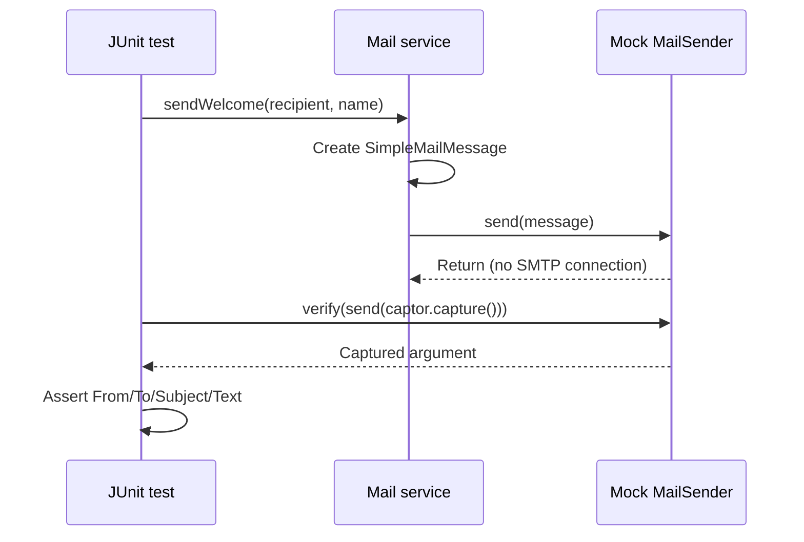

# ArgumentCaptor for Inspecting Built Messages

In Spring Framework Mail, an email-sending service typically has two responsibilities: **building the right message** and **invoking the message-sending component**. For instance, when an account is created, the service must set the right recipient, sender name, subject, and body; when issuing an invoice, the service must also construct a MIME multipart containing plain text, HTML, and an attachment. In unit tests, what you usually need to know is not whether the SMTP server delivered the mail, but **which email object the service prepared to pass to `MailSender` or `JavaMailSender`**.

Mockito provides `ArgumentCaptor<T>` to capture the actual argument passed into a mock call. After running the service, the test can use `verify(...)` with `captor.capture()`, then read `captor.getValue()` to inspect the fields inside the message.

This lesson explains how to use `ArgumentCaptor` with `SimpleMailMessage`, `MimeMessage`, and `MimeMessagePreparator`; how to supply a real in-memory `MimeMessage` while mocking SMTP transport; how to check To/Cc/Bcc, From, Reply-To, Unicode subjects, plain text, HTML, attachments, and inline resources; how to handle overloads/varargs; and common testing pitfalls. Examples use Java 21, JUnit Jupiter, Mockito, Spring Framework 6.x / Spring Boot 3.x, and Jakarta Mail.

> **Goal of ArgumentCaptor:** verify the email content and structure built by the application at the sending boundary. This is **unit testing**, not testing an SMTP server, mailbox delivery, or whether an email reaches the Inbox.

## 1. What problem does ArgumentCaptor solve?

Suppose a service has:

```java
public void sendWelcome(String recipient, String displayName) {
    SimpleMailMessage message = new SimpleMailMessage();
    message.setFrom("notifications@example.test");
    message.setTo(recipient);
    message.setSubject("Welcome");
    message.setText("Hello " + displayName + "!");

    mailSender.send(message);
}
```

A simple test checking only:

```java
verify(mailSender).send(any(SimpleMailMessage.class));
```

tells you **some `SimpleMailMessage` object was passed to the mock**, yet tells nothing about whether its addresses, subject, or body are right. A service sending emails to the wrong person can still make that test pass.

With `ArgumentCaptor`:

```java
ArgumentCaptor<SimpleMailMessage> captor =
        ArgumentCaptor.forClass(SimpleMailMessage.class);

verify(mailSender).send(captor.capture());

SimpleMailMessage captured = captor.getValue();
assertEquals("notifications@example.test", captured.getFrom());
assertArrayEquals(
        new String[]{"customer@example.test"},
        captured.getTo());
assertEquals("Welcome", captured.getSubject());
assertEquals("Hello Linh!", captured.getText());
```

This tests the **actual output** at the `mailSender.send(...)` boundary. It catches bugs such as wrong recipients, missing subjects, wrong templates, or sending inappropriate personal data.

### 1.1. Interaction flow



Mockito records the invocation and argument. `capture()` **does not send emails itself**, does not alter message content, and opens no SMTP connection. It is an inspection tool at the mock boundary.

## 2. Classes to distinguish in Spring Mail

| Type | Used for | Inspectable data |
|---|---|---|
| `MailSender` | API for sending simple text emails | `SimpleMailMessage` |
| `SimpleMailMessage` | From, To/Cc/Bcc, Reply-To, subject, text, sent date | Plain-text values and direct fields |
| `JavaMailSender` | Sending MIME emails, plus inheriting plain-mail support | `MimeMessage`, `MimeMessagePreparator`, `SimpleMailMessage` |
| `MimeMessage` | Jakarta Mail message with rich headers/parts | Recipients, subject, MIME type, multipart/body/attachment |
| `MimeMessageHelper` | Helper for building/updating a `MimeMessage` | Not an argument to `send`; inspect the resulting `MimeMessage` |
| `MimeMessagePreparator` | Callback preparing the message before sending | Capture callback and execute it on a test `MimeMessage` |

The two test families differ:

- **Simple mail:** mock `MailSender`, capture `SimpleMailMessage`; assert getters without needing a Jakarta Mail Session.
- **MIME mail:** mock `JavaMailSender`, stub `createMimeMessage()` to return a real in-memory message, capture the `MimeMessage` passed to `send(...)`; assert MIME details using the Jakarta Mail API.

Do not capture `MimeMessageHelper` when the service simply uses the helper to populate fields and then calls `sender.send(mimeMessage)`. The helper is a builder; **the final message** is the object crossing the sending boundary.

## 3. Test dependencies: JUnit 5 and Mockito

When using Gradle and Spring Boot, dependencies typically include:

```groovy
dependencies {
    implementation 'org.springframework.boot:spring-boot-starter-mail'
    testImplementation 'org.springframework.boot:spring-boot-starter-test'
}

tasks.named('test') {
    useJUnitPlatform()
}
```

Versions are typically managed by the Spring Boot BOM if the project uses Spring Boot dependency management. `spring-boot-starter-test` normally brings in JUnit Jupiter, Mockito, and related test utilities.

A unit test needing only Mockito can run **without starting a Spring ApplicationContext**. This keeps tests fast, isolates message-building logic, and avoids depending on SMTP environment variables.

Key imports:

```java
import static org.junit.jupiter.api.Assertions.*;
import static org.mockito.Mockito.*;

import org.junit.jupiter.api.Test;
import org.mockito.ArgumentCaptor;
import org.springframework.mail.MailSender;
import org.springframework.mail.SimpleMailMessage;
```

Later sections list additional imports when using Jakarta Mail.

## 4. Complete example: capturing SimpleMailMessage

### 4.1. Service under test

```java
package com.example.mail;

import org.springframework.mail.MailSender;
import org.springframework.mail.SimpleMailMessage;

public final class WelcomeMailService {

    private final MailSender sender;
    private final String from;

    public WelcomeMailService(MailSender sender, String from) {
        this.sender = sender;
        this.from = from;
    }

    public void sendWelcome(String recipient, String displayName) {
        if (recipient == null || recipient.isBlank()) {
            throw new IllegalArgumentException("recipient required");
        }

        String name = displayName == null
                ? "friend"
                : displayName.trim();

        SimpleMailMessage message = new SimpleMailMessage();
        message.setFrom(from);
        message.setTo(recipient);
        message.setSubject("Welcome");
        message.setText("Hello " + name + "!");

        sender.send(message);
    }
}
```

This is a minimal service for unit testing; production also requires validating recipient format, sender authorization policy, proper escaping/templating, and avoiding logging sensitive data. `example.test` is a reserved testing domain.

### 4.2. JUnit test using ArgumentCaptor

```java
package com.example.mail;

import static org.junit.jupiter.api.Assertions.assertArrayEquals;
import static org.junit.jupiter.api.Assertions.assertEquals;
import static org.mockito.Mockito.mock;
import static org.mockito.Mockito.verify;

import org.junit.jupiter.api.Test;
import org.mockito.ArgumentCaptor;
import org.springframework.mail.MailSender;
import org.springframework.mail.SimpleMailMessage;

class WelcomeMailServiceTest {

    @Test
    void sendsExpectedWelcomeMessage() {
        MailSender sender = mock(MailSender.class);
        WelcomeMailService service = new WelcomeMailService(
                sender, "notifications@example.test");

        service.sendWelcome("customer@example.test", "Linh");

        ArgumentCaptor<SimpleMailMessage> captor =
                ArgumentCaptor.forClass(SimpleMailMessage.class);

        verify(sender).send(captor.capture());

        SimpleMailMessage actual = captor.getValue();
        assertEquals("notifications@example.test", actual.getFrom());
        assertArrayEquals(
                new String[]{"customer@example.test"},
                actual.getTo());
        assertEquals("Welcome", actual.getSubject());
        assertEquals("Hello Linh!", actual.getText());
    }
}
```

No mail relay needs to run. The mock `MailSender` records the invocation without performing transport. The test focuses on values the service **explicitly controls**.

### 4.3. Checking Reply-To, Cc, and Bcc

If the service sets:

```java
message.setReplyTo("support@example.test");
message.setCc("audit@example.test");
message.setBcc("archive@example.test");
```

the test can add:

```java
assertEquals("support@example.test", actual.getReplyTo());
assertArrayEquals(
        new String[]{"audit@example.test"}, actual.getCc());
assertArrayEquals(
        new String[]{"archive@example.test"}, actual.getBcc());
```

The `getTo()`, `getCc()`, and `getBcc()` getters return arrays, or `null` if never set. Thus, if the business rule forbids **Cc/Bcc**, assert explicitly:

```java
assertNull(actual.getCc());
assertNull(actual.getBcc());
```

This is especially important for personalized emails: putting someone else in Cc can leak addresses or private data.

### 4.4. Why assertArrayEquals instead of assertEquals?

`SimpleMailMessage` recipient fields use `String[]`. Java arrays use reference equality in `equals(...)`; therefore:

```java
assertArrayEquals(
        new String[]{"a@example.test", "b@example.test"},
        actual.getTo());
```

checks element-by-element equality, whereas `assertEquals(new String[]{...}, actual.getTo())` is rarely what you want. If recipient order is not a business requirement, convert to a `Set` to assert membership while checking for duplicates separately.

## 5. Capture and verify: ordering and invocation count

`ArgumentCaptor` is typically used during the **verification phase** after the code under test has called the mock:

```java
service.sendWelcome("a@example.test", "An");

ArgumentCaptor<SimpleMailMessage> captor =
        ArgumentCaptor.forClass(SimpleMailMessage.class);

verify(sender).send(captor.capture());
SimpleMailMessage message = captor.getValue();
```

By default `verify(sender)` checks **exactly once** for matching invocations. If the service must create two emails, use `times(2)` and `getAllValues()`.

### 5.1. Capturing two invocations

```java
service.sendWelcome("a@example.test", "An");
service.sendWelcome("b@example.test", "Bình");

ArgumentCaptor<SimpleMailMessage> captor =
        ArgumentCaptor.forClass(SimpleMailMessage.class);

verify(sender, times(2)).send(captor.capture());

List<SimpleMailMessage> messages = captor.getAllValues();
assertEquals(2, messages.size());
assertArrayEquals(
        new String[]{"a@example.test"}, messages.get(0).getTo());
assertArrayEquals(
        new String[]{"b@example.test"}, messages.get(1).getTo());
```

In this example, `List` requires importing `java.util.List`. `getAllValues()` returns captured arguments in invocation order. If order does not matter, match by recipient/key instead of coupling tests to internal iteration order.

### 5.2. Verify no invocation when data is invalid

```java
@Test
void invalidRecipientDoesNotSend() {
    MailSender sender = mock(MailSender.class);
    WelcomeMailService service = new WelcomeMailService(
            sender, "notifications@example.test");

    assertThrows(
            IllegalArgumentException.class,
            () -> service.sendWelcome("", "An"));

    verifyNoInteractions(sender);
}
```

This test protects the "reject before sending" condition. There is no need to create an `ArgumentCaptor` when **no message is permitted to be sent**.

### 5.3. Captor stores a reference, not an automatic snapshot

Mockito captures a reference to the object passed into the mock. If the service continues mutating the same `SimpleMailMessage` after calling `send(...)`, reading `getValue()` later will observe the mutated state, **not necessarily the snapshot at send time**.

Example of buggy code:

```java
sender.send(message);
message.setSubject("Another subject after send");
```

By design, a message should be treated as finalized before crossing the sending boundary and never mutated afterward. If a test genuinely needs a snapshot at invocation time, use `doAnswer(...)` in a stub to copy fields the moment the mock is called. Still, avoid adding complexity when the service does not mutate post-send.

## 6. What changes when switching to MimeMessage?

`SimpleMailMessage` only supports simple text content. Emails with HTML, text alternatives, attachments, or inline images typically use `MimeMessage` with `MimeMessageHelper`.

Example:

```java
MimeMessage message = javaMailSender.createMimeMessage();
MimeMessageHelper helper =
        new MimeMessageHelper(message, true, "UTF-8");

helper.setFrom("billing@example.test");
helper.setTo("customer@example.test");
helper.setSubject("Invoice is ready");
helper.setText(
        "Invoice is ready. Sign in to view it.",
        "<p>Invoice is ready.</p>");

javaMailSender.send(message);
```

To test this, we want to capture `MimeMessage` when `send(message)` is called and inspect its structure via the Jakarta Mail API.

**Key difference:** a default Mockito mock of `JavaMailSender` returns `null` from `createMimeMessage()`. If the service passes that result to `MimeMessageHelper`, the test crashes before reaching `send`. Therefore, **stub the factory** for `createMimeMessage()` to return a real in-memory `MimeMessage`.

## 7. Create a real MimeMessage in tests without sending SMTP

Jakarta Mail lets you construct a message with a local `Session`:

```java
import java.util.Properties;

import jakarta.mail.Session;
import jakarta.mail.internet.MimeMessage;

Session session = Session.getInstance(new Properties());
MimeMessage message = new MimeMessage(session);
```

Creating `Session` and `MimeMessage` this way **does not connect to an SMTP server**. Network I/O occurs only when a real transport is invoked to send.

Mockito setup:

```java
JavaMailSender sender = mock(JavaMailSender.class);
Session session = Session.getInstance(new Properties());

when(sender.createMimeMessage())
        .thenAnswer(invocation -> new MimeMessage(session));
```

Use `thenAnswer(...)` instead of `thenReturn(oneMessage)` if the service may build multiple emails: each factory call gets a fresh instance, preventing tests from accidentally mixing content across messages.

Mocking `send(MimeMessage)` is a no-op by default because the method returns `void`. The test inspects the message without sending via SMTP.

## 8. Complete example: service building MIME with attachment

### 8.1. Command and service

The example below uses PDF bytes from a trusted fixture source to illustrate MIME construction. In production, attachments must be checked for size, authorization, content type, and stream re-openability.

```java
package com.example.mail;

public record InvoiceMailCommand(
        String recipient,
        String invoiceNumber,
        byte[] pdfBytes
) {}
```

```java
package com.example.mail;

import jakarta.mail.MessagingException;
import jakarta.mail.internet.MimeMessage;
import org.springframework.core.io.ByteArrayResource;
import org.springframework.mail.javamail.JavaMailSender;
import org.springframework.mail.javamail.MimeMessageHelper;

public final class InvoiceMailService {

    private final JavaMailSender sender;

    public InvoiceMailService(JavaMailSender sender) {
        this.sender = sender;
    }

    public void sendInvoice(InvoiceMailCommand command)
            throws MessagingException {

        if (command.recipient() == null
                || command.recipient().isBlank()) {
            throw new IllegalArgumentException("recipient required");
        }
        if (command.pdfBytes() == null
                || command.pdfBytes().length == 0) {
            throw new IllegalArgumentException("pdf required");
        }

        MimeMessage message = sender.createMimeMessage();
        MimeMessageHelper helper =
                new MimeMessageHelper(message, true, "UTF-8");

        helper.setFrom("billing@example.test");
        helper.setReplyTo("support@example.test");
        helper.setTo(command.recipient());
        helper.setSubject("Hóa đơn " + command.invoiceNumber());

        helper.setText(
                "Hóa đơn " + command.invoiceNumber()
                        + " đã được phát hành.",
                "<html><body><p>Hóa đơn "
                        + command.invoiceNumber()
                        + " đã được phát hành.</p></body></html>");

        helper.addAttachment(
                "invoice.pdf",
                new ByteArrayResource(command.pdfBytes().clone()),
                "application/pdf");

        sender.send(message);
    }
}
```

With `MimeMessageHelper(message, true, "UTF-8")`, the helper builds multipart MIME supporting text/HTML/attachments. `ByteArrayResource` provides a fresh stream from the byte array whenever Jakarta Mail reads the attachment. For large files in production, prefer re-openable stream sources and avoid loading entire files into the heap unnecessarily.

### 8.2. Test capturing MimeMessage

```java
package com.example.mail;

import static org.junit.jupiter.api.Assertions.*;
import static org.mockito.Mockito.*;

import java.util.Properties;

import jakarta.mail.Message;
import jakarta.mail.Session;
import jakarta.mail.internet.InternetAddress;
import jakarta.mail.internet.MimeMessage;

import org.junit.jupiter.api.Test;
import org.mockito.ArgumentCaptor;
import org.springframework.mail.javamail.JavaMailSender;

class InvoiceMailServiceTest {

    @Test
    void buildsExpectedInvoiceMessage() throws Exception {
        JavaMailSender sender = mock(JavaMailSender.class);
        Session session = Session.getInstance(new Properties());

        when(sender.createMimeMessage())
                .thenAnswer(invocation -> new MimeMessage(session));

        byte[] pdfFixture = new byte[]{
                0x25, 0x50, 0x44, 0x46, 0x2D, 0x31, 0x2E, 0x37
        };
        InvoiceMailService service = new InvoiceMailService(sender);

        service.sendInvoice(new InvoiceMailCommand(
                "customer@example.test", "INV-2026-42", pdfFixture));

        ArgumentCaptor<MimeMessage> captor =
                ArgumentCaptor.forClass(MimeMessage.class);
        verify(sender).send(captor.capture());

        MimeMessage actual = captor.getValue();

        assertEquals("Hóa đơn INV-2026-42", actual.getSubject());
        assertEquals(
                "billing@example.test",
                ((InternetAddress) actual.getFrom()[0]).getAddress());
        assertEquals(
                "support@example.test",
                ((InternetAddress) actual.getReplyTo()[0]).getAddress());
        assertEquals(
                "customer@example.test",
                ((InternetAddress) actual.getRecipients(
                        Message.RecipientType.TO)[0]).getAddress());
    }
}
```

The fixture above contains only leading magic bytes simulating a PDF header to test the **MIME metadata flow**, not a complete valid PDF document. If you need to test actual PDF formatting, use a real allowed PDF fixture; the goal of `ArgumentCaptor` here is confirming the service attached the byte array with the expected filename and content type.

### 8.3. Unicode Subject and addresses

`MimeMessage.getSubject()` normally returns the decoded string per the Jakarta Mail API; thus you can assert Vietnamese Unicode directly:

```java
assertEquals("Hóa đơn INV-2026-42", actual.getSubject());
```

Do not assert specific raw header bytes if the goal is only the displayed subject. MIME headers can be encoded or folded differently by the library. For addresses, `InternetAddress.getAddress()` extracts the mailbox instead of comparing a string that might include a display name.

### 8.4. Verify Cc/Bcc are not leaked

```java
assertNull(actual.getRecipients(Message.RecipientType.CC));
assertNull(actual.getRecipients(Message.RecipientType.BCC));
```

These two assertions catch cases where the service accidentally adds extra recipients. If business requirements call for a Bcc archive address, assert the exact allowed address and make the privacy policy explicit.

## 9. Read the MIME body: never assume getContent() is always String

With `SimpleMailMessage`, `getText()` is a string. With a multipart `MimeMessage`, `actual.getContent()` is typically a `Multipart`, not the body string directly.

Wrong example:

```java
String text = (String) capturedMimeMessage.getContent();
```

If the message is `multipart/mixed` or `multipart/alternative`, that cast throws `ClassCastException`. Inspect the MIME structure using `jakarta.mail.Part` and `Multipart` APIs.

### 9.1. Recursive traversal of multipart structure

A test helper can collect leaf `Part` entries regardless of how text/HTML are nested inside multiparts:

```java
package com.example.mail.test;

import java.io.IOException;
import java.util.ArrayList;
import java.util.List;

import jakarta.mail.MessagingException;
import jakarta.mail.Multipart;
import jakarta.mail.Part;

public final class MimeTestParts {

    private MimeTestParts() {}

    public static List<Part> leaves(Part root)
            throws MessagingException, IOException {
        List<Part> result = new ArrayList<>();
        visit(root, result);
        return result;
    }

    private static void visit(Part part, List<Part> result)
            throws MessagingException, IOException {
        Object content = part.getContent();
        if (content instanceof Multipart multipart) {
            for (int i = 0; i < multipart.getCount(); i++) {
                visit(multipart.getBodyPart(i), result);
            }
        } else {
            result.add(part);
        }
    }
}
```

This helper handles typical multiparts built by `MimeMessageHelper`. For more complex MIME (such as `message/rfc822` attaching another email), add logic to inspect nested `Message` parts or identify attachments explicitly. Never use this simple helper to claim you have handled every possible MIME structure.

### 9.2. Assert plain text and HTML

```java
List<Part> leaves = MimeTestParts.leaves(actual);

Part plainPart = leaves.stream()
        .filter(p -> isBodyText(p, "text/plain"))
        .findFirst()
        .orElseThrow();

Part htmlPart = leaves.stream()
        .filter(p -> isBodyText(p, "text/html"))
        .findFirst()
        .orElseThrow();

String plain = (String) plainPart.getContent();
String html = (String) htmlPart.getContent();

assertTrue(plain.contains("Hóa đơn INV-2026-42"));
assertTrue(html.contains("<p>Hóa đơn INV-2026-42"));
```

Because `Part.isMimeType(...)` and `getFileName()` can throw checked `MessagingException`, an `isBodyText` helper keeps the lambda readable:

```java
private static boolean isBodyText(Part part, String mimeType) {
    try {
        return part.getFileName() == null
                && part.isMimeType(mimeType);
    } catch (MessagingException ex) {
        throw new AssertionError("Cannot inspect MIME part", ex);
    }
}
```

The snippet above needs `java.util.List`, `jakarta.mail.Part`, `jakarta.mail.MessagingException`, and static JUnit assertions. Use `isMimeType("text/html")` rather than strictly comparing `getContentType()` against `"text/html"`, since Content-Type may include `charset=UTF-8` or other parameters.

### 9.3. Do not force exact CRLF or HTML serialization comparisons

For `text/plain`, the MIME transport system may normalize line endings or encodings. When business content is what matters, assert required sentences/paragraphs; if exact comparison is needed, normalize according to a defined rule. For HTML, tests should generally assert template data, links, and escaping rather than whitespace details.

Do not strip all whitespace indiscriminately if the email relies on preformatted text or meaningful paragraph breaks.

## 10. Capture attachments in MimeMessage

When the service calls:

```java
helper.addAttachment(
        "invoice.pdf",
        new ByteArrayResource(pdfBytes),
        "application/pdf");
```

The test can locate the leaf part with that filename:

```java
List<Part> leaves = MimeTestParts.leaves(actual);

Part attachment = null;
for (Part part : leaves) {
    if ("invoice.pdf".equals(part.getFileName())) {
        attachment = part;
        break;
    }
}

assertNotNull(attachment);
assertEquals(Part.ATTACHMENT, attachment.getDisposition());
assertTrue(attachment.isMimeType("application/pdf"));
assertArrayEquals(
        pdfFixture,
        attachment.getInputStream().readAllBytes());
```

This snippet can sit inside a test method declaring `throws Exception` like the previous example. The test checks not only that `addAttachment(...)` was called in production code, it checks **the constructed MIME structure**.

### 10.1. Filename is metadata, not a file path

`getFileName()` on a MIME part may be decoded by Jakarta Mail and MIME settings. Tests should compare a valid display filename such as `invoice.pdf`, never an internal storage path as the filename.

If the filename contains Unicode, assert the decoded filename and verify encoding config. Do not couple unit tests to a raw `Content-Disposition` header string that may be encoded or folded differently across implementations.

### 10.2. Read streams in tests and release resources

When checking file content, close the input stream:

```java
byte[] actualBytes;
try (var in = attachment.getInputStream()) {
    actualBytes = in.readAllBytes();
}
assertArrayEquals(pdfFixture, actualBytes);
```

In small tests with `ByteArrayResource`, `readAllBytes()` is convenient. For large files, tests should avoid loading many MB onto the heap just for a MIME assertion; use hash/streaming comparison or a small fixture. To test provider performance/streaming, write a separate integration test.

### 10.3. Nested multipart structure

When setting plain text, HTML, and an attachment, the helper may build a tree:

```text
MimeMessage
  multipart/mixed
    multipart/related
      multipart/alternative
        text/plain
        text/html
    application/pdf (attachment)
```

The exact structure can vary with `MimeMessageHelper` mode and added inline/attachment parts. Therefore, when the goal is simply confirming the email contains both body parts and the PDF, traversing leaf parts is far more resilient than asserting `multipart.getBodyPart(0)` is always text.

If the product has strict nesting requirements for email-client compatibility, write a dedicated MIME integration test for that structure; avoid enforcing unnecessary internal ordering across every unit test.

## 11. Check inline images or Content-ID

For HTML emails with inline images, a service may call:

```java
helper.setText(
        "Hello, here is your notification.",
        "<html><body><p>Hello!</p>"
        + "</body></html>");

helper.addInline(
        "brand-logo",
        new ByteArrayResource(imageBytes),
        "image/png");
```

The standard rule is setting the HTML body via `setText(...)` before adding inline resources so the helper constructs a MIME structure that can reference the CID properly. Tests should verify two things: HTML contains `cid:brand-logo`, and the multipart includes an inline part with the matching Content-ID.

Example:

```java
List<Part> parts = MimeTestParts.leaves(captured);

Part image = null;
for (Part part : parts) {
    String[] ids = part.getHeader("Content-ID");
    if (ids != null && ids.length > 0
            && ids[0].contains("brand-logo")) {
        image = part;
        break;
    }
}

assertNotNull(image);
assertEquals(Part.INLINE, image.getDisposition());
assertTrue(image.isMimeType("image/png"));
```

In this unit test, `captured` is the `MimeMessage` retrieved from `ArgumentCaptor`. The `Content-ID` header is usually wrapped in angle brackets in wire format (e.g. `<brand-logo>`); tests can compare IDs using the project's normalization rule instead of hardcoding a raw header format.

In some clients, inline images may be hidden or loaded under client-specific policies. Unit tests verify the MIME relationship, not that every email app will display the image.

### 11.1. Attachments and inline parts are not the same

An attachment part usually has `Content-Disposition: attachment`; an inline resource can have `Content-Disposition: inline` and a Content-ID. If a logo is added as an attachment, email clients may display a downloadable file instead of an image inside the HTML. Assertions on disposition and Content-ID catch this structural bug.

## 12. Captor when the service uses MimeMessagePreparator

`JavaMailSender` supports another usage style:

```java
javaMailSender.send(mimeMessage -> {
    MimeMessageHelper helper =
            new MimeMessageHelper(mimeMessage, "UTF-8");
    helper.setTo("customer@example.test");
    helper.setSubject("Welcome");
    helper.setText("Hello from Spring Mail.");
});
```

The argument passed to `send(...)` is now a **`MimeMessagePreparator` callback**, not a pre-built `MimeMessage`. With a plain mock `JavaMailSender`, Mockito records the callback yet **does not invoke it** to construct the message.

Therefore, a test such as:

```java
ArgumentCaptor<MimeMessage> mimeCaptor =
        ArgumentCaptor.forClass(MimeMessage.class);
verify(sender).send(mimeCaptor.capture());
```

will not match the invocation when the service calls the `send(MimeMessagePreparator)` overload. You must capture the callback type instead.

### 12.1. Service using a callback

```java
package com.example.mail;

import org.springframework.mail.javamail.JavaMailSender;
import org.springframework.mail.javamail.MimeMessageHelper;

public final class ReminderMailService {

    private final JavaMailSender sender;

    public ReminderMailService(JavaMailSender sender) {
        this.sender = sender;
    }

    public void remind(String recipient, String taskName) {
        sender.send(mimeMessage -> {
            MimeMessageHelper helper =
                    new MimeMessageHelper(mimeMessage, "UTF-8");
            helper.setFrom("reminders@example.test");
            helper.setTo(recipient);
            helper.setSubject("Reminder: " + taskName);
            helper.setText(
                    "You have a task to complete: " + taskName);
        });
    }
}
```

### 12.2. Capture the callback and execute it on a test MimeMessage

```java
import static org.junit.jupiter.api.Assertions.assertEquals;
import static org.mockito.Mockito.*;

import java.util.Properties;

import jakarta.mail.Message;
import jakarta.mail.Session;
import jakarta.mail.internet.InternetAddress;
import jakarta.mail.internet.MimeMessage;

import org.junit.jupiter.api.Test;
import org.mockito.ArgumentCaptor;
import org.springframework.mail.javamail.JavaMailSender;
import org.springframework.mail.javamail.MimeMessagePreparator;

class ReminderMailServiceTest {

    @Test
    void preparatorProducesExpectedMessage() throws Exception {
        JavaMailSender sender = mock(JavaMailSender.class);
        ReminderMailService service = new ReminderMailService(sender);

        service.remind("customer@example.test", "Submit report");

        ArgumentCaptor<MimeMessagePreparator> captor =
                ArgumentCaptor.forClass(
                        MimeMessagePreparator.class);

        verify(sender).send(captor.capture());

        MimeMessage testMessage = new MimeMessage(
                Session.getInstance(new Properties()));

        // Mock send does not invoke the callback automatically, so the test invokes it explicitly.
        captor.getValue().prepare(testMessage);

        assertEquals(
                "Reminder: Submit report",
                testMessage.getSubject());
        assertEquals(
                "customer@example.test",
                ((InternetAddress) testMessage.getRecipients(
                        Message.RecipientType.TO)[0]).getAddress());
        assertEquals(
                "You have a task to complete: Submit report",
                testMessage.getContent());
    }
}
```

The advantage of this approach is testing the message-building callback output directly without SMTP or starting a Spring context. Name the test after the behavior **preparator builds a valid message**, not claiming the mock performed transport.

### 12.3. Another option: doAnswer to run the callback

When test code or fixtures need to simulate sender behavior more closely at the preparation level, stub the callback overload with `doAnswer(...)`:

```java
List<MimeMessage> prepared = new ArrayList<>();
Session session = Session.getInstance(new Properties());

doAnswer(invocation -> {
    MimeMessagePreparator preparator =
            invocation.getArgument(0);
    MimeMessage message = new MimeMessage(session);
    preparator.prepare(message);
    prepared.add(message);
    return null;
}).when(sender).send(any(MimeMessagePreparator.class));

service.remind("customer@example.test", "Submit report");

assertEquals(1, prepared.size());
assertEquals("Reminder: Submit report",
        prepared.get(0).getSubject());
```

This requires importing `java.util.List`, `ArrayList`, `jakarta.mail.Session`, `MimeMessage`, and `Properties`. Because the mock executes the callback right inside the stub, message-preparation exceptions also flow through the service call path. This works well for multi-test fixtures, though for a single simple test, capturing the callback and calling `prepare(...)` is usually clearer.

Never automatically execute a preparator **twice** if the callback has side effects; that could behave differently from production. And never confuse a callback test with a real SMTP transaction.

## 13. JavaMailSender overloads and selecting the wrong method

`JavaMailSender` has multiple `send(...)` overloads. Relevant signatures include:

```java
void send(SimpleMailMessage simpleMessage);
void send(SimpleMailMessage... simpleMessages);

void send(MimeMessage mimeMessage);
void send(MimeMessage... mimeMessages);

void send(MimeMessagePreparator mimeMessagePreparator);
void send(MimeMessagePreparator... mimeMessagePreparators);
```

There is no generic `send(Object)` method. Mockito resolves invocations by **signature and argument type**. When a captor's type does not match the actual overload, `verify` reports no matching invocation.

### 13.1. Capture the right type for a single SimpleMailMessage

```java
ArgumentCaptor<SimpleMailMessage> c =
        ArgumentCaptor.forClass(SimpleMailMessage.class);
verify(sender).send(c.capture());
```

### 13.2. Capture the right type for a single MimeMessage

```java
ArgumentCaptor<MimeMessage> c =
        ArgumentCaptor.forClass(MimeMessage.class);
verify(sender).send(c.capture());
```

### 13.3. Capture the right type for a single MimeMessagePreparator

```java
ArgumentCaptor<MimeMessagePreparator> c =
        ArgumentCaptor.forClass(MimeMessagePreparator.class);
verify(sender).send(c.capture());
```

The static type of `capture()` helps Java pick the overload. In a method issuing multiple invocation types, capture each type separately instead of using `ArgumentCaptor<Object>` and casting.

### 13.4. When the service uses send(SimpleMailMessage...)

Example:

```java
SimpleMailMessage one = new SimpleMailMessage();
SimpleMailMessage two = new SimpleMailMessage();
// ... set fields ...
sender.send(new SimpleMailMessage[]{one, two});
```

This is the array/varargs overload. A concrete way to test it:

```java
ArgumentCaptor<SimpleMailMessage[]> batchCaptor =
        ArgumentCaptor.forClass(SimpleMailMessage[].class);

verify(sender).send(batchCaptor.capture());

SimpleMailMessage[] messages = batchCaptor.getValue();
assertEquals(2, messages.length);
```

Key distinction to keep in mind:

- **Two calls** `send(one)` then `send(two)`: use `verify(sender, times(2))` and `getAllValues()`.
- **One call** `send(new SimpleMailMessage[]{one, two})`: capture the **array** and assert its elements.

Modern Mockito handles varargs by type; matcher/captor behavior depends on the compiled overload/parameter type. If verification seems confusing, look at the actual call site and check whether it is one invocation with an array or multiple invocations with single messages.

### 13.5. Capturing a MimeMessage array

Similarly:

```java
ArgumentCaptor<MimeMessage[]> batchCaptor =
        ArgumentCaptor.forClass(MimeMessage[].class);

verify(sender).send(batchCaptor.capture());
MimeMessage[] messages = batchCaptor.getValue();
```

If the batch targets multiple recipients or messages with different states, assert each message by notification ID/recipient rather than merely checking the array is non-null.

## 14. Using @Captor and MockitoExtension

Instead of creating captors inside each test, Mockito supports the `@Captor` annotation. Example:

```java
import static org.junit.jupiter.api.Assertions.*;
import static org.mockito.Mockito.*;

import org.junit.jupiter.api.Test;
import org.junit.jupiter.api.extension.ExtendWith;
import org.mockito.ArgumentCaptor;
import org.mockito.Captor;
import org.mockito.Mock;
import org.mockito.junit.jupiter.MockitoExtension;
import org.springframework.mail.MailSender;
import org.springframework.mail.SimpleMailMessage;

@ExtendWith(MockitoExtension.class)
class WelcomeMailServiceWithExtensionTest {

    @Mock
    MailSender sender;

    @Captor
    ArgumentCaptor<SimpleMailMessage> messageCaptor;

    @Test
    void capturesMessage() {
        WelcomeMailService service = new WelcomeMailService(
                sender, "notifications@example.test");

        service.sendWelcome("customer@example.test", "Linh");

        verify(sender).send(messageCaptor.capture());

        assertEquals(
                "Welcome",
                messageCaptor.getValue().getSubject());
    }
}
```

`MockitoExtension` initializes `@Mock` and `@Captor` for JUnit Jupiter. In this unit test, no `@SpringBootTest`, `@MockBean`, or `ApplicationContext` is needed because the service is constructed directly.

When reusing one captor field across multiple tests, `MockitoExtension` creates fresh mock/captor state per test lifecycle. Still, never depend on captured state from another test or try to enforce test ordering; every test must remain independent.

## 15. ArgumentCaptor vs argThat and ArgumentMatcher

There are several ways to assert mock arguments:

```java
verify(sender).send(argThat(message ->
        "Welcome".equals(message.getSubject())));
```

`argThat(...)` fits short conditions when you only need to know an invocation received a matching argument. `ArgumentCaptor` fits when checking **multiple fields on the same message**, producing clear assertion messages, or inspecting structured MIME.

| Approach | Pros | Cons |
|---|---|---|
| `any(SimpleMailMessage.class)` | Very concise | Does not inspect content |
| `eq(expected)` | Good for value objects with clear equality | Mutable MIME objects rarely define content equality |
| `argThat(predicate)` | Concise for simple conditions | Long lambdas hurt readability; stack traces rarely pinpoint which field failed |
| `ArgumentCaptor` | Retrieves object for multiple JUnit assertions | Needs a verify step and a captor variable |
| Fake/recording sender | Explicitly records messages, supports stateful tests | Requires writing and maintaining a test double |

Example captor with specific field assertions:

```java
SimpleMailMessage message = captor.getValue();

assertEquals("notifications@example.test", message.getFrom());
assertArrayEquals(
        new String[]{"customer@example.test"}, message.getTo());
assertEquals("Welcome", message.getSubject());
assertTrue(message.getText().contains("Linh"));
```

When the subject is wrong, the test fails right at the subject `assertEquals`, which is usually much easier to diagnose than a complex matcher returning `false`.

### 15.1. When not to use a captor?

If you only need to verify "do not send email when input is invalid," `verifyNoInteractions(sender)` or `never()` is clearer. If you only need to check invocation count, `verify(sender, times(n)).send(any(...))` suffices. Avoid capturing everything when the test makes no assertions on the argument.

### 15.2. Do not use a captor primarily for stubbing

An anti-pattern:

```java
// Avoid using capture to control default stubbing.
doNothing().when(sender).send(captor.capture());
```

Captors are designed primarily for **verification** after the invocation occurred. To stub behavior, use a matcher such as `any(MimeMessage.class)` or `doAnswer(...)`; to assert arguments, use a captor after running the service. This keeps arrange, act, and assert cleanly separated.

## 16. Test transport failure cases with mocks

A unit test should verify the service handles exceptions per policy without needing real SMTP. Example:

```java
JavaMailSender sender = mock(JavaMailSender.class);
Session session = Session.getInstance(new Properties());
when(sender.createMimeMessage())
        .thenAnswer(inv -> new MimeMessage(session));

doThrow(new MailSendException("Simulated SMTP rejection"))
        .when(sender).send(any(MimeMessage.class));

InvoiceMailService service = new InvoiceMailService(sender);

MailSendException failure = assertThrows(
        MailSendException.class,
        () -> service.sendInvoice(validInvoiceCommand()));

ArgumentCaptor<MimeMessage> captor =
        ArgumentCaptor.forClass(MimeMessage.class);
verify(sender).send(captor.capture());
assertEquals("Hóa đơn INV-2026-42",
        captor.getValue().getSubject());
```

In the test above, `validInvoiceCommand()` is a project-defined fixture and `MailSendException` is imported from `org.springframework.mail`. Throwing a mocked exception does not prove a real relay returns that specific code. The unit test checks that the message was prepared and the service propagates/maps errors as expected. Classifying SMTP 4xx/5xx codes or real timeouts needs dedicated tests with an appropriate test server/fault injection.

### 16.1. Test validation errors happening before createMimeMessage()

```java
@Test
void invalidInvoiceDoesNotConstructOrSendMime() {
    JavaMailSender sender = mock(JavaMailSender.class);
    InvoiceMailService service = new InvoiceMailService(sender);

    InvoiceMailCommand invalid =
            new InvoiceMailCommand("", "INV-1", new byte[]{1});

    assertThrows(IllegalArgumentException.class,
            () -> service.sendInvoice(invalid));

    verifyNoInteractions(sender);
}
```

This is a valuable constraint: the service validates the recipient **before** asking the factory to build MIME. If validation happens after `createMimeMessage()`, `verifyNoInteractions(sender)` will fail, catching the ordering bug.

### 16.2. Test not attaching when data is invalid

If the service rejects oversized/invalid attachments, assert that `sender.send(...)` is never called. If the service creates the message first and validates later, tests should state expected behavior explicitly rather than silently treating a half-built MIME message as valid.

### 16.3. Do not treat simulated exceptions as end-to-end retry tests

`doThrow(new MailSendException(...))` only tests one branch. Retries usually live in an outbox dispatcher with attempt counts, backoff, leases, and separate state. When testing retries, capture messages per attempt and verify correlation/notification IDs per policy; do not force `InvoiceMailService` to both render and own the entire state machine if architecture separates responsibilities.

## 17. Organize fixtures and helpers for readable tests

When multiple services send MIME emails, you can create a dedicated test utility class:

```java
package com.example.mail.test;

import java.util.Properties;

import jakarta.mail.Session;
import jakarta.mail.internet.MimeMessage;

import org.springframework.mail.javamail.JavaMailSender;

import static org.mockito.Mockito.*;

public final class MockMailSenderFixture {

    private MockMailSenderFixture() {}

    public static JavaMailSender senderWithRealMimeFactory() {
        JavaMailSender sender = mock(JavaMailSender.class);
        Session session = Session.getInstance(new Properties());
        when(sender.createMimeMessage())
                .thenAnswer(inv -> new MimeMessage(session));
        return sender;
    }
}
```

Main test:

```java
JavaMailSender sender =
        MockMailSenderFixture.senderWithRealMimeFactory();
InvoiceMailService service = new InvoiceMailService(sender);

service.sendInvoice(command);

ArgumentCaptor<MimeMessage> captor =
        ArgumentCaptor.forClass(MimeMessage.class);
verify(sender).send(captor.capture());

MimeMessage actual = captor.getValue();
// Assert the business properties of the email.
```

The fixture should return an independent sender per test rather than sharing a singleton mock across the whole suite. Extracting utilities like `MimeTestParts.leaves(...)` avoids duplicating multipart traversal; however, overly "clever" test helpers can hide malformed email structures. Keep key assertions explicit in each test.

### 17.1. How many fields should you inspect?

Focus on the email's business contract:

- Correct recipients and no unintended recipients.
- Sender matching the notification type.
- Subject matching the template and Unicode.
- Plain text/HTML containing required business data.
- Links pointing to allowed domains with proper encoding/escaping.
- Attachments with the right filename, content type, and required content.
- Inline resources with CIDs matching HTML references.

Do not assert auto-generated headers, boundary ordering, or random `Message-ID` values unless they are explicit business requirements.

## 18. Do not tie tests to unstable MIME bytes

A `MimeMessage` can be serialized with different MIME boundaries, header folding, transfer encodings, and line endings while keeping identical meaning. The library may generate or update `Date`, `Message-ID`, and other headers when `saveChanges()` or serialization runs.

Therefore, tests like:

```java
ByteArrayOutputStream out = new ByteArrayOutputStream();
captured.writeTo(out);
assertEquals(expectedRawMimeString, out.toString("UTF-8"));
```

are brittle. A Jakarta Mail version bump can alter MIME boundary/header formatting without breaking email content.

### 18.1. When is serialization needed?

Serialization is useful when testing wire-format validity or whether headers encode/fold properly. Yet that is a specialized test. When you only want to verify subject/recipients/body/attachments, reading getters, `getContent()`, and `Part.isMimeType(...)` is usually more appropriate.

If you do serialize, avoid asserting the exact whole string; re-parse into a MIME message or inspect meaningful parts. Never dump raw MIME to CI stdout when fixtures resemble real data.

### 18.2. Is saveChanges() necessary?

Reading subjects and parts configured via `MimeMessageHelper` often does not require calling `saveChanges()` just to inspect content. However, if a test checks headers finalized during preparation/serialization, you can call:

```java
captured.saveChanges();
```

This finalizes the message in memory without sending over SMTP. Note that it can add/update headers such as Date or Message-ID; do not write tests expecting a fixed random value.

## 19. Test UTF-8 and HTML escaping

Spring Mail often uses UTF-8 for Vietnamese content. A test can guard both subject and body:

```java
assertEquals("Xác nhận đăng ký thành công", captured.getSubject());

Part html = findHtmlBodyPart(captured);
String body = (String) html.getContent();
assertTrue(body.contains("Cảm ơn bạn đã đăng ký"));
```

`findHtmlBodyPart(...)` can be implemented using `MimeTestParts.leaves(...)` as shown earlier.

### 19.1. Contextual escaping

If a username contains characters like:

```text
Linh <script>alert('x')</script>
```

and that name is placed into an HTML template, it must be properly escaped; text in HTML must never turn into executable markup. Tests can verify the escaped HTML output:

```java
assertTrue(htmlBody.contains("&lt;script&gt;"));
assertFalse(htmlBody.contains("<script>"));
```

Do not treat this snippet as a general HTML sanitization mechanism: escaping depends on template engine context (text node, attribute, URL). With Thymeleaf, `th:text` is usually appropriate for text nodes; avoid `th:utext` on untrusted data.

### 19.2. Do not confuse plain-text escaping with HTML escaping

Plain text can contain `<` and `>` as literal characters; HTML must escape them inside structured content. A test should not require plain text to contain `&lt;` merely because HTML escapes it. Assert each version according to its own format and semantics.

## 20. Check links and sensitive data

Password reset, account verification, or invoice notification emails often contain sensitive URLs. Unit tests should confirm:

- Scheme and host come from trusted configuration, never unvalidated Host headers.
- Links point to the right resource or flow.
- One-time tokens (if present) never leak into subjects or inappropriate headers.
- Entire raw entity/user objects are not dumped into the body.
- Recipients belong to authorized notification targets.

Invoice example:

```java
String htmlBody = (String) htmlPart.getContent();
assertTrue(htmlBody.contains("https://app.example.test/invoices/"));
assertFalse(htmlBody.contains("http://internal-service:8080/"));
```

If tokens are generated randomly, do not assert a fixed token value unless the test stubs the token generator. Test link prefix/structure and expiration policy in a dedicated service, and confirm tokens are never logged.

### 20.1. Never put real data in fixtures

Never use real customer email addresses, real invoice contents, real tokens, or real PDFs containing private info in unit tests. `ArgumentCaptor` makes messages easy to inspect in tests; if an assertion fails or an IDE prints objects, that data can end up in CI logs/artifacts.

## 21. Test asynchronous mail sending and event listeners

If a mail service runs via `@Async` or is triggered after an event, tests must establish clear boundaries:

- Unit test the **composer/sender** layer by calling it directly and capturing the message.
- Unit test the **orchestrator** layer by verifying it passes the right command/job to the next service.
- Integration test the Spring context when verifying `@Async` proxies, `@TransactionalEventListener(AFTER_COMMIT)`, or transaction boundaries.

### 21.1. Avoid verifying too early

Example of an asynchronous method returning a future:

```java
CompletableFuture<Void> result =
        asyncMailService.sendAsync(command);

result.get(5, TimeUnit.SECONDS);

ArgumentCaptor<MimeMessage> captor =
        ArgumentCaptor.forClass(MimeMessage.class);
verify(sender).send(captor.capture());
```

This assumes the service genuinely returns a future that completes **after** the send call and the test invokes it through the appropriate Spring proxy. In a unit test calling an instance directly without a proxy, `@Async` will not run asynchronously; always know which layer the test exercises.

Avoid `Thread.sleep(...)` to wait for a task before verifying: it flakes easily depending on CI machine speed. Use futures/completion signals or controlled test synchronization. Mockito offers `timeout(...)` for some cases, yet when the business contract exposes a future, awaiting the future is usually clearer.

### 21.2. Do not test SMTP delivery with ArgumentCaptor

Captors only see messages entering the mock. A fake sender does not prove:

- TLS handshake succeeds against a real provider.
- SMTP credentials are accepted by the provider.
- The relay does not rate-limit or reject the address.
- The email is delivered downstream.
- The email lands in Inbox versus Spam.

When those guarantees are needed, use integration tests with an SMTP sandbox like Mailpit/GreenMail or controlled, authorized provider smoke tests. Those tests serve the transport/deliverability layer, **not the primary purpose of `ArgumentCaptor`**.

## 22. Common pitfalls

**Only running `verify(sender).send(any(...))` and assuming content is tested.** The call may still have the wrong subject or recipient. Use a captor to assert fields.

**Forgetting to stub `createMimeMessage()`.** Mockito mocks return null; `MimeMessageHelper` can fail before sending. Return a real `MimeMessage` backed by an in-memory `Session`.

**Capturing the wrong overload.** Service calls `send(MimeMessagePreparator)` while the test captures `MimeMessage`, or service passes a varargs array while the test checks a single message. Check the actual signature.

**Calling `getValue()` after multiple invocations and ignoring the other messages.** When sending multiple messages, use `getAllValues()` or capture the typed array and inspect every element.

**Casting `MimeMessage.getContent()` to String on multipart emails.** With HTML/attachments, content is usually a `Multipart`. Traverse `Part` nodes to find text/html/attachments.

**Comparing Content-Type strictly to "text/html".** Headers may include charsets/parameters. Use `Part.isMimeType("text/html")`.

**Comparing entire raw MIME strings.** Header order, boundaries, encodings, and auto-generated values can vary while the message remains valid.

**Checking attachments only by `getFileName()`.** Also check MIME type, disposition, and byte content where appropriate.

**Confusing inline items with attachments.** Inline parts need a CID matching HTML `cid:` references and an inline disposition.

**Checking only the To recipient.** Unintended Bcc/Cc can leak data; assert their absence when policy requires.

**Using `@Async` yet verifying before the task completes.** Causes flaky tests. Await the future or completion signal.

**Reading a captor after the same object was mutated.** Captors hold references, not automatic call-time snapshots. Finalize messages before sending; if a snapshot is needed, use a dedicated test double.

**Dumping entire MIME messages into assertion errors or logs.** Can leak tokens/addresses/content; use dummy fixtures, field-level assertions, and redacted logs.

**Assuming passing unit tests mean emails reach the Inbox.** Captors verify the built object, not the SMTP relay or mailbox provider.

## 23. Practice exercises

### Part A — Welcome mail

Write `WelcomeMailService` using `SimpleMailMessage`. Capture the object passed to `MailSender.send(...)` and assert From, To, Subject, and Text with JUnit.

### Part B — Cc/Bcc recipients

Build a personal notification email that forbids Cc/Bcc. Add `getCc()==null` and `getBcc()==null` assertions. Intentionally add an unwanted Cc in the service to observe the test catching the bug.

### Part C — Multiple sends

Send two notifications using two `send(message)` calls. Use `times(2)` and `getAllValues()`. Then switch the service to one `send(messageArray)` call and update the test to capture the array.

### Part D — MIME Unicode

Stub `JavaMailSender.createMimeMessage()` with a message from `Session.getInstance(new Properties())`. Send a Vietnamese subject/body, capture the `MimeMessage`, and assert decoded strings.

### Part E — Multipart/alternative

Use `MimeMessageHelper.setText(plain, html)`. Write a recursive helper traversing `Multipart` to find `text/plain` and `text/html` and verify their respective contents.

### Part F — Attachment

Attach a small byte fixture named `invoice.pdf` with `application/pdf`. Capture the MIME part and assert filename, content type, disposition, and bytes. Ensure the input stream is closed.

### Part G — Inline logo

Add HTML with `cid:brand-logo` and an inline image. Capture the MIME message, verify `Content-ID` matches, and confirm the part is marked inline.

### Part H — MimeMessagePreparator

Switch the service to `sender.send(preparator)`. Capture `MimeMessagePreparator`, construct an in-memory `MimeMessage`, invoke `prepare(...)`, and assert subject/recipients/body.

### Part I — Validation errors

Call the service with an empty recipient or policy-violating attachment. Assert the exception and `verifyNoInteractions(sender)` to guarantee rejection before building/sending the message.

### Part J — Simulated transport failure

Use `doThrow(new MailSendException(...))` on `send(MimeMessage)`. Verify the service propagates/translates the error per contract and confirm the message was built properly before the send call.

### Part K — Sensitive data tests

Pass HTML input containing a name with `<` and `>` or a dummy URL token. Verify HTML escaping, confirm the token is absent from the subject, and verify the right recipient. Never use real data.

### Part L — Unit/integration boundary

Run the same service with a mock sender to inspect MIME; then use an SMTP sandbox in a separate integration test. Contrast the questions each test answers: "is the message built right?" versus "did the SMTP server receive it?"

## 24. Practical checklist for ArgumentCaptor

When writing a Spring Mail unit test, verify:

- Does the service call `MailSender` or `JavaMailSender`?
- Does it use `SimpleMailMessage`, `MimeMessage`, or `MimeMessagePreparator`?
- Does the captor have the exact generic type and match the `send(...)` overload?
- If the service calls `createMimeMessage()`, does the mock return a real MIME message?
- Does the test execute the message-building code before verifying?
- If multiple invocations occur, are all required arguments checked?
- Do From, Reply-To, To, and Cc/Bcc follow policy?
- Are Unicode subjects asserted via decoded getters?
- Is the body text/plain, HTML, or a nested multipart?
- Does the test use `isMimeType(...)` instead of raw Content-Type string comparison?
- Do attachments have the right name, type, disposition, and content?
- Do inline resources have matching CIDs referenced from HTML?
- Is non-sending asserted when validation/authorization fails?
- Are mock SMTP results being confused with real delivery?
- Does the test depend on boundaries, Message-IDs, or auto-generated headers?
- With `@Async`, does the test await completion before verifying?
- Do fixtures/assertions avoid real PII, tokens, and credentials?

## 25. Conclusion

`ArgumentCaptor` is an ideal tool for inspecting **the message built by a Spring Mail service before sending**. For simple text emails, capture `SimpleMailMessage` and assert From/To/Subject/Text getters. For HTML and attachment emails, mock `JavaMailSender` while having `createMimeMessage()` return a real in-memory `MimeMessage`; capture the object passed to `send(...)` and inspect MIME parts with Jakarta Mail. If the service uses `MimeMessagePreparator`, capture the callback and run it on a test message to verify the outcome.

Good unit tests focus on the **business contract**: right recipients, accurate headers, consistent subject/body, no leaked Cc/Bcc, proper attachment/inline structure, and no sending on invalid data. Avoid coupling tests tightly to MIME boundaries, raw encodings, or random headers. Captor results do not say whether a relay accepted the email or whether it reached the Inbox; those questions belong to transport/deliverability testing in another layer.

Used properly, `ArgumentCaptor` catches email-construction bugs early, lets you verify complex content **without sending a single real email**, and keeps unit tests fast and independent of SMTP providers.

