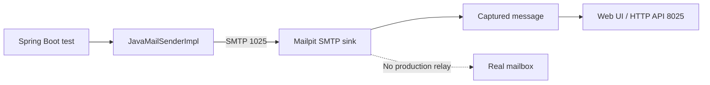

# Configuring a Dedicated Test Sender in Spring Framework Mail

In a Spring application, the email-sending layer typically uses `JavaMailSender` to build and submit messages over SMTP. When running tests, especially integration tests, **you must never accidentally use the production environment's SMTP server, password, recipient lists, or real sending configuration**. Even a single test case that creates an account or places an order can trigger confirmation, OTP, or invoice emails; if the mail configuration mistakenly points to a real provider, the test could send emails to customers, consume quota, and skew operational metrics.

Therefore, you should have a **dedicated test sender**: either a `JavaMailSender` implementation controlled within the test environment, or a real `JavaMailSenderImpl` pointing to a fake SMTP server (SMTP sink) such as Mailpit/GreenMail. The goal is to test the right behavior, keep tests repeatable, and cause no external side effects.

In the *Integration Testing* chapter of Spring Framework Mail, this guide explains how to choose the testing level, configure a Spring Boot test profile, override beans with `@TestConfiguration`/`@Primary`, use Mockito when no network is needed, use Mailpit with Testcontainers and `@DynamicPropertySource` when SMTP protocol verification is required, inspect MIME and recipients, and avoid common configuration pitfalls.

**Principle:** tests must never send emails to real users. If a test needs to verify the SMTP submission path, route the email to an SMTP sink within the test scope, never to a production email provider.

## 1. What Problems Does a Dedicated Test Sender Solve?

Consider an application with a service:

```java
@Service
public class RegistrationService {

    private final RegistrationRepository repository;
    private final RegistrationMailService mailService;

    @Transactional
    public void register(RegisterCommand command) {
        Registration saved =
                repository.save(Registration.from(command));
        mailService.sendWelcome(saved.getEmail());
    }
}
```

- If an integration test calls `register(...)` inside a Spring context configured with the real environment's `spring.mail.host` and `spring.mail.password`, calling `sendWelcome(...)` can send mail externally. Even if the test database is rolled back, **SMTP is a side effect outside the database transaction** and does not automatically roll back the email.

A dedicated test sender helps:

- Prevent sending to real SMTP accounts/providers.
- Verify that the service invokes email sending with the expected data.
- Verify `MimeMessage`, recipients, Subject, charset, HTML, and attachments.
- Simulate authentication failures, timeouts, or exceptions without network dependencies.
- Test retries, queue workers, and post-commit event listeners.
- Run reliably on developer machines and in CI without provisioning production SMTP credentials.
- Clarify the boundary between unit tests, Spring context integration tests, and real SMTP integration tests.

### Scope of a Test Sender

A test sender is not meant to "mimic Gmail perfectly". A mock only proves the code invokes the expected API; an SMTP sink can receive and store messages to verify MIME/transport. Neither **automatically proves deliverability, inbox placement, SPF/DKIM/DMARC, or real mailbox provider responses**.

## 2. Sender Testing Strategies

There are four common strategies:

| Strategy | Mechanism | Best Suited For | Limitations |
|---|---|---|---|
| Mockito mock `JavaMailSender` | No SMTP connection | Verifying calls and error-handling branches | Does not verify SMTP protocol |
| Recording/Fake sender | Stores messages in memory | Inspecting MIME at the application layer | Must write and maintain the fake |
| In-JVM SMTP sink | Test SMTP server such as GreenMail | Testing real submission, headers, MIME | Does not fully simulate Internet mail |
| Containerized SMTP sink | Mailpit with Testcontainers | Testing Spring context, SMTP, capture via API/UI | Requires Docker/container runtime |

Do not run a full integration test just to verify that a method called `JavaMailSender.send`. Conversely, if the requirement is to verify TLS, SMTP protocol, ports, recipients, and MIME sent to a test server, a plain mock misses most of the behavior under test.

### 2.1. Choosing Based on the Question to Answer

| Testing Question | Appropriate Approach |
|---|---|
| Does the service issue a send command when an order is valid? | Mock sender/gateway |
| Does it avoid sending when the transaction rolls back? | Spring integration test + mock gateway and transaction control |
| Are Subject/To/HTML/attachments built properly? | Recording sender or SMTP sink |
| Can `JavaMailSenderImpl` connect and submit? | Real SMTP sink |
| Does retry after an SMTP timeout behave properly? | Error stub/mock or controllable SMTP test server |
| Will the email land in Gmail Inbox? | Cannot be proven with a test sender; requires separate deliverability testing |

## 3. Architecture Separating Business Logic from the SMTP Adapter

A test-friendly design avoids having business services call SMTP APIs directly everywhere:

```text
RegistrationService / OrderService
            |
            v
   MailNotificationService
            |
            v
        MailGateway
       /          \
      /            \
Production         Test adapter
JavaMailSender      Mock / Fake / SMTP sink
```

Example of an application-layer interface:

```java
package com.example.mail;

public interface MailGateway {
    void send(OrderConfirmationMail mail);
}
```

Production adapter:

```java
package com.example.mail;

import jakarta.mail.MessagingException;
import jakarta.mail.internet.MimeMessage;
import org.springframework.mail.javamail.JavaMailSender;
import org.springframework.mail.javamail.MimeMessageHelper;
import org.springframework.stereotype.Component;

@Component
public class SpringMailGateway implements MailGateway {

    private final JavaMailSender sender;

    public SpringMailGateway(JavaMailSender sender) {
        this.sender = sender;
    }

    @Override
    public void send(OrderConfirmationMail mail) {
        try {
            MimeMessage message = sender.createMimeMessage();
            MimeMessageHelper helper = new MimeMessageHelper(
                    message, false, "UTF-8");
            helper.setFrom("no-reply@example.org");
            helper.setTo(mail.recipient());
            helper.setSubject(
                    "Order confirmation " + mail.orderNumber());
            helper.setText(mail.plainText(), false);
            sender.send(message);
        } catch (MessagingException ex) {
            throw new IllegalStateException(
                    "Unable to construct confirmation email", ex);
        }
    }
}
```

`OrderConfirmationMail` is an application-defined DTO containing `recipient()`, `orderNumber()`, and `plainText()`. The adapter focuses on formatting and sending mail, while the application service decides *when* to send.

When testing business rules, you can mock `MailGateway`. When testing the adapter, use a fake `JavaMailSender` or an SMTP sink. This separation avoids spinning up a fake SMTP server for every business-logic test.

**Never replace the production sender with a fake inside main source code just for tests.** Fake/test configurations must live in the test source set or a controlled test module.

## 4. Spring Boot Test Profile: application-test.yml

A straightforward way to isolate configuration is creating `src/test/resources/application-test.yml` and using `@ActiveProfiles("test")`.

Example:

```yaml
# src/test/resources/application-test.yml
spring:
  mail:
    host: 127.0.0.1
    port: 1025
    protocol: smtp
    test-connection: false
    username: ""
    password: ""
    properties:
      "[mail.smtp.auth]": false
      "[mail.smtp.starttls.enable]": false
      "[mail.smtp.ssl.enable]": false
      "[mail.smtp.connectiontimeout]": 2000
      "[mail.smtp.timeout]": 2000
      "[mail.smtp.writetimeout]": 2000
      "[mail.debug]": false
      "[mail.debug.auth]": false
```

In the example, port 1025 is Mailpit's common SMTP port when running in a test environment. If using a container with dynamic port mapping, this value is overridden by `@DynamicPropertySource` in a later step.

Do not put both production passwords and test settings in the same YAML file relying on an ambiguous toggle flag. All real secrets must be managed outside source code, and tests must never receive them via CI runtime environments.

### 4.1. Activating the Profile

```java
@SpringBootTest
@ActiveProfiles("test")
class RegistrationMailIntegrationTest {
    // Tests use application-test.yml.
}
```

`@ActiveProfiles` belongs to Spring Test and activates the profile in the test context. Runners do not need to remember passing `-Dspring.profiles.active=test` on the command line for every test.

### 4.2. Watch Configuration Override Precedence

Tests can receive configuration from multiple sources such as:

- Shared `application.yml`.
- `application-test.yml` when the test profile is active.
- `@TestPropertySource`, `@SpringBootTest(properties = ...)`.
- `@DynamicPropertySource` provided by a container.
- Environment variables, JVM system properties, test runners, and other property sources.

If Testcontainers dynamic configuration provides `spring.mail.host` and `spring.mail.port`, those values must take effect instead of the defaults in the test profile. Do not just glance at a YAML file and assume which host a test uses; understand which property source actually takes precedence.

### 4.3. Why Not Use localhost:25?

Port 25 is typically used for SMTP relays/server-to-server traffic and may require special privileges or configuration. In developer/CI environments, port 1025 is a convenient unprivileged test port; it is not a standard production SMTP port.

Do not assume every machine already has Mailpit running on `127.0.0.1:1025`. Tests should only run when an SMTP sink has been started or when intentionally using a mock. If the server is not running, `JavaMailSenderImpl` will report a connection error - that is a signal to fix test setup, not a reason to fall back to production SMTP.

### 4.4. Notes on Protecting the Test Profile

`application-test.yml` can reside in `src/test/resources` so it is not packaged into production application artifacts, though file placement alone is not enough if build pipelines have custom copy rules. Control artifacts, profile activation, and deployments.

Do not add a flag like `allowRealMailInTests=true` and enable it by default. Tests must be safe when run by newcomers or CI, even if they are unaware of every environment variable present.

## 5. Dedicated Test JavaMailSender Bean with @TestConfiguration

When precise control over the sender is needed, you can define dedicated test configuration. `@TestConfiguration` helps declare beans used during test execution, while `@Import` brings them into the test's Spring context.

The example below creates a `JavaMailSenderImpl` pointing to an SMTP sink from test properties:

```java
package com.example.mail;

import java.nio.charset.StandardCharsets;
import java.util.Properties;
import org.springframework.beans.factory.annotation.Value;
import org.springframework.context.annotation.Bean;
import org.springframework.context.annotation.Primary;
import org.springframework.boot.test.context.TestConfiguration;
import org.springframework.mail.javamail.JavaMailSender;
import org.springframework.mail.javamail.JavaMailSenderImpl;

@TestConfiguration(proxyBeanMethods = false)
public class LocalSmtpSenderTestConfiguration {

    @Bean
    @Primary
    public JavaMailSender localTestMailSender(
            @Value("${test.smtp.host}") String host,
            @Value("${test.smtp.port}") int port) {

        JavaMailSenderImpl sender = new JavaMailSenderImpl();
        sender.setHost(host);
        sender.setPort(port);
        sender.setProtocol("smtp");
        sender.setDefaultEncoding(
                StandardCharsets.UTF_8.name());

        Properties properties = sender.getJavaMailProperties();
        properties.put("mail.smtp.auth", "false");
        properties.put("mail.smtp.starttls.enable", "false");
        properties.put("mail.smtp.ssl.enable", "false");
        properties.put("mail.smtp.connectiontimeout", "2000");
        properties.put("mail.smtp.timeout", "2000");
        properties.put("mail.smtp.writetimeout", "2000");
        properties.put("mail.debug", "false");

        return sender;
    }
}
```

An integration test can import it:

```java
@SpringBootTest(properties = {
        "test.smtp.host=127.0.0.1",
        "test.smtp.port=1025"
})
@ActiveProfiles("test")
@Import(LocalSmtpSenderTestConfiguration.class)
class OrderMailIntegrationTest {

    @Autowired
    private OrderMailService orderMailService;

    // The SMTP sink must be running at 127.0.0.1:1025.
}
```

`@Primary` gives the test bean priority when multiple beans of the same type exist and dependency injection does not specify a qualifier. However, it **does not guarantee** every component uses the test bean if code calls `new JavaMailSenderImpl()`, injects via a `@Qualifier` pointing to another bean, or directly invokes a production sender configuration.

Only declare `LocalSmtpSenderTestConfiguration` in the test source set or test module. Importing it in the main application could accidentally cause production environments to use a fake SMTP server.

### 5.1. When to Use @Primary vs. Replacing the Bean?

- `@Primary` works well when multiple `JavaMailSender` beans exist and services inject by type without qualifiers.
- If the application has a bean named `mailSender` and many consumers use `@Qualifier("mailSender")`, a test bean with a different name - even with `@Primary` - will not replace qualifier-targeted injections.
- If an exact bean override is needed, prefer the testing bean-override mechanism supported by your Spring/Boot version, or refactor production configuration to allow explicit test sender selection.
- If you only need to mock a `MailGateway` adapter, replacing the adapter at the boundary can be simpler than overriding every `JavaMailSender` bean.

Do not enable global bean definition overriding just to mask duplicate bean names; overrides should be explicit and scoped to tests.

## 6. Mockito: Test Sender Without Connecting to SMTP

For service tests that only need to verify invocations, Mockito can mock `JavaMailSender`. Because `MimeMessageHelper` requires a real `MimeMessage`, you must configure the mock's `createMimeMessage()` to return a valid instance.

Example test independent of version-specific bean annotations:

```java
package com.example.mail;

import jakarta.mail.Session;
import jakarta.mail.internet.MimeMessage;
import java.util.Properties;
import org.mockito.Mockito;
import org.springframework.boot.test.context.TestConfiguration;
import org.springframework.context.annotation.Bean;
import org.springframework.context.annotation.Primary;
import org.springframework.mail.javamail.JavaMailSender;

@TestConfiguration(proxyBeanMethods = false)
public class MockMailSenderTestConfiguration {

    @Bean
    @Primary
    JavaMailSender mockMailSender() {
        JavaMailSender sender = Mockito.mock(JavaMailSender.class);

        Mockito.when(sender.createMimeMessage())
                .thenAnswer(invocation ->
                        new MimeMessage(Session.getInstance(
                                new Properties())));

        // sender.send(...) is void and does nothing by default.
        return sender;
    }
}
```

In the test:

```java
@SpringBootTest
@ActiveProfiles("test")
@Import(MockMailSenderTestConfiguration.class)
class OrderMailServiceTest {

    @Autowired
    private OrderMailService orderMailService;

    @Autowired
    private JavaMailSender sender;

    @Test
    void sendsConfirmationWithExpectedSubject()
            throws Exception {

        orderMailService.sendConfirmation(testOrder());

        ArgumentCaptor<MimeMessage> captor =
                ArgumentCaptor.forClass(MimeMessage.class);
        verify(sender).send(captor.capture());

        MimeMessage message = captor.getValue();
        assertEquals(
                "Order confirmation A-1042",
                message.getSubject());
    }
}
```

In this example, `OrderMailService`/`testOrder()` belong to the project. Import the corresponding JUnit, Mockito, and Jakarta Mail classes. `Mockito.verify(...)` proves the code called `send(MimeMessage)`, not that an SMTP server received the message.

**Watch overloads:** `JavaMailSender` has multiple `send` overloads including `send(MimeMessage[])`. If the code calls a different overload, assertions must match. Use `ArgumentCaptor` and `verify` to inspect the exact signature required.

### 6.1. @MockitoBean and @MockBean by Version

In Spring Framework 6.2+ (and corresponding Spring Boot generations), Spring Test provides `@MockitoBean` to override a bean with a Mockito mock. Example:

```java
@SpringBootTest
@ActiveProfiles("test")
class PasswordResetServiceTest {

    @MockitoBean
    JavaMailSender mailSender;

    @BeforeEach
    void prepare() {
        when(mailSender.createMimeMessage())
                .thenAnswer(invocation -> new MimeMessage(
                        Session.getInstance(new Properties())));
    }

    // Test mail-sending logic here.
}
```

Older Spring Boot versions have `@MockBean` in the Spring Boot Test package; that API is deprecated in newer Boot generations in favor of `@MockitoBean`. Pick the annotation matching your project's version and dependencies; do not mix both annotations in the same test.

Using `@MockitoBean` keeps code concise, yet you still must ensure `createMimeMessage()` returns a real `MimeMessage` if the code under test invokes MIME creation APIs.

### 6.2. Do Not Mock Every Layer and Call It an SMTP Integration Test

If `JavaMailSender` is a Mockito mock, the test does not verify:

- TCP connection to the SMTP sink.
- SMTP `MAIL FROM`, `RCPT TO`, and `DATA`.
- How MIME is serialized on the wire.
- SMTP response codes or server-side rejections.
- Timeouts/TLS/auth of the `JavaMailSenderImpl` configuration.

A mock sender fits **service logic and bean wiring**, not real transport verification. To test those aspects, use an SMTP sink.

## 7. Fake Sender and Recording Messages in Memory

Besides Mockito, you can create a fake sender that records messages for assertions. A fake helps when multiple tests need to:

- Record the list of requested emails.
- Inspect Subject, recipients, and constructed MIME contents.
- Simulate scripted SMTP failures.
- Avoid Docker dependencies for small tests.

You do not always have to implement every method on `JavaMailSender`. A concise approach is **extending `JavaMailSenderImpl` and overriding the needed overloads** in a test fixture; however, make sure code cannot call another overload and accidentally fall through to the real implementation.

Example covering only a service's `MimeMessage` sending path:

```java
package com.example.mail.testing;

import jakarta.mail.internet.MimeMessage;
import java.util.List;
import java.util.concurrent.CopyOnWriteArrayList;
import org.springframework.mail.javamail.JavaMailSenderImpl;

public final class RecordingMailSender extends JavaMailSenderImpl {

    private final List<MimeMessage> messages =
            new CopyOnWriteArrayList<>();

    @Override
    public void send(MimeMessage message) {
        messages.add(message);
    }

    @Override
    public void send(MimeMessage... messages) {
        for (MimeMessage message : messages) {
            this.messages.add(message);
        }
    }

    public List<MimeMessage> sentMessages() {
        return List.copyOf(messages);
    }

    public void clear() {
        messages.clear();
    }
}
```

The fake above demonstrates call recording and **only supports the overridden overloads**. `JavaMailSenderImpl` also has `send(SimpleMailMessage...)` and `send(MimeMessagePreparator...)` overloads; if production code may call them, override/handle them completely or use Mockito/an appropriate adapter to prevent sending over a real network. Before using it in a test suite, verify no code path reaches the superclass SMTP implementation.

### 7.1. Thread Safety and Isolation

`CopyOnWriteArrayList` is safe for concurrent appends/reads across threads, but does not automatically guarantee test isolation if Spring's cache shares the context across multiple tests. Clear messages before each test or isolate contexts/fakes as appropriate. With `@Async`, wait for the worker to complete before asserting.

Do not treat an in-memory fake list as a durable queue system; it is strictly a test fixture and disappears when the JVM exits.

## 8. Using Mailpit as an SMTP Sink

Mailpit is a testing SMTP server: the application sends emails to it via SMTP, and Mailpit retains the messages for inspection in its web UI/API instead of forwarding them to real mailboxes.

Model:



Where Mailpit fits well:

- Testing SMTP connections from `JavaMailSender`.
- Inspecting Subject, sender, recipients, and MIME source.
- Checking plain text/HTML and attachments.
- Observing MIME construction errors, encoding issues, or overly complex messages.
- Running locally and in CI without real credentials.

Mailpit does not fully simulate Gmail/Outlook mailbox policies and does not prove an email will reach an external Internet Inbox.

### 8.1. Running Mailpit Manually on a Development Machine

Example with Docker:

```bash
docker run --rm --name mailpit-test \
  -p 127.0.0.1:1025:1025 \
  -p 127.0.0.1:8025:8025 \
  axllent/mailpit:latest
```

Port `1025` is for SMTP; port `8025` is for the HTTP UI/API. The command above binds to loopback to reduce the risk of exposing the SMTP sink to other networks; if using Docker on another platform, adjust mapping syntax accordingly.

In a browser, the interface is typically accessed at `http://127.0.0.1:8025`. For CI or team projects, pin a tested image tag/digest rather than using `latest` to avoid tests breaking when new images arrive.

### 8.2. Using the Test Profile When the SMTP Sink Runs Locally

```java
@SpringBootTest
@ActiveProfiles("test")
class MailSubmissionTest {

    @Autowired
    private JavaMailSender mailSender;

    @Test
    void submitsMessageToLocalMailpit() throws Exception {
        MimeMessage message = mailSender.createMimeMessage();
        MimeMessageHelper helper = new MimeMessageHelper(
                message, false, "UTF-8");

        helper.setFrom("no-reply@example.org");
        helper.setTo("recipient@example.invalid");
        helper.setSubject("Fake SMTP test");
        helper.setText("Test content", false);

        mailSender.send(message);
    }
}
```

The expected outcome is that Mailpit captures the message rather than sending it to `recipient@example.invalid` on the Internet. This test is **only truly safe if `spring.mail.host/port` actually points to Mailpit**, so configuration and environment isolation is a prerequisite.

The address `example.invalid` is used for tests to avoid hitting real recipients; however, **fake addresses are no substitute for sender isolation** if a production SMTP server is still configured.

## 9. Integrating Mailpit with Testcontainers

An integration test that manages its own SMTP sink is much more reproducible than one requiring developers to start a Docker container manually. Testcontainers can launch Mailpit, map random ports, and supply host/port to Spring via `@DynamicPropertySource`.

### 9.1. Test Dependencies

With Gradle and Spring Boot dependency management:

```groovy
dependencies {
    implementation 'org.springframework.boot:spring-boot-starter-mail'

    testImplementation 'org.springframework.boot:spring-boot-starter-test'
    testImplementation 'org.testcontainers:junit-jupiter'
}
```

`spring-boot-starter-test` typically includes the necessary JUnit/Mockito libraries. Testcontainers versions must align with your Spring Boot/JDK stack and project dependency management. CI must provide an authorized Docker/container runtime.

### 9.2. Container and Dynamic Properties

```java
package com.example.mail;

import org.junit.jupiter.api.Test;
import org.springframework.beans.factory.annotation.Autowired;
import org.springframework.boot.test.context.SpringBootTest;
import org.springframework.test.context.ActiveProfiles;
import org.springframework.test.context.DynamicPropertyRegistry;
import org.springframework.test.context.DynamicPropertySource;
import org.testcontainers.containers.GenericContainer;
import org.testcontainers.junit.jupiter.Container;
import org.testcontainers.junit.jupiter.Testcontainers;

@Testcontainers
@SpringBootTest
@ActiveProfiles("test")
class MailpitSmtpIntegrationTest {

    @Container
    static final GenericContainer<?> mailpit =
            new GenericContainer<>("axllent/mailpit:latest")
                    .withExposedPorts(1025, 8025);

    @DynamicPropertySource
    static void configureSmtp(DynamicPropertyRegistry registry) {
        registry.add("spring.mail.host", mailpit::getHost);
        registry.add("spring.mail.port",
                () -> mailpit.getMappedPort(1025));
    }

    @Autowired
    JavaMailSender mailSender;

    @Test
    void sendsMailToTestContainer() throws Exception {
        MimeMessage message = mailSender.createMimeMessage();
        MimeMessageHelper helper = new MimeMessageHelper(
                message, false, "UTF-8");

        helper.setFrom("no-reply@example.org");
        helper.setTo("test-user@example.invalid");
        helper.setSubject("Mailpit test");
        helper.setText("Hello from Spring Mail", false);

        mailSender.send(message);
    }
}
```

Imports for `JavaMailSender`, `MimeMessage`, and `MimeMessageHelper` were illustrated in the previous section. Once the container starts, Testcontainers supplies the actual host and mapped SMTP port. The test does not assume host port 1025, avoiding conflicts across processes and CI runners.

`@DynamicPropertySource` must be a static method in this example; the property supplier should only be evaluated once the container is managed/started by Testcontainers. Across test classes with different context caching and container lifecycles, watch context reuse so stale host/port values are not kept after a container stops.

**Configuration note:** the test profile in section 4 set `mail.smtp.auth=false`, `mail.smtp.starttls.enable=false`, and blank credentials. Without that profile, Spring might pull TLS/auth settings from other property sources that are incompatible with the SMTP sink - or worse, use production credentials.

### 9.3. Why test-connection Needs Consideration

`spring.mail.test-connection=true` can make Spring Boot test the connection immediately at application context startup. That helps verify settings, yet causes confusing failures if the SMTP sink is not ready yet or when a test only checks business logic with a mock sender.

For most tests using Mailpit/Testcontainers, set `test-connection=false` in the profile and explicitly call `mailSender.testConnection()` in targeted tests when needed.

Never enable test-connection against production SMTP just to "make sure the network works"; it couples tests to real systems, credentials, and rate limits.

## 10. Verifying Captured Messages in Mailpit

A send test that stops right after `mailSender.send(message)` has not inspected the content on the SMTP sink side. You can use Mailpit's API to list messages or inspect raw source.

Mailpit versions typically expose an API under `/api/v1/messages`. HTTP example:

```text
GET http://127.0.0.1:8025/api/v1/messages
```

With Testcontainers, the HTTP port must come from `mailpit.getMappedPort(8025)`, **not the SMTP port 1025**.

### 10.1. Reading Captured Messages with an HTTP Client

An illustrative Java 17+ example:

```java
import com.fasterxml.jackson.databind.JsonNode;
import com.fasterxml.jackson.databind.ObjectMapper;
import java.net.URI;
import java.net.http.HttpClient;
import java.net.http.HttpRequest;
import java.net.http.HttpResponse;

private JsonNode fetchMailpitMessages() throws Exception {
    String baseUrl = "http://" + mailpit.getHost() + ":"
            + mailpit.getMappedPort(8025);

    HttpRequest request = HttpRequest.newBuilder()
            .uri(URI.create(baseUrl + "/api/v1/messages"))
            .GET()
            .build();

    HttpResponse<String> response = HttpClient.newHttpClient().send(
            request, HttpResponse.BodyHandlers.ofString());

    assertEquals(200, response.statusCode());
    return new ObjectMapper().readTree(response.body());
}
```

In the test:

```java
JsonNode result = fetchMailpitMessages();
assertTrue(result.path("messages").isArray());

boolean subjectFound = false;
for (JsonNode item : result.path("messages")) {
    if ("Mailpit test".equals(item.path("Subject").asText())) {
        subjectFound = true;
    }
}
assertTrue(subjectFound);
```

Here, `mailpit` is the static Testcontainers field from section 9. The code depends on the JSON contract of the running Mailpit version; if endpoints or fields differ in your pinned version, adapt the client to that version's API. When sending mail asynchronously, wait conditionally rather than asserting immediately.

### 10.2. Do Not Assert Only Email Count

When testing confirmation emails, worthwhile fields to check include:

- Does `From` match the test sender identity?
- Is `To` the expected fake recipient?
- Does Subject match the template without leaking unintended tokens/PII?
- Does the body contain full order details or valid test-environment links?
- Does UTF-8 render Vietnamese text properly?
- Does the mail contain properly structured `text/plain` and `text/html` when required?
- Are CID images and attachments present with the right content types?
- Are there any unintended `Cc/Bcc` recipients?

Depending on Mailpit's API, you may need to fetch individual message details or raw MIME source. Do not parse raw SMTP text with a naive regex when messages have multipart/encoding; use a Jakarta Mail parser when structural inspection is needed.

### 10.3. Distinguishing SMTP Envelope from MIME Headers

MIME `To/Cc/Bcc` are message headers; SMTP `RCPT TO` is the transport-level recipient list. Notably, many mail transports strip the `Bcc` header from the transmitted message while still delivering to Bcc recipients in the SMTP envelope.

If a test must verify "which recipients actually received the mail", check the envelope recipients captured by the SMTP sink rather than inspecting raw message headers alone. This matters for preventing misdelivery and testing Bcc.

## 11. GreenMail or In-JVM SMTP Test Server

If CI lacks Docker or you want to test SMTP transport directly inside the JVM, you can use an embedded test SMTP server such as GreenMail. It starts an SMTP listener on a test port, records messages, and lets tests inspect contents.

An example usage structure:

```text
JUnit 5 / Spring test
    |
    +--> start GreenMail SMTP server (test lifecycle)
    |
    +--> inject host + bound port into JavaMailSenderImpl
    |
    +--> call application mail service
    |
    +--> read captured messages from GreenMail
    |
    +--> stop server after test
```

If using GreenMail, choose an artifact compatible with modern Spring's Jakarta Mail stack and manage server lifecycle via a JUnit extension or test fixture. Never mix legacy `javax.mail` APIs with `jakarta.mail`.

### In-Process Does Not Mean Mock

An SMTP sink running inside the JVM still receives SMTP commands over a local network socket of the process. A real `JavaMailSenderImpl` can send to it to verify:

- Host/port connection.
- Building the message into MIME bytes.
- Transport envelope sender and recipients.
- SMTP-level submission success/failure.

A mocked `JavaMailSender` cannot verify these steps.

### Dynamic Port Management

Do not hard-code test ports if multiple JVMs or test suites run in parallel. Pick an available port provided by the test server and pass the bound port into Spring configuration. If a fixed port is unavoidable, tests must prevent conflicts and execute sequentially as needed.

### What Can GreenMail Test?

A test server can verify recipients, Subject, MIME parts, and server responses. However, not all production SMTP behavior is simulated: throttling, anti-spam checks, per-account limits, and mailbox provider policies can differ substantially.

## 12. Testing MIME Without Sending Over SMTP

Sometimes the only question is "Does the constructed email have the right Subject, HTML, charset, and attachments?". You can create a `MimeMessage` with an in-memory `Session` and inspect it after `saveChanges()` without running an SMTP sink.

Example:

```java
import jakarta.mail.Message;
import jakarta.mail.Session;
import jakarta.mail.internet.MimeMessage;
import java.util.Properties;
import org.springframework.mail.javamail.MimeMessageHelper;

Session session = Session.getInstance(new Properties());
MimeMessage message = new MimeMessage(session);

MimeMessageHelper helper = new MimeMessageHelper(
        message,
        MimeMessageHelper.MULTIPART_MODE_MIXED_RELATED,
        "UTF-8");
helper.setFrom("no-reply@example.org");
helper.setTo("alice@example.invalid");
helper.setSubject("Registration confirmation");
helper.setText("Hello Alice", "<p>Hello Alice</p>");

message.saveChanges();

assertEquals("Registration confirmation", message.getSubject());
assertEquals(
        "alice@example.invalid",
        ((InternetAddress) message.getRecipients(
                Message.RecipientType.TO)[0]).getAddress());
assertTrue(message.isMimeType("multipart/*"));
```

`message.isMimeType("multipart/*")` only checks the outer type; to be sure `multipart/alternative` and specific body parts exist, traverse the MIME tree. With `MIXED_RELATED`, multiparts can be nested multiple levels deep, so never assume body text is always the first top-level element.

### 12.1. Traversing the MIME Tree

An illustrative helper to collect text from parts:

```java
import jakarta.mail.BodyPart;
import jakarta.mail.Multipart;
import jakarta.mail.Part;
import java.util.ArrayList;
import java.util.List;

static void collectTextParts(
        Part part,
        List<String> plain,
        List<String> html) throws Exception {

    if (part.isMimeType("text/plain")) {
        plain.add((String) part.getContent());
        return;
    }
    if (part.isMimeType("text/html")) {
        html.add((String) part.getContent());
        return;
    }
    Object content = part.getContent();
    if (content instanceof Multipart multipart) {
        for (int index = 0;
                index < multipart.getCount(); index++) {
            BodyPart child = multipart.getBodyPart(index);
            collectTextParts(child, plain, html);
        }
    }
}
```

Usage:

```java
List<String> plain = new ArrayList<>();
List<String> html = new ArrayList<>();

collectTextParts(message, plain, html);

assertTrue(plain.stream().anyMatch(
        text -> text.contains("Hello Alice")));
assertTrue(html.stream().anyMatch(
        text -> text.contains("<p>Hello Alice</p>")));
```

In practice, you may also need to handle nested `message/rfc822`, streaming attachments, and complex encoded text parts. The helper above only verifies MIME parts expected from test templates, not a full-featured MIME parser.

### 12.2. Checking Content-ID for Inline Images

With an HTML email referencing:

```html

```

Spring:

```java
helper.setText(plainText, htmlText);
helper.addInline(
        "brand-logo",
        new ClassPathResource("mail/images/logo.png"),
        "image/png");
```

In tests, verify that `cid:brand-logo` appears in the HTML and that the inline MIME part has the matching `Content-ID`, non-empty content, and Content-Type `image/png`. `MimeMessageHelper` recommends calling `setText` before `addInline` so related parts are structured properly.

### 12.3. Do Not Log Raw MIME on Test Failure

In tests with fake data, printing raw MIME may temporarily aid debugging. However, the same utility can be copied into production or run with real data. Limit diagnostic output and never print secrets/tokens/user emails. Instead, log fixture paths, part counts, Content-Types, and standardized error codes.

## 13. Testing Timeouts, SMTP Errors, and Retry Policies

A dedicated test sender does not always have to return success. Key mail pipeline branches include:

- SMTP connection failure.
- Authentication error.
- Provider message rejection.
- Timeout after sending.
- Task rejected by executor.
- MIME/template construction error.
- Retrying while within deadline and dropping expired jobs.
- Recording `SUBMITTED`, `RETRY_WAIT`, or `FAILED_PERMANENT` statuses accurately.

### 13.1. Using Mockito to Simulate Errors

If the service calls `JavaMailSender.send(MimeMessage)`:

```java
@Test
void schedulesRetryWhenMailSubmissionFails() {
    when(sender.createMimeMessage())
            .thenAnswer(invocation ->
                    new MimeMessage(
                            Session.getInstance(new Properties())));

    doThrow(new MailSendException("simulated SMTP failure"))
            .when(sender)
            .send(any(MimeMessage.class));

    assertThrows(MailException.class,
            () -> mailService.sendConfirmation(testOrder()));

    // In job worker tests, check RETRY_WAIT status
    // and nextAttemptAt according to the real policy.
}
```

`MailSendException` and `MailException` belong to Spring Mail. This snippet is just a skeleton for testing an exception path; if the service wraps errors in domain exceptions, assertions must follow the service contract.

Never mock exceptions with values containing passwords, OTPs, or raw messages. Avoid `log.error(ex.getMessage())` when provider data may appear in nested causes.

### 13.2. Which Failures Can an SMTP Sink Test?

Default Mailpit primarily receives and stores mail for inspection; it does not reproduce every production SMTP failure mode. To test specific response codes, latency, or AUTH/TLS failures, you need a configurable stub/test server or a mock transport adapter capable of fault injection.

Test division:

| Failure to Simulate | Strategy |
|---|---|
| Unable to connect | Point to an unused host/port in an isolated test with short timeouts |
| Specific SMTP 4xx/5xx | Stub SMTP server with controllable responses |
| SMTP AUTH failure | Auth-enabled test server or error-classification mock |
| MailSendException | Mockito at the sender boundary |
| MIME formatting error | Pass invalid input into formatter/service |
| Executor rejection | Bounded executor test with tiny pool and queue |
| Expired retry | Inject `Clock` and check `expiresAt` |

Never use production SMTP to intentionally trigger AUTH failures or rate limits in tests. That can lock accounts, raise alerts, and disrupt real services.

### 13.3. Testing Retries Does Not Mean Testing Duplicate Prevention

If the provider accepted a message yet the application lost the ACK or crashed before persisting state, retries can send duplicates. A test sender can simulate error branches, but does not automatically provide exactly-once delivery. For critical mail, test idempotency keys/job leases/outboxes and ambiguous-state handling policies.

## 14. Testing @Async and Post-Commit Listeners

In Spring Mail applications, sending often happens after a business event:

```java
@TransactionalEventListener(
        phase = TransactionPhase.AFTER_COMMIT)
public void handle(OrderPlacedEvent event) {
    asyncMailService.sendConfirmation(event.orderId());
}
```

If a test uses `@Transactional` at the method/class level, Spring Test normally rolls back the transaction after each test. In that case, an `AFTER_COMMIT` listener **does not execute**, misleading the test into thinking mail logic is broken.

### 14.1. Testing AFTER_COMMIT Intentionally

Example with Spring TestContext and a mock mail gateway:

```java
@SpringBootTest
@ActiveProfiles("test")
@Transactional
class OrderAfterCommitMailTest {

    @Autowired
    OrderService orderService;

    @MockitoBean
    MailGateway mailGateway;

    @Test
    void sendsOnlyAfterSuccessfulCommit() {
        orderService.placeOrder(testCommand());

        verify(mailGateway, never()).send(any());

        TestTransaction.flagForCommit();
        TestTransaction.end();

        verify(mailGateway).send(any());
    }
}
```

The example assumes the listener calls the gateway **synchronously**. With `@Async`, wait for completion after commit using Awaitility or explicit test synchronization. Imports depend on Spring/JUnit/Mockito versions. `@MockitoBean` applies to Spring Framework 6.2+; for older versions, use the corresponding override mechanism.

### 14.2. Waiting Conditionally with @Async

Example using Awaitility (if the project includes the test dependency):

```java
await()
        .atMost(Duration.ofSeconds(5))
        .untilAsserted(() ->
                verify(mailGateway).send(any()));
```

Do not use `Thread.sleep(1000)` and assume the email must have been sent. In CI, schedulers, CPUs, and networks can be slower than on local machines, making tests flaky. Wait on a concrete condition with a finite timeout.

If the mock returns success immediately, the test only proves the async listener called the gateway; to test real transport, swap the gateway for an SMTP sink and wait for Mailpit to capture the message.

### 14.3. Original Transaction Does Not Propagate to Async Workers

Spring's imperative transactions are typically thread-bound. `@Async` runs on a worker thread and does not automatically inherit the request's database transaction. If the mail job needs to query the database, the worker layer must open a read-only or new transaction as needed. Tests should verify this behavior rather than assuming the test transaction wraps the worker.

### 14.4. Testing Rollback

Similarly, for a rolled-back test transaction:

```java
orderService.placeOrder(testCommand());
TestTransaction.flagForRollback();
TestTransaction.end();

verify(mailGateway, never()).send(any());
```

This is an abbreviated example for a test with an active transaction. If the listener is async, ensure no tasks from another test case are still running when asserting. The best approach is isolating contexts/queues and using specific job IDs and test states.

## 15. Test Isolation: Avoiding Messages from Other Tests Skewing Results

An SMTP sink shared across multiple tests may retain older messages. If a test only asserts "at least one email exists", it can falsely pass due to a message from a previous test.

Isolation techniques:

1. Use a dedicated container/server per test class or suite with clear rules.
2. Delete messages before each test if the API supports it and no parallel tests share the server.
3. Generate a unique mail job ID or test Subject marker, then query for that case's message.
4. Wait for the exact target message rather than merely waiting for total count to increase.
5. Never use real recipient addresses or an SMTP inbox shared across multiple runners.
6. Reset mocks, fake senders, and state counters between cases.
7. If tests run in parallel, never wipe the entire inbox of an SMTP sink used by other cases.

### 15.1. Using a Unique ID per Test

Example:

```java
String marker = UUID.randomUUID().toString();
String expectedSubject = "Test order " + marker;

mailService.sendTestMessage(
        "receiver@example.invalid",
        expectedSubject);

// Poll Mailpit, select the message with Subject == expectedSubject.
```

The ID here is a test fixture containing no user data. When testing real business emails, it is better to trace by a unique order ID from the test database rather than letting tests override the Subject arbitrarily.

### 15.2. Cleaning Up Data in Both Places

An end-to-end test may involve:

- A database containing mail jobs/outbox rows.
- A message broker or local executor queue.
- An SMTP sink storing captured messages.
- Test logs/tracing.

Deleting database records does not delete messages captured in Mailpit. Conversely, clearing Mailpit's inbox does not remove jobs from the outbox. Clean up each component according to its lifecycle and responsibility so workers from an old test do not keep sending after a new test begins.

### 15.3. Be Careful with Shared Spring Contexts

Spring's TestContext cache can reuse an application context across test classes for speed. If a singleton fake stores messages or an executor has unfinished tasks, state can leak into another case.

`@DirtiesContext` can force a fresh context when genuinely required, though overusing it slows tests down. Prefer explicit fixture resets and isolation first; reserve `@DirtiesContext` for cases that mutate beans/configuration or state that cannot be safely reset.

### 15.4. Container Reuse Does Not Solve Isolation Automatically

Testcontainers has an option to reuse containers in some environments. This speeds up runs, yet can preserve messages across runs. For tests needing strict independence, prefer explicit automatic lifecycles; if using reuse, define data-reset rules and avoid concurrent test interference.

## 16. Preventing Tests from Accidentally Sending Real Mail

This requirement matters even more than whether tests pass.

### 16.1. Do Not Supply Production SMTP Credentials to Test Runners

CI test jobs do not need to know the production `SMTP_PASSWORD`. If a pipeline injects all secrets into every stage, scope secrets by environment and job type.

For a local SMTP sink:

```yaml
spring:
  mail:
    username: ""
    password: ""
    properties:
      "[mail.smtp.auth]": false
```

These values fit default Mailpit. If the test server requires authentication, use **dedicated test credentials**, never real passwords.

### 16.2. Fail Closed If the Test Host Is Invalid

A guardrail can verify that the injected sender points to the SMTP endpoint provided by the test fixture. Example in an integration test:

```java
@Autowired
JavaMailSender mailSender;

@Test
void senderUsesLocalSmtpSink() {
    assertInstanceOf(JavaMailSenderImpl.class, mailSender);

    JavaMailSenderImpl impl = (JavaMailSenderImpl) mailSender;
    assertEquals(mailpit.getHost(), impl.getHost());
    assertEquals(mailpit.getMappedPort(1025), impl.getPort());
    assertNull(impl.getUsername());
    assertNull(impl.getPassword());
}
```

This test expects dynamic configuration from Mailpit/Testcontainers and an auto-configured sender without credentials. With `application-test.yml` specifying `username: ""`, the getter may return an empty string instead of `null`; in that case assert `null || isBlank()`. Most importantly, **it must contain no real credentials**.

An assertion inside a test method cannot stop early-starting constructors/components from sending mail before the test runs. For systems with startup jobs, ensure the environment has no network access to production SMTP and that the test profile is active as soon as the context starts.

### 16.3. Restrict Outbound Network Access

A strong safeguard is configuring CI/containers so tests can only reach the SMTP sink or permitted dependencies. If application code is misconfigured to point to a real email provider, the connection is blocked instead of succeeding.

For integration tests that intentionally access external services, use mocks/proxies/sandboxes and a dedicated network allowlist. Do not rely on "the recipient is example.invalid" if tests still possess real SMTP credentials.

### 16.4. Distinguishing Sandbox Providers from Real Providers

Some providers offer sandbox environments or dedicated test addresses. You can use them for approved testing, provided you:

- Use separate sandbox credentials.
- Restrict recipients/destinations.
- Never fall back to real sending when the sandbox fails.
- Never pass real customer data into the sandbox unless authorized.
- Never confuse sandbox results with production Inbox placement.

## 17. Configuring Multiple Senders: Production, Transactional, and Test

An application may define multiple `JavaMailSender` beans by purpose:

```text
JavaMailSender
  ├── transactionalSender
  ├── marketingSender
  └── testSender (test context only)
```

When `@Qualifier` is used in a production service:

```java
public OrderMailService(
        @Qualifier("transactionalSender") JavaMailSender sender) {
    this.sender = sender;
}
```

A `@Primary` test bean named `testSender` **does not necessarily override** a `transactionalSender` qualifier. Ensure the test configuration replaces the exact sender used by consumers.

Possible approaches:

- Design purpose-specific `MailGateway` interfaces and override the gateway at the boundary.
- Use profiles/conditional configuration so production senders are only created outside tests, and test senders are created in tests.
- Use Spring Test's bean override mechanism matching the exact bean name/qualifier.
- Define test configuration matching the bean names services inject, without enabling hidden global overrides.

### Explicit Profile Example

In intentional production configuration:

```java
@Configuration
@Profile("!test")
class ProductionMailConfiguration {

    @Bean("transactionalSender")
    JavaMailSender transactionalSender(...) {
        // Real SMTP configuration; omitted.
    }
}
```

In tests:

```java
@TestConfiguration
class TransactionalSenderTestConfig {

    @Bean("transactionalSender")
    JavaMailSender transactionalSenderForTest(...) {
        // Return a sender pointing to the SMTP sink.
    }
}
```

This illustrates environment-based bean selection rather than a complete configuration copy-pasteable into every application. With Spring Boot auto-configuration, avoid duplicate bean names or accidentally creating both the production and test senders.

Do not place `@Profile("test")` on classes in production source if that could let a fake get deployed and activated unexpectedly in production. Keeping test fixtures in the test source set remains the safer boundary.

## 18. Testing Containers and Configuration in CI

A pipeline can run:

```text
Source checkout
   |
   v
Unit tests / mocks
   |
   v
Spring integration tests
   |
   +--> Testcontainers Mailpit
   +--> Test database / broker
   +--> @DynamicPropertySource
   |
   v
Report assertions + test results
   |
   v
Stop containers / cleanup
```

### Operational Requirements

- CI runner has a compatible Docker/container runtime.
- Test images are pinned to verified tags/digests.
- Tests cannot access production SMTP and hold no production credentials.
- Mapped ports are assigned by the container runtime, not hard-coded on the host.
- Tests have finite timeouts and wait for server readiness at startup.
- Parallel tests do not share uncontrolled inbox/DB state.
- Test artifacts/logs contain no OTPs, passwords, or full customer emails.
- Containers and resources are cleaned up according to test lifecycle.

If CI disallows Docker, use an in-JVM test SMTP server or route non-transport tests to Mockito/recording senders. Never "temporarily send via production SMTP" to work around container runtime requirements.

### Watch Startup Wait Times

Right when Mailpit starts, SMTP and the HTTP API might not yet be ready at the exact instant a test attempts to connect. Testcontainers provides waiting strategies or readiness checks; apply them if images/runners have startup latency.

Do not fix flaky tests by placing `Thread.sleep(30000)` in every run. Use readiness probes/polling against the right endpoint with a reasonable timeout.

## 19. Configuring Timeouts, TLS, and SMTP AUTH in Test Environments

Test sender configuration must match the actual capabilities of the SMTP sink. Many default Mailpit setups run SMTP without AUTH/TLS on local port 1025. In contrast, production typically uses port 587 with STARTTLS or port 465 with implicit TLS and authentication.

### 19.1. Do Not Use a Non-TLS Test Sender to Prove Production TLS

If you test with:

```yaml
spring:
  mail:
    properties:
      "[mail.smtp.auth]": false
      "[mail.smtp.starttls.enable]": false
```

that test **does not verify** certificate trust, hostname verification, TLS negotiation, or production SMTP AUTH.

Separate two goals:

1. Testing email generation/basic submission protocol: local SMTP sink without auth/TLS.
2. Testing security configuration: an SMTP test server configured with TLS/AUTH using test-specific certificates and accounts, or a controlled sandbox provider.

Never disable TLS in production code just to make integration tests easier to run. If a test requires production-equivalent security settings, provide a test server that supports those features.

### 19.2. Finite Timeouts Give Clear Test Signals

If the SMTP sink is not listening, a test can hang for a long time without explicit timeouts. With a Jakarta Mail-based sender:

```yaml
spring:
  mail:
    properties:
      "[mail.smtp.connectiontimeout]": 2000
      "[mail.smtp.timeout]": 2000
      "[mail.smtp.writetimeout]": 2000
```

Values are in milliseconds and for test illustration only. Tune them based on CI speed and the failure modes simulated. Timeouts that are too low cause flaky tests, especially during container startup or CI load; timeouts that are too high delay diagnostics when the SMTP sink is missing.

### 19.3. Never Fall Back to Production SMTP

A dangerous design is:

```java
try {
    sendWithLocalSmtp(message);
} catch (Exception ex) {
    sendWithProductionSmtp(message); // Never do this in tests.
}
```

In tests, a missing SMTP sink must be a **test failure**. Never silently fall back to another host or call a production mail provider API.

If an application implements production SMTP failover, configure tests so the entire provider/fallback list also points to fakes/sandboxes or is disabled in the test context.

## 20. Testing Retries, Outbox, and Job Workers with a Test Sender

Many applications do not call `JavaMailSender.send(...)` directly inside an HTTP transaction. Instead:

```text
Business transaction
   |
   +--> INSERT order
   +--> INSERT mail_job / outbox
   |
   v
  COMMIT
   |
   v
Background worker
   |
   +--> Claim mail job
   +--> Render MIME
   +--> JavaMailSender.send(...)
   +--> Mark SUBMITTED / RETRY_WAIT / FAILED
```

In this architecture, a dedicated test sender can sit at the **worker boundary**, while the database/outbox continues to use a real test database implementation.

### 20.1. Testing Idempotency in the Job Store

A critical scenario:

1. Publish the same business event twice.
2. The transactional outbox keeps exactly one send intent within the idempotency scope.
3. The worker claims one eligible job.
4. The test sender records one submission attempt.
5. The job is marked `SUBMITTED`.

Do not assert that an email was sent once and treat that as a system-wide exactly-once guarantee. If a worker crashes after SMTP acceptance but before the DB update, retries can re-send. Test senders can simulate that failure to verify the application's recovery policy.

### 20.2. Testing Email Deadlines

For OTP or password-reset emails:

- Create a job with `expiresAt` in the past and verify the worker does not call the sender.
- Create a non-expired job and verify the worker sends it.
- Push retry backoff past the deadline and verify no new send attempt occurs.
- Issue a new OTP, invalidate the old job, and verify the revoked code is not sent.

Inject `Clock` or a test clock instead of waiting for wall-clock time. A no-network test sender verifies exact invocation counts across state transitions.

### 20.3. Testing Application Restarts

With an outbox/database queue, you can:

1. Create an unsent job and commit it to the test database.
2. Stop the worker or context at a controlled test step.
3. Start a new worker/context configured with an equivalent test sender.
4. Verify the job is claimed and submitted.

If a job exists only in `@Async` executor memory, do not expect it to survive a restart. A test sender does not alter the durability properties of the queue.

## 21. Common Mistakes When Configuring a Dedicated Test Sender

| Symptom | Likely Cause | Resolution |
|---|---|---|
| Tests still send to production SMTP | Profile inactive, properties overridden, or consumer uses a different bean | Check effective host/port and bean wiring; block outbound network |
| `NoSuchBeanDefinitionException` for JavaMailSender | Missing starter/config or auto-configuration skipped bean creation | Check dependencies and test configuration |
| `NoUniqueBeanDefinitionException` | Multiple senders without qualifier/primary | Select bean explicitly or apply `@Primary` appropriately |
| Mock sender throws `NullPointerException` creating MIME | Mock's `createMimeMessage()` returns null | Stub to return `new MimeMessage(Session.getInstance(...))` |
| `@Primary` test bean is ignored | Service injects with `@Qualifier` or instantiates sender manually | Override the exact bean or swap at gateway boundary |
| Connection to `127.0.0.1:1025` refused | Mailpit not running or running on another port | Start SMTP sink, use dynamically mapped port |
| Container test uses port 1025 on host | Confusing container port with mapped port | Use `getMappedPort(1025)` |
| Mailpit HTTP UI opens but SMTP fails | Confusing 8025 with SMTP port, or auth/TLS mismatch | Use SMTP 1025; check test profile |
| Context fails at startup | `spring.mail.test-connection=true` while sink is not ready | Disable startup check or synchronize lifecycle |
| Test passes with no new email | Mailpit holds messages from an earlier case | Isolate containers, clear state, or filter by unique ID |
| Test intermittently fails with `@Async` | Asserting before worker completes | Await condition with finite timeout |
| `AFTER_COMMIT` listener does not run | `@Transactional` test rolls back by default | Commit explicitly via `TestTransaction` or test boundary separately |
| Mockito sender reports success yet real SMTP fails | Mock does not check network/encoding | Add SMTP sink tests |
| MIME part is not at expected index | Nested multipart structure | Traverse MIME tree rather than assuming indices |
| Plain text and HTML do not appear together | Helper lacks multipart mode | Use `setText(plain, html)` with MIME multipart |
| Test sends email twice | Retry/worker still active, broken test isolation | Clean up jobs/queues, control async and unique IDs |
| Testcontainers fails to run in CI | Missing Docker or container privileges | Provide proper runtime or use in-process SMTP sink |
| Test port conflicts | Hard-coded host port, parallel runners | Use dynamically mapped ports |
| Tests use real passwords | Secrets injected broadly or inherited from env | Isolate CI secrets and sender configuration |
| CI is slow from too many containers | Spinning up a new server per test unnecessarily | Group tests, cache contexts, and choose proper test tiers |

### 21.1. When Seeing MailAuthenticationException in Tests

Check `mail.smtp.auth` and test credentials. If the SMTP sink has AUTH disabled, do not send a real username/password. If testing authentication, use a dedicated AUTH-enabled test server and assert standardized error codes/exceptions; never log passwords.

### 21.2. When Encountering javax.mail vs. jakarta.mail Incompatibilities

Modern Spring Framework uses Jakarta Mail (`jakarta.mail.*`). Some older libraries or code snippets still use `javax.mail.*`. These two package namespaces are not directly interchangeable.

Select SMTP sink/parser libraries and versions compatible with your actual Spring stack, and never mix `MimeMessage` types from both namespaces in the same test. If the project uses Spring Framework 5.x, use the `javax` API variant; with Spring Framework 6.x, use Jakarta.

### 21.3. When Tests Lose Vietnamese Content

Verify the sender and helper use UTF-8:

```java
MimeMessageHelper helper = new MimeMessageHelper(
        message, true, "UTF-8");
helper.setSubject("Xác nhận đơn hàng");
helper.setText("Nội dung tiếng Việt", false);
```

Also verify tests read MIME content using charset-decoding APIs rather than comparing raw encoded bytes directly against Unicode strings.

## 22. Practical Scenario: Testing with an SMTP Sink and Synthetic Data

Suppose an application must send an order confirmation email after commit. A sensible test suite could include:

### Group A - Business Service Unit Tests

Mock `MailGateway`:

- When an order is valid and commits successfully, publish the expected send intent.
- When business conditions are invalid, do not send.
- When a retry is requested, preserve the idempotency key.

No Mailpit or SMTP host required.

### Group B - Sender Adapter Integration Tests

Use a real `JavaMailSenderImpl` pointing to Mailpit:

- MIME submission succeeds.
- Captured message has the right From/To/Subject.
- UTF-8/HTML/plain text are represented accurately.
- Attachments/inline resources have valid content types and filenames.

No real credentials used.

### Group C - Worker/Outbox Integration Tests

Use a test database + Mailpit or a recording sender:

- Committed jobs are picked up by the worker.
- Expired jobs are not sent.
- If SMTP throws, the job transitions to the proper retry/error state.
- If a worker crashes or a lease expires, the job is recovered per policy.
- If the same business event is published repeatedly, duplicate jobs are not created unnecessarily.

### Group D - Independent Sending Infrastructure Tests

If you need to verify production TLS, SMTP AUTH, provider limits, or deliverability, organize a separate test suite with dedicated test environments/secrets under strict controls and monitoring. Never embed these checks inside every `@SpringBootTest` running in basic CI.

### Expected Outcome

A good suite is not merely green; it helps maintainers answer: "Does this test prove business logic, MIME structure, or SMTP transport?". Clear answers reduce over-mocking and unnecessary reliance on real servers.

## 23. Test Sender Configuration Checklist

### Before Running

- [ ] Clearly distinguish no-network tests from SMTP sink tests.
- [ ] `@ActiveProfiles("test")` or equivalent test context configuration is active.
- [ ] Production SMTP credentials are never injected into CI.
- [ ] If using Mailpit, SMTP host/port come from test fixtures or Testcontainers.
- [ ] If using `@TestConfiguration`, import it only in tests and verify which bean is injected.
- [ ] If using `@Primary`, check all `@Qualifier` usages in consumers.
- [ ] If using Mockito, stub `createMimeMessage()` to return a valid instance.
- [ ] No fallback exists to a real email provider.
- [ ] Startup/background jobs are isolated during tests.
- [ ] Connection timeouts prevent tests from hanging indefinitely.

### During Tests

- [ ] Use fake-domain recipients and payloads without real secrets.
- [ ] Verify exact recipients, Subject, MIME parts, and charset when needed.
- [ ] For async flows, wait on concrete conditions instead of fixed sleeps.
- [ ] For `AFTER_COMMIT`, control transaction commit/rollback intentionally.
- [ ] Never rely solely on existing message counts if the inbox could hold stale data.
- [ ] Test exceptions/responses contain no passwords or personal contents.
- [ ] Do not print raw MIME into centralized logs.

### After Tests

- [ ] SMTP sinks/containers are stopped per lifecycle unless an explicit reuse policy exists.
- [ ] Fake/mock state is reset if the Spring context is reused.
- [ ] Outbox/jobs and test queues do not leak into other cases.
- [ ] Test reports do not contain raw bodies/attachments with sensitive data.
- [ ] No real events were sent to a production provider.

## 24. Frequently Asked Questions

**What is a dedicated test sender configuration?** It means using a mock/fake `JavaMailSender` or a `JavaMailSenderImpl` pointing to a test SMTP server, isolated from production hosts and credentials.

**Can I rely solely on `@ActiveProfiles("test")`?** Possibly, if all properties and beans are properly separated, though the annotation alone does not prevent overrides from other property sources or consumers using a production SMTP bean. Add guardrails in configuration and CI networking.

**When do I need `@TestConfiguration`?** When tests need to declare a sender/gateway with custom behavior, override injection, or customize settings beyond what profile properties provide.

**Does `@Primary` override a bean injected with `@Qualifier`?** Not necessarily. A qualifier selects a bean by specific criteria; you must override the matching bean or swap wiring at a boundary.

**If I mock `JavaMailSender`, do I still need an SMTP sink?** Not for tests checking only business logic. However, if you want to verify transport, transmitted MIME, or SMTP responses, you need a test server.

**Why does mocking `createMimeMessage()` often fail?** Mockito returns `null` for object-returning methods unless stubbed; `MimeMessageHelper` needs a valid `MimeMessage`, causing a `NullPointerException`.

**Should I use `@MockitoBean` or `@MockBean`?** It depends on your Spring Framework/Boot version. Spring Framework 6.2+ provides `@MockitoBean`; older Spring Boot versions use `@MockBean`. Never use an annotation absent from your project's dependencies.

**Does Mailpit send real emails?** Mailpit acts as an SMTP sink to capture messages in a test environment. Verify the setup is not configured as an outbound relay and that the application actually points to it.

**How do ports 1025 and 8025 differ?** In default Mailpit, 1025 is for SMTP; 8025 is for the HTTP UI/API. With Testcontainers, host ports are dynamically mapped.

**Is Docker required to test Spring Mail?** No. Mock/recording senders and in-JVM SMTP servers are Docker-free options; Testcontainers is ideal when reproducible containerized tests are desired.

**Should we use a real SMTP provider to test MIME?** No need. An SMTP sink or in-memory `MimeMessage` inspection suffices for most requirements. Real providers belong to approved infrastructure/sandbox tests.

**Does using Mailpit guarantee emails will reach production Inboxes?** No. Mailpit verifies application sending and message structure; it does not fully simulate mail reputation, SPF/DKIM/DMARC, or spam filtering.

**Why didn't my `AFTER_COMMIT` test run even though an event fired?** Spring Test normally rolls back `@Transactional` tests at completion. `AFTER_COMMIT` listeners only run on real commits; use `TestTransaction` or structure transactions accordingly.

**How long should async tests sleep?** No fixed sleep duration is universally right. Use polling/await conditions with finite timeouts tied to a specific ID/event.

**What if the application has multiple senders?** Check bean names, qualifiers, and `@Primary`. Every sender used in tests must point to an SMTP sink or be replaced by a fake; do not override only one sender while others remain live.

**Can timeouts be tested through Mailpit?** You can simulate connection failures if the sink is down, but to simulate specific response codes or timings, use a controllable stub server or mock adapter. Never intentionally induce errors against a production provider.

**Does capturing one email mean the test is complete?** It only shows the submission reached the SMTP sink. The test may still need to assert Subject, recipients, MIME content, and database job status.

**Should Mailpit's inbox be cleared after every test?** That works if tests run sequentially and the API supports it. With parallel tests, avoid global wipes; use isolated containers or filter by a unique test ID.

**Should `spring.mail.test-connection=true` be enabled for all tests?** Not necessarily. It can cause context startup failures when the sink is not ready yet. Enable it only when the test actually targets SMTP connectivity and lifecycles are synchronized.

**Why can't rollback undo a sent email?** SMTP is a side effect outside the database transaction; rolling back data does not recall a submitted email. Test senders still need to verify proper transactional ordering.

**Does `SUBMITTED` mean the recipient has received the email?** No. It usually only indicates the SMTP server accepted the submission. Delivery and inbox placement are separate steps.

**What should we do if CI has no Docker?** Use Mockito/fakes for logic and an in-JVM SMTP sink such as GreenMail for transport tests, or provision a controlled container runner. Never switch to production SMTP.

**Should raw MIME be saved to test artifacts on failure?** Only with synthetic data and proper access/retention controls. Avoid putting tokens, credentials, or real customer addresses/contents into test logs.

## 25. Related Technical References

- **Spring Framework Mail:** `JavaMailSender`, `JavaMailSenderImpl`, `MimeMessageHelper`, `SimpleMailMessage`, and `MailException`.
- **Spring Boot Testing:** `@SpringBootTest`, `@TestConfiguration`, `@Import`, `@ActiveProfiles`, and property precedence.
- **Spring Test Bean Overriding:** `@MockitoBean` (Spring Framework 6.2+) and equivalent mechanisms in older versions.
- **Spring Test Transaction Management:** `@Transactional` in tests, `TestTransaction`, commit/rollback.
- **Spring Framework Task Execution:** `@Async`, executors, thread boundaries, and awaiting async completion.
- **Testcontainers Java:** `GenericContainer`, `@Container`, `@Testcontainers`, and `@DynamicPropertySource`.
- **Mailpit:** SMTP sink, web UI, HTTP API, and message capture.
- **GreenMail:** SMTP test server and JUnit fixtures compatible with javax/jakarta mail stacks.
- **Jakarta Mail:** `MimeMessage`, `Session`, `Multipart`, `BodyPart`, and SMTP semantics.
- **Mockito and JUnit 5:** argument captors, mock stubbing, test fixtures, and assertions.
- **OWASP / test security practices:** secret isolation, avoiding external side effects, and controlling sensitive data in tests.

---

**Remember:** a dedicated test sender must guarantee **no real emails are sent**, while providing the appropriate level of verification. Use **Mockito or a recording gateway** when testing logic and calls; use **`JavaMailSenderImpl` pointing to Mailpit/GreenMail** when verifying MIME and SMTP submission; use **`@ActiveProfiles("test")`, `@TestConfiguration`, `@Primary`, and `@DynamicPropertySource`** to isolate configuration. For `@Async` flows, transaction listeners, and outboxes, control completion, retries, and test isolation. Never supply production credentials to tests, never fall back to real providers, and never confuse SMTP sink results with external deliverability.
