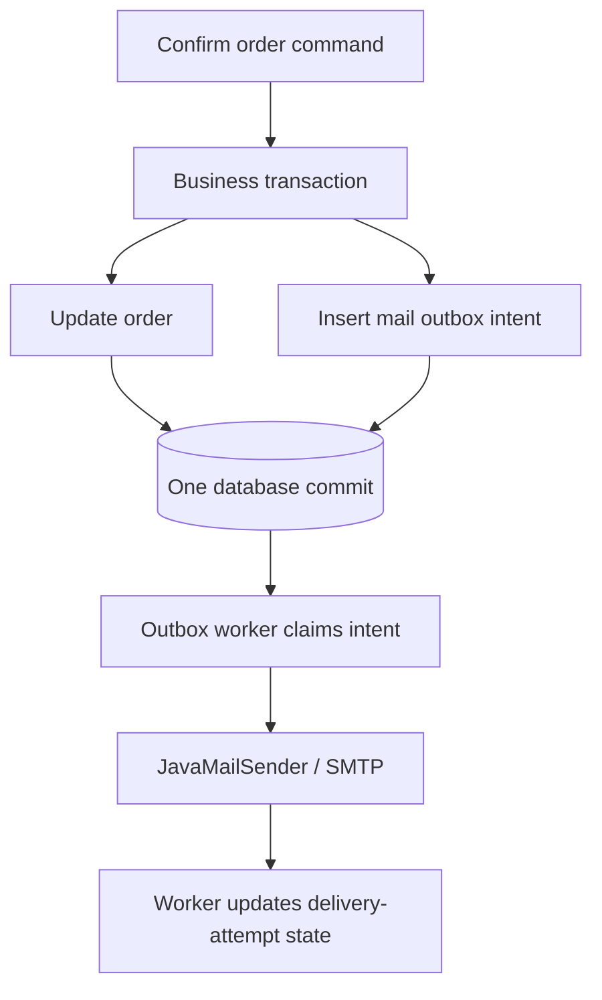

# Testing Transactions with an Outbox

A Spring Boot application uses `JavaMailSender` to send a confirmation email after an order is paid. The requirement looks simple: update the order, build the email, and send it. Yet if the database commits and the application crashes before calling SMTP, the email is lost. If it calls SMTP first and the database rolls back, the customer may receive a confirmation email for an unconfirmed order.

**Transactional Outbox** solves a crucial part of this problem: within the **same database transaction**, the system writes the business state and a durable record representing the **intent to send an email** (notification intent). A separate worker reads the outbox and sends after commit. To trust this architecture, we need **transaction integration tests against a real database**, not merely mocking repositories and calling `verify(save)`.

This guide, **"Testing Transactions with an Outbox"**, belongs to the **Integration Testing** chapter of the **Spring Framework Mail** module. Its focus is proving critical invariants: both records commit together, both roll back together, reprocessed events do not create duplicate intents, workers never read uncommitted rows, and SMTP failures never corrupt business state. It also clarifies what an outbox **cannot** guarantee: exactly-once delivery over SMTP.

## 1. Why Are Transactions the Most Critical Part of an Outbox?

Suppose a `confirmOrder` use case must:

1. Transition the order status from `NEW` to `CONFIRMED`.
2. Insert a confirmation email request into the `mail_outbox` table.
3. Commit.
4. Later, a worker reads the outbox, builds a `MimeMessage`, and calls `JavaMailSender.send(...)`.

Expected outcomes:

| Transaction Outcome | Order Status | Outbox Record |
|---|---|---|
| Commit succeeds | `CONFIRMED` | Matching notification intent exists |
| Rolls back on business error | Retains prior status | No new notification intent |
| Rolls back on outbox insert error | Retains prior status | No committed intent |
| Duplicate event reprocessed | Order not confirmed a second time | No second notification intent created |

When both mutations use the same transaction manager and database resource, the database guarantees atomicity: **either both commit, or neither change commits**.

### 1.1. What Happens Without an Outbox?

The dangerous approach:

```java
@Transactional
public void confirmOrder(UUID orderId) {
    orderRepository.markConfirmed(orderId);
    javaMailSender.send(buildMessage(orderId));
}
```

Several failure windows:

- SMTP accepts the message, then the DB transaction rolls back: the email was sent yet the business state does not exist.
- The database holds locks during a slow network call.
- An SMTP timeout slows down or fails the transaction.
- SMTP accepts the message yet the application loses the response: impossible to tell whether it was sent.

Another flawed approach:

```java
@Transactional
public void confirmOrder(UUID orderId) {
    orderRepository.markConfirmed(orderId);
}

public void afterConfirmation(UUID orderId) {
    javaMailSender.send(buildMessage(orderId));
}
```

If the process crashes between DB commit and `afterConfirmation`, the send request is never persisted anywhere. A transactional outbox replaces the direct send call by **persisting the intent inside the transaction**.

### 1.2. Distinguishing the Two Transactions



The confirmation transaction **does not span** the subsequent SMTP network I/O. The worker uses separate transactions to claim rows, record outcomes, or schedule retries. Never stretch a database transaction across an SMTP call: the SMTP server does not participate in that transaction.

## 2. Which Contracts Must Be Verified by Integration Tests?

A strong integration test suite proves contracts rather than merely verifying method calls:

| Contract | Evidence to Verify |
|---|---|
| **Atomic commit** | Run use case successfully; query database and observe both business state and outbox row |
| **Atomic rollback** | Inject error after writing both; query from another transaction and observe no changes |
| **Rollback when outbox insert fails** | If outbox write fails, business changes must not commit either |
| **Single intent** | Re-invoke the same business command/event; unique keys and state guards protect it |
| **Uncommitted intents invisible** | Other workers/connections must not read uncommitted rows per isolation rules |
| **Worker sends only committed rows** | Zero SMTP attempts occur before the intent commits |
| **Durable retry schedule** | Transport errors update the same row; retry schedule survives restarts |
| **Concurrency safety** | Concurrent transactions/workers neither create duplicate intents nor claim the same row |
| **Never equate submit with deliver** | Successful `JavaMailSender.send` marks submission only, not Inbox delivery |

### 2.1. Three Testing Scopes

- **Unit tests:** template/recipient selection logic, idempotency key generation, retry policy; can mock ports/repositories.
- **Database integration tests:** transactions, unique constraints, rollbacks, row locking, SQL isolation, migrations, and Spring transaction wiring.
- **SMTP/adapter integration tests:** MIME construction, talking to an SMTP catcher, handling responses and exceptions.

Do not try to prove both database atomicity and Inbox placement in a single test. Those verifications have different dependencies and definitions of success.

### 2.2. What Counts as Real Transaction Proof?

A test like this is **insufficient**:

```java
verify(orderRepository).save(any());
verify(mailOutboxRepository).save(any());
```

It proves two methods were called, not that they shared the same database transaction. Even if real repositories are called, unless the test observes **commit/rollback from an independent observer transaction**, misconfigured transaction managers or propagation can slip through.

## 3. Setting the Example: Confirming an Order and Writing the Mail Outbox

Suppose the system has two PostgreSQL tables:

- `purchase_order` stores order status.
- `mail_outbox` stores confirmation notification intents.

One intent corresponds to one transition of an order to `CONFIRMED` for `ORDER_CONFIRMATION`.

### 3.1. Illustrative Schema

```sql
CREATE TABLE purchase_order (
    id UUID PRIMARY KEY,
    status VARCHAR(30) NOT NULL,
    CONSTRAINT ck_order_status
        CHECK (status IN ('NEW', 'CONFIRMED', 'CANCELLED'))
);

CREATE TABLE mail_outbox (
    id UUID PRIMARY KEY,
    aggregate_id UUID NOT NULL
        REFERENCES purchase_order(id),
    event_id UUID NOT NULL,
    idempotency_key VARCHAR(240) NOT NULL,
    recipient_address VARCHAR(320) NOT NULL,
    subject VARCHAR(300) NOT NULL,
    body_text TEXT NOT NULL,
    status VARCHAR(30) NOT NULL,
    attempts INTEGER NOT NULL DEFAULT 0,
    created_at TIMESTAMPTZ NOT NULL,
    next_attempt_at TIMESTAMPTZ,
    last_error_code VARCHAR(100),
    claim_token UUID,
    lease_until TIMESTAMPTZ,
    submitted_at TIMESTAMPTZ,
    CONSTRAINT uq_mail_outbox_idempotency
        UNIQUE (idempotency_key),
    CONSTRAINT ck_mail_outbox_status
        CHECK (status IN (
            'PENDING', 'PROCESSING', 'RETRY_WAIT',
            'SUBMITTED', 'UNKNOWN', 'FAILED_PERMANENT'
        ))
);

CREATE INDEX idx_mail_outbox_due
    ON mail_outbox (status, next_attempt_at, created_at);
```

This is a teaching schema. Production may add tenant IDs, notification types, recipient identities, payload JSON/versions, provider references, and an attempt-history table.

Key requirements:

1. Both `purchase_order` and `mail_outbox` participate in the **same database transaction** in the example.
2. `idempotency_key` has a **real unique constraint in the database**.
3. Workers select only due `PENDING` or `RETRY_WAIT` rows.
4. Outbox data suffices for processing after the HTTP request/service returns; it never relies on a live in-memory Java object.

### 3.2. Choosing Idempotency Keys by Business Meaning

Example:

```text
order-confirmation:<order-id>
```

If each order generates one confirmation email on state transition, keying by order ID and purpose makes sense. If one event legitimately spawns multiple recipients or notification types, the key must distinguish recipient/purpose/channel per business rules.

Never generate keys from `UUID.randomUUID()` on every retry: otherwise the database cannot detect duplicate intents.

### 3.3. Event ID and Idempotency Key Need Not Be Identical

`event_id` identifies the source event; `idempotency_key` identifies **the effect that must happen once within a business scope**. One event may legitimately produce multiple notifications. Conversely, a retried business command might emit a new event if inputs are unprotected.

For instance, an order can be confirmed only once, so keying by order ID also guards against replayed commands carrying new event IDs, provided state transitions are guarded as well.

## 4. JDBC Repository: Keeping Operations Inside the Caller's Transaction

To make transaction boundaries clear, create a writer repository using `JdbcTemplate` that **does not open its own independent transaction**:

```java
package com.example.mailoutbox;

import java.sql.Timestamp;
import java.time.Instant;
import java.util.UUID;

import org.springframework.jdbc.core.JdbcTemplate;
import org.springframework.stereotype.Repository;

@Repository
public class OrderConfirmationWriter {

    private final JdbcTemplate jdbc;

    public OrderConfirmationWriter(JdbcTemplate jdbc) {
        this.jdbc = jdbc;
    }

    public boolean markConfirmedAndEnqueue(
            UUID orderId,
            UUID eventId,
            String recipient,
            Instant now) {

        int changed = jdbc.update(
                """
                UPDATE purchase_order
                SET status = 'CONFIRMED'
                WHERE id = ? AND status = 'NEW'
                """,
                orderId);

        if (changed == 0) {
            return false;
        }

        String key = "order-confirmation:" + orderId;

        jdbc.update(
                """
                INSERT INTO mail_outbox (
                    id, aggregate_id, event_id,
                    idempotency_key, recipient_address,
                    subject, body_text, status,
                    attempts, created_at
                )
                VALUES (
                    ?, ?, ?,
                    ?, ?,
                    ?, ?, 'PENDING',
                    0, ?
                )
                """,
                UUID.randomUUID(),
                orderId,
                eventId,
                key,
                recipient,
                "Order confirmation " + orderId,
                "Order " + orderId
                        + " has been confirmed.",
                Timestamp.from(now));

        return true;
    }
}
```

In the code above:

- `UPDATE ... WHERE status = 'NEW'` performs a conditional state transition.
- If the transition did not happen because the order was already confirmed or missing, the example returns `false` without inserting a new intent; production can distinguish not-found vs. duplicate.
- If the outbox `INSERT` fails while **the caller is in a transaction**, the entire transaction must roll back.
- `JdbcTemplate` uses the Spring-managed transaction-bound connection when `DataSource` and transaction manager are wired properly.
- `recipient` should come from verified business data; this example focuses on transactions and omits full validation and privacy policies.

### 4.1. Why Not Put @Transactional on the Writer?

The writer merely expresses two SQL statements. The transaction boundary belongs to the application use case. This also lets integration tests invoke the writer **inside a `TransactionTemplate`** to throw intentionally before commit and prove both operations roll back.

Putting `@Transactional` on repositories is not always wrong; what must be proven is that the operations share **one single transaction**, with no surprise propagation committing one piece independently.

## 5. Application Service with @Transactional

The service is where the business transaction begins:

```java
package com.example.mailoutbox;

import java.time.Clock;
import java.util.UUID;

import org.springframework.stereotype.Service;
import org.springframework.transaction.annotation.Transactional;

@Service
public class ConfirmOrderService {

    private final OrderConfirmationWriter writer;
    private final Clock clock;

    public ConfirmOrderService(
            OrderConfirmationWriter writer,
            Clock clock) {
        this.writer = writer;
        this.clock = clock;
    }

    @Transactional
    public boolean confirm(
            UUID orderId,
            UUID eventId,
            String recipient) {

        if (recipient == null || recipient.isBlank()) {
            throw new IllegalArgumentException(
                    "Recipient is required");
        }

        return writer.markConfirmedAndEnqueue(
                orderId,
                eventId,
                recipient,
                clock.instant());
    }
}
```

To provide a `Clock` bean in the application:

```java
@Configuration
public class ClockConfiguration {

    @Bean
    Clock clock() {
        return Clock.systemUTC();
    }
}
```

Corresponding imports are `java.time.Clock`, `org.springframework.context.annotation.Bean`, and `Configuration`.

In Spring Boot with a properly configured `DataSource` and transaction manager, `@Transactional` typically opens a transaction when another bean calls the service **through the Spring proxy**. JDBC calls inside the writer join that transaction.

**Do not confuse calling a method directly on `new ConfirmOrderService(...)` with calling a bean via the Spring container.** Manually instantiated objects are not wrapped by the transaction proxy unless managed explicitly by another mechanism.

### 5.1. Watch Out for Self-Invocation

If code within the same class calls:

```java
public void process(UUID id) {
    this.confirm(id, eventId, recipient);
}
```

then the internal call `this.confirm(...)` typically **bypasses the Spring proxy** in proxy-based transaction management, so the annotation on `confirm` does not apply as expected. Resolve this by placing transactional use cases on beans invoked by other beans or using `TransactionTemplate` explicitly.

This is exactly the kind of bug that integration tests across real bean/proxy boundaries catch.

## 6. Configuring Real PostgreSQL for Integration Tests

### 6.1. Why Use Testcontainers?

For a transactional outbox, critical behaviors depend on a real database:

- `UNIQUE` constraints and conflict handling.
- Transaction isolation and row locking.
- `INSERT ... ON CONFLICT` syntax.
- `FOR UPDATE SKIP LOCKED` during worker claiming.
- JDBC/JPA exception and rollback semantics.
- Contention behavior across multiple connections.

H2 can be useful for fast tests of simple repositories, yet never assume H2 reproduces PostgreSQL transaction and concurrency semantics accurately. When production runs PostgreSQL, use **PostgreSQL Testcontainers** for integration tests meant to prove transactions and locking.

### 6.2. Common Dependencies

Gradle example for Spring Boot and PostgreSQL:

```groovy
dependencies {
    implementation 'org.springframework.boot:spring-boot-starter-jdbc'
    implementation 'org.springframework.boot:spring-boot-starter-mail'

    runtimeOnly 'org.postgresql:postgresql'

    testImplementation 'org.springframework.boot:spring-boot-starter-test'
    testImplementation 'org.testcontainers:junit-jupiter'
    testImplementation 'org.testcontainers:postgresql'
}
```

If your project uses Spring Boot Testcontainers Service Connections, you can add `spring-boot-testcontainers` and `@ServiceConnection`; the examples below use `@DynamicPropertySource` to show how the JDBC URL is supplied to Spring.

Dependencies/versions must be managed consistently via your project's Spring Boot BOM/build config. This is a guide document and does not require executing Gradle while reading.

### 6.3. Starting PostgreSQLContainer

```java
import org.junit.jupiter.api.Test;
import org.springframework.beans.factory.annotation.Autowired;
import org.springframework.boot.test.context.SpringBootTest;
import org.springframework.test.context.DynamicPropertyRegistry;
import org.springframework.test.context.DynamicPropertySource;
import org.testcontainers.containers.PostgreSQLContainer;
import org.testcontainers.junit.jupiter.Container;
import org.testcontainers.junit.jupiter.Testcontainers;

@Testcontainers
@SpringBootTest
class OutboxTransactionIT {

    @Container
    static final PostgreSQLContainer<?> postgres =
            new PostgreSQLContainer<>("postgres:16-alpine");

    @DynamicPropertySource
    static void datasourceProperties(
            DynamicPropertyRegistry registry) {

        registry.add(
                "spring.datasource.url",
                postgres::getJdbcUrl);

        registry.add(
                "spring.datasource.username",
                postgres::getUsername);

        registry.add(
                "spring.datasource.password",
                postgres::getPassword);
    }

    @Autowired
    ConfirmOrderService service;

    @Autowired
    OrderConfirmationWriter writer;

    @Autowired
    JdbcTemplate jdbc;

    @Autowired
    PlatformTransactionManager transactionManager;
}
```

Additional imports for tests need `java.util.UUID`, `org.springframework.jdbc.core.JdbcTemplate`, `org.springframework.transaction.PlatformTransactionManager`, `TransactionTemplate`, and AssertJ.

The example assumes **migrations already created the `purchase_order`/`mail_outbox` schema** before tests run (e.g., via a Flyway test profile). If your project skips migrations in tests, run the illustrative schema SQL from section 3 via a controlled `@Sql`/init script.

### 6.4. Do Not Put @Transactional on This Test Class

This is a critical caveat:

```java
@SpringBootTest
@Transactional // Do not use by default for this commit/rollback verification suite.
class OutboxTransactionIT {
    // ...
}
```

In many Spring integration tests, `@Transactional` on a test method/class makes Spring Test open a transaction for the test and **automatically roll it back when the test ends**. When that happens:

- `@Transactional` on the service may join the test's transaction instead of committing itself.
- Assertions reading on the same connection may see **uncommitted** rows.
- `@TransactionalEventListener(phase = AFTER_COMMIT)` may never fire in tests because no commit happened.
- Tests pass green yet fail to prove production transactions commit at the right time.

To verify atomic commits/rollbacks, **do not let a test transaction mask the service's transaction**. Let the service genuinely commit or use `TransactionTemplate` to explicitly begin and end transactions.

## 7. Creating Independent Test Data

Each test should create its own `orderId` to avoid state interference. Example helpers:

```java
private UUID insertNewOrder() {
    UUID id = UUID.randomUUID();

    jdbc.update(
            """
            INSERT INTO purchase_order (id, status)
            VALUES (?, 'NEW')
            """,
            id);

    return id;
}

private String orderStatus(UUID orderId) {
    return jdbc.queryForObject(
            "SELECT status FROM purchase_order WHERE id = ?",
            String.class,
            orderId);
}

private int outboxCount(UUID orderId) {
    Integer count = jdbc.queryForObject(
            """
            SELECT COUNT(*)
            FROM mail_outbox
            WHERE aggregate_id = ?
            """,
            Integer.class,
            orderId);

    return count == null ? 0 : count;
}
```

In the test examples:

- `insertNewOrder()` executes outside any test transaction, committing via standard JDBC autocommit.
- Each test generates a fresh UUID, avoiding `DELETE FROM mail_outbox` across the whole database before every test.
- Data remains inside the test class's container; when stricter isolation is needed, use controlled transactions/setup/cleanup or an appropriate container lifecycle.

**Never wipe entire test tables during parallel test execution**, as it can delete data belonging to another active test.

## 8. Test 1: Commit Must Persist Both Order and Outbox

A core integration test:

```java
@Test
void commitPersistsBusinessStateAndOutboxTogether() {
    UUID orderId = insertNewOrder();
    UUID eventId = UUID.randomUUID();

    boolean changed = service.confirm(
            orderId,
            eventId,
            "customer@example.net");

    assertThat(changed).isTrue();
    assertThat(orderStatus(orderId))
            .isEqualTo("CONFIRMED");

    assertThat(outboxCount(orderId))
            .isEqualTo(1);

    Map<String, Object> row = jdbc.queryForMap(
            """
            SELECT idempotency_key,
                   recipient_address,
                   status,
                   attempts
            FROM mail_outbox
            WHERE aggregate_id = ?
            """,
            orderId);

    assertThat(row.get("idempotency_key"))
            .isEqualTo("order-confirmation:" + orderId);
    assertThat(row.get("recipient_address"))
            .isEqualTo("customer@example.net");
    assertThat(row.get("status"))
            .isEqualTo("PENDING");
    assertThat(((Number) row.get("attempts")).intValue())
            .isZero();
}
```

Import `java.util.Map` and AssertJ assertions.

### 8.1. Why Is This a Commit Proof?

The test has **no** `@Transactional`. Calling `service.confirm(...)` goes through the Spring bean proxy; the transaction finishes when the service returns. Subsequent `jdbc.queryForObject(...)`/`queryForMap(...)` calls observe committed state via Spring/JDBC connections.

If the service updates the order yet forgets to insert the outbox, the test fails. If it inserts the outbox yet forgets to change the order status, the test fails. If the transaction rolls back, both assertions catch it.

### 8.2. Checking Row Counts and Contents

Counting one row is not enough if that row points to the wrong aggregate, recipient, or purpose. Depending on the business contract, also verify:

- `event_id` was stored accurately.
- `idempotency_key` and notification type.
- Recipient snapshot/address.
- Body/template data or schema version.
- Initial status `PENDING`.
- `attempts=0` and `next_attempt_at` as required.

Tests should verify the fields workers need to resend after a process restart, without over-constraining random timestamps/UUIDs outside the contract.

## 9. Test 2: Error After Outbox Insert Must Roll Back Both

This is the most important test for proving atomicity. We explicitly start a transaction, invoke the real writer, and throw an exception **after both SQL statements ran** yet **before commit**.

```java
@Test
void rollbackRemovesBothOrderChangeAndOutboxIntent() {
    UUID orderId = insertNewOrder();
    UUID eventId = UUID.randomUUID();

    TransactionTemplate tx =
            new TransactionTemplate(transactionManager);

    assertThatThrownBy(() ->
            tx.executeWithoutResult(status -> {
                writer.markConfirmedAndEnqueue(
                        orderId,
                        eventId,
                        "customer@example.net",
                        Instant.parse("2026-11-12T08:00:00Z"));

                // Simulate failure occurring after writing both.
                throw new IllegalStateException(
                        "SIMULATED_FAILURE_AFTER_OUTBOX");
            }))
            .isInstanceOf(IllegalStateException.class)
            .hasMessage("SIMULATED_FAILURE_AFTER_OUTBOX");

    assertThat(orderStatus(orderId))
            .isEqualTo("NEW");

    assertThat(outboxCount(orderId))
            .isZero();
}
```

### 9.1. What This Test Proves

`TransactionTemplate` opens a transaction using the real transaction manager. `OrderConfirmationWriter` uses the same `DataSource`/connection bound by Spring to that transaction. The unchecked exception causes the template to roll back. After the transaction ends, the test queries the database and observes:

- Order remains `NEW`.
- Zero outbox rows exist.

Thus, writing the intent never leaks as a separate commit when the business transaction rolls back.

### 9.2. What This Test Does Not Prove Alone

Because the test opens the transaction manually via `TransactionTemplate`, it proves the writer can **join a transaction** and both mutations roll back together. It is **not enough on its own** to prove `@Transactional` on the service is activated by a Spring proxy.

Combine it with the commit test in section 8, or a test invoking the service directly through the proxy and checking state after return. If the service uses wrong propagation like `REQUIRES_NEW`, an outer-transaction rollback test catches it because the inner transaction commits independently.

### 9.3. Never Catch an Exception Inside a Transaction and Keep Committing

Wrong:

```java
tx.executeWithoutResult(status -> {
    try {
        writer.markConfirmedAndEnqueue(
                orderId, eventId, recipient, clock.instant());
        throw new IllegalStateException("failure");
    } catch (Exception ex) {
        // Swallowed the error without calling setRollbackOnly!
    }
});
```

If an exception is swallowed and the transaction is not marked rollback-only, Spring may attempt to commit. When catching exceptions inside a closure where rollback is still required, call `status.setRollbackOnly()` or let an appropriate exception escape the transaction boundary.

## 10. Test 3: Outbox Insert Failure Rolls Back Business Change

A dangerous scenario: updating the order succeeds, yet the SQL insert into the outbox fails due to a constraint, database unavailability, or invalid data. In that case, **the order must not commit as confirmed** if the mail intent is a mandatory invariant of the use case.

### 10.1. Simulating a Real Database Failure

One way is passing a `recipient_address` exceeding the `VARCHAR(320)` limit so PostgreSQL rejects the insert. In the example, the service only checks `isBlank()` without checking length. This test illustrates a failure at the **database boundary**, not a recommendation to omit production validation.

```java
@Test
void databaseInsertFailureRollsBackOrderUpdate() {
    UUID orderId = insertNewOrder();
    String tooLongRecipient = "x".repeat(400);

    assertThatThrownBy(() ->
            service.confirm(
                    orderId,
                    UUID.randomUUID(),
                    tooLongRecipient))
            .isInstanceOf(DataAccessException.class);

    assertThat(orderStatus(orderId))
            .isEqualTo("NEW");

    assertThat(outboxCount(orderId))
            .isZero();
}
```

Import `org.springframework.dao.DataAccessException`. In JDBC/PostgreSQL, a value exceeding `VARCHAR(320)` typically produces an exception Spring translates into the `DataAccessException` hierarchy. Do not couple tests to exact error text or SQLState if the contract only cares about rollback.

### 10.2. Why Not Just Use doThrow on a Repository?

If a mock repository throws `RuntimeException`, you prove the service throws, yet **do not** prove the database rolled back prior SQL statements. For transaction integration tests, let a real failure happen at JDBC/database level and query the committed state afterwards.

### 10.3. What If Business Allows Confirming Without Sending Mail?

Then the design and contract differ. For instance, if the application treats email as best-effort without needing a transactional outbox, lacking an intent may be an intentional choice.

However, if the architecture chose a transactional outbox to guarantee "confirmed order => notification intent exists", tests must lock down that invariant. Never mark `COMPLETED` for a transaction that committed business state yet lost the outbox intent.

## 11. Test 4: Reprocessing Commands/Events Creates No Extra Intents

In distributed systems, HTTP clients retry, brokers redeliver events, or jobs rerun after crashes. Preventing duplicate notification requests requires idempotency at the right scope.

### 11.1. Testing Conditional State Transitions

```java
@Test
void repeatedConfirmCreatesOneIntent() {
    UUID orderId = insertNewOrder();

    boolean first = service.confirm(
            orderId,
            UUID.randomUUID(),
            "customer@example.net");

    boolean second = service.confirm(
            orderId,
            UUID.randomUUID(),
            "customer@example.net");

    assertThat(first).isTrue();
    assertThat(second).isFalse();

    assertThat(orderStatus(orderId))
            .isEqualTo("CONFIRMED");

    assertThat(outboxCount(orderId))
            .isEqualTo(1);
}
```

On the second call, `UPDATE ... WHERE status = 'NEW'` matches zero rows, so the writer skips creating another outbox row. This is **idempotency at the business-transition level**.

### 11.2. Testing Real Unique Constraints

Even when the application checks beforehand, two concurrent transactions can both observe that an idempotency key does not exist yet. Enforce `UNIQUE(idempotency_key)` in the database.

If a repository offers an insert-if-absent method (independent of updating the order), PostgreSQL can use:

```sql
INSERT INTO mail_outbox (
    id, aggregate_id, event_id,
    idempotency_key, recipient_address,
    subject, body_text, status,
    attempts, created_at
)
VALUES (
    :id, :orderId, :eventId,
    :key, :recipient,
    :subject, :bodyText,
    'PENDING', 0, CURRENT_TIMESTAMP
)
ON CONFLICT (idempotency_key) DO NOTHING;
```

When two transactions insert the same key:

- One transaction inserts the new row.
- The other transaction inserts no second row.
- The unique index arbitrates safely under concurrency.

If using plain JPA `save()` and catching unique violations **inside the same transaction**, be careful: the transaction may already be marked rollback-only or the persistence context may no longer be safe to continue using. For clean insert-if-absent semantics, native SQL/PostgreSQL `ON CONFLICT` or an equivalent abstraction is usually cleaner.

### 11.3. One Event Can Produce Multiple Valid Emails

If an `InvoiceIssued` event must notify both the customer and the finance team, a unique key containing only the event ID would drop one valid email.

Keys must match the contract, for example:

```text
<event-id>:CUSTOMER_INVOICE:EMAIL:<customer-id>
<event-id>:FINANCE_COPY:EMAIL:<finance-team-id>
```

Tests must verify duplicates for the same purpose/recipient are blocked, **yet two distinct purposes still create two valid intents**.

## 12. Test 5: Concurrency Between Two Confirmation Transactions

Single-threaded tests can pass green even when a race condition occurs if two concurrent requests confirm the same order.

### 12.1. Objective

Have two requests invoke `service.confirm(orderId, ...)` nearly simultaneously. After both finish:

- The order is `CONFIRMED`.
- Exactly one confirmation outbox row exists.
- No duplicate email intents exist.
- No unexpected exception breaks the transaction that should succeed.

### 12.2. Example with Two Threads

```java
@Test
void concurrentConfirmationsProduceOneOutboxIntent()
        throws Exception {

    UUID orderId = insertNewOrder();

    ExecutorService executor =
            Executors.newFixedThreadPool(2);

    CountDownLatch ready = new CountDownLatch(2);
    CountDownLatch start = new CountDownLatch(1);

    try {
        Callable<Boolean> command = () -> {
            ready.countDown();
            if (!start.await(5, TimeUnit.SECONDS)) {
                throw new IllegalStateException(
                        "Start latch timed out");
            }

            return service.confirm(
                    orderId,
                    UUID.randomUUID(),
                    "customer@example.net");
        };

        Future<Boolean> first =
                executor.submit(command);
        Future<Boolean> second =
                executor.submit(command);

        assertThat(ready.await(5, TimeUnit.SECONDS))
                .isTrue();
        start.countDown();

        boolean a = first.get(10, TimeUnit.SECONDS);
        boolean b = second.get(10, TimeUnit.SECONDS);

        assertThat(a != b).isTrue();
        assertThat(orderStatus(orderId))
                .isEqualTo("CONFIRMED");
        assertThat(outboxCount(orderId))
                .isEqualTo(1);
    } finally {
        start.countDown();
        executor.shutdownNow();
    }
}
```

Imports need `java.util.concurrent.*` and `UUID`. Timeouts are illustrative test bounds adjustable for CI. Both commands call the **same Spring service bean** on two different threads, each crossing the proxy with its own transaction and connection.

### 12.3. Concurrency Tests Can Be Non-Deterministic

`CountDownLatch` lets two threads start close together, yet **does not guarantee** they execute the exact same SQL instruction simultaneously. In PostgreSQL, `UPDATE ... WHERE status = 'NEW'` on the same row uses row-level locking; the second transaction may wait for the first to commit and then update 0 rows.

To test specific interleavings like "two transactions both observe a missing key", use a test barrier **at the exact repository step**, or run concurrent inserts directly across two JDBC transactions. Never claim "all races proven" from one latch test run.

### 12.4. Concurrency Tests Should Not Be Wrapped in a Test Transaction

Each thread must cross its own transaction boundary. If the test method has `@Transactional`, that transaction is thread-bound and **does not propagate to worker threads**; the test may observe very different data/commits than intended.

That is another reason to keep concurrency integration tests **free of `@Transactional` on the test method**.

## 13. Test 6: Worker Must Not See Uncommitted Outbox Rows

A transactional outbox only works if workers process **committed intents**, not transient rows from transactions that might roll back.

Under standard isolation such as PostgreSQL `READ COMMITTED`, another transaction does not see uncommitted rows.

### 13.1. Two-Connection Test Idea

```text
Transaction A                     Transaction B (worker)
-------------                     ----------------------
BEGIN
UPDATE order -> CONFIRMED
INSERT mail_outbox N-1
                                  SELECT ready outbox rows
                                  --> N-1 not visible yet
ROLLBACK
                                  SELECT ready outbox rows
                                  --> N-1 still does not exist
```

With commit:

```text
Transaction A                     Transaction B
-------------                     -------------
BEGIN
UPDATE + INSERT N-1
                                  SELECT N-1 --> not visible
COMMIT
                                  SELECT N-1 --> visible
```

Tests can use two Spring-managed transactions/connections, latches to pause A before commit, and another transaction B to query. Never reuse the same JDBC connection for both A and B when proving isolation.

### 13.2. Never Use READ UNCOMMITTED to "Read Earlier"

Never design a worker to read uncommitted outbox rows just to shave latency. If it reads an intent from a transaction that later rolls back, the worker may send an email for a business event that never happened.

In PostgreSQL, `READ UNCOMMITTED` behaves like `READ COMMITTED`; other databases differ. Tests must rely on the isolation semantics of your production database.

### 13.3. Use Idempotency and Row State After Commit

Even when workers read only committed rows, you still need:

- Due `status='PENDING'` or `RETRY_WAIT` filtering.
- Short, concurrency-safe claim transactions.
- Preventing two workers from sending the same row.
- Updating state guarded by claim tokens/leases.
- Not retrying blindly when submission outcomes are uncertain.

Do not mistake post-commit visibility for the entire worker contract.

## 14. Test 7: Same Transaction Manager and Same Resource

`@Transactional` does not automatically turn two separate databases into one atomic transaction.

Example:

```text
Business state -> PostgreSQL A
Mail outbox    -> PostgreSQL B
```

If each database has its own independent transaction manager, a `@Transactional` annotation targeting manager A will not cover operations on B. Failure scenario:

1. A commits business state.
2. Insert into B fails.
3. The system has no notification intent.

### 14.1. Checking Wiring in Tests

For single-database architectures, verify:

- `OrderConfirmationWriter` uses a `JdbcTemplate` pointing to the right `DataSource`.
- `@Transactional` selects the right `PlatformTransactionManager`.
- Transaction propagation does not spawn separate commits.
- Schemas/migrations match the production database.
- Code never opens `DriverManager.getConnection(...)` or connections outside Spring transactions.

The rollback test in section 9 catches this nicely: if the writer opens a separate autocommit connection, the outbox row survives even when the business transaction rolls back.

### 14.2. If Multiple Resources Are Truly Required

When business state and the mail queue/outbox reside in two independent systems, atomicity is no longer guaranteed by local `@Transactional` alone. Consider moving the outbox into the aggregate's database or adopting another pattern with explicit consistency guarantees.

Never claim "atomic transactional outbox" if the outbox lives in a separate queue/broker not participating in the same transaction.

## 15. Test 8: Transaction Propagation Leaking Commits

### 15.1. The REQUIRES_NEW Risk

Suppose the outbox writer uses:

```java
@Transactional(
    propagation = Propagation.REQUIRES_NEW)
public void saveOutboxIntent(...) {
    // insert outbox
}
```

If the outer business transaction later rolls back, the inner transaction may **already have committed the outbox row**. Result:

```text
Outer business TX:
    UPDATE order
       |
       +-- Inner REQUIRES_NEW:
       |       INSERT outbox
       |       COMMIT
       |
       +-- Throw exception
       v
    ROLLBACK order

Final state: order NEW, yet outbox already has an intent.
```

This violates atomicity if the invariant is "business and outbox commit together or roll back together".

### 15.2. Integration Tests Must Catch This

When an error occurs after calling the writer, the test must query after rollback and verify the outbox row **must not exist**. If the row persists, check for `REQUIRES_NEW`, a mismatched transaction manager, an autocommit connection, or writes outside transaction boundaries.

### 15.3. REQUIRED vs. MANDATORY

`Propagation.REQUIRED` joins an active transaction or starts one if none exists. In some designs, outbox repositories use `MANDATORY` to require callers to have an active transaction, preventing direct calls outside transactions:

```java
@Transactional(propagation = Propagation.MANDATORY)
public void insertOutbox(...) {
    // ...
}
```

`MANDATORY` alone does not guarantee two resources share a transaction manager if wiring is broken. It documents the transaction-boundary contract, not a substitute for integration testing.

### 15.4. Checked Exceptions and Rollback Rules

In traditional Spring transaction models, default rollback applies to `RuntimeException` and `Error`; checked exceptions may not trigger rollback unless configured.

If the use case throws a checked exception after writing both the intent and business state, decide explicitly:

```java
@Transactional(rollbackFor = Exception.class)
public void confirm(...) throws SomeCheckedException {
    // ...
}
```

Do not blindly add `rollbackFor = Exception.class` to every service; align with business policy. Still, integration tests must verify **the actual exception types** that should roll back the transaction.

## 16. @TransactionalEventListener AFTER_COMMIT Is Not a Transactional Outbox

A common pattern:

```java
@TransactionalEventListener(
        phase = TransactionPhase.AFTER_COMMIT)
public void onOrderConfirmed(OrderConfirmed event) {
    javaMailSender.send(...);
}
```

This works for lightweight post-commit reactions, yet **does not replace a durable outbox**:

- If the process crashes after commit yet before the listener runs, the notification is lost.
- If the listener sends over SMTP and then throws, the business DB transaction already committed; SMTP cannot be rolled back.
- If the listener inserts into an outbox post-commit in a new transaction, a crash window still remains between business commit and outbox insert.

### 16.1. AFTER_COMMIT Tests Must Actually Commit

A test class with `@Transactional` and default rollback prevents `AFTER_COMMIT` listeners from running, producing misleading failures or tempting authors to "fix" it by changing the phase.

To test a listener:

1. Explicitly commit using a real transaction.
2. Observe the callback after the transaction finishes.
3. Distinguish durable notifications from in-memory callbacks.
4. Never conclude a callback running means crashes cannot lose emails.

### 16.2. Using In-Transaction Events to Write the Outbox

A synchronous event handler participating in the same transaction can write the outbox within that transaction, **provided** the transaction boundary is genuinely shared and DB constraints hold. What still needs testing is that business state + outbox commit/roll back together, not the event listener annotation name.

## 17. Test 9: Workers Claiming Rows Without Holding Transactions During SMTP Calls

After the intent commits, workers must claim rows safely. A PostgreSQL pattern:

```sql
SELECT id
FROM mail_outbox
WHERE status IN ('PENDING', 'RETRY_WAIT')
  AND (next_attempt_at IS NULL
       OR next_attempt_at <= CURRENT_TIMESTAMP)
ORDER BY created_at
LIMIT 10
FOR UPDATE SKIP LOCKED;
```

The worker must:

1. Open a short transaction to select and claim.
2. Move the row to `PROCESSING`, storing `claim_token` and `lease_until`.
3. Commit the claim transaction.
4. Call SMTP **outside the claim transaction**.
5. Open a new short transaction to record the attempt outcome.
6. Guard the update with the claim token so a stale worker never overwrites newer state.

### 17.1. Why Not Hold a DB Transaction Across an SMTP Call?

If `JavaMailSender.send` takes 30 seconds, holding a transaction/row lock the whole time can:

- Block other workers.
- Increase lock contention.
- Exhaust the connection pool.
- Trigger transaction timeouts.
- On rollback, fail to recall emails the SMTP server already accepted.

**Never write tests asserting "SMTP send and DB update roll back together"**: SMTP does not participate in local SQL transactions.

### 17.2. Testing Claim Concurrency

An integration test can insert two `PENDING` rows and launch two workers claiming concurrently. Assert:

- Each row belongs to at most one valid claim at a time.
- The other worker can claim the remaining row.
- Rows in `PROCESSING` are not re-claimed before lease expiry.
- Updates using an old claim token affect 0 rows once another worker reclaims.

Test against a production-compatible database; mocked repositories cannot prove real `SKIP LOCKED`/row locking.

### 17.3. Testing That Workers Do Not Send Before Commit

One architectural check:

- During the order-confirmation transaction, inject a mock mail port into the worker.
- Before the worker dispatches, verify the mail port **was never called**.
- After the transaction commits, the worker claims the intent and invokes the port once.

Keep `ConfirmOrderService` clearly separated from the worker; if the service calls `JavaMailSender` directly inside the transaction, a contract test verifying zero mail-port calls during intent persistence catches the boundary violation.

## 18. Test 10: SMTP Errors Must Not Roll Back Committed Business State

An outbox operates in two independent stages:

1. The business transaction produces `CONFIRMED + PENDING`.
2. The worker attempts email delivery afterwards.

If SMTP returns a temporary error, **never** roll back the confirmed order. The worker transitions the outbox row to `RETRY_WAIT`, sets `next_attempt_at`, and increments the attempt count per retry policy.

Example state progression:

```text
T0: Business TX committed
    purchase_order = CONFIRMED
    mail_outbox    = PENDING, attempts=0

T1: Worker attempt #1
    SMTP 451 temporary failure

T2: Worker result TX committed
    purchase_order = CONFIRMED
    mail_outbox    = RETRY_WAIT, attempts=1
    next_attempt_at = T3
```

### 18.1. Integration Testing with a Fake Mail Port

Suppose the worker depends on an application `MailDeliveryPort`; tests can plug in a fake adapter throwing a temporary error:

```java
public interface MailDeliveryPort {
    void submitOnce(OutgoingEmail email);
}

public record OutgoingEmail(
        String recipient,
        String subject,
        String bodyText) {
}
```

Use a fake in this integration test to avoid sending real mail, while keeping the worker's database repository and transactions **real**. Test steps:

1. Confirm the order via the real service, ensuring commit.
2. Configure the fake port to throw a temporary failure.
3. Invoke the worker once on the claimed row.
4. Query the committed database.
5. Assert the order remains `CONFIRMED`.
6. Assert outbox is `RETRY_WAIT`, attempts incremented, and `next_attempt_at` set.
7. Invoke the worker again before due time and assert no second attempt occurs.

### 18.2. Why Doesn't a Fake Port Devalue the Transaction Test?

The goal here is **transactions around outbox state**. Sending real SMTP does not help prove database transaction commit/rollback; it only adds network coupling and nondeterminism.

Test the SMTP adapter separately against an SMTP catcher. Splitting integration tests by boundary yields clear, meaningful signals.

## 19. Test 11: Crash Window After SMTP Acceptance

This is the fundamental limitation of a transactional outbox.

Scenario:

```text
1. Outbox row N-1 committed.
2. Worker claims N-1.
3. Worker calls SMTP.
4. SMTP server receives DATA and returns 250.
5. Worker/host crashes before committing status=SUBMITTED.
6. Worker recovery sees row not yet SUBMITTED.
7. Retry may send the same email a second time.
```

**An outbox guarantees no notification intent is lost inside the business transaction; it does not automatically guarantee an email is accepted by the SMTP server only once.**

### 19.1. Simulating the Limit to Prove Behavior

With a fake provider recording requests:

1. Create outbox row N-1.
2. Fake provider records the submission.
3. Intentionally throw an exception after fake provider recording yet before the DB status update.
4. Assert the outbox stays `PROCESSING` or `UNKNOWN`/recovery state per design.
5. Let the lease expire/recover.
6. If the worker retries without provider idempotency, the fake may record a second attempt.
7. Verify the application applies its duplicate-risk policy rather than claiming exactly-once.

### 19.2. How Can Provider Idempotency Help?

Some mail providers over HTTP APIs support idempotency keys on send endpoints. When supported, the worker passes the **same key** across all retries of a notification. The provider can return the original result rather than creating a new send, within their retention window and rules.

Plain SMTP and `Message-ID` headers carry no universal guarantee that servers deduplicate requests. A stable `Message-ID` aids tracing, not exactly-once guarantees.

### 19.3. The UNKNOWN State

When a connection drops after sending `DATA` without a final response, the application may not know whether the server accepted it. An `UNKNOWN` or `SUBMISSION_UNCERTAIN` state enables:

- Reconciling against the provider if APIs/logs exist.
- Blocking automatic retries per safety policy.
- Intentionally accepting duplicate risk when a notification is mission-critical.
- Recording operational decisions.

Integration tests should verify **application policy**, not try to prove an SMTP guarantee that does not exist.

## 20. Test 12: Event Redelivery and the Inbox/Outbox Pattern

If events arrive from Kafka/RabbitMQ, the same message may be redelivered if a consumer crashes before ACK. An inbox table enables idempotent handling:

```sql
CREATE TABLE processed_event (
    consumer_name VARCHAR(120) NOT NULL,
    event_id UUID NOT NULL,
    processed_at TIMESTAMPTZ NOT NULL,
    PRIMARY KEY (consumer_name, event_id)
);
```

Inside the consumer transaction:

```text
BEGIN
  INSERT processed_event if absent
  IF inserted:
      INSERT mail_outbox if absent
COMMIT
ACK broker
```

### 20.1. Testing Duplicate Delivery

Invoke the consumer twice with the same event ID using **real repositories**:

- First call inserts inbox + outbox.
- Second call detects the duplicate inbox record.
- Only one notification intent commits.

### 20.2. Testing Rollback on Consumer Failure

Inject an error after the inbox insert yet before outbox commit. Assert:

- Zero inbox records committed.
- Zero outbox records committed.
- The event can be redelivered and processed cleanly afterwards.

If the inbox commits first while the outbox insert fails in a separate transaction, the consumer marks the event processed without ever creating the email. Therefore, **inbox and outbox must share the same transaction** when using this pattern.

### 20.3. ACK After Commit

If a consumer ACKs the broker before DB commit and then crashes, the event is lost before creating an outbox row. Testing ACK ordering typically requires broker/consumer harness integration tests, while database tests prove the inbox/outbox atomicity half.

## 21. Testing Rollbacks with JPA: Flush, Persistence Context, and Same-EntityManager Pitfalls

If the project uses Spring Data JPA instead of JDBC, understand persistence context and flush timing.

### 21.1. save() Does Not Mean SQL Has Committed

`repository.save(entity)` may only place the entity into the persistence context. SQL inserts/updates may flush only on query or commit depending on strategy. To trigger a constraint failure **before the transaction ends**, use `saveAndFlush(...)` or `EntityManager.flush()` in appropriate tests.

However, `flush()` **is not commit**: SQL was sent to the database yet still lives inside an uncommitted transaction.

### 21.2. Reading Through the Same EntityManager Can Mislead

In a test class with `@Transactional`:

```java
orderRepository.save(order);
assertThat(orderRepository.findById(id)).isPresent();
```

The assertion may read the entity from the persistence context's first-level cache, failing to prove the row committed and became visible to another transaction.

To verify commit/rollback:

- Do not wrap the test in a transaction by default.
- Let the service transaction complete.
- Read from a fresh transaction/connection.
- When needed, `flush`/`clear` to bypass cache, though never mistake that for a commit boundary.

### 21.3. Unique Constraints with JPA

When two transactions insert the same idempotency key, the unique constraint may fire at flush/commit time. A test calling only `save()` without committing can miss real failures.

For a transactional outbox using JPA:

- Test unique keys against a real database.
- Let transactions finish.
- Never swallow exceptions and keep using a broken persistence context.
- If insert-if-absent is a hot path, consider native upsert/JDBC for your database.

## 22. Integration Test Stability in CI

A good transaction test suite must be reproducible locally and in CI.

### 22.1. Do Not Use Thread.sleep to Wait for Commit

Wrong:

```java
service.confirm(...);
Thread.sleep(500);
assertThat(outboxCount(orderId)).isEqualTo(1);
```

If `confirm` is a synchronous `@Transactional` method called via the Spring proxy, the transaction is already done when the method returns. Arbitrary waiting is unnecessary.

If the architecture uses an async worker, use conditional signal/await against real state with explicit timeouts. Fixed `Thread.sleep` calls fail on slow CI or hide races on fast machines.

### 22.2. Use a Fixed Clock for Retry Timestamps

If tests assert `next_attempt_at`, inject `Clock.fixed(...)` into retry/worker logic or use a policy returning fixed instants. Never assert exact equality against `Instant.now()` called at two different moments.

### 22.3. Never Share Unintended Data Across Test Methods

- Use unique UUIDs per order/notification.
- Use unique keys scoped per test.
- Never depend on test execution order.
- Never wipe global tables while tests run in parallel.
- Manage Testcontainers lifecycles and migrations consistently.

### 22.4. Never Mock DataSource or Transaction Managers in DB Integration Tests

Replacing `DataSource`, `PlatformTransactionManager`, or `JdbcTemplate` with mocks stops the test from verifying real transactions. Mocking the mail port makes sense when proving database atomicity; mocking the database does not.

### 22.5. Versions and Migrations

An integration test running a schema different from production can miss bugs:

- Missing `UNIQUE(idempotency_key)`.
- Missing check constraint on `status`.
- Unsupported `ON CONFLICT`.
- Incompatible due-queue indexes.
- Differing transaction manager/`DataSource` settings.

Run production-compatible migrations on the test database. Do not silently use `hibernate.hbm2ddl.auto=create` in integration tests if production uses Flyway/Liquibase and you want to verify the actual schema.

## 23. Observing Transaction and Mail Outcomes

For an outbox, logs and metrics distinguish:

- A **business transaction** committed.
- A **notification intent** was durably persisted.
- A **worker attempt** occurred.
- SMTP/provider **accepted the submission**.
- The message was ultimately **delivered/bounced** per provider events.

Fields to track:

| Field / Metric | Meaning |
|---|---|
| `orderId` / aggregate ID | Source of business intent |
| `eventId` | Source event |
| `notificationId` | Logical send request |
| `idempotencyKey` | Deduplication scope |
| `outbox_status` | `PENDING`/`PROCESSING`/`RETRY_WAIT`/`SUBMITTED`... |
| `attempts` | Number of send attempts |
| `nextAttemptAt` | Retry schedule |
| `claimToken` / worker ID | Concurrency diagnostics |
| `providerMessageId` | Submission/delivery reconciliation |
| `oldest_pending_age` | Queue lag alert |
| `unknown_submission_count` | Tracks attempts with uncertain outcomes |

Never log email bodies, attachment bytes, credentials, or recipient addresses as metric labels. Use low-cardinality labels like provider key, notification type, status, and error category.

### 23.1. Alerts More Meaningful Than "send() Error Count"

Examples:

- Business commits occur while outbox intents are missing: **critical invariant violation**.
- Rising `PENDING`/`RETRY_WAIT` counts with `oldest_pending_age` breaching SLA.
- High `UNKNOWN` counts after a provider outage.
- Frequent worker lease expirations.
- Duplicate outbox rows for the same idempotency purpose due to missing schema constraints.

Alerts should reflect business impact; do not turn every isolated temporary SMTP error into a critical page.

## 24. Required Integration Test Matrix

| Test Case | Expected Effect | Evidence |
|---|---|---|
| Commit happy path | Confirm order + insert `PENDING` outbox | Query DB after return shows both |
| Fail after outbox insert | Roll back entire transaction | Order stays `NEW`; zero outbox rows |
| Outbox insert violates constraint | Roll back order update | No partial commit |
| Repeat command | No extra intent | Count = 1; stable key |
| Two concurrent confirms | Single transition/intent | Both transactions finish; count = 1 |
| Concurrent inserts with same key | Unique index blocks duplicate | DB holds one row |
| Worker reads before commit | Uncommitted intent invisible | Query from another connection |
| Concurrent worker claims | One valid owner per row | Claim/lease state verified |
| Temporary SMTP failure retry | Business not rolled back; outbox waits | `CONFIRMED` + `RETRY_WAIT` |
| Uncertain submission | Never blindly marked delivered | `UNKNOWN`/reconciliation |
| Inbox redelivery | Inbox + outbox atomically deduplicate | Consistent count after duplicate |
| JPA flush/commit | Constraint errors at right moment | Test crosses commit boundary |
| `@TransactionalEventListener` `AFTER_COMMIT` | Callback runs only post-commit | Not confused with durable outbox |
| Misplaced `REQUIRES_NEW` | Outer rollback must leave zero intents | Test catches leaked commit row |
| Restart/recovery | Pending row survives worker restart | DB query after spawning new worker |

This matrix outlines verification scope for a complete system. Cases can be split across test classes covering transaction repositories, worker dispatch, and SMTP adapters.

## 25. Common Mistakes

### 25.1. Putting @Transactional on Every Integration Test and Claiming Commit Was Tested

Test transactions auto-roll back, preventing the service from committing. Test real boundaries by keeping tests non-transactional or using `TransactionTemplate`.

### 25.2. Only Calling verify(repository.save)

Mocks do not prove two SQL statements commit/roll back together. Use a real database and query post-transaction.

### 25.3. Using H2 When Production Uses PostgreSQL Locking / ON CONFLICT

H2 differs in concurrency and SQL semantics. Use PostgreSQL Testcontainers for tests proving those behaviors.

### 25.4. Assuming saveAndFlush Means Commit

`flush` sends SQL without ending the transaction. Distinguish visibility from post-commit durability.

### 25.5. Outbox Using REQUIRES_NEW Inside a Business Transaction

It can commit an intent even when the outer business transaction rolls back. Rollback tests after outbox insert must catch this.

### 25.6. Writing the Outbox in AFTER_COMMIT and Calling It Atomic

A crash window exists between commit and the callback/new-transaction insert. Write the outbox **inside the same transaction** when atomicity is required.

### 25.7. Testing Rollback While Swallowing Exceptions

Without letting an exception escape or marking rollback-only, the transaction may commit. Ensure fault injection actually causes rollback.

### 25.8. Same Event Yet Random Key Every Time

Unique indexes cannot stop duplicates if keys differ. Pick stable idempotency keys based on business identity and purpose.

### 25.9. Querying the DB in the Same Persistence Context and Claiming It Committed

JPA first-level caches and test transactions can mask true DB state. Read past the boundary from a fresh connection/transaction.

### 25.10. Two Workers Claim One Row and Both Send via SMTP

Unique constraints protect intent creation, not claiming. Use row locks, leases, and fencing tokens.

### 25.11. Holding a Database Transaction Open While Calling SMTP

Extends locks and achieves no atomicity with SMTP. Claim and update status in short transactions, and send outside.

### 25.12. Claiming the Outbox Guarantees Exactly-Once Delivery

A crash after SMTP acceptance yet before DB status commit can still cause duplicate retries. Test this limit instead of advertising non-existent guarantees.

### 25.13. @Transactional Self-Invocation

Internal calls via `this` bypass the Spring proxy, leaving transactions uncreated.

### 25.14. Never Testing Outbox Insert Failures

The happy path passes even if the outbox repository uses an autocommit connection or a different transaction manager. Inject real DB errors to verify rollback.

### 25.15. Using @MockBean/@MockitoBean for the Database in Transaction Integration Tests

Mocking repositories makes transaction tests meaningless. Only fake external effects such as SMTP.

### 25.16. Testing Async with Thread.sleep

Fixed sleeps cause flakiness. Separate synchronous logic or wait on durable state conditions with explicit timeouts.

### 25.17. Deleting the Entire Outbox Between Parallel Tests

Deletes other tests' rows. Use unique UUIDs, isolated databases, or scoped cleanup.

### 25.18. Ignoring Mailbox Event Semantics

`JavaMailSender.send()` succeeding does not mean delivered/Inbox. Outbox statuses must distinguish submission from delivery.

## 26. Practice Exercises

### Exercise 1 - Commit Atomicity

Use PostgreSQL Testcontainers and a `@Transactional` Spring service updating `purchase_order` and inserting `mail_outbox`. Write a test without `@Transactional` on the test method and query the DB after the service returns.

### Exercise 2 - Rollback After Insert

Use `TransactionTemplate` to call the writer and throw `IllegalStateException`. Verify the order remains `NEW` and the outbox has zero rows. Explain why this differs from mocking repositories.

### Exercise 3 - Constraint Failure

Make the outbox insert violate a real PostgreSQL constraint after updating business state. Prove the entire transaction rolls back.

### Exercise 4 - The REQUIRES_NEW Bug

Intentionally make the outbox writer run with `REQUIRES_NEW`. Run the rollback test and observe the invariant violation. Then fix propagation so both writes share one transaction.

### Exercise 5 - Test-Level @Transactional

Write two versions of a test: with and without `@Transactional` on the test class. Explain why the test method reads the outbox row even though the transaction may never have committed in the first version.

### Exercise 6 - JPA Flush

If using JPA, perform `saveAndFlush` followed by rollback. Distinguish "SQL sent to DB" from "row committed".

### Exercise 7 - Duplicate Events

Process the same event ID twice in a consumer. Use a unique key and `insertIfAbsent` to guarantee only one outbox intent commits.

### Exercise 8 - Concurrent Confirms

Run two concurrent transactions confirming the same order ID. Using a latch and real PostgreSQL, verify one transition and one intent. Analyze the limitations of tests using only a start latch.

### Exercise 9 - Visibility

Open transaction A to write an uncommitted outbox row; transaction B reads the table. Verify B does not see the row until commit, and never sees it after rollback. Use two distinct connections.

### Exercise 10 - Inbox/Outbox Atomicity

Have a consumer write `processed_event` and `mail_outbox`. Throw after inbox insert before commit and verify both roll back. Simulate redelivery and confirm the retry succeeds.

### Exercise 11 - Worker Claim

Design a `claimDue` repository method using `FOR UPDATE SKIP LOCKED`, leases, and claim tokens. Write an integration test with two concurrent workers.

### Exercise 12 - Fake SMTP Failure

Keep the real DB while a fake mail port throws a temporary failure. Verify the `CONFIRMED` order stays intact, outbox transitions to `RETRY_WAIT`, and the retry schedule commits.

### Exercise 13 - Crash After Submission

Have a fake provider record the message and simulate a worker crash before the DB update. Explain why the outbox does not guarantee exactly-once and design an `UNKNOWN`/reconciliation policy.

### Exercise 14 - @TransactionalEventListener

Compare using an `AFTER_COMMIT` listener to send directly vs. writing an outbox inside the transaction. Identify the crash window and how to test real commits instead of Spring Test's default rollback.

### Exercise 15 - Spring Transaction Manager

Simulate the outbox repository using a different `DataSource` or autocommit connection. Run the rollback test and identify the evidence showing broken atomicity.

### Exercise 16 - Designing a Test Matrix

Build a test matrix for payment notifications with recipient snapshots, email template versions, unique keys, retries, and bounces. Indicate which tests need the DB, which need an SMTP catcher, and which need ESP provider events.

## 27. Key Takeaways and References

When **testing transactions with an outbox** in Spring Framework Mail:

1. **A transactional outbox writes business state and notification intent in the same database transaction**, never calling SMTP inside that transaction.
2. Integration tests must observe outcomes **after real commits/rollbacks**, not merely verify two repository methods were called.
3. **Avoid `@Transactional` on test methods/classes** when verifying service commits or `AFTER_COMMIT` callbacks; Spring Test rolls back by default at test completion.
4. Use **`TransactionTemplate`** to deliberately throw after the writer updates both tables and prove joint rollback.
5. Also test **outbox insert failures** via real constraints to catch partially committed business state.
6. Use PostgreSQL Testcontainers if production runs PostgreSQL and tests require unique constraints, `ON CONFLICT`, isolation, or row locks.
7. **Database unique constraints** are the primary guard against duplicate intents under concurrency; `SELECT` before `INSERT` alone is insufficient.
8. Test **business-transition idempotency** and **event-to-notification idempotency** using real business keys.
9. Verify transaction managers, `DataSource`, propagation, and self-invocation, as miswiring silently breaks atomicity.
10. **Never use `REQUIRES_NEW` for outbox inserts** when they must roll back with the business transaction.
11. **`AFTER_COMMIT` listeners do not replace a durable outbox**; crash windows remain.
12. Workers process only **committed outbox rows**, claiming in short transactions and calling SMTP outside DB transactions.
13. Temporary SMTP failures never roll back committed business transactions; workers update retry state on the same notification.
14. An outbox guarantees durable intent and retryability, **not exactly-once SMTP submission or delivery**.
15. Use a fake mail port in DB integration tests, an SMTP catcher in adapter integration tests, and provider events for deliverability.
16. Scope tests by boundary, use deterministic IDs/`Clock`, and avoid `Thread.sleep` and unintended shared test data.

Recommended references:

- **Spring Framework Reference - Transaction Management:** `@Transactional`, rollback rules, transaction propagation, and transaction proxies.
- **Spring Framework Testing - Test-managed Transactions:** `@Transactional` in tests, default rollbacks, `@Commit`, and `@Rollback`.
- **Spring Framework API - TransactionTemplate / PlatformTransactionManager:** controlling transactions in integration tests.
- **Spring Framework Reference - Transaction-bound Events:** `@TransactionalEventListener` and phases `BEFORE_COMMIT`, `AFTER_COMMIT`, `AFTER_ROLLBACK`, `AFTER_COMPLETION`.
- **Spring JDBC - JdbcTemplate:** repositories participating in Spring-managed transactions when wired to the right `DataSource`.
- **Spring Data JPA / Hibernate:** persistence context, flush, commit, and unique constraint exceptions.
- **Testcontainers PostgreSQL documentation:** running a real PostgreSQL database in integration tests.
- **PostgreSQL documentation - Transactions, MVCC, INSERT ON CONFLICT, SELECT FOR UPDATE SKIP LOCKED:** isolation, concurrency, uniqueness, and queue claiming.
- **Transactional Outbox pattern:** persisting intents alongside business transactions for asynchronous dispatch.
- **Idempotent Consumer / Inbox pattern:** handling redeliveries without creating duplicate notifications.
- **Spring Framework Mail - JavaMailSender:** email submission, exception handling, and limits of synchronous sending.
- **Jakarta Mail / SMTP protocol documentation:** distinguishing accepted submissions, temporary rejections, and unknown outcomes.

**Testing transactions with an outbox is not merely verifying a row was INSERTed.** The strongest evidence is that when the business transaction commits, the intent persists durably; when the transaction rolls back, the intent vanishes along with business changes; and under retries/concurrency, only the right logical request is created. Use a real database and clear transaction boundaries, then test SMTP and workers in separate layers to keep the system consistent without mistaking a transactional outbox for an exactly-once delivery guarantee.
