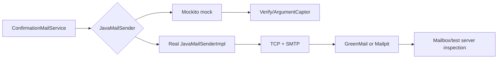
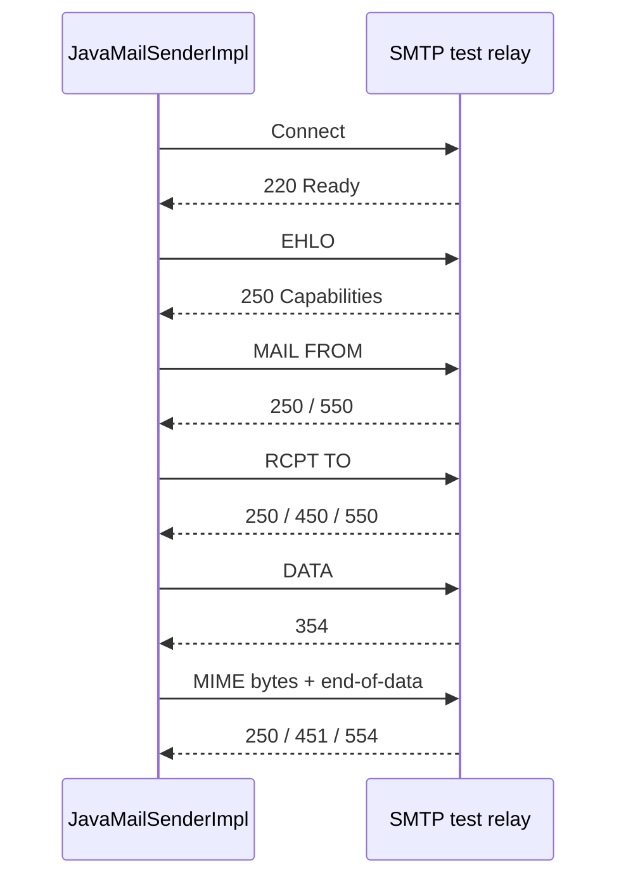
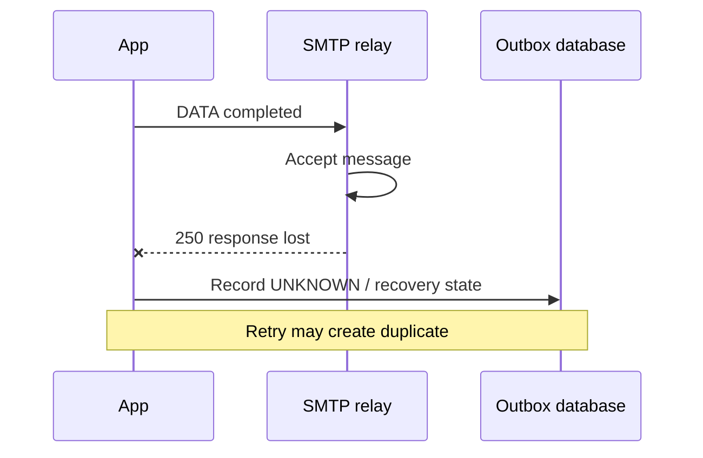

# Testing the Difference Between JavaMail Mocks and Real Servers

A Spring Framework Mail unit test can run very fast: mock `JavaMailSender` with Mockito, invoke the service, and use `verify(...)` or `ArgumentCaptor` to inspect the recipient, subject, body, and attachments. That test is useful, but it easily creates a false sense that "email sending is working". In reality, a mock typically **does not open a socket, perform an SMTP handshake, authenticate credentials, or transmit the MIME message to any relay**.

When replacing the mock with `JavaMailSenderImpl` connecting to a real SMTP test server, the system must cross additional boundaries: host/port configuration, TCP connection, banner/EHLO, STARTTLS or implicit TLS if required, AUTH, `MAIL FROM`, `RCPT TO`, `DATA`, MIME encoding, relay responses, and network error handling. A bug completely hidden in a mock test can surface immediately in an integration test.

**The goal of this lesson is to test the difference between JavaMail mocks and real servers**, and from there build a layered testing strategy: unit tests to verify message creation logic, integration tests with an SMTP server in a controlled environment to verify transport behavior, and limited smoke tests when verifying a real provider's configuration is necessary. Examples use Java 21, JUnit Jupiter, Mockito, Spring Framework 6.x / Spring Boot 3.x, Jakarta Mail, and GreenMail/Mailpit.

Key point: a "real server" in integration testing here means **an actual SMTP server running in-process or in a container that accepts commands over TCP**, not necessarily a production mail provider. A sandbox can prove that an email was accepted by a relay in a test environment, but **cannot by itself prove final inbox placement, reputation, or deliverability**.

## 1. Distinguishing Three Testing Questions

When saying "the email sending test succeeded", determine which question is actually being answered:

1. **Is the message constructed correctly?** Does the email have the accurate To, From, Subject, plain text, HTML, attachments, encoding, and business content?
2. **Does SMTP transport work?** Can the client connect to the relay, satisfy TLS/AUTH, send the envelope, transmit DATA, and receive an acceptance response?
3. **Did the message reach the right place and can the recipient see it?** Did the provider deliver it to the mailbox, did it land in Inbox/Spam, and were there any bounces or complaints?

No single test type automatically answers all three questions.

| Testing Approach | MIME Construction | TCP/SMTP | TLS/AUTH | Relay Accepted | Inbox/Deliverability |
|---|---:|---:|---:|---:|---:|
| Pure `JavaMailSender` mock | Yes, if service creates it and test stubs factory to return a real message | No | No | No | No |
| `MimeMessage` unit test with in-memory Jakarta Mail `Session` | Yes | No | No | No | No |
| `JavaMailSenderImpl` + GreenMail/Mailpit | Yes | Yes | Depends on test server configuration | Can be inspected on test server | No |
| Real staging/sandbox provider | Yes | Yes | Yes per provider | Can confirm provider accepted | Not by default |
| End-to-end with valid test mailboxes | Yes | Yes | Yes | Yes, depending on flow | Observable on sample test mailboxes, not guaranteed for all recipients |

An effective implementation uses **many cheap and precise unit tests** for templates/messages, **fewer meaningful integration tests** for transport, and **very limited smoke tests** for real providers when truly needed.

## 2. Same Service, Two Very Different Testing Styles

Suppose an application has a confirmation email sending feature:

```java
package com.example.mail;

import jakarta.mail.MessagingException;
import jakarta.mail.internet.MimeMessage;
import org.springframework.mail.javamail.JavaMailSender;
import org.springframework.mail.javamail.MimeMessageHelper;

public final class ConfirmationMailService {

    private final JavaMailSender sender;
    private final String fromAddress;

    public ConfirmationMailService(
            JavaMailSender sender, String fromAddress) {
        this.sender = sender;
        this.fromAddress = fromAddress;
    }

    public void sendConfirmation(
            String recipient, String confirmationCode)
            throws MessagingException {

        if (recipient == null || recipient.isBlank()) {
            throw new IllegalArgumentException("Recipient is required");
        }
        if (confirmationCode == null || confirmationCode.isBlank()) {
            throw new IllegalArgumentException("Code is required");
        }

        MimeMessage message = sender.createMimeMessage();
        MimeMessageHelper helper =
                new MimeMessageHelper(message, false, "UTF-8");

        helper.setFrom(fromAddress);
        helper.setTo(recipient);
        helper.setSubject("Xác nhận tài khoản");
        helper.setText(
                "Mã xác nhận: " + confirmationCode,
                "<html><body><p>Mã xác nhận: <strong>"
                + confirmationCode
                + "</strong></p></body></html>");

        sender.send(message);
    }
}
```

This service uses `MimeMessageHelper` to construct plain text and HTML content. In real production systems, a confirmation code is sensitive data: it must have a TTL, attempt limits, never be logged, and never concatenate unescaped input directly into HTML. The code snippet is simplified to illustrate testing boundaries; test examples use fake codes.

If a Mockito mock is injected, `sender.send(message)` by default **does nothing**. If a `JavaMailSenderImpl` configured with an SMTP test server is injected, that call executes real network protocol traffic.



## 3. What Does a JavaMailSender Mock Actually Do?

Mockito creates a test double with the same interface as `JavaMailSender`. When unstubbed:

- A `void` method such as `send(MimeMessage)` is usually a no-op.
- Methods returning objects such as `createMimeMessage()` return `null` by default.
- Does not check DNS, sockets, SMTP banner, AUTH, TLS, or relay policy.
- Does not automatically serialize content into SMTP DATA.
- Does not check whether recipients are accepted by the relay.

Therefore, a service using `sender.createMimeMessage()` requires stubbing the factory. We should return a **real in-memory `MimeMessage`** so we can still verify how the service builds MIME.

### 3.1. Unit Test Example with Mockito

```java
package com.example.mail;

import static org.junit.jupiter.api.Assertions.assertEquals;
import static org.mockito.Mockito.*;

import java.util.Properties;

import jakarta.mail.Message;
import jakarta.mail.Session;
import jakarta.mail.internet.InternetAddress;
import jakarta.mail.internet.MimeMessage;

import org.junit.jupiter.api.Test;
import org.mockito.ArgumentCaptor;
import org.springframework.mail.javamail.JavaMailSender;

class ConfirmationMailServiceUnitTest {

    @Test
    void buildsMessageWithExpectedRecipientAndSubject()
            throws Exception {

        JavaMailSender sender = mock(JavaMailSender.class);
        Session session = Session.getInstance(new Properties());
        when(sender.createMimeMessage())
                .thenAnswer(invocation -> new MimeMessage(session));

        ConfirmationMailService service = new ConfirmationMailService(
                sender, "no-reply@example.test");

        service.sendConfirmation(
                "student@example.test", "TEST-ONLY-123");

        ArgumentCaptor<MimeMessage> captor =
                ArgumentCaptor.forClass(MimeMessage.class);
        verify(sender).send(captor.capture());

        MimeMessage actual = captor.getValue();
        assertEquals("Xác nhận tài khoản", actual.getSubject());
        assertEquals(
                "student@example.test",
                ((InternetAddress) actual.getRecipients(
                        Message.RecipientType.TO)[0]).getAddress());
    }
}
```

This test verifies that the service calls `send(...)` with a message containing the expected data. It does **not** verify that the relay accepts the content after DATA. The code `TEST-ONLY-123` is a fake fixture; do not use real verification codes in unit tests.

### 3.2. Why Is Mockito verify Needed?

If the service constructs `MimeMessage` correctly but forgets to call `sender.send(message)`, assertions on the standalone object may still pass. `verify(sender).send(captor.capture())` proves that the service crossed the **sender invocation boundary**.

However, `verify` only proves **a Java method was called**, not that an SMTP call was executed. That distinction is the central focus of this chapter.

### 3.3. When Are Unit Tests Sufficient?

Unit tests are suitable for checking:

- Subject, From/Reply-To, To/Cc/Bcc according to policy.
- Template rendering, Unicode, and HTML escaping.
- MIME alternative/plain/html parts and attachments built by the service.
- Not calling the sender when validation/authorization fails.
- Mapping business commands into email data.
- Simulating exceptions to verify retry/error-mapping logic.

There is no need to start an SMTP server just to check whether a subject string is right. Running integration tests for those same simple assertions can make the suite slow and brittle due to infrastructure overhead.

## 4. What Bugs Can a Mock Hide?

| Failure Possibility | Detectable by Mock Unit Test? | Detectable by SMTP Integration Test? |
|---|---|---|
| Recipient name concatenated wrongly | Yes if asserting recipient | Detectable from envelope or test mailbox |
| Subject/HTML rendered wrongly | Yes | Yes, if inspecting message on server |
| Wrong `spring.mail.host` | No, mock does not use config | Yes, if test uses real sender/config |
| Port blocked by firewall | No | Yes if test environment reflects that network path |
| Misconfigured EHLO/STARTTLS | No | Yes with server supporting/rejecting appropriately |
| Wrong SMTP AUTH | No unless stubbing exception | Yes if test server requires AUTH |
| Envelope `MAIL FROM` rejected | No | Yes with server configured with matching policy |
| `RCPT TO` rejected | No | Yes with test server actively rejecting |
| MIME serialization/transfer encoding bug | No if only asserting getters | Likely detectable when server receives message |
| Timeout, connection reset | No unless stubbing exception | Yes with fault injection/network test |
| Attachment stream failure during transport serialization | Easily missed if stream is not read | Yes because transport must read source when sending |
| SMTP relay returns accepted after DATA | No | Verifiable |
| Downstream bounce, spam folder, final inbox | No | Not guaranteed by SMTP sandbox |

The "Detectable" qualification matters: a default GreenMail server readily accepts any recipient and requires neither TLS nor AUTH, so it **does not automatically test every failure mode**. Confirming negative paths requires configuring the server or building test fixtures capable of returning the right responses and simulating the right failure phases.

## 5. Testing with Real JavaMailSenderImpl Without Sending to the Internet

`JavaMailSenderImpl` is Spring's SMTP implementation. It creates `MimeMessage` via Jakarta Mail and performs transport when `send(...)` is called.

```java
JavaMailSenderImpl sender = new JavaMailSenderImpl();
sender.setHost("127.0.0.1");
sender.setPort(3025);
sender.setProtocol("smtp");
sender.setDefaultEncoding("UTF-8");

Properties props = sender.getJavaMailProperties();
props.put("mail.smtp.auth", "false");
props.put("mail.smtp.starttls.enable", "false");
props.put("mail.smtp.connectiontimeout", "3000");
props.put("mail.smtp.timeout", "5000");
props.put("mail.smtp.writetimeout", "5000");
```

This snippet only configures the client. For an integration test to succeed, **an SMTP test server must be listening** on the corresponding host/port. Never use production SMTP addresses in tests that could send real emails, and never hardcode corporate mail passwords.

One interesting detail: instantiating `JavaMailSenderImpl` does not open a connection immediately. The SMTP connection typically happens during `send(...)`, or when calling a corresponding connect/test API. Thus, a test that only instantiates the bean cannot prove transport works.

### 5.1. Separating Test and Production SMTP Configuration

An application should keep configurations separate:

```yaml
# application-test.yml -- localhost test example
spring:
  mail:
    host: 127.0.0.1
    port: 3025
    properties:
      "[mail.smtp.auth]": "false"
      "[mail.smtp.starttls.enable]": "false"
      "[mail.smtp.connectiontimeout]": "3000"
      "[mail.smtp.timeout]": "5000"
      "[mail.smtp.writetimeout]": "5000"
```

Do not put `auth=false`, `starttls=false` settings into production just to make tests pass easily. This configuration is strictly for **an unauthenticated loopback SMTP test server**. Real servers usually require TLS, AUTH, and specific policies.

## 6. Two SMTP Server Options for Integration Testing

### 6.1. GreenMail -- In-JVM SMTP Test Server

GreenMail is an SMTP/IMAP/POP3 server library for testing. With its Jakarta Mail compatible release, it can start an SMTP server in the same JVM, receive messages, and provide APIs to inspect received messages.

Strengths:

- No Docker required for simple tests.
- Can be started/stopped with the JUnit lifecycle.
- Provides APIs to fetch received emails and assert From, To, Subject, and MIME.
- Supports some AUTH/TLS or server behavior tests depending on configuration.

Note: GreenMail has separate version lines compatible with `javax.mail` and `jakarta.mail`. With Spring Framework 6 / Spring Boot 3, choose a GreenMail version supporting **Jakarta Mail**; otherwise you will hit type mismatch errors when reading `jakarta.mail.internet.MimeMessage`.

### 6.2. Mailpit -- SMTP Server and Mail Inspection UI

Mailpit can run via Docker, receive mail over SMTP, and offer a web UI/API for inspection:

```bash
docker run --rm --name mailpit ^
  -p 1025:1025 -p 8025:8025 ^
  axllent/mailpit
```

The example above uses the Windows `cmd.exe` line-continuation character `^`; when using PowerShell or Bash, write the command on a single line to avoid syntax errors:

```text
docker run --rm --name mailpit -p 1025:1025 -p 8025:8025 axllent/mailpit
```

Typically SMTP listens on `localhost:1025` and the web UI on `http://localhost:8025` according to the mapped ports. Use only in test environments and restrict port exposure; in CI, pin a verified image version/digest rather than relying on the default tag.

Mailpit lets you observe emails accepted by the test server, but does not fully simulate spam filtering, reputation, domain DNS auth, or every production provider SMTP policy. An integration test using Mailpit and HTTP API assertions should rely on the contract of the pinned version.

## 7. Complete Integration Test with GreenMail

The example below uses GreenMail running real SMTP on loopback, while `ConfirmationMailService` is the business service defined earlier. The test does not mock `JavaMailSender`; it creates a `JavaMailSenderImpl` connecting over TCP to the test server.

### 7.1. Illustrative Gradle Dependencies

```groovy
dependencies {
    implementation 'org.springframework.boot:spring-boot-starter-mail'
    testImplementation 'org.springframework.boot:spring-boot-starter-test'
    testImplementation 'com.icegreen:greenmail:YOUR_JAKARTA_COMPATIBLE_VERSION'
}
```

`YOUR_JAKARTA_COMPATIBLE_VERSION` is a placeholder to be replaced with a project-compatible version and pinned in dependency management. Do not copy the placeholder literally and run Gradle. The snippets below use familiar GreenMail APIs; if the chosen version changes APIs or namespaces, update according to the pinned library documentation.

### 7.2. Starting GreenMail and JavaMailSenderImpl

```java
package com.example.mail;

import static org.junit.jupiter.api.Assertions.*;

import java.util.Properties;

import com.icegreen.greenmail.util.GreenMail;
import com.icegreen.greenmail.util.ServerSetup;
import jakarta.mail.Message;
import jakarta.mail.internet.InternetAddress;
import jakarta.mail.internet.MimeMessage;

import org.junit.jupiter.api.AfterEach;
import org.junit.jupiter.api.BeforeEach;
import org.junit.jupiter.api.Test;
import org.springframework.mail.javamail.JavaMailSenderImpl;

class ConfirmationMailServiceSmtpIT {

    private GreenMail greenMail;
    private ConfirmationMailService service;

    @BeforeEach
    void startSmtpServer() {
        ServerSetup setup = new ServerSetup(
                0, "127.0.0.1", ServerSetup.PROTOCOL_SMTP);
        greenMail = new GreenMail(setup);
        greenMail.start();

        JavaMailSenderImpl sender = new JavaMailSenderImpl();
        sender.setHost("127.0.0.1");
        sender.setPort(greenMail.getSmtp().getPort());
        sender.setProtocol("smtp");
        sender.setDefaultEncoding("UTF-8");

        Properties props = sender.getJavaMailProperties();
        props.put("mail.smtp.auth", "false");
        props.put("mail.smtp.starttls.enable", "false");
        props.put("mail.smtp.connectiontimeout", "3000");
        props.put("mail.smtp.timeout", "5000");
        props.put("mail.smtp.writetimeout", "5000");

        service = new ConfirmationMailService(
                sender, "no-reply@example.test");
    }

    @AfterEach
    void stopSmtpServer() {
        if (greenMail != null) {
            greenMail.stop();
        }
    }

    @Test
    void smtpServerReceivesExpectedMessage() throws Exception {
        service.sendConfirmation(
                "student@example.test", "TEST-ONLY-123");

        assertTrue(greenMail.waitForIncomingEmail(5000, 1));

        MimeMessage[] received = greenMail.getReceivedMessages();
        assertEquals(1, received.length);

        MimeMessage actual = received[0];
        assertEquals("Xác nhận tài khoản", actual.getSubject());
        assertEquals(
                "no-reply@example.test",
                ((InternetAddress) actual.getFrom()[0]).getAddress());
        assertEquals(
                "student@example.test",
                ((InternetAddress) actual.getRecipients(
                        Message.RecipientType.TO)[0]).getAddress());
    }
}
```

In this example, `ServerSetup(0, ...)` requests a dynamic port and `greenMail.getSmtp().getPort()` retrieves the port used by the test server. Port allocation and helper APIs may depend on the GreenMail version; use the version chosen to match Jakarta Mail in your project.

**Difference from a mock:** the test genuinely opens TCP, executes SMTP commands, and the test server receives the message into its mailbox store. This test catches SMTP-boundary bugs that `verify(sender).send(any(...))` cannot detect.

### 7.3. Why Use Dynamic Ports?

If every test hardcodes port `3025`, two parallel CI jobs can collide trying to bind the port, causing one test to fail randomly. Dynamic ports keep test sessions isolated and reduce dependence on free ports on the host.

Ensure the sender reads the actual port after the server starts. Do not guess the port in integration tests; a misconfigured port is something tests can catch, but it should not make the suite unintentionally flaky.

## 8. Testing the MIME Content Received by the SMTP Server

A unit test captures `MimeMessage` before `sender.send(...)`, whereas an integration test reads a message stored by the server after receiving it over SMTP. Both objects may carry the same business content, but their paths differ:

```text
Unit test:
  Service -> MimeMessage in-memory -> mock.send(message)
  No serialization/protocol unless the test explicitly asks for it.

SMTP integration test:
  Service -> MimeMessage -> JavaMailSenderImpl
          -> MIME serialization -> SMTP DATA
          -> Test SMTP server -> received MimeMessage
```

Serialization can introduce details that getter-only tests miss:

- Encoded-word headers for Unicode subjects or display names.
- `Content-Type` and `charset` on each MIME part.
- `Content-Transfer-Encoding`, CRLF, and multipart boundaries.
- Attachment streams opened/read when transport writes content.
- `Date`, `Message-ID`, and other headers finalized during `saveChanges()`.
- Differences between recipients in the SMTP envelope and recipients shown in MIME headers.

However, do not assert every raw header byte-for-byte. MIME can be valid with different boundaries, encodings, and header folding.

### 8.1. Checking Plain Text and HTML on the Received Message

With `MimeMessageHelper.setText(plain, html)`, the server receives a multipart message. You can traverse `Part` nodes recursively:

```java
import java.io.IOException;
import java.util.ArrayList;
import java.util.List;

import jakarta.mail.MessagingException;
import jakarta.mail.Multipart;
import jakarta.mail.Part;

public final class MimePartTestHelper {

    private MimePartTestHelper() {}

    public static List<Part> leafParts(Part root)
            throws MessagingException, IOException {
        List<Part> result = new ArrayList<>();
        visit(root, result);
        return result;
    }

    private static void visit(Part node, List<Part> result)
            throws MessagingException, IOException {
        Object content = node.getContent();

        if (content instanceof Multipart multipart) {
            for (int i = 0; i < multipart.getCount(); i++) {
                visit(multipart.getBodyPart(i), result);
            }
        } else {
            result.add(node);
        }
    }
}
```

This is an illustrative helper for typical multipart structures. It does not recurse into a `message/rfc822` attachment containing nested messages. If a test involves complex MIME structures, extend the helper for the appropriate content types.

Usage:

```java
MimeMessage received = greenMail.getReceivedMessages()[0];
List<Part> leaves = MimePartTestHelper.leafParts(received);

Part plain = null;
Part html = null;

for (Part part : leaves) {
    if (part.isMimeType("text/plain")) {
        plain = part;
    }
    if (part.isMimeType("text/html")) {
        html = part;
    }
}

assertNotNull(plain);
assertNotNull(html);
assertTrue(((String) plain.getContent())
        .contains("Mã xác nhận: TEST-ONLY-123"));
assertTrue(((String) html.getContent())
        .contains("<strong>TEST-ONLY-123</strong>"));
```

This test checks content **after the SMTP test server receives it**, unlike inspecting `MimeMessage` only before transport. Prefer `Part.isMimeType("text/html")` over exact string comparison of `getContentType()` against `"text/html"`, because headers may include `charset=UTF-8` or other parameters.

### 8.2. Vietnamese Charset

Vietnamese subjects and bodies must display properly:

```java
assertEquals("Xác nhận tài khoản", received.getSubject());
```

The Jakarta Mail API decodes the subject for `getSubject()`. If you want to inspect raw header encoding, write a dedicated test and understand that MIME headers can be folded in multiple valid ways. Normal unit/integration tests should assert the decoded string expected by users.

Similarly, the body may carry quoted-printable or base64 transfer encoding on the wire while `part.getContent()` returns decoded content. Do not assert raw MIME bytes for a simple business requirement.

## 9. Attachments: Big Difference Between Getter Tests and Real Transport

In a unit test, a service may call `MimeMessageHelper.addAttachment(...)` with an `InputStreamSource`. The helper creates a MIME part referencing the data source; the test merely captures the message and asserts the filename. In an SMTP integration test, however, Jakarta Mail **must read the attachment source while serializing the message**.

If the source only allows a single read, or the stream is already closed or missing at send time, failure can occur during transport serialization even though mock tests pass.

### 9.1. Creating Attachments from a Re-Readable Source

```java
byte[] pdfBytes = fakePdfFixture();

MimeMessage message = sender.createMimeMessage();
MimeMessageHelper helper =
        new MimeMessageHelper(message, true, "UTF-8");

helper.setFrom("billing@example.test");
helper.setTo("student@example.test");
helper.setSubject("Receipt");
helper.setText("The receipt is attached.");
helper.addAttachment(
        "receipt.pdf",
        new ByteArrayResource(pdfBytes),
        "application/pdf");

sender.send(message);
```

`ByteArrayResource` lets you open a stream from a byte array whenever needed, fitting small fixtures. For real files, `FileSystemResource` can also supply a fresh stream as long as the file exists. For object-storage sources, design a supplier that opens a new stream on each read and guarantees the source remains available throughout attempts/retries.

### 9.2. Testing Attachments After SMTP Server Receipt

```java
MimeMessage received = greenMail.getReceivedMessages()[0];
Part attachment = null;

for (Part part : MimePartTestHelper.leafParts(received)) {
    if ("receipt.pdf".equals(part.getFileName())) {
        attachment = part;
        break;
    }
}

assertNotNull(attachment);
assertTrue(attachment.isMimeType("application/pdf"));
assertEquals(Part.ATTACHMENT, attachment.getDisposition());

byte[] actualBytes;
try (var input = attachment.getInputStream()) {
    actualBytes = input.readAllBytes();
}

assertArrayEquals(pdfBytes, actualBytes);
```

Here the test does not merely know the helper attached "some part named receipt.pdf"; it observes **the server received the bytes after SMTP DATA**. That exposes a class of bugs missed by tests that only use `ArgumentCaptor` without opening the attachment stream.

### 9.3. Testing Attachment Source Failures on Send

A negative test can use a source whose stream can only be opened within a window or throws an exception on read. The goal is to confirm the exception surfaces at the proper preparation/serialization step and is classified properly.

Do not test by keeping a pre-opened `InputStream` and assuming JavaMail will close/reopen it as desired. Clearly define ownership and repeatability of `InputStreamSource`. For large attachments, use small fixtures in unit tests; if streaming/heap usage must be measured, organize dedicated integration/performance tests.

## 10. Envelope Recipients Differ from MIME Headers

Mock tests typically inspect:

```java
message.getRecipients(Message.RecipientType.TO);
```

But SMTP transport communicates using `RCPT TO`. Recipients in the envelope can differ from headers because of Bcc, resends, API/provider policy, or how the message was prepared.

### 10.1. Bcc Is an Easy Example

An email has:

```java
helper.setTo("main@example.test");
helper.setBcc("audit@example.test");
```

A unit test can confirm Bcc was configured. Yet during SMTP sending, `audit@example.test` should appear in an envelope `RCPT TO` command while **remaining hidden from other recipients** in message headers per expected Bcc semantics.

Tests need to distinguish:

1. Was the Bcc recipient actually sent in the SMTP envelope?
2. Did Bcc leak into headers/content visible to other recipients?

An SMTP test server supporting envelope inspection or per-mailbox storage helps verify (1). For (2), inspect the delivered message in the test mailbox; do not infer blindly from a pre-transport `MimeMessage`.

### 10.2. Multiple Recipients and Partial Success

An SMTP relay can accept some `RCPT TO` addresses and reject others:

```text
C: MAIL FROM:<billing@example.test>
S: 250 Sender OK
C: RCPT TO:<a@example.test>
S: 250 Recipient accepted
C: RCPT TO:<b@example.test>
S: 550 Recipient rejected
```

With a `void`-returning Mockito mock, tests never see these responses. With a test server, you must **explicitly configure** a recipient rejection; a default sandbox accepting everything does not prove partial-success handling.

Applications should define granularity: one job per recipient generally enables cleaner retries. If one MIME message carries multiple recipients, understand Jakarta Mail SMTP provider behavior, such as handling valid/invalid recipients and `mail.smtp.sendpartial` configuration if used. Never assume all recipients failed or all succeeded based solely on a single message-level exception.

## 11. AUTH: Mocks Do Not Verify Credentials

Suppose the configuration is:

```yaml
spring:
  mail:
    host: smtp.provider.example
    port: 587
    username: ${SMTP_USERNAME}
    password: ${SMTP_PASSWORD}
    properties:
      "[mail.smtp.auth]": "true"
      "[mail.smtp.starttls.enable]": "true"
```

A `JavaMailSender` mock does not use host, username, or password unless manually stubbed. Tests continue passing even when:

- Password is not configured in the environment.
- Username is wrong.
- The provider requires a different authentication mechanism.
- The SMTP account is locked or not permitted to send from that From domain.
- STARTTLS has not occurred yet though the server requires it before AUTH.

### 11.1. Testing When AUTH Is Required

With a test server supporting AUTH, configure it to require login, then test two cases:

- Valid test credentials: server accepts and the message is stored.
- Invalid credentials: client receives the corresponding exception, and no message is recorded as sent.

Test server libraries differ on whether AUTH is enforced per user or per protocol mode. **Merely calling an API to create a mailbox user does not guarantee every SMTP session must authenticate**; enable the test server's AUTH enforcement policy per your version's docs.

Never use production secrets in tests. If testing a real provider, use a dedicated test account with quota limits and never log AUTH payloads.

### 11.2. What to Assert

Negative tests can verify:

- The exception maps to the appropriate application error (e.g., a `MailAuthenticationException` branch if `JavaMailSenderImpl` wraps it that way).
- Outbox is not transitioned to SENT.
- No infinite retries occur on invalid credentials.
- Logs contain only the error category, never passwords.

Do not assert the entire provider exception message as a fixed string. Messages can change across server/test library versions while the error type and business decision remain stable.

## 12. TLS: A Local Non-TLS Server Is Not Enough to Verify Production

Plaintext SMTP configured on loopback with GreenMail/Mailpit is very useful for logic integration tests, but it **does not verify**:

- Whether the certificate chain is valid against the production truststore.
- Whether the hostname matches the certificate.
- Whether STARTTLS is required or merely opportunistic.
- Whether the client supports the TLS versions/ciphers used by the provider.
- Whether the submission port expects implicit TLS or STARTTLS.

Several scenarios:

| Configuration | Expected Behavior |
|---|---|
| Client requires STARTTLS; server does not support STARTTLS | Error, never silently send plaintext if `required=true` |
| Client enables STARTTLS with `required=false`; server lacks support | May send plaintext if policy allows; avoid in sensitive production |
| Client uses implicit TLS against a plaintext port | Handshake/protocol mismatch |
| Untrusted certificate | TLS handshake failure |
| Hostname differs from certificate | Validation failure when server identity verification is properly configured |

### 12.1. Timeout and STARTTLS Configuration

```java
Properties properties = sender.getJavaMailProperties();
properties.put("mail.smtp.auth", "true");
properties.put("mail.smtp.starttls.enable", "true");
properties.put("mail.smtp.starttls.required", "true");
properties.put("mail.smtp.connectiontimeout", "3000");
properties.put("mail.smtp.timeout", "5000");
properties.put("mail.smtp.writetimeout", "5000");
```

Only use this property set when the SMTP test server is **configured to match** and valid test credentials exist. For implicit TLS, providers may use `mail.smtp.ssl.enable` and a different port; do not treat the two modes as equivalent.

Do not "fix" TLS test failures by disabling certificate checks in production. Use appropriate test certificates/truststores, or layer tests: plaintext SMTP unit/integration tests for logic, plus a separate TLS test group to verify transport security.

### 12.2. Why Test the TLS Path Separately?

If an app relies on mocks and a single plaintext GreenMail test, both can pass while production hits `SSLHandshakeException`. A meaningful suite explicitly documents which tests cover TLS and which cover only message construction/SMTP commands.

TLS tests using self-signed certificates should construct a controlled test truststore/hostname. Never configure "trust all" and claim certificate validation was tested.

## 13. SMTP Response Codes and Errors Invisible to Mocks

An SMTP session has phases:



These are examples of codes that may be returned at various phases, not a fixed transcript. Some servers reject early, some require AUTH/TLS, and some reject after inspecting the entire content.

Key differences:

| Phase | Simulated Error | Meaning for Application |
|---|---|---|
| Connect | Connection refused/timeout | No usable SMTP session to accept mail |
| EHLO | Server closes connection or capability error | Misconfigured or incompatible SMTP capabilities |
| STARTTLS | 454/handshake failure | Transport security could not be established |
| AUTH | 535 | Authentication rejected; usually requires configuration fix |
| MAIL FROM | 550 5.7.1 | Sender not permitted |
| RCPT TO | 550 5.1.1 | Invalid/non-existent recipient per reply |
| RCPT TO | 451 4.x.x | Temporary failure, eligible for policy-based retry |
| DATA | 552/554 after body | Possibly size/content/policy violation |
| After DATA | Lost response | Outcome may be indeterminate |

Unit tests can use `doThrow(...)` to exercise an error branch, but cannot prove the error actually occurs at the exact SMTP phase assumed by the code. When real client/server interaction must be verified, use a test relay with controllable responses.

### 13.1. Not All SMTP Errors Are Identical MailSendExceptions

Spring Mail defines exceptions such as:

- `MailAuthenticationException` on authentication failure.
- `MailSendException` when sending one or more messages fails.
- `MailParseException` for certain address/message parsing errors.
- `MailPreparationException` when message preparation fails.

Jakarta Mail providers may attach `MessagingException`, `SendFailedException`, or specific subclasses inside the cause/next-exception chain. Exact results vary by call path, provider, and version. Integration tests should assert error types/actions on the **application contract**, not couple rigidly to full stack traces.

### 13.2. Do Not Treat Temporary Errors as Permanent Send Failures

When a relay clearly returns 4xx, the service may need retry/backoff. With 5xx, retrying the exact same message indefinitely is futile or abusive. If a system-wide AUTH/TLS failure occurs, handle it as an infrastructure/configuration incident rather than repeatedly retrying per recipient.

## 14. Timeouts and the "Uncertain Delivery" State

This is a limitation that cannot be accurately simulated with a generic error-returning mock without designing a dedicated scenario.

Suppose:

1. The client finishes sending the full MIME DATA.
2. The SMTP relay receives and accepts the message.
3. The client loses the connection before receiving the final `250` or before updating the outbox to SENT.
4. The application cannot know for sure whether the message was accepted.
5. Retrying may cause the recipient to receive two emails.



A mock `doThrow(new MailSendException("timeout"))` exercises the exception-handling branch, but does not prove the **exact failure window** where the server already accepted while the client lost the reply. Only fault injection or a scripted server reproduces that phase deterministically.

### 14.1. Do Not Force Tests to Answer the Unknowable

If the client loses the final response after DATA, the accurate state may be `UNKNOWN`, not definitely `NOT_SENT`. Integration tests for this scenario should verify policy:

- Record the last phase with evidence.
- Preserve notification/attempt IDs.
- Never claim exactly-once delivery.
- Decide retries with duplicate warnings or reconciliation if supported by the provider.

Do not force an assertion that "the server must or must not have the message" as a universal rule across all timeouts. The server may have accepted it while the application has no proof.

## 15. Why Mocks Often Hide Pre- or Post-Transaction Bugs

A service might do:

```java
@Transactional
public void completeOrder(Long id) {
    Order order = orders.findById(id).orElseThrow();
    order.complete();
    sender.send(buildOrderEmail(order));
}
```

A mock sender returns immediately; the unit test passes easily. In production, SMTP can be slow, holding the database transaction open; the email might be accepted by the relay and then the database commit fails. Because SMTP does not participate in DB transactions, rollback **does not recall the email**.

SMTP integration tests reveal network latency and transport errors, but testing commit boundaries requires a separate **database transaction + mail event/outbox** integration test:

1. When the business transaction rolls back, no send intent is committed.
2. When committed, the outbox row persists durably.
3. The worker claims the job, sends over SMTP outside the claim transaction, and records the outcome in a separate transaction.
4. When SMTP accepted succeeds but DB ack fails, the processing state reflects duplicate risk.

Merely adding `@Async` solves neither atomicity nor durability. An SMTP sandbox proves transport invocation, not that events won't be lost on process crash after commit.

## 16. Integrating an SMTP Test Server into Spring Boot

A Spring Boot integration test should test the **real autoconfigured beans and configuration**, rather than replacing them with mocks when the objective is validating transport.

With a unit test:

```java
JavaMailSender sender = mock(JavaMailSender.class);
ConfirmationMailService service =
        new ConfirmationMailService(sender, "no-reply@example.test");
```

With an integration test:

```text
Spring Boot ApplicationContext
  -> @ConfigurationProperties / spring.mail
  -> JavaMailSenderImpl
  -> Real running SMTP test server
  -> Message received by test server
```

Some bugs only surface when building a real context:

- Misspelled property names in `application-test.yml`.
- Custom `JavaMailSender` bean failing to pick up expected settings.
- Service injecting the wrong sender when multiple beans/providers exist.
- Credentials/host supplied from another active profile.
- Feature flags routing the service to a different sending path.
- Timeout/TLS/AUTH properties failing to apply.

If a `@SpringBootTest` uses `@MockBean` or `@MockitoBean` to replace `JavaMailSender`, that test **no longer validates SMTP transport** even though the ApplicationContext started. It can still serve as an orchestration test, provided naming and expectations reflect that.

### 16.1. DynamicPropertySource for Dynamic SMTP Ports

When an SMTP server runs in a container with dynamically mapped ports, Spring Boot config must receive the host/port after the container is ready. `@DynamicPropertySource` is the standard approach:

```java
@DynamicPropertySource
static void registerSmtpProperties(DynamicPropertyRegistry registry) {
    registry.add("spring.mail.host", smtp::getHost);
    registry.add("spring.mail.port",
            () -> smtp.getMappedPort(1025));
    registry.add("spring.mail.properties.mail.smtp.auth",
            () -> "false");
    registry.add("spring.mail.properties.mail.smtp.starttls.enable",
            () -> "false");
}
```

Here `smtp` is a container declared in the test. Registering properties via suppliers lets Spring read the true mapped port instead of falling back to defaults in CI.

### 16.2. @SpringBootTest with Mailpit + Testcontainers

A structured integration test example:

```java
import static org.junit.jupiter.api.Assertions.assertTrue;
import static org.awaitility.Awaitility.await;

import java.net.URI;
import java.net.http.HttpClient;
import java.net.http.HttpRequest;
import java.net.http.HttpResponse;
import java.time.Duration;

import org.junit.jupiter.api.Test;
import org.springframework.beans.factory.annotation.Autowired;
import org.springframework.boot.test.context.SpringBootTest;
import org.springframework.boot.test.context.TestConfiguration;
import org.springframework.context.annotation.Bean;
import org.springframework.context.annotation.Import;
import org.springframework.mail.javamail.JavaMailSender;
import org.springframework.test.context.DynamicPropertyRegistry;
import org.springframework.test.context.DynamicPropertySource;

import org.testcontainers.containers.GenericContainer;
import org.testcontainers.junit.jupiter.Container;
import org.testcontainers.junit.jupiter.Testcontainers;
import org.testcontainers.utility.DockerImageName;

@Testcontainers
@SpringBootTest
@Import(MailpitSmtpIT.TestMailConfiguration.class)
class MailpitSmtpIT {

    @Container
    static final GenericContainer<?> smtp = new GenericContainer<>(
            DockerImageName.parse("axllent/mailpit:latest"))
            .withExposedPorts(1025, 8025);

    @DynamicPropertySource
    static void configureMail(DynamicPropertyRegistry registry) {
        registry.add("spring.mail.host", smtp::getHost);
        registry.add("spring.mail.port",
                () -> smtp.getMappedPort(1025));
        registry.add("spring.mail.properties.mail.smtp.auth",
                () -> "false");
        registry.add("spring.mail.properties.mail.smtp.starttls.enable",
                () -> "false");
    }

    @TestConfiguration(proxyBeanMethods = false)
    static class TestMailConfiguration {

        @Bean
        ConfirmationMailService confirmationMailService(
                JavaMailSender sender) {
            return new ConfirmationMailService(
                    sender, "no-reply@example.test");
        }
    }

    @Autowired
    ConfirmationMailService service;

    @Test
    void mailpitReceivesConfirmation() throws Exception {
        service.sendConfirmation(
                "student@example.test", "TEST-ONLY-123");

        await().atMost(Duration.ofSeconds(10)).untilAsserted(() ->
                assertTrue(
                        mailpitMessages().contains("student@example.test")));
    }

    private static String mailpitMessages() throws Exception {
        String url = "http://" + smtp.getHost() + ":"
                + smtp.getMappedPort(8025) + "/api/v1/messages";

        HttpRequest request = HttpRequest.newBuilder(
                URI.create(url)).GET().build();
        return HttpClient.newHttpClient().send(
                request, HttpResponse.BodyHandlers.ofString()).body();
    }
}
```

The snippet uses the Mailpit API `GET /api/v1/messages` to inspect the sandbox inbox; schema/endpoints should be verified against the **pinned Mailpit version**. `axllent/mailpit:latest` is written for readability in the example, but **do not use the latest tag in long-lived CI**: pin a verified image tag/digest with a periodic update workflow. When using a real application class, `@SpringBootTest` must locate the project's Spring Boot configuration; `@Import` adds the service fixture if it is not already an application bean.

Required test dependencies include Spring Boot starter test, Testcontainers JUnit Jupiter, Testcontainers core, and Awaitility (if not already pulled by the BOM/starter test). Add via dependency management:

```groovy
dependencies {
    testImplementation 'org.springframework.boot:spring-boot-starter-test'
    testImplementation 'org.testcontainers:junit-jupiter'
    testImplementation 'org.awaitility:awaitility'
}
```

This test only confirms the test recipient appears in Mailpit's API; it does not prove MIME body correctness unless the raw message is also read -- when needed, query the message ID and inspect raw MIME per the pinned version's API. Execution requires a Docker/container runtime, compatible network policy, and image pull access.

### 16.3. Docker Alone Does Not Make a Test Provider End-to-End

A Mailpit container accepts real SMTP, yet only simulates a minimal relay. It does not check:

- Real domain DNS SPF/DKIM/DMARC.
- IP/domain reputation.
- Filtering by Gmail/Outlook or corporate mailboxes.
- Provider-specific quotas and rate limits.
- Downstream relay bounces.

Seeing the message in Mailpit proves the **app -> SMTP sandbox** path works, not the **app -> production provider -> receiving mailbox** path.

## 17. When to Use GreenMail, Mailpit, or a Scriptable Fake SMTP?

| Criterion | GreenMail in-process | Mailpit container | Scriptable SMTP test server |
|---|---|---|---|
| Local setup | Test dependency | Requires Docker/external process | Depends on library |
| Assert received messages | GreenMail API | UI/HTTP API | Depends on implementation |
| Test Spring configuration | Yes if using real sender | Yes | Yes |
| Test normal SMTP acceptance | Yes | Yes | Yes |
| Simulate AUTH/TLS | Depends on GreenMail features/config | Depends on version config | Scriptable as needed |
| Deliberately return 451/550 per command | Check if server supports it | Not guaranteed by default | Well suited if scriptable |
| Drop connection after DATA | Needs separate fault injection | Not guaranteed by default | Well suited |
| Real Inbox/Spam check | No | No | No |

Choose the tool according to the **failure mode you need to prove**. An SMTP test server does not have to support every feature. For normal SMTP DATA acceptance, GreenMail/Mailpit is quite effective; for anomalous protocol interactions and specific reply codes, a scriptable server makes tests more deterministic.

## 18. Testing Connection Errors at the Real Layer

A minimal example:

```java
JavaMailSenderImpl sender = new JavaMailSenderImpl();
sender.setHost("127.0.0.1");
sender.setPort(portThatIsNotListening);
sender.getJavaMailProperties().put(
        "mail.smtp.connectiontimeout", "1000");

ConfirmationMailService service =
        new ConfirmationMailService(
                sender, "no-reply@example.test");

assertThrows(
        MailException.class,
        () -> service.sendConfirmation(
                "student@example.test", "TEST-ONLY-123"));
```

`portThatIsNotListening` is a fixture-controlled test port confirmed to have no listener; never pick a random port assuming it is "guaranteed free", as parallel runs make that flaky.

The snippet above requires importing `org.springframework.mail.MailException` and static JUnit assertions. With a real sender, `createMimeMessage()` still builds the object; failure only occurs during connection when calling `send(...)`. With a mock, an equivalent test could pass even with an invalid port because mocks use no sockets.

### 18.1. Never Test Timeouts with Unbounded Sleeps

Network integration tests need clear deadlines for:

- Client connection/read/write timeouts.
- Wait duration for the test server to store the email.
- Overall test case execution timeout.
- Container readiness/startup timeout if using Docker.

Without timeouts, a hung test network/relay can stall an entire CI pipeline for a long time. Conversely, timeouts too short for CI machine capacity create false failures. Balance based on the test environment.

### 18.2. Distinguishing Connection Refused from Authentication Failure

A connect error may wrap `ConnectException` or a socket timeout in the cause chain. AUTH failure can produce `MailAuthenticationException` and nested Jakarta Mail exceptions. Do not write a unit test using `doThrow(new MailSendException(...))` and claim it verified real connect or AUTH paths.

## 19. Testing Rejected SMTP Replies

A test server can be scripted to reject commands:

```text
CLIENT: EHLO app.example.test
SERVER: 250 Capabilities
CLIENT: MAIL FROM:<no-reply@example.test>
SERVER: 250 Sender OK
CLIENT: RCPT TO:<student@example.test>
SERVER: 550 5.1.1 User unknown
```

In an integration test, verify:

1. The sender does not report the result as a successfully sent message.
2. The application receives and classifies the appropriate error category.
3. Outbox is not marked `SENT` when the recipient was definitely rejected.
4. No infinite retries occur merely by re-sending to the same recipient.
5. Logs/state do not expose addresses or sensitive content outside policy.

Another example:

```text
CLIENT: RCPT TO:<student@example.test>
SERVER: 451 4.3.0 Temporary failure
```

In this case, the application can schedule retry/backoff if policy permits. Test business outcomes rather than asserting exact exception strings that depend on the SMTP provider implementation.

### 19.1. Rejected After DATA

```text
CLIENT: DATA
SERVER: 354 End data
CLIENT: [MIME bytes + terminator]
SERVER: 554 5.7.1 Message rejected by policy
```

This differs from `RCPT TO` rejection. The relay read the content before deciding to reject. Tests must record the failure at the proper step and never treat 354 as acceptance.

### 19.2. Can a Server Accept Every Recipient?

Yes. Many SMTP sandboxes accept any address and store messages regardless of whether the mailbox truly exists. Hence, GreenMail/Mailpit accepting `student@example.test` does **not** prove the production provider will accept that recipient. When testing provider-specific validation, use scripted active rejections or a provider sandbox enforcing matching rules.

## 20. Multi-Layer Test Suite in a Spring Mail Project

A strategy can be organized as:

```text
src/test/java/
  .../mail/
    ConfirmationMailServiceUnitTest.java
    MimeComposerUnitTest.java
    MailFailurePolicyUnitTest.java
    ConfirmationMailServiceSmtpIT.java
    MailpitSmtpIT.java
    MailOutboxIntegrationTest.java
    MailProviderSmokeTest.java      (run separately, opt-in)
```

### 20.1. Unit Tests -- Run Frequently

Test focused logic with no network needed:

- Validation and authorization.
- Template inputs/outputs and escaping.
- Subject, recipient, From, Reply-To.
- MIME multipart/attachments with test sources.
- Mapping simulated exceptions to outcomes.
- Retry decisions, idempotency keys.

### 20.2. SMTP Integration Tests -- Isolated Environment

Start an SMTP test server on loopback/container:

- Real sender connects to the right host/port.
- MIME is serialized and received by the server.
- Plain/HTML/attachment bytes remain accurate.
- Unicode headers/bodies decode properly.
- Sender uses auth/TLS/timeout settings when the test provides an appropriate server.
- When the server rejects at a specific phase, the app records the appropriate outcome.
- Never accidentally sends to the Internet.

### 20.3. Database/Outbox Integration Tests

Run against a real test database or equivalent:

- Business row and outbox row commit/rollback atomically.
- Worker claims a job once even under multiple workers.
- Attempt count increments and lease tokens are verified.
- SMTP accepted updates SENT.
- SMTP failure schedules retry/dead-letter per policy.
- Crash/timeout produces UNKNOWN state and appropriate replay policy.

### 20.4. Provider Smoke Tests -- Intentional Execution

If the project needs to verify a real provider after config changes:

- Run only on authorized accounts and domains.
- Send to controlled test mailboxes, never customer lists.
- Limit message count, rate, and duration.
- Never log credentials/tokens.
- Verify SPF/DKIM/DMARC, accepted status, and provider events if available.
- Do not rely on one seed mailbox to guarantee Inbox placement for all recipients.

Smoke tests against real providers incur cost, rate limits, network dependencies, and policy drift; do not run them by default on every developer unit test pass.

## 21. False Positives: Tests Pass While Real Behavior Fails

### 21.1. Mocking the Sender Hides Misconfiguration

```java
JavaMailSender sender = mock(JavaMailSender.class);
service.sendConfirmation(...);
verify(sender).send(any(MimeMessage.class));
```

The call is always recorded by the mock even if production's `spring.mail.host` does not exist. That is not a Mockito bug, but a **designed boundary** of unit testing.

### 21.2. Mocking createMimeMessage to Return a Shared Object

If a test writes:

```java
when(sender.createMimeMessage()).thenReturn(sharedMessage);
```

and the service builds multiple emails, they may mutate the **same object**. That can mask bugs or create spurious failures. Use `thenAnswer(inv -> new MimeMessage(session))` so each call produces a new instance.

### 21.3. Inspecting Messages Only Before Serialization

An attachment resource may have a valid filename/content type yet throw inside `getInputStream()` when transport reads it. A test asserting only the filename can pass. SMTP integration tests that read bytes on the server catch this.

### 21.4. Sandboxes Permitting Everything

GreenMail/Mailpit without policy configuration may accept every sender, recipient, and message. Passing does not prove real provider AUTH/TLS/domain policies are satisfied.

### 21.5. Tests Injecting Mocks Instead of Real Senders

`@SpringBootTest` does not mean SMTP integration if `JavaMailSender` is replaced by a mock. Verify dependency injection and test bean configuration for the intended purpose.

### 21.6. Asserting "send() Did Not Throw" Without Reading the Server

A fake server or transport wrapper might swallow exceptions or fail to send. Verify **the message was received by the SMTP test server**, not just that the call returned normally.

### 21.7. Confusing SMTP Accepted with Inbox Delivered

When an SMTP sandbox receives an email, the test only proves up to the test relay. It does not check spam filtering or downstream deliverability. Never name a test `deliversToCustomerInbox()` when all it asserts is that GreenMail holds one message.

## 22. False Negatives and Flaky Tests: Tests Fail While Production Code Is Fine

Common causes:

- Static port already occupied by another test or process.
- SMTP test server not yet ready when the sender connects.
- CI lacks Docker or restricts image pulls.
- Mailbox from a previous test was not cleaned up.
- Test expects exactly one message while another job sends to the same server.
- Asserting unstable raw MIME boundaries or Message-ID headers.
- Using `Thread.sleep(...)` with fixed durations on slow CI runners.
- TLS test using expired certificates or mismatched hostnames.
- Production-provider tests hitting uncontrollable rate limits.
- Clock/timezone differences causing Date/TTL assertions to fail.

### 22.1. Isolation Between Test Cases

Each test should have independent mailbox/test storage or reset properly before running. With GreenMail, per-test start/stop or state resets are supported. With a shared Mailpit container, use unique recipients/notification IDs and controlled cleanup APIs.

Do not wipe the entire mailbox of an SMTP sandbox shared with another test suite unless ownership is guaranteed. Parallel tests need separate servers/namespaces or clear isolation mechanisms.

### 22.2. Bounded Waits Instead of Fixed Sleeps

Integration tests involve processing latency. Use bounded wait helpers such as `greenMail.waitForIncomingEmail(5000, 1)`, or timeout-bounded polling for Mailpit's API. Avoid `Thread.sleep(200)` followed by reading the mailbox: slow CI can make the test flaky even when the app is correct.

### 22.3. Dynamic Ports and Readiness

When using Testcontainers, wait for container readiness before invoking SMTP; Testcontainers provides suitable wait strategies. With in-process servers, complete startup before querying the port. Never fall back to port 25 or a production SMTP host just because tests fail on localhost.

### 22.4. Resource Cleanup

Shut down/stop test servers after each test or suite. Manage attachment fixture files and streams with try-with-resources. If using Testcontainers, let the JUnit/Testcontainers lifecycle manage containers or configure reuse intentionally; do not leave zombie processes after tests finish.

## 23. SimpleMailMessage: Unit Tests vs MIME Conversion in Transport

`MailSender.send(SimpleMailMessage)` is an API for sending plain-text mail. Unit tests easily capture `SimpleMailMessage`:

```java
MailSender sender = mock(MailSender.class);

SimpleMailMessage message = new SimpleMailMessage();
message.setFrom("system@example.test");
message.setTo("student@example.test");
message.setSubject("Class reminder");
message.setText("Class starts at 09:00.");

sender.send(message);

ArgumentCaptor<SimpleMailMessage> captor =
        ArgumentCaptor.forClass(SimpleMailMessage.class);
verify(sender).send(captor.capture());
assertEquals("Class reminder",
        captor.getValue().getSubject());
```

Yet `JavaMailSenderImpl` can accept `SimpleMailMessage` via the inherited API and construct the MIME message needed for transport. An integration test using a real sender can inspect the text email after the server receives it:

```java
JavaMailSenderImpl sender = configuredSenderForGreenMail();

SimpleMailMessage simple = new SimpleMailMessage();
simple.setFrom("system@example.test");
simple.setTo("student@example.test");
simple.setSubject("Class reminder");
simple.setText("Class starts at 09:00.");

sender.send(simple);

assertTrue(greenMail.waitForIncomingEmail(5000, 1));
MimeMessage received = greenMail.getReceivedMessages()[0];
assertEquals("Class reminder", received.getSubject());
assertEquals(
        "Class starts at 09:00.",
        received.getContent());
```

`configuredSenderForGreenMail()` is a test-defined fixture like the GreenMail setup shown earlier. This shows **using `SimpleMailMessage` in the API does not mean the protocol sends raw non-MIME strings**. The real sender converts it into an appropriate SMTP representation; check charset/encoding if Unicode content matters.

Keep test goals clear: confirm the test relay received the message with valid subject/body without asserting every auto-generated header.

## 24. MimeMessagePreparator: An Even Larger Gap with Mocks

Spring supports:

```java
sender.send(mime -> {
    MimeMessageHelper helper =
            new MimeMessageHelper(mime, "UTF-8");
    helper.setFrom("no-reply@example.test");
    helper.setTo("student@example.test");
    helper.setSubject("Activate account");
    helper.setText("Your account is ready.");
});
```

Here the argument to `send(...)` is **`MimeMessagePreparator`**, a callback that populates the content. With a real sender, `JavaMailSenderImpl` executes the callback against a `MimeMessage` and sends it. With an unstubbed Mockito mock of `JavaMailSender`, `send(preparator)` is a no-op by default: **the callback may never run at all**.

This is a serious false positive:

```java
JavaMailSender sender = mock(JavaMailSender.class);

service.sendPreparedConfirmation("student@example.test");

verify(sender).send(any(MimeMessagePreparator.class));
```

The test passes even if the callback produces wrong recipients or throws an exception when executed. Therefore, unit tests using preparators must **capture the callback and invoke it on an in-memory message**, or configure the mock with `doAnswer` to simulate the preparation step.

### 24.1. Capturing the Preparator to Test Content

```java
ArgumentCaptor<MimeMessagePreparator> captor =
        ArgumentCaptor.forClass(MimeMessagePreparator.class);

verify(sender).send(captor.capture());

MimeMessage message = new MimeMessage(
        Session.getInstance(new Properties()));

captor.getValue().prepare(message);

assertEquals("Activate account",
        message.getSubject());
```

In an SMTP integration test using real `JavaMailSenderImpl`, the callback is executed by the sender and the server receives the message. That is why you should have at least one transport test for the preparator flow if the app relies on this style.

### 24.2. Do Not Mix Up Overload Signatures

`JavaMailSender` has overloads for `SimpleMailMessage`, `MimeMessage`, and `MimeMessagePreparator`, including varargs forms. An invocation `send(new MimeMessage[]{a, b})` is one call to the array overload, not two calls to `send(a)` and `send(b)`. When unit testing with Mockito, capture the exact type and understand invocation counts; integration tests check how many emails the server actually received.

## 25. Keeping Job State and SMTP Outcomes Separate in Tests

When an application uses a queue/outbox, there are at least two outcome classes:

- **Notification processing outcome:** QUEUED, SENDING, SENT, FAILED, DEAD_LETTER...
- **Single SMTP attempt outcome:** not started, connection failed, rejected, accepted, or outcome unknown.

A mock test can stub `send(...)` to return success and assert SENT status in a fake database. Without a test server, however, it does not prove the protocol ran. Conversely, an SMTP test proves server acceptance, not that the database committed SENT if the status update fails.

### 25.1. Case: Accepted Followed by Status Update Failure

```text
Worker claim outbox row -> SENDING
JavaMailSenderImpl -> SMTP server receives DATA
SMTP responds 250 Accepted
Worker -> database UPDATE status=SENT
Database update fails
```

A test with database fault injection verifies the application **does not immediately re-invoke SMTP just because the DB ack failed**. The relay may have already accepted it, and retrying before/after lease expiry creates duplicates.

This tests **coordination between transactions and side effects**, beyond the unit scope of a mail composer. Yet it is critical when systems require reliable delivery.

### 25.2. At-Least-Once and the Limits of Exactly-Once

Transactional outbox records **send intent** inside the business transaction, enabling crash recovery. It does not make SMTP a rollbackable resource, nor does it eliminate the window where the relay accepted before the DB wrote SENT.

Therefore:

- Mocks help assert deliberate idempotency/retry logic.
- SMTP test servers verify real transport.
- Database integration tests verify claims, leases, and transitions.
- No test guarantees exactly-once email delivery across the Internet.

## 26. Confirming the "Real Server" Under Test Is Not a Production Provider

Before running integration tests with real transport, establish safety guardrails:

1. **Host is a controlled loopback or test container host**, never production SMTP.
2. **Port is a dynamic or explicitly mapped test port**, never the company's provider port in normal tests.
3. **Recipients are fake addresses/test accounts**, never real users.
4. **Credentials are test-only**, if the test server requires AUTH.
5. **Do not enable raw SMTP protocol debug logs containing AUTH/data** except in dedicated investigation procedures.
6. **Network policy prevents tests from leaking onto the Internet** when possible, especially if test config is missing.
7. **Fixtures use fake data**, including attachments/OTPs/invoices.

### 26.1. Preventing Fallback to Real SMTP

One risk is a test loading the wrong profile and picking up:

```yaml
spring:
  mail:
    host: smtp.production.example
```

If a real sender is injected and the test calls `send(...)`, that could become a real email. To prevent this:

- Use isolated test profiles.
- Require host/port to be injected from the SMTP test container/server.
- Fail fast if the host is not on a test allowlist.
- Provide dedicated test SMTP credentials or withhold production secrets from CI.
- Avoid generic fallback hosts/ports in integration environments.

### 26.2. Managing Data and Logs

Tests capturing email bodies, subjects, attachments, and SMTP transcripts can expose that data in CI artifacts. Use fixtures without real PII/tokens; do not print raw MIME on assertion failures. When debugging, log minimal metadata such as phase, reply code, notification ID, and message count.

## 27. Recommended Risk-Based Testing Matrix

| Scenario | Mock Unit | SMTP Test Server | DB/Outbox Integration | Provider Test |
|---|---:|---:|---:|---:|
| Correct From/To/subject | Yes | Verifiable post-transfer | Not needed | Not needed |
| Text/HTML escaping | Yes | Inspectable MIME post-transfer | Not needed | Not needed |
| Attachment stream readable on send | Can actively read | **Very useful** | Not needed | Infrequent |
| Vietnamese MIME encoding | Yes | **Very useful** | Not needed | Occasional |
| Real host/port | No | **Yes** | Not needed | When config changes |
| SMTP AUTH | Stub branch | Test server with AUTH enabled | Not needed | Needed if provider-specific |
| TLS certificate/hostname | No | TLS test with proper cert | Not needed | Environment-dependent |
| RCPT rejected/temporary failure | Stub error | Scripted server | Check retry outcome | As needed |
| Partial recipient success | Mock per policy | Scripted server | State per recipient | As needed |
| Timeout after DATA / UNKNOWN outcome | Stub policy | Fault injection | **Yes** | Avoid forcing errors on real provider |
| Enqueue within business transaction | No | No | **Yes** | No |
| Worker lease/idempotency/retry | Policy unit test | Fake SMTP helpful | **Yes** | No |
| Provider rate limit/accepted response | No | Insufficient if simple sandbox | Can simulate | Limited testing, only as needed |
| Downstream bounce | Stub event | Not guaranteed by sandbox | Event processing | Provider webhook sandbox |
| Inbox placement and reputation | No | No | No | Observe valid test mailboxes, limited |

There is no need to build a test for every cell in the table. Pick the **right test layer for the specific risk** and avoid duplicating identical assertions across every tier, which makes suites hard to maintain.

## 28. Step-by-Step Practical Exercises

### Part A -- Build Unit Tests with Mockito

Write `ConfirmationMailService` using `JavaMailSender`. Stub `createMimeMessage()` with an in-memory `MimeMessage` and capture the `send(...)` argument. Assert From, To, Unicode subject, and plain/HTML bodies. Note what the test cannot observe.

### Part B -- Run an SMTP Test Server

Start GreenMail in-process or Mailpit in a container. Configure `JavaMailSenderImpl` with the test server's host/port. Send the same notification; verify the server receives exactly one message with the expected subject/recipient.

### Part C -- Compare Messages Before and After Transport

In unit tests, capture the message before sending; in integration tests, read the message received by the server. Verify decoded subject/body match while raw MIME may differ in boundaries, line wrapping, and transfer encoding.

### Part D -- Unicode

Send a Vietnamese subject, Unicode display name, and accented body. Assert `getSubject()`/`getContent()` from the server. Do not assert raw encoded-word headers unless specifically required.

### Part E -- Attachment Repeatability

Send an attachment from `ByteArrayResource` and verify the bytes received by the server. Next, supply a stream source unreadable at serialization time; observe which mock tests still pass and which integration test catches the failure.

### Part F -- AUTH Test

Configure the SMTP test server to require AUTH (if the implementation supports it). Send with valid credentials and then invalid credentials. Test the exception and ensure passwords are not logged. Never use real accounts.

### Part G -- STARTTLS

Set up a test server that does not advertise STARTTLS. Set `mail.smtp.starttls.required=true` and observe the failure on send. To test successful TLS, use a test certificate and proper truststore; never bypass hostname validation.

### Part H -- RCPT Rejection

With a scriptable SMTP server, return `550 5.1.1` for a recipient. Verify the application classifies it as a permanent failure and does not mark SENT. Try `451` to test retry/backoff.

### Part I -- Timeout After DATA

Simulate a relay accepting content and then closing the connection or dropping the final response. Verify the application marks the outcome UNKNOWN and does not claim "definitely not sent". Discuss duplicate risks on retry.

### Part J -- Batch and Partial Success

Send one message to two recipients, configuring the test server to accept one address and reject the other. Observe Jakarta Mail transport behavior and reconcile per-recipient state according to the chosen policy.

### Part K -- Spring Boot Configuration

Run `@SpringBootTest` with `@DynamicPropertySource` pointing to the SMTP test container. Ensure the service receives a real `JavaMailSenderImpl` rather than a mock; verify the message via Mailpit's API or GreenMail.

### Part L -- Outbox with Transactions

Write a database integration test verifying that business state and mail outbox rows are written in the same transaction. On rollback, no outbox row exists. On commit, the worker sends to the SMTP test server and updates SENT.

### Part M -- Isolating Real Provider Tests

Design a manual/opt-in smoke test using strictly test accounts and test mailboxes. Record Accepted status/provider message IDs, keep secrets out of CI logs, and never treat a passing test as a guarantee of Inbox delivery across all providers.

## 29. Checklist Before Concluding Email Sending Tests Are Complete

- Is this test checking **message construction**, **SMTP protocol**, or **downstream delivery**?
- Is `JavaMailSender` in the test a Mockito mock or a real `JavaMailSenderImpl`?
- If mocked, is `createMimeMessage()` stubbed to return a real message?
- If using `MimeMessagePreparator`, is the callback actually executed?
- Are recipient, subject, body, and MIME structure/attachments asserted per business contract?
- If transport is required, is the SMTP test server actually running?
- Are host/port obtained from the exact test instance?
- Is there any risk the test falls back to production SMTP due to a wrong profile?
- Does the test open a socket, exchange SMTP commands, and read the message on the server?
- Does the test server enforce AUTH/TLS or accept plaintext/anonymous traffic?
- If AUTH/TLS is the target, have matching scenarios been created?
- Are timeouts configured for connect/read/write?
- Do rejection responses at MAIL, RCPT, or DATA need testing?
- Is an accept-all server masking failure paths?
- Does MIME read post-transport preserve Unicode, text/HTML, and attachment bytes?
- Is envelope sender vs From header verified when needed?
- Do tests use dynamic ports, readiness checks, and bounded waits to avoid flakiness?
- Are servers/mailboxes reset cleanly per test ownership?
- Is the case of accepted delivery followed by outbox SENT write failure tested?
- Are retryable, permanent, and UNKNOWN outcomes distinguished?
- Do unit tests avoid asserting random MIME boundaries and Message-IDs?
- Do tests use fake fixtures without logging passwords/tokens/PII?
- Are test conclusions properly scoped: SMTP accepted is **not** Inbox delivered?

## 30. Summary

**A Mockito mock of `JavaMailSender` tests email preparation logic, not networking or SMTP.** It lets you accurately assert To/From/Subject, body, attachments, and simulated exceptions, yet does not open sockets, execute TLS/AUTH, or let a relay decide message acceptance. With `MimeMessagePreparator`, an unstubbed mock does not even invoke the callback unless the test captures/executes it or stubs `doAnswer(...)`.

**SMTP integration tests with `JavaMailSenderImpl` and a test server such as GreenMail/Mailpit push the message across the real transport boundary.** They catch host/port errors, misconfiguration, MIME serialization issues, attachment stream problems, and SMTP behaviors skipped by mocks; with appropriate scenarios, they also verify AUTH, TLS, recipient rejections, timeouts, and partial success.

Good design does not try to replace unit tests with integration tests or vice versa. Use abundant, fast unit tests to protect business contracts, isolated SMTP integration tests to guard the transport path, database/outbox integration tests to guard transactions/retries/idempotency, and provider smoke tests only when needed with strict safety limits.

Finally, **a test server receiving an email does not mean real recipients saw it in their Inbox**. That is the natural boundary of an SMTP sandbox. Stating precisely what each test layer proves prevents false positives, reduces flaky tests, and makes Spring Framework Mail systems more reliable in real deployments.


