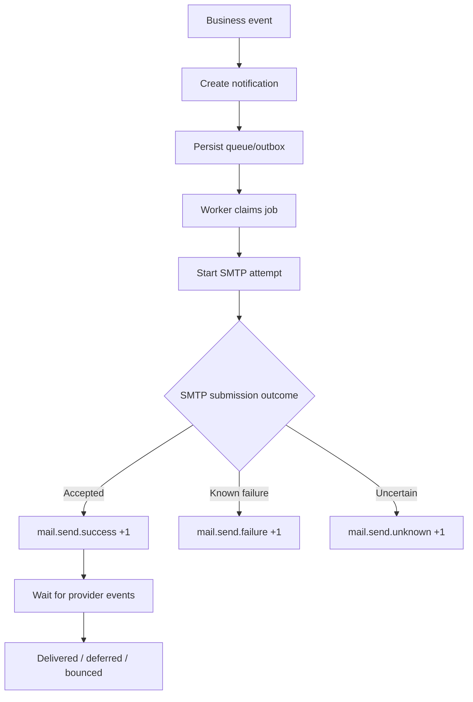

# Metrics for Messages Created, Sent, Succeeded, and Failed

In a **Spring Framework Mail** application, calling `JavaMailSender.send(...)` is just one step in the email processing pipeline. As email volume grows, standalone logs are no longer enough to tell how many notifications the system is creating, how many send attempts have been made, how many succeeded over SMTP, where failures occur, and whether a backlog is building up in a queue.

**Metrics** are numerical measurements over time, typically collected via Micrometer, Spring Boot Actuator, and an observability stack such as Prometheus/Grafana. The four foundational metric groups are:

1. **Messages created** — how many logical email requests the application has recorded.
2. **Messages sent/attempted** — how many calls to SMTP or a provider API have been made.
3. **Successful sends** — how many times SMTP/provider accepted a submission.
4. **Failed sends** — how many attempts resulted in a confirmed rejection or error.

When designing metrics, you must distinguish between a **logical notification**, an **SMTP attempt**, a **recipient**, and a **delivery event**. A single email can be retried multiple times; likewise, a successful send call **does not prove the message reached the inbox**. Conflating these concepts can cause dashboards to report a high success rate while recipients never receive mail, or inflate failure rates solely due to retries.

This lesson covers how to name and define metrics, create counters/timers/gauges with Micrometer, instrument Spring Mail, handle retries and queues/outboxes, build dashboards and alerts, avoid high cardinality, and test measurement consistency.

## 1. What operational questions do metrics help answer?

A mail-sending system needs to answer questions at multiple levels:

- In the last 15 minutes, how many new email requests were created?
- How many times did workers attempt to send via SMTP?
- Out of those attempts, how many did SMTP accept?
- How many attempts were rejected due to authentication, timeout, quota, or policy?
- How many messages are still sitting in the outbox and how long have they been waiting?
- Are errors happening on only one SMTP route or across all routes?
- When the application is redeployed, is sending traffic interrupted?
- After SMTP credentials are fixed, is the backlog draining?
- Does a retry wave increase send attempts without increasing messages created?
- How many emails are later confirmed delivered or reported bounced by the provider?

These questions cannot be answered accurately with a single generic `mail.sent` counter without a clear definition. You need to define **semantics** before choosing metric names.

### An illustrative event sequence

```text
Order confirmed
       |
       v
Create logical mail notification
       |        +1 message created
       v
Persist outbox record
       |
       v
Worker claims record
       |
       v
SMTP attempt #1
       |        +1 send attempt
       v
Temporary failure
       |        +1 failed attempt
       v
Retry scheduled
       |
       v
SMTP attempt #2
       |        +1 send attempt
       v
SMTP accepts message
       |        +1 send success
       v
Provider later reports delivery
                +1 provider delivery event
```

In this example:

- **1** logical message was created.
- **2** send attempts occurred.
- **1** successful send occurred at the SMTP layer.
- **1** failed attempt occurred.
- **1** provider-reported delivery event may arrive later.

If you only count calls to `send` and label that “email count”, the dashboard will show **2 emails** even though from a business standpoint there was only **1 notification**.

## 2. Define the unit of counting before creating a Counter

Distinguish the following entities:

| Entity | Meaning | A suitable ID |
|---|---|---|
| **Logical notification** | An intent to send specific content to a recipient | `notificationId` |
| **Recipient** | The destination of a notification | `recipientRef` |
| **Submission attempt** | One attempt to transfer a message to SMTP/provider | `attemptId` |
| **MIME message** | The concrete message structure built with Jakarta Mail | `Message-ID` header if present |
| **Provider event** | A post-submission processing/delivery event | `providerEventId` |

A single business event can produce multiple notifications. For example, `ORDER_CONFIRMED` may generate emails for both the customer and the seller. These two emails should have two distinct `notificationId` values, even if they share the same `correlationId`.

### Per-recipient counting convention

For transactional emails that require clear accounting, a practical convention is **each logical notification directed to a single recipient counts as one created message**.

For example:

```text
Domain event: ORDER_CONFIRMED
      |
      +--> Customer email -> notification A -> created +1
      |
      +--> Seller email   -> notification B -> created +1
```

Total `created=2`. A single business event should not be assumed to always equal a single message.

If the application sends a single MIME message with multiple recipients in `To/Cc/Bcc`, counting must be defined separately. One transport call can produce different outcomes per recipient. For consistent per-recipient statistics, it is usually easier to manage by creating a separate notification per recipient; if you choose batch sending, you need separate per-recipient outcome metrics.

## 3. Clearly define the four core counters

A system can adopt a dot-delimited Micrometer naming scheme:

| Micrometer Name | Typical Prometheus Exported Name | Increment Condition |
|---|---|---|
| `mail.message.created` | `mail_message_created_total` | A logical mail request was created/recorded per contract. |
| `mail.send.attempt` | `mail_send_attempt_total` | A submission via SMTP/provider begins. |
| `mail.send.success` | `mail_send_success_total` | A submission is reported as accepted by the transport. |
| `mail.send.failure` | `mail_send_failure_total` | A submission has a **confirmed** failure under the classification policy. |

Metric names are suggestions; follow your organization's naming conventions and avoid registering two names for the same measurement. The Prometheus exporter typically normalizes dots to underscores and appends the `_total` counter suffix; verify the exact exported names at the actual endpoint of your Micrometer/registry version.

**Important:** Define `created` as when an accepted **logical notification** is created in the system; do not increment `created` every time `new MimeMessage()` is called. A single notification may be rendered multiple times during retries; counting by MIME object would falsely inflate the created message count.

### “Sent” here must be understood as an attempt

`mail.send.attempt` counts **each time the application actually initiates a send operation**. It does not mean all of those messages were accepted by SMTP.

If displaying on a Vietnamese dashboard, use a label equivalent to “Send attempts” or “SMTP submission attempts” instead of simply “Sent”.

`mail.send.success` counts **attempts accepted by SMTP/provider**, not confirmation of inbox delivery. For a provider API, define success based on the API's return contract (for example, request accepted/queued), without conflating it with a delivered webhook.

### When should failure be incremented?

`mail.send.failure` should be incremented when an attempt's outcome is a confirmed failure, for example:

- SMTP rejects authentication before accepting the message.
- The server returns an explicit rejection response during the send phase.
- The transport layer returns an error classified as `KNOWN_REJECTED`.

Do not automatically treat **every** `MailException` as proof that the message was definitely not received. A timeout or connection drop after transmitting `DATA` can leave the outcome **unknown**.

Therefore, you should also include:

| Micrometer Name | Meaning |
|---|---|
| `mail.send.unknown` | Attempt where it is uncertain whether SMTP/provider accepted the message. |
| `mail.render.failure` | Error rendering subject/body or preparing content before an attempt. |
| `mail.message.rejected` | Notification creation request rejected due to validation/policy, if observability is needed. |

Adding `unknown` avoids mislabeling attempts that may actually have succeeded as “failures”.

## 4. How Counter differs from Gauge and Timer

Micrometer provides several meter types. Choosing the right one keeps measurements meaningful over time.

| Meter Type | Example | How It Is Used |
|---|---|---|
| **Counter** | Messages created, attempts, successes, failures | Monotonically increases with events; read via rate/increase over a time window. |
| **Gauge** | Current PENDING jobs, currently running attempts | Represents the value at the moment of scrape. |
| **Timer** | Duration of an SMTP attempt | Captures count, total time, and optional histogram buckets. |
| **DistributionSummary** | Size of MIME message/attachment | Observes distribution of non-time numeric values. |
| **LongTaskTimer** | Count/duration of long-running active tasks | Used when tracking tasks that span multiple scrapes. |

Do not use a Gauge to count total emails sent since startup if the goal is to measure throughput over a time window. A Counter is more suitable because the observability backend can compute rate/increase and handle counter resets.

Conversely, the count of emails waiting to be sent (`PENDING`) can both rise and fall, so use a Gauge rather than a Counter. `mail.message.created` and `mail.outbox.pending` complement each other and cannot replace one another.

## 5. Designing the email metrics lifecycle

A workflow has multiple instrumentation points:



At each stage:

- When the notification is created: increment `mail.message.created` **once per logical notification**.
- When the worker starts a send attempt: increment `mail.send.attempt`.
- When the transport returns success: increment `mail.send.success`.
- When the attempt is confirmed failed: increment `mail.send.failure`.
- If the outcome is uncertain due to lost response: increment `mail.send.unknown`.
- When a verified webhook arrives: increment a **separate delivery metric**.

Note that counters are observability telemetry, **not a business ledger**. Increments can be lost if the process stops between committing to the database and incrementing the counter, or duplicated if an event is reprocessed. To compute exact historical counts of logical notifications, query durable records or an analytics pipeline with deduplication.

## 6. Setting up Spring Boot Actuator and Micrometer

For a Spring Boot project using Gradle, you typically need Actuator and the Prometheus registry:

```gradle
dependencies {
    implementation 'org.springframework.boot:spring-boot-starter-mail'
    implementation 'org.springframework.boot:spring-boot-starter-actuator'
    runtimeOnly 'io.micrometer:micrometer-registry-prometheus'
}
```

If using Maven, declare the corresponding dependencies managed by your Spring Boot version.

Micrometer provides APIs such as `MeterRegistry`, `Counter`, `Timer`, and `Gauge`. Spring Boot Actuator can auto-configure the registry to expose metrics at an endpoint for your monitoring system.

Example configuration:

```yaml
management:
  endpoints:
    web:
      exposure:
        include: health,info,prometheus
  metrics:
    tags:
      application: notification-service
    distribution:
      percentiles-histogram:
        mail.smtp.attempt.duration: true
```

This configuration illustrates exposing Prometheus metrics and enabling histogram buckets for a timer. Property names, endpoints, and registry capabilities may vary across versions; cross-check against the Spring Boot/Micrometer version in use.

### Do not leave metrics endpoints publicly exposed without controls

`/actuator/prometheus` can expose service names, SMTP routes, errors, and operational state. When deploying:

- Allow only monitoring systems to access it via appropriate network controls and authorization.
- Do not expose all Actuator endpoints publicly to the Internet.
- Do not put credentials, recipient addresses, or sensitive business data into metric tags.
- Enforce access control and retention policies on the monitoring backend.
- Ensure scraping remains available during replica rollouts.

You do not need to enable SMTP protocol debug logging to count sends; debug output can contain sensitive data and is unsuitable as a primary metric source.

## 7. Creating a MailMetricsRecorder class with Micrometer

Centralize instrumentation in a small component instead of copying `Counter.builder(...)` into every service.

```java
import io.micrometer.core.instrument.Counter;
import io.micrometer.core.instrument.MeterRegistry;
import io.micrometer.core.instrument.Timer;
import org.springframework.stereotype.Component;

@Component
public class MailMetricsRecorder {

    private final MeterRegistry registry;

    public MailMetricsRecorder(MeterRegistry registry) {
        this.registry = registry;
    }

    public void messageCreated(String type) {
        Counter.builder("mail.message.created")
                .description("Created logical mail notifications")
                .tag("type", type)
                .register(registry)
                .increment();
    }

    public void attemptStarted(String route, String type) {
        Counter.builder("mail.send.attempt")
                .tags("route", route, "type", type)
                .register(registry)
                .increment();
    }

    public void attemptAccepted(String route, String type) {
        Counter.builder("mail.send.success")
                .tags("route", route, "type", type)
                .register(registry)
                .increment();
    }

    public void attemptKnownFailure(
            String route,
            String type,
            String errorCategory
    ) {
        Counter.builder("mail.send.failure")
                .tags(
                        "route", route,
                        "type", type,
                        "error", errorCategory
                )
                .register(registry)
                .increment();
    }

    public void attemptUnknown(String route, String type) {
        Counter.builder("mail.send.unknown")
                .tags("route", route, "type", type)
                .register(registry)
                .increment();
    }

    public void recordAttemptDuration(
            String route,
            long elapsedNanos
    ) {
        Timer.builder("mail.smtp.attempt.duration")
                .tag("route", route)
                .register(registry)
                .record(
                        elapsedNanos,
                        java.util.concurrent.TimeUnit.NANOSECONDS
                );
    }
}
```

This class preserves the exact semantics of each metric; callers do not need to know Micrometer API details.

**Warning:** `type`, `route`, and `errorCategory` must come from a bounded catalog of values, such as an enum or normalized mapping. Never pass arbitrary values from an HTTP request, raw SMTP message, or unnormalized exception name. Unbounded tag values can cause uncontrolled growth in time series.

### Why not continuously instantiate new counters with `new`?

Calling `Counter.builder(...).register(registry)` with the same name and tags generally returns the already-registered meter; it does not allocate a brand-new counter on every send. Even so, for hot-path metrics, you can cache meter handles for fixed tag combinations to reduce lookup overhead.

Never cache by `notificationId`, as doing so creates a separate meter per email and causes high cardinality.

## 8. Instrumenting the SMTP send point

Example gateway sending via `JavaMailSender`:

```java
import jakarta.mail.internet.MimeMessage;
import org.springframework.mail.MailAuthenticationException;
import org.springframework.mail.MailException;
import org.springframework.mail.javamail.JavaMailSender;
import org.springframework.stereotype.Service;

@Service
public class InstrumentedSmtpGateway {

    private final JavaMailSender mailSender;
    private final MailMetricsRecorder metrics;

    public InstrumentedSmtpGateway(
            JavaMailSender mailSender,
            MailMetricsRecorder metrics
    ) {
        this.mailSender = mailSender;
        this.metrics = metrics;
    }

    public void submit(
            MimeMessage message,
            String approvedRoute,
            String notificationType
    ) {
        long started = System.nanoTime();

        metrics.attemptStarted(
                approvedRoute,
                notificationType
        );

        try {
            mailSender.send(message);

            // Success at the SMTP submission layer
            // does not mean the email reached the inbox.
            metrics.attemptAccepted(
                    approvedRoute,
                    notificationType
            );
        } catch (MailAuthenticationException exception) {
            // AUTH error before the message-send step is a known failure.
            metrics.attemptKnownFailure(
                    approvedRoute,
                    notificationType,
                    "authentication"
            );
            throw exception;
        } catch (MailException exception) {
            // Insufficient evidence to classify as a confirmed
            // rejection. Track under the unknown category.
            metrics.attemptUnknown(
                    approvedRoute,
                    notificationType
            );
            throw exception;
        } finally {
            metrics.recordAttemptDuration(
                    approvedRoute,
                    System.nanoTime() - started
            );
        }
    }
}
```

This example is **deliberately conservative**: unclassified `MailException` instances are recorded as `unknown`, rather than assuming “SMTP definitely did not receive it”. In a real system, a classifier should inspect the cause, response code, failure stage, and transport/provider semantics to distinguish `KNOWN_REJECTED` from `UNKNOWN`.

### Do not double-count the same attempt

A single attempt should record:

```text
attemptStarted +1
        |
        +-- success +1
        OR
        +-- failure +1
        OR
        +-- unknown +1
```

Outcome categories must be **mutually exclusive** for the same attempt; otherwise aggregate totals will be inflated.

Do not increment `mail.send.failure` in both the gateway and a caller catching the same exception. Pick **one metric owner** — typically the gateway/worker where the outcome is determined — and have upper layers only log or update business state.

### What if an error occurs before calling send?

Validation, template rendering, or `MimeMessage` building errors prior to starting an attempt should not increment `mail.send.attempt`. You can measure them separately:

```text
mail.render.failure{reason="template_missing"}
mail.render.failure{reason="invalid_input"}
mail.mime.build.failure{reason="invalid_attachment"}
```

This separates internal data errors from SMTP provider errors.

## 9. Normalizing error types instead of using raw exception messages

Mail-sending exceptions include `MailAuthenticationException`, `MailSendException`, network/TLS errors, and SMTP rejections. However, an exception class name alone is not enough to tell whether an attempt can be retried.

A metric taxonomy should be concise, for example:

| `error` tag | Example | Handling hint |
|---|---|---|
| `authentication` | Credentials/AUTH mechanism rejected | Check secret, policy, token; avoid blind retries. |
| `connection` | Cannot connect to SMTP host | Check DNS, firewall, availability. |
| `tls` | TLS handshake or certificate error | Check transport and TLS config. |
| `recipient_rejected` | Server rejected a specific recipient | Check address/policy. |
| `rate_limited` | Provider reported throttling | Retry with backoff, limit concurrency. |
| `message_rejected` | Message rejected for content/size/policy | Inspect specific cause. |
| `unclassified` | Error could not be classified | Investigate via logs/attempt record. |

Never put `exception.getMessage()` directly into a tag. Messages can contain hostnames, email addresses, per-request status text, or sensitive data, creating a huge number of time series.

**Metric labels must be sufficient for aggregation, not for identifying individual emails.** Details like attempt ID, correlation ID, and root cause belong in logs, traces, and records with proper access controls.

## 10. Recording created message counts at the right time

A logical notification can be created by an HTTP request, a scheduler, or a domain event. When to increment `mail.message.created` depends on the contract:

- If the system uses an outbox, increment when the notification is **successfully persisted according to application logic**.
- If there is no outbox, you may increment when the service accepts the notification for processing; clearly document this as **accepted in-memory**, with no durability guarantee.
- If you only count after `new MimeMessage()`, retries will multiply the created message count.
- If you count before transaction commit, a rollback can leave a created metric even though no durable notification exists.

One model:

```text
Business transaction
    |
    +--> Save order
    |
    +--> Insert outbox(notificationId)
    |
    v
Commit
    |
    v
Record mail.message.created +1
```

You can use post-commit events or instrument where enqueue success is confirmed. However, **a metric increment is not part of the database transaction**. If the process dies after commit but before incrementing the counter, the metric may miss one created count. This is an inherent limitation of best-effort telemetry.

### For exact historical reporting, use durable data

Counters are well suited for observing traffic and detecting anomalies. To calculate the **exact count of unique notifications** for a day or a campaign, you should usually query the notification/outbox table or an analytics pipeline with deduplication based on `notificationId`.

A metric alone does not provide exactly-once guarantees; trying to “fix” this by embedding the notification ID into a tag is wrong because it creates high cardinality.

## 11. How do retries change metrics?

Suppose one notification is created and then retried three times:

```text
notificationId = notif-001
created        = +1

attempt 1: 421 temporary failure
  attempt = +1
  failure = +1 (if there is evidence of a known rejection)

attempt 2: SMTP timeout with unknown outcome
  attempt = +1
  unknown = +1

attempt 3: SMTP accepted
  attempt = +1
  success = +1
```

Result:

| Metric | Increment |
|---|---:|
| `mail.message.created` | 1 |
| `mail.send.attempt` | 3 |
| `mail.send.success` | 1 |
| `mail.send.failure` | 1 |
| `mail.send.unknown` | 1 |

**One notification can increment attempt counters multiple times**, so do not divide `success_total / created_total` and assume it is the “send success rate”. The two counters have different counting units and may belong to different time windows.

### Retries must not change the logical ID

Keep:

```text
notificationId = notif-001
correlationId  = corr-901
```

across all attempts, while generating a new `attemptId`. These IDs are useful in logs and the DB; **do not use them as metric tags**.

### Distinguish automatic retry from manual resend

A “resend” action can mean two different things:

- Retrying the same notification due to a temporary failure.
- Creating a new notification at the user's request even though the previous message was already SMTP accepted.

The two cases should have distinct contracts. If it is a new notification, increment created. If it is only retrying an existing notification, increment only attempt; do not increment created again.

## 12. Two types of success rates that are easily confused

### 12.1. SMTP attempt acceptance rate

Measures the percentage of attempts confirmed as accepted by the transport:

\[
\text{Attempt acceptance rate} =
\frac{\text{successful SMTP attempts}}
{\text{all SMTP attempts}}
\times 100\%
\]

For example, in an observation window:

- 900 attempts started.
- 850 attempts SMTP accepted.
- 40 known failures.
- 10 unknown.

The attempt acceptance rate is `850 / 900 ≈ 94.4%`.

This is the success rate of **send attempts**, not the rate of emails ultimately delivered.

### 12.2. Logical notification submission completion rate

Measures the proportion of **unique** notifications that achieved an accepted submission:

\[
\text{Logical completion rate} =
\frac{\text{unique notifications with SMTP accepted}}
{\text{eligible notifications in a cohort}}
\times 100\%
\]

To compute the second metric accurately, use notification/outbox state with stable IDs and a well-defined cohort. Simple attempt counters are not enough, because retries and queue waiting distort the relationship.

### 12.3. Provider-reported delivery rate

If a provider webhook is available, you can measure according to the provider's definition:

\[
\text{Provider reported delivery rate} =
\frac{\text{notifications reported delivered}}
{\text{eligible tracked notifications}}
\times 100\%
\]

**No webhook does not mean failure.** You must define the observation window, event delay, suppression/bounce policy, and tracking coverage. Provider “delivered” also does not by itself prove the email landed in the inbox or was read.

## 13. Adding a Timer to measure send duration

Counters tell you volume; Timers tell you **latency** and execution count.

Example:

```java
import io.micrometer.core.instrument.MeterRegistry;
import io.micrometer.core.instrument.Timer;

public class TimedMailSender {

    private final JavaMailSender mailSender;
    private final MeterRegistry registry;

    public TimedMailSender(
            JavaMailSender mailSender,
            MeterRegistry registry
    ) {
        this.mailSender = mailSender;
        this.registry = registry;
    }

    public void send(MimeMessage message) {
        Timer.Sample sample = Timer.start(registry);

        try {
            mailSender.send(message);
        } finally {
            sample.stop(
                    Timer.builder("mail.smtp.attempt.duration")
                            .tag("route", "primary")
                            .register(registry)
            );
        }
    }
}
```

Using `finally` ensures duration is recorded even when sending fails or times out. If you only record duration after `send` succeeds, dashboards will miss the slowest attempts — often the exact group you care about most.

### Which intervals should Timers measure?

Define boundaries clearly:

- `mail.render.duration`: generating subject/HTML/plain text from a template.
- `mail.mime.build.duration`: building the MIME message.
- `mail.smtp.attempt.duration`: time spent in the transport send call.
- `mail.queue.wait.duration`: time from enqueue until a worker begins processing.
- `mail.end_to_end.duration`: from notification creation to a clearly defined terminal milestone.

Do not mix queue wait time with SMTP operation time and call the combined value “SMTP latency”.

### P95/P99 and histograms

SMTP latency can vary widely due to TLS handshakes, DNS, network conditions, or slow providers. Averages can hide very slow requests.

You can use histograms to compute p95/p99 across multiple replicas. However, enabling histograms across too many tag combinations can significantly increase time series count. Enable them only on key meters and configure appropriate SLO buckets.

## 14. Gauges for in-flight attempts and queue backlog

Counters do not tell you immediately how many attempts are currently running. For active work in progress, use a Gauge.

Example:

```java
import io.micrometer.core.instrument.Gauge;
import io.micrometer.core.instrument.MeterRegistry;
import java.util.concurrent.atomic.AtomicInteger;

public final class MailInFlightMetrics {

    private final AtomicInteger inFlight =
            new AtomicInteger(0);

    public MailInFlightMetrics(MeterRegistry registry) {
        Gauge.builder(
                "mail.send.inflight",
                inFlight,
                AtomicInteger::get
        ).description("Current in-flight mail attempts")
         .register(registry);
    }

    public void started() {
        inFlight.incrementAndGet();
    }

    public void finished() {
        inFlight.decrementAndGet();
    }
}
```

If an attempt increments in-flight in `try` without decrementing in `finally`, the gauge will drift when an exception occurs. Manage increment/decrement consistently at a single ownership point.

One caveat with Micrometer: a Gauge typically holds a **weak reference** to the observed object. In the example, `inFlight` is a strong field on the component, so it continues to be observed. Never pass `new AtomicInteger(...)` inside the registration expression and drop all strong references to it.

### Outbox backlog gauges

Useful gauges:

| Gauge | Meaning |
|---|---|
| `mail.outbox.pending` | Number of notifications currently waiting to be processed. |
| `mail.outbox.processing` | Number of jobs claimed and not yet finished. |
| `mail.outbox.oldest.age` | Age of the oldest PENDING job. |
| `mail.send.inflight` | Number of attempts currently executing on this instance. |
| `mail.worker.capacity` | Configured maximum processing slots, if needed. |

With Prometheus, use explicit units, such as exporting the name as `mail_outbox_oldest_age_seconds`. If a metric is registered as a Gauge in seconds, do not mix minutes or milliseconds into the same time series.

### Avoid expensive database queries on every scrape

A Gauge executing `SELECT COUNT(*)` on an outbox table with millions of rows on every scrape can impose significant load. You can:

- Use indexes and optimized queries.
- Periodically update a snapshot in a dedicated bean.
- Use a cache with bounded staleness.
- Collect metrics from the queue broker if the broker already exposes them.

Document clearly that a cached gauge is a **snapshot** and does not necessarily reflect millisecond-level state.

## 15. Separate metrics for render, MIME, and SMTP errors

An email may never reach the send step due to internal errors:

```text
Notification created
    |
    v
Render Thymeleaf template
    |
    +-- Missing key / invalid input
    |      -> render failure
    |
    v
Build MIME message
    |
    +-- Invalid attachment / header
    |      -> MIME build failure
    |
    v
Call JavaMailSender.send()
           -> SMTP attempt
```

If every error increments `mail.send.failure`, operators may blame the SMTP provider when in reality a template was missing a variable.

A metric mapping:

| Stage | Suggested Metric | Example Error |
|---|---|---|
| Notification input/creation | `mail.message.rejected` | Validation, unauthorized recipient. |
| Template rendering | `mail.render.failure` | Missing template, missing required variable. |
| MIME building | `mail.mime.build.failure` | Unreadable attachment, invalid header data. |
| SMTP submission | `mail.send.failure` | SMTP reject/authentication. |
| SMTP submission ambiguity | `mail.send.unknown` | Timeout, connection lost after DATA. |
| Post-submission delivery | `mail.provider.bounce` | Provider reported bounce. |

You can add a general `mail.pipeline.failure` counter if dashboards need total failed operations, but you must explicitly define whether it includes retries and whether it overlaps with lower-level counters. Never add counters with different units together and call the sum “failed emails”.

## 16. Delivery event metrics belong to a separate layer

After `JavaMailSender.send(...)` returns successfully, the email still has to be processed by the provider and receiving servers.

If the provider offers webhooks, you can track:

- `mail.provider.delivered`
- `mail.provider.bounced`
- `mail.provider.deferred`
- `mail.provider.complaint`
- `mail.provider.suppressed`

**These counters must only be incremented upon receiving corresponding evidence from the provider**, not immediately after `send`.

### Webhooks can be delivered repeatedly

Providers may retry webhooks when the application returns a timeout or 5xx. If every webhook delivery increments `mail.provider.delivered`, the metric can double-count a single delivery event.

Ensure:

1. The webhook is verified according to the provider contract.
2. The event has a suitable ID or deduplication key.
3. The event is checked for whether it has already been applied.
4. The delivery record is updated atomically.
5. The metric is emitted from the point where the accepted event is processed.

Even with deduplication, the DB write and in-process metric increment still do not share a single transaction. Therefore, metrics remain best-effort telemetry; for accurate historical reporting by notification, read from the deduplicated event store.

### Delivered does not mean inbox or read

Some providers report delivered as soon as the destination server accepts the email. Do not rename `mail.provider.delivered` to “reached inbox” unless the system has actual evidence for that milestone. Open tracking is also not reliable proof that the user actually read the email.

## 17. Tag/label design for mail metrics

Micrometer lets you partition metrics by tags; Prometheus stores each label combination as a distinct time series.

Useful, bounded tags:

| Tag | Example | Notes |
|---|---|---|
| `type` | `order_confirmation`, `password_reset` | Taken from a finite enum or catalog. |
| `route` | `primary`, `backup` | Use internal aliases; do not expose sensitive secrets/hosts. |
| `result` | `accepted`, `failed`, `unknown` | Fixed list of outcomes. |
| `error` | `authentication`, `tls`, `rate_limited` | Finite taxonomy. |
| `environment` | `staging`, `production` | Usually configured at registry/common tags. |
| `provider` | `smtp_relay_a`, `smtp_relay_b` | Acceptable if the number of providers is small. |

Do not use the following values as tags:

- `notificationId`, `attemptId`, `correlationId`, `traceId`.
- Raw recipient email, user name, or phone number.
- Full subject, template body, or exception message.
- Order ID, user UUID, or unbounded tenant ID.
- Full URL, query string, or attachment filename.
- Provider message ID.

### Why cardinality matters

Suppose a metric has:

- 10 email types.
- 3 SMTP routes.
- 7 error categories.
- 2 environments.
- 500,000 notification IDs.

If you attach all of these fields, the number of series combinations can explode and exhaust monitoring backend resources. Use only a small set of low-cardinality labels for aggregation; per-request identifying data belongs in logs, traces, and databases.

### Keep labels consistent per metric name

If `mail.send.attempt` has `route` and `type` tags, while `mail.send.success` adds an `error` tag that does not exist on success, Prometheus can still aggregate via `sum(...)`. However, when building dashboards grouped by route/type, ensure series groupings remain compatible. Never create tags with random or null values.

## 18. Prometheus: reading counters over a time window

Counters increase monotonically over a process's lifetime. When a process restarts, values may reset to 0. Therefore, to ask “how many sends occurred in the last 15 minutes?”, do not read the raw instantaneous counter value as a system-wide historical total.

Commonly used functions:

- `rate(counter[5m])`: average per-second rate over the window.
- `increase(counter[15m])`: estimated increase over the window.
- `sum(...)`: aggregation across multiple instances/replicas.
- `histogram_quantile(...)`: percentiles from histogram buckets.

### Total messages created in 1 hour

```promql
sum(increase(mail_message_created_total[1h]))
```

### Total send attempts in 1 hour

```promql
sum(increase(mail_send_attempt_total[1h]))
```

### Accepted, failed, and unknown in 1 hour

```promql
sum(increase(mail_send_success_total[1h]))

sum(increase(mail_send_failure_total[1h]))

sum(increase(mail_send_unknown_total[1h]))
```

The expressions above assume exported series names follow the naming convention shown. Inspect the actual `/actuator/prometheus` output to use exact names and labels.

### Successful send rate per second by route

```promql
sum by (route) (
  rate(mail_send_success_total[5m])
)
```

If each route is a stable alias, dashboards can show which route is disrupted or experiencing reduced throughput.

### When to apply `sum` before or after `rate`?

Typically across multiple replicas, compute `rate(...)` per series first and then `sum(...)` so counter resets are handled per instance. Avoid `rate(sum(counter)[5m])` if summing counters beforehand masks a single replica's reset or distorts the result.

## 19. Calculating success and failure rates with the right denominator

A 15-minute attempt acceptance rate:

```promql
100 *
sum(increase(mail_send_success_total[15m]))
/
sum(increase(mail_send_attempt_total[15m]))
```

Keep these caveats in mind:

- If there are no attempts, the denominator is 0; do not arbitrarily interpret that as 100% or 0%.
- If an attempt starts at the end of a window and its outcome arrives later, numerator and denominator may fall into different windows.
- If an attempt was recorded as success but its attempt increment was lost due to a process crash, skew can occur.
- Retries make the attempt count larger than the logical notification count.

To reduce dashboard noise, only display ratios when the attempt count in the window exceeds a product-chosen minimum threshold.

### Known failure rate by attempt

```promql
100 *
sum(increase(mail_send_failure_total[15m]))
/
sum(increase(mail_send_attempt_total[15m]))
```

`unknown` should not be silently merged into failure if the goal is to distinguish uncertain outcomes. You can compute a separate ratio:

```promql
100 *
sum(increase(mail_send_unknown_total[15m]))
/
sum(increase(mail_send_attempt_total[15m]))
```

For the business question “how many notifications were ultimately submitted successfully”, read final notification state by cohort and time instead of forcing a formula out of attempt counters.

## 20. Reconciling messages created and attempts

The two counters can legitimately differ:

| Scenario | Created | Attempts | Accepted | Known failures | Unknown |
|---|---:|---:|---:|---:|---:|
| One email, succeeds on first try | 1 | 1 | 1 | 0 | 0 |
| One email, fails then succeeds on retry | 1 | 2 | 1 | 1 | 0 |
| One email, times out then retried | 1 | 2 | 1 | 0 | 1 |
| One email still waiting in outbox | 1 | 0 | 0 | 0 | 0 |
| One email fails rendering before SMTP | 1 | 0 | 0 | 0 | 0 |
| Two emails for two recipients, each sent once | 2 | 2 | 2 | 0 | 0 |

You will not always have:

```text
created == attempts
attempts == success + failure
```

Because of retries, in-flight work, unknowns, batch semantics, collection lag, and events spanning different time windows.

### When can an invariant be checked?

Within a **set of finished, durably persisted attempts**, if each attempt has exactly one terminal outcome:

```text
completed_attempts
    = accepted
    + known_failed
    + unknown
```

This is an invariant in the **attempt ledger/database**, not a strict equality between Counter time series pulled from different scrape intervals. Metrics can drop events or be temporarily out of sync at evaluation time.

## 21. Recommended dashboard for Spring Mail operations

A mail dashboard should show **trends and causes**, not just a single “sent” tile.

| Panel | Metric / Data Source | Question |
|---|---|---|
| Notifications created per minute | `rate(mail_message_created_total[5m])` | Is email sending demand rising or falling? |
| SMTP attempts per minute | `rate(mail_send_attempt_total[5m])` | At what rate are workers operating? |
| SMTP accepted per minute | `rate(mail_send_success_total[5m])` | How many attempts is the provider accepting? |
| Known failures per minute | `rate(mail_send_failure_total[5m])` | Are actual errors increasing? |
| Unknown outcomes per minute | `rate(mail_send_unknown_total[5m])` | Are there timeouts or ambiguous communication outcomes? |
| Failure breakdown | `sum by (error, route)(...)` | Which route and error cause are failing? |
| SMTP latency p95/p99 | Timer histogram | Is the provider unusually slow? |
| In-flight attempts | `mail.send.inflight` | How many workers are currently busy? |
| Pending outbox / oldest age | DB/queue gauge | Is there a backlog or overdue mail? |
| Delivery/bounce events | Provider event counters | Are there post-submission delivery issues? |

**Never display only a 100% success rate** when throughput is 0 because workers stopped processing. Place ratios alongside total attempt and backlog charts.

### Which time ranges should panels cover?

- 5–15 minutes: fresh incidents, broken credentials, timeouts.
- 1 hour: throughput, retry storms, backlog buildup.
- 24 hours / 7 days: product trends, scheduled sends, message creation volume.
- Longer ranges: use analytics or database summaries because raw metrics have retention and cardinality limits.

Choose observation windows that match sending schedules. Reminder emails may go out in batches, while password reset emails can have irregular traffic spikes.

## 22. Alerting: not on error rate alone

A system can fail to send because provider authentication is rejected, backlog grows because workers died, or traffic drops abnormally because the pipeline stopped creating notifications.

### High send-error alert gated on sufficient volume

Illustrative expression:

```promql
(
  sum(increase(mail_send_failure_total[15m]))
  /
  sum(increase(mail_send_attempt_total[15m]))
) > 0.05
and
sum(increase(mail_send_attempt_total[15m])) > 100
```

This illustrative condition triggers when the known failure rate exceeds 5% and total attempts exceed 100 within 15 minutes. This is not a default Spring Mail threshold; tune it to your SLOs and real traffic.

### Dedicated alert for unknown outcomes

If timeouts surge and the classifier records them under `mail.send.unknown`, alerts watching only `mail.send.failure` will miss the incident.

Alert when the unknown count or rate exceeds a small threshold, especially for transactional emails with duplicate-send risk.

### Non-draining backlog alert

One scenario:

```text
mail.message.created: increasing
mail.send.attempt:    near zero
mail.outbox.pending:  increasing
```

Workers may have stopped, the broker may be unreachable, or the scheduler may not be running. Alerts should cover backlog, oldest age, and worker health, not just SMTP errors.

### Route or authentication failure alert

If a route sees a spike in `authentication` errors, prefer alerting per route rather than firing one alert per notification. Avoid repeatedly retrying with persistently rejected credentials.

### Zero-traffic alert

Zero traffic can be normal for small systems or off-peak hours. Only alert on “no mail created/sent” when there is a clear expectation: for example, jobs are sitting in the backlog, new notifications are being created, or a scheduled job is expected to emit emails. Do not automatically treat `rate=0` as an incident.

## 23. Metrics for queues and outboxes

With asynchronous Spring Mail, SMTP may run in a different process from where messages are created. Counting only at the sender cannot show a backlog building at the application side.

Additional metrics:

| Metric | Suggested Definition |
|---|---|
| `mail.outbox.pending` | Current number of PENDING jobs. |
| `mail.outbox.processing` | Number of PROCESSING jobs or active valid leases. |
| `mail.outbox.retry.scheduled` | Number of jobs waiting for retry at measurement time. |
| `mail.outbox.oldest.age` | Age of the oldest PENDING job, in seconds. |
| `mail.worker.claim` | Total job claim operations (counter). |
| `mail.worker.claim.failure` | Total claim/lock errors if needed. |
| `mail.queue.wait.duration` | Time from enqueue until a worker starts. |
| `mail.worker.process.duration` | Job processing duration, potentially including render and SMTP. |

If a worker crashes while holding a lease, the job may be reprocessed after lease timeout. In that case `mail.worker.claim` increments twice while `mail.message.created` still increments only once.

### Do not fake queue depth by computing `created - accepted`

People sometimes compute backlog from:

```text
created_total - success_total
```

This breaks when there are retries, unknowns, policy-blocked jobs, canceled jobs, or counter resets. Read backlog from the **actual queue/outbox state**.

### Why oldest age matters

A backlog of 100 jobs may be normal right after a short batch burst. But if a single job has been waiting for 2 hours when the email SLA is a few minutes, that is an incident even if total pending count is small.

Measure both pending count and oldest job age or queue wait latency distribution.

## 24. Metric reliability across multiple instances and process restarts

In a multi-replica deployment:

```text
API instance A -> created +1
API instance B -> created +2

Worker instance X -> attempts +2
Worker instance Y -> attempts +1
```

Each instance maintains counters in its own memory/registry. Prometheus scrapes each instance's time series, and `sum(rate(...))` or `sum(increase(...))` aggregates the system-wide total.

### Counter resets are not mail-sending incidents

When a process restarts, local counters can reset to 0. If a dashboard plots raw counters, the graph will drop. Use `rate`/`increase` and distinguish restart-induced resets from actual traffic drops.

### Jobs survive even when old-process metrics disappear

If the outbox persists jobs durably, a new worker can continue sending them. However, counters from the terminated instance do not live forever. This is normal for in-process telemetry, not a reason to put notification IDs into metric tags.

### Handling telemetry backend unavailability

Business email sending should not automatically fail just because Prometheus temporarily fails to scrape or the dashboard is down. Micrometer normally records metrics in the process's local registry; external scrapes may miss samples.

Treat metrics as supplemental observability. **Sending state and retry decisions must be driven by transport results and business storage**, never by whether a counter scrape succeeded.

## 25. Avoiding double-counting across multiple layers

A pipeline may include several layers:

```text
Controller -> NotificationService
           -> OutboxRepository
           -> MailWorker
           -> SmtpGateway
           -> ProviderWebhookHandler
```

If controller, service, and repository all increment `mail.message.created` for the same notification, the dashboard will report `created=3`.

Define a **metric ownership** table:

| Event | Owning Layer | Condition |
|---|---|---|
| Logical message created | Notification admission/persistence boundary | Request accepted once per contract. |
| Send attempt started | SmtpGateway/transport boundary | Once right before calling send. |
| Send success | SmtpGateway | Transport returns success. |
| Send known failure | SmtpGateway classifier | Error is deterministically classified. |
| Send unknown | SmtpGateway classifier | Outcome is inconclusive. |
| Render failure | Template renderer/orchestrator | No SMTP attempt created. |
| Provider delivered/bounced | Verified webhook handler | Event actually accepted; deduplicated. |

In other layers, log `correlationId`, `notificationId`, and `attemptId` for investigation. Never duplicate counters just because multiple layers participate in handling the same event.

## 26. Place instrumentation closest to where the outcome is known

Sometimes a service looks like this:

```java
public void process(MailJob job) {
    render(job);
    buildMime(job);
    mailSender.send(message);
    updateJobStatus(job);
}
```

If you increment success at the end of `process`, an exception updating the DB after SMTP will leave an actually accepted attempt uncounted in success metrics. If you increment success at the start of `process`, you risk reporting success before sending.

Rule of thumb: **instrument attempt metrics right around `JavaMailSender.send(...)`**, where the transport outcome is known. Notification completion metrics belong in the state management layer after the record is updated.

Divergence between the two metrics can be legitimate when a database update fails. They represent two distinct milestones:

- `SMTP accepted` according to the transport.
- `Notification state persisted` according to the database.

If needed, add `mail.state.persist.failure` to investigate the gap after SMTP acceptance but before commit.

## 27. Testing counters with SimpleMeterRegistry

You do not need a real Prometheus or SMTP server to unit-test counter increments. Micrometer provides `SimpleMeterRegistry` for in-memory testing.

Example testing created message count:

```java
import io.micrometer.core.instrument.simple.SimpleMeterRegistry;
import org.junit.jupiter.api.Test;
import static org.assertj.core.api.Assertions.assertThat;

@Test
void countsLogicalNotificationOnce() {
    try (SimpleMeterRegistry registry =
                 new SimpleMeterRegistry()) {

        MailMetricsRecorder metrics =
                new MailMetricsRecorder(registry);

        metrics.messageCreated("order_confirmation");

        double count = registry
                .get("mail.message.created")
                .tag("type", "order_confirmation")
                .counter()
                .count();

        assertThat(count).isEqualTo(1.0);
    }
}
```

This illustrates unit-testing the recorder itself. In workflow integration tests, also verify that a retried notification does not increment created again.

### Testing a successful attempt

Use Mockito to mock `JavaMailSender`, invoke the gateway once, and assert the counters:

```java
@Test
void acceptedSmtpAttemptIncrementsSuccess() {
    try (SimpleMeterRegistry registry =
                 new SimpleMeterRegistry()) {

        JavaMailSender mailSender = mock(JavaMailSender.class);
        MimeMessage message = mock(MimeMessage.class);

        MailMetricsRecorder metrics =
                new MailMetricsRecorder(registry);

        InstrumentedSmtpGateway gateway =
                new InstrumentedSmtpGateway(
                        mailSender, metrics
                );

        gateway.submit(
                message,
                "primary",
                "order_confirmation"
        );

        assertThat(registry
                .get("mail.send.attempt")
                .tags(
                        "route", "primary",
                        "type", "order_confirmation"
                )
                .counter().count()
        ).isEqualTo(1.0);

        assertThat(registry
                .get("mail.send.success")
                .tags(
                        "route", "primary",
                        "type", "order_confirmation"
                )
                .counter().count()
        ).isEqualTo(1.0);

        verify(mailSender).send(message);
    }
}
```

Configure Mockito/JUnit imports and test fixtures for your project. The goal is to verify that one successful submission increments **attempt once and success once**, without recording delivery.

### Testing an authentication failure

```java
@Test
void authFailureIncrementsKnownFailure() {
    try (SimpleMeterRegistry registry =
                 new SimpleMeterRegistry()) {

        JavaMailSender mailSender = mock(JavaMailSender.class);
        MimeMessage message = mock(MimeMessage.class);

        doThrow(new MailAuthenticationException(
                new jakarta.mail.AuthenticationFailedException(
                        "Invalid test credentials"
                )
        )).when(mailSender).send(message);

        InstrumentedSmtpGateway gateway =
                new InstrumentedSmtpGateway(
                        mailSender,
                        new MailMetricsRecorder(registry)
                );

        assertThatThrownBy(() ->
                gateway.submit(
                        message,
                        "primary",
                        "order_confirmation"
                )
        ).isInstanceOf(MailAuthenticationException.class);

        assertThat(registry
                .get("mail.send.failure")
                .tags(
                        "route", "primary",
                        "type", "order_confirmation",
                        "error", "authentication"
                )
                .counter().count()
        ).isEqualTo(1.0);
    }
}
```

Never use real credentials in tests. Test other exception branches as well to verify that `unknown` does not simultaneously increment `success` or `failure`.

## 28. Recommended test scenarios

A semantic verification matrix:

| Scenario | Created | Attempt | Success | Failure | Unknown |
|---|---:|---:|---:|---:|---:|
| Notification persisted, not yet sent | +1 | 0 | 0 | 0 | 0 |
| Sent once, SMTP accepted | +1 | +1 | +1 | 0 | 0 |
| AUTH rejected | +1 | +1 | 0 | +1 | 0 |
| SMTP timeout, outcome uncertain | +1 | +1 | 0 | 0 | +1 |
| Retry after known failure, then succeeds | +1 | +2 | +1 | +1 | 0 |
| Render error before send step | +1 | 0 | 0 | 0 | 0 |
| Provider reports bounce after acceptance | +1 | +1 | +1 | 0 | 0 |
| One event creates two recipient notifications | +2 | Per attempts | Per outcomes | Per outcomes | Per outcomes |

This table measures the **delta of a single scenario**, not a replacement for live metric scraping.

Other important tests:

- An error caught across two layers does not produce two failure increments.
- Outcome counters increment at most once per attempt.
- `type`/`route`/`error` tags use finite enums or mappings.
- Send duration is recorded on both success and exception.
- In-flight gauge returns to 0 in `finally`.
- Retries do not increment created.
- Replayed webhooks do not increment already-deduplicated events.
- No tag contains recipient email or notification ID.
- When queue enqueue fails or a transaction rolls back, created behavior is clearly explainable per contract.

These examples are **for learning how to test**; you do not need to run production SMTP to verify them.

## 29. Observing security and SMTP configuration errors

In operations, different errors have distinct signatures:

- Sudden spike in `MailAuthenticationException`: inspect credentials, AUTH mechanism, secret rotation, and provider policy.
- `connection` failures: inspect DNS, network, firewall, and server availability.
- `tls` failures: inspect port/TLS mode, certificates, and SSL policies.
- `rate_limited`: lower concurrency, apply backoff, and check quotas.
- `message_rejected`: inspect MIME size limits, sender policy, or recipient handling.

Multiple errors can occur simultaneously. Dashboards should support drill-down by route and error category, while logs indexed by correlation/attempt ID reveal the exact root cause.

**Do not put full exception messages into metric tags.** Besides high cardinality, doing so can leak internal hostnames, accounts, or recipients.

## 30. Runbook for anomalous metrics

### Case A — Created rises while attempts stay near 0

1. Check `mail.outbox.pending` and oldest job age.
2. Check whether workers/schedulers/consumers are running.
3. Check job claiming, database/broker connectivity, and leases.
4. Check rate limits, pause flags, or circuit breakers.
5. Do not assume SMTP is healthy just because the failure counter is 0: no attempts may be running at all.

### Case B — Attempts grow many times faster than created

1. Check retry counts per notification.
2. Inspect error categories, timeout durations, and provider throttling.
3. Check for duplicate delivery/requeue loops or worker claim races.
4. Check retry backoff/jitter and max attempts.
5. If outcomes are `unknown`, evaluate duplicate-send risk instead of retrying blindly.

### Case C — Success drops while authentication failures spike

1. Identify the affected route.
2. Check secret versions, SMTP AUTH policy, and app password/OAuth2 tokens.
3. Avoid continuous retries while credentials are persistently rejected.
4. Pause the affected route, fix configuration, and test with a few controlled jobs.
5. Resume draining the backlog with rate limiting; monitor created, attempt, and success together.

### Case D — High success rate, yet users report missing emails

1. Recall that success here only means SMTP/provider submission acceptance.
2. Look up notification/attempt records and provider message IDs.
3. Check delivered, deferred, bounced, and suppressed webhook events.
4. Check spam/quarantine folders and sender reputation if needed.
5. Do not rename the success counter to “delivered” without evidence.

### Case E — Metrics disappear from dashboards after deployment

1. Check the Actuator endpoint and scrape access permissions.
2. Check whether replicas are still discovered by Prometheus.
3. Check whether metrics use lazy registration and have not emitted events yet.
4. Verify metric names after normalization and label sets.
5. Check for counter resets caused by restarts; use `rate`/`increase`.
6. Verify registry and Prometheus dependency configuration.

## 31. Common mistakes

| Mistake | Consequence | Fix |
|---|---|---|
| Incrementing `created` every time `MimeMessage` is built | Retries artificially inflate created message counts | Count logical notifications at the admission/persistence boundary. |
| Recording `delivered` right after `send` returns | Confuses SMTP acceptance with inbox delivery | Name it `SMTP_ACCEPTED`; track provider events separately. |
| Counting every `MailException` as a known failure | Uncertain timeouts are misclassified | Add an `unknown` outcome and a classifier. |
| Incrementing failure in both gateway and caller | A single error is counted twice | Assign one owner per metric. |
| Computing backlog via `created - success` | Inaccurate due to retries and differing outcomes | Read queue/outbox state gauges directly. |
| Using email/notification ID as a tag | High cardinality and PII leakage | Use enum tags; keep IDs in logs/DB. |
| Watching only error rate | Workers stall with error = 0 | Monitor throughput, backlog, and in-flight work. |
| Using raw counter values as today's total | Resets on instance restart | Use `increase`/`rate` or an analytics DB. |
| Incrementing `created` when retrying after timeout | One logical mail is counted multiple times | Keep notification ID; mint a new attempt ID. |
| Counting raw webhooks without dedup | Deliveries are double-counted | Verify and deduplicate provider events. |
| Timing only successful sends | Misses the slowest failing attempts | Stop the Timer in `finally`. |
| Dividing `success / created` as delivery rate | Mismatched units and queue lag | Use cohort-level state and provider evidence. |
| Alerting at 5% failure on 1 attempt | Noisy alerts on low volume | Enforce minimum volume thresholds and windows. |
| Leaving Prometheus endpoint public | Exposes operational details | Restrict access via network/authorization. |
| Counting rejected notifications as created | Distorts real demand statistics | Define acceptance and rejection separately. |

## 32. Implementation checklist

A team can align on these items before deploying mail metrics to production:

1. Define **created** as a logical notification accepted under an explicit contract.
2. Define **attempt** as one SMTP/provider submission call, not a unique email.
3. Define **success** as transport accepted; do not use “delivered”.
4. Define **failure** as a confirmed failure; include an **unknown** category when outcomes are uncertain.
5. Enforce a single increment owner for each event.
6. Use only tags with finite value sets; never include PII, tokens, or per-item IDs.
7. Record attempt ID, notification ID, and correlation ID in logs/records instead of metric labels.
8. Add a Timer for SMTP duration, including failed attempts.
9. Add Gauges for in-flight work, queue depth, and oldest age when using async/outbox.
10. Separate render/MIME errors from SMTP failures.
11. If provider webhooks exist, keep delivery/bounce metrics separate and deduplicated.
12. Include counts/rates/ratios alongside throughput, backlog, and latency on dashboards.
13. Gate alerts on minimum traffic volume and appropriate time windows.
14. Never replace a business state ledger with best-effort metrics.
15. Test created/attempt/success/failure/unknown across retries and exceptions.
16. Verify Actuator/Prometheus endpoints are secured.
17. During rollout, verify actual exported metric names and label sets before writing alerts.
18. Document metric owners and how to investigate using logs, outbox records, and provider events.

## 33. Key takeaways

- Spring Mail metrics must distinguish **logical message created**, **SMTP send attempt**, **SMTP accepted**, **known failure**, and **unknown outcome**.
- A successful `JavaMailSender.send(...)` call does not mean the email reached the inbox; provider delivery must be measured separately when evidence exists.
- One notification can have multiple attempts due to retries, so `created_total` and `attempt_total` do not measure the same quantity.
- With Micrometer, use `Counter` for events, `Timer` for latency, and `Gauge` for active in-flight work and backlog.
- Pick the exact right increment point and avoid double-counting the same exception across layers.
- Never put correlation IDs, recipients, subjects, message IDs, or exception messages into metric tags.
- Use `sum(rate(...))` and `sum(increase(...))` when aggregating across instances; raw counters reset on restarts.
- Success rates need the right denominator; never compute a 0% failure rate with zero traffic and conclude the system is healthy.
- Event counting via metrics does not guarantee exactly-once accuracy. For exact unique notification counts, query durable records.
- Dashboards and alerts should combine created, attempts, outcomes, latency, queue depth, and backlog age.
- Retries, outboxes, duplicate webhooks, and uncertain SMTP outcomes must all be reflected in the metric contract.
- Protect telemetry endpoints as an operational component of the system.

**Conclusion:** Effective metrics do not start with sprinkling more `Counter.increment()` calls; they start with **precisely defining each event in the email lifecycle**. When message creation, send attempts, SMTP outcomes, and delivery events are measured separately, a Spring Framework Mail application can accurately observe sending demand, worker performance, provider errors, and backlog without mistaking a successful `send` call for an email read by the recipient.
