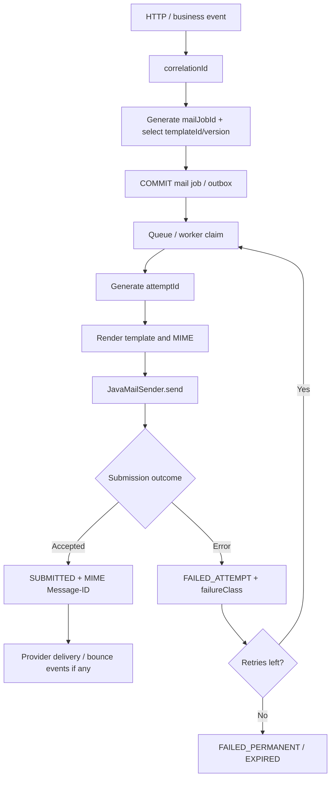

# Logging Message ID, Template ID, and Correlation ID in Spring Framework Mail

When an application sends emails asynchronously, a message may traverse many components: HTTP API, application service, database transaction, outbox, queue, worker, `JavaMailSender`, SMTP relay, and email provider. When a user says “I didn't receive the email”, the system must correlate log entries belonging to **the same send request** without opening raw emails, printing recipient addresses, or manually grepping through millions of log lines.

Three identifiers are especially useful:

- **Message ID**: the email message identifier in Internet Message Format, usually stored in the `Message-ID` header generated by Jakarta Mail or the sending infrastructure.
- **Template ID**: a stable, coded name for the email template used, such as `ORDER_CONFIRMATION` or `PASSWORD_RESET`. Pair it with **template version** so you know which content revision was used.
- **Correlation ID**: an identifier linking operations belonging to the same business workflow/request, even across asynchronous boundaries or multiple services.

These three IDs **are not interchangeable**. One correlation ID may relate to multiple mail jobs; one mail job may undergo multiple send attempts; each attempt may generate a different MIME `Message-ID`. For consistent tracking, the system should also maintain `mailJobId` and `attemptId`.

This lesson covers how to design safe logging, generate and propagate identifiers across Spring Framework Mail layers, read `MimeMessage.getMessageID()`, use SLF4J/MDC with `@Async`, preserve correlation across outboxes or brokers, build dashboards, trace incidents, and write tests. The goal is not to print as much data as possible, but to capture **just enough metadata to determine exactly what happened to an email without leaking content or secrets**.

## 1. Why logging a single SMTP error code is not enough

Suppose hundreds of emails time out within a few minutes:

```text
2026-11-12T10:00:01Z WARN Failed to send mail: timeout
2026-11-12T10:00:02Z WARN Failed to send mail: timeout
2026-11-12T10:00:02Z WARN Failed to send mail: timeout
```

These lines fail to answer:

- Which email belongs to the customer asking support?
- Was it queued yet?
- Was it resent after a retry?
- Which email type and template version did it use?
- Did the failure occur during MIME rendering, SMTP submission, or downstream delivery?
- Which request or business transaction can this error be linked to?

A better structured log entry:

```json
{
  "timestamp": "2026-11-12T10:00:02Z",
  "event": "mail_submission_failed",
  "correlationId": "a8c3fc71-41d9-4e50-8b68-d54144d8d71b",
  "mailJobId": "6c23c255-4e9e-4cdc-8654-ab4375b742b3",
  "attemptId": "7f77bdd9-dcb3-42ef-a7fb-969d40c9736e",
  "templateId": "ORDER_CONFIRMATION",
  "templateVersion": "v12",
  "failureClass": "SMTP_TIMEOUT",
  "retryable": true,
  "elapsedMs": 5010
}
```

In this example, none of the three IDs carry recipient addresses or message content. Operators can trace the sequence of events by `mailJobId` and use `correlationId` to locate the order-creation request without printing `recipientEmail` or `htmlBody`.

## 2. Distinguishing six common identifiers

| Identifier | When Created? | Scope of Stability | Primary Purpose |
|---|---|---|---|
| `correlationId` | When the request/business workflow starts | Across the related processing flow | Links API, transaction, outbox, and worker |
| `mailJobId` | When persisting a send intent in the job store/outbox | Throughout the mail job's lifetime, including retries | Locates the exact send request |
| `attemptId` | Each time a worker begins a send attempt | One send attempt | Distinguishes retries, timeouts, and submissions |
| `templateId` | When business logic selects an email template | A defined template category | Identifies which template was used |
| `templateVersion` | When a template is published or a job is created | One content revision | Investigates template regressions/changes |
| MIME `Message-ID` | When the MIME message is created/saved for sending | Usually one message instance | Matches email headers and some provider records |

In addition, some providers supply a **provider message ID**, **SMTP queue ID**, or **delivery event ID**. These belong to the provider and do not necessarily match the header `Message-ID`.

### 2.1. Why not rely solely on Message-ID?

`Message-ID` may not exist yet when the application first creates the job. When `JavaMailSender` fails before the message is saved/serialized, you may not obtain a usable ID. When a retry rebuilds the MIME message, `Message-ID` can change. Some providers also assign their own identifier after receiving the message.

Therefore, **`mailJobId` must be generated and persisted before sending** so it can be traced even if an SMTP connection was never opened. `Message-ID` is only a supplemental identifier tied to a built or submitted message.

### 2.2. Why not rely solely on correlation ID?

A single order-placement request can trigger three jobs:

```text
correlationId = C1
    |
    +--> mailJobId = J1 (customer email)
    +--> mailJobId = J2 (operations email)
    +--> notificationJobId = N1 (push notification)
```

Filtering only by `C1` shows the entire workflow without distinguishing the state of each individual email. Each job needs its own `mailJobId`; on retry, `mailJobId` stays constant while `attemptId` changes.

### 2.3. Template ID is not template content

`templateId = PASSWORD_RESET` is a controlled business key. It is not the HTML body, the rendered subject, or a link containing a token. Logging ID and version aids investigation without copying sensitive data.

## 3. Email lifecycle and where to log

A reference event flow:



You do not need to log every internal method call. A stable set of events is usually sufficient:

| Event | Recommended Fields | Meaning |
|---|---|---|
| `mail_job_created` | correlationId, mailJobId, templateId, version | Send intent has been recorded |
| `mail_job_enqueued` | mailJobId, queueName | Job placed into waiting queue |
| `mail_attempt_started` | mailJobId, attemptId, attemptNo | Worker began processing |
| `mail_render_completed` | IDs, templateId, version, renderDuration | Template/MIME built |
| `mail_submission_started` | IDs, providerAlias | About to invoke sending layer |
| `mail_submitted` | IDs, mimeMessageId if available, latency | SMTP submission returned normally |
| `mail_attempt_failed` | IDs, failureClass, retryable | An attempt failed |
| `mail_retry_scheduled` | mailJobId, nextAttemptAt, attemptNo | Scheduled for retry |
| `mail_job_expired` | mailJobId, expiryReason | No longer permitted to send |
| `mail_delivery_event` | mailJobId or providerMessageId, outcome | Provider reported downstream delivery status |

Not every project needs every event. A small service can start with **created, attempt started, submitted/failed, and retry**. More important is keeping event names and semantics consistent; never log `mail_submitted` at the enqueue step.

### Where should logging begin?

If logs are emitted only inside `JavaMailSender.send(...)`, you cannot see jobs never picked up by workers, jobs expired in the queue, or template rendering failures. Log at both the **application/job layer** and the **transport layer**, without letting both layers log the same error into duplicate lines.

## 4. What is RFC 5322 Message-ID?

`Message-ID` is an Internet Message Format header field, typically formatted as:

```text
Message-ID: <unique-part@example.org>
```

It is designed to identify a specific version of an email message, helping systems match messages, threads, or diagnostics. Its syntax and usage follow RFC 5322 rules; it is not a bare UUID without a domain part.

`Message-ID` is **not**:

- An SMTP envelope recipient (`RCPT TO`).
- An SMTP queue ID returned by the server in a reply.
- A business idempotency key.
- A token proving inbox delivery.
- Guaranteed to be preserved unchanged by mailbox providers across all gateways.
- Guaranteed to be present before calling `send()`.

### 4.1. Generating Message-ID with Jakarta Mail

Modern Spring Framework Mail builds on Jakarta Mail; `JavaMailSender.createMimeMessage()` returns a `MimeMessage`. Typically, when a message is saved/prepared for sending, Jakarta Mail populates missing headers, which can include `Message-ID`.

```java
MimeMessage message = mailSender.createMimeMessage();
MimeMessageHelper helper = new MimeMessageHelper(
        message, false, "UTF-8");

helper.setFrom("notifications@example.org");
helper.setTo("tester@example.invalid");
helper.setSubject("Order confirmation");
helper.setText("Your order has been recorded.", false);

// ID may not exist yet before the message is saved/serialized.
String before = message.getMessageID();

mailSender.send(message);

// Read ID after submission if the message implementation generated one.
String after = message.getMessageID();
```

`before` can be `null`; never write business logic assuming it is always populated before sending. `after` usually has a value with `JavaMailSenderImpl`, though logging must handle `null` or implementation/provider differences gracefully.

### 4.2. saveChanges() and when the ID is created

`MimeMessage.saveChanges()` can update required headers when preparing a message for transmission. `JavaMailSenderImpl` also prepares and saves the message before handing it to the transport. Depending on version and operations, `Message-ID` may be generated or modified on save.

If an application needs to read the ID before submission, it may call `message.saveChanges()` following the MIME lifecycle, but **never assume an ID read beforehand is guaranteed to be final** if the message is modified, re-saved, or rewritten by a provider. When exact verification is needed, inspect the message received by the SMTP sink/provider.

### 4.3. Should you set Message-ID manually?

Usually, letting Jakarta Mail generate the ID is simpler and safer. If a system has strict compatibility or tracing requirements for a self-generated ID, it must comply with RFC syntax, an organization-controlled domain, uniqueness, and Jakarta Mail's behavior during save/send. Some implementations may overwrite a preset ID on save.

Never take `Message-ID` from raw HTTP headers or user input. Never use a recipient email, user ID, or secret token as the local part of the ID, because headers can be stored and forwarded outside application boundaries.

### 4.4. Message-ID of retried emails

If a worker constructs a fresh `MimeMessage` on each attempt, the message ID may differ:

```text
mailJobId=J1
  attemptId=A1 -> mimeMessageId=<m1@example.org> -> timeout
  attemptId=A2 -> mimeMessageId=<m2@example.org> -> accepted
```

If the same message instance is reused, the ID may stay the same or change depending on save and transport behavior. Never rely on matching IDs to assume SMTP or a mailbox will automatically deduplicate.

**`Message-ID` is message-tracing metadata, not an exactly-once guarantee.**

## 5. Keep Message-ID and provider message ID separate

Some providers return their own identifier when submitting via REST API or in SMTP response metadata. For example:

```text
mimeMessageId     = <abcd@example.org>
providerMessageId = provider-queue-8f20c...
mailJobId         = 6c23c255-4e9e-4cdc-8654-ab4375b742b3
```

`JavaMailSender` has no common contract returning a provider queue ID from `send(MimeMessage)`. The `send` method returns `void`; it returns neither a delivery receipt nor a provider ID.

If an adapter uses a provider REST API whose response includes an ID, map that ID into a separate `providerMessageId` field. If using an SMTP server whose response text contains a queue ID, do not promise that standard `JavaMailSender` will expose it portably. Specific transport/provider instrumentation may be needed.

### Attempt-level identifier mapping table

| mailJobId | attemptId | MIME Message-ID | providerMessageId | Outcome |
|---|---|---|---|---|
| J-101 | A-1 | m-1 | Unavailable | TIMEOUT |
| J-101 | A-2 | m-2 | p-9021 | SUBMITTED |
| J-102 | A-3 | m-3 | p-9022 | SUBMITTED |

Values above are illustrative symbols. In a real system, also store timestamps, provider alias, normalized error, and delivery status. Treat provider identifiers as potentially sensitive metadata according to the provider's nature and retention policies.

## 6. Template ID and template version

`templateId` identifies **which template category** was selected. Never use the raw `Subject` as a substitute for template ID, because `Subject` can contain customer names, order numbers, or private details.

Example enum:

```java
package com.example.mail;

public enum MailTemplateId {
    ACCOUNT_VERIFICATION,
    PASSWORD_RESET,
    ORDER_CONFIRMATION,
    INVOICE_READY,
    APPOINTMENT_REMINDER
}
```

Instead of:

```java
log.info("template subject={}", renderedSubject);
log.debug("template variables={}", variables);
```

log:

```java
log.info(
        "mail templateSelected jobId={} templateId={} templateVersion={}",
        jobId,
        MailTemplateId.ORDER_CONFIRMATION.name(),
        "v12");
```

### 6.1. When should you add a version?

Suppose the `ORDER_CONFIRMATION` template changes over time:

```text
v10: simple text/plain email
v11: added HTML and logo
v12: changed domain of the view-order button
```

If next week recipients report that the button points to the wrong page, `templateId` alone is not enough. `templateVersion` tells you which revision the job used and correlates with deployment timestamps.

A version can be:

- An incrementing template release number (`v12`).
- A version key issued by a CMS/template registry.
- A fixed artifact/revision ID of the template bundle.
- A short meaningful fingerprint from an internal release mechanism.

Never use the HTML body or raw template variables as `version`. If templates load dynamically from a database, the job should persist the selected ID/version so retries do not silently alter content unexpectedly.

### 6.2. Do not use arbitrary template names as unbounded tags

If `templateId` comes straight from user-defined strings, it can contain PII, control characters, and millions of distinct values. For logging/metrics, use an approved catalog or map to a finite group.

Multi-tenant templates can be distinguished in an access-controlled job store; never automatically add raw tenant IDs or full database paths to every metric tag.

### 6.3. Template ID vs. locale

The same `ORDER_CONFIRMATION` may have Vietnamese and English variants. You can log `locale=vi-VN/en-US` when chosen from an allowlisted set. Avoid naming templates like `templateId=order-confirmation-for-customer-123@example.net`.

## 7. Correlation ID: linking requests, events, and workers

`correlationId` links related events within the same business workflow. An HTTP request may write an outbox event that another worker processes minutes later, or another service may send the email on its behalf.

Example:

```text
HTTP POST /orders
  correlationId = C-100
  |
  +-- OrderService
  |     order created
  |
  +-- MailOutbox
  |     mailJobId = J-200
  |
  +-- Background mail worker
  |     attemptId = A-300
  |     templateId = ORDER_CONFIRMATION
  |
  +-- SMTP provider
        mimeMessageId = <m-400@example.org>
```

All logs within the application workflow can share `correlationId`, while each component retains its own responsibility-specific ID.

### 7.1. Generating a correlation ID

A simple approach:

```java
UUID correlationId = UUID.randomUUID();
```

Never use an email address, session cookie, JWT, or account number as a correlation ID. If accepting an ID from a request header such as `X-Correlation-ID`, validate format, length, trusted origin, and proxy forwarding policies.

### 7.2. Be cautious with external input

An HTTP client can supply anything:

```text
X-Correlation-ID: <arbitrary value>
```

If the server writes that raw value into MDC/logs, it could contain newlines, sensitive data, or huge strings. Safe practice:

- Accept only standard UUIDs or a strictly defined format.
- Reject/regenerate when input is invalid.
- Enforce a length cap.
- Never grant special trust to client-supplied headers.
- When behind a trusted reverse proxy/tracing infrastructure, explicitly define which sources are authorized to supply correlation context.

Example:

```java
public static UUID parseOrCreateCorrelationId(String supplied) {
    if (supplied != null && supplied.length() == 36) {
        try {
            UUID parsed = UUID.fromString(supplied);
            if (parsed.toString().equalsIgnoreCase(supplied)) {
                return parsed;
            }
        } catch (IllegalArgumentException ignored) {
            // Generate a new ID for invalid input.
        }
    }
    return UUID.randomUUID();
}
```

The goal is not to authenticate callers via UUID, but to guarantee a log-safe identifier. If correlation context touches authorization/security, never treat a self-declared UUID as proof of permission.

### 7.3. Correlation ID vs. trace ID

Systems using OpenTelemetry/Micrometer Tracing may have:

- `traceId`: distributed trace identifier.
- `spanId`: identifier for a unit of work within a trace.
- `correlationId`: application-chosen business correlation key that may outlive a single trace.

They can be linked, though they need not be identical. An outbox job processed hours later may run under a new worker trace while preserving the original workflow's `correlationId`.

If using `traceId` as a correlation key in a short-lived flow, understand tracing lifecycle and retention. For durable jobs, persist a stable `correlationId` in payload/metadata.

## 8. Generating correlation ID at the HTTP boundary

At the HTTP layer, a filter can accept a valid correlation ID from a header or generate a new one, then place it into MDC so services log with that context.

Spring Web example:

```java
package com.example.mail.observability;

import jakarta.servlet.FilterChain;
import jakarta.servlet.ServletException;
import jakarta.servlet.http.HttpServletRequest;
import jakarta.servlet.http.HttpServletResponse;
import java.io.IOException;
import java.util.UUID;
import org.slf4j.MDC;
import org.springframework.stereotype.Component;
import org.springframework.web.filter.OncePerRequestFilter;

@Component
public class CorrelationIdFilter extends OncePerRequestFilter {

    private static final String HEADER = "X-Correlation-ID";

    @Override
    protected void doFilterInternal(
            HttpServletRequest request,
            HttpServletResponse response,
            FilterChain chain) throws ServletException, IOException {

        UUID correlationId = CorrelationIds.parseOrCreate(
                request.getHeader(HEADER));

        response.setHeader(HEADER, correlationId.toString());

        try (MDC.MDCCloseable ignored = MDC.putCloseable(
                "correlationId", correlationId.toString())) {
            chain.doFilter(request, response);
        }
    }
}
```

`CorrelationIds.parseOrCreate(...)` is a utility applying the UUID rule from section 7. Header names are fixed; never copy all request headers or bodies into logs. If a filter interacts with multiple tracing mechanisms, align field names and trust policies.

### 8.1. When a request creates multiple mail jobs

Example:

```java
@Transactional
public Order placeOrder(PlaceOrderCommand command) {
    UUID correlationId = currentCorrelationId();
    Order order = orderRepository.save(Order.create(command));

    mailJobRepository.save(MailJob.pending(
            UUID.randomUUID(),
            correlationId,
            MailTemplateId.ORDER_CONFIRMATION,
            "v12",
            order.getId()));

    return order;
}
```

`currentCorrelationId()` is an application-provided helper that can read validated context or take an explicit parameter. `MailJob.pending(...)` is a project-defined entity factory. The key point is **persisting `correlationId` in the durable record within the same transaction that creates the send intent**.

Never rely solely on MDC so workers know the ID minutes later, because MDC is thread-bound and disappears when the request ends.

### 8.2. Flows without an HTTP request

Mail jobs can originate from `@Scheduled` tasks, cron jobs, message brokers, or admin actions. Without an inbound request header, the application should generate a correlation ID for the batch/workflow:

```java
UUID batchCorrelationId = UUID.randomUUID();
```

If a batch processes thousands of emails, you can use a shared batch correlation ID alongside an individual mail job ID per email. Never try to reuse one correlation ID as the message ID for all emails.

## 9. Safe logging with SLF4J and MDC

SLF4J supports parameterized logging and MDC. Rather than concatenating long strings containing request data, log explicit fields:

```java
private static final Logger log =
        LoggerFactory.getLogger(MailWorker.class);

log.info(
        "mail event={} jobId={} attemptId={} templateId={} templateVersion={}",
        "attempt_started",
        job.id(),
        attemptId,
        job.templateId().name(),
        job.templateVersion());
```

`correlationId` can be added via the MDC/logging pattern or placed into structured events according to your schema.

### 9.1. Scoped MDC

Example inside a worker:

```java
UUID attemptId = UUID.randomUUID();

try (MDC.MDCCloseable correlation = MDC.putCloseable(
             "correlationId", job.correlationId().toString());
     MDC.MDCCloseable mailJob = MDC.putCloseable(
             "mailJobId", job.id().toString());
     MDC.MDCCloseable attempt = MDC.putCloseable(
             "attemptId", attemptId.toString())) {

    log.info("mail event={} templateId={}",
            "attempt_started", job.templateId().name());

    mailProcessor.process(job, attemptId);
}
```

`MDC.putCloseable` automatically removes the associated key when exiting the scope. This is critical for thread pools: a worker thread may handle job J1 and then J2; without cleaning MDC, J2's logs could inherit J1's IDs.

**Note:** closing `MDCCloseable` removes the key that was set; if the same key already held a prior value that must be preserved, capture and restore the previous MDC explicitly. In a worker handling a single job, establish a clean context or use a scope helper with explicit rules.

### 9.2. Log patterns and JSON logging

In a Logback pattern, you can include MDC fields:

```xml
<pattern>
  %d{ISO8601} %-5level
  [%thread] correlationId=%X{correlationId:-}
  mailJobId=%X{mailJobId:-}
  attemptId=%X{attemptId:-}
  %logger - %msg%n
</pattern>
```

This XML snippet shows the `pattern` portion to place inside an appropriate Logback appender/configuration. In centralized log backends, a JSON encoder or structured logging configuration enables exact filtering by key.

Example of a well-formed JSON event:

```json
{
  "event": "mail_submitted",
  "correlationId": "a8c3fc71-41d9-4e50-8b68-d54144d8d71b",
  "mailJobId": "6c23c255-4e9e-4cdc-8654-ab4375b742b3",
  "attemptId": "7f77bdd9-dcb3-42ef-a7fb-969d40c9736e",
  "templateId": "ORDER_CONFIRMATION",
  "templateVersion": "v12",
  "mimeMessageId": "<demo-001@example.org>",
  "providerAlias": "outbound-primary",
  "elapsedMs": 308
}
```

Do not assume a `log.info("key={}...", ...)` call automatically turns into separate JSON fields. You must configure a structured log encoder; with plain text only, the log backend receives a single message string.

### 9.3. SLF4J 2 fluent logging

With SLF4J 2.x, you can write:

```java
log.atInfo()
        .addKeyValue("event", "mail_submitted")
        .addKeyValue("mailJobId", job.id().toString())
        .addKeyValue("attemptId", attemptId.toString())
        .addKeyValue("templateId", job.templateId().name())
        .log("Mail submission accepted");
```

Key-value pairs may be supported by your encoder/rendering system depending on configuration. If JSON structured logging is not yet configured, inspect actual log output to see how fields appear; do not assume every appender supports key-based querying.

## 10. Complete example: JavaMailSender logging Message-ID after send

The following example focuses on a single SMTP submission in Spring Framework Mail. Types like `MailJobData`, `MailTemplateId`, and stores are application-defined, not built-in APIs.

### 10.1. DTO that keeps secrets out of toString()

```java
package com.example.mail;

import java.util.UUID;

public record MailJobData(
        UUID mailJobId,
        UUID correlationId,
        MailTemplateId templateId,
        String templateVersion,
        int attemptNo,
        String recipientEmail,
        String subject,
        String plainText,
        String htmlText) {
}
```

**Never log the entire record**, because a Java record's default `toString()` includes `recipientEmail`, `subject`, and email body. Log only allowlisted fields.

### 10.2. Sending and event-logging adapter

```java
package com.example.mail;

import jakarta.mail.MessagingException;
import jakarta.mail.internet.MimeMessage;
import java.nio.charset.StandardCharsets;
import java.util.UUID;
import org.slf4j.Logger;
import org.slf4j.LoggerFactory;
import org.slf4j.MDC;
import org.springframework.mail.MailException;
import org.springframework.mail.javamail.JavaMailSender;
import org.springframework.mail.javamail.MimeMessageHelper;
import org.springframework.stereotype.Service;

@Service
public class ObservedMailSender {

    private static final Logger log =
            LoggerFactory.getLogger(ObservedMailSender.class);

    private final JavaMailSender sender;

    public ObservedMailSender(JavaMailSender sender) {
        this.sender = sender;
    }

    public void submit(MailJobData job) {
        UUID attemptId = UUID.randomUUID();
        long startedNanos = System.nanoTime();

        try (MDC.MDCCloseable correlation = MDC.putCloseable(
                     "correlationId", job.correlationId().toString());
             MDC.MDCCloseable mailJob = MDC.putCloseable(
                     "mailJobId", job.mailJobId().toString());
             MDC.MDCCloseable attempt = MDC.putCloseable(
                     "attemptId", attemptId.toString())) {

            log.info(
                    "mail event={} templateId={} templateVersion={} attemptNo={}",
                    "submission_started",
                    job.templateId().name(),
                    job.templateVersion(),
                    job.attemptNo());

            MimeMessage message;
            try {
                message = sender.createMimeMessage();

                MimeMessageHelper helper = new MimeMessageHelper(
                        message,
                        MimeMessageHelper.MULTIPART_MODE_MIXED_RELATED,
                        StandardCharsets.UTF_8.name());

                helper.setFrom("notifications@example.org");
                helper.setTo(job.recipientEmail());
                helper.setSubject(job.subject());
                helper.setText(job.plainText(), job.htmlText());
            } catch (MessagingException ex) {
                log.warn(
                        "mail event={} failureClass={}",
                        "submission_failed",
                        "MIME_PREPARATION");
                throw new IllegalStateException(
                        "Cannot prepare email", ex);
            }

            try {
                sender.send(message);
            } catch (MailException ex) {
                log.warn(
                        "mail event={} failureClass={} elapsedMs={}",
                        "submission_failed",
                        "MAIL_TRANSPORT",
                        elapsedMillis(startedNanos));
                throw ex;
            }

            // Send succeeded: Message-ID may or may not be present.
            String mimeId = safeMessageId(message);

            log.info(
                    "mail event={} templateId={} templateVersion={} " +
                    "mimeMessageId={} elapsedMs={}",
                    "submitted",
                    job.templateId().name(),
                    job.templateVersion(),
                    mimeId,
                    elapsedMillis(startedNanos));
        }
    }

    private static long elapsedMillis(long startNanos) {
        return (System.nanoTime() - startNanos) / 1_000_000;
    }

    private static String safeMessageId(MimeMessage message) {
        try {
            String id = message.getMessageID();
            if (id == null || id.length() > 320) {
                return "unavailable";
            }

            // Conservative logging policy for standard identifiers.
            if (!id.matches("<[A-Za-z0-9._%+\\-]+@[A-Za-z0-9.\\-]+>")) {
                return "unavailable";
            }
            return id;
        } catch (MessagingException ex) {
            return "unavailable";
        }
    }
}
```

In this example:

- `IllegalStateException` in the MIME preparation branch is a simplified example; an application can substitute a domain exception with its own error classification.
- `mailJobId` and `correlationId` are placed into MDC from the job record; never read from an already-finished request thread.
- `attemptId` is created for one submit call. If the system persists attempts to a database, create `attemptId` in the worker before calling the adapter and pass it in rather than generating it inside.
- When `sender.send(message)` returns normally, `submitted` is logged; this **does not prove delivery or inbox placement**.
- `safeMessageId` uses a conservative logging allowlist and returns `unavailable` for non-standard IDs. Some valid Message-IDs might not match this regex; the goal here is preventing unusual headers from entering logs, not writing a full RFC parser.
- `safeMessageId` must never throw an exception that marks a successful SMTP submission as failed just because reading the ID failed.
- The adapter never logs recipient, Subject, HTML body, OTP, attachments, or raw `MailException.getMessage()`.
- SMTP errors are rethrown to the worker layer to decide retries, expiry, and job updates. If another layer prints the entire exception chain, the safe logging policy can be bypassed.

The example above is a **sender-boundary event logging pattern**. In production, separate attempt-state persistence and classify `MailException` in greater detail—especially timeouts where it is uncertain whether the server accepted the message.

### 10.3. When using SimpleMailMessage

With `SimpleMailMessage`, a service typically calls:

```java
SimpleMailMessage mail = new SimpleMailMessage();
mail.setFrom("notifications@example.org");
mail.setTo("tester@example.invalid");
mail.setSubject("Hello");
mail.setText("Content");
mailSender.send(mail);
```

At this layer, the service holds no `MimeMessage` instance from which to read `Message-ID` after sending. Thus, if logging MIME `Message-ID` is required, use `MimeMessage`/`MimeMessageHelper` or an adapter/instrumentation that actually supports that metadata. Never fabricate a Message-ID just to populate log fields.

## 11. Managing attempt IDs consistently across retries

When a job fails and is retried, separate two questions:

1. “Is this the same **send intent**?” — use `mailJobId`.
2. “Which **attempt** is this and what happened?” — use `attemptId` and `attemptNo`.

Example:

```text
mailJobId=J100  templateId=PASSWORD_RESET  version=v4
    |
    +-- attemptNo=1 attemptId=A101
    |       -> SMTP timeout
    |       -> result=UNKNOWN / retry scheduled
    |
    +-- attemptNo=2 attemptId=A102
            -> SMTP accepted
            -> mimeMessageId=<m102@example.org>
```

Do not merely log “send failed” then “send success” without linking them as retries of the same job. Conversely, never reuse the same `attemptId` across attempts, because investigating timeouts and duplicates depends on distinguishing individual SMTP calls.

### 11.1. Creating attempt records in the worker

A store class can provide:

```java
public record MailAttempt(
        UUID attemptId,
        UUID mailJobId,
        int attemptNo,
        Instant startedAt) {
}
```

Worker:

```java
MailAttempt attempt = attemptStore.startAttempt(
        job.id(), clock.instant());

senderAdapter.submit(job, attempt.attemptId());
```

With this API, the sender adapter uses the `attemptId` created by the store, keeping logs, retries, and the database aligned. Recording the attempt should occur in a short transaction with lease/ownership policies if multiple workers can share the queue.

### 11.2. A timeout does not guarantee the email was not sent

If the SMTP connection drops after the server has already received the full message, the caller may miss the ACK. Then:

```text
attempt=A101 -> TIMEOUT
provider may have received the message
worker is uncertain -> retry A102
```

Mail Job `J100` may result in two emails in the mailbox. A `Message-ID` or `attemptId` only helps distinguish and investigate them; **it does not create exactly-once delivery**.

If the provider offers an idempotency API, supply the key and store the provider ID per its contract. With plain SMTP, job/retry design must accept uncertainty and mitigate duplicate impact through business policy.

## 12. Propagating correlation ID across @Async

SLF4J MDC normally relies on thread-local context. When `@Async` hands work off to a thread pool, the request thread's MDC values **are not guaranteed to propagate automatically to the worker**. Simply writing:

```java
@Async("mailExecutor")
public void sendLater(MailJob job) {
    log.info("mail event=started"); // May be missing correlationId.
}
```

can leave logs missing `correlationId`, especially when publisher and worker run on separate threads.

### 12.1. TaskDecorator with an MDC allowlist

Spring's `ThreadPoolTaskExecutor` supports `TaskDecorator` to wrap `Runnable` tasks. It can capture and propagate **only safe keys**, then restore the previous MDC when the task finishes:

```java
package com.example.mail.observability;

import java.util.HashMap;
import java.util.List;
import java.util.Map;
import org.slf4j.MDC;
import org.springframework.core.task.TaskDecorator;

public final class SafeMailMdcTaskDecorator implements TaskDecorator {

    private static final List<String> SAFE_KEYS =
            List.of("correlationId", "mailJobId");

    @Override
    public Runnable decorate(Runnable task) {
        Map<String, String> source = MDC.getCopyOfContextMap();
        Map<String, String> safeContext = new HashMap<>();

        if (source != null) {
            for (String key : SAFE_KEYS) {
                String value = source.get(key);
                if (value != null && value.matches(
                        "[0-9a-fA-F-]{36}")) {
                    safeContext.put(key, value);
                }
            }
        }

        return () -> {
            Map<String, String> previous =
                    MDC.getCopyOfContextMap();
            try {
                MDC.clear();
                if (!safeContext.isEmpty()) {
                    MDC.setContextMap(safeContext);
                }
                task.run();
            } finally {
                MDC.clear();
                if (previous != null) {
                    MDC.setContextMap(previous);
                }
            }
        };
    }
}
```

The example intentionally copies only `correlationId` and `mailJobId`, not everything in the request context. The regex is a simple length/character check during propagation; ID creation boundaries still require strict UUID parsing. In production, share one unified ID validation helper rather than duplicating policies.

### 12.2. Wiring TaskDecorator into the executor

```java
@Configuration
@EnableAsync
public class MailAsyncConfiguration {

    @Bean("mailExecutor")
    public ThreadPoolTaskExecutor mailExecutor() {
        ThreadPoolTaskExecutor executor =
                new ThreadPoolTaskExecutor();
        executor.setCorePoolSize(4);
        executor.setMaxPoolSize(8);
        executor.setQueueCapacity(200);
        executor.setThreadNamePrefix("mail-worker-");
        executor.setTaskDecorator(
                new SafeMailMdcTaskDecorator());
        return executor;
    }
}
```

Thread and queue sizes are illustrative. Executors with bounded queues need rejection policies, backlog monitoring, and saturation handling. Configure `TaskDecorator` before the executor starts accepting tasks.

### 12.3. Limitations of TaskDecorator

`TaskDecorator` propagates context only when a task is submitted from a thread already carrying the right MDC. It **does not help** when:

- Jobs are polled from a database after the request finishes.
- The process restarts and another instance picks up the job.
- Jobs pass through RabbitMQ/Kafka/SQS.
- A scheduler creates tasks on a background thread lacking the original MDC.
- Retries are driven by a separate orchestrator.

Therefore, for durably asynchronous email processing, **persist `correlationId` in the mail job or event** and initialize MDC from that metadata when the worker starts. `TaskDecorator` is a helper for in-process async, not a sole source of truth.

## 13. Preserving IDs across transactional outboxes and message brokers

A reliable pattern is writing the mail job to an outbox in the same transaction as the business action:

```text
OrderService (transaction)
    |
    +-- save order
    +-- save mail_outbox {
          mailJobId,
          correlationId,
          templateId,
          templateVersion,
          payloadRef
        }
    |
   COMMIT
    |
    v
Mail worker
    +-- read metadata from outbox
    +-- generate attemptId
    +-- configure logging context
    +-- render/send
    +-- persist status
```

If the transaction rolls back, no durable job is created. If it commits, workers can resume after restarts. Because `correlationId` is saved alongside the job, it survives retries and deployments.

### 13.1. Event DTO carrying correlation metadata

```java
package com.example.mail;

import java.util.UUID;

public record MailSendRequested(
        UUID mailJobId,
        UUID correlationId,
        MailTemplateId templateId,
        String templateVersion,
        UUID payloadReference) {
}
```

`payloadReference` is only an identifier pointing to protected data, not the email body or OTP. If the system requires a snapshot for retries, store the payload with appropriate access controls, encryption, and retention.

### 13.2. When publishing to a broker

Message brokers can support headers carrying correlation metadata. Two sensible approaches:

1. Place `correlationId`, `mailJobId`, and template metadata inside a **payload envelope** with an explicit schema/version.
2. Place selected identifiers in broker headers and validate them at the consumer boundary.

If an untrusted producer can publish directly to the broker, never treat headers as authenticated data. Validate format and size; never let arbitrary input turn into log entries, MDC keys, trace fields, or custom email headers.

### 13.3. Do not inject correlation IDs into email headers unnecessarily

Some teams want to add:

```text
X-Correlation-ID: ...
```

for searching raw emails. This can be useful in certain systems but carries a trade-off: the header travels to recipients and intermediate gateways, exposing internal metadata. If used, the ID must contain no PII, no credentials, and be generated and validated with strict syntax.

In most cases, internal logs with `mailJobId` and `Message-ID` are sufficient. There is no need to broadcast request correlation IDs across every outbound email merely for debugging convenience.

## 14. A database schema for reconciling logs, retries, and providers

For critical business emails, store metadata in a database to cross-check against logs. PostgreSQL example:

```sql
CREATE TABLE mail_job (
    id                UUID PRIMARY KEY,
    correlation_id    UUID NOT NULL,
    template_id       VARCHAR(80) NOT NULL,
    template_version  VARCHAR(40) NOT NULL,
    status            VARCHAR(40) NOT NULL,
    created_at        TIMESTAMPTZ NOT NULL,
    updated_at        TIMESTAMPTZ NOT NULL,
    completed_at      TIMESTAMPTZ
);

CREATE TABLE mail_attempt (
    id                   UUID PRIMARY KEY,
    mail_job_id          UUID NOT NULL REFERENCES mail_job(id),
    attempt_no           INTEGER NOT NULL,
    started_at           TIMESTAMPTZ NOT NULL,
    completed_at         TIMESTAMPTZ,
    result               VARCHAR(40),
    failure_class        VARCHAR(80),
    mime_message_id      VARCHAR(320),
    provider_message_id  VARCHAR(320),
    CONSTRAINT uq_mail_attempt_no
        UNIQUE (mail_job_id, attempt_no)
);

CREATE INDEX idx_mail_job_correlation
    ON mail_job (correlation_id);

CREATE INDEX idx_mail_attempt_message_id
    ON mail_attempt (mime_message_id);
```

This is an illustrative schema, not a full outbox implementation. If multiple workers claim jobs concurrently, you also need status/lease/fencing tokens and short transactions; for retries, add `next_attempt_at`, `expires_at`, and polling mechanisms. Validate length on provider-returned values before persisting.

### 14.1. Why separate mail_job and mail_attempt?

A single job can have multiple attempts:

```text
mail_job
  id=J100
  correlation=C200
  template=ORDER_CONFIRMATION/v12

mail_attempt
  A1 / J100 / TIMEOUT / mime m1
  A2 / J100 / SUBMITTED / mime m2
```

If there were only a single `messageId` column on the job table, each retry would overwrite the previous ID, losing the ability to reconcile provider events or investigate potential duplicates.

### 14.2. How indexes assist lookups

- Find mail jobs by correlation ID: `mail_job.correlation_id`.
- Find all attempts for a job: `mail_attempt.mail_job_id`.
- Find an attempt by MIME Message-ID: `mail_attempt.mime_message_id`.
- Look up by provider ID: add a dedicated index if that is a frequent investigation path.

Never add Subject, recipient address, or MIME body to search indexes/logs solely for lookup convenience. When support needs to search by user, go through an access-controlled business system and join on internal IDs.

### 14.3. Logs do not replace durable state

Log collectors can lag, drop entries, or apply sampling. Business state such as “how many times a job retried” or “whether SMTP accepted it” belongs in the application's job/attempt model. Logs are an observability and investigation tool, not a reliable transaction store replacing a database.

## 15. Standard definitions for log fields

A multi-service system should agree on a single schema rather than letting each team invent different names:

| Suggested Field Name | Type | Example | Notes |
|---|---|---|---|
| `timestamp` | ISO-8601 UTC | `2026-11-12T10:00:02Z` | When event was logged |
| `event` | Bounded enum/string | `mail_submitted` | Stable event name |
| `service` | Bounded string | `mail-worker` | Deployed service name |
| `environment` | Enum | `staging` | Never mix test/prod |
| `correlationId` | UUID | `a8c3...` | Links workflow |
| `mailJobId` | UUID | `6c23...` | Send intent |
| `attemptId` | UUID | `7f77...` | Single send attempt |
| `attemptNo` | Integer | `2` | Attempt sequence number |
| `templateId` | Enum | `ORDER_CONFIRMATION` | Finite catalog |
| `templateVersion` | Bounded string | `v12` | Approved version identifier |
| `mimeMessageId` | Optional string | `<m1@example.org>` | May be null/absent |
| `providerMessageId` | Optional string | `provider-9021` | Distinct from MIME ID by default |
| `providerAlias` | Enum | `outbound-primary` | Never log credentials |
| `failureClass` | Enum | `SMTP_TIMEOUT` | Coded failure cause |
| `retryable` | Boolean | `true` | Current retry decision |
| `elapsedMs` | Long | `308` | Duration of corresponding step |
| `nextAttemptAt` | ISO-8601 UTC | `2026-11-12T10:02:00Z` | Present only when scheduling retry |

Not every event carries every field. For example, `mail_job_created` will not have `attemptId` or `mimeMessageId` yet; never invent dummy values just to fill a JSON schema.

### 15.1. Use consistent field names across every service

`correlation_id`, `correlationId`, and `requestCorrelation` are not wrong individually, but mixing them across the same system makes queries and dashboards hard to maintain. Pick one convention and apply it consistently across:

- HTTP API logging.
- Outbox/queue producers.
- Mail workers.
- SMTP sender adapters.
- Delivery webhook processors.
- Incident and dashboard queries.

Java internals may use camelCase while OpenTelemetry conventions or log stores use another naming style. Mapping at the collector is fine as long as every field's meaning is clearly documented.

### 15.2. Name events after lifecycle transitions, not vague messages

Instead of:

```text
Mail finished
Mail failed
Mail done
```

choose:

```text
mail_job_created
mail_attempt_started
mail_render_failed
mail_submission_started
mail_submitted
mail_attempt_failed
mail_retry_scheduled
mail_job_expired
mail_delivery_confirmed
mail_bounced
```

For each event, agree on who emits it, when it is emitted, and which state has been durably persisted. Never emit `mail_submitted` before `JavaMailSender.send(...)` actually completes.

## 16. Log SMTP outcomes accurately

An SMTP server reply is not the same as mailbox delivery state. A common mistake is:

```java
mailSender.send(message);
log.info("Email delivered successfully");
```

This overstates what happened. `JavaMailSender.send(...)` returning normally typically means the transport submitted the message to the receiving server at that hop. Name the event:

```java
log.info("mail event=mail_submitted ...");
```

rather than `mail_delivered`, unless you have a confirmed delivery event from the provider.

### 16.1. One submission can have multiple subsequent outcomes

Example:

```text
10:00:00 mail_submitted
10:00:04 provider_delivery_event = deferred
10:01:20 provider_delivery_event = bounced
```

Looking only at the first log line, the app may claim “sent successfully” even though the recipient never received the email. Persist provider outcomes separately with a normalized status code and provider event timestamp.

### 16.2. Message-ID does not prove delivery

A mail provider or mailbox server may have a `Message-ID` in the message source while still rejecting the message or routing it to Spam. The presence of that header does not even prove SMTP submission succeeded.

When investigating, combine:

1. Job/attempt state.
2. `JavaMailSender.send` outcome.
3. SMTP submission timestamp.
4. Provider message ID / queue ID if available.
5. Delivery/bounce webhooks and recipient policies.

Never treat the count of logged MIME `Message-ID` values as the number of emails read by recipients.

## 17. Classify failureClass instead of logging raw exceptions

Some SMTP exceptions contain recipient addresses, server responses, or header fragments. Printing raw `ex.getMessage()` or stack traces at every layer risks leaking data and hampers filtering.

A suggested taxonomy:

```java
public enum MailFailureClass {
    SMTP_AUTHENTICATION,
    SMTP_CONNECTION,
    SMTP_TIMEOUT,
    SMTP_THROTTLED,
    SMTP_RECIPIENT_REJECTED,
    SMTP_MESSAGE_TOO_LARGE,
    MIME_PREPARATION,
    TEMPLATE_RENDERING,
    POLICY_REJECTED,
    UNKNOWN
}
```

These values are application-defined, not a built-in Spring Mail enum. When a cause cannot be determined, use `UNKNOWN` instead of dumping the raw provider reply into `failureClass`.

### 17.1. Error classifiers need safe inputs

```java
public MailFailureClass classify(MailException ex) {
    if (ex instanceof MailAuthenticationException) {
        return MailFailureClass.SMTP_AUTHENTICATION;
    }
    if (ex instanceof MailSendException) {
        return MailFailureClass.UNKNOWN;
    }
    return MailFailureClass.UNKNOWN;
}
```

This is a minimal example. In production, classify further based on exception subtypes or SMTP reply codes safely exposed by your library/provider, without logging raw messages just to classify. Be careful with `retryable`: timeouts may be retried, configuration auth failures usually should not be hammered continuously, and permanent recipient errors should move to terminal state.

### 17.2. What details can be logged on error?

Example:

```json
{
  "event": "mail_attempt_failed",
  "mailJobId": "6c23c255-4e9e-4cdc-8654-ab4375b742b3",
  "attemptId": "7f77bdd9-dcb3-42ef-a7fb-969d40c9736e",
  "templateId": "ORDER_CONFIRMATION",
  "failureClass": "SMTP_TIMEOUT",
  "retryable": true,
  "elapsedMs": 5010
}
```

Never include:

- Raw SMTP passwords, OAuth tokens, or API keys.
- `recipientEmail`, `Cc`, or `Bcc`.
- Subjects containing order IDs or usernames.
- HTML/plain-text bodies or template variables.
- User-associated attachment filenames or file bytes.
- Full unredacted provider responses.

If a separate diagnostic system exists for authorized operators, extra data must still obey retention, access control, and masking; never expose full raw MIME by default.

### 17.3. Only one layer should own primary error logging

If an exception passes through mail adapter, retry worker, event listener, executor, and HTTP handler, do not let all five layers log the same full exception.

Convention:

- The adapter classifies transport errors and may emit metrics.
- The worker owns attempt state and logs a single `mail_attempt_failed` event.
- The scheduler logs `mail_retry_scheduled` once state is updated.
- The controller returns an appropriate business outcome.

This prevents log storms and duplicate entries while keeping each event's semantics intact.

## 18. Metrics, traces, and logs: three distinct data sources

Logs with `mailJobId` and `attemptId` help investigate a specific case. Metrics show system-wide trends. Traces explain latency across steps.

| Tool | Best Suited For | Example |
|---|---|---|
| Logs | Investigating a specific job/attempt | Find all lines with `mailJobId=J100` |
| Metrics | Rates, latency, backlog, and alerting | SMTP timeouts rising after deploy |
| Traces | Relationships and durations across steps | HTTP → transaction → worker → SMTP |
| Job/attempt database | Durable state and auditing | Job J100 retried twice, attempt A2 submitted |

### 18.1. Do not use high-cardinality IDs as metric tags

Micrometer can increment a counter:

```java
registry.counter(
        "mail.submission.attempts",
        "templateId", job.templateId().name(),
        "outcome", "failed",
        "failureClass", failureClass.name())
        .increment();
```

These tags have finite catalogs suitable for aggregation. By contrast:

```java
// Do not do this: each job creates a separate time series.
registry.counter(
        "mail.submission.attempts",
        "mailJobId", job.id().toString())
        .increment();
```

`mailJobId`, `attemptId`, `correlationId`, and `mimeMessageId` are high-cardinality IDs. Putting them in metric tags can create a separate time series per email, inflating memory, storage cost, and slowing down monitoring.

Detailed IDs belong in logs, traces, or access-controlled stores. In tracing, high-cardinality attributes still require sampling, privacy, and cost controls.

### 18.2. Essential metrics for mail workers

| Metric | Type | Meaning |
|---|---|---|
| `mail.jobs.created` | Counter | Recorded send intents |
| `mail.jobs.ready` | Gauge | Due jobs currently waiting |
| `mail.attempts.started` | Counter | Attempts started |
| `mail.submissions.accepted` | Counter | SMTP submits returning success |
| `mail.attempts.failed` | Counter | Failed attempts by failure class |
| `mail.jobs.expired` | Counter | Jobs expired before sending |
| `mail.jobs.retry_scheduled` | Counter | Jobs scheduled for retry |
| `mail.smtp.duration` | Timer | SMTP call latency |
| `mail.queue.wait` | Timer | Time jobs wait for a worker |

These metrics do not need message ID labels. Dashboards can slice by `mailType`, `providerAlias`, and `templateId` if value sets are small and needed. Avoid blindly adding `templateVersion` if dynamic versioning produces unbounded values; check cardinality and analytical value first.

### 18.3. Distributed tracing

With Micrometer Tracing/OpenTelemetry, create spans for:

```text
order.place
  |
  +--> mail.job.create

mail.job.process
  |
  +--> mail.render
  +--> mail.smtp.submit
```

If an outbox job runs hours later, it should be a new trace linked (via trace link) to the original trace rather than keeping one span open for hours. Persist a stable `correlationId` to support cross-trace queries.

When propagating trace context across a queue/broker, use a framework-supported propagation format and respect trust boundaries. Never stuff raw baggage with recipient/OTP/template variables to forward to other services.

### 18.4. Log sampling

At millions of emails per day, logging every `INFO` event can be costly. You can:

- Use metrics to count all attempts and outcomes.
- Log all failures, retries, and critical state transitions.
- Sample a subset of successful events.
- Persist durable job/attempt state for exact lookup.

Sampling must never cause the system to lose official send status. A sampled log may omit a line; never treat that as meaning the job was not sent. Database state remains the source of truth.

## 19. Querying logs when an email goes missing

Suppose support receives a `mailJobId` from the business system. Investigation workflow:

### Step 1 — Find the job

Look up the job record by ID in an authorized store:

```sql
SELECT id, correlation_id, template_id,
       template_version, status,
       created_at, completed_at
FROM mail_job
WHERE id = :mail_job_id;
```

If no job exists, inspect send-intent creation and the business transaction. Do not jump straight to blaming SMTP.

### Step 2 — Find the attempts

```sql
SELECT id, attempt_no, started_at,
       completed_at, result,
       failure_class, mime_message_id,
       provider_message_id
FROM mail_attempt
WHERE mail_job_id = :mail_job_id
ORDER BY attempt_no;
```

If there are no attempts, the job may still be `PENDING`, unclaimed, expired, or rejected by policy prior to SMTP.

### Step 3 — Read logs by mailJobId

In a structured logging backend, filter by:

```text
mailJobId = "6c23c255-4e9e-4cdc-8654-ab4375b742b3"
```

Query syntax varies across OpenSearch/Elastic, Loki, Splunk, and other platforms. What matters is consistent field indexing/parsing and proper log access controls.

### Step 4 — Inspect the problematic attempt

If the job has two attempts, narrow further by `attemptId` or `attemptNo`:

```text
mailJobId=J100 AND attemptId=A102
```

Check for `submission_started`, `mail_submitted`, `mail_attempt_failed`, and `mail_retry_scheduled`. Do not just search for the raw word “error” in plain logs.

### Step 5 — Cross-check Message-ID and provider ID

When `mail_submitted` has a `mimeMessageId`, use it to correlate email source or provider data if supported. When the provider returns its own ID, use that exact field to search delivery/bounce events.

Not every receiving system supports lookups by MIME `Message-ID`, and gateways may rewrite messages differently. If provider-level IDs are missing, note that limitation rather than guessing outcomes.

### Step 6 — Distinguish unsent from undelivered

| Observed Data | Reasonable Interpretation | Investigation Path |
|---|---|---|
| No job exists | Send intent was not persisted | Business flow, transaction/outbox |
| Job pending, no attempts | Worker has not claimed it | Queue depth, schedule, lease |
| Render failed | SMTP was never called | Template, input data, attachment |
| Attempt timed out | Uncertain whether server accepted | Retry, provider status, network |
| Job submitted | Submission layer accepted | Delivery/bounce/provider events |
| Provider delivered | Reached receiving system per provider | Inbox placement, spam/quarantine, recipient |
| Provider bounced | Rejected or returned | Bounce reason, suppression |
| Job expired | No longer allowed to begin sending | Deadline, queue backlog, retry policy |

### Step 7 — Trace back via correlation ID

If sending failed due to upstream business data:

```text
correlationId=C100
    -> order.created
    -> outbox.mail_job_created
    -> mail_attempt_started
    -> mail_render_failed
```

Querying by `correlationId` reveals steps before the mail worker without searching centralized logs by recipient email.

## 20. Diagnosing three scenarios by example

### 20.1. SMTP timeout followed by retry success

```text
event=mail_job_created      job=J1 corr=C1 tpl=ORDER_CONFIRMATION/v12
event=mail_attempt_started  job=J1 corr=C1 attempt=A1
event=mail_attempt_failed   job=J1 attempt=A1 reason=SMTP_TIMEOUT
event=mail_retry_scheduled  job=J1 nextAttemptAt=...
event=mail_attempt_started  job=J1 corr=C1 attempt=A2
event=mail_submitted        job=J1 attempt=A2 mimeMessageId=<m2@example.org>
```

Certain conclusion: one attempt timed out, and the next attempt was accepted by the submission layer. You cannot be certain attempt A1 never reached the provider simply because it timed out. If the recipient sees two emails, inspect provider events and idempotency policies.

### 20.2. New template causes rendering errors

```text
event=mail_job_created     tpl=INVOICE_READY version=v18 job=J2
event=mail_attempt_started job=J2 attempt=A3
event=mail_render_failed   job=J2 tpl=INVOICE_READY version=v18
                           reason=TEMPLATE_RENDERING
```

If errors spike on `INVOICE_READY/v18` while `v17` was stable, template version pinpoints which release to investigate. There is no need to print HTML template variables or invoice files into logs.

### 20.3. Worker loses correlation ID after crossing a queue

```text
HTTP       correlationId=C3  job=J3
OUTBOX     correlationId=C3  job=J3
MAIL WORKER correlationId=- job=J3
```

Likely the worker relied only on the request thread's MDC rather than reading correlation metadata from the outbox. Fix: store `correlationId` with the job, populate MDC from the payload when the worker starts, and clear context afterward.

Do not fix this by copying all inbound HTTP headers or request bodies into events, which can leak session tokens and sensitive data.

## 21. Testing identifier logging

A thorough test verifies not only that the email was sent, but also that key IDs appear in logs, survive across layers, and never leak confidential data.

### 21.1. Testing invariant IDs across retries

A worker test can create a job:

```java
UUID jobId = UUID.randomUUID();
UUID correlationId = UUID.randomUUID();
MailTemplateId templateId = MailTemplateId.ORDER_CONFIRMATION;

// First send attempt fails, second attempt succeeds.
```

Expected values to verify:

| Value | Attempt 1 | Attempt 2 |
|---|---|---|
| `mailJobId` | Unchanged | Unchanged |
| `correlationId` | Unchanged | Unchanged |
| `templateId` | Per template policy | Per template policy |
| `templateVersion` | Selected/persisted version | Unchanged if retrying snapshot |
| `attemptId` | New ID A1 | New ID A2 |
| `attemptNo` | 1 | 2 |
| `mimeMessageId` | May be absent | May have new ID |

Do not assert that `Message-ID` always changes if an implementation reuses the MIME message; tests must check the concrete adapter's contract.

### 21.2. Testing MDC cleanup after worker execution

In thread pools that reuse threads, “J1's mail ID leaking into J2” is hard to spot if you only test a single send.

A simple MDC scope test:

```java
import static org.junit.jupiter.api.Assertions.*;
import java.util.UUID;
import org.junit.jupiter.api.Test;
import org.slf4j.MDC;

class MailMdcScopeTest {

    @Test
    void removesJobIdAfterScope() {
        String id = UUID.randomUUID().toString();

        try (MDC.MDCCloseable ignored =
                     MDC.putCloseable("mailJobId", id)) {
            assertEquals(id, MDC.get("mailJobId"));
        }

        assertNull(MDC.get("mailJobId"));
    }
}
```

The test above assumes no prior `mailJobId` existed before the scope. To test real propagation, use a single-threaded executor, submit two tasks sequentially, and verify the second task no longer has the first task's MDC after cleanup.

### 21.3. Testing that TaskDecorator propagates only allowed keys

Test outline:

1. Put `correlationId=C1` and a sensitive key `Authorization=TEST_SECRET` into MDC on the submitting thread.
2. Submit a `Runnable` through `ThreadPoolTaskExecutor` configured with `SafeMailMdcTaskDecorator`.
3. Inside the worker, assert `correlationId=C1`.
4. Assert `Authorization` is absent from the worker's MDC.
5. Submit a second task without a correlation ID and verify no value leaks from the previous task.

For asynchronous tests, use `CountDownLatch` or `CompletableFuture` with a bounded timeout instead of guessing with `Thread.sleep`.

### 21.4. Testing Message-ID generation from MIME

Example verifying Jakarta Mail can generate an ID in memory:

```java
import static org.junit.jupiter.api.Assertions.*;
import jakarta.mail.Session;
import jakarta.mail.internet.InternetAddress;
import jakarta.mail.internet.MimeMessage;
import java.util.Properties;
import org.junit.jupiter.api.Test;

class MimeMessageIdTest {

    @Test
    void messageHasIdentifierAfterSaveChanges() throws Exception {
        Session session = Session.getInstance(new Properties());
        MimeMessage message = new MimeMessage(session);

        message.setFrom(
                new InternetAddress("no-reply@example.org"));
        message.setRecipients(
                jakarta.mail.Message.RecipientType.TO,
                "alice@example.invalid");
        message.setSubject("Message-ID test", "UTF-8");
        message.setText("Test content", "UTF-8");

        message.saveChanges();

        String messageId = message.getMessageID();
        assertNotNull(messageId);
        assertFalse(messageId.isBlank());
    }
}
```

This test verifies Jakarta Mail's behavior in the test environment upon calling `saveChanges()`; it does not prove a production provider preserves the ID or delivers the email.

### 21.5. Testing that logs omit recipients, OTPs, and tokens

Use **synthetic test data**:

```text
recipient: alice@example.invalid
smtpPassword: TEST_PASSWORD_DO_NOT_LOG
resetToken: TEST_TOKEN_DO_NOT_LOG
htmlMarker: TEST_PRIVATE_HTML_DO_NOT_LOG
```

In an integration test where a mock sender throws an exception, capture the service's log appender and assert:

```java
assertFalse(logs.contains("alice@example.invalid"));
assertFalse(logs.contains("TEST_PASSWORD_DO_NOT_LOG"));
assertFalse(logs.contains("TEST_TOKEN_DO_NOT_LOG"));
assertFalse(logs.contains("TEST_PRIVATE_HTML_DO_NOT_LOG"));

assertTrue(logs.contains(jobId.toString()));
assertTrue(logs.contains(correlationId.toString()));
assertTrue(logs.contains("PASSWORD_RESET"));
```

`logs` is the string captured from a test log appender provided by the test fixture. This is an assertion skeleton, not a standalone complete test. Also inspect HTTP logging, Jakarta Mail debug output, executors, and third-party libraries to ensure they do not write secrets to stdout or separate log backends.

### 21.6. Testing against an SMTP sink instead of a real provider

With Mailpit or GreenMail, you can:

- Submit a MIME message via `JavaMailSenderImpl` pointed at the SMTP sink.
- Fetch the raw message from the sink in the test and inspect `Message-ID`.
- Compare it against the ID logged by the sender adapter.
- Verify `Subject`, charset, and MIME structure when needed.
- Avoid sending emails to real addresses.

If the implementation rewrites `Message-ID` during save/transport, this test catches discrepancies between the application object and the message received by the sink. You do not need to send to production Gmail to verify this consistency.

## 22. Protecting personal data in logs and IDs

Logging IDs instead of raw payloads lowers risk, yet **identifiers themselves can still be sensitive** if they link to a person or transaction.

For example:

- `mailJobId` can be used to look up the recipient in a database.
- `correlationId` can tie together multiple actions of a single user.
- `Message-ID` travels across emails/gateways and may expose domain details.
- `providerMessageId` can correlate with provider-side logs.

Therefore:

1. Restrict log and job/attempt store queries to authorized personnel.
2. Never use email addresses, phone numbers, or account IDs directly as log identifiers.
3. Never embed tokens in IDs or metadata.
4. Avoid using `Subject`/body or exception text as field names or values.
5. Apply log retention aligned with diagnostic needs.
6. Protect log transport, indexes, and exports.
7. Never paste full logs into unrestricted tickets or chats.
8. Audit tracing/metrics systems so they do not automatically capture request headers or payloads.

### 22.1. Do not use correlation ID as a credential

If an API lets callers inspect full email details solely because they know `correlationId`, that ID has become a poorly designed bearer token.

Correlation IDs connect operational records; accessing mail status still requires authentication, authorization, and user/tenant scope checks. An unguessable UUID never replaces access control.

### 22.2. Do not embed PII in MIME Message-ID

Avoid constructing:

```text
Message-ID: <alice@example.net.ORDER-123@example.org>
```

Use a random identifier or let the mail library generate one. Headers can be persisted in many places outside application logs; never use them to carry recipients, session IDs, or sensitive internal details.

### 22.3. Log injection is a distinct risk

If a provider returns a message ID or response text containing control characters, writing it raw into plain-text logs can forge fake log lines. Therefore:

- Enforce field length limits.
- Validate/normalize IDs per policy.
- Never write raw headers or SMTP replies into routine logs.
- Use a JSON encoder that escapes properly for structured logging.
- Never accept arbitrary log field names from clients.

The `safeMessageId(...)` example in section 10 applies a conservative allowlist to a header identifier. For other provider IDs, build a policy matching the provider's contract so valid values are preserved while control characters are blocked.

## 23. Retention and access controls for tracing data

Do not keep all logs, raw MIME, and attachments forever “for debugging”. Different data types need different retention periods:

| Storage | Primary Data | Control Suggestion |
|---|---|---|
| Application logs | IDs, events, `failureClass`, latency | Operational retention; per-service access control |
| Mail job store | Status, template ID/version, correlation ID | Business/audit retention |
| Mail attempt store | Attempt ID, MIME/provider IDs, errors | Retention tied to retry/delivery investigation |
| Trace backend | Traces/spans and attributes | Sampling and separate retention |
| Provider dashboard | Delivery/bounce, recipient metadata | Provider permissions and separate policy |
| Raw MIME / attachments | Email body, files, and tokens | Avoid storing if unnecessary; strict protection |

Exact durations must follow organizational policies and applicable regulations; `JavaMailSender` defines no default retention period.

### When user data deletion is required

Never assume deleting a row in the application immediately deletes log backups, traces, or provider-side records. Maintain retention and deletion workflows suited to each system. Keep only metadata needed for safe incident handling where permitted, rather than retaining raw personal data simply for lack of a correlation mechanism.

## 24. Practical implementation checklist

### ID design

- [ ] `correlationId` has a consistent format, contains no PII, and is never used as an authorization token.
- [ ] `mailJobId` is generated before sending and persisted durably if retries are needed.
- [ ] A new `attemptId` is generated for each attempt without overwriting previous attempt IDs.
- [ ] `templateId` comes from a controlled catalog, not raw `Subject` or template content.
- [ ] `templateVersion` is recorded with the job/attempt per render/retry policy.
- [ ] `mimeMessageId` is read/logged only when present; never fabricated when absent.
- [ ] `providerMessageId` is managed separately and not equated with MIME ID.

### Logging and correlation

- [ ] Event and field names are consistent across API, outbox, worker, and sender.
- [ ] MDC is initialized and cleared for every worker task.
- [ ] `@Async` propagates context safely when needed; never rely on MDC alone for durable jobs.
- [ ] Outbox/broker retains `correlationId` in metadata.
- [ ] Events are emitted at accurate points: created, started, submitted, failed, retry.
- [ ] All attempts for a job can be queried by `mailJobId`.
- [ ] Entire workflows can be traced by `correlationId`.
- [ ] The same raw exception is not logged across multiple layers.

### Security and operations

- [ ] SMTP passwords, OAuth tokens, OTP/reset tokens, raw MIME, `Subject`/body, and attachments are never logged.
- [ ] Exceptions and provider responses are safely classified.
- [ ] `Message-ID`/provider IDs are checked for length and control characters before logging.
- [ ] Client-supplied correlation IDs from HTTP requests are validated before use.
- [ ] Per-message IDs are never used as metric tags.
- [ ] Tracing does not automatically capture secrets in spans or baggage.
- [ ] Logs, traces, and audit stores have dedicated retention and access controls.
- [ ] Tests cover ID propagation across retries, async, outbox, and MDC isolation.

## 25. Common errors

| Symptom | Possible Cause | Fix |
|---|---|---|
| `Message-ID` is null before send | MIME not yet saved/serialized | Read after send when appropriate; tolerate missing values |
| `Message-ID` changes across attempts | Fresh message built or re-saved | Tie IDs to attempts, not solely the job |
| Job has no `Message-ID` | Never reached SMTP or render failed | Use `mailJobId` as the primary identifier |
| Cannot look up provider via `Message-ID` | Provider uses its own ID or gateway rewrote header | Persist `providerMessageId` if API returns it |
| Logs missing `correlationId` in `@Async` | MDC does not cross threads automatically | Use safe `TaskDecorator` or load from job |
| J2's logs carry J1's `correlationId` | MDC not cleared on pooled thread reuse | Scoped/`finally` restore and isolation tests |
| Correlation ID lost after restart | Held only in `ThreadLocal` | Persist in outbox/job metadata |
| One correlation ID has too many emails | One workflow spawns multiple jobs | Narrow lookups with `mailJobId`/`attemptId` |
| Cannot tell which retry number ran | No attempt records persisted | Separate `attemptId` and `attemptNo` |
| Subject changed but version unknown | Logged only `templateId` | Persist and log `templateVersion` |
| Metrics overloaded | Tagged with `mailJobId`/`correlationId` | Use bounded labels; keep IDs in logs |
| Logs contain recipients or tokens | Logged DTO/`toString`/raw `ex.getMessage` | Allowlist fields; never log payloads |
| SMTP error logged five times | Multiple layers logging the same exception | Define logging ownership |
| Logs say `delivered` yet user received nothing | Equated send success with delivery | Log `submitted` and track provider events |
| SMTP timeout produced two emails | Retried after uncertain ACK | Store attempts, idempotency, and provider state |
| Weird characters in `X-Correlation-ID` | Trusted raw HTTP input | Accept only valid format or regenerate |
| Cannot find mail when ticket only names user | Logs omit PII per policy | Look up via authorized business system |

## 26. Frequently asked questions

**Are `Message-ID` and `mailJobId` the same?** No. `Message-ID` is a MIME message header; `mailJobId` is the application-managed send-intent identifier. One job can have multiple attempts and multiple `Message-ID`s.

**Why do we need `attemptId` if we already have `mailJobId`?** Because retries can happen multiple times. `attemptId` identifies which send call timed out, which was accepted, and where duplicate risk lies.

**Is `Message-ID` created when calling `createMimeMessage()`?** Possibly not yet. It is usually generated when the message is saved/prepared for sending. Handle missing IDs gracefully and avoid relying on unverified internal lifecycles.

**Should we set `Message-ID` manually with a UUID?** Only when there is a clear requirement and full understanding of RFC syntax and mail implementation behavior. Never put raw user data into `Message-ID`. Usually, letting Jakarta Mail generate it is simpler.

**Does `JavaMailSender.send(...)` return `Message-ID`?** No. `send(MimeMessage)` returns `void`. You can read `message.getMessageID()` from the MIME object afterward when the implementation populates it.

**Does `Message-ID` prove an email reached the Inbox?** No. It is a header identifier, not proof of delivery or Inbox placement.

**How does a provider message ID differ from `Message-ID`?** A provider ID is an internal identifier from the mail service/queue. MIME `Message-ID` resides in the email header. Some providers expose both; do not conflate them.

**Should `templateId` include the `Subject`?** No. Subjects can be dynamic and carry private data. `templateId` should be a stable key like `PASSWORD_RESET`.

**Why track `templateVersion`?** When templates change HTML, links, or wording, the version shows which exact build an attempt used and helps isolate regressions.

**Can an email address be used as `correlationId`?** Never. That leaks PII into logs and fails to distinguish separate workflows for the same user. Use random internal identifiers.

**Is `correlationId` the same as `traceId`?** Not necessarily. `traceId` belongs to distributed tracing and may change across processing stages, while a business `correlationId` can outlive a trace.

**Does MDC follow `@Async` automatically?** It is not guaranteed. Use proper context propagation or restore `correlationId` from the job inside the worker.

**What else should be logged when using Kafka/RabbitMQ?** Carry `correlationId` and `mailJobId` in a validated envelope/metadata. Broker offsets or delivery tags are transport identifiers, not replacements for `mailJobId`.

**If we already have `correlationId`, do we still need an outbox?** `correlationId` aids tracing; it does not make jobs survive crashes. For high reliability, you still need an outbox or durable queue.

**What if one email produces multiple `Message-ID`s?** Associate each observed ID with its attempt/job and timestamp. Never overwrite attempt history.

**Should raw `MimeMessage` payloads be logged for reconciliation?** Not in operational logs. Raw MIME can contain recipients, tokens, HTML bodies, attachments, and private data.

**Should `mailJobId` be added as an email header?** Only if external integration truly requires it and privacy implications have been reviewed. Keeping `mailJobId` internal is usually enough.

**Why not use `correlationId` as a metric tag?** Every request has a different ID, creating massive cardinality and resource cost. Use finite groupings like `templateId` and `outcome` for metrics.

**Why can `send()` succeed without error yet the provider reports a bounce?** Submission and delivery are separate stages. A server can accept submission before a downstream step fails.

**Can `Message-ID` generation be tested without connecting to SMTP?** You can build an in-memory `MimeMessage`, call `saveChanges()`, and inspect the ID if the implementation supports it. That test does not exercise a real provider.

**If raw SMTP replies include a queue ID, should we parse logs to extract it?** Only if the adapter/provider explicitly supports it and the value is validated under a stable contract. Standard `JavaMailSender` does not expose provider IDs portably.

**Should `exception.getMessage()` be logged by default?** No by default. SMTP replies and exception chains can expose recipients and untrusted strings. Use safe failure classes in operational logs.

**When an async test misses log IDs, should we add a sleep?** No. Fix context propagation or job metadata, and synchronize tests using bounded timeouts.

**Can logs replace a database of mail attempts?** No. Logs can be sampled, delayed, or dropped; retry and delivery state require a durable store.

## 27. Related technical references

- **Spring Framework Mail:** `JavaMailSender`, `JavaMailSenderImpl`, `MimeMessageHelper`, and `MailException`.
- **Jakarta Mail / Eclipse Angus Mail:** `MimeMessage`, `getMessageID()`, `saveChanges()`, and SMTP transport behavior.
- **RFC 5322 — Internet Message Format:** `Message-ID`, `References`, and Internet message formatting.
- **Spring Framework Task Execution:** `@Async`, `ThreadPoolTaskExecutor`, and `TaskDecorator`.
- **SLF4J:** parameterized logging, `MDC`, and fluent key-value logging.
- **Logback:** pattern layouts, MDC fields, structured encoders, and appender management.
- **Spring Transaction Management:** `@Transactional`, `@TransactionalEventListener(AFTER_COMMIT)`, and transactional outbox.
- **Micrometer / Spring Boot Actuator:** `Counter`, `Timer`, metrics endpoints, and tag cardinality.
- **OpenTelemetry / Micrometer Tracing:** trace/span context, propagation, span links, and baggage.
- **OWASP Logging Cheat Sheet:** sensitive data, log injection, access controls, and retention.
- **Actual mail provider documentation:** provider message ID APIs, submission status, delivery/bounce events, and `Message-ID` lookup support.

---

**Takeaway:** to trace emails reliably, maintain **`correlationId` for the entire workflow**, **`mailJobId` for the send intent**, **`attemptId` for each send try**, **`templateId` + `templateVersion` for content**, and **MIME `Message-ID`/provider IDs when genuinely available**. Log states at the right boundaries, propagate context safely across `@Async`, and persist metadata in an outbox to survive restarts. Never treat `Message-ID` as proof of delivery or idempotency, never use per-message IDs as metric tags, and never put recipients, `Subject`s, tokens, bodies, or raw MIME into operational logs.
