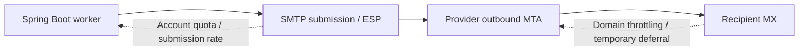
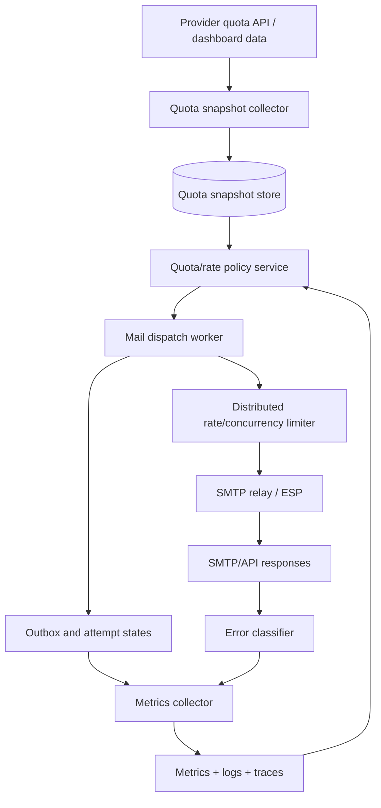

# Monitoring Provider Quotas and Send Rates

A Spring Boot application uses `JavaMailSender` to send OTP emails, invoices, and order notifications through an SMTP relay. Normally the system sends a few hundred emails per hour. On a campaign day, tens of thousands of send requests arrive within minutes: the SMTP provider begins returning rate-limit errors, some messages are delayed, workers retry aggressively, and the queue keeps growing. If the application simply logs `MailSendException` and retries immediately, adding more workers can make the incident worse.

In production, an email provider (ESP/SMTP relay) often enforces **multiple simultaneous limits**: total messages or recipients allowed in a period, send rate per minute or second, active SMTP connections, account or subaccount quotas, per-destination-domain caps, and restrictions arising from sender reputation. Some limits are documented, some adjust dynamically, and some surface only through provider responses.

This lesson belongs to the **Observability and Operations** chapter of **Spring Framework Mail**. Its goal is designing how to **measure usage, detect approaching quota limits, throttle throughput, manage retries, forecast capacity, and operate during provider throttling**. Examples use Spring Boot, Jakarta Mail, Java, SQL, and common metrics tools; they do not assume every provider shares the same counting units or policies.

## 1. Why must quotas and send rates be tracked separately?

Two systems both claiming “up to 10,000 emails” can behave very differently:

- System A allows 10,000 **recipients** per 24 hours, capped at 100 recipients per second.
- System B allows 10,000 **messages** per day, with at most 10 concurrent SMTP connections.
- System C enforces quotas by **API requests** and limits recipients per request.
- System D publishes no hard numbers; when an IP or domain appears overloaded, it returns temporary deferrals or automatically slows acceptance.

Storing only a single `maxEmailsPerDay` variable cannot accurately represent all of these limits.

**Quota** answers: *How much total resource can be consumed over a period or cycle?*

**Rate limit / throughput** answers: *At what maximum speed can sends occur within a short time window?*

**Concurrency limit** answers: *How many connections or parallel submissions can be open simultaneously?*

**Capacity** answers: *Given current limits and state, how long will it take to finish queued mail?*

**Reputation-based throttling** occurs when a provider or receiving system slows acceptance based on sending behavior, rather than a fixed configured quota.

### 1.1. A numerical example

Suppose a provider documents illustrative limits:

| Limit | Hypothetical Value |
|---|---:|
| Total recipients in 24 hours | 50,000 recipients |
| Maximum send rate | 120 recipients/minute |
| Open SMTP connections | 5 |
| Max recipients per message | 50 |

The business needs to send 8,000 emails, each with one recipient. Reserving 20% headroom on the rate limit gives a target rate of:

```text
Safe target rate = 120 × 0.80
                 = 96 recipients/minute

Estimated minimum dispatch time
    = 8,000 / 96
    ≈ 83.3 minutes
```

This is an **ideal minimum duration** at the target rate, excluding timeouts, retries, live throttling, latency, or specific recipient-domain delays. You must also check **remaining 24-hour quota**; if only 5,000 recipients remain, the full campaign cannot finish even if the rate limit permits it.

Never copy these hypothetical values into production. Every provider, service tier, account, deployment region, and API type has its own contract.

## 2. Limiting units that are easily confused

| Unit | Meaning | Risk When Miscounted |
|---|---|---|
| **API request** | One HTTP call to a provider API | One request may carry multiple messages/recipients |
| **SMTP transaction** | One `MAIL FROM`/`RCPT TO`/`DATA` exchange | May not match “emails” shown on a dashboard |
| **Message** | One MIME message | One message can address multiple recipients |
| **Recipient** | One target address counted against quota | Sending 1 message to 20 people may cost 20 units |
| **Submitted / accepted message** | Provider accepted submission | Does not mean delivered to Inbox |
| **Connection** | One open TCP/TLS/AUTH session | Restricted separately from messages/second |
| **Bytes / message size** | Payload size or bandwidth | Large attachments can hit size caps |
| **Per-domain throughput** | Rate to one destination domain | Target MX may defer even while ESP quota remains |
| **Daily / window allowance** | Total cap for a defined cycle | Resets at a fixed hour or rolling window per provider |

### 2.1. Example of a single message with multiple recipients

```text
One MimeMessage:
    To: a@example.net
    Cc: b@example.net
    Bcc: c@example.net

MIME messages: 1
Recipient identities: 3
SMTP RCPT TO commands: typically 3 in the transaction
```

Providers may meter quota by recipient, request, or other rules. **Never assume one `JavaMailSender.send(message)` call always consumes one quota unit.**

For transactional notifications, one notification intent per recipient is usually easier to rate-limit, suppress, troubleshoot, and audit; if business rules require grouping recipients into one MIME message, design an accurate cost model.

### 2.2. Never mix attempts, accepted sends, and deliveries

If the same notification retries three times:

```text
Notification N-100
  attempt 1: SMTP connect timeout
  attempt 2: SMTP 451 temporary reject
  attempt 3: SMTP accepted
```

The app records **3 attempts**, yet only **1 accepted submission**. Providers may count partial usage differently; sometimes the client cannot tell whether a timed-out attempt was charged.

Therefore, track separately:

- Application `attempt_count`.
- `accepted_count` from confirmed submission outcomes.
- `provider_usage` from provider-reported data.
- `delivery_count` from delivery events.
- `ambiguous_attempt_count` when outcomes are uncertain.

**Send-call count is not an accurate quota gauge if the provider bills per accepted recipient or when timeouts leave outcomes ambiguous.**

## 3. Two layers of limits: ESP and receiving MX

### 3.1. Limits enforced by the SMTP relay / ESP

Spring Boot sends to `smtp.provider.example:587`. The provider may restrict:

- Recipients per account.
- Submissions per second.
- Concurrent connections.
- Maximum recipients per message.
- Monthly or plan-tier quotas.
- Burst allowances.
- Deployment regions, subaccounts, or IP pools.

Spring applications typically observe these limits via error responses or ESP account/usage APIs.

### 3.2. Limits enforced by receiving servers

After the ESP accepts a message, its outbound MTAs deliver to the recipient's MX. The MX can return temporary deferrals if an IP sends too fast to that domain, or based on reputation.



**Critical difference:**

- `JavaMailSender.send(...)` can succeed once the ESP accepts the message.
- An MX may defer the message **afterward**; the app only knows if the provider sends delivery/bounce events or exposes dashboard/logs.
- While the provider retries delivery at the MX, the application **must not create a brand-new email** just because delivery is still pending.

Dashboards must distinguish **submission throttling** at the application → ESP boundary from **downstream deferral** between ESP → recipient MX.

## 4. Dimensions to include in a quota inventory

Maintain a **quota inventory** for each sending channel:

| Dimension | Example Identifier | Meaning |
|---|---|---|
| Provider | `primary-esp` | Active mail provider |
| Account / subaccount | `transactional-account` | Quota isolated by account |
| Region / endpoint | `region-a` | Limits may vary by region |
| Channel | `SMTP` or `HTTP_API` | Two APIs may carry different quotas |
| Sending identity | `billing-domain` | Domain, sender, or verified identity |
| IP pool | `transactional-pool` | Dedicated rate and reputation |
| Tenant | `tenant-42` | Internal cap for multi-tenant fairness |
| Notification type | `OTP`, `INVOICE`, `MARKETING` | Distinct SLAs and priorities |
| Recipient domain | `example.net` | Pacing sends to a destination domain |
| Window | `PER_SECOND`, `ROLLING_24H` | How usage accumulates over time |

Not every provider supports every dimension. Record only dimensions backed by provider docs, account telemetry, or real internal policies.

### 4.1. Quota configuration needs provenance

Each limit entry should record:

```text
providerKey: primary-esp
accountKey: transactional-account
metric: recipient_units
limit: 50000
window: rolling_24h
source: provider_api
observedAt: <timestamp>
validUntil: <timestamp or TTL>
confidence: reported
```

Values above are illustrative. If a quota is entered manually from a contract, `source` can be `contract_config`. If a limit is only inferred from throttling replies, do not record it as a provider-guaranteed quota.

### 4.2. Distinguish limits from targets

- **Hard provider limit:** limit enforced by the provider that triggers rejections.
- **Internal configured limit:** ceiling the application intentionally stays under.
- **Target rate:** normal operating rate, usually below the hard limit to preserve headroom.
- **Observed accepted rate:** actual measured throughput.
- **Available capacity:** remaining capacity after accounting for quota, rate, backlog, and concurrent load.

For example, the provider allows 120 recipients/minute while the internal target is 96 recipients/minute for headroom. Show both on dashboards instead of merging them into one ambiguous number.

## 5. Windowed quotas and reset times

A common design bug is assuming “daily quota resets at 00:00 local time”. In reality, providers may use:

- A **rolling 24-hour** window counting usage over the trailing 24 hours.
- Calendar days in **UTC**.
- Calendar days in the account's configured timezone.
- **Monthly billing** quotas.
- Token buckets / leaky buckets with no single reset timestamp.
- Dynamic limits raised or lowered by account reputation.

### 5.1. Rolling windows vs. calendar windows

Suppose 10,000 recipients are sent at 23:59:

- Under a calendar window resetting at 00:00, fresh quota appears one minute later.
- Under a rolling 24h window, those 10,000 recipients remain in usage for nearly 24 hours.
- Under a token bucket, capacity recovers gradually at the refill rate.

Using the wrong model causes the app to assume quota “has reset” and push a large batch too early.

### 5.2. Always store timezone-aware timestamps

In databases and telemetry, use `Instant`/UTC for:

- `observedAt` when reading provider data.
- `windowStart`/`windowEnd` when the provider defines exact windows.
- `resetAt` if published by the provider.
- `nextAllowedAt` when a limiter permits retrying.
- `nextAttemptAt` on outbox rows.
- `providerRetryAfter` when an API supplies it.

Dashboards can render in operators' local timezones, but never infer reset boundaries from local machine time.

### 5.3. Remaining-quota data can be stale

Provider usage APIs can lag behind real-time traffic. A dashboard might report 5,000 recipients remaining while multiple workers keep sending, leaving actual remaining capacity much lower.

Therefore:

1. Record the timestamp of each quota fetch.
2. Flag readings as stale past a configured age threshold.
3. Combine with **internal reservation/accounting** to prevent oversubscription across workers.
4. Never treat an API `remaining` number as a concurrency lock.
5. Periodically reconcile drift between provider usage and internal telemetry.

## 6. Where does quota data come from?

Multiple sources exist, each measuring different aspects.

### 6.1. Provider APIs or dashboards

Some ESPs provide endpoints or UIs for:

- Daily sending quota / remaining allowance.
- Maximum send rate.
- Account restrictions.
- Sending statistics.
- Concurrent connections or throughput.
- Rate-limit HTTP response headers.
- Subaccount / region usage.

Rely on your specific provider's contract. **Never assume every SMTP relay offers a quota API.** Plain SMTP has no universal command to ask “how many emails are left today?”.

### 6.2. Synchronous SMTP replies

An SMTP server may reply:

```text
421 4.7.0 Service temporarily unavailable
451 4.7.1 Temporarily rejected
452 4.5.3 Too many recipients
```

These lines are **examples**, not the sole interpretation of each code. SMTP codes and enhanced status codes depend on phase, reason, and provider. Inspect normalized diagnostics and provider documentation.

- `4xx` usually signals a temporary negative completion, **not definitive confirmation that quota is exhausted**.
- `5xx` usually signals a permanent negative completion for that operation, such as policy or sender/recipient issues.
- `421` can indicate an outage or rate limit; never label it “quota exceeded” without supporting evidence.
- Throttling can happen at `CONNECT`, `MAIL FROM`, `RCPT TO`, or `DATA`.

Never build quota logic merely by regex-matching the word “limit” in exception messages. Use status codes, enhanced codes, protocol stage, and provider diagnostics when available.

### 6.3. HTTP provider APIs

An HTTP email provider may return `429 Too Many Requests` or `503 Service Unavailable`, possibly with:

```http
HTTP/1.1 429 Too Many Requests
Retry-After: 30
```

`Retry-After` may be an integer number of seconds or an HTTP-date per HTTP semantics. Use it only when supported by the provider and valid; parse formats safely, account for clock skew, and bound values.

**SMTP 4xx replies do not automatically carry an HTTP-style `Retry-After` header.** Never infer a rigid retry timestamp from 421/451 unless the provider explicitly documents one.

### 6.4. Internal application telemetry

Even when a provider exposes no usage API, the application can measure:

- Created intents.
- Expected recipient units per intent.
- Send attempts.
- Accepted, failed, and unknown submissions.
- Send invocation rate.
- Queue depth and age.
- Requests deferred by local rate limiters.
- Retry counts and provider error categories.

These numbers aid operations, yet **do not replace official provider quota figures** if the provider meters usage differently.

### 6.5. Delivery events from ESPs

Webhooks/DSNs supply delivery, bounce, complaint, and downstream deferral data. They are vital for reputation and SLA tracking, but **must not be mixed into “remaining quota”** when the provider charges quota at submission time.

## 7. Designing the observability data pipeline

An architecture can separate collection from enforcement:



Responsibilities should stay clear:

- **Quota collector:** polls with read permissions, recording timestamps and provenance.
- **Policy service:** computes target send rates from quotas, load, and alerts.
- **Rate limiter:** enforces caps across concurrent workers.
- **Dispatcher:** claims committed notifications and sends when granted capacity.
- **Metrics / logging:** observes outcomes and detects anomalies.
- **Reconciler:** resolves discrepancies between internal counts and provider reports.
- **Operations:** decides on quota increases, traffic shedding, failovers, or campaign adjustments.

Never cram all of this logic into a single `catch (MailSendException)` inside a mail service.

## 8. Outboxes manage quotas without losing emails

When capacity runs out, the safe approach is **queuing notifications durably and waiting**, rather than hammering sends until timeouts occur.

```text
Business event
    |
    v
Insert notification intent into outbox (transaction)
    |
    v
PENDING
    |
    +--> insufficient rate/quota budget --> DEFERRED / nextAttemptAt
    |
    +--> capacity granted --> PROCESSING
                                  |
                                  v
                            JavaMailSender.send
                                  |
                +-----------------+------------------+
                |                 |                  |
           Accepted         Temporary reject    Uncertain
                |                 |                  |
           SUBMITTED          RETRY_WAIT           UNKNOWN
```

### 8.1. Do not create a new intent when rate-limited

A confirmation email intent might wait 10 minutes. When rate budget runs out, the worker simply updates `nextAttemptAt` on **the same outbox row**, without minting a new message with a new ID.

Useful fields:

```sql
CREATE TABLE mail_outbox (
    id UUID PRIMARY KEY,
    idempotency_key VARCHAR(240) NOT NULL UNIQUE,
    provider_key VARCHAR(80) NOT NULL,
    account_key VARCHAR(80) NOT NULL,
    tenant_key VARCHAR(120) NOT NULL,
    notification_type VARCHAR(80) NOT NULL,
    recipient_units INTEGER NOT NULL,
    status VARCHAR(40) NOT NULL,
    attempts INTEGER NOT NULL DEFAULT 0,
    next_attempt_at TIMESTAMPTZ,
    created_at TIMESTAMPTZ NOT NULL,
    expires_at TIMESTAMPTZ,
    claim_token UUID,
    lease_until TIMESTAMPTZ,
    provider_reference VARCHAR(240),
    last_error_code VARCHAR(100)
);
```

This example schema omits subject/payload to focus on quota observability; a real system must durably store or reference content to survive process restarts. Never let payloads live only inside an HTTP request.

### 8.2. Distinguish waiting on quota from a send failure

A row deferred by a local limiter must not increment `attempts` as if an SMTP attempt occurred.

Example:

```text
N-100 status=PENDING, attempts=0
Local limiter: DENIED -> nextAttemptAt=10:01, attempts=0
Local limiter: ALLOWED -> attempt #1
Provider accepted -> SUBMITTED, attempts=1
```

If the provider returns 421/451 after an actual send attempt, that is a failed transport attempt; increment `attempts` per policy.

This distinction is vital for “attempts per notification” metrics, retry exhaustion, and operations.

### 8.3. Expiring notifications

OTPs, payment links, and time-sensitive notifications carry `expiresAt`. If quota recovers after an OTP has expired, workers must not send the stale token.

Options:

- Mark `EXPIRED` and skip sending.
- Prioritize OTP queues ahead of marketing.
- Reserve capacity exclusively for transactional mail.
- If business rules require minting a fresh token, create a new command/notification with a clear identity rather than silently mutating a snapshotted intent.

## 9. Rate limiters: burst vs. sustained rate

### 9.1. Fixed window

For example, allowing up to 100 recipients per calendar minute:

```text
10:00:00 - 10:00:59 -> max 100
10:01:00 - 10:01:59 -> max 100
```

Easy to implement, yet suffers from **boundary bursts**: 100 at the end of one minute plus 100 at the start of the next sends 200 recipients within a few seconds.

If the provider uses a sliding window or token bucket, a simple fixed-window limiter can fail to prevent rate violations across boundaries.

### 9.2. Sliding window

Limits events within a **continuous window** looking backward from now—for instance, no more than 100 recipients in any 60-second span.

- Matches providers that enforce rolling windows.
- Requires storing event timestamps or bucket aggregates.
- Uses more resources than fixed windows in some implementations.

### 9.3. Token bucket

A token bucket defines:

- `capacity`: maximum tokens, permitting a bounded burst.
- `refillRate`: rate at which tokens replenish.
- `cost`: tokens consumed by one submission.
- `availableTokens`: currently available tokens.

For example, capacity 120 recipients, refilling at 2 recipients/second. A message with 3 recipients costs 3 tokens when provider quota is metered per recipient.

A token bucket regulates **bursts and average rate**, but does not by itself protect a daily quota without an additional cap.

### 9.4. Leaky bucket and pacing

A leaky bucket or inter-request scheduler smooths traffic, which helps when an SMTP provider is burst-sensitive. A system can combine:

- Token bucket for burst + sustained rate.
- Daily/rolling quota ledger.
- Semaphore for concurrency.
- Per-domain pacing.
- Outbox queue for durability.

Never pick an algorithm because its name sounds appealing; pick based on **the provider's actual limit semantics**.

## 10. Java example: single-JVM token bucket

The code below illustrates a limiter by recipient units. It does not depend on Spring and does not send emails itself.

```java
import java.time.Instant;

public final class LocalRecipientTokenBucket {

    private final int capacity;
    private final double tokensPerSecond;

    private double available;
    private long lastRefillMillis;

    public LocalRecipientTokenBucket(
            int capacity,
            double tokensPerSecond,
            Instant initialTime) {

        if (capacity <= 0 || tokensPerSecond <= 0.0) {
            throw new IllegalArgumentException(
                    "Capacity and refill rate must be positive");
        }

        this.capacity = capacity;
        this.tokensPerSecond = tokensPerSecond;
        this.available = capacity;
        this.lastRefillMillis = initialTime.toEpochMilli();
    }

    public synchronized boolean tryAcquire(
            int recipientUnits, Instant now) {

        if (recipientUnits <= 0 || recipientUnits > capacity) {
            throw new IllegalArgumentException(
                    "Invalid recipient unit cost");
        }

        long timestamp = now.toEpochMilli();
        long elapsed = Math.max(
                0L, timestamp - lastRefillMillis);

        available = Math.min(
                capacity,
                available + elapsed / 1000.0 * tokensPerSecond);

        lastRefillMillis = Math.max(lastRefillMillis, timestamp);

        if (available < recipientUnits) {
            return false;
        }

        available -= recipientUnits;
        return true;
    }
}
```

Usage:

```java
Instant now = Instant.parse("2026-11-12T08:00:00Z");

LocalRecipientTokenBucket bucket =
        new LocalRecipientTokenBucket(120, 2.0, now);

boolean first = bucket.tryAcquire(5, now);
boolean second = bucket.tryAcquire(120, now);

// first = true; second = false because 5 tokens were already used.
```

### 10.1. Important limitations of this example

- `synchronized` protects threads **only within a single JVM**.
- Each instance/pod creating its own bucket multiplies effective capacity unintentionally.
- `Instant`/wall clock is used here for testability; production limiters should generally rely on monotonic time sources or server-side atomic time semantics to avoid clock jumps.
- A bucket allows bursts up to `capacity`; it does not strictly enforce a sliding-window cap.
- It does not model daily quotas, dynamic provider limits, or SMTP connection limits.
- Never treat a successful `tryAcquire()` as meaning the provider accepted the request.
- Tokens represent **admission budget**, not necessarily the exact usage the provider will bill.

With multiple Spring Boot instances, you need a distributed limiter or a single dispatcher sharing capacity across the provider account.

### 10.2. Testing the limiter with fixed timestamps

```java
@Test
void rejectsWhenBurstCapacityIsConsumed() {
    Instant t0 = Instant.parse("2026-11-12T08:00:00Z");

    LocalRecipientTokenBucket bucket =
            new LocalRecipientTokenBucket(10, 1.0, t0);

    assertThat(bucket.tryAcquire(7, t0)).isTrue();
    assertThat(bucket.tryAcquire(4, t0)).isFalse();

    assertThat(bucket.tryAcquire(
            4, t0.plusSeconds(1))).isTrue();
}
```

At `t0+1s`, the bucket has refilled 1 token, leaving `3 + 1 = 4` tokens. Never use `Thread.sleep` in tests when an injected clock makes them deterministic and non-flaky.

## 11. Multi-instance: distributed rate limiters

Suppose an account allows at most 100 recipients/minute, and the application runs 10 worker pods. If each pod configures a 100/minute limiter, aggregate throughput can hit 1,000/minute—10x over limit.

You need a shared coordinator across the entire quota scope.

### 11.1. Common architectures

| Architecture | Pros | Constraints |
|---|---|---|
| Centralized dispatch service | Easy to enforce account-wide quota | Needs HA and bottleneck management |
| Redis + atomic Lua/functions | Fast, suited for distributed token buckets | Must handle Redis outages, atomicity, clocks, TTLs |
| PostgreSQL quota ledger | Leverages DB transactions, easy auditing | Can cause lock contention at very high throughput |
| Provider throttling + conservative local limiter | Simpler when ESP handles throttling cleanly | Must handle/reconcile rate rejections and unknown usage |
| Message queue with consumer/dispatch caps | Easy concurrency control | Consumer count alone **does not equal** recipients/time-window quota |

### 11.2. Atomic reservation is mandatory

Never do:

```text
GET remaining tokens
IF remaining >= cost:
    SET remaining = remaining - cost
```

Two workers can both read 5 remaining tokens and both consume 5, causing oversubscription. Use a transaction or atomic operation:

```text
reserve(cost, quotaKey, window):
    check tokens/usage
    atomically deduct tokens / add usage
    return ALLOWED or DENIED
```

In Redis, use atomic primitives, transactions, or Lua scripts. In a database, use row locks, conditional updates, or conditional upserts.

### 11.3. Multi-dimensional quotas must be granted atomically

A single send may simultaneously require:

- 1 SMTP connection slot.
- 3 recipient tokens/minute.
- 3 recipient units from daily quota.
- 3 units under a per-tenant limit.
- 3 units under a recipient-domain bucket.

If you acquire buckets sequentially and the last one denies, budget has already been spent on the earlier buckets without sending. The system needs **atomic multi-key admission**, transactions spanning related ledgers, or an explicit reserve/cancel protocol.

Never hold a quota-locking database transaction open while making SMTP calls. **Admission/reservation** must finish in a short transaction, after which transport I/O runs independently.

### 11.4. Reservation is not final usage proof

A tricky case:

1. Worker reserves 5 recipient units.
2. Before sending, the worker crashes.
3. The provider never received the message.
4. The budget reservation remains consumed.

If you blindly refund every reservation after a timeout, the reverse can happen: the provider received it while the client assumed unsent, refunded, retried, and exceeded quota.

Distinguish states:

- `RESERVED`: capacity held ahead of an attempt.
- `ATTEMPTED`: transport call started.
- `ACCEPTED`: provider confirmed submission.
- `UNKNOWN`: outcome uncertain.
- `RELEASED/EXPIRED`: reservation released under explicit rules.
- `RECONCILED`: usage reconciled with the provider.

For tight quotas where the provider offers no usage API, favor **conservative** accounting for ambiguous attempts to avoid breaching limits, accepting slight underutilization.

## 12. Illustrative PostgreSQL fixed-window counter

A simple DB approach counts recipient units in an **application-defined** window. Example schema:

```sql
CREATE TABLE provider_quota_window (
    provider_key VARCHAR(80) NOT NULL,
    account_key VARCHAR(80) NOT NULL,
    window_kind VARCHAR(40) NOT NULL,
    window_start TIMESTAMPTZ NOT NULL,
    used_units BIGINT NOT NULL DEFAULT 0,
    updated_at TIMESTAMPTZ NOT NULL,
    PRIMARY KEY (
        provider_key, account_key,
        window_kind, window_start
    ),
    CONSTRAINT ck_used_units_nonnegative CHECK (used_units >= 0)
);
```

In PostgreSQL, reserve cost in a fixed window via a conditional insert/upsert:

```sql
INSERT INTO provider_quota_window (
    provider_key, account_key,
    window_kind, window_start,
    used_units, updated_at
)
SELECT
    :providerKey, :accountKey,
    :windowKind, :windowStart,
    :cost, CURRENT_TIMESTAMP
WHERE :cost > 0 AND :cost <= :windowLimit
ON CONFLICT (
    provider_key, account_key,
    window_kind, window_start
)
DO UPDATE
SET used_units =
        provider_quota_window.used_units
        + EXCLUDED.used_units,
    updated_at = CURRENT_TIMESTAMP
WHERE provider_quota_window.used_units
      + EXCLUDED.used_units <= :windowLimit
RETURNING used_units;
```

- Returns one row: reservation succeeded.
- Returns no row: cost invalid or window full under this logic.
- Unique key + upsert protects updates under concurrency in PostgreSQL.
- `windowStart` must match **the exact window contract**, not blindly truncate by minute/day for every provider.

### 12.1. Limitations of a fixed-window ledger

This example:

- Cannot model a rolling 24h window or token bucket with one row alone.
- Cannot reserve multiple window types atomically if callers execute statements outside one transaction.
- Does not know actual provider usage when attempts are ambiguous.
- Does not resolve time skew if instances compute different `windowStart` values.
- Can become a hot row at very high throughput.
- Needs cleanup/retention per contract and audit requirements.

If the provider enforces a rolling window, choose an appropriate algorithm/ledger. This snippet illustrates **an atomic conditional counter**, not a universal formula for every quota.

## 13. Concurrency limits are not rate limits

Suppose a provider allows at most 5 concurrent SMTP connections. An application can keep 5 connections open and send very rapidly over them, still risking exceeding recipients/second.

Conversely, a 100 recipients/minute rate limiter does not stop an application from opening 100 simultaneous TCP connections at the start of a minute.

Two separate controls are needed:

1. **Semaphore / concurrency gate:** active connections or in-flight send operations.
2. **Rate / quota gate:** send units granted over time.

### 13.1. SMTP connections and Spring Mail

`JavaMailSenderImpl` uses Jakarta Mail's SMTP transport per implementation. In typical usage, transports are opened, used, and closed per `send` lifecycle unless the application designs custom connection management. Never assume SMTP connection pooling is always active.

When many workers call `send` concurrently, parallel TCP/TLS/AUTH handshakes can spike. Monitor:

- Active mail submission calls.
- Connection errors and timeouts.
- Connect/TLS/AUTH/send durations when instrumentation captures them.
- Worker concurrency.
- Provider connection-limit diagnostics.

If implementing connection reuse/pooling in a custom adapter, verify transport thread-safety and lifecycle contracts; never share a non-thread-safe object across worker threads just to save handshakes.

### 13.2. A Semaphore does not enforce cluster-wide limits

A `Semaphore(5)` inside each JVM allows up to 5 connections **per instance**, not 5 across the provider account. With 8 pods, connections can reach 40. For account-wide provider limits, use a distributed concurrency gate or centralized dispatch architecture.

## 14. Limits by tenant and notification type

An organization has 20 tenants sharing one provider account. If one tenant launches a huge campaign, it can exhaust the entire quota and block OTP emails for other tenants.

### 14.1. Hierarchical quotas

You can enforce multiple tiers:

```text
Provider account: 10,000 recipients/hour
    |
    +-- Transactional pool: reserved 3,000/hour
    |     +-- OTP
    |     +-- Invoice
    |
    +-- Marketing pool: max 7,000/hour
          +-- Tenant A
          +-- Tenant B
```

This illustrates **internal capacity allocation**; ensure the sum never exceeds the provider's real quota.

Policies may include:

- Hard per-tenant caps.
- Weighted fair scheduling.
- Reserved capacity for transactional email.
- Priority queues.
- Borrowing unused capacity only when reclaimable ahead of high-priority demand.
- Per-tenant campaign quotas.

### 14.2. Never let marketing consume OTP quota

Suppose 500 daily recipients remain while a 5,000-email campaign is queued. Without priority admission, the last 500 units go to marketing while users requesting password resets get blocked.

Therefore, admission policies should account for **notification type and deadline**:

- OTP / password reset: tight SLA, carries `expiresAt`.
- Invoices / receipts: durable, can wait slightly longer yet still need monitoring.
- Marketing: usually deferrable or batch-throttled.
- Internal alerts: depending on severity, route through a backup channel when mail quota is constrained.

Priority never justifies sending an expired email or one lacking consent.

### 14.3. Fair scheduling

Strict absolute priority can also starve marketing indefinitely. Use weighted fair queueing with per-stream minimums/caps, or reserve capacity for critical SLAs and divide the remainder fairly across tenants.

Monitor “oldest pending age” per notification type and tenant class, not only total backlog.

## 15. Quota exhaustion, throttling, and SMTP errors

When a provider starts rate-limiting, the response should depend on **confidence in root cause and SMTP phase**.

### 15.1. Explicit temporary rejection

For example, the provider returns `451 4.7.1` before `DATA` completes, with diagnostics indicating a temporary rate limit.

You can:

1. Classify as `PROVIDER_RATE_LIMIT`.
2. Record attempt failure and provider code.
3. Reduce target rate per policy.
4. Compute `nextAttemptAt` with backoff/jitter or provider-advised delay.
5. Keep the same notification ID / idempotency key.
6. Do not ramp speed back up until recovery evidence appears.

### 15.2. Permanent rejection

If the provider returns `550`, `554`, or permanent account/sender/policy rejections, do not auto-retry simply because a backlog exists. Separate recipient rejections, account suspensions, domain verification errors, and configuration failures.

A permanent issue may be resolved later by an operator, but immediate retries with unchanged configuration rarely help.

### 15.3. Timeout after DATA: unknown outcome

If the SMTP provider received the MIME bytes and the client loses connection before the final reply, the provider **may have accepted the message**.

```text
Application -> SMTP: DATA + MIME + end marker
SMTP provider: possibly accepted
Network timeout before client reads final response

Result: submission outcome uncertain
```

Never automatically conclude “quota was not deducted” or “email definitely unsent”. Use `UNKNOWN`/reconciliation state; retrying risks creating duplicates even with a single outbox row.

### 15.4. Downstream deferral after submission

If the ESP accepted the message and later encounters `421` from the recipient's MX, the application should not resend the whole message immediately. ESPs typically manage their own delivery retry queues. Track delivery events and deferrals at the right layer.

## 16. Retry policies and adaptive pacing

A sound policy distinguishes:

| Scenario | Default Action |
|---|---|
| Local quota gate denies before transport | Defer dispatch; do not count a send attempt |
| Provider reports explicit temporary throttling | Backoff with jitter; optionally reduce target rate |
| Provider daily quota exhausted per reliable data | Wait for reset/rolling capacity; prioritize critical SLAs |
| Provider timeout before confirmed submission | Bounded retry; inspect network and policy |
| Uncertain submission outcome | Reconcile or apply duplicate-aware policy |
| Bad credentials / hostname / TLS config | Halt automatic retries and alert |
| Recipient hard bounce | Suppress; do not retry in ways that harm reputation |
| Notification expired | Mark `EXPIRED`; do not send stale content |

### 16.1. Exponential backoff with jitter

Example delays after temporary rejections:

```text
Attempt 1 -> ~30 seconds
Attempt 2 -> ~60 seconds
Attempt 3 -> ~120 seconds
Attempt 4 -> ~240 seconds
Thereafter -> cap at 10 minutes, enforce max attempts / max age
```

In production, add jitter so thousands of workers do not retry simultaneously. When an HTTP provider API returns a valid `Retry-After`, never retry before that deadline. SMTP 4xx replies lack a universal `Retry-After` mechanism.

### 16.2. Adaptive throttling

When a provider repeatedly returns temporary rate-limit errors, a controller can reduce the target rate. Conceptual strategy:

- Start at a target below the known provider limit.
- When throttling ratio exceeds a threshold, cut rate substantially.
- After a clean stability window with backlog still present, ramp up gradually.
- Enforce a hard ceiling per quota/provider contract.
- Never ramp up when remaining quota is low or usage snapshots are stale.
- Adjust per provider/account/region and recipient domain where appropriate.

This follows additive-increase/multiplicative-decrease principles, though **no single constant set fits every ESP**. Rate adjustments need hysteresis to avoid oscillating up and down endlessly.

### 16.3. Circuit breakers do not replace quota limiters

A circuit breaker temporarily pauses calls to a provider when infrastructure error rates spike. It does not replace a token bucket or quota ledger. A completely healthy provider still requires rate limiting because its contract permits only N recipients/minute.

## 17. Forecasting backlog drain time

Suppose:

```text
Pending recipients  = 8,000
Safe target rate    = 96 recipients/minute
Average new arrival = 20 recipients/minute
```

When sending and receiving new requests simultaneously, **net drain capacity** is:

```text
Net drain rate = 96 - 20 = 76 recipients/minute

Estimated backlog drain time
    = 8,000 / 76
    ≈ 105.3 minutes
```

This forecast is meaningful only if:

- Remaining daily quota covers the queued messages.
- Retry failure rates do not significantly erode accepted throughput.
- Provider and recipient-domain throttling remain steady.
- Arrival rates remain relatively stable.
- Queues enforce clear priorities and fairness.
- Notifications have not expired.
- Counting units match consistently (recipients vs. messages).

If `newArrivalRate >= acceptedDispatchCapacity`, the backlog cannot drain sustainably. Adding more workers **will not help** when the bottleneck is provider quota.

### 17.1. Queue age matters more than count alone

Having 10,000 pending marketing emails may be fine during certain batches. Yet just 30 OTPs waiting over 5 minutes can be a critical incident. Track:

- `pending_count`.
- `oldest_pending_age_seconds`.
- `p50`/`p95`/`p99` `time_to_submission`.
- `expiring_soon_count`.
- `retry_wait_count`.
- `unknown_count`.
- All sliced by provider and notification class as appropriate.

### 17.2. Measuring utilization

An approximate formula:

```text
Rate utilization (%) =
    observed submitted recipient units per minute
    ----------------------------------------------- × 100
        configured safe recipient units per minute
```

Do not compute utilization by message count when the limit is by recipients. When provider caps are dynamic and exact limits are unknown, state clearly that this measures **utilization against internal targets**, not percentage of a hard provider quota.

## 18. Metrics for Spring Boot / Micrometer

An application using Spring Boot Actuator and Micrometer can emit these metrics:

| Suggested Metric | Type | Meaning |
|---|---|---|
| `mail_intents_created_total` | Counter | New notification intents |
| `mail_submission_attempts_total` | Counter | Attempts to SMTP/API |
| `mail_submission_recipients_total` | Counter | Recipient units attempted or accepted (label `result` clearly) |
| `mail_rate_limit_denials_total` | Counter | Denials by local quota/rate gate |
| `mail_provider_throttles_total` | Counter | Confirmed rate-limit/throttle replies from provider |
| `mail_submission_duration_seconds` | Timer/Histogram | Duration of one attempt |
| `mail_outbox_pending_count` | Gauge | Unsent rows |
| `mail_outbox_oldest_age_seconds` | Gauge | Age of oldest pending row |
| `mail_quota_limit_units` | Gauge | Provider/internal reported limit per window |
| `mail_quota_remaining_units` | Gauge | Observed provider remaining allowance |
| `mail_quota_snapshot_age_seconds` | Gauge | Age of quota data |
| `mail_active_submissions` | Gauge | Currently running send calls |
| `mail_submission_unknown_count` | Gauge | Notifications with uncertain outcome |
| `mail_notification_expired_total` | Counter | Notifications expired prior to submission |

### 18.1. Keep names and units explicit

Never call everything `mail_count`. When a counter measures recipients, include `recipient_units` or equivalent metadata. Measure durations in seconds; never switch a metric's unit between messages and recipients under the same name.

In Prometheus, `_total` for counters and `_seconds` for durations aid clarity. Micrometer applies naming conventions upon export; verify actual names at the metrics endpoint before building dashboards.

### 18.2. Label cardinality

Useful labels:

- `provider`: e.g. `primary-esp`.
- `account_class`: `transactional`/`marketing`.
- `region`: when quotas genuinely split by region.
- `notification_type`: `OTP`/`INVOICE`/`MARKETING`.
- `result`: `accepted`/`temporary_reject`/`permanent_reject`/`unknown`.
- `error_category`: `rate_limit`/`auth`/`network`/`policy`.
- `window_kind`: `per_minute`/`rolling_24h`.

Never place into metric labels:

- Recipient emails.
- Notification IDs, event IDs, or message IDs.
- Request IDs or raw idempotency keys.
- Individual SQL row IDs.
- Raw SMTP response text.
- Arbitrary URLs or user inputs.

Those values create huge time-series cardinality and risk exposing data. Keep investigative identifiers in access-controlled structured logs and traces.

### 18.3. Example recording counters with MeterRegistry

```java
import io.micrometer.core.instrument.MeterRegistry;

public final class MailMetrics {

    private final MeterRegistry registry;

    public MailMetrics(MeterRegistry registry) {
        this.registry = registry;
    }

    public void recordAttempt(
            String providerKey,
            String result,
            int recipientUnits) {

        if (recipientUnits < 1) {
            throw new IllegalArgumentException(
                    "Recipient units must be positive");
        }

        registry.counter(
                "mail.submission.attempts",
                "provider", providerKey,
                "result", result).increment();

        registry.counter(
                "mail.submission.recipient.units",
                "provider", providerKey,
                "result", result).increment(recipientUnits);
    }
}
```

In production, `providerKey` and `result` must be normalized via finite allowlists/enums. Never pass raw provider error strings as labels. Here, `mail.submission.recipient.units` counts attempt cost **by outcome**, not verified provider quota consumption.

Quota gauges can be updated by a collector, provided snapshot timestamps are recorded and stale `remaining` figures are never presented as real-time.

## 19. What questions should an operations dashboard answer?

A good mail delivery dashboard goes beyond an “emails sent per day” chart. At minimum it should answer:

1. Which provider/account is nearing quota exhaustion?
2. Is the remaining figure from an API, configuration, or an estimate?
3. How does actual send rate compare against safe targets and hard limits?
4. Is the provider throttling, or is the local limiter holding traffic back?
5. When does the quota reset, according to which source?
6. Will the current backlog drain within SLA?
7. Are OTPs/invoices being starved by marketing traffic?
8. Are retries rising due to throttling, outages, or recipient failures?
9. How many submissions have an `unknown` outcome?
10. Is there significant divergence between internal usage and provider-reported figures?

### 19.1. Dashboard sections

**Quota & capacity:**

- Limit, used, remaining, and window kind.
- Snapshot freshness.
- Safe target rate.
- Projected time to exhaustion when valid data exists.

**Real-time sending:**

- Attempts/second, accepted recipients/second.
- Concurrent sends and connection failures.
- Provider throttle code breakdown.
- Local admission denials.

**Backlog & SLA:**

- `Pending` / `RetryWait` / `Unknown` counts.
- Oldest pending age.
- Time-to-submission by notification type.
- Expiring-soon and expired counts.

**Deliverability after submission:**

- Provider delivery, bounce, and deferral events.
- Per-domain downstream delays.
- Reputation and complaints if exposed by the provider.

### 19.2. Illustrative PromQL for throttling ratio

Assuming the exported metric is `mail_submission_attempts_total`:

```promql
sum by (provider) (
  rate(mail_submission_attempts_total{
    result="rate_limited"
  }[5m])
)
/
clamp_min(
  sum by (provider) (
    rate(mail_submission_attempts_total[5m])
  ),
  0.000001
)
```

This yields the fraction of attempts classified as `rate_limited` over all attempts in a 5-minute window, per provider. It is meaningful only when instrumentation tags `result` consistently without double-counting retries.

### 19.3. Illustrative PromQL for accepted throughput

Assuming the recipient-units counter carries `result="accepted"`:

```promql
sum by (provider) (
  rate(mail_submission_recipient_units_total{
    result="accepted"
  }[5m])
)
```

The unit is **accepted recipient units/second** when the counter increments by confirmed accepted recipients. Multiply by `60` in the query or configure display units to show recipients/minute.

Never compare attempt rates against hard accepted-recipient limits when the provider counts differently.

### 19.4. Remaining quota gauge

Example display:

```text
Provider: primary-esp
Window: rolling_24h
Limit: 50,000 recipient units
Remaining: 7,500 recipient units
Snapshot age: 4 minutes
Internal safe rate: 96 recipients/minute
Current accepted rate: 80 recipients/minute
```

Dashboards must highlight snapshot age: `remaining` at observation time **is not guaranteed** to equal the live value. When data gets too old, display `STALE`/`UNKNOWN` instead of keeping a green “plenty of quota” indicator.

## 20. Alerting: thresholds, burn rates, and backlogs

### 20.1. Alert categories

| Category | Suggested Condition | Action |
|---|---|---|
| Low remaining quota | Below internal threshold with fresh data | Throttle campaigns; protect transactional capacity |
| Projected exhaustion | At current rate, quota runs out before reset | Adjust pacing or capacity |
| Rising provider throttling | Temporary rate-limit ratio elevated for minutes | Lower target rate; check provider |
| Stale quota snapshot | Collector failed to refresh on schedule | Alert on missing data; switch to conservative mode |
| Queue SLA at risk | Oldest pending OTP/invoice exceeds target | Prioritize processing / investigate bottleneck |
| Rising `unknown` submissions | Spikes in timeouts after DATA or crash windows | Reconcile; avoid blind retries |
| Quota usage mismatch | Provider usage diverges from internal beyond tolerance | Check accounting, windows, and recipient units |
| Connection saturation | Active connections near max, connect errors rising | Lower concurrency; inspect network/server |

Thresholds depend on workloads and SLAs. Never treat “80% quota” as an absolute rule if quota resets in minutes with low backlog; conversely, 50% usage can be dangerous if heavy traffic remains before reset.

### 20.2. Time-to-exhaustion alerts

If `remaining = 7,500` units and observed accepted consumption is `80` units/minute:

```text
Time to exhaustion ≈ 7,500 / 80
                   ≈ 93.75 minutes
```

This approximates a constant consumption rate. Under rolling windows, older usage drops off and capacity recovers gradually, so this formula **does not give an exact exhaustion timestamp**. Under fixed windows, compare time-to-exhaustion against the provider-verified `resetAt`.

When consumption is 0 or data is stale, report time-to-exhaustion as `UNKNOWN` or “cannot compute” rather than displaying a confusing infinity.

### 20.3. Avoiding alert storms

When 1,000 attempts get throttled, do not send 1,000 incident notifications. Alert by:

- Provider / account / window.
- Error ratio over an interval.
- Backlog / SLA impact.
- State transitions of circuit or pacing controllers.

Use grouping, deduplication, and suppression across related alerts—especially when the failing email provider makes email alerting unreliable. Use an incident/alerting channel independent of the troubled email provider.

## 21. How to check if quota measurements are consistent

### 21.1. A reconciliation table

Example:

| Source | Time / Window | Value |
|---|---|---:|
| Internal reserved units | Window A | 8,500 |
| Internal accepted units | Window A | 7,900 |
| Internal unknown units | Window A | 150 |
| Provider reported usage | Window A, delayed update | 8,020 |

Do not hastily claim the provider is wrong because `8,020 != 7,900`. Possible explanations include:

- The provider counted some ambiguous attempts.
- Provider windows/resets differ from internal windows.
- Provider reporting lags.
- The ESP processed sends outside this Spring application.
- The account is shared across multiple services or subaccounts.
- Multi-recipient messages cost differently than expected.
- The provider deducts quota at a timestamp slightly different from submission time.
- Webhook or metrics events were dropped or double-counted.

### 21.2. Reconcile by key and window, not lifetime totals

When the provider breaks down usage by account/region/window, reconcile within that exact scope. Local-time totals cannot be compared directly against a provider's rolling 24h window. Discrepancies can stem entirely from window alignment.

### 21.3. Track sends originating outside the system

Someone may send emails directly from the ESP dashboard or from another service sharing the account. Internal application counters will not see those sends, yet provider quota still drains.

Mitigations:

- Inventory every system sharing the account.
- Isolate subaccounts/credentials wherever possible.
- Poll provider usage periodically.
- Maintain internal capacity reservations with safety headroom.
- Audit logs and provider message references.

## 22. Security and privacy when monitoring quotas

Diagnosing throttling never requires collecting full email contents.

### 22.1. Structured logs

Example:

```json
{
  "event": "mail_submission_throttled",
  "provider": "primary-esp",
  "accountClass": "transactional",
  "notificationType": "INVOICE",
  "attempt": 2,
  "recipientUnits": 1,
  "smtpCode": 451,
  "failureCategory": "RATE_LIMIT",
  "nextAttemptAt": "<UTC timestamp>",
  "quotaSnapshotAgeSeconds": 35
}
```

This JSON is illustrative; the timestamp field is a placeholder, not an app-fabricated time.

### 22.2. Keep sensitive data out of logs and metrics

Never include:

- SMTP usernames/passwords or OAuth tokens.
- Raw MIME bodies or attachments.
- Recipient addresses in metric labels.
- Full SMTP transcripts (which can expose addresses and secrets).
- Raw provider responses containing PII.
- High-cardinality tenant/customer IDs as metric labels.

When tracing a specific notification is necessary, log IDs under appropriate access and retention controls rather than attaching them to time series.

### 22.3. Quota API credentials

The quota collector may need credentials to read account usage. Ensure you:

- Use least-privilege / read-only scopes if the provider supports them.
- Store credentials in a secret manager.
- Configure timeouts and backoff on quota API calls.
- Avoid polling so frequently that you trigger API rate limits.
- Never print credentials in debug configuration logs.
- Audit quota overrides and provider account switches.

## 23. When providers do not publish explicit quotas

Some SMTP relays only signal limits when you send too fast or when reputation triggers recipient-domain deferrals.

In that case:

1. Establish an initial **conservative internal target**.
2. Collect attempt, accepted, throttle, and deferral signals.
3. Separate account submission issues from downstream MX delays.
4. Increase speed gradually under controlled policies rather than bursting blindly.
5. On temporary deferrals, lower the target and watch trends.
6. Contact provider support for documented limits or guidance.
7. Never interpret “no 4xx seen yet” as an unlimited guarantee.
8. Monitor deliverability and reputation alongside throughput.

### 23.1. Dynamic rate limits cannot be learned from a single error

A single `421` response might stem from an outage, DNS hiccup, or maintenance rather than rate limits. Classify using status codes, enhanced codes, provider diagnostics, temporal correlation, and behavior across other accounts.

### 23.2. Warm-up and IP reputation

If the provider manages dedicated IPs, effective throughput can depend on warm-up status and recipient engagement. Raising contractual quota will not improve Inbox placement if your list produces heavy hard bounces and complaints.

Monitor:

- Bounces and complaints.
- Recipient engagement where supported and lawful.
- Domain/IP reputation signals.
- Per-domain deferrals.
- Consent, unsubscribes, and suppression lists.

Capacity engineering never replaces deliverability hygiene.

## 24. Failing over to another provider: does it really solve quota?

A failover strategy might use two ESPs:

```text
Primary provider -> near quota exhaustion
          |
          +--> secondary provider (if authorized)
```

Yet failover carries distinct risks:

- The secondary provider also has its own quotas, rate limits, and reputation.
- Sending domains must be properly authenticated (`SPF`/`DKIM`/`DMARC`).
- Webhooks and provider message IDs follow different schemas.
- A primary submission with an **UNKNOWN** outcome may have succeeded; resending via secondary risks duplicates.
- Opt-out and suppression state must stay consistent across both providers.
- OTP/invoice content must not change subtly due to differing provider templates.
- Failover traffic spikes can immediately throttle or hurt the secondary provider's reputation.

### 24.1. Fail over only intents clearly not yet accepted

If the primary was **never called** because the local quota gate returned `DENIED`, routing to secondary is relatively clean when both are configured and policy permits.

If the primary received the request and timed out after `DATA`, never treat it as a “confirmed failure” and immediately fail over. Reconcile first or accept duplicate trade-offs per business policy.

### 24.2. Unify usage accounting

When failing over, record which provider account handled each attempt. Never merge usage from two accounts into one shared daily quota if their limits differ, while still maintaining an overall capacity policy to preserve send quality.

## 25. Runbook when quota is nearly exhausted

### Step 1 — Verify the data source

Record:

```text
Provider/account/region:
Quota unit:
Window type:
Provider hard limit:
Provider reported remaining:
Snapshot observedAt:
Internal reserved/accepted:
Safe target rate:
Pending and expiring notifications:
Next known reset/replenishment:
```

If the provider usage API is stale, flag it and use a conservative policy. Do not rely on a "remaining" number without a timestamp.

### Step 2 — Check which traffic is consuming capacity

Break down by:

- Transactional vs marketing.
- Tenant/subaccount.
- Campaign vs user-triggered.
- Single vs multi-recipient.
- New intents vs retries.
- Services sharing the account.

Look for a batch wave or retry storm consuming excessive capacity without contributing additional successful submissions.

### Step 3 — Adjust dispatching immediately

Appropriate actions:

1. Pause non-urgent campaigns.
2. Reserve capacity for SLA-bound OTP/invoices.
3. Lower target rate and concurrency if throttling occurs.
4. Stop immediate self-retries; move to backoff with jitter.
5. Mark/remove expired notifications from the queue per policy.
6. Do not delete pending outbox records just to shrink the backlog chart.

### Step 4 — Check limits and resets

- Does the provider allow quota increases?
- Is the account restricted due to reputation or policy?
- Is the reset rolling or calendar-based?
- Is there an unused subaccount/region?
- Is a secondary provider eligible for failover?

If a quota increase is needed, provide actual traffic volume, forecasts, bounce/complaint rates, and business justification. Do not assume a quota increase takes effect immediately.

### Step 5 — Controlled recovery

When quota recovers:

- Ramp up the rate step by step.
- Maintain the per-provider cap.
- Do not flush the entire backlog in one minute.
- Prioritize still-valid notifications.
- Monitor temporary deferrals and SMTP connection errors.
- Verify usage reconciliation.
- Reconcile delivery events, not just accepted counts.

### Step 6 — Post-incident

Record the findings:

- Root cause of quota exhaustion or throttling.
- Source of truth and data lag.
- Traffic class causing the spike.
- Impact on SLA and notification expiry.
- Timing of rate reduction/failover application.
- Usage discrepancies.
- Action items for the limiter, forecasting, tests, and capacity planning.

## 26. Runbook when the provider persistently returns rate-limit errors

If you are receiving `421`/`451`/`429` or corresponding diagnostics:

1. **Identify the layer:** ESP SMTP submission, HTTP API, or downstream destination MX after submission?
2. **Identify the scope:** one account, region, domain, or all?
3. **Read the code and context:** SMTP stage, enhanced code, HTTP status/Retry-After per contract.
4. **Cross-check quota:** is remaining actually low, or is the provider throttling rate even though daily quota remains?
5. **Slow down:** lower tokens/refill, concurrency, or per-domain pace.
6. **Do not retry all at once:** schedule with backoff and jitter.
7. **Check error classification:** do not turn every `MailSendException` into RATE_LIMIT.
8. **Preserve intents:** keep the outbox and idempotency key unchanged.
9. **Monitor effectiveness:** throttle rate decreases, accepted rate stabilizes, queue lag does not grow unboundedly.
10. **Escalate the incident:** if the provider reports an account restriction/reputation issue, contact support and fix the sending source.

Do not start by increasing the worker count; once you hit provider throttling, more workers may only generate more failed attempts.

## 27. Testing the rate-limiting system

### 27.1. Limiter unit tests

Test cases:

- Fresh bucket has sufficient tokens and permits sending.
- Multi-recipient cost deducts the exact number of units.
- Insufficient tokens are rejected.
- Refill proceeds under controlled time.
- Zero/negative cost is rejected.
- Bursts do not exceed capacity.
- Clock rollback does not arbitrarily create extra tokens.
- Limit/target changes follow an explicit policy.

### 27.2. Quota policy unit tests

Examples:

| Scenario | Expected behavior |
|---|---|
| Sufficient quota, sufficient rate | ALLOW |
| Daily quota exhausted | DEFER, do not call SMTP |
| Per-minute tokens exhausted | DEFER until an appropriate time |
| Provider snapshot stale | Conservative mode or configured policy |
| OTP notification expired | EXPIRE, do not send |
| Marketing running, reserved transactional pool nearly empty | Defer marketing, preserve capacity |
| Account disabled by provider | BLOCKED_CONFIGURATION, do not retry indefinitely |
| Primary outcome unknown | Reconciliation, no blind failover |

### 27.3. Integration tests with real DB/Redis

If deploying a distributed limiter, test:

1. Multiple threads/processes reserving the same key concurrently.
2. Total granted recipient units do not exceed the configured limit.
3. No lost updates within the same window.
4. Window rollover under controlled time.
5. Multi-dimensional reservation does not consume partial budget when one dimension rejects.
6. Reservation crash/lease expiry is handled per policy.
7. Quota data survives worker restarts when required by design.
8. No deadlocks or prolonged lock starvation under simulated load.

You cannot prove atomicity of Redis Lua or PostgreSQL upserts using simple mocks. Use real containers or a production-compatible integration test environment.

### 27.4. Integration tests with an SMTP catcher

Test the Spring Mail adapter:

- A request with sufficient capacity calls `JavaMailSender` and builds valid MIME.
- Local quota gate DENIED performs no SMTP call.
- Temporary SMTP 4xx transitions the outbox to `RETRY_WAIT`.
- SMTP 5xx is not retried blindly.
- Timeout after DATA produces `UNKNOWN` per policy.
- Multiple recipients are costed accurately per contract.
- Batch partial failure does not retry all already-accepted messages.

An SMTP catcher checks technical communication; it does not naturally simulate every real ESP quota policy. When testing throttling responses, use an SMTP test server/proxy capable of emitting controlled replies and ensure nothing is sent to real mailboxes.

### 27.5. Load testing and SLA verification

A sample workload:

```text
Expected new arrivals: 200 recipients/minute
Safe capacity:         150 recipients/minute
Duration:              30 minutes
```

A gap of 50 recipients/minute will cause the backlog to **grow by approximately 1,500 recipient units** if all units are queued and there are no other factors.

Tests must verify:

- The admission gate does not exceed the safe rate.
- Backlog grows as expected when arrival > capacity.
- No intents are lost.
- Retries do not increase the intent count.
- Workers do not open more than the connection limit.
- OTPs do not wait past their deadline because of marketing.
- After arrivals drop, the backlog drains gradually.

Do not run load tests sending real emails to customers or blasting high volume into an ESP without approval/test limits; use a fake provider or test relay.

### 27.6. Chaos/failure tests

Simulate:

- Unresponsive provider quota API.
- Redis limiter connection loss.
- Worker crash after reservation before send.
- Worker crash after SMTP acceptance before DB update.
- Provider changing limits while workers are running.
- Clock skew between pods.
- One account blocked while another account operates normally.
- Delayed/duplicate delivery webhook events.

Verify persisted states, alerts, and recovery policies. Do not treat a "successful retry" as proof of no duplicates when an outcome was previously unknown.

## 28. Common design mistakes

### 28.1. Counting only send() invocations

`JavaMailSender.send` can send one message to multiple recipients. The provider may count recipient units rather than method calls.

### 28.2. Deriving max per-second from daily quota

Having 50,000 recipients/day remaining does not mean you can send them all in one minute. Rate and quota are two independent limits.

### 28.3. Treating every SMTP 4xx as quota exceeded

421 may be an outage; 451 may be another temporary error. Code/stage/provider diagnostics are needed to classify properly.

### 28.4. Assuming quota resets at midnight

Some providers use a rolling 24h window, a specific timezone, or a token bucket. Confirm the contract first.

### 28.5. Reading the quota API once and trusting it forever

Stale data can cause workers to oversubscribe. Track snapshot age and enforce a conservative policy.

### 28.6. Giving each pod a bucket equal to the full provider limit

Combined capacity across multiple pods exceeds the hard cap. A distributed gate is required for shared quota.

### 28.7. Non-atomic Redis GET followed by SET

Two workers can consume the same tokens concurrently. Use atomic reservation.

### 28.8. Reserving each quota dimension without rolling back when a later dimension rejects

This can leak budget without sending. Design multi-key atomic admission or safe reservation/cancellation.

### 28.9. Refunding the entire cost on timeout

The provider may already have accepted the message. Unknown outcomes must be handled cautiously to avoid oversubscription and duplicates.

### 28.10. Using a semaphore as if it were a recipients/minute limit

Concurrency and rate are different. Both are needed when the provider enforces both.

### 28.11. Increasing worker count when throttled

If the bottleneck is a provider limit, adding workers only creates a retry storm.

### 28.12. Retrying immediately upon receiving 429 or 451

Use a valid Retry-After for HTTP APIs, plus backoff and jitter; do not retry aggressively.

### 28.13. Creating a new notification intent for each retry

Violates idempotency. Retry the same outbox ID and preserve attempt history.

### 28.14. Treating send success as delivered

ESP submission accepted is not the Inbox. Monitor provider events.

### 28.15. Marking quota exhausted based on one downstream MX error

One MX may throttle per destination domain while the ESP account still has quota. Distinguish layers.

### 28.16. Failing to reserve capacity for transactional email

Marketing batches can delay or expire OTPs/invoices.

### 28.17. Not measuring queue age

A small total queue can still contain urgent notifications that have waited too long.

### 28.18. Using a metric label per recipient

Cardinality explodes, increasing cost and privacy risk. Use low-cardinality labels.

### 28.19. Comparing internal usage with provider usage across mismatched windows

Calendar day and rolling 24h cannot be compared directly. Unify scope and window definitions.

### 28.20. Believing a dedicated IP automatically has high throughput and good reputation

A dedicated IP requires warm-up, list quality, and adherence to provider policy. Account-level quota may still be the primary limit.

### 28.21. Failing over immediately when primary times out after DATA

Primary may already have accepted the message. Secondary can create duplicates and has its own quota/reputation.

### 28.22. Flushing the entire backlog right when quota resets

This can immediately hit rate limits or downstream deferrals. Recover with pacing.

## 29. Practice exercises

### Exercise 1 — Distinguishing quota and rate

Provider A allows 50,000 recipients/rolling-24h and 120 recipients/minute. Design two independent controls and explain why one cannot replace the other.

### Exercise 2 — Multi-recipient cost

A `MimeMessage` is sent to 2 To, 1 Cc, and 2 Bcc recipients. The provider bills per recipient. Determine the recipient units to reserve and explain why counting `send` calls is wrong.

### Exercise 3 — Fixed window vs rolling window

A worker sends 100 recipients at 10:00:59 and 100 recipients at 10:01:01. What happens when the limiter uses a fixed minute window compared to a rolling 60-second window?

### Exercise 4 — Token bucket

Design a bucket with capacity 120 and refill rate 2 tokens/second. After sending 100 recipients at time T, will an immediate request for 30 recipients be granted? What about after 5 seconds?

### Exercise 5 — Multi-pod

A provider account has a limit of 300 recipients/minute and the system runs 6 worker pods. Explain why creating a 300/minute bucket on each pod is wrong and design a distributed rate gate.

### Exercise 6 — Dual quota

A request needs 5 recipient units/minute and 5 units/day. The daily quota rejects after the minute bucket already granted capacity. Design atomic reservation or compensation so budget is not consumed erroneously.

### Exercise 7 — Provider quota snapshot

The quota API returned 2,000 remaining at 10:00; it is now 10:20 and workers have processed 1,500 recipients. Explain why remaining cannot be trusted to be 2,000 and how to handle stale data.

### Exercise 8 — SMTP throttling

The provider returns `451 4.7.1` on attempts. Design a classifier, adaptive target rate, and retry schedule with jitter. Distinguish it from `451` caused by non-quota issues.

### Exercise 9 — HTTP 429

An HTTP email API returns `429` with `Retry-After: 30`. Write logic to defer no earlier than 30 seconds and check notification validity. Why should this header not be applied as a general SMTP standard?

### Exercise 10 — Backlog forecast

Backlog is 8,000 recipient units, safe send rate is 96 units/minute, and arrivals are 20 units/minute. Calculate the ideal backlog drain time and list assumptions that could throw off the estimate.

### Exercise 11 — OTP priority

The provider only has 500 recipient units left in the window, marketing backlog is 5,000, and OTPs keep arriving. Design a capacity reservation and fairness policy.

### Exercise 12 — Unknown submission

A worker times out after SMTP DATA; the local limiter reserved one token and the provider may have accepted it. Why can you not safely refund it? Propose reconciliation.

### Exercise 13 — Quota and provider failover

Primary runs out of capacity; secondary has spare capacity but uses its own DKIM and bounce domain. List the DNS, consent, idempotency, and account usage conditions to check before failing over.

### Exercise 14 — Prometheus dashboard

Design counters/gauges for attempts, accepted recipients, throttles, remaining quota, snapshot age, oldest pending, and unknown submissions. Choose low-cardinality labels.

### Exercise 15 — Alerting

Create three alerts: time-to-exhaustion, rising provider throttling, and OTP pending past SLA. Explain why alerting solely on "quota usage > 80%" is insufficient.

### Exercise 16 — Provider usage mismatch

Internal metrics report 7,900 accepted recipient units while the provider reports 8,020. Propose reconciliation steps across windows, other sending sources, recipients per message, and ambiguous attempts.

### Exercise 17 — Redis outage

The distributed limiter uses Redis. Redis becomes temporarily unreachable. Define a fail-closed/conservative fallback, backlog, and alert policy; analyze fail-open risks.

### Exercise 18 — Controlled load test

Create a fake SMTP/provider accepting only 150 recipients/minute while arrivals run at 200/minute. Verify the rate gate, backlog, retries, queue priority, and recovery without sending real emails.

### Exercise 19 — Daily quota and rolling window

Design a test around 00:00 for a provider using a rolling 24h window. Explain why resetting the window at local midnight causes quota overruns.

### Exercise 20 — Incident runbook

The provider reports throttling for 30 minutes, the quota API is stale, and the invoice backlog is growing. Write a runbook to identify the failure layer, reduce marketing traffic, preserve transactional capacity, update alerts, and run a post-mortem.

## 30. Key takeaways and references

To **monitor provider quota and rate** in Spring Framework Mail:

1. **Distinguish quota, rate limit, concurrency limit, and downstream recipient MX throttling.**
2. Identify the exact **unit the provider counts**: requests, messages, recipients, accepted units, or something else.
3. Specify quota dimensions explicitly: provider, account, region, IP pool, tenant, and window type when applicable.
4. **Do not assume a daily reset at midnight**; rolling windows and token buckets have different semantics.
5. Combine provider-reported usage with internal attempts, accepted counts, reservations, and snapshot freshness.
6. When the provider does not offer a quota API, use internal telemetry while explicitly documenting accuracy limits.
7. Use a **durable outbox**, preserving intents when capacity runs out; a local limiter DENIED is not a failed SMTP attempt.
8. Use a distributed atomic rate/quota gate when multiple workers share the same provider account.
9. Rate limiters, daily quotas, and concurrency semaphores serve **different** limits.
10. Multi-dimensional reservation must avoid partial token consumption when another dimension rejects.
11. Handle SMTP 4xx, HTTP 429, and downstream deferrals according to the **exact layer, stage, and provider contract**.
12. Retry with backoff/jitter and SLA prioritization; never retry immediately when throttled.
13. Timeouts after DATA may be **UNKNOWN**; do not blindly refund quota or fail over while claiming no duplicates exist.
14. Measure backlog age, time-to-submission, and notification expiry alongside counts.
15. Use low-cardinality metrics and logging that protects credentials/PII.
16. Track quota snapshot age, internal/provider discrepancies, and sends from other systems.
17. When quota recovers, drain the queue with pacing; do not push the entire backlog out at once.
18. Increasing quota does not automatically improve domain/IP reputation, bounce rates, or Inbox placement.

Recommended references:

- **Spring Framework Reference — Email:** `JavaMailSender`, `MimeMessageHelper`, and sending email via Spring.
- **Spring Boot Reference — Sending Email:** `spring.mail.*` configuration and Jakarta Mail properties.
- **Jakarta Mail / Eclipse Angus Mail SMTP Provider documentation:** SMTP transport properties, timeouts, diagnostics.
- **RFC 5321 — Simple Mail Transfer Protocol:** SMTP stages and response codes.
- **RFC 3463 — Enhanced Mail System Status Codes:** temporary/permanent enhanced status classes.
- **RFC 6585 — Additional HTTP Status Codes:** `429 Too Many Requests`.
- **RFC 9110 — HTTP Semantics:** `Retry-After` and HTTP response semantics.
- **Micrometer Documentation:** `MeterRegistry`, counters, timers, gauges, and tagging.
- **Prometheus Documentation:** counter/gauge semantics, `rate`, `sum by`, alerting rules.
- **PostgreSQL documentation — Transactions/INSERT ON CONFLICT:** counter updates and atomic admission.
- **Redis documentation — atomic operations/scripts:** building blocks for distributed limiters.
- **Transactional Outbox pattern:** decoupling business commits from external mail submissions.
- **Idempotent Consumer pattern:** preventing duplicate notification intents on event redelivery.
- **Official quota/rate limit documentation of your ESP/SMTP provider:** limits, scopes, usage APIs, HTTP headers, account restrictions, and reset times.
- **Sender guidance from recipient mailbox providers:** deliverability, throttling, authentication, complaints, and list quality.

**Monitoring quota is not just checking how many emails remain to be sent.** A well-operated system knows what the provider counts, over which window, which account consumes capacity, how many notifications are waiting, the actual send rate, and the risk of breaching SLAs. By combining provider metrics, an outbox, distributed admission, backoff, telemetry, alerts, and capacity planning, Spring Mail can send reliably even during traffic spikes or temporary provider rate limits.
