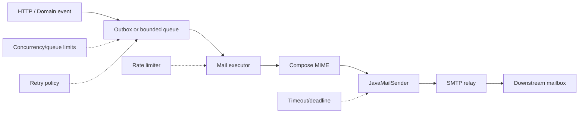
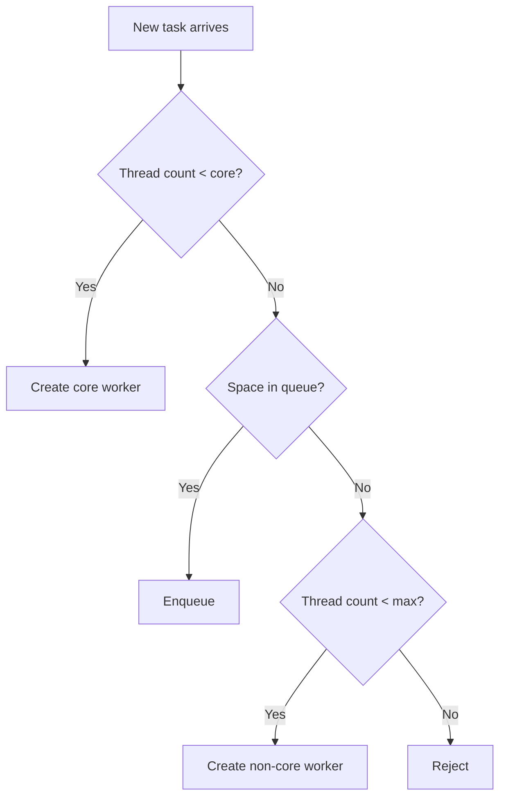
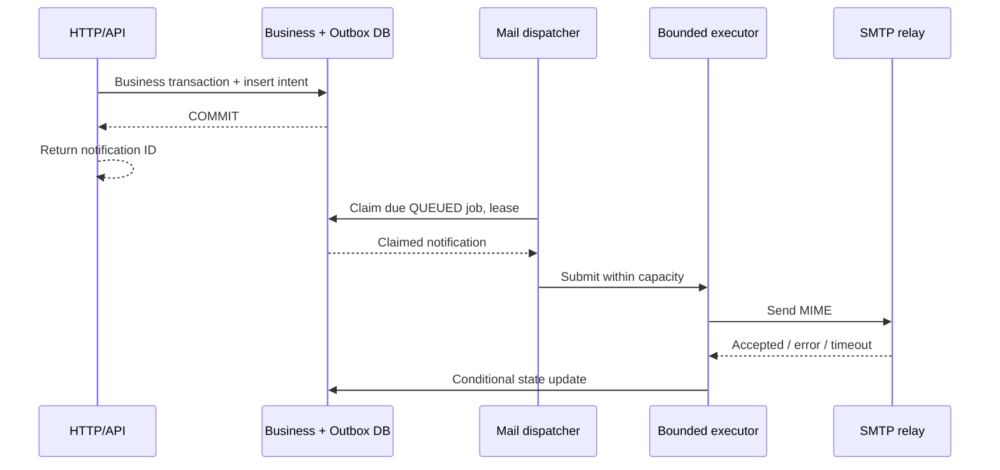

# Email Sending Thread Pool Limits

In a Spring Framework Mail application, sending email is typically an **I/O operation with high and variable latency**. A single send does not consist solely of the `JavaMailSender.send(...)` call: the client must also resolve DNS, establish a TCP connection, negotiate TLS, authenticate over SMTP, transmit MIME bodies/attachments, and wait for the mail relay to respond. If executed directly on an HTTP request thread, users may have to wait for several seconds. If all work is offloaded to `@Async` without bounding thread count and queued jobs, the system risks thread exhaustion, heap exhaustion, elevated latency, exceeding provider quotas, and losing tasks on process restarts.

Therefore, **bounding the email sending thread pool** is not as simple as setting `maxPoolSize=100` to "send faster." You must design an end-to-end resource budget covering concurrent SMTP connections, the sending rate allowed by the provider, queue capacity, deadlines, memory for MIME/attachments, database transactions, deployment instance count, and retry demand. The goal is to achieve appropriate throughput while **preventing backlogs and failures from spilling over into unrelated requests or features**.

This lesson belongs to the *Performance and Limits* chapter of Spring Framework Mail. It analyzes how `ThreadPoolTaskExecutor` actually works, concurrency estimation formulas from latency, queue capacity and backpressure, Spring `@Async` configuration, behavior when an executor is full, coordinating with SMTP rate limits, transactional outbox, retries, timeouts, observability, load testing, and common design pitfalls. Examples target Java 21, Spring Framework 6.x / Spring Boot 3.x, and Jakarta Mail.

> **Scope:** A thread pool controls the number of Java tasks executing concurrently; it does **not** replace an SMTP rate limiter, does not guarantee delivery, and does not make SMTP part of a database transaction.

## 1. What Resources Does One Email Consume?

A mail send call can occupy:

- **Worker thread:** usually waiting on I/O most of the time; still consumes stack memory, scheduling, and thread resources.
- **SMTP connection:** socket, TLS session, relay connection slot; providers may limit concurrent connections.
- **CPU:** template construction, MIME encoding, Base64 attachments, TLS crypto, serialization.
- **Memory:** `MimeMessage` objects, HTML/text, attachments if loaded into `byte[]`, job queues, and buffers.
- **Network bandwidth:** especially for large attachments or inline images.
- **Database resources:** reading business data, claiming outbox items, updating status, recording attempt history.
- **Provider sending allowance:** emails/second, recipients/day, message size, connection count, quotas per account/domain/IP.

One thread does not permanently correspond to one SMTP connection across every implementation, though with synchronous `JavaMailSender.send(...)`, there is normally one transport operation active inside the worker. Connection reuse/batching settings or provider APIs can alter this correlation; measure in practice.



Do not simply look at low CPU and raise the thread count. SMTP threads may be waiting on the network while the provider has already hit its concurrent connection limit or rate quota; raising threads at that point only causes more timeouts and throttling.

## 2. Difference Between Request Threads, Mail Workers, and SMTP Connections

Suppose an API receives 200 requests per second, each triggering an email.

If sending synchronously:

```text
HTTP thread
  -> load invoice
  -> render HTML
  -> JavaMailSender.send(...)
  -> SMTP round-trip
  -> HTTP response
```

When SMTP slows down, request threads are held for a long time and the server's responsiveness for other requests degrades. Switching to `@Async`:

```text
HTTP thread
  -> submit email task
  -> HTTP response

Mail worker
  -> render / read attachment
  -> JavaMailSender.send(...)
```

**decouples latency** between HTTP and SMTP, but does not make the work disappear. If 200 tasks/second are produced while workers only process 40 tasks/second, the backlog grows by 160 tasks/second. Without a queue bound, the consequences are merely delayed until heap or system resources run out.

### 2.1. Fast HTTP Does Not Mean the Email Was Sent

An API that only hands a task off to an executor should respond with "accepted for processing" semantics, not claim the SMTP relay accepted it. For work requiring reliability, the API can write a transactional outbox record and return a notification ID and `QUEUED` status; a worker then performs the actual send.

### 2.2. @Async Does Not Automatically Provide a Sensible Resource Budget

If an application only has:

```java
@Async
public void send(MailCommand command) {
    mailSender.send(buildMessage(command));
}
```

without knowing which executor is selected, what its pool/queue configuration is, where errors go, and which other threads share that executor, the design is not safe enough to operate. Spring has a default executor selection mechanism depending on configuration/framework/Boot; never assume that default is bounded or tuned for SMTP.

Better: **define a dedicated executor for mail** and specify it explicitly with `@Async("mailExecutor")`, or use outbox-polling workers with application-managed concurrency limits.

## 3. Parameters of ThreadPoolTaskExecutor

Spring provides `ThreadPoolTaskExecutor`, an abstraction over Java's `ThreadPoolExecutor`:

| Parameter | Meaning | Common Misconception |
|---|---|---|
| `corePoolSize` | Number of core workers the pool maintains | Does not mean incoming tasks immediately scale up to `maxPoolSize` |
| `maxPoolSize` | Upper bound on worker count in the pool | Setting 100 does not mean 100 threads are always active |
| `queueCapacity` | Number of tasks that can wait in the executor queue | Too large a queue causes `maxPoolSize` to rarely be reached |
| `keepAliveSeconds` | Time idle non-core threads are kept before shrinking | Not an SMTP timeout |
| `threadNamePrefix` | Prefix to distinguish threads in logs/thread dumps | Does not bound resources |
| `RejectedExecutionHandler` | Policy when a task cannot be accepted | Rejected notification state must not be ignored |
| `TaskDecorator` | Wraps tasks, e.g., for context propagation | Does not alter concurrency/queue limits |

When `queueCapacity > 0`, `ThreadPoolTaskExecutor` normally uses a `LinkedBlockingQueue` of that capacity. When capacity is 0 or negative, the implementation uses a direct handoff queue like `SynchronousQueue`. These choices change when the pool spawns additional threads.

### 3.1. Task Acceptance Order Matters Greatly

With the configuration:

```text
corePoolSize  = 4
maxPoolSize   = 12
queueCapacity = 200
```

and an executor using a standard bounded queue, the usual order is:

1. When worker count is below core size, create a new worker for the task.
2. Once core workers exist, **enqueue** incoming tasks first.
3. Only when the queue is full, grow workers beyond core up to max size.
4. When the pool is at max and the queue is full, tasks are rejected per the rejection policy.



Consequently, many developers configure `core=4, max=100, queue=100000` thinking it will scale up to 100 workers under load. In reality, a huge queue can accumulate tens of thousands of tasks **before** the 5th thread ever spawns. To scale concurrency earlier, pick core size and queue capacity to match demand rather than just raising max size.

### 3.2. Queue Capacity Counts Tasks, Not Bytes

`queueCapacity=500` means at most 500 pending `Runnable`s, not 500 KB or 500 small emails. If each task closure captures a large `MimeMessage` object or a 5 MB attachment byte array, 500 tasks can exert massive heap pressure. Enqueue **lightweight references/IDs** and render/read attachments when the worker executes, or store durable intents in the database.

### 3.3. Core Threads and Keep-Alive

Non-core threads can shrink away after staying idle for `keepAliveSeconds`. Core threads are typically retained unless core-thread timeouts are enabled. With bursty email traffic, this policy affects warm-up time and idle thread count. Never adjust `keepAliveSeconds` to fix an SMTP read timeout; those are completely different layers.

## 4. Configuring a Dedicated Executor for Email Sending

Spring configuration example:

```java
package com.example.mail.config;

import java.util.concurrent.ThreadPoolExecutor;

import org.springframework.context.annotation.Bean;
import org.springframework.context.annotation.Configuration;
import org.springframework.core.task.AsyncTaskExecutor;
import org.springframework.scheduling.annotation.EnableAsync;
import org.springframework.scheduling.concurrent.ThreadPoolTaskExecutor;

@Configuration(proxyBeanMethods = false)
@EnableAsync
public class MailAsyncConfig {

    @Bean(name = "mailExecutor")
    public AsyncTaskExecutor mailExecutor() {
        ThreadPoolTaskExecutor executor = new ThreadPoolTaskExecutor();
        executor.setThreadNamePrefix("mail-worker-");
        executor.setCorePoolSize(4);
        executor.setMaxPoolSize(8);
        executor.setQueueCapacity(80);
        executor.setKeepAliveSeconds(60);
        executor.setRejectedExecutionHandler(
                new ThreadPoolExecutor.AbortPolicy());
        executor.setWaitForTasksToCompleteOnShutdown(false);
        executor.initialize();
        return executor;
    }
}
```

The numbers **4 / 8 / 80 are only illustrative examples**, not a recommended setting for every provider. `AbortPolicy` rejects when capacity is exhausted, signaling overload to callers instead of silently dropping jobs. Rejection handling must be explicitly coded in the application. For graceful draining, a separate lifecycle/outbox policy is needed; `waitForTasksToCompleteOnShutdown=false` here underscores that an in-memory executor **is not durable job storage**.

### 4.1. Service Using the Right Executor

```java
package com.example.mail;

import java.util.concurrent.CompletableFuture;

import org.springframework.scheduling.annotation.Async;
import org.springframework.stereotype.Service;

@Service
public class AsyncMailService {

    private final MailComposer composer;
    private final MailTransport transport;

    public AsyncMailService(
            MailComposer composer,
            MailTransport transport) {
        this.composer = composer;
        this.transport = transport;
    }

    @Async("mailExecutor")
    public CompletableFuture<Void> sendAsync(MailCommand command) {
        var message = composer.compose(command);
        transport.send(message);
        return CompletableFuture.completedFuture(null);
    }
}
```

`MailComposer`, `MailTransport`, and `MailCommand` are application-defined abstractions separating rendering from SMTP transport. You can use `JavaMailSender` directly, though separating layers makes testing, rate limiting, and error classification easier.

`@Async` relies on Spring proxies in standard configurations. Calling `this.sendAsync(...)` from inside the same bean can bypass the proxy, causing the task to run synchronously and skip the executor. To guarantee async execution, invoke the method through another Spring bean or an appropriate proxy setup.

### 4.2. Void vs. CompletableFuture

`@Async void` gives callers no future to observe exceptions thrown inside the worker. Spring provides `AsyncUncaughtExceptionHandler`, but for email tasks needing outcome tracking, you should return an outcome/future or persist **durable state in an outbox**.

Returning `CompletableFuture<Void>` lets you observe exceptions once the task has been accepted by the executor. However, **rejection can happen right at submission time** and must be handled differently from SMTP errors inside the task; attaching `whenComplete(...)` alone is not enough if the method proxy throws on submission.

### 4.3. Shutdown Settings Do Not Turn a Queue into Durable Storage

Depending on lifecycle settings, Spring can let the executor wait for tasks on shutdown, apply await-termination, or cancel pending tasks. All of those only improve graceful shutdown at the process level. `kill -9`, OOM, or host loss can still lose unpersisted tasks.

For transactional emails, writing to an outbox before dispatching is far more reliable than relying on "wait for all tasks on shutdown."

## 5. Estimating Concurrency from Throughput and Latency

A foundational mental model is the relationship between throughput, work in progress, and average processing time (Little's law under steady-state conditions):

\[
L = \lambda W
\]

Where:

- `L`: average number of items in the system/phase being measured.
- `λ`: average completion rate, in emails/second.
- `W`: average time an item spends in that system/phase.

Considering only the **worker sending phase**, suppose each SMTP attempt occupies a worker for 0.5 seconds on average and you want 20 attempts/second throughput; the average number of busy workers needed is roughly:

\[
20\ \text{attempts/s} \times 0.5\ \text{s/attempt} = 10\ \text{concurrent attempts}
\]

This is an **initial estimate**, not a guaranteed formula. Latency has tail distributions, timeouts, retries, rate limits, CPU/MIME overhead, and connection limits; the pool also needs headroom to avoid running continuously at 100% utilization.

### 5.1. Example When SMTP Slows Down

Suppose 10 workers send continuously:

| Average SMTP Attempt | Approx. Throughput Ceiling When Workers Stay Busy |
|---:|---:|
| 0.2 seconds | ~50 attempts/second |
| 0.5 seconds | ~20 attempts/second |
| 1.0 second | ~10 attempts/second |
| 2.0 seconds | ~5 attempts/second |
| 5.0 seconds | ~2 attempts/second |

These numbers come from `workers / averageDuration`, **excluding** rate limits, batching, render CPU, or queuing. When a relay slows from 0.5 to 2 seconds, throughput drops roughly fourfold if worker count stays constant. Automatically increasing threads fourfold can overload the relay and worsen latency further.

### 5.2. Sizing Must Account for Total Worker Hold Time

If a worker executes:

```text
Read data        80 ms
Render template  30 ms
Read attachment  90 ms
SMTP send       500 ms
Update DB        20 ms
----------------------
Total           720 ms
```

then concurrency estimation must use **720 ms** if the same thread holds the entire task end-to-end, not just the 500 ms SMTP portion. If stages are split across separate executors, budget each stage independently.

### 5.3. Is Throughput Measured in Attempts or Notifications?

One notification may require retries. If 100 notifications generate 120 SMTP attempts due to transient failures, executor and provider throughput scale by **attempts**, while business KPIs may count notifications. Never use `SENT` notification counts as the sole estimate for SMTP calls or bandwidth.

## 6. When Does a Backlog Grow Unboundedly?

Suppose over an interval:

- Producers generate `λ_in = 60` emails/second.
- Workers complete `μ = 40` emails/second.

The backlog grows by roughly:

\[
\Delta Q / \Delta t \approx \lambda_{in} - \mu = 20\ \text{emails/s}
\]

After 5 minutes, the backlog grows by roughly 6,000 jobs if rates stay constant. With a queue capacity of 500, the limit is hit quickly. With an unbounded queue, the application can preserve the illusion that "the API is still accepting requests" until heap runs out or message ages breach SLA.

### 6.1. Queue Capacity Is a Wait-Time Budget

A simple steady-state queue estimate is:

\[
W_q \approx Q / \mu
\]

With 200 waiting jobs and a completion rate of 40 emails/second, average queuing delay alone is estimated at several seconds under steady, uniform conditions. This is not a p95 or max wait guarantee; bursty producers, batching, priority ordering, and retries can create wide variance.

If an SLA requires verification emails to be dispatched within 10 seconds, a 50,000-task queue is not a valid solution merely because heap has room.

### 6.2. Large Queues Have Three Costs

1. **Memory:** closures retain data, payloads, object graphs, and potentially request/session references if poorly designed.
2. **Latency:** tasks arrive late; tokens may expire or business intents may no longer be valid.
3. **Shutdown/crash:** RAM-only tasks can be lost; draining a huge queue slows deployments.

Therefore, size queues by **acceptable wait time and memory budget**, not by "picking a huge number to avoid errors."

## 7. Backpressure: What Does the System Do When the Pool Is Full?

Backpressure is the mechanism signaling producers or coordinators that consumers cannot accept more work at the current rate. For email sending, this matters because applications normally cannot drop invoices, OTPs, or business emails just because an executor is temporarily overloaded.

Three states must be distinguished:

1. **Accepted into durable storage:** the intent is committed to the database/outbox; a dispatcher can send when capacity opens.
2. **Accepted into executor memory queue:** the task sits only in RAM; not durable across restarts.
3. **Rejected by executor:** not accepted into the pool; the caller must handle or report appropriately.

Never call all three "email sent successfully."

### 7.1. Four Types of RejectedExecutionHandler

Java's `ThreadPoolExecutor` offers standard policies:

| Policy | When Both Pool and Queue Are Full | Suitable for Mail? |
|---|---|---|
| `AbortPolicy` | Throws `RejectedExecutionException`; Spring may translate to `TaskRejectedException` | Usually suitable when callers handle rejections explicitly |
| `CallerRunsPolicy` | Runs the task on the thread calling `execute` if the executor is still active | Caution: can block HTTP requests waiting on SMTP |
| `DiscardPolicy` | Silently drops the task | **Unsuitable** for important emails |
| `DiscardOldestPolicy` | Drops the oldest queued job and retries accepting the new one | Risks losing notifications and breaking business ordering |

In particular, `CallerRunsPolicy` can act as backpressure if the producer is an internal dispatcher worker: the dispatcher slows down when the pool fills. However, if the producer is an HTTP thread, this policy can **execute SMTP directly on the HTTP request thread**, losing async benefits, tying up request threads, and causing timeouts. Furthermore, once the executor shuts down, policy behavior must be understood; do not treat `CallerRunsPolicy` as a guarantee against job loss.

### 7.2. Submission Failures Are Not SMTP Failures

For example:

```java
try {
    asyncMailService.sendAsync(command);
} catch (TaskRejectedException rejected) {
    // Executor did not accept task; SMTP was not attempted.
    enqueueForLaterOrReturnOverloaded(command);
}
```

`TaskRejectedException` is in `org.springframework.core.task`. In a real application, recovery logic must ensure the intent is not enqueued **twice** if already recorded earlier. Use an idempotency key to create a unique intent rather than catching exceptions and retrying HTTP infinitely.

If `sendAsync` returns `CompletableFuture`, you must also handle exceptions **after the task was accepted**:

```java
CompletableFuture<Void> future =
        asyncMailService.sendAsync(command);

future.whenComplete((ignored, failure) -> {
    if (failure != null) {
        recordAsyncFailure(command.notificationId(), failure);
    }
});
```

These two examples illustrate two distinct failure points. `recordAsyncFailure(...)` and `enqueueForLaterOrReturnOverloaded(...)` are application-defined abstractions. For flows requiring durability, prefer outbox status and worker retries rather than treating an in-process `CompletableFuture` as the single source of truth.

### 7.3. What Should an HTTP API Return Under Overload?

It depends on semantics:

- If **an outbox intent is already committed**, return an accepted response with the notification ID without waiting on SMTP.
- If the request **is not yet durably persisted** and cannot be accepted due to overload, return an explicit error signal such as `429 Too Many Requests` or `503 Service Unavailable` per API contract, with retry guidance if appropriate.
- If the task is optional, best-effort/drop can follow explicitly documented business requirements, but never silently drop critical transactional emails.

Thread counts are no substitute for defining **admission control**: some emails are mandatory, some campaigns can be delayed, and some expired OTPs should be skipped in favor of new requests.

## 8. Thread Pool Limits Differ from SMTP Provider Rate Limits

Suppose an executor allows 20 concurrent workers. If each SMTP call takes 0.2 seconds, raw throughput could reach roughly 100 attempts/second. Yet the relay might allow only **10 messages/second** or **5 concurrent connections**. Raising threads to 20 does not increase quota; it triggers throttling.

Common provider limits:

| Limit Type | Example | Control Mechanism |
|---|---|---|
| Concurrent SMTP connections | Max simultaneous sockets | Semaphore / concurrency cap |
| Messages per second | Message submission rate | Token bucket / rate limiter |
| Recipients per second | One multi-recipient message counts multiple units | Per-recipient rate limiter |
| Hourly/daily quota | Total messages/recipients | Durable quota accounting, scheduling |
| Max message size | MIME size after encoding | Validate/cap attachments before enqueuing |
| Burst limit | Only short bursts allowed | Token bucket capacity + refill rate |
| Tenant/account quota | Per-credential/sender limit | Per-account/tenant rate limiter |

These examples illustrate **limit categories**, not limits of any specific provider. Always check your SMTP/API contract and measure real responses.

### 8.1. Two Parallel Constraints

We can model this as:

\[
\text{In-flight SMTP attempts} \leq C_{\text{connection}}
\]

and:

\[
\text{SMTP attempts / second} \leq R_{\text{provider}}
\]

Setting worker count `C=5` bounds concurrent calls, but **does not automatically keep rates below 10 messages/second** when individual attempts finish very fast. Conversely, a 10 requests/second token bucket **does not automatically keep connections capped at 5** when the server slows down. You need both whenever the provider enforces both constraints.

### 8.2. Acquiring Permits Right Before Sending

Illustrative architecture:

```java
public final class ThrottledMailTransport {

    private final MailRateLimiter rateLimiter;
    private final Semaphore smtpConnections;
    private final JavaMailSender sender;

    public ThrottledMailTransport(
            MailRateLimiter rateLimiter,
            Semaphore smtpConnections,
            JavaMailSender sender) {
        this.rateLimiter = rateLimiter;
        this.smtpConnections = smtpConnections;
        this.sender = sender;
    }

    public void send(MimeMessage message) throws InterruptedException {
        if (!rateLimiter.tryAcquire()) {
            throw new MailRateLimitedException();
        }

        if (!smtpConnections.tryAcquire()) {
            // Do not block indefinitely; caller reschedules.
            throw new MailConcurrencyLimitException();
        }

        try {
            sender.send(message);
        } finally {
            smtpConnections.release();
        }
    }
}
```

`MailRateLimiter`, `MailRateLimitedException`, and `MailConcurrencyLimitException` are application abstractions. The snippet above is simplified to illustrate both permit types; production code must manage atomicity/permit acquisition order and handle cases where a rate permit is consumed while the concurrency permit fails, as well as interrupts/cancellation. You can acquire concurrency first and then rate with a bounded wait, returning permits if sending has not started, depending on your limiter contract.

The key design principle is **never keep thousands of workers waiting on permits**. Throttle job claims/task submissions at the dispatcher when the provider has no quota, or return jobs to a deferred state to wait for a later send time.

### 8.3. Rate Limits May Need to Be Shared Across Instances

A deployment with 5 pods, each allowed 10 messages/second, can generate up to 50 messages/second against the same SMTP account. If the provider caps the **entire account** at 20 messages/second, JVM-local limiters are insufficient.

Depending on architecture, you can:

- Statically partition quotas per pod when replica count is controlled.
- Use a distributed rate limiter with atomic accounting and appropriate TTLs.
- Route sends through a centralized dispatcher group per account/provider.
- Partition worker pools by provider/tenant with explicit budgets.

Distributed limiters must account for network partitions, clock drift, and TTLs; never assume a simple counter is always strictly exact. To stay safe, leave headroom below official quotas rather than configuring right at the ceiling.

## 9. Retries, Rate Limiting, and Retry Storms

When SMTP returns 421, 450, 451, or 452, the system may classify it as a temporary error. If every task retries immediately on the executor inside a loop:

```java
while (!sent) {
    mailSender.send(message);
}
```

each worker occupies a thread continuously, hammers an already overloaded relay, and blocks the queue for new emails. That is a **retry storm**.

Instead, each attempt should:

1. Send once.
2. Classify the outcome as accepted, temporary, permanent, or unknown.
3. If temporary and retry budget remains, record the next attempt timestamp.
4. **Release the worker**; the job waits in the outbox/scheduler.
5. Re-claim and retry when due.

### 9.1. Exponential Backoff with Jitter

Example:

```text
Attempt 1: 451 -> retry after approx. 30 seconds
Attempt 2: 451 -> retry after approx. 1 minute
Attempt 3: 451 -> retry after approx. 2 minutes
Attempt 4: 451 -> retry after approx. 4 minutes
Attempt 5: retry budget exhausted -> FAILED / DEAD_LETTER
```

Jitter prevents thousands of tasks from waking up at the exact same instant. If the provider gives a reliable rate-limit window or `Retry-After` signal, incorporate it into the policy. Never re-run retries immediately just because the queue has empty space.

### 9.2. Bounded Timeouts Are Required for Pool Recovery

Jakarta Mail SMTP example:

```yaml
spring:
  mail:
    properties:
      "[mail.smtp.connectiontimeout]": "5000"
      "[mail.smtp.timeout]": "10000"
      "[mail.smtp.writetimeout]": "10000"
```

- `connectiontimeout`: deadline to establish the socket connection.
- `timeout`: deadline to wait when reading socket responses.
- `writetimeout`: deadline for socket writes depending on the implementation.

Without timeouts, workers can hang indefinitely in network I/O, driving active counts to max and stalling queue consumption. However, these three socket timeouts are **not a total deadline** for the entire attempt or notification; DNS, multiple protocol phases, MIME serialization, and retries can still push total elapsed time higher.

### 9.3. Deadlines and Job TTL

An OTP email might only be valid for 5 minutes. If queue backlog delays a worker for 6 minutes, sending an expired code creates user confusion. Before sending, check:

```java
if (clock.instant().isAfter(job.expiresAt())) {
    outbox.markExpired(job.id(), job.leaseToken());
    return;
}
```

`clock`, `job`, and `outbox` are application abstractions. For transactional emails like invoices, the TTL policy differs; do not drop every old email just because it waited long. TTL is a business policy alongside executor bounds.

### 9.4. UNKNOWN State and Duplicates

If the relay already received `DATA` but the client lost the final `250` response, the outcome is uncertain. Adding threads or retrying immediately does not clarify the outcome; it can create duplicates. The outbox must record attempt outcomes and apply appropriate reconciliation/retry policies rather than treating every `MailSendException` as "not sent."

## 10. Long-Term Design: Transactional Outbox + Bounded Worker

`@Async` is useful for short, best-effort work. However, when email is a reliable part of business workflows, a better architecture is:



Benefits:

- Intents survive restarts.
- The executor RAM queue can be tiny or zero-capacity.
- Workers claim work only when they have capacity.
- SMTP failures do not prolong business transactions.
- Retries are scheduled via the database without tying up sleeping threads.
- Data exists to measure backlog, notification age, and SLAs.
- When scaling is needed, workers scale in a controlled way within provider quotas.

### 10.1. Recording Intent Inside the Same Business Transaction

```java
@Transactional
public void issueInvoice(long invoiceId) {
    Invoice invoice =
            invoiceRepository.findById(invoiceId).orElseThrow();
    invoice.issue();

    outbox.insertIfAbsent(new MailIntent(
            "invoice-issued:" + invoiceId,
            invoice.tenantId(),
            invoice.customerId(),
            "INVOICE_ISSUED",
            clock.instant()));
}
```

`Invoice`, `MailIntent`, and the repositories are application abstractions. A unique constraint on notification key/tenant prevents duplicate enqueuing. Never call SMTP inside this transaction; mail workers send after commit.

### 10.2. Job States and Leases

A job may have:

```text
id             = ...
status         = QUEUED | SENDING | SENT | FAILED | DEAD_LETTER
attempts       = 0
nextAttemptAt  = 2026-11-12T14:00:00Z
leaseOwner     = null
leaseToken     = null
leaseUntil     = null
```

Workers atomically claim from `QUEUED` to `SENDING`, attaching a lease token; upon finishing, they update conditionally on status + token. If a worker crashes, lease expiration enables recovery. However, a lease does **not** cancel an SMTP call already in progress, nor does it eliminate duplicates after timeouts/ack failures.

### 10.3. Do Not Claim More Than Processing Capacity

A design flaw:

```text
Database claims 5,000 jobs -> SENDING
Executor capacity: 8 running + 80 queued
4,912 jobs cannot be submitted
```

Those jobs received leases despite no worker being available, getting stuck or delaying recovery. Better solutions:

- Determine free slots **before** claiming.
- Claim small batches based on capacity and quota.
- If submission is rejected, release/requeue the claim using a transition guarded by the fencing token.
- Never keep the claim transaction open while sending over SMTP.
- Do not rely solely on the executor queue's reported size as the single source of truth: queue size can change between checking and submitting.

## 11. Worker Dispatcher Bounding In-Flight Work with a Semaphore

One illustrative pattern combines a permit at the dispatcher with a bounded executor. The **Semaphore** prevents claiming more jobs than the application's allowed in-flight capacity (running + queued).

```java
package com.example.mail.worker;

import java.util.Optional;
import java.util.concurrent.Semaphore;

import org.springframework.core.task.AsyncTaskExecutor;
import org.springframework.core.task.TaskRejectedException;
import org.springframework.scheduling.annotation.Scheduled;
import org.springframework.stereotype.Component;

@Component
public final class MailOutboxDispatcher {

    private final AsyncTaskExecutor mailExecutor;
    private final OutboxClaims claims;
    private final MailAttemptProcessor processor;
    private final Semaphore inFlight = new Semaphore(8);

    public MailOutboxDispatcher(
            AsyncTaskExecutor mailExecutor,
            OutboxClaims claims,
            MailAttemptProcessor processor) {
        this.mailExecutor = mailExecutor;
        this.claims = claims;
        this.processor = processor;
    }

    @Scheduled(fixedDelayString = "${app.mail.poll-delay-ms:250}")
    public void poll() {
        while (inFlight.tryAcquire()) {
            Optional<ClaimedMailJob> maybeJob = claims.claimOneDue();
            if (maybeJob.isEmpty()) {
                inFlight.release();
                break;
            }

            ClaimedMailJob job = maybeJob.get();
            try {
                mailExecutor.execute(() -> {
                    try {
                        processor.processOne(job);
                    } finally {
                        inFlight.release();
                    }
                });
            } catch (TaskRejectedException rejected) {
                inFlight.release();
                claims.releaseAndReschedule(
                        job.id(), job.leaseToken());
                break;
            }
        }
    }
}
```

`OutboxClaims`, `MailAttemptProcessor`, `ClaimedMailJob`, and the two repository methods are application abstractions. This example only illustrates **acquire slot → claim → submit → finally release**. Production code must also handle `claimOneDue()` errors (ensuring permits are released if the database fails), rollback/requeue on submission failures, shutdown, and unexpected callback failures; wrap operations in helpers with explicit `try/finally` blocks. `@Scheduled` requires scheduling to be enabled, such as `@EnableScheduling` in configuration.

Additionally, if **multiple dispatchers call `poll()` concurrently** within the same JVM, the semaphore is thread-safe, yet claim transactions must still be protected by DB locking/fencing. Across multiple instances, each instance has its own semaphore, so global quotas must be distributed per provider.

### 11.1. Why Are a Semaphore and an Executor Queue Not the Same?

- A `Semaphore` at the dispatcher bounds **total claimed jobs currently in flight**, avoiding over-claiming beyond budget.
- `ThreadPoolTaskExecutor` bounds **running threads and RAM queue**.
- A `RateLimiter` bounds **SMTP requests per time window**.
- `Database leases` bound **job ownership** across multiple workers/processes.

These four layers solve distinct risks. Do not try to replace all of them with a single `maxPoolSize` variable.

### 11.2. Avoid Busy Polling When Quota Is Unavailable

If a permit cannot be acquired, avoid hammering the DB with high-frequency queries. Polling intervals, signal/event notifications, and adaptive backoff for the dispatcher reduce DB load when slots are unavailable. When the provider is rate-limiting, move jobs to an appropriate `nextAttemptAt` rather than repeatedly claiming and rejecting them.

## 12. Multi-Tenant Fairness and Preventing One Source from Starving the Pool

In a multi-tenant product, one tenant might enqueue a 20,000-email campaign while another needs to send 5 invoice emails. A single shared FIFO queue can stall invoices behind the campaign for a long time.

Several options exist:

- Separate pools or quotas for **transactional** vs. **bulk/marketing** traffic.
- Enforce per-tenant/account concurrency and send limits.
- Use weighted fair scheduling, round-robin, or rate allocation.
- Provide controlled priorities while preventing starvation of normal jobs.
- Keep retry queues scheduled by due time so provider-error retries do not occupy all workers.

### 12.1. Do Not Simply Put Priorities on an Unbounded Queue

If high-priority tasks arrive continuously, low-priority tasks can starve. Furthermore, priority does not guarantee the provider will allow sending faster than quota. A sound design can reserve worker/quota capacity for security, verification, or transactional emails and allocate a separate quota for campaigns.

### 12.2. Cluster-Wide Quotas

Suppose each pod has:

```text
mailExecutor maxPoolSize = 8
replicas = 6
```

The cluster-wide theoretical ceiling is **48 active workers**. If the provider allows only 20 concurrent SMTP connections, the combined pool exceeds the limit. Calculate based on **replica count and per-provider account**, not just by reading one JVM config.

### 12.3. Large Attachments and Head-of-Line Blocking

A 20 MB email occupies a worker far longer than a text-only OTP. In a single FIFO queue, small jobs behind it wait while multiple large attachments are processed concurrently. You can:

- Cap message sizes to reduce resource contention.
- Split lanes by job type/size when empirical data justifies it.
- Budget memory and bandwidth for the attachment lane.
- Maintain fairness and quotas across lanes, avoiding absolute priority starvation.

Do not create dozens of pools per template without justification: too many pools make total thread counts hard to control and operate.

## 13. Memory Budget: A Bounded Queue Can Still Cause OOM

Pending task count is only part of the heap picture. A task can retain data:

```java
record MailCommand(
        String recipient,
        byte[] pdfAttachment,
        String renderedHtml
) {}
```

Suppose each command holds a 4 MB PDF. If the queue holds 200 unexecuted commands, the byte arrays alone are roughly:

\[
200 \times 4\ \mathrm{MB} = 800\ \mathrm{MB}
\]

This figure **excludes** Java objects, HTML, MIME representations, encoding copies, buffers, worker stacks, other application heap, and GC overhead. Clearly `queueCapacity=200` is not always small.

### 13.1. Enqueue Lightweight References

Instead of:

```java
executor.execute(() ->
        mailSender.send(createMail(largePdfBytes)));
```

store a notification ID or reference to a validated attachment:

```java
executor.execute(() -> {
    MailJob job = outbox.load(jobId);
    processor.sendOne(job);
});
```

Pending tasks hold only `jobId` and a lightweight closure. Still, if you use an in-memory executor queue **without** a durable outbox, holding IDs does not solve job loss on crash. Use an outbox both to reduce memory and to protect intent.

### 13.2. MIME and Base64 Overhead

SMTP MIME attachments are usually encoded, e.g., with Base64. Wire payloads and buffers can exceed the original file size; never treat raw attachment size as the sole memory/network cost. If processing many 20 MB PDFs concurrently, throughput can hit network or GC limits before reaching `maxPoolSize`.

Optimize properly:

- Cap attachment count and size.
- Use data sources capable of opening a fresh stream when Jakarta Mail serializes.
- Do not hold open `InputStream`s while sitting in the queue.
- Enforce separate concurrency limits for large jobs if needed.
- Monitor heap/GC pauses and network egress alongside worker counts.
- Verify retries can reopen attachments after several minutes or restarts.

### 13.3. Never Capture HTTP Requests/Sessions in a Queued Runnable

A closure retaining `HttpServletRequest`, sessions, mutable JPA entities, or a user's `SecurityContext` can extend data lifetimes unexpectedly and cause leaks. For short async tasks, pass minimal immutable DTOs; for an outbox, persist validated actor ID, tenant ID, and notification ID rather than serializing the entire request/principal.

## 14. Security Context and Correlation Context in Mail Workers

Spring Security's `SecurityContextHolder` and SLF4J MDC typically use thread-bound contexts. When work is submitted to an executor, the principal and correlation ID do **not automatically** follow the worker.

If a job needs user identity for a short task within the same JVM, you can use `DelegatingSecurityContextAsyncTaskExecutor` with per-task context-capture semantics. For MDC, use a `TaskDecorator` that captures/restores context inside `try/finally`.

However, thread pools reuse threads. If you manually call:

```java
MDC.put("tenantId", tenantId);
mailSender.send(message);
// Forgot MDC.remove/restore in finally
```

the next task can see the previous task's tenant ID, corrupting logs and risking metadata leakage. Never raise thread counts to "dodge" this bug; manage context lifecycles properly.

For outbox jobs running after restarts, **never serialize `Authentication`/JWTs or sessions** to pass to long-lived workers. Workers should use a service identity, trusted tenant/reference data, and resource-check policies; correlation IDs are strictly for tracing, not authorization.

## 15. Graceful Shutdown, Deployments, and Lost In-Flight Work

When an application shuts down, an executor may hold:

```text
Pool:
  4 workers actively connected to SMTP
  60 tasks sitting in the RAM queue
```

If the process terminates immediately, RAM-queued tasks can vanish and in-flight sends can be interrupted. If configured to drain the entire queue, shutdown can exceed the orchestration platform's termination grace period.

### 15.1. Relevant Configuration Settings

Spring's `ThreadPoolTaskExecutor` provides configuration options:

- Wait for tasks to complete on shutdown.
- Bound `awaitTerminationSeconds`.
- Coordinate lifecycle with the Spring context.
- Policy for canceling pending tasks or rejecting late submissions depending on version/settings.

For a best-effort flow, you might configure:

```java
executor.setWaitForTasksToCompleteOnShutdown(true);
executor.setAwaitTerminationSeconds(30);
```

These two lines do not guarantee the process stays alive for a full 30 seconds if the orchestrator sends `SIGKILL`, the host loses power, or the JVM crashes. They only govern normal Spring-managed shutdown. Coordinate them with the runtime grace period and SMTP timeouts.

### 15.2. With an Outbox: Prioritize Durability Over Infinite Draining

If every email has an outbox row:

1. Stop claiming new jobs when shutdown begins.
2. Let in-flight attempts finish within the grace period if possible.
3. Update state using the lease token when the outcome is known.
4. Unclaimed jobs remain `QUEUED` in the database.
5. `SENDING` jobs from dead workers are recovered upon lease expiry.

Do not blindly "reset all `SENDING` to `QUEUED` immediately on shutdown" if an SMTP attempt may already have been accepted by the relay; doing so risks duplicates. Use proper outcome/lease policies.

### 15.3. Rolling Deployments and Multiple Template Versions

When multiple pods run different application versions during a rolling deploy, a `QUEUED` job may be processed by a different worker version than the one that created the intent. If payloads/schemas/templates change, version them appropriately. This is not a thread pool bug, yet it often surfaces when backlogs are large and deploys are frequent.

## 16. Do Virtual Threads Replace SMTP Limits?

Java 21 includes virtual threads. A virtual thread can handle blocking I/O with lower per-thread overhead than platform threads in many scenarios. Supported Spring Boot versions can use virtual threads for certain executors when configured.

However, **virtual threads do not remove SMTP limits**:

- Providers still limit concurrent connections and messages/second.
- Network, TLS/Base64 CPU, attachment memory, and quotas remain finite.
- One million virtual threads calling SMTP concurrently do not turn a relay into one million connection slots.
- Jobs in RAM are still lost if the process dies.
- Unbounded retries still trigger retry storms.

If using a virtual-thread executor without concurrency bounds, you still need external semaphores/rate limiters/admission control. When measuring performance, inspect the actual `JavaMailSender` implementation, SMTP library, and blocking/pinning sections; never assume all I/O scales linearly.

### 16.1. Platform Thread Pool vs. Virtual-Thread-Per-Task

| Criterion | Bounded Platform Thread Pool | Virtual-Thread-Per-Task with Concurrency Control |
|---|---|---|
| Platform thread count | Has a small, visible cap | Can run many virtual threads, while carrier threads are bounded |
| Per-task stack memory | Incurs platform thread stack cost | Generally lighter, though tasks/payloads still occupy heap |
| SMTP quota | Needs rate/concurrency caps | **Still** needs rate/concurrency caps |
| RAM queue | Can be bounded with `queueCapacity` | Needs explicit admission control |
| Durability | Not automatic | Not automatic |
| Operability | Familiar pool/queue model | Requires clear metrics and explicit bounds |

Never use virtual threads as a reason to skip an outbox or provider quotas.

## 17. Observing the Thread Pool: Do Not Measure Only Sent Emails

A good dashboard inspects multiple layers:

| Category | Signals to Measure | Operational Meaning |
|---|---|---|
| Executor | Active threads / pool size | Is the pool frequently hitting its cap? |
| Executor | Queue length / capacity | Is pending work growing or shrinking? |
| Executor | Rejected submissions | Is acceptance capacity being lost? |
| Outbox | Due `QUEUED` count | Durable backlog |
| Outbox | Age of oldest `QUEUED` job | Is SLA being affected? |
| Outbox | `SENDING` with expired lease | Worker stuck, timed out, or crashed |
| SMTP | Attempt duration p50/p95/p99 | Latency and tail latency |
| SMTP | Accepted / 4xx / 5xx / unknown outcomes | Is the provider healthy or overloaded? |
| SMTP | Concurrent connections | Approaching the limit? |
| Rate limiter | Acquired/denied permits | Is throttling occurring? |
| Retry | Scheduled retries, retry age | Retry storm or prolonged outage? |
| JVM | Heap, GC pauses, CPU, thread count | How do threads/payloads affect the runtime? |

### 17.1. Reading Executor Metrics from ThreadPoolExecutor

From an initialized `ThreadPoolTaskExecutor`, you can access the underlying executor:

```java
ThreadPoolExecutor pool = mailTaskExecutor.getThreadPoolExecutor();

int active = pool.getActiveCount();
int workers = pool.getPoolSize();
int queued = pool.getQueue().size();
int remainingQueueCapacity = pool.getQueue().remainingCapacity();
long completed = pool.getCompletedTaskCount();
```

Here `mailTaskExecutor` is a `ThreadPoolTaskExecutor` bean. These numbers are approximate snapshots in a concurrent system, not atomic measurements for deciding "exactly N slots remain." Never use them alone to claim jobs or make admission decisions; submission/permit/lease mechanisms remain the real source of control.

In Spring Boot/Micrometer, you can bind executor metrics or custom gauges compatible with your project's version and registry. Exact metric names depend on instrumentation; never assume a metric appears automatically in every configuration just because Actuator was added.

### 17.2. Logging with notificationId and attemptId

Example structured logs with sensitive data minimized:

```text
INFO event=mail_claimed notificationId=N-102 attemptId=A-1
INFO event=mail_smtp_started notificationId=N-102 attemptId=A-1
WARN event=mail_smtp_temporary_error notificationId=N-102
     attemptId=A-1 errorClass=THROTTLED
INFO event=mail_retry_scheduled notificationId=N-102
     nextAttemptAt=2026-11-12T15:30:00Z
```

There is no need to log recipient emails, bodies, verification tokens, or SMTP passwords. Never use notification IDs or attempt IDs as high-cardinality metric labels; they belong in logs or traces.

### 17.3. Correlation with Application Response Times

Monitor together:

- HTTP latency and 429/503 rates.
- Mail submit rejection rate.
- SMTP latency and errors.
- Outbox backlog and job age.
- Database connection pool saturation.

If HTTP latency rises alongside SMTP overload and the caller uses `CallerRunsPolicy`, that signals the mail thread pool is hijacking request threads. If HTTP remains stable while queue age climbs, the system may be **masking overload behind backlog**.

## 18. Alerts and Automated Responses

Do not alert just because active threads equal core size for a few seconds. That can be normal operation. Alerts should rely on **sustained signals or SLA impact**:

- Queue near full for several minutes with no downward trend.
- Rejected submissions climbing continuously.
- Oldest due outbox job age exceeding business requirements.
- SMTP 4xx throttling rising by provider/account.
- Abnormal rate of expired `SENDING` leases.
- Mail workers not claiming jobs even though due jobs exist.
- Heap/GC pauses climbing alongside queued payload sizes.
- `FAILED`/`DEAD_LETTER` ratio exceeding thresholds.

### 18.1. Runbook When the Queue Is Full

1. **Do not raise max threads immediately.** Determine whether the provider is throttling, SMTP latency rose, network errors occurred, or CPU/DB is the bottleneck.
2. Check active threads, queue depth, job age, and SMTP outcomes per provider.
3. If the provider is rate-limiting, **slow down and back off** rather than opening more connections.
4. If DB/attachment storage is slow, optimize that stage or isolate pools in a controlled way.
5. If workers are under-provisioned while the provider has headroom, increase concurrency **gradually**, watching tail latency and error rates.
6. If producer load persistently exceeds capacity, enforce admission control, business prioritization, and scale infrastructure with valid quotas.
7. Ensure rejected tasks are not lost: rely on an outbox and recovery.

### 18.2. Runbook When Active Threads Hit Max While the Queue Is Empty

Tasks may be waiting on I/O with room for more submissions if the queue drains quickly, or the dispatcher is throttled by a semaphore/rate limiter ahead of the executor. Inspect the whole pipeline. An empty queue does not prove emails are sending fast; it can indicate producers are already experiencing upstream backpressure.

### 18.3. Runbook When the Queue Grows Despite Low CPU

This is a classic SMTP scenario:

- Workers waiting on socket reads/writes.
- Provider limiting connections.
- Slow DNS/TLS handshakes.
- Slow attachment reads from remote storage.
- Pool core size too small relative to latency.
- Large queue capacity preventing max threads from activating as operators expected.

Investigate network/provider latency and executor configuration before adding CPU resources.

## 19. Testing a Full Executor with JUnit Without Real SMTP

In small unit/integration tests, you can intentionally hold workers with a `CountDownLatch` to verify rejection behavior. Do not rely solely on a flaky, artificially slow SMTP server to fill the pool.

### 19.1. Example: Pool of 2 Workers, Queue of 2

```java
package com.example.mail;

import static org.junit.jupiter.api.Assertions.*;

import java.util.concurrent.CountDownLatch;
import java.util.concurrent.TimeUnit;

import org.junit.jupiter.api.Test;
import org.springframework.core.task.TaskRejectedException;
import org.springframework.scheduling.concurrent.ThreadPoolTaskExecutor;

class MailExecutorCapacityTest {

    @Test
    void rejectsWhenWorkersAndQueueAreFull() throws Exception {
        ThreadPoolTaskExecutor executor = new ThreadPoolTaskExecutor();
        executor.setCorePoolSize(2);
        executor.setMaxPoolSize(2);
        executor.setQueueCapacity(2);
        executor.setThreadNamePrefix("mail-capacity-test-");
        executor.initialize();

        CountDownLatch running = new CountDownLatch(2);
        CountDownLatch release = new CountDownLatch(1);

        Runnable blocked = () -> {
            running.countDown();
            try {
                release.await();
            } catch (InterruptedException ex) {
                Thread.currentThread().interrupt();
            }
        };

        try {
            executor.execute(blocked);
            executor.execute(blocked);

            assertTrue(running.await(5, TimeUnit.SECONDS));

            // Two workers are running; the next two tasks sit in the queue.
            executor.execute(blocked);
            executor.execute(blocked);

            assertEquals(
                    2,
                    executor.getThreadPoolExecutor()
                            .getQueue().size());

            assertThrows(
                    TaskRejectedException.class,
                    () -> executor.execute(blocked));
        } finally {
            release.countDown();
            executor.shutdown();
        }
    }
}
```

The test keeps two workers busy, fills two queued slots, and verifies the fifth task is rejected. It tests **executor behavior**, not SMTP. Under default abort-based rejection, Spring throws `TaskRejectedException`; if a project switches to `CallerRunsPolicy`, expected behavior differs.

### 19.2. Testing That CallerRunsPolicy Does Not Unintentionally Stall HTTP

If a project deliberately uses `CallerRunsPolicy` for an internal dispatcher thread, test that when the pool fills, the task actually runs on the submitting thread and slows the dispatcher down. Do not run this test over an HTTP request with a slow SMTP call, which can hang the test; use fake tasks with latches/deadlines. Document clearly that this policy **must not be used blindly** when producers are request threads.

### 19.3. Testing That Tasks Are Not Silently Dropped

With `AbortPolicy` and an outbox, when the executor rejects:

1. The caller receives a submission error signal.
2. The claimed job is released/requeued using the lease token.
3. A `nextAttemptAt` schedule is set.
4. No false `SENT` status is recorded.
5. The job does not vanish even if the worker process restarts.

If a test only asserts an exception without checking outbox state, mail loss risks remain.

## 20. Integration Testing Throughput with an SMTP Test Server

When measuring real performance, an SMTP test server such as GreenMail or Mailpit can receive emails over loopback/containers. Use `JavaMailSenderImpl` with the test host/port instead of mocking transport. However, a sandbox is usually faster than real providers and lacks full production quotas/rate limits, so results **do not directly represent** throughput over the public Internet.

### 20.1. A Controlled Test Scenario

1. Start an SMTP test server configured never to relay mail to the Internet.
2. Define 1,000 test notifications with fake recipients and payloads.
3. Keep the same MIME/attachment sizes as the target use case.
4. Test concurrency of 2, 4, 8, and 12 workers sequentially in an isolated environment.
5. Measure SMTP attempt duration p50/p95/p99, throughput, queue age, CPU, heap, and GC.
6. Verify the test server received the expected message count, distinguishing notifications from attempts.
7. Run failure injection with 451, timeouts, or connection resets if the test server supports them.
8. Never treat a transient peak result as safe production capacity.

### 20.2. Example Result Table

Suppose an illustrative measurement produces:

| Workers | Throughput attempts/s | SMTP p95 | Rejections | Notes |
|---:|---:|---:|---:|---|
| 2 | 6 | 0.4 s | 0 | Pool below target capacity |
| 4 | 12 | 0.4 s | 0 | Near-linear scaling |
| 8 | 21 | 0.6 s | 0 | Latency beginning to rise |
| 12 | 22 | 1.5 s | Yes | Relay/network saturated |

These are **hypothetical numbers to illustrate how to interpret results**, not a real benchmark and not a recommendation to set 8 workers. If throughput barely moves from 8 to 12 while p95 spikes sharply, the limit lies in the relay, network, serialization CPU, or quotas rather than a shortage of threads.

### 20.3. Real Load Tests Require a Production-Like Environment

When a project has high throughput requirements:

- Use representative payloads and attachment sizes (synthetic data).
- Measure across multiple providers and recipient domains if quotas differ.
- Inject controlled failures/throttling to test backoff.
- Match production replica counts or simulate cluster-wide quotas.
- Measure database/outbox and object storage performance, not just SMTP.
- Enforce timeouts and stop-test safeguards to avoid unintended load.

Never use real customer email lists for load tests. Never blast traffic at real mailbox providers without authorization and planning; doing so can violate quotas/policies and damage sender reputation.

## 21. Capacity Planning Around SLA Targets

One structured approach:

### Step 1 — Classify Mail Types

For example:

| Type | Goal | Policy Under Overload |
|---|---|---|
| OTP/verification | Needs prompt delivery, short TTL | Prioritize, skip expired codes, allow issuing new codes |
| Invoices/receipts | Must deliver reliably, tolerates brief delay | Outbox + retry + audit |
| Marketing campaigns | Can smooth load over a schedule | Dedicated rate limit, pauseable |
| Operational alerts | Important, must prevent storms | Deduplication, priority, rate cap |

Not every email shares the same SLA or retry strategy. One shared pool sometimes suffices; when classifications are clear, isolating budgeted lanes/priorities prevents campaign backlogs from blocking OTPs.

### Step 2 — Estimate Arrival Rate

Measure peak hours, not just daily averages. If a system averages 100,000 emails/day but 80% arrive within 30 minutes, capacity must handle that burst or schedule smoothing.

For example:

```text
Total/day = 100,000 messages
Peak 30 minutes = 80,000 messages
Average peak arrival = 80,000 / 1,800
                     ≈ 44.4 messages/second
```

If the provider allows only 20 messages/second, no number of workers will get 44.4 messages/second accepted steadily without building a backlog. You must spread load over time, contractually raise quotas, or distribute across authorized providers/accounts.

### Step 3 — Estimate Attempt Multiplier

Suppose roughly 10% of notifications need an extra attempt due to transient errors; SMTP attempts will exceed notification counts. Headroom must account for real error distributions rather than assuming every send succeeds on the first try.

### Step 4 — Choose Concurrency from Latency and Quotas

Set an initial bound:

\[
C_{\text{target}}
\approx \lambda_{\text{target}} \times W_{\text{attempt}}
\]

Then cap it by concurrent SMTP connections, memory, DB, and replica count. When quota is insufficient, never push concurrency above limits; schedule and smooth load instead.

### Step 5 — Size Queues Around Acceptable Wait

If you want at most a 10-second dispatch wait and sustained service rate is about 20 messages/second, a target queue of a couple hundred tasks is a reasonable starting calculation **under steady-state conditions**. Verify bursts, priorities, retries, p95, and memory before finalizing.

With an outbox, the RAM queue can be tiny; long-waiting jobs stay in the DB instead of piling up inside the executor.

### Step 6 — Plan for Degradation

Test when:

- Provider latency doubles or quintuples.
- Provider lowers quotas or returns rate limits.
- An instance dies, reducing replica count.
- DB slows down or object storage is temporarily unavailable.
- Yesterday's retry backlog has not cleared yet.

Proper capacity planning means knowing how the system **degrades gracefully under control**, not just how it runs when everything is ideal.

## 22. Autoscaling and Global Limits

Adding pods can increase throughput when the bottleneck is CPU or local workers. However, if the bottleneck is a **shared SMTP quota**, autoscaling can make things worse:

```text
3 pods × 8 workers = 24 concurrent attempts
6 pods × 8 workers = 48 concurrent attempts
Provider quota = 20 concurrent connections
```

The system needs a cluster-level cap or per-replica allocation; you cannot simply watch CPU HPA and autoscale mail workers without limit.

### 22.1. When to Scale on Backlog?

Backlog depth and oldest-job age are stronger signals than CPU when workers are I/O-bound. Still, scaling on queue depth also needs guardrails:

- Max replicas bounded by SMTP quotas, network, and database.
- Per-replica concurrency caps.
- Global rate limiting if providers share one account.
- Cooldowns to prevent pod oscillation.
- Handling bursts of incoming events/notifications.

If the queue grows because the provider is throttling, adding pods will not help; the system needs to reduce its send rate or negotiate higher quotas.

### 22.2. Dynamic Tuning

You can adjust pool sizes or quotas based on telemetry, provided you enforce:

- Safe min/max bounds.
- Never increasing threads while provider errors/latency are rising.
- Hysteresis/cooldowns to avoid thrashing.
- Metrics/auditing for every change so it can be rolled back.
- Never relying on a single instantaneous queue-length snapshot.

Dynamic tuning is an advanced feature. For many systems, fixed bounded settings paired with alerts, load testing, and an outbox are already sufficiently reliable.

## 23. Common Misconceptions

**"CPU is low, so adding 100 threads will send 10x faster."** SMTP mostly waits on I/O, yet provider connection/rate quotas, bandwidth, and TLS/serialization still cap throughput.

**"Setting a high maxPoolSize makes the executor spawn threads right away."** With a bounded `LinkedBlockingQueue`, the executor enqueues tasks once core workers are busy; it grows past core only after the queue fills.

**"An unbounded queue means emails are never lost."** Tasks in RAM can exhaust heap and vanish on crashes; only durable storage preserves intents across restarts.

**"@Async guarantees mail is sent after commit."** No. Workers can run before the business transaction commits, and in-memory tasks do not survive restarts.

**"CallerRunsPolicy is always safe."** If the caller is an HTTP thread, SMTP can execute directly on the request thread and stall the server.

**"DiscardPolicy is fine because emails can just be re-sent."** Silently dropping tasks without an outbox loses the intent, leaving no basis to retry.

**"A 10/s rate limiter means at most 10 connections."** False. Rate and concurrency are two distinct constraints.

**"An 8-worker pool per pod means at most 8 SMTP calls system-wide."** Across multiple pods, total concurrency can reach the sum of all pools.

**"On SMTP 451, sleep the thread for 30 seconds and retry."** Sleeping holds a worker slot; release the worker and store `nextAttemptAt`.

**"A timeout means the server definitely did not receive the email."** Especially after `DATA`, the outcome may be `UNKNOWN` and retrying can create duplicates.

**"Virtual threads eliminate the need for concurrency limits."** Even though virtual threads are lighter, sockets, payloads, provider quotas, and RAM remain finite.

**"Waiting for the queue to drain on shutdown prevents losing emails."** Crashes and hard kills still wipe in-memory tasks.

**"If GreenMail/Mailpit handles 1,000 emails/s, production will too."** Sandboxes rarely mirror real provider latency, TLS/AUTH policies, quotas, and reputation limits.

**"An email marked SENT means the recipient sees it in their Inbox."** `SENT` normally records only SMTP submission or provider acceptance per contract; downstream delivery and Inbox placement are separate.

## 24. Hands-On Exercises

### Part A — Trace the Queueing Algorithm

Configure `corePoolSize=2`, `maxPoolSize=6`, `queueCapacity=10`. Trace the exact order when 20 tasks arrive simultaneously while all workers are blocked. Explain when the pool grows from 2 to 3 and when new tasks get rejected.

### Part B — Estimate Concurrency

Target 15 attempts/second with an average attempt duration of 0.8 seconds. Compute average required concurrency via Little's law, then explain why headroom and checking provider quotas are still necessary.

### Part C — Create a Dedicated Executor

Write a `mailExecutor` bean with core=3, max=6, queue=40, `AbortPolicy`, and a thread name prefix. Use `@Async("mailExecutor")` on a service. Verify calls go through the Spring proxy rather than self-invocation.

### Part D — Controlled Pool Saturation

Use `CountDownLatch` to hold workers, fill the queue, and verify rejections occur. Record accepted/rejected task counts without letting the test send real emails.

### Part E — Backpressure from HTTP

Design an email-enqueuing API. If the outbox insert commits, return a notification ID. If the intent cannot be accepted due to policy/quotas, return a clearly defined error. Test both `AbortPolicy` and `CallerRunsPolicy` to observe the difference in request latency.

### Part F — Outbox Worker

Create `mail_outbox` with `status`, `nextAttemptAt`, `leaseToken`, and `attempts`. Have the dispatcher claim only while an in-flight permit is available; when the executor rejects, release/requeue the job using the lease token. Simulate a restart to verify jobs are not lost.

### Part G — Backoff Retries

Simulate SMTP 451 across three attempts. Verify workers do not call `Thread.sleep` between retries; jobs return to `QUEUED` with `nextAttemptAt` without holding executor slots.

### Part H — Rate Limits and Concurrency

Set pool max=8, connection semaphore=3, and rate limiter=5 attempts/second. Generate 100 fake notifications. Verify both concurrent call limits and submission rate limits are respected independently.

### Part I — Multi-Instance

Simulate two mail worker instances, each with 4 slots. Design a distributed quota so the entire cluster never exceeds 5 concurrent connections to the same SMTP account. Verify DB claims do not collide.

### Part J — Tenant Fairness

Tenant A creates 1,000 marketing emails; Tenant B creates one invoice email. Design lanes/quotas so B's email does not wait behind A's entire campaign. Check for starvation under aggressive prioritization.

### Part K — Memory Profile

Compare a queue of 200 commands holding 4 MB `byte[]` attachments against a queue of 200 notification IDs. Measure heap and GC in tests with dummy fixtures, never customer data.

### Part L — SMTP Integration and Timeouts

Run an SMTP test server and measure latency with 2/4/8 workers. Simulate read timeouts and slow attachments; verify workers release slots after errors and the outbox updates outcomes.

### Part M — Metrics and Alerts

Build a dashboard for active threads, pool size, queue depth, rejection count, oldest `QUEUED` age, SMTP p95, retry count, and provider throttling. Set up alerts when queue age breaches SLA, not just when CPU is high.

### Part N — Graceful Shutdown

Stop a worker while 3 jobs are `SENDING` and 20 jobs are `QUEUED`. Verify no new claims happen, waiting jobs remain in the outbox, and unfinished jobs recover via lease expiry. Analyze duplicate risk if the relay accepted the message before `SENT` was persisted.

## 25. Production Deployment Checklist

Before increasing thread counts for Spring Framework Mail, answer:

- Is the email OTP, transactional, marketing, or an alert? What is the SLA/TTL for each?
- Are tasks stored only in a RAM queue or committed to a durable outbox?
- Does `@Async` execute through the proper Spring proxy and dedicated executor?
- Were `corePoolSize`, `maxPoolSize`, and `queueCapacity` chosen from measurements or guesses?
- Do you understand that bounded queues are normally filled before the pool grows past core?
- Do queued tasks retain oversized `MimeMessage`s, attachment bytes, or requests/sessions?
- Does the SMTP provider limit connections, message rates, and account/tenant quotas?
- Does total concurrency across all replicas fit within the provider's budget?
- Do you have both a rate limiter **and** a concurrency cap where needed?
- Is there an explicit rejection policy that avoids losing intents when the pool is full?
- Could `CallerRunsPolicy` unintentionally execute on HTTP request threads?
- Can backlog age breach SLAs or expire tokens before sending?
- Are SMTP connect/read/write timeouts and retry deadlines configured?
- Do retries have backoff/jitter, max attempts, and job TTLs?
- Do workers sleep on threads between retries?
- Do outbox claims check real capacity and use short transactions?
- Do lease/fencing tokens protect status updates across workers?
- Does shutdown/crash recovery exist rather than relying solely on draining RAM queues?
- Are Security/MDC contexts cleaned up on reused threads?
- Can one tenant or bulk campaign starve critical emails of capacity?
- Are active/queued/rejected counts, SMTP p95, oldest due age, 4xx/5xx, and memory/GC measured?
- Do load tests cover slow SMTP, rate limiting, large attachments, and replica failures?
- Is SMTP accepted distinguished from delivered/Inbox placement?

## 26. Conclusion

**Bounding the email sending thread pool is a resource management control, not merely a speed knob.** `ThreadPoolTaskExecutor` lets you set core/max threads and queue capacity, yet enqueuing order can keep max size from being used as newcomers expect. Overly large RAM queues easily hide overload and heighten memory/shutdown risks, while tiny queues without backpressure can drop tasks.

Worker counts should start from **arrival rate, real latency, and SMTP quotas**, then be validated with load tests, p95/p99, queue age, and provider error rates. Distinguish concurrency limits from rate limits; across multiple replicas, quotas must be budgeted at the cluster/account level rather than a single JVM. Transient retries should be scheduled with backoff while releasing threads, never sleeping on workers.

For critical business emails, a more durable design is **transactional outbox + bounded dispatcher + SMTP/rate limiter + leases/retries/metrics**. When the pool is busy, work waits in durable storage; when the provider slows down, the system throttles itself; when a process dies, another worker recovers without losing intents. And no matter how well a thread pool is tuned, SMTP accepted still does not mean delivery to the Inbox: sending performance, retry correctness, and deliverability are related yet distinct responsibilities.


