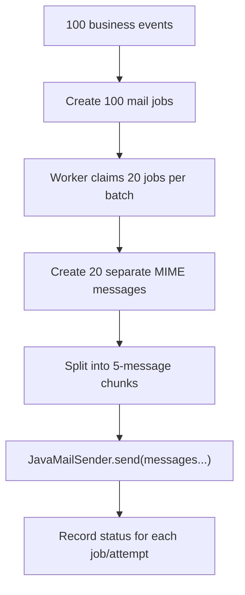
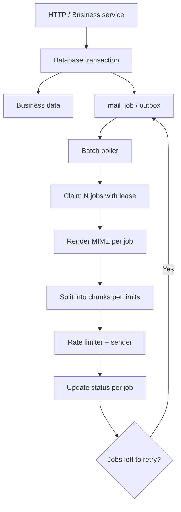

# Batching or Chunking Send Requests in Spring Framework Mail

When email volume grows from a few notifications per minute to thousands or tens of thousands of requests, calling `JavaMailSender.send(...)` individually directly inside an HTTP request is usually no longer viable. Every template render, MIME message creation, SMTP connection, authentication, and data transfer consumes time and resources. If every request sends immediately, the application easily hits timeouts, thread exhaustion, full queues, SMTP provider quota breaches, or duplicate sends on retries.

**Batching or chunking send requests** means organizing send requests into bounded groups to pull work from a queue, build messages, submit over SMTP, and update statuses efficiently, safely, and with controlled load.

However, "batching emails" can mean several different things: claiming multiple jobs from the database in one worker poll; passing multiple `MimeMessage` instances in a single `JavaMailSender.send(...)` call; aggregating multiple notifications into one digest email; or sending one message to many recipients. These four patterns are **not equivalent**, especially regarding privacy, content, retries, and idempotency.

In Spring Framework Mail, `JavaMailSender` and `MimeMessageHelper` handle building and submitting emails, but **do not automatically provide a durable queue, batching policy, rate limiter, per-job state, or exactly-once delivery guarantees**. The application must design those components based on SLAs, quotas, and email characteristics.

This document focuses on operational models, practical limits, Java/Spring Boot examples, transactional outboxes, SQL batch claiming, partial-failure handling, retries, concurrency, observability, and testing.

## 1. First, Distinguish the Four Kinds of "Batching"

| Pattern | Action | Best Suited For | Main Risk |
|---|---|---|---|
| **Batch job claiming** | Worker claims 20–100 jobs in one queue/outbox query | Reducing query round-trips, dividing workload | Holding job leases too long, uneven distribution |
| **Batch SMTP submission** | Build multiple `MimeMessage`s and call `send(messages...)` | Reducing call/transport overhead under suitable conditions | Partial failures, memory pressure, ambiguous errors |
| **Digest/aggregation** | Combine multiple events into **one email** | Reports, periodic notifications | Delays, overly long content, mixing differently authorized data |
| **One email to many recipients** | One message with multiple To/Cc/Bcc | General announcements, non-personalized content | Exposing recipients, per-recipient quotas, lack of per-user tracking |

A system can combine multiple techniques: pull 50 jobs from the outbox, split them into chunks of 5, build one message per job, and submit by chunk. Conversely, 50 notifications for **a single recipient** can be consolidated into one digest after verifying permissions and deadlines.

### 1.1. Visual Example



In this diagram, there are **100 send intents and 100 distinct messages**. Grouping at the worker/SMTP layer does not change the recipient list or content of any individual email.

Another pattern:

```text
20 activity events for user A
            |
            v
    Digest aggregator
            |
            v
   1 summary email for user A
```

Here, email count drops because **business semantics allow merging content**. You cannot substitute digests for the first batching pattern when events carry an obligation to send individually, such as OTPs, invoices, or security alerts.

## 2. Practical Benefits of Batching

### 2.1. Reducing Coordination Overhead

When a worker pulls one row at a time from the database, each job can incur its own query/transaction round-trip. Claiming multiple rows in one short transaction reduces overhead, especially at high queue volumes.

### 2.2. Potentially Reducing SMTP Connection Setup Cost

`JavaMailSender` supports sending multiple MIME messages via varargs overloads. With some implementations, notably `JavaMailSenderImpl`, the multi-message send method can reuse the same SMTP session across the sequence instead of opening a new connection per message. This can reduce connect/TLS/AUTH cost in suitable workloads.

However, **there is no guarantee every implementation/provider keeps one connection open or sends in a single round-trip**. Each email still has its own headers, body, recipients, MIME data, and SMTP transaction. Measure in practice instead of equating one Java call with one network send.

### 2.3. Controlling Throughput and Quotas

Batch size, concurrent workers, and dispatch rate can be tuned to stay within limits:

- Messages per second/minute.
- Recipients per hour/day.
- Concurrent SMTP connections.
- Maximum size of a single message.
- Total application bandwidth/CPU/memory.
- Quotas per account, tenant, or email category.

### 2.4. Improving System Predictability

Bounded batching creates explicit load-control points. Workers can decide to pull at most 20 jobs, send at most 5 messages per chunk, and open only a fixed number of connections. That is much easier to observe and recover than an unbounded queue with thousands of tasks hitting SMTP simultaneously.

### 2.5. Trade-Offs: Latency and Complexity

Grouping to save overhead has costs:

- Jobs must wait for enough items or the batch window to expire.
- Large batches tie up workers longer, delaying high-priority jobs.
- On mid-batch failure, you must determine which items were submitted and which were not.
- Large MIME messages or heavy attachments can cause memory pressure.
- Bulk retries can trigger secondary bursts.

**Batching is not an end in itself.** Increase batch sizes only when measured throughput improves while wait times, error rates, and memory remain within SLOs.

## 3. Choosing a Strategy by Email Type

| Email Type | Time Sensitivity | Suggested Approach |
|---|---|---|
| OTP / password reset | Very high, deadline-bound | Priority queue, tiny batches or immediate send upon claim |
| Security change alerts | High | Separate from bulk; never delay to fill a batch |
| Order confirmation | High–medium | Durable outbox, small batches, per-job retries |
| Invoices/receipts | Depends on business rules | Controlled batches; never silently drop when delayed |
| Periodic reports | Usually less urgent | Batching or per-recipient digests when business allows |
| Newsletters/marketing | Bulk; respect consent/unsubscribe | Rate limits, batch dispatch, suppression, separate quotas |
| Notification summaries | Deferrable | Per-recipient/tenant digests with time windows |

For example, waiting 30 seconds to batch a newsletter is usually acceptable; waiting 30 seconds for an OTP valid for 90 seconds degrades UX. In a shared queue, bulk campaigns can block urgent emails behind them.

### Workload Isolation

```text
Business events
    |
    +--> critical-mail-queue
    |       OTP / reset / security
    |
    +--> transactional-mail-queue
    |       order / invoice
    |
    +--> bulk-mail-queue
            newsletter / reports
```

Each queue has its own batch size, worker count, deadlines, retries, and monitoring. If an SMTP provider enforces a shared account-wide quota, splitting queues **does not create extra quota**; a shared rate limiter at the sending layer is still required.

## 4. Parameters to Define Before Batching

A batch policy may include:

| Parameter | Meaning | Illustrative Example |
|---|---|---|
| `maxBatchItems` | Max jobs pulled in one claim | 50 |
| `maxChunkMessages` | Max MIME messages in one `send` call | 10 |
| `maxBatchWait` | Max wait time to accumulate jobs | 200 ms |
| `maxBatchBytes` | Estimated size budget threshold | 5 MiB |
| `maxConcurrentSends` | Concurrent chunks/connections sending | 4 |
| `maxAttempts` | Maximum send attempts per job | 5 |
| `expiresAt` | Business deadline per job | Varies by mail type |
| `leaseDuration` | How long a worker holds a claim | Longer than expected processing time, with renewal |

All values are illustrative, **not defaults of Spring Framework Mail**. If a provider allows 100 emails/minute, a 10-message chunk still counts against that limit; batch size does not mean one recipient quota unit or "free" throughput.

### 4.1. Multi-Dimensional Limits

Do not decide batch size solely by message count. A 2 KB text email and a 15 MB PDF-attachment email have vastly different costs.

You can enforce a combined budget:

```text
batchItems <= maxBatchItems
estimatedBatchBytes <= maxBatchBytes
now - firstEnqueuedAt <= maxBatchWait
now < earliestExpiresAt - safetyMargin
```

Here `estimatedBatchBytes` is a pre-render estimate. MIME transfer encoding, attachments, and HTML can make actual size differ from the estimate. Enforce **per-message** size limits separately, not only total batch size.

### 4.2. Batch Size and Wait Windows

A common strategy is **size-or-time**: flush when enough items accumulate or when the first item has waited up to the limit.

```text
Create batch at 10:00:00.000
    |
    +-- 10:00:00.030: receive job 1
    +-- 10:00:00.050: receive job 2
    +-- ...
    +-- reach 10 jobs: send immediately

If fewer than 10 jobs before 10:00:00.230
    -> send existing jobs; do not wait indefinitely
```

When an item's `expiresAt` is near, flush earlier so emails are not held until expiration. With database/outbox sources, in-memory accumulation wait windows may be unnecessary; workers can poll batches of jobs already due on schedule.

## 5. How Does Spring Mail Support Sending Multiple Messages?

`JavaMailSender` provides these primary overloads:

```java
void send(MimeMessage mimeMessage) throws MailException;

void send(MimeMessage... mimeMessages) throws MailException;

void send(MimeMessagePreparator mimeMessagePreparator)
        throws MailException;

void send(MimeMessagePreparator... mimeMessagePreparators)
        throws MailException;

void send(SimpleMailMessage simpleMessage) throws MailException;

void send(SimpleMailMessage... simpleMessages)
        throws MailException;
```

These are Spring Mail API methods shown for signature illustration. In production code, inject the `JavaMailSender` interface and use the varargs overloads when sending multiple messages.

### 5.1. Sending One Message to One Recipient

```java
MimeMessage message = mailSender.createMimeMessage();
MimeMessageHelper helper = new MimeMessageHelper(
        message, false, "UTF-8");

helper.setFrom("notifications@example.org");
helper.setTo("customer-a@example.invalid");
helper.setSubject("Order A confirmation");
helper.setText("Order A has been recorded.", false);

mailSender.send(message);
```

One submission processes one message. The `example.invalid` address is a test fixture, not a real recipient.

### 5.2. Sending an Array of Multiple Messages

```java
MimeMessage[] messages = new MimeMessage[2];

messages[0] = buildTextMessage(
        mailSender,
        "customer-a@example.invalid",
        "Order A confirmation",
        "Order A has been recorded.");

messages[1] = buildTextMessage(
        mailSender,
        "customer-b@example.invalid",
        "Order B confirmation",
        "Order B has been recorded.");

mailSender.send(messages);
```

Helper:

```java
private static MimeMessage buildTextMessage(
        JavaMailSender sender,
        String recipient,
        String subject,
        String body) throws MessagingException {

    MimeMessage message = sender.createMimeMessage();
    MimeMessageHelper helper =
            new MimeMessageHelper(message, false, "UTF-8");

    helper.setFrom("notifications@example.org");
    helper.setTo(recipient);
    helper.setSubject(subject);
    helper.setText(body, false);

    return message;
}
```

Each array element is **a distinct message** that can have different recipients, subjects, and bodies. Calling `send(messages)` once does not mean the provider merges them into one shared email.

**Do not assume array sending is atomic**: if the third message fails, the first two may already have been accepted by the SMTP server. Error handling must track each mail job/attempt individually.

### 5.3. Varargs Is Not One SMTP Transaction

In SMTP, sending a message involves `MAIL FROM`, `RCPT TO`, and `DATA` for each transaction. Sending multiple messages over one connection may reuse the connection, yet still runs separate transactions and receives separate responses.

Do not treat:

```java
mailSender.send(messageA, messageB, messageC);
```

as an atomic operation where all three emails succeed or roll back together. SMTP does not participate in Spring database transactions.

## 6. Why Not Build One MimeMessage for the Entire List?

A seemingly economical option:

```java
helper.setTo(new String[]{
        "alice@example.invalid",
        "bob@example.invalid",
        "carol@example.invalid"
});
mailSender.send(message);
```

This creates **one email with multiple recipients**. It is completely different from three separate messages.

### 6.1. Privacy Risks

`To` and `Cc` are normally visible to recipients, allowing everyone to see each other's addresses. For personalized emails, invoices, password resets, OTPs, or account notices, never group recipients this way.

`Bcc` hides recipients in headers, yet you must still evaluate:

- The provider's bulk-sending policies.
- Whether one shared payload is appropriate for all recipients.
- Per-recipient tracking of bounces, complaints, and unsubscribes.
- Reply/reply-all behavior, group semantics, and header processing.
- Quotas counted per recipient, not just per message.
- Personalization and per-user links/tokens.

**Bcc does not turn one shared message into independent personalized emails.** When each recipient needs a unique token, use separate messages or a provider bulk API with explicit merge/personalization support.

### 6.2. When Multiple Recipients Are Valid

An internal notice to an authorized group may use multiple `To` or `Cc` addresses when sharing addresses is approved. However, that is a business and privacy decision, not a default batching optimization.

### 6.3. One Recipient, Multiple Notifications

If the goal is reducing emails to one user, build a **digest** at the business layer. Never arbitrarily mash unrelated events into one subject/body while ignoring deadlines, sensitive data, or token expirations.

## 7. Batching Architecture Based on a Transactional Outbox

For critical transactional emails, avoid simply pushing `Runnable`s into an in-memory queue and returning HTTP 200. On process restarts, unsent tasks can be lost. A durable architecture typically looks like:



An order is committed alongside a send-request record inside the same transaction. After commit, a worker poller pulls ready jobs and processes them independently. This decouples SMTP latency from HTTP responses while enabling retries across restarts.

### 7.1. Do Not Send SMTP Inside a Business Transaction

Example to avoid:

```java
@Transactional
public void placeOrder(PlaceOrderCommand command) {
    orderRepository.save(...);
    mailSender.send(...); // Network side effect inside a DB transaction.
}
```

If SMTP accepts the email and the database rolls back afterward, you cannot "roll back" the email. If SMTP is slow, the database transaction holds connections and locks far longer than necessary. With an outbox, the transaction records only business state + send intent; emails are sent after commit.

### 7.2. Do Not Hold Database Locks Throughout Batch Sending

A batch can take seconds or even minutes if attachments are heavy or the provider throttles. Never keep a `SELECT FOR UPDATE` transaction open during SMTP calls. Instead:

1. Claim jobs and record lease tokens in a short transaction.
2. Commit to release database locks.
3. Render/send over SMTP outside that transaction.
4. Update outcomes in short transactions guarded conditionally by the lease token.

If a crash happens between steps 3 and 4, retries and handling uncertain SMTP acceptance may be required; an outbox gives **at-least-once processing**, not automatic exactly-once email delivery.

## 8. State Schema for Batch Workers

Illustrative PostgreSQL table:

```sql
CREATE TABLE mail_job (
    id               UUID PRIMARY KEY,
    idempotency_key  VARCHAR(160) NOT NULL UNIQUE,
    mail_type        VARCHAR(64) NOT NULL,
    template_id      VARCHAR(80) NOT NULL,
    template_version VARCHAR(40) NOT NULL,
    payload_ref      VARCHAR(200) NOT NULL,
    status           VARCHAR(32) NOT NULL,
    priority         INTEGER NOT NULL DEFAULT 0,
    created_at       TIMESTAMPTZ NOT NULL,
    next_attempt_at  TIMESTAMPTZ NOT NULL,
    expires_at       TIMESTAMPTZ,
    attempts         INTEGER NOT NULL DEFAULT 0,
    claim_token      UUID,
    lease_until      TIMESTAMPTZ,
    submitted_at     TIMESTAMPTZ,
    last_error_class VARCHAR(80),
    CHECK (attempts >= 0)
);

CREATE INDEX idx_mail_job_ready
    ON mail_job (priority DESC, next_attempt_at, created_at)
    WHERE status IN ('PENDING', 'RETRY_WAIT');

CREATE INDEX idx_mail_job_processing_lease
    ON mail_job (lease_until)
    WHERE status = 'PROCESSING';
```

This is a design-guiding schema, not a complete implementation. Production requires tenant/provider routing, an attempts table, payload access control, cleanup/retention, claim logic, and provider event handling per real requirements.

### 8.1. Claim Only Due Jobs

A PostgreSQL batch-claim query:

```sql
WITH ready AS (
    SELECT id
    FROM mail_job
    WHERE status IN ('PENDING', 'RETRY_WAIT')
      AND next_attempt_at <= NOW()
      AND (expires_at IS NULL OR expires_at > NOW())
    ORDER BY priority DESC, next_attempt_at, created_at, id
    FOR UPDATE SKIP LOCKED
    LIMIT :batch_size
)
UPDATE mail_job AS j
SET status = 'PROCESSING',
    claim_token = :claim_token,
    lease_until = NOW() + INTERVAL '2 minutes',
    attempts = attempts + 1
FROM ready
WHERE j.id = ready.id
RETURNING j.*;
```

This runs inside a short transaction with a unique `:claim_token` for the claim batch; each job retains its own `id`. In multi-worker systems, `SKIP LOCKED` lets workers skip rows locked by other transactions instead of blocking on them.

**This query alone does not handle lease recovery.** If a worker crashes after claiming, jobs can stay stuck in `PROCESSING`. You need a process to recover jobs after `lease_until` passes, check deadlines, and prevent stale workers from overwriting states.

### 8.2. Reclaiming Expired Leases

A maintenance worker can detect:

```sql
SELECT id, claim_token, lease_until
FROM mail_job
WHERE status = 'PROCESSING'
  AND lease_until <= NOW();
```

Do not blindly reset all of them to `PENDING` without checking expiration, attempt state, and whether SMTP may already have accepted the email. If the old worker is still alive, another worker reclaiming the job can cause duplicate sends.

Use claim/fencing tokens, lease renewal, uncertain-submission states, and mail-type-specific retry policies. Update queries need conditions like `WHERE id = :id AND claim_token = :token AND status = 'PROCESSING'` to stop stale owners from overwriting a new owner's state.

### 8.3. Why Can Claim Batches and Send Chunks Differ in Size?

For example, a worker claims 50 jobs from the database, yet sends 5 messages per chunk:

```text
Claim batch: 50 jobs
    |
    +-- chunk 1: 5 MIME messages
    +-- chunk 2: 5 MIME messages
    ...
    +-- chunk 10: 5 MIME messages
```

Claiming many jobs reduces database overhead, yet if each chunk is slow, jobs near the end of the batch wait for a long lease. Therefore, do not claim far more jobs than you have capacity to process; bound claim size by throughput and lease duration. Some architectures claim only when worker slots are genuinely free rather than buffering many jobs in memory.

## 9. Splitting a List into Fixed-Size Chunks

Suppose the system already has a list of jobs owned by a single worker. They can be split into chunks:

```java
package com.example.mail.batch;

import java.util.ArrayList;
import java.util.List;

public final class MailChunks {

    private MailChunks() {
    }

    public static <T> List<List<T>> partition(
            List<T> items,
            int maxItems) {

        if (maxItems <= 0) {
            throw new IllegalArgumentException(
                    "maxItems must be positive");
        }
        List<List<T>> chunks = new ArrayList<>();
        for (int start = 0;
                start < items.size();
                start += maxItems) {

            int end = Math.min(
                    start + maxItems, items.size());
            chunks.add(List.copyOf(
                    items.subList(start, end)));
        }
        return chunks;
    }
}
```

Usage:

```java
List<MailJob> claimedJobs = jobStore.claimReady(50);
List<List<MailJob>> chunks =
        MailChunks.partition(claimedJobs, 10);

for (List<MailJob> chunk : chunks) {
    processChunk(chunk);
}
```

This example is straightforward and helpful when maximum batch sizes are small. For very large datasets, **never load millions of jobs into memory and then partition the list**. Paginate/claim from the database or broker in small bounded batches, process them, and then fetch the next batch.

### 9.1. Avoid OFFSET Pagination on a Mutating Queue

When multiple workers concurrently update states, queries like:

```sql
SELECT *
FROM mail_job
WHERE status = 'PENDING'
ORDER BY created_at
LIMIT 100 OFFSET 500;
```

are unsafe for claiming jobs; earlier rows leaving `PENDING` can cause skipped or duplicate items across pages. Use atomic claiming with `FOR UPDATE SKIP LOCKED` or proper broker acknowledgments.

### 9.2. Avoid Overly Large Chunks

A chunk holding 5,000 MIME messages can:

- Allocate thousands of `MimeMessage` objects and attachments in the heap.
- Hold large amounts of personal data in memory simultaneously.
- Keep a single SMTP connection open for a very long time.
- Prolong retry and recovery times.
- Hit provider limits or timeouts.
- Make per-item outcome identification difficult on errors.

Choose chunk sizes based on benchmarks at target load rather than simply the maximum record count the database can return.

## 10. Batching by Estimated Total Size

Not all emails are equal in size. A batch of 10 text emails can be lighter than a single email carrying multiple files.

A guiding policy:

```java
public record MailWeight(
        UUID jobId,
        long estimatedBytes) {
}
```

When assembling chunks, check both item count and byte budget together:

```text
if (chunk.size >= maxChunkMessages)
    flush chunk

if (estimatedChunkBytes + next.estimatedBytes > maxChunkBytes)
    flush chunk

add next to chunk
```

### 10.1. When a Single Job Exceeds the Chunk Budget

If a single message is already 10 MiB while `maxChunkBytes` is 5 MiB, avoid creating an empty chunk and looping infinitely. Define an explicit policy:

- If it exceeds the **per-message provider limit**, record a content/size error and route to another handling flow.
- If it exceeds only the **internal chunk budget** yet remains within provider limits, it may be sent alone in its own chunk under a dedicated policy budget.
- If an authorized download link is acceptable, consider sending a link instead of a large attachment.

Note that actual MIME size has overhead from transfer encoding and boundaries. Byte estimates from payloads need a safety margin; never treat raw source file size as a guaranteed bound on raw MIME.

### 10.2. Do Not Hold All Attachment Bytes in a Batch

If 20 jobs each carry a 12 MiB PDF and the worker builds every MIME message before sending, raw file data alone can occupy hundreds of MiB, excluding encoded forms, templates, and object overhead.

Instead:

- Store `payloadRef` or an authorized asset reference in the job rather than raw attachment bytes.
- Render each chunk right before sending.
- Limit how many chunks are processed concurrently.
- Release references after processing.
- Where resources support streaming, use an appropriate `InputStreamSource`/`DataSource` and account for re-reads when Jakarta Mail requires them.
- Measure heap, GC, and actual message sizes in load tests.

**A sender with large batches does not replace memory limits and backpressure.**

## 11. Sending Chunks with JavaMailSender

A separation-of-concerns model:

```text
MailJobStore.claimReady(N)
        |
        v
MailChunkProcessor
  ├── check expiresAt
  ├── check business relevance
  ├── render MimeMessage for each job
  ├── invoke JavaMailSender.send(MimeMessage...)
  └── report per-job outcome
        |
        v
MailJobStore.finalize(...)
```

### 11.1. Application Result API

Distinguish per-item outcomes:

```java
public enum AttemptOutcome {
    SUBMITTED,
    FAILED_RETRYABLE,
    FAILED_PERMANENT,
    UNKNOWN_SUBMISSION
}

public record MailAttemptResult(
        UUID jobId,
        UUID attemptId,
        AttemptOutcome outcome,
        String failureClass) {
}
```

`UNKNOWN_SUBMISSION` is especially critical when the SMTP connection drops at a point where you cannot tell whether the server already accepted the message.

### 11.2. Basic Implementation

The example below assumes `PreparedMail` holds `jobId()`, `attemptId()`, and `mimeMessage()` built by the worker. Every job has already been claimed and authorized before reaching the sender.

```java
package com.example.mail.batch;

import jakarta.mail.internet.MimeMessage;
import java.util.ArrayList;
import java.util.List;
import org.springframework.mail.MailException;
import org.springframework.mail.MailSendException;
import org.springframework.mail.javamail.JavaMailSender;
import org.springframework.stereotype.Component;

@Component
public class ChunkSmtpSubmitter {

    private final JavaMailSender sender;

    public ChunkSmtpSubmitter(JavaMailSender sender) {
        this.sender = sender;
    }

    public List<MailAttemptResult> submit(
            List<PreparedMail> prepared) {

        if (prepared.isEmpty()) {
            return List.of();
        }

        MimeMessage[] messages = prepared.stream()
                .map(PreparedMail::mimeMessage)
                .toArray(MimeMessage[]::new);

        try {
            sender.send(messages);

            List<MailAttemptResult> results =
                    new ArrayList<>(prepared.size());
            for (PreparedMail item : prepared) {
                results.add(new MailAttemptResult(
                        item.jobId(),
                        item.attemptId(),
                        AttemptOutcome.SUBMITTED,
                        null));
            }
            return results;
        } catch (MailSendException ex) {
            // Do not infer that every item failed
            // or that every item missing from the map succeeded.
            return uncertainResults(prepared, "SMTP_PARTIAL_OR_UNKNOWN");
        } catch (MailException ex) {
            return uncertainResults(prepared, "SMTP_SUBMISSION_FAILED");
        }
    }

    private List<MailAttemptResult> uncertainResults(
            List<PreparedMail> prepared,
            String failureClass) {

        List<MailAttemptResult> results =
                new ArrayList<>(prepared.size());
        for (PreparedMail item : prepared) {
            results.add(new MailAttemptResult(
                    item.jobId(),
                    item.attemptId(),
                    AttemptOutcome.UNKNOWN_SUBMISSION,
                    failureClass));
        }
        return results;
    }
}
```

This is a **conservative** policy to avoid falsely marking items as succeeded when an exception lacks sufficient detail. It is not optimal for every system's throughput: if the implementation yields reliable detailed results, the application can classify each item more precisely as shown next.

Because `UNKNOWN_SUBMISSION` can lead to retries and duplicates, the job store must manage this state per business policy. Never treat unknown as completed, nor blindly re-send indefinitely.

### 11.3. Handling Errors During Rendering

If rendering MIME for 10 jobs and the fourth job has a corrupted attachment, do not throw the whole batch into one exception and mark all 10 jobs failed. Separate them:

1. Check each job's deadline and business relevance.
2. Render each job inside its own try/catch scope.
3. For template/attachment failures: record a dedicated failure class.
4. Pass only validly prepared MIME messages to `send(...)`.

Never mix a non-retryable `TEMPLATE_RENDERING` error with a retryable SMTP timeout.

## 12. Partial Failure in send(messages...)

Spring Mail provides `MailSendException`, which exposes information on failed messages via `getFailedMessages()` in cases where the implementation records them.

Skeleton example:

```java
try {
    mailSender.send(messages);
} catch (MailSendException ex) {
    Map<Object, Exception> failures =
            ex.getFailedMessages();

    for (MimeMessage message : messages) {
        Exception failure = failures.get(message);
        if (failure != null) {
            // There is a failure associated with this message.
            recordKnownFailure(message, failure);
        } else {
            // Do not automatically treat as SUBMITTED without
            // reliable per-message evidence.
            recordUnknownOutcome(message);
        }
    }
}
```

`recordKnownFailure` and `recordUnknownOutcome` are application functions defined by the project. This snippet shows **never rely solely on the exception count** to decide the status of the whole batch.

### 12.1. Why Might the Map Be Insufficient?

An exception may arise before any item is sent, mid-way when the connection drops, or after several items have already been accepted by the server. Exact contracts and metadata depend on the `JavaMailSender` implementation, SMTP server, and failure point.

Example case:

```text
Batch [A, B, C, D]
 A -> SMTP accepted
 B -> SMTP accepted
 C -> timeout / lost connection
 D -> not yet started
```

A single summary exception cannot prove A–D all failed. Even C timing out does not guarantee C never reached the provider. When extremely accurate per-message state is required, send individual MIME messages with independent retries, or use a provider adapter/API offering explicit per-message results.

### 12.2. Sending One Message at a Time to Reduce Ambiguity

For sensitive transactions, a worker can still **claim jobs in batches from the database** while submitting one message at a time:

```java
for (PreparedMail item : prepared) {
    try {
        mailSender.send(item.mimeMessage());
        jobStore.markSubmitted(
                item.jobId(), item.attemptId());
    } catch (MailException ex) {
        jobStore.recordFailure(
                item.jobId(), item.attemptId(), classify(ex));
    }
}
```

This does not eliminate lost SMTP ACKs, yet narrows failure ambiguity to one submission instead of an entire chunk. The trade-off can be higher round-trip/connection overhead. Choose based on SLOs and how tightly individual outcomes must be controlled.

### 12.3. Updating Job States in Short Transactions

Never do:

```java
@Transactional
void submitEntireBatchAndCommit(...) {
    mailSender.send(messages); // SMTP inside a long DB transaction.
    markAllSubmitted();
}
```

If SMTP accepts some emails and the database rolls back, side effects remain. Use short claim transactions, execute network calls outside transactions, and finalize each outcome guarded by ownership conditions.

## 13. Retries in a Batch: Per-Job Rather Than Retrying the Whole Batch

When 3 jobs in a 50-job batch fail, retrying all 50 risks duplicating 47 already successful emails. Design state tracking per job/attempt:

```text
Batch B1: 50 jobs
   45 confirmed SUBMITTED
    2 confirmed FAILED_RETRYABLE
    1 FAILED_PERMANENT
    2 UNKNOWN_SUBMISSION
```

Here:

- `SUBMITTED`: do not retry as unsent.
- `FAILED_RETRYABLE`: schedule retry with backoff if still within deadline.
- `FAILED_PERMANENT`: terminate and record root cause.
- `UNKNOWN_SUBMISSION`: apply a dedicated policy based on content and provider; may require querying the provider before retrying.

Never conclude that the 2 unknown items "definitely were not sent."

### 13.1. Exponential Backoff with Jitter

Example policy:

```text
base delay: 5 seconds
attempt 1: approx. 5 seconds + jitter
attempt 2: approx. 10 seconds + jitter
attempt 3: approx. 20 seconds + jitter
attempt 4: approx. 40 seconds + jitter
max delay: 60 seconds + jitter
```

Jitter spreads retry timestamps so thousands of jobs do not stampede back into the queue the moment the provider recovers.

### 13.2. Deadlines Must Be Per-Job

A batch may contain emails with different deadlines:

```text
job A: OTP expires at 10:02
job B: order confirmation expires at 17:00
job C: newsletter expires at 23:59
```

If workers process FIFO and wait to fill batches, job A can expire before its turn. Check deadlines:

- Before claiming.
- After rendering, right before sending.
- When scheduling retries.

If `nextAttemptAt >= expiresAt`, do not schedule a new retry. Never extend `expiresAt` merely because a job was batched. If a job is no longer meaningful due to changed business state, close it as `CANCELLED`/`EXPIRED` per policy.

### 13.3. Keep the Idempotency Key Constant Across Retries

Each send intent should have a fixed idempotency key (derived from business event and mail type). Retries keep the same key while creating a new `attemptId`.

```text
mailJobId = J100
idempotencyKey = order-123:confirmation:v1
attempt A1 -> timeout
attempt A2 -> submitted
```

A new order or a new OTP request is a new business intent with a new key/deadline. Never reuse an old key to "merge" requests with different purposes.

### 13.4. There Is No Universal Exactly-Once Delivery

SMTP is a side effect outside database transactions. If the server accepted an email and the worker crashes before `markSubmitted`, a retry can send a duplicate.

Mitigate impact via:

- Recording attempts and uncertain states.
- Claim tokens/leases to prevent multiple workers from sending the same job.
- Provider API idempotency keys when genuinely supported by the service.
- Idempotent business/content design where duplicates are tolerable (e.g., an existing order confirmation).
- Reconciling with provider events when available.

Never assume matching `Message-ID`s will make SMTP or mailboxes automatically deduplicate.

## 14. Controlling Concurrency and Rate Limiting

Batch size and concurrency are two distinct parameters:

- **Batch size**: how many messages are claimed/sent at once.
- **Concurrency**: how many batches, chunks, or SMTP connections run simultaneously.

For example, 4 workers sending 10-message chunks create up to 4 concurrent chunks, which does not automatically mean 40 messages/second is allowed. Chunk send duration, recipient count, and provider quotas still govern throughput.

### 14.1. Bounding the Executor

With Spring:

```java
@Configuration
@EnableAsync
public class MailWorkerConfiguration {

    @Bean("mailExecutor")
    public ThreadPoolTaskExecutor mailExecutor() {
        ThreadPoolTaskExecutor executor =
                new ThreadPoolTaskExecutor();

        executor.setCorePoolSize(4);
        executor.setMaxPoolSize(8);
        executor.setQueueCapacity(100);
        executor.setThreadNamePrefix("mail-batch-");
        executor.setRejectedExecutionHandler(
                new ThreadPoolExecutor.AbortPolicy());
        return executor;
    }
}
```

The example assumes imports from `org.springframework.context.annotation`, `org.springframework.scheduling.annotation`, `org.springframework.scheduling.concurrent`, and `java.util.concurrent`. When using `ThreadPoolTaskExecutor`, changing `corePoolSize`/`maxPoolSize` and `queueCapacity` affects how threads spawn:

- The pool grows up to core size first.
- Once core threads are busy, the queue accepts tasks if capacity remains.
- Once the queue is full, the pool can grow up to max size.
- Once both workers and queue are full, the rejection policy applies.

Do not assume raising `maxPoolSize` runs every job immediately while the queue still has space. If the mailbox provider is already throttling, increasing concurrency may only cause more timeouts and retries.

### 14.2. Worker Count Is Not Total Connection Count

A single worker may send a chunk sequentially over one SMTP connection or one connection per message, depending on the adapter. A worker may also call other services while rendering. Measure active connections if the provider/transport exposes them; do not infer solely from thread count.

### 14.3. Time-Window Limits on Messages and Recipients

Providers may enforce quotas:

```text
Max 100 messages/minute
Max 300 recipients/minute
Max 5 concurrent SMTP connections
```

These are illustrative numbers. One message with 20 recipients may consume 1 message quota unit yet 20 recipient quota units; policies vary by provider.

Batching does not eliminate limits. Before dispatching a chunk, the limiter must calculate tokens to consume according to real quota semantics.

### 14.4. Token Buckets and Distributed Limiters

A token bucket can pace sends to an average rate while allowing bounded bursts. For a single instance, an in-process limiter library may suffice. Across multiple pods, if each pod grants itself 100 tokens/minute while the provider allows only 100 messages/minute **for the whole account**, total load can exceed the quota several times over.

Solutions:

- Partition quotas explicitly per worker/instance when instance count is fixed.
- Use a distributed rate limiter with shared state when needed.
- Use a broker scheduler or provider queue/API with built-in throttling mechanisms.
- Track rate limits and adjust pacing upon 4xx/throttle responses.

Do not hold a database transaction open while waiting for a limiter token. If the wait is long, move the job to `RETRY_WAIT`/`SCHEDULED` rather than tying up a worker and lease unnecessarily.

### 14.5. Circuit Breakers When a Provider Has Issues

If the SMTP server repeatedly returns timeouts or transient errors, continuing to pull hundreds of jobs and blast sends can rapidly grow the error backlog. A circuit breaker/backoff at the adapter layer can throttle or pause dispatching when the dependency is unhealthy.

However, distinguish carefully:

- One invalid recipient error: should not "trip" the whole provider.
- Account-wide SMTP AUTH error: requires configuration alerting.
- 4xx/rate-limit errors: require slowing down per policy.
- Widespread network errors: can pause batch submission while keeping jobs durable.

When a circuit breaker is open, unsent jobs must keep a clear status; never mark them submitted merely because a worker picked them up.

## 15. Batch Poller in Spring Boot

A poller can run on a schedule, claim a ready batch, and partition it into chunks for processing. The template below illustrates orchestration components without cramming SQL, SMTP, and transactions into a single method.

```java
package com.example.mail.batch;

import java.util.List;
import org.springframework.scheduling.annotation.Scheduled;
import org.springframework.stereotype.Component;

@Component
public class MailBatchPoller {

    private final MailJobStore jobStore;
    private final MailChunkPreparer preparer;
    private final ChunkSmtpSubmitter submitter;

    public MailBatchPoller(
            MailJobStore jobStore,
            MailChunkPreparer preparer,
            ChunkSmtpSubmitter submitter) {
        this.jobStore = jobStore;
        this.preparer = preparer;
        this.submitter = submitter;
    }

    @Scheduled(fixedDelayString =
            "${app.mail.batch.poll-delay-ms:500}")
    public void poll() {
        List<ClaimedMailJob> jobs =
                jobStore.claimReady(50);

        for (List<ClaimedMailJob> chunk :
                MailChunks.partition(jobs, 10)) {

            PreparationOutcome preparation =
                    preparer.prepareValidMessages(chunk);

            // Render/expiration errors are handled per job.
            jobStore.persistPreparationFailures(
                    preparation.failures());

            List<MailAttemptResult> results =
                    submitter.submit(preparation.messages());

            // Finalize with per-job ownership condition.
            jobStore.persistSubmissionOutcomes(results);
        }
    }
}
```

`MailJobStore`, `ClaimedMailJob`, `MailChunkPreparer`, and `PreparationOutcome` are application-defined interfaces/records. `MailChunks` and `ChunkSmtpSubmitter` were illustrated in earlier sections. This is a processing skeleton, not a standalone runnable module.

### 15.1. What a Real Poller Must Add

- Do not claim new work when executor/SMTP capacity is already full.
- Control multi-instance concurrency using claim tokens/leases.
- Renew leases if sending takes longer than expected.
- Catch errors at the chunk level so remaining claimed jobs are not abandoned.
- Avoid losing jobs if `persistSubmissionOutcomes` fails.
- Bound the total duration of a poll cycle, or separate scheduler and workers.
- Check deadlines and business relevance right before sending.
- Record metrics for queue wait, batch size, chunk duration, and partial failures.
- Never let one failing chunk halt the entire poller indefinitely.

### 15.2. Avoiding Uncontrolled Concurrent Polling

An application running multiple instances each has a `@Scheduled` poller. That is fine if DB/broker claiming is safe, yet you must never rely on "each JVM has only one scheduler" to assume only one worker system-wide claims jobs.

If a singleton scheduler is needed, use a distributed leader/lock mechanism. To scale out, design competing claims with `SKIP LOCKED`/leases or explicit broker consumer semantics.

### 15.3. Error Handling at the Orchestration Level

If `mailSender.send(...)` throws an exception and the poller fails to record an outcome or schedule a retry, jobs can remain stuck in `PROCESSING` until lease expiration. Every branch needs an explicit state transition.

When an unexpected exception occurs in the poll loop, log safe error codes and IDs; never log raw MIME/credentials. Use monitoring to detect stalled jobs and a reaper to recover expired claims.

## 16. Batching in RabbitMQ, Kafka, or Other Brokers

When the job source is a broker rather than a database, batching mechanics depend on the consumer:

### RabbitMQ

Messages arrive under consumer/prefetch settings. A worker can accumulate up to N messages or a time window, while keeping in mind:

- Prefetch affects how many messages are delivered but unacknowledged.
- Completing a batch does not mean every message succeeded.
- Ack/nack must match per-message outcomes; never ack an entire batch while failed jobs remain unhandled.
- For consumers with parallel workers, avoid acking the wrong delivery tag and respect channel bounds.
- Dead-letter/retry queues must be kept separate from ready messages.

If a chunk has 9 successful emails and 1 failure, acking the batch as a single unit can lose the failed job or cause redelivery of the 9 successful ones, depending on broker usage. Design per-message acknowledgments or explicit checkpointing.

### Kafka

A Kafka consumer can `poll()` a batch of records. However:

- A batch of records does not mean all SMTP side effects happen atomically.
- Offset commits must reflect safely processed states.
- One failing record can block partition progress if ordering must be preserved.
- Never commit offsets past records that lack durable retry/dead-letter handling.
- Kafka transactions do not automatically cover external SMTP side effects.

When routing failed records to a retry topic/outbox, ensure durable state transitions complete before committing offsets. Never equate Kafka's internal exactly-once processing with exactly-once SMTP delivery.

### SQS and Queues with Visibility Timeouts

Consumers fetch a batch of messages and process them. If processing takes longer than the visibility timeout, messages can reappear and be processed by another consumer, causing duplicates. Tune visibility extensions or batch sizes to processing durations, and delete/ack only messages completed with proper semantics.

Batch size limits and API operations vary by broker/provider, so consult documentation for the exact version in use. Never copy a database worker's batch size blindly to every broker.

## 17. Aggregating Multiple Events into One Digest

A **digest** is a business decision distinct from transport batching. It reduces email volume by turning a set of events for the same recipient into one summary email.

For example, instead of:

```text
10:00: user A gets a new comment -> email 1
10:01: user A gets a new follower -> email 2
10:02: user A gets a new like -> email 3
```

you can send:

```text
10:05: email "New activity in the last 5 minutes"
  - 1 comment
  - 1 follower
  - 1 like
```

Apply this only when user expectations and product policy allow delaying and combining events. Never merge OTPs, reset tokens, mandatory invoices, or content belonging to different accounts into a single digest merely because they share an email address.

### 17.1. Choosing a Grouping Key

A grouping key might include:

```text
(tenantId, recipientAccountId, digestType, locale, timeWindow)
```

Where:

- `tenantId` prevents mixing data across organizations.
- `recipientAccountId` is an internal recipient ID, not necessarily the raw email text.
- `digestType` distinguishes system activity, reports, and project updates.
- `locale` ensures consistent language.
- `timeWindow` defines the aggregation period.

Add content-permission bounds: one user can hold multiple roles, projects, and differently classified data. Matching recipients alone does not prove all events belong in the same email.

### 17.2. Time Windows Must Not Drop Events

A digest scheduler can group events into a window:

```text
Window: [10:00, 10:05)
    |
    +-- event E1
    +-- event E2
    +-- event E3
    |
    v
digest D1 -> one mail job
```

In the database, ensure:

1. Events are durably recorded.
2. Each event is assigned to a digest window under deterministic rules.
3. One digest is created idempotently per recipient/window.
4. Events are not marked consumed before the digest send intent is committed.
5. If sending the digest fails, the job is retried per policy.

When events arrive late after a window closes, define a strategy: include in the next window, create a supplemental digest, or flag late events per business rules. Never silently drop an event because it missed a scheduler tick.

### 17.3. Capping Items Inside One Digest

A user with 20,000 events in a day should not receive a giant HTML email. Display the top 20 most important items alongside an authenticated link to full details.

```text
20 new updates this week
  1. ...
  2. ...
  ...
  20. ...

View all: https://account.example.org/updates
```

Summaries must be honest: if more items exist than shown, state the total count and let recipients view the rest inside the product. For sensitive content, link to an authenticated page instead of embedding everything in the email.

### 17.4. Digests and Unsubscribe Preferences

Users may prefer immediate notifications, daily digests, or muted notifications. Respect preferences when generating digests, at submission time, and on future runs. For marketing/bulk mail, enforce consent, suppression, and unsubscribe requirements per policy/law/provider rules.

### 17.5. Digest Versions and Idempotency

A digest job can use a key:

```text
digest:<recipientAccountId>:<digestType>:<windowStart>
```

Keys are built from internal identifiers and normalized timestamps; if logged, use opaque IDs rather than raw PII. A unique constraint on the key prevents the scheduler from creating duplicate digest jobs across restarts or repeated runs.

If a user changes preferences right before sending, workers should re-check the applicable policy. Once sent, a digest cannot be "recalled" by rolling back the database.

## 18. Calculating Throughput, Backlog, and Batch Latency

Batching alone cannot solve **request arrival rates exceeding system processing rates**. Estimate:

- `λ`: arrival rate of new jobs, jobs/second.
- `μ`: completion rate of jobs, jobs/second.
- `B`: number of waiting jobs.
- `W`: time a job waits before a worker starts it.
- `S`: time to process/submit one job or chunk.
- `C`: maximum concurrent jobs/chunks.

Over a relatively short window with steady rates:

```text
backlog growth ≈ arrivals per second - completions per second
```

Example:

```text
Application produces:   25 jobs/second
System completes:       20 jobs/second
Backlog growth:          5 jobs/second

Queue has 300 slots remaining
  -> approx. 60 seconds to fill the remaining capacity
     if rates hold steady with no other limits or variance.
```

Raising `maxBatchItems` from 50 to 100 **does not necessarily raise μ**. If the SMTP provider accepts only 20 messages/second, larger batches may simply make jobs wait longer without improving throughput.

### 18.1. Little's Law

In a steady-state system:

\[
L = \lambda W
\]

where `L` is the average count inside the defined system/queue, `λ` is throughput, and `W` is average residence time in that measurement scope.

For instance, if 10 jobs/second complete and an average of 50 jobs sit in the queue, average queue wait is roughly 5 seconds when the law's stability assumptions hold.

Do not apply Little's Law to predict a system whose backlog grows indefinitely because `λ > μ` as if it were stable.

### 18.2. Accounting for Batch Window Cost

With `maxBatchWait=500ms`, a job can wait nearly 500 ms **just to become eligible to flush**, before queuing, rendering, or SMTP. For OTPs, 500 ms may be unwelcome; for periodic reports, it is usually acceptable.

Approximate end-to-end time includes:

```text
business event -> outbox insert
    + queue wait
    + batch wait
    + rendering/MIME
    + limiter wait
    + SMTP submission latency
    + downstream provider delivery
```

`JavaMailSender` measures only the submission phase once sending begins. If an SLA requires "OTP arrives within 1 minute," track age from the original event plus delivery telemetry rather than just `send()` call duration.

### 18.3. When Does Connection Reuse Help?

Suppose a connection/TLS/AUTH handshake costs 100 ms while per-message submission costs 20 ms in a test environment:

```text
No reuse:
  10 * (100 ms + 20 ms) = 1200 ms

Reuse one connection for 10 messages:
  100 ms + 10 * 20 ms = 300 ms
```

This is purely illustrative, excluding provider throttling, MIME payload sizes, network load, and concurrency limits. Never claim every `JavaMailSender.send(messages...)` call achieves this ratio. Benchmark with your actual implementation and authorized test SMTP endpoints.

## 19. Optimal Batch Size Is Not Static

A "good" batch size during off-peak hours may perform poorly during peak campaigns. It also depends on message sizes, mail-type mix, worker count, and provider quotas.

### 19.1. Start with Conservative Settings

A tuning sequence:

1. Measure a baseline sending single messages or small chunks.
2. Measure SMTP connection/setup time and per-message latency.
3. Try increasing chunk size under a fixed load.
4. Watch P95/P99 queue wait, throughput, error rates, memory, and GC.
5. Increase concurrency cautiously without exceeding provider quotas.
6. Isolate emails with large attachments or short SLAs.
7. Keep configurations easy to roll back if production latency/timeouts climb.

Keep workloads equivalent when comparing. A test of 100 plain-text emails and 100 PDF emails cannot yield a universal rule on batch size effects.

### 19.2. Do Not Keep Increasing Limits Blindly When Backlog Appears

If the system is hitting 4xx throttling, larger batches may trigger even more rejections. If HTML rendering CPU is the bottleneck, adding SMTP connections will not help. If database polling is heavy, adding workers increases DB pressure.

Look at the bottleneck:

| Symptom | Likely Cause | Remediation |
|---|---|---|
| High SMTP duration, rising 4xx errors | Provider throttling | Slow down, follow backoff policy |
| High CPU, normal SMTP duration | Heavy rendering/templates/PDFs | Optimize rendering, bound parallelism |
| Heap/GC spikes with large chunks | Too many MIME/attachments | Reduce chunk size/byte budget |
| Slow DB queries, idle workers | Claim/index bottleneck | Indexing, batch claiming, short transactions |
| Growing queue wait, active workers at max | Lack of capacity or slow dependency | Identify bottleneck before scaling |
| OTPs delayed during campaign hours | Head-of-line blocking | Separate queues/priorities/workloads |
| Retry queue growing continuously | Systemic outage or bad backoff | Circuit breaker, dead-lettering, investigate |

### 19.3. Adaptive Batching

Some systems adjust chunk size dynamically based on signals:

```text
Stable provider + low latency:
    gradually increase chunk size within bounds

Provider throttling/timeouts:
    slow down and/or reduce chunk size

Memory pressure:
    reduce concurrently built MIME messages
```

This load-control mechanism needs min/max bounds, hysteresis, sufficiently long observation windows, and rollback capability. Never start with a complex controller before baseline metrics exist. Larger automatic batch sizes do not equate to better deliverability.

## 20. Observability for Batch Email

To operate batching, measure both **batches** and **individual jobs/attempts**. Logging only a "batch completed" event can hide failing messages.

### 20.1. Useful Metrics

| Proposed Metric | Type | Purpose |
|---|---|---|
| `mail.batch.claimed.items` | Distribution summary | Jobs claimed per batch |
| `mail.batch.chunk.size` | Distribution summary | Messages per chunk |
| `mail.batch.chunk.duration` | Timer | Processing time of one chunk |
| `mail.batch.submission.failed` | Counter | Chunks encountering send failures |
| `mail.jobs.ready` | Gauge | Ready jobs count |
| `mail.jobs.inflight` | Gauge | Jobs currently handled by workers |
| `mail.jobs.oldest.ready.age` | Gauge | Age of oldest ready job |
| `mail.jobs.expired` | Counter | Jobs dropped for missing deadline |
| `mail.attempts.started` | Counter | Send attempts started |
| `mail.submission.accepted` | Counter | Confirmed accepted submissions |
| `mail.submission.unknown` | Counter | Uncertain outcomes |
| `mail.attempts.failed` | Counter | Failed attempts by failure class |
| `mail.smtp.duration` | Timer | SMTP submission duration |
| `mail.executor.rejections` | Counter | Tasks rejected by executor |

Metric names can follow Prometheus conventions when exported. What matters is meaningful, consistent measurements; never count calls to `send(messages)` and label that as emails submitted.

### 20.2. Micrometer Example

```java
DistributionSummary chunkSizes = DistributionSummary.builder(
        "mail.batch.chunk.size")
        .baseUnit("messages")
        .description("Messages in a mail SMTP chunk")
        .register(registry);

Timer chunkTimer = Timer.builder("mail.batch.chunk.duration")
        .description("Processing duration of SMTP chunk")
        .register(registry);

chunkSizes.record(prepared.size());

Timer.Sample sample = Timer.start(registry);
try {
    List<MailAttemptResult> results =
            submitter.submit(prepared);
    persistResults(results);
} finally {
    sample.stop(chunkTimer);
}
```

`registry` and `prepared` are provided by the real service. Decide consistently whether duration includes persisting results or only sending. Never change metric semantics between releases without updating dashboards.

### 20.3. Counting Attempts, Messages, and Recipients Separately

In a 10-message chunk where each message has one recipient, `attempts=10` and `recipientAttempts=10`. If one message goes to 5 recipients, counts might be:

```text
SMTP chunk calls: 1
MIME messages:    1
Recipients:       5
```

Do not use a single shared `mail.count` metric for all three. With retries, attempts can also exceed unique job count.

### 20.4. Log IDs, Never Use Them as Metric Tags

A sensible event log:

```json
{
  "event": "mail_chunk_completed",
  "batchId": "1b950c15-f762-42a2-a685-36db5b224fed",
  "providerAlias": "transactional-primary",
  "chunkSize": 10,
  "submittedCount": 8,
  "failedCount": 1,
  "unknownCount": 1,
  "elapsedMs": 1240
}
```

Log per-attempt `mailJobId`, `attemptId`, `templateId`, and correlation IDs where appropriate, without recording raw recipients/bodies/credentials.

In metrics, use only low-cardinality labels such as `mailType`, `providerAlias`, `outcome`, and `failureClass`. Never use `batchId`, `mailJobId`, `recipientEmail`, or `attemptId` as metric tags due to high cardinality.

### 20.5. Alerting When Batching Has Issues

Signals:

- `oldestReadyAge` breaches SLO, even when queue depth is small.
- Queue depth rises steadily over several minutes.
- Low batch fill ratio while batch wait stays too long.
- Chunk duration P95/P99 rises after a deployment.
- `UNKNOWN_SUBMISSION` spikes during provider/network failures.
- Retries/dead-letters climb while completed jobs drop.
- Executor queue fills up or rejections appear.
- `PROCESSING` jobs exceed their lease without proper reclamation.

A "queue > 0" alert is usually noisy because batching intentionally holds a few jobs briefly. Combine age, latency, throughput, and error rates.

## 21. Protecting Data When Batching Multiple Send Requests

Batching is not just a performance optimization. It can widen data exposure because a single worker or object holds multiple recipients' data simultaneously.

### 21.1. Prevent Mixing Tenants and Recipients

For digests, the grouping key must include tenant/security boundaries. For transport batching, each MIME message must still have its own exact recipient and content.

Never do:

```java
String combinedBody = jobs.stream()
        .map(MailJob::renderedHtml)
        .collect(Collectors.joining());

helper.setTo(allRecipients);
helper.setText(combinedBody, true);
```

This can put multiple recipients' contents into one shared message, leaking data. Only merge content when an explicit digest feature and authorization exist.

### 21.2. Never Log or Dump an Entire Batch

Avoid:

```java
log.debug("batch={}", jobs);
log.error("failed MIME messages={}",
        exception.getFailedMessages());
```

A batch object can contain email addresses, OTPs, HTML, PDFs, and reset links. Even an exception map can reference `MimeMessage` objects or sensitive provider replies. Log counts, internal IDs, failure classes, and durations instead.

### 21.3. Never Merge Provider Credentials or Permissions

If a multi-tenant system has multiple SMTP sender identities, never automatically route all jobs into one `JavaMailSenderImpl` sharing credentials. Provider/tenant/sender routing must be authorized:

```text
Job -> authorized sender identity
    -> approved SMTP provider/account
    -> rate limit/quota
    -> submit
```

If a batch spans jobs needing different sending accounts, group by valid sender identity before sending. Never simply swap `From` to spoof an unverified domain.

### 21.4. Managing Memory and Document Files

Retaining attachment bytes for many recipients in the heap risks OOM or spilling into disk dumps. Bound concurrency/sizes, use re-readable resources when needed, and set safe retention for temp files. For uploaded files, validate MIME type, size, and access permissions before attaching.

### 21.5. Never Boost Throughput by Bypassing Limits

Never use batching to exceed quotas, bypass unsubscribes, or mail lists without valid consent. Compliance with recipient policies, consent, and provider limits outweighs saving a few SMTP connections.

## 22. Testing Batching

Good tests verify **no lost jobs, no mixed data, and no false status marks** when processing many jobs.

### 22.1. Unit Testing Chunk Partitioning

JUnit 5 example:

```java
import static org.junit.jupiter.api.Assertions.*;
import java.util.List;
import org.junit.jupiter.api.Test;

class MailChunksTest {

    @Test
    void partitionsWithoutLosingOrRepeatingItems() {
        List<Integer> jobs = List.of(1, 2, 3, 4, 5, 6, 7);

        List<List<Integer>> chunks =
                MailChunks.partition(jobs, 3);

        assertEquals(
                List.of(
                        List.of(1, 2, 3),
                        List.of(4, 5, 6),
                        List.of(7)),
                chunks);

        List<Integer> flattened = chunks.stream()
                .flatMap(List::stream)
                .toList();
        assertEquals(jobs, flattened);
    }

    @Test
    void returnsNoChunksForEmptyInput() {
        assertTrue(
                MailChunks.partition(List.of(), 3).isEmpty());
    }

    @Test
    void rejectsInvalidChunkSize() {
        assertThrows(
                IllegalArgumentException.class,
                () -> MailChunks.partition(
                        List.of(1, 2), 0));
    }
}
```

This tests the list-partitioning algorithm. It does not test SMTP and should not be treated as proof that emails were sent.

### 22.2. Mockito Test for Varargs Send

When verifying a chunk is passed to the sender:

```java
@Test
void submitsOneChunkAsMessageArray() {
    JavaMailSender sender = mock(JavaMailSender.class);

    MimeMessage first = new MimeMessage(
            Session.getInstance(new Properties()));
    MimeMessage second = new MimeMessage(
            Session.getInstance(new Properties()));

    sender.send(new MimeMessage[]{first, second});

    verify(sender).send(
            any(MimeMessage[].class));
}
```

This snippet mainly illustrates the array-accepting overload: real tests should invoke `ChunkSmtpSubmitter.submit(prepared)`, then use `ArgumentCaptor<MimeMessage[]>` to assert count and individual messages. Mockito mocks have no network and do not verify SMTP provider acceptance.

### 22.3. Testing Partial Failures

For a three-message chunk, simulate:

```text
Job A -> accepted
Job B -> SMTP timeout
Job C -> not attempted / unknown
```

Verify:

- `markSubmitted` is not called for every job just because the batch is non-empty.
- Outcomes with solid evidence are recorded accurately.
- Uncertain outcomes go to `UNKNOWN_SUBMISSION` or an equivalent state.
- Retried jobs preserve the idempotency key and create a new attempt.
- Already-submitted jobs are not put back on the retry queue as new jobs.

No need to hit production SMTP to simulate failures; use a mock adapter or an SMTP stub with controllable responses.

### 22.4. Testing Concurrent Database Claims

With PostgreSQL Testcontainers or a compatible test DB:

1. Insert 100 ready mail jobs.
2. Start two worker pollers concurrently.
3. Have each worker claim a batch with `SKIP LOCKED`.
4. Verify no single job has two valid owners simultaneously.
5. Verify total claimed jobs neither lose items nor duplicate arbitrarily.
6. Simulate crashes/lease timeouts and verify the recovery policy.

Do not run H2 and assume locking behavior matches production PostgreSQL; `SKIP LOCKED` semantics and isolation levels are database-specific.

### 22.5. Testing with Mailpit or GreenMail

When testing real SMTP:

- Point `JavaMailSenderImpl` at the SMTP sink.
- Send a batch of distinct MIME messages.
- Verify the sink captured the expected count and each matching Subject/To.
- Verify Bcc/envelope recipients when required.
- Ensure no content leaks from job A to job B.
- Check UTF-8 charsets, HTML, and attachments/CIDs if present.
- Confirm nothing is sent to the public Internet.

An SMTP sink does not simulate full deliverability, spam filters, or provider quotas. Rate limiting and circuit breakers need mocks/stubs or a controllable test environment.

### 22.6. Testing @Async and Deadlines

For async batch workers, use `CountDownLatch`/Awaitility to wait for completion rather than fixed `Thread.sleep(...)`. Inject a `Clock` to verify:

- Jobs expired before claiming are not sent.
- Jobs expiring while waiting for a batch are skipped.
- Retries past the deadline are not scheduled.
- Urgent jobs flush before the batch window ends.

Tests must isolate executor queues and database/outbox state between runs. Never share one SMTP inbox across tests and assert only total message count, as leftover emails from earlier tests can contaminate results.

## 23. Operational Scenarios and Remediation

### 23.1. Queue Grows Despite Increasing Batch Size

If arrivals persistently exceed completions, merely raising batch size will not solve the bottleneck. Measure:

- Queue depth and oldest ready age.
- Active worker count.
- Render and SMTP submission durations.
- Messages/recipients per minute.
- Provider throttling/quotas.
- Rejections, retries, and dead-letters.

If the provider caps send rate, prioritize pacing and valid quota increases per policy; if PDF rendering is the bottleneck, reduce memory and optimize rendering first.

### 23.2. One Very Slow Chunk Expires Many Job Leases

Common causes are overly large chunks, heavy attachments, long SMTP timeouts, or missing lease renewals. Once leases expire, other workers can reclaim those jobs.

Remediation:

1. Claim fewer jobs ahead of available capacity.
2. Bound processing time per chunk.
3. Conditionally renew leases during long sends.
4. Check ownership tokens before finalizing.
5. Handle submission ambiguity before retrying.

Never set a huge lease duration and ignore crash recovery, or jobs will stay stuck long after a process dies.

### 23.3. A Mail Job Is Sent Twice

Check:

- Did two workers claim the same job simultaneously?
- Did SMTP accept the email before the database update failed?
- Did retries preserve the old idempotency key?
- Was the whole batch re-sent when one item failed?
- Did a broker redeliver due to ack/visibility timeout?
- Does the provider support idempotency?

If the root cause is an uncertain ACK, adding `synchronized` inside one JVM cannot fix it completely, because multiple instances/processes may run and SMTP is outside that lock/transaction.

### 23.4. Some Recipients Do Not Receive the Email

When using one shared message for multiple recipients, distinguish per-recipient errors, SMTP envelope issues, and provider events. When using separate messages, look up by `mailJobId`, `attemptId`, and provider ID if available.

Never infer "all emails were sent" from a `batch_completed` log lacking per-message outcomes. Never infer Inbox delivery merely from `JavaMailSender.send(...)` returning normally.

### 23.5. Increasing Concurrency Causes Errors to Spike

Causes can include provider concurrent connection limits, quotas, TLS connection churn, memory/CPU exhaustion, or socket exhaustion. Drop load back to a measured baseline, group errors by category, and tune concurrency independently of chunk size.

When the provider throttles, immediate zero-delay retries create a death spiral: more errors cause more retries, which cause more errors. Use exponential backoff, jitter, circuit breakers, and limiters.

### 23.6. Digest Sends Another User's Content

This is a severe authorization bug. Inspect grouping keys, tenant boundaries, account IDs, locales, caches, and recipient lookups. Never merely patch the template to hide a few lines; ensure the aggregator cannot mix events from accounts lacking shared authorization.

If an email was already sent to the wrong person, follow your incident response/data exposure policy and assess scope. Never dump the full leaked content into logs during investigation.

## 24. Common Design Mistakes

| Mistake | Consequence | Remediation |
|---|---|---|
| Calling SMTP inside HTTP transactions | Slow API, rollback cannot recall mail | Outbox/workers after commit |
| Treating `MimeMessage[]` as an atomic transaction | Wrong status on partial failure | Per-message outcome/attempt tracking |
| Retrying whole chunk when one message fails | Duplicating already accepted emails | Per-job retries |
| One shared To/Cc for many customers | Exposing addresses/content | Separate message per recipient |
| Using Bcc as a substitute for personalization | Same generic content for everyone | Individual messages or controlled merge API |
| Very large static batch sizes | OOM, timeouts, expired leases | Bound count, bytes, and wait time |
| Claiming many jobs while workers are slow | Leases expire before sending | Capacity-aware claiming and lease renewal |
| Holding SQL transactions during SMTP send | Locks and connections held too long | Short transactions before/after network calls |
| OFFSET paging on a mutating queue | Skipped or re-selected jobs | Atomic claims, `SKIP LOCKED` |
| Counting one JVM's queue as the whole system | Ignores DB/broker/other instances | Aggregate from the true queue source |
| Confusing message vs. recipient quotas | Exceeding quota despite small chunks | Limit per provider quota rules |
| Per-pod limiters with a global quota | Multiple pods exceed total limit | Distributed/shared quotas |
| Holding OTPs waiting to fill a batch | Codes arrive late or expire | Dedicated queue, early flush, expiry checks |
| Mixing cross-tenant events in digests | Severe data leak | Grouping key + authorization |
| No idempotency key for digests | Restarts create duplicate digests | Unique key per recipient/window |
| Batch exception kills the poller | Queue stalls completely | Error handling, metrics, lease recovery |
| Logging raw batches/MIME | Exposes tokens, recipients, and files | Structured metadata logs |
| Tagging metrics with job IDs | Cardinality explosion per email | Low-cardinality labels |
| Adding workers while SMTP throttles | More errors and retries | Rate limiting/circuit breakers |
| Treating Mailpit passes as deliverability | Overestimating Inbox placement | Provider events and deliverability tests |

## 25. Step-by-Step Batching Implementation Process

### Step 1 — Classify Mail Types and Set SLAs

Identify which emails can wait for batches and which must be prioritized; define target deadlines/latencies. Never apply one shared policy to both OTPs and marketing.

### Step 2 — Persist Durable Send Intents

Write jobs/outbox rows in the business transaction when reliability matters. Each job needs an ID, idempotency key, template ID, recipient reference, status, eligible send time, and deadline where applicable.

### Step 3 — Claim in Batches

Select ready, non-expired jobs using a safe claim mechanism. In PostgreSQL, use `FOR UPDATE SKIP LOCKED` in a short transaction; with brokers, follow their consumer/ack/visibility semantics.

### Step 4 — Partition into Budgeted Chunks

Group by sender/provider and workload class, then enforce count, estimated byte, and wait-time bounds. Do not pre-build excessive attachments in memory.

### Step 5 — Validate Each Job and Build MIME

Verify recipient, consent/business relevance, and expiration. Use `MimeMessageHelper`, UTF-8 charset, template versions, and proper MIME structure; never assemble SMTP headers via raw String concatenation.

### Step 6 — Rate Limit and Submit

Dispatch only when capacity exists. Choose array multi-message send or single-message send based on throughput needs and tolerance for partial-failure ambiguity.

### Step 7 — Record Per-Attempt Outcomes

Never mark an entire batch as succeeded/failed uniformly. Distinguish `SUBMITTED`, retryable errors, permanent failures, and uncertain states. Finalize conditionally on ownership.

### Step 8 — Retry and Recover

Use exponential backoff/jitter, deadline checks, and idempotency; provide lease renewal/reapers to recover jobs after crashes.

### Step 9 — Measure Before Increasing Batch Size

Compare P95/P99 queue wait, SMTP latency, memory, throughput, throttling, and unknown outcomes. Raise batch sizes/concurrency incrementally with bounds, rolling back if metrics degrade.

## 26. Frequently Asked Questions

**What does batching or chunking send requests mean?** It can mean claiming multiple mail jobs at once, submitting multiple MIME messages in one call, or aggregating multiple events into one digest email. Clarify which type of batching is needed before choosing a solution.

**Does `JavaMailSender` have an API to send multiple emails?** Yes. `send(MimeMessage... mimeMessages)` and its matching overloads accept multiple messages. It is a submission API, not a queue scheduler with retries and quotas.

**Does `send(messages)` guarantee using one SMTP connection?** Do not treat it as a universal guarantee across all implementations/providers. Some implementations like `JavaMailSenderImpl` may reuse a session/connection when sending multiple messages. Measure in the target test environment.

**Does one `send(messages)` call count as one email?** No. The array contains multiple MIME messages, each with its own SMTP transaction/recipients and content. Provider quotas may count by message, recipient, or both.

**Should I build one MimeMessage with thousands of recipients?** Not as a default batching approach. It risks exposing To/Cc, hitting quotas, and losing personalization. Only do this when business rules approve sending identical content to an authorized group and the provider permits it.

**Does Bcc solve privacy?** It hides the Bcc list in headers delivered to recipients under normal mechanisms, yet remains a single shared message without per-recipient personalization, retries, or delivery tracking. Evaluate both policy and content data.

**What batch size is optimal?** There is no universal number. Base it on provider quotas, SMTP latency, attachment size, heap, worker count, deadlines, and benchmarks. Start small, measure, and scale up cautiously.

**Can OTPs be batched?** You can claim a few jobs at once, yet you should never hold OTPs waiting to fill a batch. Use a priority queue, flush early, and check token/job expiration.

**How do a batch and a chunk differ?** In this document, a claim batch is the number of jobs a worker pulls at once; a chunk is the smaller group of messages actually submitted/dispatched in one sub-operation. The two sizes can differ.

**Should I claim 1,000 jobs and split into 100 chunks?** Only if workers have enough capacity, memory, and lease time to process them safely. Over-eager claiming leaves trailing jobs waiting too long, expiring, or getting reclaimed.

**How do multiple workers claim without missing or duplicating jobs?** Use atomic claims/leases or broker acknowledgments. With PostgreSQL, `FOR UPDATE SKIP LOCKED` in short transactions is useful; crash recovery is still required.

**Why not use OFFSET to paginate jobs?** The queue mutates continuously; OFFSET paging can skip or repeat rows as statuses change. Batch claiming is safer.

**If one message fails mid-batch, should I retry the whole batch?** No. Persist per-job outcomes; retry unfinished jobs per policy, and handle `UNKNOWN_SUBMISSION` cautiously.

**Does `MailSendException.getFailedMessages()` prove the remaining items succeeded?** Do not generalize across all cases. It provides some per-message failure details when available to the implementation; dropped connections or broad failures can still leave outcomes uncertain.

**Can an outbox guarantee zero duplicate emails?** An outbox persists send intents durably and enables at-least-once processing. SMTP side effects sit outside DB transactions; duplicate risk still exists on crashes or uncertain ACKs.

**Is a digest an SMTP batch?** No. A digest merges business content into one new message. An SMTP batch processes multiple independent messages without altering their content.

**Can events from multiple tenants sharing an email address be merged into one digest?** Not by default. Enforce tenant boundaries and read permissions. Matching email addresses do not prove shared data authorization.

**Does batching bypass provider limits?** No. It only helps pacing and coordination. Providers still enforce quotas and policies per account/message/recipient/connection.

**Where should limiters live across multiple pods?** For a global account quota, use a shared limiter or partition quotas carefully across pods. Independent per-pod limiters can sum up past the limit.

**What state applies if SMTP times out after sending data?** Often `UNKNOWN_SUBMISSION`, because it is unknown whether the server accepted it. Retries must consider duplicates and provider telemetry if available.

**Why does increasing batch size increase memory?** Each MIME message carries headers, bodies, attachments/resources, encoding, and object overhead. Larger batches keep more concurrent data in the heap.

**Is `@Async` required for batching?** Not strictly. Independent scheduled pollers/workers can handle it. `@Async` only provides async execution in Spring; it does not make tasks survive restarts.

**Do RabbitMQ/Kafka automatically guarantee exactly-once email delivery?** No. Broker acks/offsets and transactions do not synchronize atomically with SMTP side effects. Proper idempotency, state, and retry policies are still required.

**Should I open many concurrent SMTP connections?** Only within provider quotas and system capacity. Measure latency/error rates; more connections can worsen throttling.

**Does testing batching require real SMTP?** No. Chunking unit tests and mocked senders verify logic; an SMTP sink like Mailpit/GreenMail tests transport. Never send to real customers during tests.

**Which metrics matter most?** At minimum: queue depth, oldest ready age, batch size, chunk duration, throughput, SMTP latency, errors, retries, unknown submissions, and executor rejections. Never replace all of those with a single "batch sent" count.

**Does batching improve deliverability?** It helps smooth send rates and prevent spikes when designed properly, yet does not guarantee Inbox placement. Sender authentication, reputation, consent, bounce/complaint handling, and content still matter.

## 27. Related Technical References

- **Spring Framework Mail:** `JavaMailSender`, `JavaMailSenderImpl`, `MimeMessageHelper`, `MailSendException`, and `MimeMessagePreparator`.
- **Jakarta Mail:** `MimeMessage`, `Transport`, SMTP transactions, and MIME/attachment transfer encoding.
- **Spring Framework Task Execution:** `@Async`, `ThreadPoolTaskExecutor`, queue capacity, and rejection policies.
- **Spring Scheduling:** `@Scheduled` and background worker lifecycles.
- **Spring Transaction Management:** `@Transactional`, `@TransactionalEventListener(AFTER_COMMIT)`, and transactional outboxes.
- **PostgreSQL:** `FOR UPDATE SKIP LOCKED`, row-level locking, transaction isolation, and partial indexes.
- **Micrometer / Spring Boot Actuator:** Timer, Counter, DistributionSummary, Gauge, and metric cardinality.
- **RabbitMQ:** consumer prefetch, manual acknowledgment, retry/dead-lettering.
- **Kafka:** consumer poll batches, partition ordering, offset commits, and retry semantics.
- **Amazon SQS:** batch receive/delete, visibility timeouts, and at-least-once delivery.
- **Testcontainers / Mailpit / GreenMail:** isolated SMTP submission testing.
- **SMTP provider documentation:** message/recipient quotas, per-connection limits, rate limits, retries, and bulk-send APIs.

---

**Takeaway:** **Batching** in Spring Framework Mail is a way to organize and pace send requests, not magic that turns multiple emails into one atomic transaction. You can use `JavaMailSender.send(MimeMessage...)` to submit multiple messages, yet you must still manage individual jobs/attempts, partial failures, retries, quotas, and deadlines. For critical emails, use a durable outbox and safe claiming; for aggregatable notifications, design digests honoring recipient/tenant/permission boundaries. Bound count, size, wait time, and concurrency, measure real throughput alongside latency, and never trade privacy or correctness for higher emails per second.
